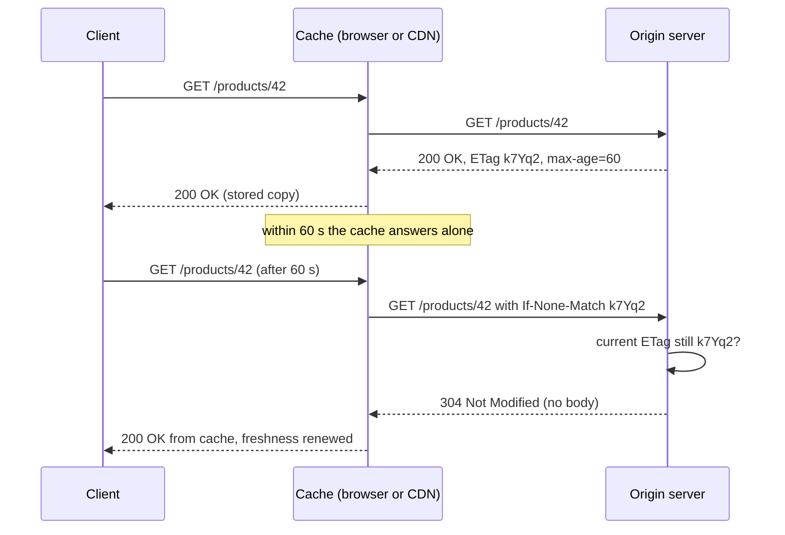

# HTTP Fundamentals

> **Module 02 · Core Backend** · Prerequisites: [TCP](../Module-06-Networking-and-Distributed-Basics/08-TCP.md) · Next: [REST APIs](02-REST-APIs.md)

---

## ⏱ If You Only Have 2 Minutes

- HTTP is **stateless**: each request carries everything the server needs. Login state lives in cookies, tokens, or a server-side store, not in the protocol.
- A request is a **request line** (`GET /products/42 HTTP/1.1`), **headers**, an empty line, and an optional **body**. A response is a **status line**, headers, and an optional body. HTTP/2 and HTTP/3 keep the same meaning but send it as binary frames.
- **Safe** methods (GET, HEAD, OPTIONS, TRACE) are not meant to change state. **Idempotent** methods are the safe ones plus PUT and DELETE. POST and PATCH are neither by default ([RFC 9110 §9.2](https://www.rfc-editor.org/rfc/rfc9110#section-9.2)).
- `Cache-Control: no-cache` means "you may store it, but check with me before reusing it". `no-store` means "do not store it at all".
- An `ETag` plus `If-None-Match` lets the server answer **304 Not Modified** with no body. `If-Match` plus a stale ETag gives **412 Precondition Failed**, which stops lost updates.
- HTTP/1.1 connections are **persistent by default**. Set the app's keep-alive timeout *longer* than the load balancer's idle timeout, or you get random 502s.
- HTTP/2 **multiplexes** many requests over one TCP connection. HTTP/3 runs over **QUIC** (UDP), so one lost packet stalls only its own stream, not every stream.

---

## 1. What It Is and Why It Exists

**HTTP** (Hypertext Transfer Protocol) is a text-based request/response protocol. A client sends a *method* and a *target* ("GET /products/42"). The server replies with a *status code*, some *headers* (metadata), and usually a *representation* of the resource (the bytes of a JSON document, an image, an HTML page). The meaning of HTTP — methods, status codes, headers, caching — is defined in [RFC 9110](https://www.rfc-editor.org/rfc/rfc9110). How those messages are written on the wire is defined separately for each version: HTTP/1.1 ([RFC 9112](https://www.rfc-editor.org/rfc/rfc9112)), HTTP/2 ([RFC 9113](https://www.rfc-editor.org/rfc/rfc9113)) and HTTP/3 ([RFC 9114](https://www.rfc-editor.org/rfc/rfc9114)).

**Analogy:** a restaurant order slip. It says what you want (method + target), adds notes like "no onions" or "I already have the bread" (headers), and sometimes carries an attachment (body). The kitchen answers "here it is" (200), "your bread is still fresh, no new basket" (304), or "we're out of that" (404). The waiter does not remember you between slips, so every slip must be complete. That is statelessness.

**The problem it solves.** HTTP gives every client and server a shared vocabulary. A browser, `curl`, a CDN and a load balancer all know what `GET`, `Cache-Control: max-age=60` and `304` mean without knowing your application. So caches can answer for you, proxies can retry a failed GET safely, and clients can ask for only what changed. Misuse it and things break in predictable ways: a GET that deletes data is triggered by a link prefetcher, or a CDN serves one user's account page to another.

---

## 2. How It Works

### The message on the wire (HTTP/1.1)

A request:

```http
GET /products/42 HTTP/1.1
Host: api.example.com
Accept: application/json
Accept-Encoding: gzip, br
If-None-Match: "k7Yq2"
User-Agent: curl/8.5.0

```

A response:

```http
HTTP/1.1 200 OK
Content-Type: application/json
Content-Length: 48
ETag: "k7Yq2"
Cache-Control: no-cache
Vary: Accept-Encoding

{"id":"42","name":"Desk lamp","priceCents":3900}
```

The rules that matter:

1. **Start line.** `method target version` for requests; `version status reason` for responses. The reason phrase ("OK") is decoration — clients use the number.
2. **Headers.** `Name: value`, one per line, names case-insensitive, lines ending in CRLF. A bare CRLF ends the header section.
3. **Body framing.** The receiver must know where the body ends: `Content-Length: 48` gives the byte count, or `Transfer-Encoding: chunked` streams length-prefixed chunks when the size is unknown. A message with both is suspicious (see request smuggling below).
4. **`Host` is mandatory in HTTP/1.1** — it lets one IP serve many sites. A missing `Host` gets a 400.

HTTP/2 and HTTP/3 carry the same fields in compressed binary frames; the request line becomes pseudo-headers (`:method`, `:path`, `:scheme`, `:authority`). Your handler sees the same method, path, headers and body in all three. Before any of this, the client opens a TCP connection plus TLS (where **ALPN** picks `h2` or `http/1.1`), or reuses an idle pooled one.

### Conditional GET through a cache



The 304 saves the body bytes and the server's serialization work. It does **not** save the round trip. Only freshness (`max-age`) saves the round trip.

---

## 3. Key Concepts

### Method properties

From [RFC 9110 §9](https://www.rfc-editor.org/rfc/rfc9110#section-9) (PATCH from [RFC 5789](https://www.rfc-editor.org/rfc/rfc5789)):

| Method | Purpose | Safe | Idempotent | Cacheable |
|---|---|---|---|---|
| GET | Read a representation | Yes | Yes | Yes |
| HEAD | Same as GET, headers only | Yes | Yes | Yes |
| OPTIONS | Ask what the target supports (CORS preflight) | Yes | Yes | No |
| POST | Process the enclosed data (create, run an action) | No | No | Only with explicit freshness; almost no cache does it |
| PUT | Replace the target's state with the enclosed one | No | Yes | No |
| PATCH | Apply a partial change | No | No (can be designed to be) | No |
| DELETE | Remove the target | No | Yes | No |

- **Safe** means the client is not *requesting* a state change. The server may still log, count, or rate-limit. What matters: a crawler or prefetcher can call it without harm.
- **Idempotent** means sending the same request N times has the same *intended effect on the server* as sending it once. The *response* may differ (a second DELETE may return 404). Idempotency is why a client or proxy may retry PUT and DELETE automatically after a dropped connection, but not POST.

### Headers you will use

| Header | Direction | What it does |
|---|---|---|
| `Content-Type` | Both | Media type of the body, e.g. `application/json` |
| `Accept`, `Accept-Encoding` | Request | What the client can handle (content negotiation) |
| `Authorization` | Request | Credentials, e.g. `Bearer <token>` |
| `Cache-Control` | Both | Caching rules |
| `ETag`, `Last-Modified` | Response | Validators for conditional requests |
| `If-None-Match` / `If-Match` | Request | "Send only if changed" / "write only if unchanged" |
| `Vary` | Response | Request headers that change the response (part of the cache key) |
| `Location` | Response | URL of a created resource or redirect target |

Header values are untrusted input. `X-Forwarded-For`, for example, can be set by anyone unless your own proxy overwrites it.

### Content negotiation

The client says what it prefers; the server picks and labels the result.

- `Accept: application/json, text/csv;q=0.5` — prefer JSON; CSV at lower weight (`q` from 0 to 1).
- `Accept-Encoding: gzip, br` — the server may compress and labels it `Content-Encoding: br`.
- Add `Vary: Accept, Accept-Encoding` (whichever you used), or a shared cache may hand a Brotli body to a gzip-only client.
- If nothing matches, return **406 Not Acceptable** or just send your default. For a request *body* the server cannot read, the code is **415 Unsupported Media Type**.

### Caching ([RFC 9111](https://www.rfc-editor.org/rfc/rfc9111))

A cache decides two things: *is my stored copy fresh?* and, if not, *can I revalidate it cheaply?*

| `Cache-Control` directive | Meaning |
|---|---|
| `max-age=60` | Fresh for 60 s; reuse without asking |
| `s-maxage=300` | Like `max-age`, but only for shared caches (CDN, proxy) |
| `no-cache` | May store, but **must revalidate** before every reuse |
| `no-store` | Must not store at all (bank statements, tokens) |
| `private` | Only the end user's browser may store it, not a CDN |
| `public` | Shared caches may store it, even if the request had `Authorization` |
| `must-revalidate` | Once stale, never serve it without revalidating |
| `immutable` ([RFC 8246](https://www.rfc-editor.org/rfc/rfc8246)) | Will never change; don't revalidate (fingerprinted assets) |
| `stale-while-revalidate=30` ([RFC 5861](https://www.rfc-editor.org/rfc/rfc5861)) | Serve stale for up to 30 s while refreshing in the background |

**Validators** let a stale copy be revalidated:

- **`ETag`** — an opaque version tag. Strong: `"k7Yq2"` (byte-for-byte identical). Weak: `W/"k7Yq2"` (semantically equivalent, e.g. same data, different compression). `If-None-Match` uses *weak* comparison, so `W/"x"` matches `"x"`. `If-Match` uses *strong* comparison.
- **`Last-Modified`** — a timestamp with one-second resolution. Paired with `If-Modified-Since`. Less precise than an ETag; if both are sent, the server evaluates `If-None-Match` and ignores `If-Modified-Since`.

A 304 repeats the caching headers a 200 would carry (`ETag`, `Cache-Control`, `Vary`) so the cache can refresh its copy. Without explicit freshness, caches may *guess* one from `Last-Modified` (heuristic freshness), so always set `Cache-Control` on API responses.

### Connections and keep-alive

- **HTTP/1.0** closed the connection after each response unless both sides sent `Connection: keep-alive`. **HTTP/1.1** keeps it open by default until `Connection: close` or an idle timeout.
- On one HTTP/1.1 connection only one request is in flight at a time (pipelining is effectively unused). A slow response blocks everything behind it — HTTP-level **head-of-line blocking**. Browsers open about six connections per origin to compensate.
- A new HTTPS connection costs TCP + TLS handshakes before the first byte, so reuse matters for your *outbound* calls too. Since Node 19 the default `http.globalAgent` keeps connections alive; in Python, `httpx.AsyncClient` and `requests.Session` pool only if you reuse the client object.
- **HTTP/2 and HTTP/3** remove HTTP-level head-of-line blocking by multiplexing streams (see the comparison table). In most backends the CDN or load balancer speaks them to the internet and HTTP/1.1 to your app servers, so your app mainly cares about keep-alive tuning.

---

## 4. Code Examples

Scenario: a product endpoint that sends an `ETag`, honours `If-None-Match`, and answers `304 Not Modified` when the client's copy is current. The Node version uses bare `node:http` so every header is visible.

### Node.js / TypeScript

```ts
// No npm packages — node:http only. Node.js 22+, TypeScript 5, ESM
import { createServer, type ServerResponse } from "node:http";
import { createHash } from "node:crypto";

interface Product { id: string; name: string; priceCents: number; version: number }
const products = new Map<string, Product>([
  ["42", { id: "42", name: "Desk lamp", priceCents: 3900, version: 7 }],
]);

// Derive the ETag from a version the database already tracks, so a 304 needs no
// serialization. Hashing the body also works but costs CPU on every request.
const etagOf = (p: Product): string =>
  `"${createHash("sha256").update(`${p.id}:${p.version}`).digest("base64url").slice(0, 16)}"`;

// If-None-Match uses weak comparison (W/"x" equals "x"), may list several tags, or be "*".
function matchesAny(header: string | undefined, etag: string): boolean {
  if (!header) return false;
  if (header.trim() === "*") return true;
  const opaque = (tag: string) => tag.trim().replace(/^W\//, "");
  return header.split(",").some((tag) => opaque(tag) === opaque(etag));
}

function sendJson(res: ServerResponse, status: number, body: unknown, headers: Record<string, string> = {}) {
  const json = JSON.stringify(body);
  res.writeHead(status, { ...headers, "Content-Type": "application/json", "Content-Length": Buffer.byteLength(json) });
  res.end(json);
}

const server = createServer((req, res) => {
  const match = /^\/products\/([^/]+)$/.exec(new URL(req.url ?? "/", "http://x").pathname);
  if (!match) { sendJson(res, 404, { error: "not_found" }); return; }
  if (req.method !== "GET") { sendJson(res, 405, { error: "method_not_allowed" }, { Allow: "GET" }); return; }

  const product = products.get(match[1]);
  if (!product) { sendJson(res, 404, { error: "not_found" }); return; }

  const etag = etagOf(product);
  // no-cache: caches may keep a copy but must revalidate it every time — cheap with a 304.
  const cacheHeaders = { ETag: etag, "Cache-Control": "private, no-cache" };

  if (matchesAny(req.headers["if-none-match"], etag)) {
    res.writeHead(304, cacheHeaders); // a 304 carries the validators again, never a body
    res.end();
    return;
  }
  const { version: _internal, ...publicFields } = product;
  sendJson(res, 200, publicFields, cacheHeaders);
});

// Behind a load balancer with a 60 s idle timeout, the app must keep idle connections
// open longer than that. Otherwise Node (default 5 s) closes a socket the LB is about
// to reuse, and the client sees a 502.
server.keepAliveTimeout = 65_000;
server.headersTimeout = 66_000; // must exceed keepAliveTimeout
server.listen(3000);
```

In Express, `res.json()` already adds a weak body-hash ETag and answers 304 when the request is fresh. Write it by hand, as above, when the ETag must come from a database version or you need `If-Match` on writes.

### Python

```python
# pip install fastapi uvicorn   — Python 3.12+
import hashlib
from dataclasses import dataclass

from fastapi import FastAPI, Request, Response
from fastapi.responses import JSONResponse


@dataclass
class Product:
    id: str
    name: str
    price_cents: int
    version: int  # bumped by every UPDATE; never sent to clients


PRODUCTS = {"42": Product(id="42", name="Desk lamp", price_cents=3900, version=7)}
app = FastAPI()


def etag_of(p: Product) -> str:
    return '"' + hashlib.sha256(f"{p.id}:{p.version}".encode()).hexdigest()[:16] + '"'


def matches_any(header: str | None, etag: str) -> bool:
    if not header:
        return False
    if header.strip() == "*":
        return True
    opaque = lambda tag: tag.strip().removeprefix("W/")  # weak comparison
    return any(opaque(tag) == opaque(etag) for tag in header.split(","))


@app.get("/products/{product_id}")
async def get_product(product_id: str, request: Request) -> Response:
    product = PRODUCTS.get(product_id)
    if product is None:
        return JSONResponse({"error": "not_found"}, status_code=404)

    etag = etag_of(product)
    cache_headers = {"ETag": etag, "Cache-Control": "private, no-cache"}

    # Check the validator before building the body: a 304 skips serialization entirely.
    if matches_any(request.headers.get("if-none-match"), etag):
        return Response(status_code=304, headers=cache_headers)

    body = {"id": product.id, "name": product.name, "priceCents": product.price_cents}
    return JSONResponse(body, headers=cache_headers)

# Run: uvicorn app:app --timeout-keep-alive 65
# Uvicorn's keep-alive default is 5 s — the same load-balancer mismatch as Node.
```

**Runtime difference to notice:** both handlers run on an event loop. Hashing a short version string costs microseconds, but hashing a multi-megabyte body would block Node's single thread and, inside an `async def` handler, the asyncio loop just the same — one more reason to derive ETags from a version column. FastAPI adds no ETags to JSON responses (Starlette's `FileResponse` does, for files), so code like this is the normal approach.

---

## 5. Production Concerns

- **Keep-alive timeout mismatch.** If the app closes an idle connection before the load balancer does, the LB may send a request on a socket that is closing, and the user gets a 502. AWS recommends an app idle timeout longer than the ALB's (60 s by default). Node and Uvicorn both default to 5 s.
- **Personal data in shared caches.** A CDN may cache anything marked `public` or given `s-maxage`. Mark per-user responses `private` or `no-store`. RFC 9111 stops shared caches from storing responses to requests with `Authorization` unless the response allows it — cookies get no such protection.
- **`Vary` and hit ratio.** List every request header the response depends on. But `Vary: Cookie` or `Vary: User-Agent` on CDN content splits the cache into near-unique keys and the hit ratio collapses.
- **ETags must match across replicas.** An ETag built from local state (file inode, process start time) differs per replica, so revalidations miss. Some proxies (nginx is one) also turn a strong ETag weak when they compress, which then fails `If-Match`.
- **Request smuggling.** If a proxy and the app disagree on where a body ends (`Content-Length` vs `Transfer-Encoding: chunked`), an attacker can hide a second request inside the first. Keep servers patched and reject messages that carry both.
- **Header limits.** Servers cap total header size and answer **431 Request Header Fields Too Large**. Oversized cookies and JWTs are the usual cause.
- **What to measure.** Status by route *template* (`/products/:id`), bytes, duration, protocol version, and the 304 / cache-hit ratio. A falling 304 ratio after a deploy usually means the ETag became unstable.

---

## 6. Common Mistakes

- **GET with side effects** (`GET /orders/42/cancel`) — link prefetchers, crawlers and proxy retries trigger it — use POST (or DELETE/PATCH) for anything that changes state.
- **Reading `no-cache` as "don't cache"** — sensitive data gets stored on disk by browsers and proxies — use `no-store` for data that must never be stored; use `no-cache` when you want revalidation.
- **Caching per-user data as `public`** — the CDN serves Alice's profile to Bob — use `private` or `no-store` for anything that depends on who is asking.
- **Unstable or per-replica ETags** — every `If-None-Match` misses and you pay full price — derive the ETag from a version column or content hash.
- **Automatic retries of POST on a dropped connection** — the server may have processed the first one, so you create duplicates — retry only idempotent methods, or make POST safe to retry with an [idempotency key](04-API-Design-Principles.md).
- **Creating a new HTTP client per outbound request** — every call pays TCP + TLS handshakes and can exhaust ephemeral ports — create one pooled client at startup and reuse it.
- **Ignoring the body framing** — streaming a response without `Content-Length` or chunked encoding, or sending a body with 204/304 — clients hang or misparse the next response on the connection — let the framework frame the body, and never write a body for 204 or 304.

---

## 7. Comparison Table

| | HTTP/1.1 | HTTP/2 | HTTP/3 |
|---|---|---|---|
| Spec | RFC 9112 | RFC 9113 | RFC 9114 |
| Transport | TCP (+TLS optional) | TCP + TLS in practice | QUIC over UDP (TLS 1.3 built in) |
| Wire format | Text | Binary frames | Binary frames |
| Concurrency per connection | One request at a time | Many multiplexed streams | Many independent streams |
| Head-of-line blocking | At HTTP level | At TCP level only | Per stream only |
| Header compression | None | HPACK | QPACK |
| Connection setup | TCP + TLS handshakes | TCP + TLS handshakes | Combined, fewer round trips; 0-RTT resumption possible |
| Typical place in a backend | LB → app servers, internal calls | Browser → CDN/LB; gRPC | Browser/mobile → CDN/LB |

Semantics (methods, status codes, headers, caching) are identical across all three. Changing the version never changes what your API means.

---

## 8. Interview Questions

**[Junior] What is the difference between safe and idempotent?**
A safe method does not request any state change on the server: GET, HEAD, OPTIONS, TRACE. An idempotent method may change state, but doing it twice has the same effect as doing it once: all safe methods plus PUT and DELETE. So DELETE is idempotent but not safe. POST is neither, which is why clients and proxies do not retry it automatically.

**[Junior] What happens when a client sends `If-None-Match`?**
The client sends back the ETag it has cached. The server computes the current ETag; if they match (weak comparison), it returns 304 Not Modified with no body and the client reuses its copy. If not, it returns 200 with the new body and new ETag. It saves bandwidth and server serialization work, but still costs one round trip.

**[Mid] Explain `no-cache`, `no-store`, `private` and `max-age`.**
`max-age=N` makes a stored response fresh for N seconds, so it is reused without contacting the server. `no-cache` lets caches store the response but forces revalidation before each use. `no-store` forbids storing it anywhere. `private` restricts storage to the user's own browser, so CDNs and shared proxies must not keep it. A typical per-user API response is `private, no-cache` with an ETag.

**[Mid] Why do we see random 502s behind a load balancer after a deploy, and how do you fix it?**
A common cause is the keep-alive race: the app closes an idle connection after its own timeout (5 s by default in Node and Uvicorn) while the load balancer, which keeps connections for 60 s, sends a new request on that socket and gets a reset. Set the app's keep-alive timeout above the LB's idle timeout (in Node, `headersTimeout` above that too).

**[Mid] What does HTTP/2 fix compared to HTTP/1.1, and what does it not fix?**
HTTP/2 multiplexes many streams over one connection, so a slow response no longer blocks others at the HTTP layer, and it compresses repetitive headers. It does not fix TCP-level head-of-line blocking: a single lost packet stalls every stream until it is retransmitted. On lossy mobile networks that can make HTTP/2 slower than several HTTP/1.1 connections. HTTP/3 over QUIC fixes this by doing loss recovery per stream.

**[Senior] How would you use HTTP to prevent lost updates when two users edit the same record?**
Use optimistic concurrency with ETags. The client reads the resource and gets `ETag: "v7"`. When it saves, it sends `PUT` (or `PATCH`) with `If-Match: "v7"`. The server compares against the current version inside the same transaction as the update — for example `UPDATE ... WHERE id = $1 AND version = 7`. If no row matched, someone else saved first, and the server returns 412 Precondition Failed; the client reloads and merges. You can require the header and return 428 Precondition Required when it is missing.

**[Senior] Design caching headers for a product catalog API used by browsers and a CDN.**
Public product data: `public, max-age=60, s-maxage=300, stale-while-revalidate=30` plus a version-based ETag, so the CDN absorbs most traffic and revalidation is cheap. Per-user data (cart, personal prices): `private, no-cache` with an ETag, never cached at the CDN. Add `Vary: Accept-Encoding`. State the staleness bound (`s-maxage`) as a product decision, and purge the CDN on writes where minutes of staleness are not acceptable.
---

## 9. Cheat Sheet

```text
Message       start line → headers → CRLF → body (Content-Length or chunked)
Safe          GET HEAD OPTIONS TRACE
Idempotent    safe + PUT DELETE        (POST, PATCH: no)
Cacheable     GET HEAD (POST only with explicit freshness, rarely used)
Freshness     Cache-Control: max-age / s-maxage → no round trip
Revalidate    ETag + If-None-Match → 304 (no body);  Last-Modified + If-Modified-Since
Write guard   If-Match: "v7" → 412 if changed;  428 to require it
no-cache      store, revalidate every time      no-store = never store
private       browser only, not CDN             public = shared caches allowed
Vary          list request headers that change the response (Accept-Encoding, Accept)
Negotiation   Accept / Accept-Encoding → Content-Type / Content-Encoding; 406, 415
Keep-alive    default in HTTP/1.1; app idle timeout > LB idle timeout (Node/Uvicorn default 5 s)
HTTP/2        multiplexed streams on 1 TCP conn, HPACK; still TCP HOL blocking
HTTP/3        QUIC over UDP, per-stream loss recovery, TLS 1.3 built in, QPACK
```

---

## Related Topics

- [REST APIs](02-REST-APIs.md) — how resources and method semantics turn into an API design
- [HTTP Status Codes](03-HTTP-Status-Codes.md) — 304, 412, 415 and the rest in depth
- [Node HTTP Server Concepts](05-Node-HTTP-Server-Concepts.md) — timeouts, streaming and keep-alive inside a Node server
- [HTTP over TCP](../Module-06-Networking-and-Distributed-Basics/11-HTTP-over-TCP.md) — the transport underneath and its handshakes
- [CDN](../Module-07-Advanced-Backend-and-System-Design/17-CDN.md) — where `s-maxage`, `Vary` and invalidation matter most
- [Caching Fundamentals](../Module-07-Advanced-Backend-and-System-Design/14-Caching-Fundamentals.md) — application-level caching beyond HTTP headers
