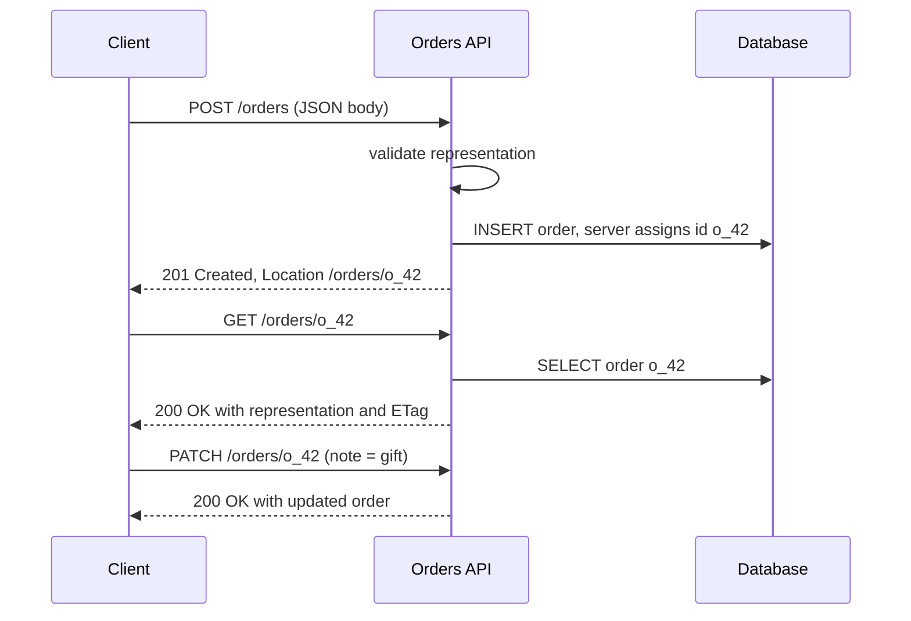
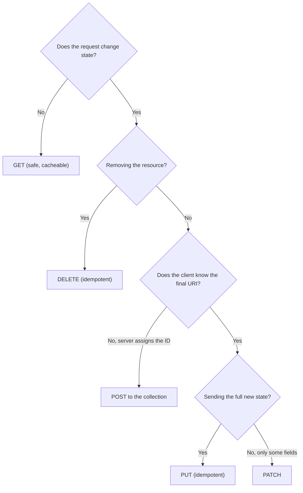

# REST APIs

> **Module 02 · Core Backend** · Prerequisites: [HTTP Fundamentals](01-HTTP-Fundamentals.md) · Next: [HTTP Status Codes](03-HTTP-Status-Codes.md)

---

## ⏱ If You Only Have 2 Minutes

- REST is an **architectural style** (Roy Fielding, 2000), not a protocol or framework. Its constraints: client–server, stateless, cacheable, uniform interface, layered system, and optional code-on-demand.
- Name **resources with nouns** (`/orders/42`) and let the **HTTP method** be the verb. `/getOrder?id=42` and `POST /orders/42/delete` are RPC wearing REST's clothes.
- **POST** to a collection creates (`201 Created` + `Location`). **PUT** replaces the whole resource and is idempotent. **PATCH** changes part of it and is not idempotent by default. **DELETE** is idempotent.
- **Stateless** means each request carries its own auth and context, so any server instance can handle it. It does not mean the *application* has no state — the state lives in the database.
- Pick one PATCH format and declare it: **JSON Merge Patch** ([RFC 7396](https://www.rfc-editor.org/rfc/rfc7396)) — `null` deletes a field — or **JSON Patch** ([RFC 6902](https://www.rfc-editor.org/rfc/rfc6902)) — a list of operations.
- Filtering, sorting and pagination go in the **query string** of the collection: `GET /orders?status=paid&sort=-created_at&limit=50`.
- **HATEOAS** (links in responses that drive the client) is part of Fielding's definition, but most "REST" APIs in industry skip it. Say so honestly in an interview.

---

## 1. What It Is and Why It Exists

**REST** (Representational State Transfer) is a set of constraints for designing networked systems, described by Roy Fielding in his 2000 dissertation. A REST API exposes **resources** — things like an order, a customer, or "the list of a customer's orders" — each with a URI. Clients never touch the resource directly. They exchange **representations** of it (usually JSON) using the standard HTTP methods.

**Analogy:** a library catalogue. Every book has a fixed shelf number (URI). You don't ask the librarian to "run the fetchBook procedure". You go to the shelf and use the same few actions on every book: look at it, put a new one on a shelf, replace it, remove it. Because the actions are the same everywhere, any visitor already knows how to use any shelf.

**The problem it solves.** Before REST became common, many web APIs were RPC endpoints like `POST /api` with `{"method": "getOrder"}`. Every API had its own verbs, nothing could be cached, and proxies could not tell a read from a write. REST pushes the API onto HTTP's existing semantics:

- A `GET` is safe, so CDNs can cache it and clients can retry it.
- A `PUT` or `DELETE` is idempotent, so a client can retry after a timeout.
- Status codes and headers mean the same thing for every resource.
- Stateless servers scale horizontally behind a load balancer.

The cost: some business operations do not map cleanly onto "create, read, replace, update, delete" on nouns. Section 3 covers how to model them.

---

## 2. How It Works

### Resources, URIs and representations

```text
/customers                        collection
/customers/c_17                   one customer
/customers/c_17/orders            sub-collection: orders belonging to c_17
/orders/o_42                      canonical URI of one order
/orders/o_42/items                order lines
```

- A **URI identifies** the resource. It should not change when the representation changes, and it should not contain verbs or file extensions.
- A **representation** is one serialization of the resource's state: JSON, CSV, a PDF invoice. The client picks with `Accept`; the server labels with `Content-Type`.
- IDs are opaque strings to the client. Prefer non-sequential IDs (UUIDs, prefixed random IDs) so callers cannot enumerate `1, 2, 3...`.

### Methods on a collection and an item

| Request | Meaning | Success response |
|---|---|---|
| `GET /orders` | List (filtered, paginated) | `200` with a page of items |
| `POST /orders` | Create; server assigns the ID | `201` + `Location: /orders/o_42` + body |
| `GET /orders/o_42` | Read one | `200`, or `404` |
| `PUT /orders/o_42` | Replace the whole resource | `200` with body, or `204` |
| `PATCH /orders/o_42` | Change some fields | `200` with the updated resource |
| `DELETE /orders/o_42` | Remove | `204` |

### A create-then-read flow



Every request in that flow is complete on its own: it carries its credentials and the full target. Any API instance can serve any step.

### Choosing the method



---

## 3. Key Concepts

### Fielding's constraints, in practice

| Constraint | What it means for your API |
|---|---|
| Client–server | UI and storage evolve separately; the API is the contract |
| Stateless | No server-side conversation state between requests; auth on every call |
| Cacheable | Responses say if they can be cached (`Cache-Control`, `ETag`) |
| Uniform interface | Same methods, status codes and media types for every resource |
| Layered system | Clients cannot tell if they talk to a CDN, gateway or the origin |
| Code on demand (optional) | Server may send executable code (e.g. JavaScript); rare in APIs |

The **uniform interface** has four parts: resources are identified by URIs; they are changed through representations; messages are self-descriptive (media type, method and headers say how to process them); and hypermedia drives application state (HATEOAS).

The **Richardson Maturity Model** is a common interview shorthand: level 0 is one endpoint for everything (`POST /api`), level 1 adds resources, level 2 adds proper HTTP methods and status codes, level 3 adds hypermedia. Most production APIs that call themselves RESTful are level 2.

### PUT vs PATCH vs POST

- **PUT** sends the *complete* new state. Fields you leave out are reset to their defaults or removed — that is what "replace" means. Repeating the same PUT gives the same result, so it is idempotent. PUT may also create a resource when the client chooses the URI (`PUT /users/u_1/avatar`); answer `201` the first time and `200`/`204` after.
- **PATCH** sends a *change description*. Its format is set by `Content-Type`:
  - `application/merge-patch+json` (RFC 7396): `{"note": "gift", "coupon": null}` sets `note` and removes `coupon`. Absent fields are left alone. Simple, but you cannot set a field to literal `null` or edit one array element.
  - `application/json-patch+json` (RFC 6902): `[{"op": "replace", "path": "/note", "value": "gift"}]`. Supports `add`, `remove`, `replace`, `move`, `copy`, `test`. Precise, but harder for clients.
  - A merge patch that only sets fields is idempotent in effect; an "increment" style patch is not. Clients should not assume PATCH is safe to retry.
- **POST** means "process this according to the resource's own rules". Use it to create in a collection, and for actions that do not fit the other methods. It is neither safe nor idempotent; make it retry-safe with an [idempotency key](04-API-Design-Principles.md).

### Collections, sub-resources and actions

- Nest only when the child cannot exist without the parent and you always know the parent: `/orders/o_42/items`. Keep nesting to one or two levels. Otherwise give the child its own top-level URI and filter: `/payments?order_id=o_42`.
- Plural nouns for collections (`/orders`), consistent casing in paths (`/order-items` or `/order_items`, pick one).
- **Actions** that are not plain field updates (cancel, refund, approve) have three common shapes:
  1. Change a state field: `PATCH /orders/o_42 {"status": "cancelled"}` — fine when it is a simple transition.
  2. Create a sub-resource: `POST /orders/o_42/refunds` — best when the action has its own data and history.
  3. A controller endpoint: `POST /orders/o_42/cancel` — pragmatic, common, and honest that it is an action.

### Query conventions for collections

| Need | Common convention |
|---|---|
| Filter | `?status=paid&customer_id=c_17`, ranges as `?created_after=2026-01-01` |
| Sort | `?sort=-created_at,id` (minus = descending); always add a unique tie-breaker |
| Paginate | `?limit=50&cursor=eyJpZCI6...` (cursor) or `?limit=50&offset=100` |
| Sparse fields | `?fields=id,status,total` |
| Expand related | `?expand=customer` |

Allow-list filterable and sortable fields. Passing a client's `sort` value straight into SQL is an injection hole and lets callers sort on unindexed columns. The pagination contract itself is covered in [API Design Principles](04-API-Design-Principles.md).

### HATEOAS, honestly

In full REST, a response includes links to the next valid actions, and the client follows links instead of building URLs:

```json
{
  "id": "o_42",
  "status": "pending_payment",
  "_links": {
    "self": { "href": "/orders/o_42" },
    "pay": { "href": "/orders/o_42/payments", "method": "POST" },
    "cancel": { "href": "/orders/o_42/cancel", "method": "POST" }
  }
}
```

The idea is good: the server controls which transitions are available, and URLs can change without breaking clients. In practice, most public APIs (and most client SDKs) hard-code URL templates from documentation or an OpenAPI file. Partial use is common and useful: a `Location` header after create, `next` links for pagination, and the URL of a status monitor after a `202 Accepted`.

---

## 4. Code Examples

Scenario: a `tasks` resource with full method semantics — list with a filter, create (`201` + `Location`), read, replace (PUT), merge-patch (PATCH), and delete.

### Node.js / TypeScript

```ts
// npm i express zod   — Node.js 22+, TypeScript 5, ESM
import express from "express";
import { randomUUID } from "node:crypto";
import { z } from "zod";

// The full representation. PUT and POST must produce a valid one of these.
const TaskBody = z.object({
  title: z.string().min(1).max(200),
  done: z.boolean(),
  due: z.string().date().nullable(),   // "2026-12-01" or null
});
const TaskPatch = TaskBody.partial(); // merge patch: absent keys stay absent after parsing
type Task = z.infer<typeof TaskBody> & { id: string };
const DEFAULTS = { done: false, due: null };

const tasks = new Map<string, Task>();
const app = express();
app.use(express.json({ type: ["application/json", "application/merge-patch+json"] }));

app.get("/tasks", (req, res) => {
  const status = req.query.status;                       // filter on the collection
  const limit = Math.min(Number(req.query.limit) || 20, 100);
  let items = [...tasks.values()];
  if (status === "open" || status === "done") items = items.filter((t) => t.done === (status === "done"));
  res.json({ data: items.slice(0, limit) });
});

app.post("/tasks", (req, res) => {
  const parsed = TaskBody.safeParse({ ...DEFAULTS, ...req.body });
  if (!parsed.success) { res.status(422).json({ error: "invalid_task", issues: parsed.error.issues }); return; }
  const task: Task = { id: randomUUID(), ...parsed.data };   // the server owns the ID
  tasks.set(task.id, task);
  res.status(201).location(`/tasks/${task.id}`).json(task);
});

app.get("/tasks/:id", (req, res) => {
  const task = tasks.get(req.params.id);
  if (!task) { res.status(404).json({ error: "not_found" }); return; }
  res.json(task);
});

app.put("/tasks/:id", (req, res) => {
  if (!tasks.has(req.params.id)) { res.status(404).json({ error: "not_found" }); return; }
  // Replace means replace: an omitted `due` is reset to null, not kept.
  const parsed = TaskBody.safeParse({ ...DEFAULTS, ...req.body });
  if (!parsed.success) { res.status(422).json({ error: "invalid_task", issues: parsed.error.issues }); return; }
  const task: Task = { id: req.params.id, ...parsed.data };
  tasks.set(task.id, task);
  res.json(task);
});

app.patch("/tasks/:id", (req, res) => {
  const task = tasks.get(req.params.id);
  if (!task) { res.status(404).json({ error: "not_found" }); return; }
  // `title: null` fails validation (title is not nullable); `due: null` clears the date.
  const parsed = TaskPatch.safeParse(req.body);
  if (!parsed.success) { res.status(422).json({ error: "invalid_patch", issues: parsed.error.issues }); return; }
  const updated: Task = { ...task, ...parsed.data };
  tasks.set(updated.id, updated);
  res.json(updated);
});

app.delete("/tasks/:id", (req, res) => {
  // Idempotent: a second DELETE leaves the same server state. 204 both times keeps retries quiet.
  tasks.delete(req.params.id);
  res.status(204).end();
});

app.listen(3000);
```

### Python

```python
# pip install fastapi uvicorn   — Python 3.12+
from datetime import date
from typing import Annotated, Literal
from uuid import uuid4

from fastapi import FastAPI, HTTPException, Query, Response
from pydantic import BaseModel, Field, model_validator


class TaskIn(BaseModel):          # full representation for POST and PUT
    title: str = Field(min_length=1, max_length=200)
    done: bool = False
    due: date | None = None


class Task(TaskIn):
    id: str


class TaskPatch(BaseModel):       # merge patch: every field optional
    title: str | None = Field(default=None, min_length=1, max_length=200)
    done: bool | None = None
    due: date | None = None

    @model_validator(mode="after")
    def only_due_can_be_cleared(self) -> "TaskPatch":
        # model_fields_set tells "sent as null" apart from "not sent at all".
        for name in ("title", "done"):
            if name in self.model_fields_set and getattr(self, name) is None:
                raise ValueError(f"{name} cannot be null")
        return self


TASKS: dict[str, Task] = {}
app = FastAPI()


def get_or_404(task_id: str) -> Task:
    if (task := TASKS.get(task_id)) is None:
        raise HTTPException(404, "not_found")
    return task


@app.get("/tasks")
async def list_tasks(
    state: Annotated[Literal["open", "done"] | None, Query(alias="status")] = None,
    limit: Annotated[int, Query(ge=1, le=100)] = 20,
) -> dict[str, list[Task]]:
    items = [t for t in TASKS.values() if state is None or t.done == (state == "done")]
    return {"data": items[:limit]}


@app.post("/tasks", status_code=201)
async def create_task(body: TaskIn, response: Response) -> Task:
    task = Task(id=str(uuid4()), **body.model_dump())
    TASKS[task.id] = task
    response.headers["Location"] = f"/tasks/{task.id}"
    return task


@app.get("/tasks/{task_id}")
async def read_task(task_id: str) -> Task:
    return get_or_404(task_id)


@app.put("/tasks/{task_id}")
async def replace_task(task_id: str, body: TaskIn) -> Task:
    get_or_404(task_id)
    TASKS[task_id] = Task(id=task_id, **body.model_dump())  # omitted fields get defaults
    return TASKS[task_id]


@app.patch("/tasks/{task_id}")
async def patch_task(task_id: str, patch: TaskPatch) -> Task:
    task = get_or_404(task_id)
    changes = patch.model_dump(exclude_unset=True)          # only the keys the client sent
    TASKS[task_id] = task.model_copy(update=changes)
    return TASKS[task_id]


@app.delete("/tasks/{task_id}", status_code=204)
async def delete_task(task_id: str) -> Response:
    TASKS.pop(task_id, None)
    return Response(status_code=204)
```

FastAPI parses `application/merge-patch+json` bodies as JSON because it accepts any `+json` media type; in Express you must list it in `express.json({ type })`, as above. FastAPI returns `422` for invalid bodies by default, which is why the Node version uses `422` too.

**Runtime difference to notice:** these handlers are `async def` on purpose. FastAPI runs plain `def` handlers in a thread pool, so two PATCH requests could interleave their read-modify-write on the shared dict. An `async def` handler with no `await` runs to completion on the event loop, like every Express handler in Node's single thread. With a real database, neither helps — use a transaction or an `If-Match` version check.

---

## 5. Production Concerns

- **Lost updates on PUT and PATCH.** Two clients read version 7 and both write; the second silently overwrites the first. Return an `ETag` on GET and require `If-Match` on writes; answer `412` when it no longer matches (see [HTTP Fundamentals](01-HTTP-Fundamentals.md)).
- **Mass assignment.** Spreading the request body into a database row lets a client set `role`, `owner_id` or `price`. Validate against an explicit schema per operation — note `id` is never taken from the body in the examples above.
- **Authorization per resource.** `/customers/c_17/orders` must check that the caller may see `c_17`. Nested URLs make it easy to forget the parent check. Return `404` rather than `403` when you do not want to reveal that the resource exists ([HTTP Status Codes](03-HTTP-Status-Codes.md)).
- **Unbounded collections.** `GET /orders` without a default `limit` works in development and returns 2 million rows in production. Always cap `limit` server-side.
- **Chatty clients.** A strict one-resource-per-call design can force a mobile app into 30 requests per screen. Use `?expand=`, sparse fieldsets, or a purpose-built endpoint for that screen rather than abandoning resource design.
- **Observability.** Record metrics by **route template** (`PATCH /tasks/:id`), not raw URL, or IDs explode your metric cardinality. Track 409/412 rates (concurrency conflicts) and 422 rates per endpoint (contract confusion after a client release).

---

## 6. Common Mistakes

- **Verbs in URIs** (`/createOrder`, `/orders/42/delete`) — every endpoint invents its own semantics and caches cannot help — use nouns plus methods; keep explicit action endpoints for real business actions only.
- **Using PUT for partial updates** — a client sends `{"title": "x"}` and the other fields are wiped, or the server silently keeps them and PUT stops meaning replace — use PATCH for partial changes; make PUT require or default the full representation.
- **Returning `200` with an empty body after create** — the client cannot find the new resource without another search — return `201` with `Location` and the created representation.
- **Treating `null` and "missing" the same in PATCH** — clients cannot clear an optional field, or they wipe fields by accident — use Merge Patch semantics and check which fields were actually sent (`exclude_unset`, absent keys).
- **Deep nesting** (`/customers/1/orders/2/items/3/discounts`) — long URLs that need every parent ID and break when ownership changes — nest one level and give children their own top-level URIs.
- **Server-side session state between calls** ("step 2 of the wizard is in memory on server A") — the next request lands on server B and fails — keep state in the resource (a draft order) or in the client.
- **Claiming HATEOAS but shipping hard-coded URLs** — misleading docs and interviews — be accurate: "level 2 REST with OpenAPI, plus Location and pagination links".

---

## 7. Comparison Table

| | REST (resource-oriented) | RPC over HTTP / gRPC | GraphQL |
|---|---|---|---|
| Unit of design | Resources + standard methods | Procedures (`CreateOrder`, `GetOrder`) | One schema, client-chosen query |
| Endpoint shape | Many URIs | One URI per method (gRPC: `/package.Service/Method`) | Usually one URI (`POST /graphql`) |
| HTTP caching | Natural for GET | Mostly none | Hard; needs persisted queries or client caches |
| Over/under-fetching | Common; mitigated with `fields`/`expand` | Defined per method | Client asks for exactly what it needs |
| Contract | OpenAPI (optional) | `.proto` (required, typed) | GraphQL schema (required, typed) |
| Errors | HTTP status codes | gRPC status codes | Usually `200` with an `errors` array |
| Best fit | Public APIs, CRUD-heavy domains, cacheable reads | Internal service-to-service, streaming, low latency | Many client types with different data needs |

Many companies use more than one: REST for public APIs, gRPC between internal services, GraphQL as a backend-for-frontend.

---

## 8. Interview Questions

**[Junior] What makes an API RESTful?**
It models data as resources with stable URIs and uses HTTP methods for operations, with standard status codes and media types. Requests are stateless, so each carries its own credentials and context. Responses state whether they can be cached. Strictly, Fielding also requires hypermedia (HATEOAS), which most real APIs only partly implement.

**[Junior] What is the difference between PUT and PATCH?**
PUT replaces the entire resource with the representation in the body; omitted fields are reset. It is idempotent. PATCH sends a description of changes in a declared format, such as JSON Merge Patch or JSON Patch, and only the named fields change. PATCH is not guaranteed to be idempotent, so clients should not retry it blindly.

**[Mid] Is DELETE idempotent if the second call returns 404?**
Yes. Idempotency is about the effect on server state, not about identical responses. After the first DELETE the resource is gone; after the second it is still gone. Some APIs return 204 both times to make client retries simpler; returning 404 the second time is also correct.

**[Mid] How do you model "cancel order" in REST?**
If cancelling is just a state transition, `PATCH /orders/42` with `{"status": "cancelled"}` works, with the server enforcing valid transitions and returning 409 when cancelling is not allowed. If the cancellation has its own data (reason, refund, who did it), create a resource: `POST /orders/42/cancellations`. A `POST /orders/42/cancel` action endpoint is a pragmatic, widely used compromise. What matters is that a state-changing action is never a GET.

**[Mid] What does "stateless" mean if my app has a database and logged-in users?**
It means the server keeps no per-client *conversation* state between requests in its own memory. Each request includes everything needed: the token or session cookie, the full resource URI, the full intent. Resource state still lives in the database, and session data can live in a shared store. The benefit is that any instance can serve any request, which makes scaling and failover simple.

**[Senior] When would you choose RPC or gRPC over REST?**
For internal service-to-service calls where both sides are owned by your teams, latency and typed contracts matter, and you need streaming — gRPC gives generated clients, HTTP/2 multiplexing and deadlines. For operations that are naturally procedures with complex inputs (e.g. "price this basket with these promotions"), forcing them into resources adds little. REST still wins for public APIs because of HTTP caching, tooling, browser support and familiarity. Many systems use REST at the edge and gRPC inside.

**[Senior] Two clients edit the same task at the same time. How does your REST API stay correct?**
Use optimistic concurrency. GET returns an `ETag` derived from a version column. PUT and PATCH require `If-Match`; the update runs `WHERE id = ? AND version = ?` and bumps the version. If no row matched, return 412 and let the client re-read and merge. You can return 428 when the header is missing to force clients to adopt it. This avoids locks and works across any number of API instances.

**[Senior] Is HATEOAS worth implementing?**
Partly. The full version — clients that discover every action by following links — is rare because clients are usually written against documented URL templates and SDKs, and links add payload and design cost. The useful parts are cheap: `Location` after create, `next` links or cursors for pagination, a status-monitor URL after `202`, and including only currently-allowed actions to save the client from duplicating state-machine rules. I would adopt those, and not claim the API is level-3 REST.

---

## 9. Cheat Sheet

```text
REST           style, not protocol: client-server, stateless, cacheable, uniform interface, layered
URI            noun, plural collections, opaque non-sequential IDs, nest ≤ 2 levels
POST /coll     create, server assigns ID → 201 + Location + body
GET            safe, cacheable; never changes state
PUT            full replace, idempotent; omitted fields reset; may create if client picks URI
PATCH          partial; merge-patch+json (null = delete) or json-patch+json (ops); not idempotent by default
DELETE         idempotent; 204 (second call 204 or 404, both fine)
Actions        PATCH status | POST /orders/42/refunds | POST /orders/42/cancel
Collections    ?status=paid&sort=-created_at,id&limit=50&cursor=…  (allow-list fields)
Concurrency    ETag + If-Match → 412; 428 to require it
Stateless      no per-client memory between requests; state in DB/shared store
HATEOAS        part of REST; most APIs are Richardson level 2; use Location + next links
vs gRPC        REST for public/cacheable; gRPC for internal, typed, streaming
```

---

## Related Topics

- [HTTP Fundamentals](01-HTTP-Fundamentals.md) — method safety, idempotency, caching and conditional requests
- [HTTP Status Codes](03-HTTP-Status-Codes.md) — which status each REST operation should return
- [API Design Principles](04-API-Design-Principles.md) — pagination contracts, idempotency keys, compatibility
- [MVC Architecture](12-MVC-Architecture.md) — where route handlers end and business logic begins
- [RPC and gRPC](../Module-06-Networking-and-Distributed-Basics/29-RPC-and-gRPC.md) — the main alternative style for internal APIs
