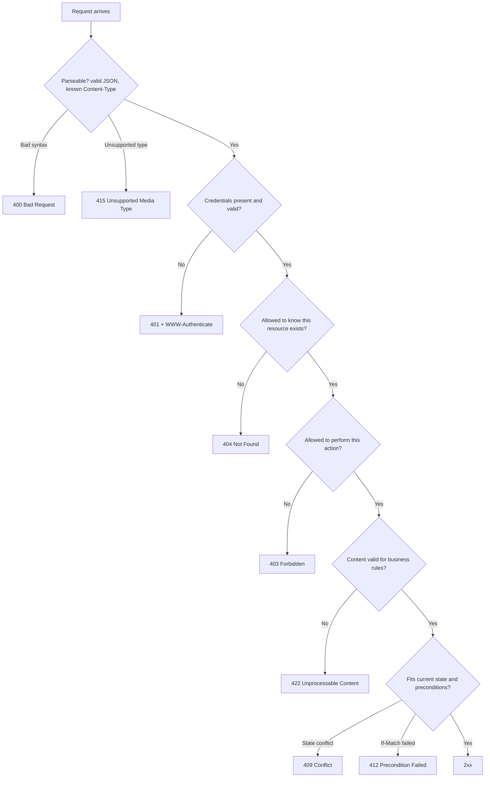

# HTTP Status Codes

> **Module 02 · Core Backend** · Prerequisites: [REST APIs](02-REST-APIs.md) · Next: [API Design Principles](04-API-Design-Principles.md)

---

## ⏱ If You Only Have 2 Minutes

- The first digit is the class: **2xx** success, **3xx** go elsewhere / use your cache, **4xx** the client must change something, **5xx** the server or something behind it failed. Clients that do not know a code treat it as `x00` of its class.
- **401** means "I don't know who you are" (missing or bad credentials) and must carry a `WWW-Authenticate` header. **403** means "I know who you are, and the answer is no". Return **404** instead of 403 when even confirming the resource exists would leak information — RFC 9110 allows exactly that.
- **400** is for a request the server cannot parse (malformed JSON, wrong type). **422** is for well-formed content that fails business or schema validation. **409** is for a conflict with the resource's current state.
- **201** after create (with `Location`), **202** when work is queued and not done yet, **204** when there is nothing to return.
- Retry automatically only on **408, 429, 502, 503, 504** (and connection errors), only for idempotent requests or requests with an idempotency key, and honour **`Retry-After`**.
- **502** = the upstream sent a bad response; **504** = the upstream did not answer in time — and the work may still have happened.
- Send errors as **Problem Details** ([RFC 9457](https://www.rfc-editor.org/rfc/rfc9457)): `Content-Type: application/problem+json` with `type`, `title`, `status`, `detail`, `instance`.

---

## 1. What It Is and Why It Exists

A **status code** is the three-digit number at the start of every HTTP response. It is the server's summary of what happened, written for machines. The full registry is defined in [RFC 9110 §15](https://www.rfc-editor.org/rfc/rfc9110#section-15), with a few extras such as **429** from [RFC 6585](https://www.rfc-editor.org/rfc/rfc6585).

**Analogy:** the light on a parcel locker. Green means take your parcel (2xx). Blue means "your parcel is in locker 14 instead" (3xx). Red means "wrong code, try again" (4xx). Flashing amber means "the machine is broken, it's not you" (5xx). You know what to do next without reading the screen.

**The problem it solves.** Software in the middle makes decisions from the code alone, without parsing your JSON: a retry library retries a 503 but not a 400; a CDN may cache a 404 but not a 500; an SDK refreshes its token on 401 and shows "access denied" on 403; an SLO dashboard counts 5xx as your fault and 4xx as the caller's. Get the code wrong and all of these break together. A `200 {"error": "not found"}` is cached, never retried, never alerted on. A `500` for invalid input pages on-call for a client bug.

---

## 2. How It Works

### Choosing a status for a failed request



The order matters. Check authentication before validating the body, so an anonymous caller cannot learn your validation rules. Check "may this caller see it?" before "does it exist?", so 404 and 403 do not leak existence.

### A Problem Details response

```http
HTTP/1.1 409 Conflict
Content-Type: application/problem+json

{
  "type": "https://api.example.com/problems/insufficient-funds",
  "title": "Insufficient funds",
  "status": 409,
  "detail": "Account acc_7 has 30.00 EUR; the transfer needs 50.00 EUR.",
  "instance": "/transfers/tr_91",
  "balanceCents": 3000
}
```

| Member | Meaning |
|---|---|
| `type` | URI that identifies the problem type. Clients switch on this. Defaults to `about:blank` (meaning: nothing beyond the status code) |
| `title` | Short human summary of the *type*; the same for every occurrence |
| `status` | The HTTP status code, repeated for convenience; must match the real one |
| `detail` | Human explanation of *this* occurrence. Clients should not parse it |
| `instance` | URI identifying this occurrence (request path or an error ID) |
| extensions | Any extra members, such as `balanceCents` or an `errors` array |

RFC 9457 replaced RFC 7807 in 2023 with the same format. Its example for validation uses an `errors` array of `{ "detail", "pointer" }` objects, where `pointer` is a JSON Pointer such as `#/amountCents`.

---

## 3. Key Concepts

### The codes that matter

**2xx — success**

| Code | Use it when |
|---|---|
| 200 OK | A read, or an update that returns the resource |
| 201 Created | A new resource exists now. Send `Location` with its URI |
| 202 Accepted | Work was queued, not finished. Return a status URL to poll |
| 204 No Content | Success with no body (DELETE, some PUTs). A 204 must not have a body |

**3xx — redirection and caching**

| Code | Method on follow | Permanent? | Typical use |
|---|---|---|---|
| 301 Moved Permanently | Clients may change POST to GET | Yes | Old URL of a web page |
| 302 Found | Clients may change POST to GET | No | Legacy temporary redirect |
| 303 See Other | Always GET | — | After a POST, "see the result here" |
| 307 Temporary Redirect | Same method and body | No | Temporary move of an API endpoint |
| 308 Permanent Redirect | Same method and body | Yes | Permanent move of an API endpoint |
| 304 Not Modified | — | — | Conditional GET: your cached copy is still valid |

For APIs, prefer 307/308: a 301/302 can silently turn a client's POST into a GET.

**4xx — the client must change something**

| Code | Meaning | Notes |
|---|---|---|
| 400 Bad Request | Cannot parse or understand the request | Malformed JSON, wrong type in a query param |
| 401 Unauthorized | No valid credentials | Must send `WWW-Authenticate`. The name is historical — it means *unauthenticated* |
| 403 Forbidden | Authenticated, but not allowed | Re-authenticating will not help |
| 404 Not Found | No such resource, or you may not know it exists | Also used to hide forbidden resources |
| 405 Method Not Allowed | Resource exists, method not supported | Must send `Allow: GET, PUT` |
| 409 Conflict | Clashes with current state | Duplicate email, cancelling a shipped order |
| 412 Precondition Failed | `If-Match` / `If-Unmodified-Since` failed | Optimistic-concurrency loss |
| 415 Unsupported Media Type | Body format not supported | Sent XML to a JSON API |
| 422 Unprocessable Content | Parsed fine, content invalid | `quantity: -3`, end date before start date |
| 429 Too Many Requests | Rate limit hit | Add `Retry-After` |

Others worth recognising: **406** (cannot produce an acceptable format), **410 Gone** (removed on purpose, will not return), **413 Content Too Large**, **428 Precondition Required** (you require `If-Match`).

**5xx — the server side failed**

| Code | Meaning | Typical source |
|---|---|---|
| 500 Internal Server Error | Unexpected failure in this server | Unhandled exception, bug |
| 502 Bad Gateway | A proxy got an invalid response from upstream | App crashed mid-response; connection reset |
| 503 Service Unavailable | Temporarily cannot handle it | Overload, maintenance, dependency down; add `Retry-After` |
| 504 Gateway Timeout | A proxy got no response in time | Slow upstream; the request may still complete |

### 401 vs 403 vs 404

- **401** — authentication failed or is missing. The client should log in or refresh its token, then retry.
- **403** — the caller is known and is not allowed. Use it when the resource's existence is not secret: "only admins can delete projects".
- **404** — RFC 9110 lets a server that wants to *hide* a forbidden resource answer 404. GitHub does this for private repositories you cannot access. Use it when the ID itself is sensitive — another tenant's invoice, another user's order — so callers cannot probe which IDs exist. Be consistent: the 404 for "forbidden" must look identical (body, timing) to a real 404.

### 400 vs 422 (and 409)

- **400**: the server could not understand the request at all — invalid JSON, `limit=abc`, a required header missing.
- **422**: the JSON was fine, but the content breaks a rule — schema or business validation. FastAPI returns 422 for all validation failures by default, including malformed JSON; Express has no default.
- **409**: the content is valid on its own, but conflicts with the current state of the resource — the email is taken, the order already shipped.

Many APIs use only 400 for all input problems. That is acceptable if it is consistent and the body explains the problem. Mixing them randomly is the real mistake.

### Retries and `Retry-After`

| Status | Retry automatically? |
|---|---|
| 408, 429 | Yes, after `Retry-After` or with backoff |
| 503 | Yes, honour `Retry-After` |
| 502, 504, connection reset | Yes, if the request is idempotent or carries an idempotency key |
| 500 | At most once, idempotent only — it is often a deterministic bug |
| Other 4xx | No — the same request will fail the same way |
| 401 | Only after refreshing credentials, once |

`Retry-After` is either seconds (`Retry-After: 30`) or an HTTP date (`Retry-After: Wed, 25 Nov 2026 10:00:00 GMT`). Clients should combine it with exponential backoff and jitter so that thousands of clients do not all retry at the same second.

A 504 does **not** mean the operation failed. The upstream may have completed the payment after the gateway gave up. Never blind-retry a POST on 504 without an idempotency key.

---

## 4. Code Examples

Scenario: one place in the app that turns every error — domain errors, framework errors, parse errors, bugs — into a Problem Details response with the right status code, so route handlers only `throw`.

### Node.js / TypeScript

```ts
// npm i express   — Node.js 22+, TypeScript 5, ESM
import express, { type Request, type Response, type NextFunction } from "express";

const PROBLEMS = "https://api.example.com/problems";

interface ProblemInit {
  status: number;
  type: string;                 // stable slug clients can switch on
  title: string;
  detail?: string;
  headers?: Record<string, string>;
  extensions?: Record<string, unknown>;
}

export class AppError extends Error {
  readonly problem: ProblemInit;
  constructor(problem: ProblemInit) {
    super(problem.detail ?? problem.title);
    this.problem = problem;
  }
}

function toProblem(err: unknown): ProblemInit {
  if (err instanceof AppError) return err.problem;
  // body-parser marks its own errors with `type`; malformed JSON is a 400, not a 500.
  const type = (err as { type?: string } | null)?.type;
  if (type === "entity.parse.failed") return { status: 400, type: "malformed-json", title: "Malformed JSON body" };
  if (type === "entity.too.large") return { status: 413, type: "body-too-large", title: "Request body too large" };
  return { status: 500, type: "internal", title: "Internal server error" }; // never leak err.message
}

const app = express();
app.use(express.json({ limit: "100kb" }));

app.post("/transfers", (req, res) => {
  const amount: unknown = req.body?.amountCents;
  if (!Number.isInteger(amount) || (amount as number) <= 0) {
    throw new AppError({
      status: 422, type: "validation-error", title: "Request validation failed",
      extensions: { errors: [{ pointer: "#/amountCents", detail: "must be a positive integer" }] },
    });
  }
  const balanceCents = 3000;
  if ((amount as number) > balanceCents) {
    throw new AppError({
      status: 409, type: "insufficient-funds", title: "Insufficient funds",
      detail: `Balance is ${balanceCents} cents; transfer needs ${amount}.`, extensions: { balanceCents },
    });
  }
  res.status(201).location("/transfers/tr_91").json({ id: "tr_91", amountCents: amount });
});

// Unmatched routes become a problem too, so clients only ever parse one error shape.
app.use((req, _res, next) => {
  next(new AppError({ status: 404, type: "about:blank", title: "Not Found" }));
});

// Express 5 forwards rejected promises from async handlers here automatically.
app.use((err: unknown, req: Request, res: Response, _next: NextFunction) => {
  const p = toProblem(err);
  if (p.status >= 500) console.error({ err, method: req.method, path: req.originalUrl }, "unhandled error");
  res.status(p.status).set(p.headers ?? {}).type("application/problem+json").json({
    type: p.type === "about:blank" ? p.type : `${PROBLEMS}/${p.type}`,
    title: p.title,
    status: p.status,
    ...(p.detail ? { detail: p.detail } : {}),
    instance: req.originalUrl,
    ...p.extensions,
  });
});

app.listen(3000);
```

A rate limiter would throw `new AppError({ status: 429, type: "rate-limited", title: "Too many requests", headers: { "Retry-After": "30" } })`, and the mapper copies the header onto the response.

### Python

```python
# pip install fastapi uvicorn   — Python 3.12+
import logging
from http import HTTPStatus
from typing import Any

from fastapi import FastAPI, Request
from fastapi.exceptions import RequestValidationError
from fastapi.responses import JSONResponse
from pydantic import BaseModel, Field
from starlette.exceptions import HTTPException as StarletteHTTPException

PROBLEMS = "https://api.example.com/problems"
log = logging.getLogger("api")


class AppError(Exception):
    def __init__(self, status: int, type_: str, title: str, detail: str | None = None,
                 headers: dict[str, str] | None = None, **extensions: Any) -> None:
        super().__init__(detail or title)
        self.status, self.type_, self.title, self.detail = status, type_, title, detail
        self.headers, self.extensions = headers, extensions


def problem(request: Request, status: int, type_: str, title: str, detail: str | None = None,
            headers: dict[str, str] | None = None, **extensions: Any) -> JSONResponse:
    body: dict[str, Any] = {
        "type": type_ if type_ == "about:blank" else f"{PROBLEMS}/{type_}",
        "title": title, "status": status, "instance": request.url.path,
    }
    if detail:
        body["detail"] = detail
    body.update(extensions)
    return JSONResponse(body, status_code=status, headers=headers, media_type="application/problem+json")


app = FastAPI()


@app.exception_handler(AppError)
async def on_app_error(request: Request, exc: AppError) -> JSONResponse:
    return problem(request, exc.status, exc.type_, exc.title, exc.detail, exc.headers, **exc.extensions)


@app.exception_handler(RequestValidationError)
async def on_validation_error(request: Request, exc: RequestValidationError) -> JSONResponse:
    errors = exc.errors()
    # FastAPI reports unparseable JSON as a validation error; it is really a 400.
    if any(e["type"] == "json_invalid" for e in errors):
        return problem(request, 400, "malformed-json", "Malformed JSON body")
    items = [{"pointer": "#/" + "/".join(map(str, e["loc"][1:])), "in": e["loc"][0], "detail": e["msg"]}
             for e in errors]
    return problem(request, 422, "validation-error", "Request validation failed", errors=items)


@app.exception_handler(StarletteHTTPException)
async def on_http_error(request: Request, exc: StarletteHTTPException) -> JSONResponse:
    # Framework 404/405s: keep their headers (405 carries `Allow`).
    return problem(request, exc.status_code, "about:blank", HTTPStatus(exc.status_code).phrase,
                   headers=getattr(exc, "headers", None))


@app.exception_handler(Exception)
async def on_unexpected(request: Request, exc: Exception) -> JSONResponse:
    log.exception("unhandled error", extra={"path": request.url.path})
    return problem(request, 500, "internal", "Internal server error")  # no exception text


class TransferIn(BaseModel):
    amount_cents: int = Field(gt=0)


@app.post("/transfers", status_code=201)
async def create_transfer(body: TransferIn) -> dict[str, Any]:
    balance_cents = 3000
    if body.amount_cents > balance_cents:
        raise AppError(409, "insufficient-funds", "Insufficient funds",
                       f"Balance is {balance_cents} cents; transfer needs {body.amount_cents}.",
                       balance_cents=balance_cents)
    return {"id": "tr_91", "amount_cents": body.amount_cents}
```

**Runtime difference to notice:** Express has one error-handling middleware with four arguments, and anything thrown — synchronously, or as a rejected promise in Express 5 — reaches it. FastAPI dispatches by exception class instead, so you register a handler per type. Registering for `StarletteHTTPException` (not FastAPI's subclass) also catches the 404 and 405 that Starlette's router raises before your code runs. In the `Exception` handler the response is generic on purpose; the traceback goes to the log, never to the client.

---

## 5. Production Concerns

- **Never leak internals in 5xx bodies.** Stack traces, SQL fragments and hostnames help attackers. Return a generic title plus a request or trace ID in `instance` or an extension member, and keep the details in logs.
- **Status codes drive alerting.** Your error-rate SLO usually counts 5xx only. Returning 500 for validation errors pages people for client bugs; returning 4xx for your own outages hides them. Watch 5xx rate per route, and 4xx rate per route *and* client version — a jump in 422s right after a mobile release is a contract break.
- **Proxies rewrite codes.** A load balancer returns its own 502/503/504 when your app crashes, is not ready, or is too slow. Those responses never touch your error mapper, so clients must cope with non-Problem bodies on 5xx. Make the app's timeout shorter than the proxy's, so your handler — not the proxy — decides the response.
- **CDN caching of errors.** Some CDNs cache 404s (and sometimes other errors) briefly by default. A 404 served for a resource created a second later becomes a "missing data" bug. Set `Cache-Control` on error responses explicitly.
- **Retry storms.** A 503 without `Retry-After`, combined with clients retrying immediately, multiplies load on a service that is already overloaded. Send `Retry-After`, and make sure your own clients use backoff with jitter and a retry budget.
- **Stable `type` URIs are a contract.** Clients write `if (problem.type === ".../insufficient-funds")`. Renaming a type is a breaking change, just like renaming a field.

---

## 6. Common Mistakes

- **`200 OK` with `{"success": false}`** — caches store it, retries and alerts never fire, every client must parse the body — use the real 4xx/5xx code and a Problem Details body.
- **403 for "not logged in"** — the client shows "access denied" instead of refreshing its token — use 401 with `WWW-Authenticate` for missing or invalid credentials.
- **403 for another tenant's resource** — attackers can enumerate which IDs exist — return the same 404 as for a truly missing resource.
- **500 for bad input** — on-call gets paged, retry libraries retry a request that can never succeed — validate at the edge and return 400/422.
- **301/302 on API endpoints** — clients silently turn POST into GET and lose the body — use 307 or 308.
- **Retrying a POST after 504** — the first attempt may have succeeded, so the customer is charged twice — retry non-idempotent calls only with an idempotency key.
- **Putting the error code only in `detail` text** — clients regex English sentences that you later reword — put machine-readable meaning in `type` and extension members.

---

## 7. Comparison Table

| | Problem Details (RFC 9457) | Ad-hoc `{"error": "..."}` | Always-200 envelope (GraphQL / JSON-RPC style) |
|---|---|---|---|
| Status code carries meaning | Yes | Yes | No — errors are in the body |
| Machine-readable error identity | `type` URI | Whatever each team invents | `code` / `extensions` by convention |
| Standard media type | `application/problem+json` | No | No |
| Works with generic HTTP tooling (retries, CDNs, dashboards) | Yes | Yes | Poorly |
| Partial success in one response | No (one problem per response; use an `errors` extension for field lists) | Ad hoc | Yes — data and errors together |
| Best for | REST/HTTP APIs, public APIs | Small internal APIs (until they grow) | GraphQL, batch endpoints |

---

## 8. Interview Questions

**[Junior] What is the difference between 401 and 403?**
401 means the request has no valid credentials — the server does not know who you are — and it must include a `WWW-Authenticate` header saying how to authenticate. The client should log in or refresh its token. 403 means the server knows who you are and still refuses; logging in again will not help. The name "Unauthorized" for 401 is historical; it really means unauthenticated.

**[Mid] When do you use 400, 409 and 422?**
400 when the request cannot be parsed or understood: malformed JSON, a non-numeric `limit`. 422 when it parses but the content violates validation rules, such as a negative quantity. 409 when the content is valid but conflicts with the current state, such as registering an email that is already taken or cancelling a shipped order. The key is consistency, and a body that tells the client exactly what to fix.

**[Mid] What is the difference between 502, 503 and 504?**
They usually come from a proxy or gateway. 502 means the upstream returned something invalid or dropped the connection. 503 means the service is temporarily unable to handle the request, for example overloaded or in maintenance, ideally with `Retry-After`. 504 means the upstream did not respond in time. With 504 the upstream may still have finished the work, so retrying a non-idempotent call can duplicate it.

**[Senior] A user requests another tenant's invoice. Do you return 403 or 404? Why?**
404. A 403 confirms that the invoice exists, which leaks information and lets an attacker enumerate IDs across tenants. RFC 9110 explicitly allows 404 to hide a forbidden resource, and large APIs such as GitHub's do this for private repositories. The response must be indistinguishable from a real 404 — same body and similar timing — and you should still log it internally as an authorization denial so you can detect probing.

**[Senior] Design the retry policy for a client of your payment API.**
Retry only on connection errors, 408, 429, 502, 503 and 504; never on other 4xx. Every payment POST carries an idempotency key, so a retry after a timeout or 504 returns the original result instead of charging twice. Use exponential backoff with full jitter, honour `Retry-After`, cap attempts (say 3) and total time, and use a retry budget so retries cannot multiply load during an outage. Log each attempt with the same idempotency key and trace ID.

**[Senior] Your 5xx rate SLO is green but users report errors. What could be wrong with your status codes?**
Failures may be hidden as 2xx or 4xx: handlers returning `200 {"ok": false}`, dependency failures mapped to 400, or timeouts turned into empty 200 lists. Errors could also be generated by the load balancer (502/504) and only counted in LB metrics, not app metrics. Check status distributions from the edge, not only the app, and audit the error mapper so dependency failures become 502/503/504, not client errors.

---

## 9. Cheat Sheet

```text
Classes      2xx ok · 3xx elsewhere/cache · 4xx caller fixes · 5xx server fixes
Create       201 + Location · queued 202 + status URL · nothing to say 204 (no body)
Redirects    303 after POST · 307/308 keep method+body · 301/302 may turn POST into GET
Cache        304 Not Modified (conditional GET)
Auth         401 unauthenticated + WWW-Authenticate · 403 known but denied · 404 to hide existence
Input        400 unparseable · 415 wrong Content-Type · 422 invalid content · 409 state conflict
Concurrency  412 If-Match failed · 428 If-Match required
Limits       429 + Retry-After · 413 body too large · 431 headers too large
Method       405 + Allow header
Server       500 bug · 502 bad upstream response · 503 unavailable + Retry-After · 504 upstream timeout
Retry        408 429 502 503 504 + idempotent (or idempotency key), backoff + jitter, honour Retry-After
Never        200 with error body · stack traces in 5xx · blind POST retry on 504
Errors body  application/problem+json: type, title, status, detail, instance (+ extensions)
```

---

## Related Topics

- [HTTP Fundamentals](01-HTTP-Fundamentals.md) — conditional requests behind 304 and 412
- [JWT Authentication](08-JWT-Authentication.md) — when a token problem is a 401 and a scope problem is a 403
- [Error Handling](21-Error-Handling.md) — classifying exceptions before they reach the HTTP mapper
- [Retry Pattern](../Module-07-Advanced-Backend-and-System-Design/35-Retry-Pattern.md) — backoff, jitter and retry budgets for 429/5xx
- [Rate Limiting](../Module-07-Advanced-Backend-and-System-Design/33-Rate-Limiting.md) — producing 429 and `Retry-After` correctly
