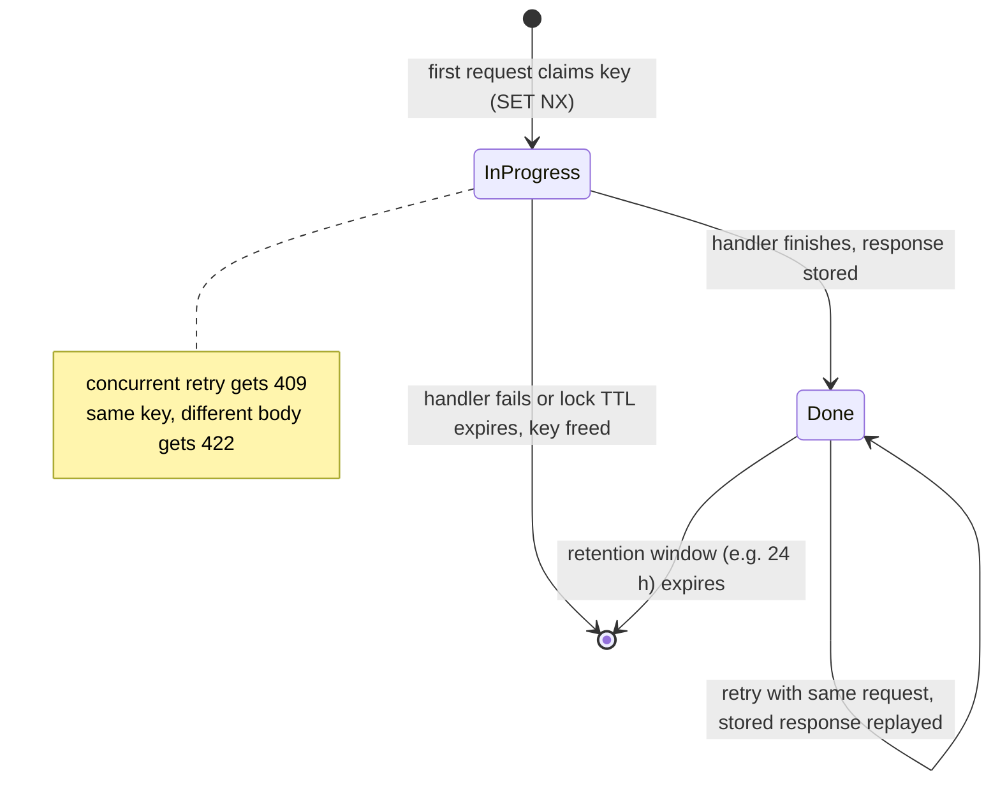

# API Design Principles

> **Module 02 · Core Backend** · Prerequisites: [HTTP Status Codes](03-HTTP-Status-Codes.md) · Next: [Node HTTP Server Concepts](05-Node-HTTP-Server-Concepts.md)

---

## ⏱ If You Only Have 2 Minutes

- **Contract-first:** write the [OpenAPI](https://spec.openapis.org/oas/v3.1.0) document before the code, review it like code, generate types and mocks from it, and fail CI on breaking diffs.
- **Additive changes are safe** (new optional field, new endpoint). **Breaking:** removing or renaming a field, changing a type or meaning, making an optional input required, or tightening validation.
- A new **enum value** breaks clients that switch over every case. Document from day one that clients must handle unknown values.
- Make POST **retry-safe with an `Idempotency-Key`**: store the key, a fingerprint of the request, and the response. Same key + same request → replay the stored response. Same key + different request → 422. Still running → 409. Stripe keeps keys for 24 hours.
- **Cursor pagination** for large or changing lists: an opaque cursor that encodes the last sort key plus a unique tie-breaker. Offset pagination skips or repeats rows when data changes, and gets slower with depth.
- **One** error format (Problem Details), **one** naming style, **one** timestamp format (RFC 3339, UTC), money as **integer minor units plus currency**.
- Rate limits: `429` + `Retry-After`, plus headers that show the remaining quota so good clients can slow down before they hit the wall.
- Version only for breaking changes. Most changes should not need a new version at all — see [API Versioning](../Module-07-Advanced-Backend-and-System-Design/54-API-Versioning.md).

---

## 1. What It Is and Why It Exists

**API design principles** are the rules that keep an API predictable for the people who call it and safe to change for the people who build it. An API is a **contract** between programs that are deployed on different schedules by different teams — often teams that never talk to you. Once a mobile app version ships with your response shape baked in, it may be used for years.

**Analogy:** the shape of a wall socket. Thousands of manufacturers build plugs against it without ever asking the electricity company. The company can upgrade power stations, wiring and meters as much as it likes — but it can never move the holes. Good API design is deciding carefully where the holes go, and making sure every socket in the building is the same shape.

**The problem it solves.** Without shared principles, each endpoint is designed by whoever wrote it that week. `/orders` returns `created_at` in Unix seconds while `/payments` returns `createdAt` as an ISO string. Errors come in three shapes. A client times out on `POST /payments`, retries, and the customer is charged twice. Someone renames `zip` to `postalCode` in a "cleanup" PR, and every user on an old app version sees a blank address screen. Each of these is cheap to prevent at design time and expensive to fix after clients depend on it.

---

## 2. How It Works

### The contract-first loop

1. **Draft the contract.** Write the OpenAPI document: paths, request and response schemas, error responses, headers such as `Idempotency-Key` and `Location`.
2. **Review it.** Consumers (frontend, mobile, partner teams) review the YAML before any code exists. Changing a draft costs minutes.
3. **Lint it.** A linter such as Spectral enforces house rules: plural nouns, camelCase fields, every operation documents its 4xx responses.
4. **Mock and generate.** Clients build against a mock server; both sides generate types (for example `openapi-typescript`), so a mismatch is a compile error.
5. **Implement and test against it.** The server validates real responses against the schema in contract tests.
6. **Diff on every change.** A tool such as `oasdiff` compares the new document with the published one and fails the build on breaking changes.

A fragment of such a contract:

```yaml
openapi: 3.1.0
info: { title: Orders API, version: 1.4.0 }
paths:
  /orders:
    post:
      operationId: createOrder
      parameters:
        - { in: header, name: Idempotency-Key, required: true, schema: { type: string, maxLength: 255 } }
      requestBody:
        required: true
        content:
          application/json:
            schema: { $ref: "#/components/schemas/OrderCreate" }
      responses:
        "201":
          description: Order created
          headers: { Location: { schema: { type: string } } }
          content:
            application/json:
              schema: { $ref: "#/components/schemas/Order" }
        "409": { $ref: "#/components/responses/Problem" }
        "422": { $ref: "#/components/responses/Problem" }
# components (schemas, the shared Problem response) omitted for brevity
```

### The life of an idempotency key



---

## 3. Key Concepts

### Contract-first vs code-first

| | Contract-first | Code-first (e.g. FastAPI generating OpenAPI) |
|---|---|---|
| Source of truth | The OpenAPI document | Route signatures and models |
| Consumer review | Before implementation | After, from generated docs |
| Risk | Spec and code drift unless validated in tests | Refactoring a model silently changes the public contract |
| Works best | Public and partner APIs, many consumer teams | Internal APIs, small teams, fast iteration |

Code-first is fine if you still treat the generated document as a contract: commit it, review its diff, and run a breaking-change check in CI.

### Consistency rules worth writing down

- **Resources:** plural nouns, lowercase paths, one casing for multi-word segments.
- **Field names:** one style (`camelCase` or `snake_case`) for every endpoint. Booleans read as predicates: `isActive`, `hasMore`.
- **Time:** RFC 3339 strings in UTC (`2026-11-24T09:30:00Z`). Never local time without an offset; avoid ambiguous epoch units.
- **Money:** integer minor units plus an ISO 4217 currency code: `{"amount": 1999, "currency": "EUR"}`. Floating-point amounts produce rounding bugs.
- **IDs:** strings, even when they are numbers today, so you can change the format later. Prefixes (`ord_`, `cus_`) make logs and support tickets easier to read.
- **Nulls and absence:** decide whether "no value" is `null` or an omitted field, and do the same everywhere.
- **Errors:** one format for every endpoint — Problem Details, covered in [HTTP Status Codes](03-HTTP-Status-Codes.md).

### Compatible vs breaking changes

| Change | Compatible? | Why |
|---|---|---|
| Add an endpoint | Yes | Nobody calls it yet |
| Add an optional request field | Yes | Old clients do not send it |
| Add a response field | Yes, if clients ignore unknown fields | Strict deserializers that reject unknown fields will break |
| Add an enum value | Risky | Exhaustive `switch` statements in clients fail or crash |
| Loosen validation (max length 50 → 100) | Usually | Clients that store the value may have their own limit |
| Remove or rename a field | **No** | Clients read it |
| Change a type (`"42"` → `42`) or format | **No** | Parsing fails |
| Make an optional input required | **No** | Old clients do not send it |
| Tighten validation | **No** | Previously valid requests now fail |
| Change a default, a status code, or the meaning of a field | **No** | Behaviour changes silently — the worst kind of break |

The rule that makes most of this work is the **tolerant reader**: clients ignore fields they do not know, and servers ignore what they do not need. Put it in your client guidelines and SDKs.

### Idempotency keys

HTTP makes PUT and DELETE idempotent by definition, but the most important writes — create a payment, place an order — are POSTs. A client that times out cannot know whether the server did the work. An idempotency key lets it retry safely:

1. The client generates a unique key (a UUID v4) **per logical operation** and sends it as `Idempotency-Key` on every attempt of that operation.
2. The server scopes the key to the caller, then atomically claims it.
3. On success, it stores the status code and body under the key for a retention window.
4. A retry with the same key and the same request gets the stored response. Stripe marks replays with an `Idempotent-Replayed: true` header.

Edge cases you must decide:

| Situation | Common response |
|---|---|
| Key missing on an endpoint that requires it | `400` |
| Same key, **different** request body | `422` — it is a client bug, not a retry |
| Same key while the first request is still running | `409`, with `Retry-After` |
| First request failed with 5xx | Either store it (Stripe does) or free the key so a retry runs again |

These responses follow the IETF draft *The Idempotency-Key HTTP Header Field* (still a draft, not an RFC). Stripe's public behaviour is the best-known reference: keys up to 255 characters, eligible for removal after 24 hours, and the parameters of a reused key are compared with the original request.

### Pagination contracts

```json
{
  "data": [ { "id": "ord_9" }, { "id": "ord_8" } ],
  "nextCursor": "eyJjcmVhdGVkQXQiOiIyMDI2LTExLTIwVDEwOjAwOjAwWiIsImlkIjoib3JkXzgifQ",
  "hasMore": true
}
```

- The **cursor is opaque**: base64 of `{createdAt, id}` today, something else tomorrow. Clients only pass it back.
- The server query is **keyset pagination**: `WHERE (created_at, id) < ($1, $2) ORDER BY created_at DESC, id DESC LIMIT 51`. Fetch one extra row to know whether there is a next page.
- Always sort by a **unique tie-breaker** (`id`) after the main key, or rows with the same timestamp are skipped or repeated across pages.
- The server sets a **default and a maximum `limit`**. A client asking for 10,000 gets the maximum, not an outage.
- `total` counts are expensive on large tables. Offer them only where needed, or return an estimate.

### Rate-limit headers

When a client is throttled, return **429** with `Retry-After`. To let well-behaved clients slow down *before* hitting the limit, publish the quota on every response. The widely used de facto set is `X-RateLimit-Limit`, `X-RateLimit-Remaining` and `X-RateLimit-Reset` (GitHub, for example, sends the reset time as Unix epoch seconds — other APIs send seconds-until-reset, so document which). The IETF is standardizing `RateLimit` and `RateLimit-Policy` header fields in a draft whose syntax has changed between versions; check the current draft before adopting it. Algorithms and enforcement are covered in [Rate Limiting](../Module-07-Advanced-Backend-and-System-Design/33-Rate-Limiting.md).

### Versioning — overview only

| Strategy | Example | Notes |
|---|---|---|
| URI path | `/v1/orders` | Most visible, easiest to route and cache |
| Header or media type | `Accept: application/vnd.example.v2+json` | Clean URIs; harder to test in a browser |
| Date-based | `Stripe-Version: 2024-06-20` style | Each account pinned to a version; server translates |

Whatever the mechanism, the principle is the same: avoid breaking changes; when you must make one, ship a new version, run both, announce the end date (for example with a `Sunset` header, [RFC 8594](https://www.rfc-editor.org/rfc/rfc8594)), and watch traffic on the old one before removing it. The full trade-offs are in [API Versioning](../Module-07-Advanced-Backend-and-System-Design/54-API-Versioning.md).

---

## 4. Code Examples

Scenario: `POST /orders` accepts an `Idempotency-Key`. The first request claims the key in Redis; a retry with the same body replays the stored `201`; a retry with a different body gets `422`; a concurrent duplicate gets `409`.

### Node.js / TypeScript

```ts
// npm i express ioredis   — Node.js 22+, TypeScript 5, ESM
import { createHash } from "node:crypto";
import express, { type NextFunction, type Request, type RequestHandler, type Response } from "express";
import { Redis } from "ioredis";

const LOCK_TTL_MS = 60_000;             // short: a crashed request must not block its key for a day
const RESULT_TTL_MS = 24 * 60 * 60_000; // how long a retry can still get the original answer

type IdemRecord =
  | { state: "in_progress"; fingerprint: string }
  | { state: "done"; fingerprint: string; status: number; location?: string; body: unknown };

export function idempotency(redis: Redis): RequestHandler {
  return async (req: Request, res: Response, next: NextFunction): Promise<void> => {
    const key = req.get("Idempotency-Key");
    if (!key || key.length > 255) { res.status(400).json({ error: "idempotency_key_required" }); return; }

    // Scope by caller: two clients may choose the same key and must never see each other's results.
    const redisKey = `idem:${String(res.locals.accountId ?? "anonymous")}:${key}`;
    const fingerprint = createHash("sha256")
      .update(`${req.method} ${req.originalUrl} ${JSON.stringify(req.body ?? null)}`)
      .digest("hex");

    // SET NX is atomic: exactly one of two concurrent duplicates wins the claim.
    const claimed = await redis.set(redisKey, JSON.stringify({ state: "in_progress", fingerprint }), "PX", LOCK_TTL_MS, "NX");
    if (claimed === null) {
      const raw = await redis.get(redisKey);
      const record = raw === null ? null : (JSON.parse(raw) as IdemRecord);
      if (record && record.fingerprint !== fingerprint) {
        res.status(422).json({ error: "idempotency_key_reused_with_different_request" }); return;
      }
      if (record?.state === "done") {
        if (record.location) res.location(record.location);
        res.status(record.status).set("Idempotent-Replayed", "true").json(record.body); return;
      }
      res.status(409).set("Retry-After", "1").json({ error: "request_in_progress" }); return;
    }

    // Wrap res.json so whatever the handler (or the error handler) sends is stored first.
    const send = res.json.bind(res);
    res.json = ((body: unknown) => {
      const done: IdemRecord = { state: "done", fingerprint, status: res.statusCode, location: res.get("Location"), body };
      const save: Promise<unknown> = res.statusCode >= 500
        ? redis.del(redisKey) // free the key so a retry runs again — safe only if the DB work rolled back
        : redis.set(redisKey, JSON.stringify(done), "PX", RESULT_TTL_MS);
      save.catch((err: unknown) => console.error({ err, redisKey }, "idempotency store failed")).finally(() => send(body));
      return res;
    }) as Response["json"];
    next();
  };
}

const app = express();
app.use(express.json());

app.post("/orders", idempotency(new Redis(process.env.REDIS_URL ?? "redis://localhost:6379")), async (req, res) => {
  const order = await createOrder(req.body);
  res.status(201).location(`/orders/${order.id}`).json(order);
});

app.listen(3000);
declare function createOrder(input: unknown): Promise<{ id: string }>;
```

### Python

```python
# pip install fastapi uvicorn "redis>=5"   — Python 3.12+
import hashlib
import json
from collections.abc import AsyncIterator
from dataclasses import dataclass
from typing import Annotated, Any
from uuid import uuid4

from fastapi import Depends, FastAPI, Header, HTTPException, Request
from fastapi.responses import JSONResponse
from pydantic import BaseModel, Field
from redis.asyncio import Redis

LOCK_TTL_MS = 60_000
RESULT_TTL_MS = 24 * 60 * 60 * 1000
redis = Redis.from_url("redis://localhost:6379/0")


@dataclass
class Idempotency:
    key: str
    fingerprint: str
    replay: JSONResponse | None = None

    async def save(self, status: int, body: Any, headers: dict[str, str] | None = None) -> JSONResponse:
        record = {"state": "done", "fingerprint": self.fingerprint, "status": status,
                  "body": body, "headers": headers or {}}
        await redis.set(self.key, json.dumps(record), px=RESULT_TTL_MS)
        return JSONResponse(body, status_code=status, headers=headers)


async def idempotency(
    request: Request, idempotency_key: Annotated[str | None, Header()] = None,
) -> AsyncIterator[Idempotency]:
    if not idempotency_key or len(idempotency_key) > 255:
        raise HTTPException(400, "idempotency_key_required")
    caller = getattr(request.state, "account_id", "anonymous")  # set by auth middleware
    key = f"idem:{caller}:{idempotency_key}"
    # Hash the raw bytes: FastAPI already read the body for the model, so this returns the cached copy.
    fingerprint = hashlib.sha256(f"{request.method} {request.url.path} ".encode() + await request.body()).hexdigest()

    claimed = await redis.set(key, json.dumps({"state": "in_progress", "fingerprint": fingerprint}),
                              nx=True, px=LOCK_TTL_MS)
    if not claimed:
        raw = await redis.get(key)
        record = json.loads(raw) if raw else None
        if record and record["fingerprint"] != fingerprint:
            raise HTTPException(422, "idempotency_key_reused_with_different_request")
        if record and record["state"] == "done":
            headers = {**record["headers"], "Idempotent-Replayed": "true"}
            yield Idempotency(key, fingerprint, JSONResponse(record["body"], record["status"], headers))
            return
        raise HTTPException(409, "request_in_progress", headers={"Retry-After": "1"})

    try:
        yield Idempotency(key, fingerprint)
    except Exception:
        await redis.delete(key)  # the handler failed: free the key so a retry runs again
        raise


class OrderIn(BaseModel):
    sku: str
    quantity: int = Field(gt=0)


app = FastAPI()


@app.post("/orders", status_code=201)
async def create_order(body: OrderIn, idem: Annotated[Idempotency, Depends(idempotency)]) -> JSONResponse:
    if idem.replay is not None:
        return idem.replay
    order = {"id": f"ord_{uuid4().hex[:12]}", **body.model_dump()}
    return await idem.save(201, order, headers={"Location": f"/orders/{order['id']}"})
```

**Runtime difference to notice:** Express middleware can wrap `res.json`, so the route handler never knows idempotency exists. FastAPI dependencies never see what the route returns, so the route opts in explicitly with `idem.save(...)`. That is more code in each route, but nothing is hidden. Exceptions raised in the route are thrown back into the `yield` dependency, which is where the key is freed. Both versions use async Redis clients, so waiting on Redis never blocks the event loop.

---

## 5. Production Concerns

- **Redis and the database are not one transaction.** If the order commits and the process dies before the result is stored, the lock expires and a retry creates a second order. The robust design writes the idempotency record in the **same database transaction** as the order, with a unique constraint on `(account_id, key)`. Use Redis as above when the operation's own side effect is idempotent or a rare duplicate is tolerable. See [Idempotency](../Module-07-Advanced-Backend-and-System-Design/32-Idempotency.md).
- **Fingerprint stability.** Hashing `JSON.stringify` of the parsed body treats reordered keys as a different request; hashing raw bytes treats whitespace changes as different. Decide which you want and document that retries must resend the identical request.
- **Storage growth.** Every POST stores a response for 24 hours. Size it: 200 requests/s × 86,400 s × 2 KB ≈ 35 GB. Store only what the replay needs, and keep the TTL as short as your clients' retry window allows.
- **Contract drift.** Generated docs and real responses diverge when nobody checks. Validate responses against the schema in contract tests, and run a breaking-change diff on every pull request.
- **Pagination under load.** Deep `OFFSET` scans grow linearly — page 10,000 makes the database read and discard hundreds of thousands of rows. Cap offset depth or move the endpoint to cursors before it becomes a hot path.
- **What to measure.** Replay rate (high means clients retry a lot — check timeouts), 422 key-reuse rate (client bugs), 409 in-progress rate, request counts per deprecated field or version, and the share of 429 responses per client.

---

## 6. Common Mistakes

- **Breaking changes disguised as cleanups** — renaming `zip` to `postalCode` breaks every installed app — add the new field, keep the old one, deprecate, and remove only when traffic to it is zero.
- **Idempotency key not scoped to the caller** — two customers who generate the same key receive each other's responses — prefix the key with the account or tenant ID.
- **Idempotency key accepted with a different body** — the client "retries" a different payment and silently gets the old result — fingerprint the request and return 422 on mismatch.
- **Offset pagination on a feed that changes** — new rows push items onto the next page, so users see duplicates or miss items — use a cursor on `(created_at, id)`.
- **Inconsistent conventions** — one endpoint uses `snake_case` and Unix seconds, another `camelCase` and ISO strings — write a style guide and enforce it with a linter on the OpenAPI document.
- **Floats for money** — `0.1 + 0.2` becomes `0.30000000000000004` in a JSON client — integer minor units plus a currency code.
- **Versioning every change** — `/v7/` after a year, with seven code paths to maintain — make additive changes without a version; reserve new versions for real breaks.

---

## 7. Comparison Table

| | Offset pagination | Cursor (keyset) pagination |
|---|---|---|
| Request | `?limit=50&offset=500` | `?limit=50&cursor=eyJ...` |
| Database query | `OFFSET 500 LIMIT 50` — reads and discards 500 rows | `WHERE (created_at, id) < (…) LIMIT 50` — index seek |
| Cost at depth | Grows with the offset | Constant per page |
| Inserts/deletes during paging | Items skipped or repeated | Stable |
| Jump to page N / show "page 7 of 40" | Yes | No — only next (and previous, if you encode it) |
| Sort options | Any column | Only indexed keys the cursor encodes |
| Best for | Small, slow-changing admin tables | Feeds, timelines, large exports, public APIs |

---

## 8. Interview Questions

**[Junior] What changes can you make to an API without breaking clients?**
Adding new endpoints, adding optional request fields, and adding response fields — assuming clients ignore unknown fields. Removing or renaming fields, changing types, making optional inputs required, tightening validation and changing behaviour are all breaking. Adding an enum value is risky because clients may handle only the values they know.

**[Mid] What does "contract-first" mean, and what do you gain?**
You write and review the OpenAPI document before implementing. Consumers can review it and build against a mock immediately, both sides generate types from it, and CI can detect breaking changes by diffing it against the published version. The cost is keeping code and spec in sync, which you enforce with contract tests that validate real responses against the schema.

**[Mid] How does an idempotency key work?**
The client generates a unique key per logical operation and sends it on every attempt. The server atomically claims the key for that caller, runs the operation, and stores the response with the key. A retry with the same key and the same request gets the stored response instead of running the operation again. A reuse with a different request is rejected (422), and a duplicate that arrives while the first is still running gets 409.

**[Senior] Where would you store idempotency records, and why?**
Ideally in the same database and transaction as the business write, with a unique constraint on `(account_id, idempotency_key)`. Then "order created" and "key recorded" commit or roll back together, and there is no window in which the order exists but the key does not. Redis is simpler and faster, and fine for a first line of defence, but a crash between the commit and the Redis write can still produce a duplicate. Either way, keep a retention window (for example 24 hours) and scope keys to the caller.

**[Senior] You need to rename a field used by mobile apps. How do you roll it out?**
Expand and contract. First add the new field and return both, writing to both on input. Update clients and SDKs to read the new field. Measure how many requests still use or read the old one — by client version, through logs or a usage metric. Announce deprecation with a date (documentation, a `Deprecation` or `Sunset` header). Remove the old field only when usage is near zero or after the announced date, ideally on a new version for clients that cannot upgrade.

**[Senior] Design the error and retry contract for a public payments API.**
All errors use Problem Details with stable `type` URIs that clients branch on. Validation problems are 422 with an `errors` array of field pointers; state conflicts are 409; rate limits are 429 with `Retry-After` and quota headers. Every POST requires an `Idempotency-Key`, so clients can retry safely after timeouts, 502, 503 and 504 with exponential backoff and jitter. Document which codes are retryable, how long keys are kept, and that clients must tolerate new fields and new error types.

---

## 9. Cheat Sheet

```text
Contract       OpenAPI 3.1 first → review → lint (Spectral) → mock/generate → diff in CI (oasdiff)
Safe changes   new endpoint · new optional input · new response field (tolerant reader)
Breaking       remove/rename · type change · optional→required · tighter validation · new meaning
Risky          new enum value → clients must handle unknown values
Conventions    plural nouns · one field casing · RFC 3339 UTC · money = int minor units + currency · string IDs
Idempotency    Idempotency-Key per logical op, scoped to caller, fingerprint request
               replay stored response · diff body → 422 · in flight → 409 + Retry-After · keep ~24 h
Best store     same DB transaction as the write, unique (account_id, key)
Pagination     cursor = opaque (sort key + unique id) · default + max limit · fetch limit+1
Offset         fine for small admin tables; slow and unstable at depth
Errors         Problem Details everywhere (see chapter 03)
Rate limits    429 + Retry-After · X-RateLimit-Limit/Remaining/Reset (document units) · IETF RateLimit draft
Versioning     only for breaking changes · /v1 vs header vs date · Sunset header before removal
```

---

## Related Topics

- [REST APIs](02-REST-APIs.md) — resource and method design that these principles build on
- [HTTP Status Codes](03-HTTP-Status-Codes.md) — the Problem Details error format and retryable codes
- [Idempotency](../Module-07-Advanced-Backend-and-System-Design/32-Idempotency.md) — transactional idempotency records and consumer deduplication
- [API Versioning](../Module-07-Advanced-Backend-and-System-Design/54-API-Versioning.md) — versioning strategies and deprecation in depth
- [Rate Limiting](../Module-07-Advanced-Backend-and-System-Design/33-Rate-Limiting.md) — algorithms behind 429 and quota headers
- [Contract Testing](../Module-09-Testing-and-Code-Quality/07-Contract-Testing.md) — keeping the implementation honest to the spec
