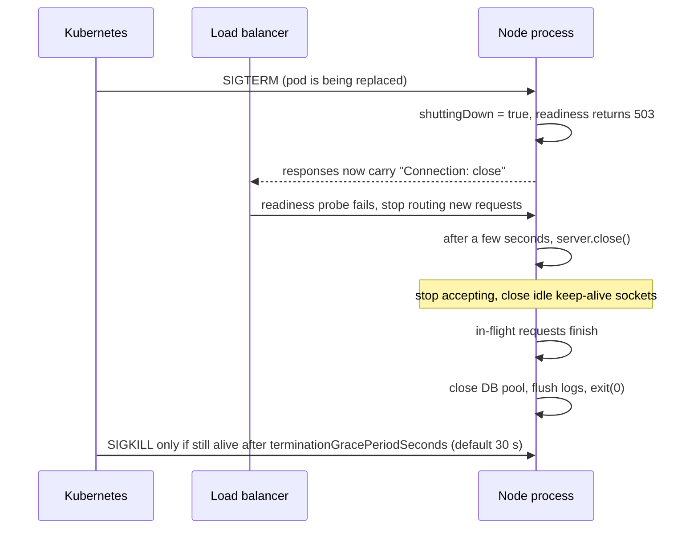

# Node HTTP Server Concepts

> **Module 02 · Core Backend** · Prerequisites: [HTTP Fundamentals](01-HTTP-Fundamentals.md), [API Design Principles](04-API-Design-Principles.md) · Next: [Node Event Loop and Concurrency](06-Node-Event-Loop-and-Concurrency.md)

---

## ⏱ If You Only Have 2 Minutes

- `http.createServer()` gives you a `net.Server` that emits one `request` event per HTTP request. `req` (`IncomingMessage`) is a **readable stream**, `res` (`ServerResponse`) is a **writable stream**. Express and Fastify are just request handlers on top of this.
- Node does **not** parse or limit request bodies for you. Check `Content-Length` *and* count bytes as they arrive; reply `413 Content Too Large` when over the limit.
- `res.write()` returning `false` is **backpressure**: stop writing until `drain`. Ignore it and a slow client makes you buffer the whole response in memory. `stream.pipeline()` handles this for you.
- Three timeouts matter: `headersTimeout` (slowloris guard), `requestTimeout` (whole request must arrive, default 300 s), `keepAliveTimeout` (idle socket, default **5 s**).
- `keepAliveTimeout` must be **longer** than the load balancer's idle timeout (AWS ALB default: 60 s), or the LB will reuse a socket Node just closed and return random `502`s.
- Graceful shutdown on `SIGTERM`: fail readiness → wait for the LB to notice → `server.close()` (stops accepting, closes idle keep-alive sockets) → let in-flight requests finish → hard deadline → exit.
- The same ideas exist in Python: uvicorn's `--timeout-keep-alive` (default 5 s), `--timeout-graceful-shutdown`, and FastAPI's `lifespan` for cleanup. Uvicorn has **no** body-size limit either.

---

## 1. What It Is and Why It Exists

A Node HTTP server is a program that listens on a TCP port, parses bytes into HTTP requests, and hands each request to your code. The `node:http` module does the parsing (with the llhttp parser) and connection bookkeeping. Everything above that — routing, JSON parsing, validation — is your code or a framework such as Express or Fastify.

**Analogy:** a restaurant's front door. The host (the server) seats guests (connections). Each guest can order several times at the same table (keep-alive). The host must decide how long to hold an empty table, how big an order the kitchen will accept, and, at closing time, how to stop seating new guests while letting seated ones finish.

**The problem it solves.** Knowing the layer under your framework explains bugs that frameworks do not hide:

- A client uploads 2 GB of JSON and the process runs out of memory, because nobody set a body limit.
- A CSV export of one million rows uses 1.5 GB of RAM, because the code wrote faster than the client could read.
- Random `502 Bad Gateway` errors appear behind a load balancer, because Node closed an idle keep-alive socket at the same moment the LB sent a new request on it.
- Every deploy drops a few hundred requests, because the process exits on `SIGTERM` without draining.

**What is Node-specific and what is universal.** Timeouts, body limits, keep-alive tuning, backpressure and graceful shutdown apply to *every* HTTP server — Go, Java, uvicorn, nginx. What is Node-specific is the API (`IncomingMessage`, `drain`, `server.close()`) and the fact that one process runs all handlers on **one thread**, so a slow synchronous handler delays every other request ([next chapter](06-Node-Event-Loop-and-Concurrency.md)).

---

## 2. How It Works

### From TCP socket to handler

1. `server.listen(3000)` opens a listening socket. The OS accepts TCP connections; Node emits `connection` with a `net.Socket`.
2. The parser reads bytes from the socket. When the request line and headers are complete, Node creates an `IncomingMessage` (headers already parsed) and a `ServerResponse`, then emits `request`.
3. The **body has not been read yet**. It arrives later as `data` chunks on `req`. If you never read it, it sits in socket buffers.
4. Your handler calls `res.writeHead()`, `res.write()` and `res.end()`. Node adds `Content-Length` or `Transfer-Encoding: chunked` as needed.
5. With HTTP/1.1 keep-alive, the socket stays open after `res.end()`. The next request on that socket starts at step 2. If no new request arrives within `keepAliveTimeout`, Node closes the socket.

### Backpressure in one picture

`res.write(chunk)` copies the chunk into an in-memory buffer and returns `true` while that buffer is below its `highWaterMark`. When the client reads slowly, the buffer grows and `write()` returns `false`. The producer must pause until the stream emits `drain`:

```ts
if (!res.write(row)) await once(res, "drain"); // pause the producer, do not keep pushing
```

`pipeline(source, res)` from `node:stream/promises` does this automatically. It also destroys the source if the client disconnects, so you do not keep generating rows for nobody.

### Graceful shutdown during a rolling deploy



The delay before `server.close()` exists because Kubernetes sends `SIGTERM` and removes the pod from load-balancer endpoints **at the same time**. For a few seconds, new requests can still arrive. Closing the listener immediately turns them into connection errors. Many teams use a `preStop` hook (`sleep 5`) for the same purpose.

---

## 3. Key Concepts

### The objects

| Object | Is a | What you do with it |
|---|---|---|
| `http.Server` | Subclass of `net.Server` | `listen()`, set timeouts, `close()`, `closeIdleConnections()`, `closeAllConnections()` |
| `net.Socket` | Duplex stream (one TCP connection) | Rarely touched; carries many requests under keep-alive |
| `IncomingMessage` (`req`) | Readable stream | Read `method`, `url`, `headers`; consume the body with `for await` |
| `ServerResponse` (`res`) | Writable stream | `writeHead()`, `write()`, `end()`; check `headersSent` |

Once `res.headersSent` is `true`, the status code is already on the wire. An error in the middle of a streamed response cannot become a `500`; the only honest option is to destroy the socket so the client sees a truncated response.

### Server timeouts

| Setting | Default (Node 22) | Protects against | Typical value |
|---|---|---|---|
| `headersTimeout` | min(60 s, `requestTimeout`) | Slowloris: a client sends headers one byte at a time | 10–20 s |
| `requestTimeout` | 300 s | A client that trickles the body forever | 30–60 s; longer only on upload routes |
| `keepAliveTimeout` | 5 s | Idle sockets piling up | Load balancer idle timeout + a few seconds |
| `server.timeout` | 0 (disabled) | Socket inactivity of any kind | Usually left at 0 |

`requestTimeout` covers **receiving** the request, not how long your handler runs. Limiting handler time is your job (deadlines on database and HTTP calls — see [Timeout Pattern](../Module-07-Advanced-Backend-and-System-Design/37-Timeout-Pattern.md)).

### Keep-alive and the load balancer

Both sides of a keep-alive connection can close it when idle. The race:

1. The socket has been idle for 5 s. Node closes it (sends FIN).
2. At the same instant, the LB picks that socket for a new request.
3. The LB receives a FIN or RST instead of a response and returns `502` to the user.

The fix: make the **upstream** (Node) wait longer than the **downstream** (LB). With an ALB at 60 s, set `keepAliveTimeout = 65_000`. Then the LB always closes first, and it never sends a request on a socket it is closing. The same rule applies to nginx (`keepalive_timeout` on upstream connections), uvicorn and Gunicorn.

### Body size limits

| Layer | Default limit |
|---|---|
| `node:http` | None — you read the stream yourself |
| `express.json()` | `100kb`, responds `413` |
| Fastify | `bodyLimit` 1 MiB |
| uvicorn / Starlette | None for raw bodies |
| nginx | `client_max_body_size` 1 MB |

Check two things: the declared `Content-Length` (reject before reading a byte) and the **actual** bytes received, because a chunked request has no `Content-Length`. After rejecting a body you did not read, send `Connection: close`; otherwise the unread bytes stay on a socket that will be reused.

### Where Express and Fastify fit

- **Express**: `app` is a function `(req, res, next)`. `app.listen()` is `http.createServer(app).listen()` and returns the `http.Server`, so every timeout above is set on that return value. Express 5 forwards rejected promises from async handlers to the error middleware.
- **Fastify**: wraps the server (`fastify.server`) and exposes the same settings as options (`bodyLimit`, `keepAliveTimeout`, `requestTimeout`). Its `keepAliveTimeout` default is 72 s, already above a 60 s ALB. `fastify.close()` stops the server and runs `onClose` hooks, which is where pools get closed.

### The Python equivalent: ASGI

In Python the split is explicit. An **ASGI server** (uvicorn, Hypercorn, Granian) owns sockets, HTTP parsing, keep-alive and signals. Your **ASGI app** (FastAPI/Starlette) is an `async def app(scope, receive, send)` callable. `receive()` returns body chunks (`http.request` messages), and `send()` writes the response — the same streaming model as `req`/`res`.

| Concern | Node `node:http` | uvicorn + FastAPI |
|---|---|---|
| Idle keep-alive | `server.keepAliveTimeout` (5 s) | `--timeout-keep-alive` (5 s) |
| Body size | Count bytes yourself | ASGI middleware or reverse proxy |
| Backpressure | `write()` → `false` → `drain` | `await send(...)` pauses when the transport buffer is full |
| Graceful shutdown | Your `SIGTERM` handler + `server.close()` | Built in on `SIGTERM`; `--timeout-graceful-shutdown`; cleanup in `lifespan` |
| Overload | Manual | `--limit-concurrency` returns `503` above N connections/tasks |
| Multiple cores | `cluster` or several containers | `--workers N` or Gunicorn with uvicorn workers |

---

## 4. Code Examples

Scenario: a JSON endpoint with a body limit, a large CSV export that respects backpressure, timeouts tuned for a load balancer with a 60 s idle timeout, and graceful shutdown on `SIGTERM`.

### Node.js / TypeScript

```ts
// No runtime packages (npm i -D typescript @types/node) — Node.js 22+, TypeScript 5, ESM
import http, { type IncomingMessage } from "node:http";
import { Readable } from "node:stream";
import { pipeline } from "node:stream/promises";

const MAX_BODY_BYTES = 1024 * 1024; // 1 MiB

class HttpError extends Error {
  constructor(readonly status: number, message: string) { super(message); }
}

async function readJson(req: IncomingMessage): Promise<unknown> {
  // Reject early on the declared size, before buffering anything.
  if (Number(req.headers["content-length"] ?? 0) > MAX_BODY_BYTES) throw new HttpError(413, "body_too_large");
  const chunks: Buffer[] = [];
  let received = 0;
  for await (const chunk of req as AsyncIterable<Buffer>) {
    received += chunk.length;
    // Chunked bodies have no Content-Length, and the header can lie: count real bytes.
    if (received > MAX_BODY_BYTES) throw new HttpError(413, "body_too_large");
    chunks.push(chunk);
  }
  try { return JSON.parse(Buffer.concat(chunks).toString("utf8")); }
  catch { throw new HttpError(400, "invalid_json"); }
}

async function* csvRows(): AsyncGenerator<string> {
  yield "id,name\n";
  for (let i = 1; i <= 1_000_000; i++) yield `${i},item-${i}\n`;
}

let shuttingDown = false;

const server = http.createServer(async (req, res) => {
  // Ask keep-alive clients (and the LB) to open new connections elsewhere while we drain.
  if (shuttingDown) res.setHeader("connection", "close");
  try {
    if (req.method === "POST" && req.url === "/orders") {
      const body = await readJson(req);
      res.writeHead(201, { "content-type": "application/json" }).end(JSON.stringify({ received: body }));
    } else if (req.method === "GET" && req.url === "/export.csv") {
      res.writeHead(200, { "content-type": "text/csv" });
      // pipeline waits for 'drain' and destroys the generator if the client disconnects.
      await pipeline(Readable.from(csvRows()), res);
    } else if (req.url === "/readyz") {
      res.writeHead(shuttingDown ? 503 : 200).end();
    } else {
      res.writeHead(404).end();
    }
  } catch (err) {
    if (res.headersSent) { res.destroy(); return; } // status already sent; truncate instead of lying
    const status = err instanceof HttpError ? err.status : 500;
    if (status === 413) res.setHeader("connection", "close"); // unread body bytes must not be reused
    const error = err instanceof HttpError ? err.message : "internal_error";
    res.writeHead(status, { "content-type": "application/json" }).end(JSON.stringify({ error }));
  }
});

server.headersTimeout = 10_000;   // slowloris guard: all headers within 10 s
server.requestTimeout = 30_000;   // the full request (headers + body) within 30 s
server.keepAliveTimeout = 65_000; // longer than the ALB's 60 s idle timeout, so the LB closes first
server.listen(3000);
```

Graceful shutdown for the same server:

```ts
const READINESS_GRACE_MS = 5_000; // time for the LB to see /readyz fail
const HARD_DEADLINE_MS = 20_000;  // must stay below terminationGracePeriodSeconds (30 s default)

function shutdown(signal: NodeJS.Signals): void {
  if (shuttingDown) return;
  shuttingDown = true;
  console.info({ signal }, "draining");

  setTimeout(() => {
    // Stops accepting connections; since Node 19 it also closes idle keep-alive sockets.
    server.close((err) => {
      // Close DB pools, flush logs and metrics here, then exit.
      process.exit(err ? 1 : 0);
    });
    // A stuck request (or a client that never finishes) must not block the deploy forever.
    setTimeout(() => {
      server.closeAllConnections();
      process.exit(1);
    }, HARD_DEADLINE_MS).unref();
  }, READINESS_GRACE_MS);
}

process.once("SIGTERM", shutdown);
process.once("SIGINT", shutdown);
```

Run the container as `CMD ["node", "dist/server.js"]`, not through `npm start` or a shell script that does not forward signals. Otherwise `SIGTERM` never reaches this handler and Kubernetes kills the process after the grace period.

### Python

```python
# pip install fastapi uvicorn httpx   — Python 3.12+
from collections.abc import AsyncIterator
from contextlib import asynccontextmanager

import httpx
from fastapi import FastAPI, HTTPException
from fastapi.responses import JSONResponse, StreamingResponse
from starlette.types import ASGIApp, Message, Receive, Scope, Send

MAX_BODY_BYTES = 1024 * 1024


class BodySizeLimit:
    """Pure ASGI middleware. Uvicorn and Starlette do not limit raw body size."""

    def __init__(self, app: ASGIApp, max_bytes: int) -> None:
        self.app, self.max_bytes = app, max_bytes

    async def __call__(self, scope: Scope, receive: Receive, send: Send) -> None:
        if scope["type"] != "http":
            await self.app(scope, receive, send)
            return
        declared = int(dict(scope["headers"]).get(b"content-length", b"0") or 0)
        if declared > self.max_bytes:
            response = JSONResponse({"error": "body_too_large"}, 413, headers={"connection": "close"})
            await response(scope, receive, send)
            return
        received = 0

        async def limited_receive() -> Message:
            nonlocal received
            message = await receive()
            received += len(message.get("body", b""))
            if received > self.max_bytes:  # chunked uploads: count what actually arrives
                raise HTTPException(413, "body_too_large", headers={"connection": "close"})
            return message

        await self.app(scope, limited_receive, send)


@asynccontextmanager
async def lifespan(app: FastAPI) -> AsyncIterator[None]:
    app.state.http = httpx.AsyncClient(timeout=5.0)
    yield
    # Runs on SIGTERM, after uvicorn stopped accepting and in-flight requests finished
    # (or --timeout-graceful-shutdown expired). Close pools here, not in a signal handler.
    await app.state.http.aclose()


app = FastAPI(lifespan=lifespan)
app.add_middleware(BodySizeLimit, max_bytes=MAX_BODY_BYTES)


@app.post("/orders", status_code=201)
async def create_order(order: dict) -> dict:
    return {"received": order}


async def csv_rows() -> AsyncIterator[str]:
    yield "id,name\n"
    for i in range(1, 1_000_001):
        yield f"{i},item-{i}\n"  # each chunk awaits send(), which waits when the socket buffer is full


@app.get("/export.csv")
async def export_csv() -> StreamingResponse:
    return StreamingResponse(csv_rows(), media_type="text/csv")
```

Run it with settings that mirror the Node example:

```bash
uvicorn app:app --host 0.0.0.0 --port 8000 --workers 4 \
  --timeout-keep-alive 65 \
  --timeout-graceful-shutdown 20 \
  --limit-concurrency 1000
```

**Runtime differences to notice:**

- In Node *you* write the `SIGTERM` handler. Uvicorn handles `SIGTERM` itself: it closes the listening socket at once, waits for in-flight requests, then runs the `lifespan` shutdown code. Because it stops listening immediately, the "fail readiness first" delay must come from a Kubernetes `preStop` hook.
- `--workers 4` starts four processes, each with its own event loop. A single Node process uses one core for JavaScript; you scale it with more containers or `cluster`.
- `HTTPException` raised inside `receive()` is turned into a `413` by Starlette's exception middleware, because the route is still reading its body when it happens.

---

## 5. Production Concerns

- **Load balancer `502` / `504` patterns.** A steady trickle of `502`s that does not follow traffic or deploys is usually the keep-alive race. Compare the LB idle timeout with `keepAliveTimeout` (Node), `--timeout-keep-alive` (uvicorn) or `keepalive_timeout` (nginx) before anything else.
- **Memory under slow clients.** Watch RSS while a slow client (`curl --limit-rate 10k`) downloads a large export. If memory climbs with the response size, something ignores backpressure — often `res.write()` in a loop, or building the whole body as a string.
- **Body limits per route.** Keep a small default (100 KB–1 MB) and raise it only on upload routes. Better still, send large files directly to object storage with pre-signed URLs, so they never pass through the API process.
- **Slowloris and connection exhaustion.** `headersTimeout` and `requestTimeout` are the in-process defence. A reverse proxy (nginx, an ALB) in front buffers slow clients so the app only sees complete requests.
- **Deploy-time errors.** Measure `5xx` and connection resets during a rolling deploy. If they spike, check the order: readiness fails → delay → `server.close()` → hard deadline below `terminationGracePeriodSeconds`. Also check that the process actually receives `SIGTERM` (PID 1, no `npm start` wrapper).
- **Long-lived connections.** WebSockets and SSE streams never become idle, so `server.close()` waits for them forever. Track them and close them explicitly during shutdown, ideally with a "reconnect" message.
- **What to measure:** open connections, requests in flight, `413`/`408` counts, response bytes per second, and the time from `SIGTERM` to exit.

---

## 6. Common Mistakes

- **Leaving `keepAliveTimeout` at 5 s behind a 60 s load balancer** — intermittent `502`s that are very hard to reproduce — set it a few seconds above the LB idle timeout.
- **Reading the whole body with no limit** — one large or endless request exhausts memory — enforce `Content-Length` and a byte counter, return `413`, and add a proxy limit too.
- **Calling `res.write()` in a loop and ignoring the return value** — memory grows with response size for slow clients — use `pipeline()` or wait for `drain`.
- **`process.exit()` straight from the `SIGTERM` handler** — in-flight requests are cut off and clients see resets on every deploy — fail readiness, `server.close()`, drain, then exit.
- **No hard deadline on shutdown** — one hung request or open WebSocket keeps the pod alive until `SIGKILL` — `closeAllConnections()` after a deadline shorter than the grace period.
- **Trying to send a `500` after headers were sent** — Node throws `ERR_HTTP_HEADERS_SENT` and the client gets a half-written body that looks complete — check `res.headersSent` and destroy the socket instead.
- **Assuming FastAPI or uvicorn limits upload size** — a 5 GB POST is accepted and buffered by `await request.body()` — add a size middleware or a proxy `client_max_body_size`.

---

## 7. Comparison Table

| | `node:http` | Express 5 | Fastify | uvicorn + FastAPI |
|---|---|---|---|---|
| Routing | Manual | Middleware chain | Radix-tree router | Decorators + Starlette router |
| Body parsing / limit | Manual / none | `express.json()` / 100 KB | Built in / 1 MiB | Pydantic models / none by default |
| Async errors | Your `try/catch` | Rejected promises go to error middleware | Built in | Exception handlers |
| Default keep-alive | 5 s | 5 s (same server) | 72 s | 5 s |
| Graceful shutdown | Write it yourself | Write it yourself (`app.listen()` returns the server) | `fastify.close()` + `onClose` hooks | Built in on `SIGTERM` + `lifespan` |
| Use when | Proxies, tiny services, learning | Large ecosystem, familiar to most teams | Throughput, schema validation | Python services, typed request models |

---

## 8. Interview Questions

**[Junior] What are `req` and `res` in a Node HTTP handler?**
`req` is an `IncomingMessage`, a readable stream with the method, URL and already-parsed headers; the body still has to be read from the stream. `res` is a `ServerResponse`, a writable stream used to send the status, headers and body. Frameworks wrap these objects but do not replace them, so stream rules such as backpressure still apply in Express and Fastify.

**[Junior] Why does a server need a request body size limit?**
Without one, a single client can send an arbitrarily large or never-ending body and the server buffers it into memory until the process crashes. Check `Content-Length` before reading, count actual bytes for chunked bodies, and return `413`. Keep a small default and raise it only on routes that accept uploads.

**[Mid] What is backpressure and how do you handle it when streaming a response?**
Backpressure is the signal that the consumer (a slow client) is not keeping up. In Node, `res.write()` returns `false` once its buffer passes the `highWaterMark`, and the producer should pause until `drain`. `stream.pipeline()` does this automatically and destroys the source when the client disconnects. In ASGI, `await send()` gives the same effect by suspending the coroutine until the transport can take more data.

**[Mid] Your service behind an AWS ALB returns occasional `502`s with no errors in the app logs. What do you check?**
The keep-alive timeout race. Node's default `keepAliveTimeout` is 5 s and the ALB idle timeout is 60 s, so Node closes idle sockets that the ALB still thinks are reusable. When the ALB sends a request on such a socket, it gets a reset and returns `502` without the app ever seeing the request. Set `keepAliveTimeout` above the LB idle timeout (for example 65 s).

**[Mid] What do `headersTimeout` and `requestTimeout` protect against?**
`headersTimeout` limits how long the client may take to send the complete headers, which stops slowloris attacks that hold sockets open by sending one header byte at a time. `requestTimeout` limits the time to receive the entire request, including the body. Neither limits how long your handler runs; that needs deadlines on downstream calls.

**[Senior] Walk through a graceful shutdown of a Node API in Kubernetes.**
On `SIGTERM`, mark the instance as shutting down so the readiness probe returns `503` and responses carry `Connection: close`. Wait a few seconds, because endpoint removal happens in parallel with the signal and new requests may still arrive. Then call `server.close()` to stop accepting and close idle keep-alive sockets, let in-flight requests finish, close pools and flush telemetry, and exit. A hard deadline below `terminationGracePeriodSeconds` calls `closeAllConnections()` so a stuck request cannot block the rollout.

**[Senior] Which of these concepts are Node-specific, and how does a Python ASGI stack handle them?**
Timeouts, keep-alive tuning, body limits, backpressure and draining are universal HTTP-server concerns. Node-specific are the APIs and the single-threaded model: one process runs every handler on one thread, so you write the shutdown handler yourself and scale with more processes. In Python, uvicorn owns the socket layer: it has `--timeout-keep-alive`, handles `SIGTERM` and drains requests itself, and runs `lifespan` shutdown code at the end. It has no body-size limit, so you add an ASGI middleware or rely on the proxy.

**[Senior] A CSV export endpoint makes pods run out of memory only for some customers. How do you investigate?**
Suspect backpressure first: large customers have big exports, and slow or distant clients read slowly, so any code that ignores `write()`'s return value buffers the whole file. Reproduce with a rate-limited client and watch RSS. The fix is to stream from a database cursor through `pipeline()` (or an async generator in `StreamingResponse`) so memory stays flat. If the export is very large, move it to a background job that writes to object storage and return a download link.

---

## 9. Cheat Sheet

```text
Objects        Server (net.Server) · Socket · req = Readable · res = Writable
Body           Node/uvicorn: no limit by default · express.json 100kb · Fastify 1 MiB · reply 413
Limit check    Content-Length first, then count bytes (chunked) · Connection: close after rejecting
Backpressure   write() === false → wait 'drain' · prefer pipeline() · ASGI: await send()
Timeouts       headersTimeout 10–20 s · requestTimeout 30–60 s (default 300 s) · keepAliveTimeout default 5 s
Keep-alive     app idle timeout > LB idle timeout (ALB 60 s → 65 s) or random 502s
Shutdown       SIGTERM → readiness 503 → wait ~5 s → server.close() → drain → close pools → exit
Deadline       closeAllConnections() before terminationGracePeriodSeconds (30 s default)
Signals        CMD ["node", "server.js"] — not npm start
Headers sent   cannot change status; destroy the socket on mid-stream errors
Express        app.listen() returns http.Server → set timeouts on it
uvicorn        --timeout-keep-alive · --timeout-graceful-shutdown · --limit-concurrency · lifespan cleanup
```

---

## Related Topics

- [Node Event Loop and Concurrency](06-Node-Event-Loop-and-Concurrency.md) — why one slow handler delays every request in the process
- [Load Balancers](../Module-06-Networking-and-Distributed-Basics/24-Load-Balancers.md) — idle timeouts, health checks and connection draining on the other side
- [HTTP over TCP](../Module-06-Networking-and-Distributed-Basics/11-HTTP-over-TCP.md) — keep-alive connections and what a socket reset looks like
- [Signals](../Module-04-Operating-Systems/29-Signals.md) — `SIGTERM`, `SIGKILL` and PID 1 behaviour
- [Timeout Pattern](../Module-07-Advanced-Backend-and-System-Design/37-Timeout-Pattern.md) — deadlines for the work inside a handler
