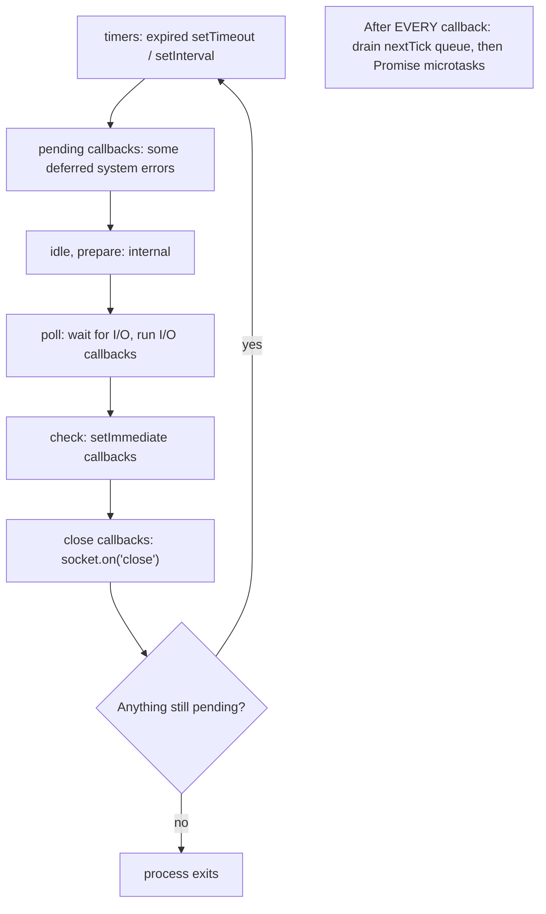

# Node Event Loop and Concurrency

> **Module 02 · Core Backend** · Prerequisites: [Node HTTP Server Concepts](05-Node-HTTP-Server-Concepts.md) · Next: [Sessions and Cookies](07-Sessions-and-Cookies.md)

---

## ⏱ If You Only Have 2 Minutes

- Node runs your JavaScript on **one thread**. The event loop (libuv) waits for I/O and runs callbacks one at a time, each to completion. Concurrency comes from *waiting* in parallel, not computing in parallel.
- Loop phases in order: **timers → pending callbacks → poll → check → close**. `setTimeout` runs in timers, I/O callbacks in poll, `setImmediate` in check.
- **Microtasks** run after every single callback, before the loop moves on: first the `process.nextTick` queue, then Promise jobs (`.then`, `await` continuations, `queueMicrotask`).
- The **libuv thread pool** (default **4** threads, `UV_THREADPOOL_SIZE`) runs work the OS cannot do asynchronously: `fs`, `dns.lookup`, async `crypto` (`pbkdf2`, `scrypt`), `zlib`. TCP sockets do **not** use it.
- Anything synchronous and slow — `pbkdf2Sync`, `JSON.parse` of a 50 MB body, a catastrophic regex, a big loop — **blocks every request** in the process. Measure it with `perf_hooks.monitorEventLoopDelay()`.
- CPU work goes to `worker_threads` (same process, separate V8 isolates). `cluster` or more containers give you more processes to serve more traffic.
- Python asyncio has the same single-thread model. A blocking call inside `async def` stalls all of FastAPI; use `asyncio.to_thread`, a plain `def` endpoint (FastAPI runs it in a thread pool), or a `ProcessPoolExecutor` for CPU work (the GIL stops threads from running Python code in parallel).

---

## 1. What It Is and Why It Exists

The **event loop** is the scheduler inside a Node process. It asks the operating system "which of my sockets, timers and files have something ready?", then runs the JavaScript callback for each ready event, one after another, on a single thread.

**Analogy:** one very fast waiter serving forty tables. The waiter never stands at the kitchen waiting for a dish; they take an order, hand it to the kitchen (the OS or thread pool), and serve whoever is ready next. It works brilliantly — until one table asks the waiter to personally carve a whole turkey. Every other table now waits.

**The problem it solves.** The older model, one OS thread per connection, spends memory on every thread stack and CPU on context switches when 10,000 connections are mostly idle, waiting for databases and clients. An event loop keeps thousands of connections open with one thread, because a waiting connection costs only a small object and a file descriptor.

**What breaks if you ignore it.** Because there is only one JavaScript thread, CPU time is shared by *every* request in the process. A 200 ms synchronous password hash means every other request in that process is at least 200 ms late. The p99 latency of the whole service rises, health checks time out, and the orchestrator restarts a pod that was "healthy" but busy.

---

## 2. How It Works

### One loop iteration



1. **Timers** — runs `setTimeout`/`setInterval` callbacks whose time has passed. A timer is a *minimum* delay, not a guarantee.
2. **Pending callbacks** — some system-level callbacks deferred from the previous iteration (for example certain TCP errors).
3. **Poll** — the heart of the loop. libuv calls epoll (Linux), kqueue (macOS) or IOCP (Windows) and runs callbacks for ready I/O: new connections, socket data, finished thread-pool jobs. If nothing else is scheduled, the loop blocks here waiting for I/O, up to the next timer.
4. **Check** — runs `setImmediate` callbacks. That is why `setImmediate` inside an I/O callback always runs before a `setTimeout(fn, 0)` scheduled at the same time.
5. **Close callbacks** — `close` events such as `socket.on("close")`.

### Microtasks vs macrotasks

A **macrotask** is a callback that a loop phase runs (a timer, an I/O callback, an immediate). A **microtask** is a job that runs as soon as the current callback finishes, before the next macrotask:

1. The `process.nextTick` queue is drained completely.
2. The Promise microtask queue is drained completely (including any new microtasks added while draining).
3. Only then does the loop continue to the next callback or phase.

Consequence: a recursive `process.nextTick` or an endless chain of resolved promises **starves I/O** — the loop never reaches the poll phase.

### Where the work actually happens

| Work | Who does it | Blocks the JS thread? |
|---|---|---|
| TCP/HTTP sockets, pipes | OS non-blocking I/O (epoll/kqueue/IOCP) | No |
| `fs.readFile`, `fs.promises.*` | libuv thread pool | No (unless you use `*Sync`) |
| `dns.lookup` (used by `http.get`, most DB drivers) | Thread pool (`getaddrinfo`) | No, but it competes for the 4 threads |
| `dns.resolve*` | c-ares, network-based | No |
| `crypto.pbkdf2`, `crypto.scrypt`, `randomBytes` (callback form) | Thread pool | No |
| `zlib.gzip` (async) | Thread pool | No |
| `JSON.parse`, regex, loops, template rendering | **The JS thread** | **Yes** |
| `crypto.pbkdf2Sync`, `fs.readFileSync`, `zlib.gzipSync` | **The JS thread** | **Yes** |

### Predict the output order

Run as CommonJS (`node order.cjs`). In an ES module, top-level code itself runs inside a promise job, so the nextTick and Promise lines can swap.

```js
const fs = require("node:fs");

console.log("A sync");
setTimeout(() => console.log("F timeout"), 0);
setImmediate(() => console.log("G immediate"));
Promise.resolve().then(() => console.log("D promise"));
process.nextTick(() => console.log("C nextTick"));
queueMicrotask(() => console.log("E queueMicrotask"));
console.log("B sync");

fs.readFile(__filename, () => {
  setTimeout(() => console.log("J io-timeout"), 0);
  setImmediate(() => console.log("I io-immediate"));
  process.nextTick(() => console.log("H io-nextTick"));
});
```

Answer: `A B C D E`, then `F` and `G` in **either order**, then `H I J`.

- Synchronous code runs first (`A`, `B`). Then the nextTick queue (`C`), then Promise jobs in FIFO order (`D`, `E`).
- From the main module, `setTimeout(0)` vs `setImmediate` depends on how fast the process got to the first timers phase (a 1 ms timer may or may not have expired), so the order is not deterministic.
- Inside an I/O callback we are in the poll phase. The next phase is check, so the immediate (`I`) always beats the timeout (`J`). The nextTick (`H`) runs before both, right after the callback returns.

The Python equivalent:

```python
import asyncio


async def worker(name: str, delay: float) -> None:
    print(f"{name} start")
    await asyncio.sleep(delay)
    print(f"{name} end")


async def main() -> None:
    asyncio.get_running_loop().call_soon(print, "call_soon")
    a = asyncio.create_task(worker("A", 0.1))
    b = asyncio.create_task(worker("B", 0))
    print("main before await")
    await asyncio.sleep(0)
    print("main after sleep(0)")
    await asyncio.gather(a, b)


asyncio.run(main())
```

Answer: `main before await`, `call_soon`, `A start`, `B start`, `main after sleep(0)`, `B end`, `A end`.

`create_task` does not start the coroutine; it schedules its first step on the loop's ready queue. Nothing runs until `main` yields at `await asyncio.sleep(0)`. Then the ready queue is processed in FIFO order: the `call_soon` callback, task A's first step, task B's first step, then `main` again. asyncio has **one** ready queue — there is no `nextTick`-style priority lane.

---

## 3. Key Concepts

### What blocks the event loop

- Synchronous APIs: `*Sync` functions in `fs`, `crypto`, `zlib`, `child_process`.
- Large `JSON.parse` / `JSON.stringify` (CPU time grows with size, and it cannot be interrupted).
- Regular expressions with catastrophic backtracking (ReDoS) on user input, for example `/(a+)+$/`.
- Loops over big arrays: sorting 1 million items, building a report in memory.
- Heavy work at startup is fine; the same work per request is not.

A useful rule of thumb from the Node docs' "Don't Block the Event Loop" guide: keep each callback's work small and bounded, and move unbounded work off the thread.

### The libuv thread pool

The pool has 4 threads by default. Set `UV_THREADPOOL_SIZE` (up to 1024) in the environment **before** the process starts; the pool is created on first use. A surprising failure: four slow `fs` reads on a network disk occupy all four threads, so `dns.lookup` for an outgoing HTTP call queues behind them, and a request that does no file I/O at all becomes slow. The fix is to raise the pool size to match the expected concurrency of pool work, not to "make Node multi-threaded".

### Measuring event-loop lag

**Event-loop delay** is how late a timer fires compared with when it was scheduled. It is the most direct signal of a blocked loop.

- `perf_hooks.monitorEventLoopDelay()` returns a histogram (values in **nanoseconds**). Export p50/p99/max as metrics.
- `performance.eventLoopUtilization()` reports the share of time the loop was busy rather than idle. Near 1.0 means the process is CPU-saturated.
- Healthy services usually show p99 delay of a few milliseconds. Sustained tens or hundreds of milliseconds means something is blocking.

### worker_threads vs cluster vs separate processes

| Option | What it is | Shares memory? | Use for |
|---|---|---|---|
| `worker_threads` | Extra threads in one process, each with its own V8 isolate and event loop | Only via `SharedArrayBuffer` or transferred `ArrayBuffer`s; otherwise messages are copied | CPU-heavy tasks: image resizing, PDF parsing, hashing, compression |
| `cluster` | Primary process forks N workers that share one listening port | No | Using all cores on a single VM without a container orchestrator |
| Separate processes / containers | N identical replicas behind a load balancer | No | The default in Kubernetes/ECS: one process per container, scale replicas |
| `child_process` | Run another program | No | Calling external tools (ffmpeg, git) |

Starting a worker thread means creating a new V8 isolate, which takes noticeable time and memory. Use a **pool** of long-lived workers (the `piscina` library is the usual choice) rather than one worker per request.

### Python: asyncio, the GIL and FastAPI's thread pool

- **asyncio** is also one thread running one event loop. A coroutine runs until it hits an `await` on something not ready; then the loop runs another. A blocking call (`time.sleep`, `requests.get`, a sync DB driver) never yields, so the whole loop stops.
- **The GIL** (Global Interpreter Lock) lets only one thread execute Python bytecode at a time in a standard CPython build. Threads still help for **blocking I/O**, because blocking calls release the GIL. They do not speed up **pure-Python CPU work**; use processes. (Python 3.13 added an experimental free-threaded build without the GIL.)
- **FastAPI** runs `async def` endpoints on the event loop and plain `def` endpoints (and `def` dependencies) in a thread pool, via AnyIO, with a default limit of 40 threads. So a `def` endpoint calling a blocking library is safe; an `async def` endpoint calling it is not.
- `asyncio.to_thread(fn, *args)` runs a blocking function in the loop's default `ThreadPoolExecutor`. `loop.run_in_executor(ProcessPoolExecutor(), fn, *args)` runs CPU work in another process (arguments and results must be picklable).
- To find blocking calls, run with asyncio debug mode (`PYTHONASYNCIODEBUG=1`): it logs any callback that takes longer than `loop.slow_callback_duration` (100 ms by default).

| Need | Node | Python (asyncio / FastAPI) |
|---|---|---|
| Wait for network I/O | `await` (OS non-blocking I/O) | `await` with an async library (`httpx`, `asyncpg`) |
| Call a blocking library | Avoid; find an async API | `def` endpoint or `asyncio.to_thread` |
| CPU-heavy work | `worker_threads` pool | `ProcessPoolExecutor` |
| Use all cores for traffic | More containers or `cluster` | More containers or `--workers N` |

---

## 4. Code Examples

Scenario: an API with a CPU-heavy report endpoint, a password-hash endpoint, and an endpoint that wraps a blocking SDK call. Each one shows the wrong way and the right way, and the service exports event-loop lag.

### Node.js / TypeScript

```ts
// npm i express   (npm i -D @types/express)  — Node.js 22+, TypeScript 5, ESM
import express from "express";
import { Worker, isMainThread, parentPort, workerData } from "node:worker_threads";
import { monitorEventLoopDelay } from "node:perf_hooks";
import { pbkdf2, pbkdf2Sync, randomBytes } from "node:crypto";
import { promisify } from "node:util";

const pbkdf2Async = promisify(pbkdf2);

function fib(n: number): number {
  return n < 2 ? n : fib(n - 1) + fib(n - 2); // deliberately CPU-bound
}

if (!isMainThread) {
  // This same file runs as the worker: compute and send the result back.
  parentPort!.postMessage(fib(workerData as number));
} else {
  // One worker per call keeps the example short; use a pool (piscina) in production,
  // because each Worker boots a new V8 isolate.
  const runInWorker = (n: number) =>
    new Promise<number>((resolve, reject) => {
      const worker = new Worker(new URL(import.meta.url), { workerData: n });
      worker.once("message", resolve);
      worker.once("error", reject);
    });

  const app = express();

  app.get("/report/blocking/:n", (req, res) => {
    res.json({ result: fib(Number(req.params.n)) }); // every other request waits for this
  });

  app.get("/report/:n", async (req, res) => {
    res.json({ result: await runInWorker(Number(req.params.n)) }); // loop stays free
  });

  app.post("/hash", async (_req, res) => {
    const salt = randomBytes(16);
    // pbkdf2Sync here would freeze the loop for the whole hash; the async form uses the libuv pool.
    const key = await pbkdf2Async("demo-password", salt, 600_000, 32, "sha256");
    res.status(201).json({ hash: key.toString("base64") });
  });

  app.get("/hash/blocking", (_req, res) => {
    const key = pbkdf2Sync("demo-password", randomBytes(16), 600_000, 32, "sha256");
    res.json({ hash: key.toString("base64") });
  });

  // Event-loop delay histogram; values are in nanoseconds.
  const loopDelay = monitorEventLoopDelay({ resolution: 20 });
  loopDelay.enable();
  setInterval(() => {
    console.info({
      loopDelayP99Ms: loopDelay.percentile(99) / 1e6,
      loopDelayMaxMs: loopDelay.max / 1e6,
    }, "event_loop");
    loopDelay.reset();
  }, 10_000).unref();

  app.listen(3000);
}
```

Try it: `curl localhost:3000/report/blocking/42` in one terminal and `curl localhost:3000/hash` in another. The hash request waits for the Fibonacci call to finish, and the logged p99 loop delay jumps to seconds. Repeat with `/report/42` and the hash returns immediately.

### Python

```python
# pip install fastapi uvicorn   — Python 3.12+
import asyncio
import hashlib
import os
import time
from collections.abc import AsyncIterator
from concurrent.futures import ProcessPoolExecutor
from contextlib import asynccontextmanager

from fastapi import FastAPI, Request


def fib(n: int) -> int:
    return n if n < 2 else fib(n - 1) + fib(n - 2)  # pure-Python CPU work holds the GIL


def legacy_sdk_call() -> dict:
    time.sleep(0.5)  # stands in for a blocking client library (requests, boto3, a sync DB driver)
    return {"status": "ok"}


async def watch_loop_lag() -> None:
    loop = asyncio.get_running_loop()
    while True:
        start = loop.time()
        await asyncio.sleep(0.5)
        lag_ms = (loop.time() - start - 0.5) * 1000  # how late the loop woke us up
        if lag_ms > 50:
            print(f"event loop lag {lag_ms:.0f} ms")


@asynccontextmanager
async def lifespan(app: FastAPI) -> AsyncIterator[None]:
    app.state.cpu_pool = ProcessPoolExecutor(max_workers=os.cpu_count() or 2)
    lag_task = asyncio.create_task(watch_loop_lag())
    yield
    lag_task.cancel()
    app.state.cpu_pool.shutdown()


app = FastAPI(lifespan=lifespan)


@app.get("/vendor/blocking")
async def vendor_blocking() -> dict:
    return legacy_sdk_call()  # async def + blocking call: the whole server stalls for 0.5 s


@app.get("/vendor/threadpool")
def vendor_threadpool() -> dict:
    return legacy_sdk_call()  # plain def: FastAPI runs it in its thread pool


@app.get("/vendor/to-thread")
async def vendor_to_thread() -> dict:
    return await asyncio.to_thread(legacy_sdk_call)  # same idea inside an async endpoint


@app.get("/report/{n}")
async def report(n: int, request: Request) -> dict:
    loop = asyncio.get_running_loop()
    # Threads would not help: the GIL lets one thread run Python code at a time.
    result = await loop.run_in_executor(request.app.state.cpu_pool, fib, n)
    return {"result": result}


@app.post("/hash", status_code=201)
async def hash_password() -> dict:
    salt = os.urandom(16)
    key = await asyncio.to_thread(hashlib.pbkdf2_hmac, "sha256", b"demo-password", salt, 600_000)
    return {"hash": key.hex()}
```

**Runtime differences to notice:**

- Node has no "plain function runs in a thread pool" escape hatch. A synchronous Express handler always runs on the event loop, so blocking work must be rewritten to an async API or moved to a worker. FastAPI decides by the function definition: `def` goes to the thread pool, `async def` runs on the loop.
- In Node, async `fs`/`crypto`/`zlib` already use the libuv pool for you. In Python you choose explicitly with `to_thread` or an executor.
- For CPU work, Node's `worker_threads` share one process (cheap messages, optional shared memory). Python uses separate processes because of the GIL, so arguments and results are pickled and copied.
- `fib` is defined at module top level because a process pool must be able to import it by name in the child process.

---

## 5. Production Concerns

- **Alert on event-loop lag, not only CPU.** One blocked callback can add seconds to p99 while average CPU looks normal. Export the p99 of `monitorEventLoopDelay` (Node) or a lag probe like `watch_loop_lag` (Python) as a metric, and correlate spikes with the route being served at that moment.
- **Health checks share the loop.** A liveness probe served by the same blocked loop times out, and the orchestrator restarts a pod that was just busy, which moves the load to other pods and can cascade. Keep liveness checks cheap and give them a generous timeout.
- **Size the thread pools.** Node's 4 pool threads are shared by `fs`, `dns.lookup`, `crypto` and `zlib`. If you hash passwords with async `scrypt` under load, raise `UV_THREADPOOL_SIZE`. In FastAPI, the 40-thread AnyIO limit means 41 concurrent `def` endpoints blocked on a slow vendor queue up behind each other.
- **Hostile input.** Limit body size (large `JSON.parse` blocks), avoid user-controlled regular expressions, and cap pagination sizes. These are denial-of-service vectors because the attacker's CPU time is taken from everyone.
- **Containers and cores.** One Node process uses roughly one core for JavaScript. Requesting 4 CPUs for a single-process Node container wastes three of them; run more replicas or a worker pool instead. For uvicorn, `--workers` (or Gunicorn workers) is roughly one per core.
- **Graceful CPU degradation.** Put CPU-heavy work behind a bounded queue (worker pool with a maximum queue length, or a background job queue). When it is full, return `503` quickly instead of letting latency grow without limit.

---

## 6. Common Mistakes

- **Using `*Sync` APIs in request handlers** (`readFileSync`, `pbkdf2Sync`) — every concurrent request waits — use the async versions; keep sync calls for startup code.
- **Assuming `async` makes CPU work non-blocking** — wrapping `fib(42)` in an `async` function still runs it on the event loop — move it to `worker_threads` or a process pool.
- **Calling blocking libraries from `async def` in FastAPI** (`requests`, `time.sleep`, sync DB drivers) — the whole server stalls — use async clients, a plain `def` endpoint, or `asyncio.to_thread`.
- **Recursive `process.nextTick` or endless promise chains** — microtasks run before I/O, so the loop never polls and sockets time out — yield with `setImmediate` between batches.
- **Creating a new worker thread per request** — isolate startup cost and memory explode under load — use a fixed-size pool such as `piscina`.
- **Using threads for CPU work in Python** — the GIL serialises them and the code is no faster — use `ProcessPoolExecutor` or a native library that releases the GIL.
- **Relying on `setTimeout(fn, 0)` vs `setImmediate` order from the main module** — the order is not guaranteed — only inside an I/O callback is `setImmediate` guaranteed to run first.

---

## 7. Comparison Table

| | Node event loop | Python asyncio | Thread-per-request (classic Java servlets / Spring MVC) |
|---|---|---|---|
| Threads running app code | 1 per process (+ worker threads) | 1 per process (+ thread pool for `def` endpoints) | One per in-flight request |
| Idle connection cost | Small object + file descriptor | Small object + file descriptor | A whole thread stack |
| Blocking call impact | Stalls every request in the process | Stalls every request in the process | Stalls only that request's thread |
| CPU parallelism | `worker_threads`, `cluster`, more processes | Processes (GIL), more workers | Threads (no GIL in the JVM) |
| Hidden pool | libuv: 4 threads for fs/dns/crypto/zlib | Default executor: `min(32, cpu_count + 4)` threads | The request thread pool itself |
| Best for | Many concurrent I/O-bound requests | Many concurrent I/O-bound requests | Mixed or CPU-heavy work, blocking libraries |

---

## 8. Interview Questions

**[Junior] Node is single-threaded. How does it handle thousands of concurrent requests?**
JavaScript runs on one thread, but almost all of a typical request's time is spent waiting for databases and networks. Node hands that waiting to the OS (non-blocking sockets) or the libuv thread pool and runs other callbacks meanwhile. When I/O completes, the event loop runs the continuation. It handles many requests concurrently, but it executes only one piece of JavaScript at a time.

**[Junior] What is the difference between `process.nextTick`, a Promise `.then`, and `setImmediate`?**
`process.nextTick` callbacks run immediately after the current operation, before any Promise jobs. Promise callbacks are microtasks that run right after the nextTick queue is drained. `setImmediate` is a macrotask that runs in the check phase, after the poll phase of the current loop iteration. So for code scheduled at the same moment the order is nextTick, then promises, then immediates.

**[Mid] What is the libuv thread pool used for, and when would you change its size?**
It runs operations the OS cannot do asynchronously in a portable way: file system calls, `dns.lookup`, async `crypto` such as `pbkdf2` and `scrypt`, and `zlib`. Network sockets do not use it. The default is 4 threads, so heavy password hashing or slow disk reads can queue other pool users such as DNS lookups for outbound HTTP calls. Raise `UV_THREADPOOL_SIZE` in the environment before the process starts when monitoring shows pool contention.

**[Mid] An `async def` FastAPI endpoint calls `requests.get()`. What happens under load, and how do you fix it?**
`requests` is blocking, so the coroutine never yields and the single event loop is stuck for the duration of each call. Every other request, including health checks, waits behind it, so throughput collapses to roughly one request at a time per worker. Fix it with an async client such as `httpx.AsyncClient`, by making the endpoint a plain `def` so FastAPI runs it in its thread pool, or with `await asyncio.to_thread(...)`.

**[Mid] How do you detect that the event loop is blocked in production?**
Measure event-loop delay: `monitorEventLoopDelay()` in Node gives a histogram of how late timers fire, and `eventLoopUtilization()` shows how busy the loop is. In Python, a small task that sleeps and measures its own lateness works, and asyncio debug mode logs callbacks slower than 100 ms. Alert on p99 delay, then use a CPU profile (`node --cpu-prof`, or py-spy for Python) during a spike to find the function.

**[Senior] You need to resize uploaded images in a Node API. Compare worker_threads, cluster and a separate service.**
`cluster` does not solve it: each cluster worker still blocks its own loop while resizing, so requests to that worker stall. A `worker_threads` pool (for example piscina) keeps the request loop free and avoids network hops, but resizing still competes for the same container's CPU and memory, and a crash or leak affects the API. A separate worker service fed by a job queue isolates the load, scales independently and survives restarts, at the cost of a queue, eventual completion and status polling. For occasional small images a thread pool is fine; for heavy or bursty workloads use the queue.

**[Senior] Why might `setTimeout(fn, 0)` and `setImmediate(fn)` run in a different order from run to run, and when is the order guaranteed?**
From the main module, the loop enters the timers phase first, but whether the 1 ms minimum timer has already expired depends on how long process startup took, so sometimes the timeout fires first and sometimes the immediate does. Inside an I/O callback, the loop is in the poll phase and the check phase comes next, so `setImmediate` always runs before the timer. Code should never depend on the main-module ordering.

**[Senior] How does Python's concurrency model differ from Node's, and what are the consequences for a CPU-heavy endpoint?**
Both use a single-threaded event loop for async I/O, and both stall completely on a blocking call. The difference is the escape hatch: Node `worker_threads` run JavaScript truly in parallel inside one process, while CPython's GIL means extra threads cannot run Python code in parallel. So a CPU-heavy FastAPI endpoint needs a `ProcessPoolExecutor`, more uvicorn workers or a job queue, and pays for pickling data between processes. Threads remain fine in Python for blocking I/O, which is exactly what FastAPI's thread pool for `def` endpoints is for.

---

## 9. Cheat Sheet

```text
Model         1 JS thread · I/O waits in OS/libuv · callbacks run to completion
Phases        timers → pending → (idle/prepare) → poll → check → close
Microtasks    after EVERY callback: all nextTicks, then all Promise jobs
Order         sync → nextTick → promise → (timeout ? immediate) ; inside I/O: immediate before timeout
ESM caveat    top-level ESM runs inside a promise job → promises may beat nextTick
Thread pool   4 threads (UV_THREADPOOL_SIZE, set before start): fs, dns.lookup, crypto, zlib — not sockets
Blockers      *Sync APIs, huge JSON.parse, ReDoS regex, big loops, recursive nextTick
Measure       monitorEventLoopDelay() (ns) p99 · eventLoopUtilization() · node --cpu-prof
CPU work      worker_threads pool (piscina) · not one worker per request
Scale         more containers or cluster · 1 Node process ≈ 1 core of JS
Python        async def + blocking call = whole server stalls
Python fix    def endpoint (AnyIO pool, 40 threads) · asyncio.to_thread · async libraries
Python CPU    ProcessPoolExecutor (GIL) · picklable top-level functions
Debug         PYTHONASYNCIODEBUG=1 → logs callbacks > 100 ms
```

---

## Related Topics

- [Node HTTP Server Concepts](05-Node-HTTP-Server-Concepts.md) — the server that the event loop is running
- [Concurrency](../Module-04-Operating-Systems/09-Concurrency.md) — concurrency vs parallelism in general
- [Process vs Thread](../Module-04-Operating-Systems/04-Process-vs-Thread.md) — why `worker_threads` and `cluster` behave differently
- [Backend Concurrency Patterns](../Module-04-Operating-Systems/32-Backend-Concurrency-Patterns.md) — pools, queues and bounded work
- [Asynchronous Processing](19-Asynchronous-Processing.md) — moving heavy work out of the request entirely
