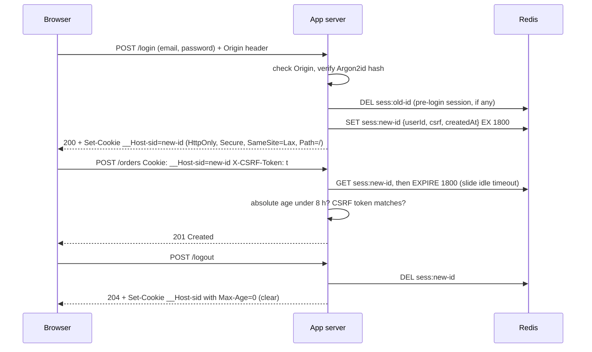

# Sessions and Cookies

> **Module 02 · Core Backend** · Prerequisites: [HTTP Fundamentals](01-HTTP-Fundamentals.md) · Next: [JWT Authentication](08-JWT-Authentication.md)

---

## ⏱ If You Only Have 2 Minutes

- The browser stores only a random **session ID** in a cookie. The server stores the session state (user ID, CSRF token, timestamps) in a store such as Redis. Deleting the server record logs the user out instantly.
- Session IDs come from a CSPRNG with at least 64 bits of entropy (OWASP); use 128–256 bits in practice. Never use user IDs, timestamps or `Math.random()`.
- Cookie flags: `HttpOnly` (JavaScript cannot read it), `Secure` (HTTPS only), `SameSite=Lax` or `Strict` (not sent on cross-site POSTs), `Path=/`, no `Domain`. The `__Host-` name prefix makes the browser enforce the last three.
- **Rotate the session ID on login** and on any privilege change. Otherwise an attacker who planted an ID before login (session fixation) is logged in too.
- Two timeouts: **idle** (for example 15–30 min, slides on activity) and **absolute** (for example 8 h, never slides).
- Cookies are sent automatically, so cookie-authenticated state-changing requests need **CSRF** protection: `SameSite` plus a synchronizer token or signed double-submit token, and an `Origin` / `Sec-Fetch-Site` check.
- Logout must **destroy the server-side session** and clear the cookie. Clearing only the cookie leaves a stolen copy valid.

---

## 1. What It Is and Why It Exists

HTTP is stateless: each request arrives with no memory of the previous one. A **cookie** is a small name/value pair that the server asks the browser to store (`Set-Cookie`) and that the browser sends back automatically (`Cookie`) on later requests to the same site. A **session** is server-side state linked to one browser through an unguessable ID stored in that cookie.

**Analogy:** a coat check. You hand over your coat and get a numbered ticket. The ticket is worthless on its own; the coat stays behind the counter. If you lose the ticket, the attendant can mark that number void, and whoever finds it gets nothing.

**The problem it solves.** After a successful login, the server must recognise the same user on every later request without asking for the password again. Putting "user=42" in a cookie would let anyone change it to 43. Signing the cookie stops tampering but still cannot be revoked. A random ID that points to server-side state gives you both integrity (the client cannot forge the state) and control (the server can end the session at any time).

**The cost.** Every request needs a store lookup, all app instances must share the store, and because browsers attach cookies automatically, you must defend against cross-site request forgery. For the stateless alternative and its trade-offs, see [JWT Authentication](08-JWT-Authentication.md).

Cookies are specified in [RFC 6265](https://www.rfc-editor.org/rfc/rfc6265). `SameSite` and the `__Host-` / `__Secure-` prefixes come from its successor draft (RFC 6265bis), which all major browsers implement.

---

## 2. How It Works

### Login, use, logout



### What the browser does with `Set-Cookie`

```http
Set-Cookie: __Host-sid=Yk3v...Q; Path=/; Max-Age=28800; Secure; HttpOnly; SameSite=Lax
```

1. Stores the cookie for the exact host that set it (no `Domain` attribute means **host-only**).
2. Deletes it after `Max-Age` seconds. Without `Max-Age` or `Expires`, it is a "session cookie" that lives until the browser decides the session is over — browsers that restore tabs may keep it for days, so never rely on this for security.
3. On every later request to that host over HTTPS, it adds `Cookie: __Host-sid=Yk3v...Q` — unless `SameSite` rules block it for a cross-site request.
4. Hides it from `document.cookie` because of `HttpOnly`.

### What the server does on each request

1. Read the session ID from the cookie. If missing, the request is anonymous.
2. Look it up in the store. Missing means expired or logged out → treat as anonymous (`401` on protected routes).
3. Reject it if the **absolute** lifetime has passed, and delete the record.
4. Slide the **idle** timeout forward (Redis `EXPIRE`).
5. For unsafe methods (`POST`, `PUT`, `PATCH`, `DELETE`), run CSRF checks before any business logic.

---

## 3. Key Concepts

### Cookie attributes

| Attribute | Effect | Recommended for a session cookie |
|---|---|---|
| `HttpOnly` | Not readable from JavaScript (`document.cookie`) | Always. XSS can still *send* requests, but cannot copy the ID out |
| `Secure` | Sent only over HTTPS | Always |
| `SameSite=Strict` | Never sent on cross-site requests, even when the user clicks a link from another site | High-value apps; users arriving from an email link appear logged out on the first page |
| `SameSite=Lax` | Sent on cross-site top-level navigations with safe methods (`GET`), not on cross-site `POST`, iframes or `fetch` | The usual default |
| `SameSite=None` | Sent everywhere; requires `Secure` | Only for genuine cross-site embeds; needs full CSRF protection |
| `Domain` | Omitted: this host only. Set: this domain **and all subdomains** | Omit it |
| `Path` | Limits which URL paths receive the cookie | `/`. Path is not a security boundary |
| `Max-Age` / `Expires` | Lifetime in seconds / as a date; `Max-Age` wins if both are set | Match the absolute session timeout |
| `__Host-` prefix | Browser rejects the cookie unless `Secure`, `Path=/` and no `Domain` | Use it: a compromised or user-controlled subdomain cannot overwrite it |
| `__Secure-` prefix | Browser rejects the cookie unless `Secure` | Weaker; use when you need `Domain` |

Set `SameSite` explicitly. Chrome treats cookies without it as `Lax`, but not every browser does, and defaults have changed before.

RFC 6265 asks browsers to support at least 4096 bytes per cookie and 50 cookies per domain. A session cookie needs about 43 characters.

### "Site" is not "origin"

`SameSite` compares **sites**: the scheme plus the registrable domain (`https://example.com`). So `https://app.example.com` and `https://blog.example.com` are the **same site** but **different origins**. A request from a hacked or user-generated subdomain counts as same-site, and `SameSite` will not stop it. That is one reason `SameSite` is defence in depth, not a complete CSRF defence.

### Session ID quality and storage

- **Entropy:** OWASP requires at least 64 bits. `crypto.randomBytes(32)` (Node) or `secrets.token_urlsafe(32)` (Python) gives 256 bits.
- **Meaningless:** the ID must not encode the user, role or time; all of that stays server-side.
- **Generic cookie name:** `connect.sid` or `PHPSESSID` reveals the framework. Use something neutral like `__Host-sid`.
- **Store:**

| Store | Pros | Cons |
|---|---|---|
| In-process memory | Zero setup | Lost on restart; not shared between instances; express-session's `MemoryStore` is documented as not for production |
| Redis | Fast, native TTL per key, shared by all instances | Another dependency; if it goes down, everyone is logged out or blocked |
| SQL table | Durable, easy "list my sessions" queries | A database read on every request; needs a cleanup job for expired rows |
| Signed cookie (client-side) | No store at all | Cannot be revoked; size limits; this is what Starlette's `SessionMiddleware` does |

To support "log out of all devices" and "end all sessions after a password change", also keep a per-user set of session IDs (Redis `SADD user-sessions:<userId> <sid>`) and delete every member.

### Session fixation and rotation

**Session fixation:** the attacker gets a valid but anonymous session ID (by visiting the site), plants it in the victim's browser (through a cookie set from a sibling subdomain, or an app that accepts IDs in URLs), and waits. The victim logs in; if the server simply marks *that* session as authenticated, the attacker's copy of the ID is now logged in too.

**Defence:** issue a brand-new ID at login and destroy the old record. Do the same on privilege changes (becoming admin, re-entering a password for a sensitive action). Accept IDs only from cookies, never from URLs. The `__Host-` prefix blocks the subdomain planting route.

### Timeouts

| Timeout | Behaviour | Typical value (OWASP ranges) |
|---|---|---|
| Idle | Expires after N minutes without a request; each request resets it | 2–5 min for high-value apps, 15–30 min for low-risk apps |
| Absolute | Expires N hours after login no matter what | 4–8 h for an office-day app |
| Renewal | Rotate the ID periodically during a long session | Optional; limits the value of a stolen ID |

Enforce timeouts **on the server**. Cookie `Max-Age` is a hint the client can ignore or edit.

### CSRF and its defences

**Cross-site request forgery:** a page on `evil.example` submits a form to `bank.com/transfer`. The browser attaches the bank's cookie, so the request arrives authenticated. The attacker cannot read the response, but the transfer still happens.

| Defence | How it works | Notes |
|---|---|---|
| `SameSite=Lax/Strict` | Browser does not send the cookie on cross-site `POST`s | Does not cover same-site subdomains or state-changing `GET`s |
| Synchronizer token | Random token stored in the session; client must echo it in a header or form field | OWASP's primary recommendation for stateful apps |
| Signed double-submit cookie | Token in a cookie and a header, HMAC-bound to the session ID | For stateless setups; the naive unsigned version can be defeated by cookie injection |
| `Origin` / `Sec-Fetch-Site` check | Reject unsafe requests the browser labels as cross-site | Cheap and strong in modern browsers; good first layer |
| Custom header required (APIs) | Cross-site HTML forms cannot add custom headers | Works for JSON APIs called with `fetch` |

Also protect the **login** form: login CSRF signs the victim into the attacker's account, so whatever they type next (card details, search history) lands in an account the attacker controls. And never change state on `GET`: `Lax` deliberately sends cookies on top-level cross-site `GET` navigations.

---

## 4. Code Examples

Scenario: a browser app logs in with email and password. The server creates a Redis-backed session, rotates the ID, sets hardened cookie flags, enforces idle and absolute timeouts, checks CSRF on every unsafe request, and destroys the session on logout. Password verification is covered in [Password Hashing](10-Password-Hashing.md).

### Node.js / TypeScript

`session.ts` — the store, the cookie, and the middleware:

```ts
// npm i express cookie-parser ioredis  (npm i -D @types/express @types/cookie-parser) — Node.js 22+, ESM
import { randomBytes, timingSafeEqual } from "node:crypto";
import type { Request, Response, NextFunction } from "express";
import { Redis } from "ioredis";

export const redis = new Redis(process.env.REDIS_URL ?? "redis://localhost:6379");
export const COOKIE = "__Host-sid";          // prefix forces Secure, Path=/, no Domain
const IDLE_TTL_S = 30 * 60;                   // slid forward on every request
const ABSOLUTE_TTL_MS = 8 * 60 * 60 * 1000;   // never slides: re-login after a working day
const APP_ORIGIN = "https://app.example.com";

export interface Session { userId: string; csrf: string; createdAt: number }

declare global {
  namespace Express { interface Request { session?: Session; sessionId?: string } }
}

const randomToken = () => randomBytes(32).toString("base64url"); // 256 bits from the OS CSPRNG

export async function createSession(userId: string): Promise<[string, Session]> {
  const id = randomToken();
  const session: Session = { userId, csrf: randomToken(), createdAt: Date.now() };
  await redis.set(`sess:${id}`, JSON.stringify(session), "EX", IDLE_TTL_S);
  return [id, session];
}

export function setSessionCookie(res: Response, id: string): void {
  res.cookie(COOKIE, id, {
    httpOnly: true, secure: true, sameSite: "lax", path: "/",
    maxAge: ABSOLUTE_TTL_MS, // Express takes milliseconds here, not seconds
  });
}

export async function loadSession(req: Request, _res: Response, next: NextFunction): Promise<void> {
  const id: unknown = req.cookies?.[COOKIE];
  if (typeof id === "string") {
    const raw = await redis.get(`sess:${id}`);
    const session = raw ? (JSON.parse(raw) as Session) : null;
    if (session && Date.now() - session.createdAt < ABSOLUTE_TTL_MS) {
      await redis.expire(`sess:${id}`, IDLE_TTL_S);
      req.session = session;
      req.sessionId = id;
    } else if (session) {
      await redis.del(`sess:${id}`); // absolute limit reached even though the user stayed active
    }
  }
  next();
}

export function csrfProtection(req: Request, res: Response, next: NextFunction): void {
  if (["GET", "HEAD", "OPTIONS"].includes(req.method)) { next(); return; }
  // Layer 1: the browser tells us the request is cross-site. Also covers login CSRF.
  const origin = req.get("origin");
  if (req.get("sec-fetch-site") === "cross-site" || (origin !== undefined && origin !== APP_ORIGIN)) {
    res.status(403).json({ error: "cross_site_request" });
    return;
  }
  // Layer 2: synchronizer token for anything done with an authenticated session.
  if (req.session) {
    const sent = Buffer.from(req.get("x-csrf-token") ?? "");
    const expected = Buffer.from(req.session.csrf);
    if (sent.length !== expected.length || !timingSafeEqual(sent, expected)) {
      res.status(403).json({ error: "csrf_token_invalid" });
      return;
    }
  }
  next();
}
```

`app.ts` — login with rotation, and a logout that destroys server state:

```ts
import express from "express";
import cookieParser from "cookie-parser";
import { COOKIE, createSession, csrfProtection, loadSession, redis, setSessionCookie } from "./session.js";

declare const users: { verifyCredentials(email: string, password: string): Promise<{ id: string } | null> };

const app = express();
app.use(express.json({ limit: "10kb" }));
app.use(cookieParser());
app.use(loadSession);
app.use(csrfProtection);

app.post("/login", async (req, res) => {
  const { email, password } = (req.body ?? {}) as { email?: string; password?: string };
  const user = await users.verifyCredentials(String(email ?? ""), String(password ?? ""));
  if (!user) {
    res.status(401).json({ error: "invalid_credentials" }); // same answer for unknown email and bad password
    return;
  }
  // Session fixation defence: never upgrade an existing ID; issue a new one and kill the old.
  if (req.sessionId) await redis.del(`sess:${req.sessionId}`);
  const [id, session] = await createSession(user.id);
  setSessionCookie(res, id);
  res.status(200).json({ csrfToken: session.csrf }); // the SPA keeps this in memory
});

app.get("/me", (req, res) => {
  if (!req.session) {
    res.status(401).json({ error: "not_authenticated" });
    return;
  }
  res.json({ userId: req.session.userId, csrfToken: req.session.csrf }); // lets a reloaded page recover the token
});

app.post("/logout", async (req, res) => {
  if (req.sessionId) await redis.del(`sess:${req.sessionId}`); // a stolen copy of the cookie is now useless
  // The browser only removes the cookie if name, path and domain match the original.
  res.clearCookie(COOKIE, { httpOnly: true, secure: true, sameSite: "lax", path: "/" });
  res.status(204).end();
});

app.listen(3000);
```

With `express-session` the same ideas appear as `req.session.regenerate()` (rotation on login), `req.session.destroy()` (logout) and a Redis store such as `connect-redis`. Writing it by hand here makes each step visible.

### Python

`session.py` — the store, the cookie, and CSRF as a dependency:

```python
# pip install fastapi "redis>=5"   — Python 3.12+
import secrets
import time
from typing import Annotated

import redis.asyncio as redis
from fastapi import Cookie, Depends, Header, HTTPException, Request, Response
from pydantic import BaseModel

r = redis.from_url("redis://localhost:6379", decode_responses=True)
COOKIE = "__Host-sid"
IDLE_TTL_S = 30 * 60
ABSOLUTE_TTL_S = 8 * 60 * 60
APP_ORIGIN = "https://app.example.com"


class Session(BaseModel):
    sid: str
    user_id: str
    csrf: str
    created_at: float


async def create_session(user_id: str) -> Session:
    s = Session(sid=secrets.token_urlsafe(32), user_id=user_id,
                csrf=secrets.token_urlsafe(32), created_at=time.time())
    await r.set(f"sess:{s.sid}", s.model_dump_json(), ex=IDLE_TTL_S)
    return s


def set_session_cookie(response: Response, sid: str) -> None:
    # max_age is in seconds in Starlette (Express uses milliseconds).
    response.set_cookie(COOKIE, sid, max_age=ABSOLUTE_TTL_S, path="/",
                        secure=True, httponly=True, samesite="lax")


async def current_session(sid: Annotated[str | None, Cookie(alias=COOKIE)] = None) -> Session | None:
    raw = await r.get(f"sess:{sid}") if sid else None
    if raw is None:
        return None
    s = Session.model_validate_json(raw)
    if time.time() - s.created_at > ABSOLUTE_TTL_S:
        await r.delete(f"sess:{sid}")
        return None
    await r.expire(f"sess:{sid}", IDLE_TTL_S)  # slide the idle timeout
    return s


async def csrf_protected(
    request: Request,
    session: Annotated[Session | None, Depends(current_session)],
    x_csrf_token: Annotated[str | None, Header()] = None,
) -> Session | None:
    if request.method in {"GET", "HEAD", "OPTIONS"}:
        return session
    origin = request.headers.get("origin")
    if request.headers.get("sec-fetch-site") == "cross-site" or (origin and origin != APP_ORIGIN):
        raise HTTPException(403, "cross_site_request")
    # compare_digest on bytes: constant time, and safe for non-ASCII header values.
    if session and not secrets.compare_digest((x_csrf_token or "").encode(), session.csrf.encode()):
        raise HTTPException(403, "csrf_token_invalid")
    return session
```

`main.py` — the routes:

```python
from typing import Annotated

from fastapi import Depends, FastAPI, HTTPException, Response
from pydantic import BaseModel

from session import COOKIE, Session, create_session, csrf_protected, current_session, r, set_session_cookie

app = FastAPI()
Guarded = Annotated[Session | None, Depends(csrf_protected)]


class LoginIn(BaseModel):
    email: str
    password: str


@app.post("/login")
async def login(body: LoginIn, response: Response, session: Guarded) -> dict:
    user_id = await users_repo.verify_credentials(body.email, body.password)  # Argon2id check
    if user_id is None:
        raise HTTPException(401, "invalid_credentials")
    if session is not None:
        await r.delete(f"sess:{session.sid}")  # rotation: the pre-login ID dies here
    new = await create_session(user_id)
    set_session_cookie(response, new.sid)
    return {"csrf_token": new.csrf}


@app.get("/me")
async def me(session: Annotated[Session | None, Depends(current_session)]) -> dict:
    if session is None:
        raise HTTPException(401, "not_authenticated")
    return {"user_id": session.user_id, "csrf_token": session.csrf}


@app.post("/logout", status_code=204)
async def logout(session: Guarded) -> Response:
    if session is not None:
        await r.delete(f"sess:{session.sid}")
    resp = Response(status_code=204)
    # Returning our own Response means cookies must be set on it, not on an injected one.
    resp.delete_cookie(COOKIE, path="/", secure=True, httponly=True, samesite="lax")
    return resp
```

**Differences to notice:**

- Express's `maxAge` is in **milliseconds**; Starlette's `max_age` is in **seconds**. Mixing them up gives 8,000-hour or 29-second cookies.
- Node's `timingSafeEqual` throws if the buffers differ in length, so the length check comes first. Python's `secrets.compare_digest` handles different lengths itself.
- Starlette's built-in `SessionMiddleware` stores the whole session in a **signed cookie**. It is not a server-side session and cannot be revoked; use a Redis-backed store like this one when logout must really log out.

---

## 5. Production Concerns

- **Redis is now on the login path.** If it is down, every authenticated request fails. Run it with replication, set short client timeouts, and decide in advance whether to fail closed (`503`) — the safe default — or allow read-only anonymous pages. Use a key prefix and `maxmemory-policy noeviction` (or a dedicated instance) so that cache pressure never silently evicts sessions.
- **Per-request cost.** Every request is a `GET` plus an `EXPIRE`. At high traffic, skip the `EXPIRE` when the TTL was refreshed recently, or pipeline both commands in one round trip.
- **Revoke on security events.** Password change, password reset, MFA change and admin-forced logout must delete *all* of a user's sessions (keep the per-user ID set). Show users a "your active sessions" list built from that set.
- **Never log session IDs.** A session ID in a log is a credential. Log a hash or the first few characters, the user ID, and the outcome. Strip `Cookie` headers from access logs and error trackers.
- **CSRF failures are a signal.** Count `403 csrf_token_invalid` and `cross_site_request` by route. A sudden rise right after a deploy is usually a frontend bug (token not sent); a steady trickle from one referrer is an attack.
- **Cookie scope across apps.** If `marketing.example.com` runs a third-party CMS, never use `Domain=example.com` for the session cookie, or that CMS receives every user's session. Host-only (`__Host-`) cookies avoid this by design.
- **XSS still matters.** `HttpOnly` stops script from *reading* the cookie, but injected script runs inside the user's session and can call your API with the cookie attached. A strict Content Security Policy and output encoding remain necessary.

---

## 6. Common Mistakes

- **Keeping the same session ID across login** — session fixation lets a pre-planted ID become an authenticated one — issue a new ID at login and on privilege changes, and delete the old record.
- **Logout that only clears the cookie** — a stolen copy of the ID keeps working until it expires — delete the server-side record first, then clear the cookie.
- **Setting `Domain=example.com` "to be safe"** — every subdomain, including ones run by vendors, receives and can overwrite the session cookie — omit `Domain` and use the `__Host-` prefix.
- **Relying on `SameSite` alone for CSRF** — sibling subdomains are same-site, and `Lax` still sends cookies on cross-site `GET` navigations — add a synchronizer token or an `Origin` check, and never change state on `GET`.
- **Only an idle timeout** — an attacker with a stolen ID keeps it alive forever by sending a request every few minutes — add an absolute lifetime enforced on the server.
- **Using the in-memory store in production** — sessions disappear on deploy and are not shared between instances, so users bounce between "logged in" and "logged out" — use Redis or a database.
- **Using `SameSite=None` without need** — cross-site requests now carry the session and every endpoint depends on the CSRF token alone — use `Lax` or `Strict` unless the app truly runs inside third-party sites.

---

## 7. Comparison Table

| | Server-side session (opaque ID + Redis) | Signed cookie session (state in the cookie) | JWT access token ([chapter 08](08-JWT-Authentication.md)) |
|---|---|---|---|
| Where state lives | Server store | Client cookie, signed by the server | Client, signed claims |
| Revocation | Instant: delete the record | Not possible before expiry (unless you add server state) | Not possible before `exp` without a denylist |
| Per-request cost | One store lookup | HMAC check | Signature check |
| Size | ~43-character ID | Grows with session data (≈4 KB cookie limit) | 300–1,000+ bytes |
| Data visible to client | No | Yes, unless also encrypted | Yes (base64url) |
| CSRF exposure | Yes (cookie) | Yes (cookie) | Only if stored in a cookie |
| Best for | Browser apps that need real logout and admin control | Small apps with tiny, non-sensitive state | APIs used by many services or non-browser clients |

---

## 8. Interview Questions

**[Junior] What do the `HttpOnly`, `Secure` and `SameSite` cookie flags do?**
`HttpOnly` hides the cookie from JavaScript, so an XSS payload cannot read and send the session ID to an attacker. `Secure` means the browser sends the cookie only over HTTPS, so it never crosses the network in plain text. `SameSite` controls whether the cookie is sent on requests started by other sites: `Strict` never, `Lax` only on top-level `GET` navigations, `None` always (and it requires `Secure`).

**[Junior] What is the difference between a cookie and a session?**
A cookie is a small piece of data the browser stores and sends back automatically to the site that set it. A session is state kept on the server, such as the user ID and CSRF token, for one logged-in browser. The usual design connects them: the cookie carries only a random session ID, and the server looks up the real data. The client never sees or controls the session contents.

**[Mid] What is session fixation, and how do you prevent it?**
The attacker obtains a valid session ID and gets the victim's browser to use it, for example by setting a cookie from a compromised subdomain. When the victim logs in, a vulnerable server marks that same session as authenticated, so the attacker now shares it. Prevent it by generating a new session ID on login and on privilege changes, deleting the old record, accepting IDs only from cookies, and using the `__Host-` prefix so subdomains cannot plant the cookie.

**[Mid] Why do cookie-based sessions need CSRF protection when `Authorization: Bearer` tokens do not?**
The browser attaches cookies automatically to requests to their site, even when another site triggered the request, so a malicious page can make authenticated requests on the user's behalf. A bearer token in a header is added by your own JavaScript, and another site's page cannot read it or make the browser add it. Defences for cookies are `SameSite`, a synchronizer or signed double-submit token, and checking `Origin` or `Sec-Fetch-Site`.

**[Mid] How do idle and absolute timeouts differ, and why do you need both?**
An idle timeout ends a session after a period with no requests and is reset by activity; it protects users who walk away from a shared computer. An absolute timeout ends the session a fixed time after login regardless of activity. Without it, someone holding a stolen ID can keep the session alive forever by making a request every few minutes. Both are enforced on the server — here with a Redis TTL for idle and a `createdAt` check for absolute.

**[Senior] `SameSite=Lax` is now the browser default. Is CSRF solved?**
No. `SameSite` works per site, not per origin, so a request from any subdomain of your registrable domain is same-site and carries the cookie. `Lax` still sends cookies on cross-site top-level `GET` navigations, so any state-changing `GET` endpoint is exposed. Not every browser applies `Lax` by default, and apps sometimes need `SameSite=None` for embeds. Treat `SameSite` as one layer and keep a token-based defence or strict `Origin` checking for unsafe methods.

**[Senior] Design "log out of all devices" and forced logout after a password change for a sessions-based app.**
Store a per-user set of session IDs next to the sessions (`SADD user-sessions:<id> <sid>` at login, `SREM` at logout). Logging out everywhere deletes every session key in the set and then the set itself; a password change or reset does the same, except possibly the current session, which gets a fresh ID. Because the state is server-side, the effect is immediate on the next request. Clean stale members periodically, or check existence when listing, because idle-expired keys disappear without removing themselves from the set.

**[Senior] Your session store (Redis) goes down. What happens and what should happen?**
Every authenticated request fails its session lookup. If the code treats "lookup error" like "no session", all users are silently logged out and may lose form data; if it treats it as authenticated, that is a security hole. The correct behaviour is to fail closed with a `503` and a clear error, alert immediately, and rely on a replicated Redis with automatic failover to keep the outage short. Keep login and session reads on a dedicated Redis (or one with `noeviction`), so a cache memory spike cannot evict sessions.

---

## 9. Cheat Sheet

```text
Model          cookie = random ID only · state in Redis · logout = DEL the record
ID             CSPRNG, ≥ 64 bits (OWASP); use 256: randomBytes(32) / secrets.token_urlsafe(32)
Cookie         __Host-sid=…; Path=/; Secure; HttpOnly; SameSite=Lax; Max-Age=<absolute>
__Host-        requires Secure + Path=/ + no Domain → subdomains cannot plant or read it
Domain         omit (host-only); setting it shares the cookie with every subdomain
SameSite       Strict: never cross-site · Lax: top-level GET only · None: always (needs Secure)
Site ≠ origin  app.example.com and evil.example.com are same-site
Rotation       new ID on login + privilege change; delete the old record (session fixation)
Timeouts       idle 15–30 min (2–5 high value), slides · absolute 4–8 h, never slides · server-enforced
CSRF           Origin/Sec-Fetch-Site check + synchronizer token (or HMAC double-submit) + SameSite
               protect login too · no state changes on GET
Logout         DEL server record → clear cookie with same name/path/domain
Units          Express maxAge = ms · Starlette max_age = s
Starlette      SessionMiddleware = signed client-side cookie, not revocable
Never          IDs in URLs, logging session IDs, MemoryStore in prod, Domain=parent for no reason
```

---

## Related Topics

- [JWT Authentication](08-JWT-Authentication.md) — the stateless alternative and when to prefer it
- [Authentication Flow](11-Authentication-Flow.md) — where session creation fits in login, MFA and recovery
- [Password Hashing](10-Password-Hashing.md) — the Argon2id check that runs before a session is created
- [Redis Deep Dive](../Module-07-Advanced-Backend-and-System-Design/15-Redis-Deep-Dive.md) — TTLs, eviction policies and replication for the session store
- [HTTPS](../Module-06-Networking-and-Distributed-Basics/12-HTTPS.md) — why `Secure` cookies and HTTPS are not optional
