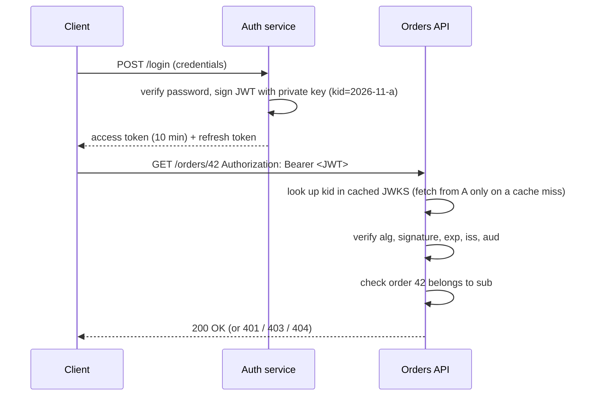

# JWT Authentication

> **Module 02 · Core Backend** · Prerequisites: [Sessions and Cookies](07-Sessions-and-Cookies.md) · Next: [Refresh Tokens](09-Refresh-Tokens.md)

---

## ⏱ If You Only Have 2 Minutes

- A JWT is `base64url(header).base64url(payload).signature`. It is **signed, not encrypted** — anyone holding it can read the payload.
- Verify in this order: algorithm is on your allow-list → signature → `exp` / `nbf` → `iss` → `aud`. Only then trust `sub` or scopes.
- **Never let the token choose the algorithm.** Pin it (e.g. only `RS256`). This blocks `alg: none` and algorithm-confusion attacks.
- HS256 uses one shared secret, so every service that can verify can also **forge** tokens. RS256 / ES256 / EdDSA sign with a private key and verify with a public key — use them when more than one service verifies.
- A JWT cannot be revoked before `exp` unless you add state (a `jti` denylist or a per-user token version). That is why access tokens are short-lived (5–15 min) and paired with [refresh tokens](09-Refresh-Tokens.md).
- Rotate keys with `kid` + a JWKS endpoint. Keep the old public key published until every token it signed has expired.
- The token proves **who** the caller is. It does not prove they may read *order 42* — still check ownership in the database.

---

## 1. What It Is and Why It Exists

A **JSON Web Token** (JWT, [RFC 7519](https://www.rfc-editor.org/rfc/rfc7519)) is a compact string that carries **claims** — statements such as "this is user 123, issued by auth.example.com, valid until 10:15". The issuer signs those claims. Any service that has the verification key can check the signature and trust the claims **without calling the issuer or a database**.

**Analogy:** a festival wristband with a tamper-proof seal. Any gate guard can check the seal and read "VIP, Saturday only" without phoning the ticket office. But once you hand out a wristband, you cannot take it back until the festival ends — unless every guard also carries a list of banned wristband numbers.

**The problem it solves.** With [server-side sessions](07-Sessions-and-Cookies.md), every request needs a lookup in a shared session store. That is fine for one application. It gets expensive when 15 microservices each need to authenticate a request, or when the store sits in another region. A JWT moves the "who is this?" answer into the request itself, so verification is a local CPU operation.

**The cost.** You give up easy revocation, and token contents become a public contract. Most of this chapter is about handling that cost.

> Terminology: what people call "a JWT" is almost always a **JWS** (signed, [RFC 7515](https://www.rfc-editor.org/rfc/rfc7515)). An encrypted token is a **JWE** ([RFC 7516](https://www.rfc-editor.org/rfc/rfc7516)) and is much rarer. Current best practices are in [RFC 8725](https://www.rfc-editor.org/rfc/rfc8725).

---

## 2. How It Works

### Anatomy

```text
eyJhbGciOiJSUzI1NiIsImtpZCI6IjIwMjYtMTEtYSIsInR5cCI6ImF0K2p3dCJ9   ← header (base64url JSON)
.eyJpc3MiOiJodHRwczovL2F1dGguZXhhbXBsZS5jb20iLCJzdWIiOiJ1c2VyXzEy…   ← payload (base64url JSON)
.Q2hlY2sgbWUgd2l0aCB0aGUgcHVibGljIGtleS4uLg…                          ← signature
```

Decoded:

```json
// header
{ "alg": "RS256", "kid": "2026-11-a", "typ": "at+jwt" }

// payload
{
  "iss": "https://auth.example.com",
  "sub": "user_123",
  "aud": "orders-api",
  "iat": 1795000000,
  "exp": 1795000600,
  "jti": "5f1c2c1e-8a0b-4c3e-9d1a-2b7e6f0a9c11",
  "scope": "orders:read orders:write"
}
```

The signature is computed over the exact bytes `base64url(header) + "." + base64url(payload)`. Change one character of the payload and verification fails. Base64url is an **encoding**, not encryption — paste a token into any decoder and you can read it.

### Request flow



### Verification steps (the order matters)

1. **Shape and size.** Exactly three dot-separated parts. Reject very large tokens before parsing.
2. **Algorithm.** Read `alg` from the header and reject it unless it is on your allow-list.
3. **Key.** Select the key by `kid` from **your own trusted** JWKS URL. Never follow a `jku` or `x5u` URL found in the token.
4. **Signature.** Verify it over the original bytes.
5. **Time claims.** `exp` must be in the future and `nbf` (if present) in the past. Allow 30–60 s of clock skew.
6. **Identity claims.** `iss` must equal the expected issuer exactly, and `aud` must include *this* API.
7. **Authorize.** Map `scope`/roles to the action, then check resource ownership in your data.

---

## 3. Key Concepts

### Registered claims

| Claim | Meaning | Typical check |
|---|---|---|
| `iss` | Issuer | Exact string match |
| `sub` | Subject (user or client ID) | Present; use as the user key |
| `aud` | Intended audience | Contains this service's name |
| `exp` | Expiry (Unix seconds) | `now < exp + leeway` |
| `nbf` | Not valid before | `now >= nbf - leeway` |
| `iat` | Issued at | Compare against "logged out at" for revocation |
| `jti` | Unique token ID | Key for denylists and replay detection |

Keep custom claims small and non-sensitive: IDs, scopes, tenant ID. Never put passwords, secrets, or personal data you would not show the user.

### Signing algorithms

| Algorithm | Key type | Who can create tokens | Use when |
|---|---|---|---|
| HS256 | Shared secret (≥ 256 random bits) | Anyone who can verify | One service both issues and verifies |
| RS256 | RSA private/public key (≥ 2048-bit) | Only the private-key holder | Many verifiers; widest library support |
| ES256 | ECDSA P-256 | Only the private-key holder | Smaller tokens and keys than RSA |
| EdDSA (Ed25519) | Edwards curve | Only the private-key holder | Modern stacks where all libraries support it |

### Known attacks

- **`alg: none`** — an attacker removes the signature and sets `alg` to `none`. Old libraries accepted this. *Defence:* an explicit algorithm allow-list.
- **Algorithm confusion** — the server expects RS256, but the attacker sends `alg: HS256` and signs with the server's **public** key used as an HMAC secret. A library that trusts the header verifies it successfully. *Defence:* pin the algorithm and bind each key to one algorithm.
- **Weak HMAC secret** — any captured token lets an attacker guess secrets offline at billions of tries per second. *Defence:* a random secret of at least 256 bits, stored in a secret manager.
- **`kid` injection** — `kid` used in a file path or SQL query. *Defence:* treat `kid` as an untrusted lookup key into a fixed map.
- **Token confusion** — an ID token or a token for another API is accepted here. *Defence:* check `aud`, and use `typ: at+jwt` for access tokens ([RFC 9068](https://www.rfc-editor.org/rfc/rfc9068)).

### Revocation strategies

A JWT stays valid until `exp`. To end it earlier you must add state back:

| Strategy | How | Cost |
|---|---|---|
| Short TTL + refresh token | Access token lives 5–15 min; revoke the refresh token | Up to one TTL of continued access |
| `jti` denylist | Store revoked `jti` in Redis with TTL = remaining lifetime | One fast lookup per request |
| Token version / "valid after" | Store `tokens_valid_after` per user; reject if `iat` is older | One lookup per request (cacheable) |

The usual combination: short TTL everywhere, plus a denylist or version check only on sensitive routes.

### Key rotation with JWKS

The issuer publishes public keys at `/.well-known/jwks.json`, each with a `kid`. To rotate:

1. Generate a new key pair and publish its public key alongside the old one.
2. Wait for verifier caches to refresh (for example, the JWKS cache lifetime).
3. Start signing with the new `kid`.
4. Remove the old public key once the longest-lived token signed with it has expired.

Verifiers cache the JWKS and refetch only when they see an unknown `kid`, with a rate limit so attackers cannot force constant refetches.

### Where the browser stores it

| Storage | Risk | Mitigation |
|---|---|---|
| `localStorage` | Any XSS can read and exfiltrate the token | Strict CSP; short TTL; avoid for high-value apps |
| In-memory variable | Lost on reload; XSS can still *use* it while the page is open | Pair with a refresh token in an HttpOnly cookie |
| `HttpOnly; Secure` cookie | Not readable by JavaScript; sent automatically, so CSRF matters | `SameSite=Lax/Strict` plus a CSRF token for unsafe methods |

---

## 4. Code Examples

Scenario: an Orders API verifies RS256 access tokens issued by a separate auth service, enforces a scope, and checks ownership.

### Node.js / TypeScript

```ts
// npm i express jose   — Node.js 22+, TypeScript 5, ESM
import express, { type Request, type Response, type NextFunction } from "express";
import { createRemoteJWKSet, jwtVerify, errors, type JWTPayload } from "jose";

const ISSUER = "https://auth.example.com";
const AUDIENCE = "orders-api";

// jose caches the key set and refetches only when an unknown `kid` arrives (with a cooldown).
const JWKS = createRemoteJWKSet(new URL(`${ISSUER}/.well-known/jwks.json`));

interface AccessClaims extends JWTPayload {
  sub: string;
  scope: string;
}

declare global {
  namespace Express {
    interface Request { user?: AccessClaims }
  }
}

async function verifyAccessToken(token: string): Promise<AccessClaims> {
  const { payload } = await jwtVerify(token, JWKS, {
    algorithms: ["RS256"],   // allow-list: rejects `none` and HS256 confusion
    issuer: ISSUER,
    audience: AUDIENCE,
    typ: "at+jwt",           // rejects ID tokens presented as access tokens
    clockTolerance: "30s",
    requiredClaims: ["sub", "exp"],
  });
  if (typeof payload.scope !== "string") throw new errors.JWTInvalid("scope claim missing");
  return payload as AccessClaims;
}

function requireScope(scope: string) {
  return async (req: Request, res: Response, next: NextFunction): Promise<void> => {
    const [scheme, token] = (req.headers.authorization ?? "").split(" ");
    if (scheme !== "Bearer" || !token) {
      res.status(401).set("WWW-Authenticate", "Bearer").json({ error: "missing_token" });
      return;
    }
    try {
      const claims = await verifyAccessToken(token);
      if (!claims.scope.split(" ").includes(scope)) {
        res.status(403).json({ error: "insufficient_scope" });
        return;
      }
      req.user = claims;
      next();
    } catch (err) {
      // "expired" tells the client to refresh; everything else is just "invalid". Never echo details.
      const code = err instanceof errors.JWTExpired ? "token_expired" : "invalid_token";
      res.status(401).set("WWW-Authenticate", `Bearer error="invalid_token"`).json({ error: code });
    }
  };
}

const app = express();

app.get("/orders/:id", requireScope("orders:read"), async (req, res) => {
  // Express 5 types route params as string | string[] (wildcards can repeat), so narrow first.
  const orderId = String(req.params.id);
  const order = await ordersRepo.findById(orderId);
  // The token proves identity, not ownership. Use 404 so callers cannot probe for other users' IDs.
  if (!order || order.ownerId !== req.user!.sub) {
    res.status(404).json({ error: "not_found" });
    return;
  }
  res.json(order);
});

declare const ordersRepo: { findById(id: string): Promise<{ id: string; ownerId: string } | null> };
```

Issuing a token (inside the auth service):

```ts
import { SignJWT, importPKCS8 } from "jose";

const privateKey = await importPKCS8(process.env.JWT_PRIVATE_KEY_PEM!, "RS256");

export function issueAccessToken(userId: string, scope: string): Promise<string> {
  return new SignJWT({ scope })
    .setProtectedHeader({ alg: "RS256", kid: "2026-11-a", typ: "at+jwt" })
    .setIssuer("https://auth.example.com")
    .setAudience("orders-api")
    .setSubject(userId)
    .setIssuedAt()
    .setExpirationTime("10m")
    .setJti(crypto.randomUUID())   // enables denylisting a single token
    .sign(privateKey);
}
```

### Python

```python
# pip install fastapi "pyjwt[crypto]"   — Python 3.12+
from typing import Annotated

import jwt
from fastapi import Depends, FastAPI, HTTPException, status
from fastapi.security import HTTPAuthorizationCredentials, HTTPBearer

ISSUER = "https://auth.example.com"
AUDIENCE = "orders-api"

jwks_client = jwt.PyJWKClient(f"{ISSUER}/.well-known/jwks.json", cache_keys=True, lifespan=300)
bearer = HTTPBearer(auto_error=False)
INVALID = {"WWW-Authenticate": 'Bearer error="invalid_token"'}


def verify_access_token(token: str) -> dict:
    signing_key = jwks_client.get_signing_key_from_jwt(token)  # selects the key by `kid`
    claims = jwt.decode(
        token,
        signing_key.key,
        algorithms=["RS256"],  # allow-list: never take the algorithm from the token
        audience=AUDIENCE,
        issuer=ISSUER,
        leeway=30,
        options={"require": ["exp", "iss", "aud", "sub", "scope"]},
    )
    # The header is covered by the signature, so after decode() it can be trusted.
    if jwt.get_unverified_header(token).get("typ") != "at+jwt":
        raise jwt.InvalidTokenError("not an access token")
    return claims


def require_scope(scope: str):
    # A plain `def` dependency: FastAPI runs it in a thread pool, so the blocking
    # JWKS fetch on a cache miss does not stall the event loop.
    def dependency(
        creds: Annotated[HTTPAuthorizationCredentials | None, Depends(bearer)],
    ) -> dict:
        if creds is None:
            raise HTTPException(status.HTTP_401_UNAUTHORIZED, "missing_token",
                                headers={"WWW-Authenticate": "Bearer"})
        try:
            claims = verify_access_token(creds.credentials)
        except jwt.ExpiredSignatureError:
            raise HTTPException(status.HTTP_401_UNAUTHORIZED, "token_expired", headers=INVALID) from None
        except jwt.PyJWTError:
            raise HTTPException(status.HTTP_401_UNAUTHORIZED, "invalid_token", headers=INVALID) from None
        if scope not in str(claims["scope"]).split():
            raise HTTPException(status.HTTP_403_FORBIDDEN, "insufficient_scope")
        return claims

    return dependency


app = FastAPI()


@app.get("/orders/{order_id}")
def get_order(order_id: str, claims: Annotated[dict, Depends(require_scope("orders:read"))]):
    order = orders_repo.find_by_id(order_id)
    if order is None or order.owner_id != claims["sub"]:  # identity is not ownership
        raise HTTPException(status.HTTP_404_NOT_FOUND, "not_found")
    return order
```

Issuing a token (inside the auth service):

```python
import time
import uuid

import jwt


def issue_access_token(user_id: str, scope: str, private_key_pem: str) -> str:
    now = int(time.time())
    return jwt.encode(
        {
            "iss": "https://auth.example.com",
            "aud": "orders-api",
            "sub": user_id,
            "scope": scope,
            "iat": now,
            "exp": now + 600,  # 10 minutes
            "jti": str(uuid.uuid4()),
        },
        private_key_pem,
        algorithm="RS256",
        headers={"kid": "2026-11-a", "typ": "at+jwt"},
    )
```

**Runtime difference to notice:** `jose` in Node is fully async, so the JWKS fetch never blocks. `PyJWKClient` is synchronous. Calling it from an `async def` FastAPI dependency would block the event loop on every cache miss. That is why the Python dependency is a plain `def`.

---

## 5. Production Concerns

- **Private key handling.** Keep the signing key in a KMS or secret manager, and only in the auth service. Verifiers need only the public JWKS. A leaked HS256 secret lets an attacker mint tokens for any user, which is why shared secrets do not scale across teams.
- **JWKS availability.** Verifiers keep working from cached keys if the auth service is down. A sudden spike of "unknown kid" errors usually means a bad rotation: you started signing before verifiers could see the new key.
- **Token size.** Tokens travel in every request header. Many proxies limit total header size to around 8 KB. Put a role or scope list in the token, not 300 fine-grained permissions.
- **Clock skew.** Servers with drifting clocks reject fresh tokens as "not yet valid" or accept expired ones. Run NTP and allow a small leeway (30–60 s), not minutes.
- **Observability.** Count `401` responses by reason (`expired`, `bad_signature`, `wrong_audience`, `unknown_kid`). Expired tokens are normal traffic; a jump in bad signatures is a probe or a misconfiguration. Log `sub` and `jti`, **never the token** — a logged token can be replayed until it expires.
- **Audience per API.** Give each API its own `aud`. Otherwise a token stolen from a low-value service can be replayed against the payments API.

---

## 6. Common Mistakes

- **Using `decode()` instead of `verify()`** — the code reads claims from an unsigned or forged token — always call the verifying function; use "unverified decode" only for debugging.
- **Trusting the `alg` header** — enables `alg: none` and RS256→HS256 confusion — pass an explicit `algorithms` allow-list.
- **Skipping `aud` and `iss` checks** — a token for another service or tenant is accepted — configure both on every verifier.
- **Long-lived access tokens (days)** — a stolen token works for days and logout means nothing — 5–15 min access tokens plus [refresh-token rotation](09-Refresh-Tokens.md).
- **Treating the payload as secret** — emails, internal IDs or feature flags leak to anyone with the token — keep claims minimal; use JWE only if you truly need confidentiality.
- **Authorizing from the token alone** — `scope=orders:read` lets user A read user B's order — check ownership against the database.
- **Weak or committed HS256 secret** — offline brute force or a leaked repository forges admin tokens — 256-bit random secret in a secret manager, or switch to asymmetric keys.

---

## 7. Comparison Table

| | JWT (self-contained) | Opaque token + server session |
|---|---|---|
| Verification | Local signature check | Lookup in session store or introspection call |
| Revocation | Hard: needs TTL, denylist, or version check | Easy: delete the session row |
| Cross-service use | Any service with the public key | Every service needs store access or an introspection endpoint |
| Contents visible to client | Yes (base64url) | No |
| Size on the wire | 300–1,000+ bytes | ~32–64 bytes |
| Best for | Distributed APIs, third-party clients, short-lived access tokens | Single web app, instant logout, admin consoles |

Many systems use both: an opaque refresh token held server-side, plus a short-lived JWT access token.

---

## 8. Interview Questions

**[Junior] Is a JWT encrypted?**
No. A standard JWT is signed (JWS). The header and payload are base64url-encoded JSON that anyone can decode. The signature only proves the claims were not changed and were issued by the key holder. If you need confidentiality, use JWE or keep the data out of the token.

**[Junior] What do you check when you receive a JWT?**
That the algorithm is on an allow-list, the signature is valid with the trusted key for that `kid`, `exp`/`nbf` are within range (with small leeway), `iss` is the expected issuer, and `aud` includes your service. After that, check that scopes allow the action and that the user owns the resource.

**[Mid] How do you implement logout with JWTs?**
The token stays valid until `exp`, so logout alone is not enough. Keep access tokens short and revoke the refresh token on logout. If you need immediate revocation, add the `jti` to a Redis denylist with TTL = remaining lifetime, or store a per-user "tokens valid after" timestamp and reject tokens whose `iat` is older. Both add a lookup, so apply them to sensitive routes or cache them.

**[Mid] HS256 or RS256 — how do you choose?**
HS256 uses one secret to sign and verify, so any verifier could also forge tokens. That is acceptable only when the same service issues and verifies. With multiple services or third-party verifiers, use an asymmetric algorithm (RS256, ES256, EdDSA): only the auth service holds the private key, and everyone else gets the public key from JWKS.

**[Mid] Where should a browser app keep the token?**
`localStorage` is readable by any injected script. An `HttpOnly; Secure; SameSite` cookie is not readable by JavaScript but needs CSRF protection. A common pattern is an access token in memory plus a refresh token in an HttpOnly cookie scoped to the refresh endpoint. The deciding factors are your XSS exposure and whether the API is same-site.

**[Senior] Explain the algorithm-confusion attack.**
The server uses RS256 and its public key is public. The attacker creates a token with `alg: HS256` and computes an HMAC using the public key bytes as the secret. If the verifying library picks the algorithm from the header and is given "the key" without its type, it runs HMAC with the public key and the signature matches. Defences: pin allowed algorithms per key, use libraries that bind key objects to algorithms, and never let the token header select verification behaviour.

**[Senior] How do you rotate signing keys without downtime?**
Publish the new public key in the JWKS next to the old one and wait at least one verifier cache lifetime. Then switch signing to the new `kid`. Keep the old key published until the longest-lived token signed with it has expired, then remove it. Monitor `unknown_kid` and signature-failure rates during the switch. For an emergency rotation after a key leak, remove the old key immediately and accept that every user must re-authenticate.

**[Senior] When would you not use JWTs?**
For a single web application with one backend, a server-side session with an opaque cookie is simpler and gives instant revocation. Avoid JWTs when you need large or frequently changing permission sets in the token, when instant logout is a strict requirement on every request, or when the team cannot run key management safely. JWTs pay off when many independent services must authenticate requests without a shared session store.

---

## 9. Cheat Sheet

```text
Format        header.payload.signature  (base64url, readable by anyone)
Verify        alg allow-list → key by kid → signature → exp/nbf (±30–60 s) → iss → aud
Then          scope/role check → ownership check in DB
Algorithms    HS256 = shared secret (issuer == verifier only)
              RS256 / ES256 / EdDSA = private signs, public verifies
Access TTL    5–15 min; long sessions come from refresh tokens
Revocation    short TTL | jti denylist (Redis, TTL = remaining life) | per-user tokens_valid_after
Rotation      publish new key → wait cache TTL → sign with new kid → drop old after max token life
Never         alg from header, decode without verify, secrets/PII in payload, log full tokens
Attacks       alg:none, RS→HS confusion, weak HMAC secret, kid injection, jku/x5u, wrong aud
Errors        401 + WWW-Authenticate for bad/expired token; 403 for missing scope; 404 for not-yours
Browser       localStorage = XSS risk; HttpOnly cookie = CSRF risk
```

---

## Related Topics

- [Sessions and Cookies](07-Sessions-and-Cookies.md) — the stateful alternative and cookie security flags
- [Refresh Tokens](09-Refresh-Tokens.md) — how short-lived JWTs become long login sessions
- [Authentication Flow](11-Authentication-Flow.md) — where token issuance fits in login, logout and recovery
- [HTTP Status Codes](03-HTTP-Status-Codes.md) — choosing between 401, 403 and 404
- [TLS/SSL](../Module-06-Networking-and-Distributed-Basics/10-TLS-SSL.md) — bearer tokens are only safe over TLS
