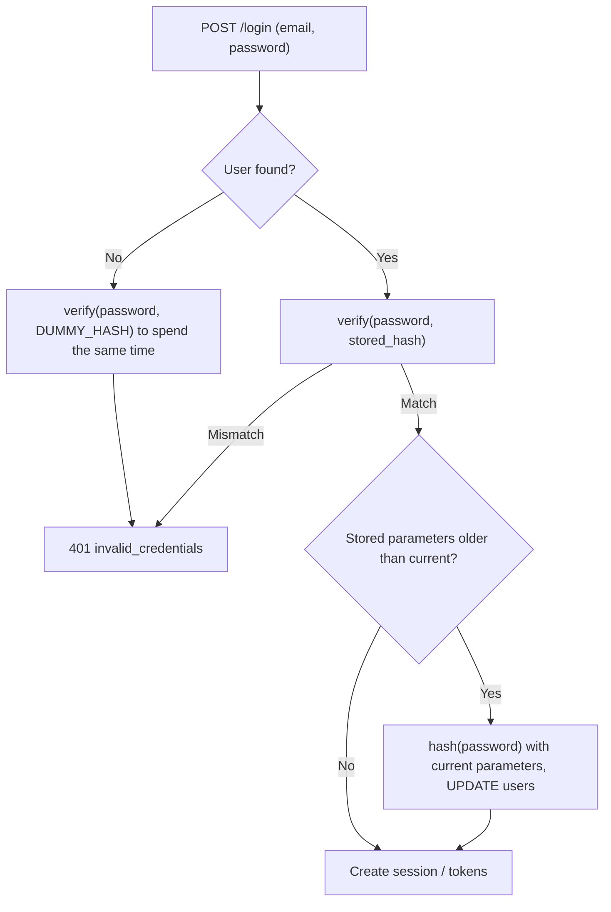

# Password Hashing

> **Module 02 · Core Backend** · Prerequisites: [Refresh Tokens](09-Refresh-Tokens.md) · Next: [Authentication Flow](11-Authentication-Flow.md)

---

## ⏱ If You Only Have 2 Minutes

- Passwords are **hashed, not encrypted**. Encryption can be reversed by whoever has the key; a password hash cannot be reversed by anyone, including you.
- Use a **slow, salted, memory-hard** password hash: **Argon2id** first, scrypt if Argon2id is unavailable, bcrypt only for legacy systems, PBKDF2 when FIPS-140 compliance forces it.
- OWASP's Argon2id minimum: **m = 19 MiB, t = 2 iterations, p = 1**. Raise the cost as far as your login latency and memory budget allow.
- Never MD5, SHA-1 or SHA-256 alone. They are designed to be fast, so a GPU can test billions of guesses per second against a leaked database.
- A unique random **salt** per password defeats precomputed tables and stops identical passwords from having identical hashes. The salt is not secret.
- bcrypt reads at most **72 bytes** of input and ignores the rest. Its cost factor is log₂ of the rounds; OWASP's minimum is 10.
- The hash string stores the algorithm and parameters (`$argon2id$v=19$m=19456,t=2,p=1$…`), so you can **rehash on login** when you raise the cost.
- Hashing is CPU and memory heavy. In Node it must run async (the `argon2` package uses the libuv thread pool); in FastAPI run it in a thread so it does not block the event loop.

---

## 1. What It Is and Why It Exists

**Password hashing** turns a password into a fixed string with a one-way function that is deliberately **slow** and **salted**. To check a login, you hash the attempt with the same salt and parameters and compare. You never need the original password back, so you never store anything that can produce it.

**Analogy:** a bank stores a plaster cast of your key, not the key. It can check whether a key fits the cast, but nobody can turn the cast back into a key. Making each cast take one full minute means a thief who steals the whole drawer of casts can only try a few keys per minute per cast.

**The problem it solves.** Databases leak — through SQL injection, a stolen backup, a misconfigured bucket, or a malicious insider. People reuse passwords across sites. So a leak of your `users` table becomes a leak of their email and bank passwords unless the stored values are useless to the attacker. A good password hash does not make cracking impossible; it makes it **expensive per guess**, so that only the weakest passwords fall and you have time to force resets.

---

## 2. How It Works

### Hashing vs encryption vs fast hashes

| | Encryption (AES) | Fast hash (SHA-256) | Password hash (Argon2id) |
|---|---|---|---|
| Reversible? | Yes, with the key | No | No |
| Speed | Fast | Very fast (billions/s on a GPU) | Tunable: tens to hundreds of ms per hash |
| Salted? | N/A | No (you would add it yourself) | Yes, built in |
| What a DB leak gives the attacker | Every password, if the key also leaks | Fast offline guessing | Slow, expensive offline guessing |
| Right for passwords? | No | No | Yes |

The attacker's model is **offline guessing**: they have the hash and the salt, and they try `hash(guess, salt)` for millions of common passwords. Your only lever is the cost of each guess. Memory-hard functions add a second lever: each guess needs a block of RAM, which GPUs and custom chips have much less of per core than they have compute.

### What Argon2id does

Argon2 won the Password Hashing Competition in 2015 and is specified in [RFC 9106](https://www.rfc-editor.org/rfc/rfc9106). Its inputs:

- **password** and **salt** (16 random bytes is the usual choice)
- **m** — memory in KiB that each hash fills and reads
- **t** — number of passes over that memory
- **p** — parallel lanes
- optional **secret** key (usable as a pepper) and output length

**Argon2id** is a hybrid of Argon2i (resists side-channel attacks) and Argon2d (resists GPU cracking). It is the recommended variant.

The output is a PHC-format string that carries everything needed to verify:

```text
$argon2id$v=19$m=19456,t=2,p=1$c29tZXNhbHRzb21lc2FsdA$Rk9PQkFSQkFaLi4uVGhpcyBpcyB0aGUgaGFzaA
 algorithm  ver  parameters      salt (base64)           hash (base64)
```

Store that string in one `password_hash text` column. You do not need separate salt or parameter columns.

### Login with rehash-on-login



The rehash step is possible only at login, because that is the only moment you have the plaintext password. Users who never log in keep their old hash until you force a reset.

---

## 3. Key Concepts

### Salt

A salt is a random value, unique per password, stored next to the hash. It does two things. First, precomputed tables (rainbow tables) are useless, because the attacker would need one table per salt. Second, two users with `Summer2026!` get different hashes, so cracking one does not crack the other and the attacker cannot spot popular passwords by counting duplicates. Salts are not secret. Every modern library generates them for you — never pass your own constant salt.

### Algorithm choice and parameters

From the [OWASP Password Storage Cheat Sheet](https://cheatsheetseries.owasp.org/cheatsheets/Password_Storage_Cheat_Sheet.html):

| Algorithm | When | OWASP minimum parameters |
|---|---|---|
| Argon2id | Default for new systems | m = 19 MiB (19456 KiB), t = 2, p = 1 — or an equivalent trade, e.g. m = 46 MiB, t = 1, p = 1 |
| scrypt | Argon2id not available | N = 2¹⁷ (128 MiB), r = 8, p = 1 |
| bcrypt | Legacy systems | Cost factor ≥ 10; maximum 72-byte input |
| PBKDF2-HMAC-SHA256 | FIPS-140 compliance required | 600,000 iterations |

These are **minimums**. Benchmark on your production hardware and pick the highest cost that keeps a login under your latency budget, typically a few hundred milliseconds of hashing at most.

### bcrypt specifics

A bcrypt hash looks like `$2b$12$` + 22 characters of salt + 31 characters of hash. `12` is the cost: 2¹² rounds. Each +1 doubles the time. bcrypt only uses the **first 72 bytes** of the password. Long passphrases — or long multi-byte UTF-8 passwords — are silently truncated, so two different long passwords that share the first 72 bytes are equal. OWASP says to enforce a 72-byte maximum. Pre-hashing the password with SHA-256 to get around the limit has its own pitfalls (NUL bytes in raw digests, and "password shucking" if the inner hash also leaked elsewhere). On a new system, choose Argon2id and the problem does not exist.

### Pepper

A **pepper** is a secret shared by all passwords and stored **outside the database** — in a secret manager or HSM. You apply it as an HMAC before hashing (`argon2id(HMAC-SHA256(pepper, password))`) or through Argon2's own secret input. If only the database leaks, the attacker cannot test any guess at all. Costs: rotating a pepper is hard (you cannot re-pepper without the plaintext, so old hashes need a pepper ID and lazy migration), and losing it locks out every user. A pepper is defence in depth, not a replacement for a slow hash.

### Rehashing and legacy migration

Raising parameters later is normal — hardware gets faster. Each library offers a "needs rehash" check that compares the parameters inside the stored string with your current ones. On a successful login, rehash and update.

Migrating from a weak legacy hash (say, unsalted MD5) cannot wait for logins, because inactive accounts stay exposed. Wrap them immediately: store `argon2id(md5(password))` with a marker. On the next login, verify through the wrapper and replace it with a plain `argon2id(password)`. Force a password reset for accounts that never come back.

### Constant-time comparison

Comparing two byte strings with `==` returns as soon as a byte differs, so response time leaks how many leading bytes matched. Libraries' `verify` functions compare in constant time. If you ever compare secrets yourself (HMAC signatures, API keys), use `crypto.timingSafeEqual` in Node or `hmac.compare_digest` in Python. Also equalize the **"user not found"** path by verifying against a dummy hash — otherwise a fast `401` for unknown emails reveals which accounts exist.

### Breached-password check

Length rules and a slow hash do not help if the password is `password123`. Check new passwords against known breach corpora. The Have I Been Pwned **Pwned Passwords range API** uses k-anonymity:

1. Compute `SHA-1(password)` in uppercase hex.
2. Send only the first 5 characters: `GET https://api.pwnedpasswords.com/range/{prefix}`.
3. The response lists every hash suffix with that prefix and a count (`SUFFIX:COUNT`). Check locally whether yours is in the list.

The service never sees the full hash. The `Add-Padding: true` header pads responses with fake zero-count entries so the response size does not hint at the prefix. Use SHA-1 here only because the API is keyed by it — it is a lookup key, not your storage format.

---

## 4. Code Examples

Scenario: `POST /register` and `POST /login` with Argon2id at OWASP's minimum parameters, a breached-password check on registration, a dummy hash for unknown users, and rehash-on-login.

### Node.js / TypeScript

`passwords.ts` — hashing policy in one place:

```ts
// npm i argon2   — Node.js 22+, TypeScript 5, ESM
import * as argon2 from "argon2";
import { createHash } from "node:crypto";

// OWASP Password Storage Cheat Sheet minimum. memoryCost is in KiB (19456 KiB = 19 MiB).
const PARAMS = { type: argon2.argon2id, memoryCost: 19_456, timeCost: 2, parallelism: 1 } as const;

// Unknown users are verified against this, so "no such user" takes as long as "wrong password".
const DUMMY_HASH = await argon2.hash("not-a-real-password-used-for-timing", PARAMS);

export function hashPassword(password: string): Promise<string> {
  // Runs on the libuv thread pool, not the event loop.
  return argon2.hash(password, PARAMS);
}

export async function verifyPassword(
  stored: string | null,
  password: string,
): Promise<{ ok: boolean; newHash?: string }> {
  const ok = await argon2.verify(stored ?? DUMMY_HASH, password);
  if (!ok || stored === null) return { ok: false };
  // Parameters live inside the stored string, so older hashes are detectable and upgradable.
  const newHash = argon2.needsRehash(stored, PARAMS) ? await hashPassword(password) : undefined;
  return { ok: true, newHash };
}

export async function isBreached(password: string): Promise<boolean> {
  const sha1 = createHash("sha1").update(password, "utf8").digest("hex").toUpperCase();
  const [prefix, suffix] = [sha1.slice(0, 5), sha1.slice(5)];
  try {
    const res = await fetch(`https://api.pwnedpasswords.com/range/${prefix}`, {
      headers: { "Add-Padding": "true" },
      signal: AbortSignal.timeout(2_000),
    });
    if (!res.ok) return false;
    const body = await res.text();
    // Padding rows have count 0, so require a positive count.
    return body.split("\n").some((line) => {
      const [s, count] = line.trim().split(":");
      return s === suffix && Number(count) > 0;
    });
  } catch {
    return false; // fail open: an outage of a third-party API should not block sign-ups
  }
}
```

`app.ts` — routes:

```ts
// npm i express pg
import express from "express";
import pg from "pg";
import { hashPassword, isBreached, verifyPassword } from "./passwords.js";

const pool = new pg.Pool({ connectionString: process.env.DATABASE_URL });
const app = express();
app.use(express.json({ limit: "10kb" }));

app.post("/register", async (req, res) => {
  const { email, password } = req.body ?? {};
  if (typeof email !== "string" || typeof password !== "string") {
    res.status(400).json({ error: "invalid_body" });
    return;
  }
  // No composition rules; length plus a breach check. Upper bound only stops absurd payloads.
  if (password.length < 8 || password.length > 256) {
    res.status(400).json({ error: "password_length" });
    return;
  }
  if (await isBreached(password)) {
    res.status(400).json({ error: "breached_password" });
    return;
  }
  const hash = await hashPassword(password);
  // Same response whether or not the email exists (see the Authentication Flow chapter).
  await pool.query(
    "INSERT INTO users (email, password_hash) VALUES ($1, $2) ON CONFLICT (email) DO NOTHING",
    [email.trim().toLowerCase(), hash],
  );
  res.status(202).json({ status: "check_email" });
});

app.post("/login", async (req, res) => {
  const { email, password } = req.body ?? {};
  if (typeof email !== "string" || typeof password !== "string" || password.length > 256) {
    res.status(400).json({ error: "invalid_body" });
    return;
  }
  const { rows } = await pool.query<{ id: string; password_hash: string }>(
    "SELECT id, password_hash FROM users WHERE email = $1", [email.trim().toLowerCase()]);
  const user = rows[0];
  const { ok, newHash } = await verifyPassword(user?.password_hash ?? null, password);
  if (!ok || !user) {
    res.status(401).json({ error: "invalid_credentials" }); // never say which part was wrong
    return;
  }
  if (newHash) {
    // Compare-and-set: do not overwrite a password changed by a concurrent reset.
    await pool.query("UPDATE users SET password_hash = $1 WHERE id = $2 AND password_hash = $3",
      [newHash, user.id, user.password_hash]);
  }
  // Next: create a session or issue tokens (chapters 07–09).
  res.json({ status: "ok", userId: user.id });
});
```

### Python

`passwords.py`:

```python
# pip install argon2-cffi httpx   — Python 3.12+
import asyncio
import hashlib

import httpx
from argon2 import PasswordHasher
from argon2.exceptions import VerifyMismatchError

# OWASP minimum for Argon2id. memory_cost is in KiB; the type defaults to Argon2id.
ph = PasswordHasher(time_cost=2, memory_cost=19_456, parallelism=1)
DUMMY_HASH = ph.hash("not-a-real-password-used-for-timing")

# Each hash holds ~19 MiB while it runs. Bound concurrency so a login burst cannot exhaust RAM.
_slots = asyncio.Semaphore(8)


async def hash_password(password: str) -> str:
    async with _slots:
        # ph.hash is a blocking C call; a worker thread keeps the event loop free.
        return await asyncio.to_thread(ph.hash, password)


def _verify_sync(stored: str | None, password: str) -> tuple[bool, str | None]:
    try:
        ph.verify(stored or DUMMY_HASH, password)  # constant-time comparison inside
    except VerifyMismatchError:
        return False, None
    if stored is None:
        return False, None
    return True, ph.hash(password) if ph.check_needs_rehash(stored) else None


async def verify_password(stored: str | None, password: str) -> tuple[bool, str | None]:
    async with _slots:
        return await asyncio.to_thread(_verify_sync, stored, password)


async def is_breached(password: str, http: httpx.AsyncClient) -> bool:
    digest = hashlib.sha1(password.encode(), usedforsecurity=False).hexdigest().upper()
    prefix, suffix = digest[:5], digest[5:]
    try:
        r = await http.get(f"https://api.pwnedpasswords.com/range/{prefix}",
                           headers={"Add-Padding": "true"}, timeout=2.0)
        r.raise_for_status()
    except httpx.HTTPError:
        return False  # fail open on outage
    for line in r.text.splitlines():
        candidate, _, count = line.partition(":")
        if candidate == suffix and int(count) > 0:  # padding rows have count 0
            return True
    return False
```

`app.py`:

```python
# pip install fastapi asyncpg httpx "pydantic[email]"
import os
from contextlib import asynccontextmanager

import asyncpg
import httpx
from fastapi import FastAPI, HTTPException, Request
from pydantic import BaseModel, EmailStr, Field

from passwords import hash_password, is_breached, verify_password


@asynccontextmanager
async def lifespan(app: FastAPI):
    app.state.pool = await asyncpg.create_pool(os.environ["DATABASE_URL"])
    app.state.http = httpx.AsyncClient()
    yield
    await app.state.http.aclose()
    await app.state.pool.close()


app = FastAPI(lifespan=lifespan)


class RegisterBody(BaseModel):
    email: EmailStr
    password: str = Field(min_length=8, max_length=256)


class LoginBody(BaseModel):
    email: EmailStr
    password: str = Field(max_length=256)  # no min here: do not reveal policy on login


@app.post("/register", status_code=202)
async def register(body: RegisterBody, request: Request) -> dict:
    if await is_breached(body.password, request.app.state.http):
        raise HTTPException(400, "breached_password")
    pw_hash = await hash_password(body.password)
    await request.app.state.pool.execute(
        "INSERT INTO users (email, password_hash) VALUES ($1, $2) ON CONFLICT (email) DO NOTHING",
        body.email.lower(), pw_hash)
    return {"status": "check_email"}  # identical for new and existing emails


@app.post("/login")
async def login(body: LoginBody, request: Request) -> dict:
    pool = request.app.state.pool
    row = await pool.fetchrow("SELECT id, password_hash FROM users WHERE email = $1",
                              body.email.lower())
    ok, new_hash = await verify_password(row["password_hash"] if row else None, body.password)
    if not ok:
        raise HTTPException(401, "invalid_credentials")
    if new_hash:  # compare-and-set so a concurrent password reset wins
        await pool.execute("UPDATE users SET password_hash = $1 WHERE id = $2 AND password_hash = $3",
                           new_hash, row["id"], row["password_hash"])
    return {"status": "ok", "user_id": str(row["id"])}
```

**Runtime differences to notice:**
- The Node `argon2` package runs hashing on the **libuv thread pool**, which has only 4 threads by default (`UV_THREADPOOL_SIZE`) and is shared with `fs`, `dns.lookup`, `zlib` and async `crypto`. A login burst can queue file reads behind password hashes. Size the pool deliberately.
- `argon2-cffi` is **synchronous**. Calling `ph.hash()` directly in an `async def` route would freeze the whole event loop for the duration of each hash. `asyncio.to_thread` moves it to a worker thread; the semaphore bounds memory use, which matters more for a memory-hard hash than for a CPU-only one.

---

## 5. Production Concerns

- **Capacity planning.** At m = 19 MiB, 50 concurrent logins need about 1 GB of RAM just for hashing. Bound concurrency (a semaphore, or the thread-pool size) and load-test the login endpoint. Expect CPU spikes at 9 a.m. or after a mass logout.
- **Login as a DoS target.** Every attempt costs you a full hash, even for nonexistent users. Rate-limit before hashing — per IP and per account — and cap the request body size. See [Rate Limiting](../Module-07-Advanced-Backend-and-System-Design/33-Rate-Limiting.md).
- **Parameter changes.** Bumping cost is a deploy plus lazy migration. Track the share of users still on old parameters (parse the PHC string) and decide when to force resets for the remainder.
- **Pepper storage.** If you use one, load it from a [secret manager](../Module-10-DevOps-and-Cloud/16-Secrets-Management.md), keep it out of the database and backups, and store a pepper version next to each hash so rotation is possible.
- **Never log passwords.** Request-body logging, error trackers capturing payloads, and debug middleware are the usual leaks. Redact `password`, `new_password` and `current_password` fields at the logger.
- **Metrics.** Hash duration (p50/p99), thread-pool queue time, login outcome counts, and breached-password rejection rate. A sudden drop in hash time after a deploy can mean someone lowered the parameters by accident.
- **Normalisation.** Decide once how you treat Unicode (e.g. NFC/NFKC normalisation) and never trim or change the password otherwise. A change here locks out every user whose password is affected.

---

## 6. Common Mistakes

- **Encrypting passwords "so support can read them"** — one key leak exposes every password in plaintext — hash with Argon2id; support resets passwords, never reads them.
- **SHA-256 with a salt** — still billions of guesses per second on GPUs — use a slow, memory-hard password hash.
- **Calling a synchronous hash on the event loop** (`bcrypt.hashSync` in Node, `ph.hash()` inside `async def`) — every other request stalls during each login — use the async API or a worker thread.
- **Returning early for unknown users** — a fast `401` reveals which emails are registered — verify against a dummy hash so both paths take the same time.
- **Ignoring bcrypt's 72-byte limit** — long passphrases are silently truncated — enforce a 72-byte maximum or move to Argon2id.
- **Setting parameters once and forgetting them** — hashes get cheaper to crack each year — benchmark regularly and rehash on login.
- **Composition rules and forced periodic changes** — users pick `Password1!` and then `Password2!` — require length, block breached passwords, and allow long passphrases.

---

## 7. Comparison Table

| | Argon2id | scrypt | bcrypt | PBKDF2-HMAC-SHA256 |
|---|---|---|---|---|
| Memory-hard | Yes | Yes | No (small fixed memory) | No |
| GPU / ASIC resistance | Strong | Strong | Moderate | Weak |
| Input limit | None in practice | None in practice | 72 bytes | None |
| Tunable knobs | memory, iterations, parallelism | N, r, p | cost (log₂ rounds) | iterations |
| Standard | RFC 9106 | RFC 7914 | De facto | RFC 8018, FIPS-approved |
| Use for | New systems | When Argon2id is unavailable | Existing systems | Compliance-driven systems |

---

## 8. Interview Questions

**[Junior] Why not encrypt passwords?**
Encryption is reversible by design: anyone with the key can recover every password. The key lives on the same servers that get breached, so the encryption usually falls with the database. Hashing is one-way, so even you cannot recover a password. You only need to check whether an attempt matches, which a hash does.

**[Junior] What is a salt and is it secret?**
A salt is a random value generated per password and stored with the hash. It makes precomputed tables useless and gives identical passwords different hashes, so an attacker has to crack each one separately. It is not secret; its value comes from being unique, not hidden.

**[Mid] Why is SHA-256 a bad password hash when it is a secure hash function?**
SHA-256 is designed to be fast, and fast is what an attacker wants. With a leaked hash and salt, they can test billions of candidate passwords per second on GPUs, which cracks most human-chosen passwords quickly. Password hashes like Argon2id are deliberately slow and memory-hard, so each guess costs real time and RAM.

**[Mid] How do you increase hashing cost for existing users?**
The stored string includes the algorithm and parameters. After deploying new parameters, on every successful login check "needs rehash", and if so hash the plaintext you just verified with the new parameters and update the row. Users who never log in keep old hashes, so track that population and force resets for it eventually. For a weak legacy algorithm, wrap old hashes immediately rather than waiting for logins.

**[Mid] What is a pepper and what does it cost you?**
A secret value added to every password (usually via HMAC) and stored outside the database, for example in a secret manager. If only the database leaks, the attacker cannot test guesses at all. The cost is operational: losing the pepper locks out everyone, and rotating it needs versioning and lazy migration because you cannot re-pepper without the plaintext.

**[Senior] Your login endpoint's p99 jumped to 3 seconds during a traffic spike, but CPU is at 60%. What is happening?**
Likely queueing, not compute. In Node, Argon2 runs on the libuv thread pool, which defaults to 4 threads and is shared with file and DNS work, so hashes wait in line while cores sit idle. In Python, the thread pool or a concurrency semaphore can be the bottleneck. Measure queue wait separately from hash time. Fixes: size the pool to the cores you dedicate to hashing, rate-limit before hashing, and if needed move hashing to a separate auth service so it cannot starve other endpoints. Do not "fix" it by lowering parameters below the security minimum.

**[Senior] How would you choose Argon2id parameters for your system?**
Start at OWASP's minimum (19 MiB, t = 2, p = 1). Benchmark on production-class hardware and increase memory first, since memory is what hurts attackers most, until a single hash reaches your latency budget. Then calculate peak concurrent logins × memory to make sure you will not run out of RAM, and add a concurrency limit. Record the parameters in config, let rehash-on-login apply them, and revisit them yearly.

**[Senior] You inherit a database of unsalted MD5 password hashes. What do you do?**
Do not wait for users to log in. In one migration, replace every MD5 value with `argon2id(md5_hex)` and mark it as wrapped, so the whole table is protected today. On login, verify by computing `argon2id(md5(password))`, then store a fresh `argon2id(password)`. Check for signs the MD5 hashes were already stolen; if so, force resets and notify users. Finally, set a deadline after which remaining wrapped accounts must reset.

---

## 9. Cheat Sheet

```text
Rule           hash, never encrypt; never log passwords
Default        Argon2id  m=19 MiB (19456 KiB), t=2, p=1  (OWASP minimum; raise if you can)
Fallbacks      scrypt N=2^17,r=8,p=1 | bcrypt cost ≥10, 72-byte max | PBKDF2-SHA256 600,000 iters (FIPS)
Wrong          MD5, SHA-1, SHA-256 (fast) | encryption | home-made salt schemes
Salt           unique, random, per password, stored in the hash string, not secret
Pepper         optional secret outside the DB; HMAC before hashing; needs versioning
Format         $argon2id$v=19$m=…,t=…,p=…$salt$hash  → one text column
Upgrade        verify OK + needsRehash → hash again → compare-and-set UPDATE
Timing         unknown user → verify against dummy hash; library verify is constant-time
Breach check   SHA-1 prefix (5 hex) → api.pwnedpasswords.com/range/{prefix}; Add-Padding: true
Policy         length + breached check; no composition rules; no forced rotation
Node           argon2 is async on the libuv pool (4 threads default, shared)
Python         argon2-cffi is sync → asyncio.to_thread + semaphore in async routes
```

---

## Related Topics

- [Authentication Flow](11-Authentication-Flow.md) — where hashing sits in registration, login and password reset
- [Refresh Tokens](09-Refresh-Tokens.md) — why random tokens get SHA-256, not Argon2
- [Node Event Loop and Concurrency](06-Node-Event-Loop-and-Concurrency.md) — why a sync hash blocks every request
- [Rate Limiting](../Module-07-Advanced-Backend-and-System-Design/33-Rate-Limiting.md) — protecting the expensive login endpoint
- [Secrets Management](../Module-10-DevOps-and-Cloud/16-Secrets-Management.md) — where a pepper lives
