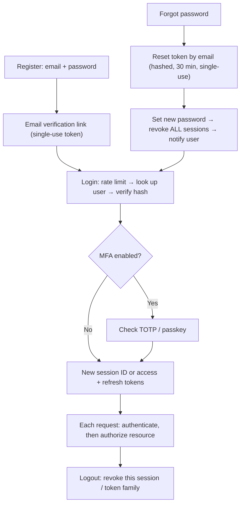

# Authentication Flow

> **Module 02 · Core Backend** · Prerequisites: [Password Hashing](10-Password-Hashing.md) · Next: [MVC Architecture](12-MVC-Architecture.md)

---

## ⏱ If You Only Have 2 Minutes

- **Authentication** proves who the caller is (`401` when it fails). **Authorization** decides whether that identity may do this action on this resource (`403` or `404`). Every request needs both.
- The lifecycle is: register → verify email → log in (password + optional MFA) → session or tokens → logout. Recovery (password reset) is a second login path and must be as strong as the first.
- **Prevent account enumeration:** login, registration and "forgot password" return the same response and take about the same time whether or not the email exists.
- **Password reset tokens:** random, stored **hashed**, **single-use**, short-lived (e.g. 30 min). After a reset, revoke every session and refresh token, notify the user, and do not log them in automatically.
- **Brute force:** rate-limit per account **and** per IP. Hard lockouts let attackers lock victims out; prefer growing delays, CAPTCHA, and MFA.
- **TOTP** ([RFC 6238](https://www.rfc-editor.org/rfc/rfc6238)): `HMAC-SHA1(secret, unix_time / 30)` truncated to 6 digits. Accept ±1 time step and reject a code that was already used.
- **OAuth 2.0 is delegated authorization; OpenID Connect adds login.** For user sign-in, use the authorization code flow with **PKCE**. Implicit and password grants are deprecated.
- If you need SSO, passkeys, enterprise federation or compliance, an **identity provider** is usually cheaper and safer than building it yourself.

---

## 1. What It Is and Why It Exists

An **authentication flow** is the full set of steps by which a person proves who they are to your system and keeps proving it over time. It is not one endpoint. It is registration, email verification, login, second factors, session issuance, logout, and recovery when the person forgets their password or loses their phone.

**Analogy:** getting into an office building. You register once at reception and show ID (registration and email verification). Each day you badge in at the gate (login). The server room needs a badge **and** a PIN (MFA). If you lose your badge, reception checks your identity again before printing a new one, and cancels the old one (password reset and session revocation). Getting in through the front door does not mean you can enter every room (authorization).

**The problem it solves.** Attackers rarely break your crypto. They attack the **flow**: they guess passwords on the login form, try leaked username/password pairs from other sites (credential stuffing), ask "forgot password" which emails exist, abuse a weak reset link, or keep using a session after the victim changed their password. Each step has a known failure mode. This chapter connects the pieces from the previous chapters — [sessions](07-Sessions-and-Cookies.md), [JWTs](08-JWT-Authentication.md), [refresh tokens](09-Refresh-Tokens.md) and [password hashing](10-Password-Hashing.md) — into one flow without gaps.

---

## 2. How It Works



### Registration

1. Validate the email format and the password (length, [breached-password check](10-Password-Hashing.md)).
2. Hash the password with Argon2id and insert the user with `email_verified = false`.
3. If the email already exists, **do not say so**. Return the same "check your email" response, and send the existing owner an email ("someone tried to register with your address — did you mean to reset your password?").
4. Send a verification link containing a random token. Store only its hash, with an expiry.

### Email verification

Clicking the link proves control of the inbox. Until verified, restrict what the account can do. In particular, never use an **unverified** email to link accounts or to match an SSO login to an existing account. Otherwise an attacker can register the victim's email first and wait for the victim to sign in (a "pre-account takeover").

### Login

1. **Rate-limit** before doing anything expensive (per IP and per normalised email).
2. Look up the user. If there is none, still verify the password against a dummy hash so the timing matches.
3. Verify the password. On failure, return one generic error: "invalid email or password".
4. If MFA is enabled, do **not** issue a full session yet. Issue a short-lived "MFA pending" state (minutes), then check the second factor.
5. Issue credentials: a **new** session ID (never reuse a pre-login one, to block session fixation) or an access token plus a refresh-token family.
6. Record a security event (user ID, outcome, IP, user agent — never the password). Optionally notify the user of a login from a new device.

### Password reset

Based on the [OWASP Forgot Password Cheat Sheet](https://cheatsheetseries.owasp.org/cheatsheets/Forgot_Password_Cheat_Sheet.html):

1. **Request.** The user submits an email. Always return the same message ("If an account exists, we have sent a link") in roughly the same time. Do the lookup and the email sending in a background job.
2. **Token.** 32 random bytes from a CSPRNG. Store `SHA-256(token)` with the user ID and an expiry (15–60 minutes is typical; this chapter uses 30). Delete older unused tokens for the same user.
3. **Link.** Build the URL from a configured base URL, **never from the `Host` header** — an attacker who controls `Host` gets the victim's token sent to their own domain. Serve the reset page with `Referrer-Policy: no-referrer` so the token does not leak to third-party resources.
4. **Confirm.** Atomically mark the token used (single-use), set the new password hash, revoke all sessions and refresh tokens, and set `tokens_valid_after = now()` so live JWTs die too.
5. **After.** Email the user that their password changed. Send them to the normal login — OWASP advises against logging them in automatically.

---

## 3. Key Concepts

### Authentication vs authorization

| | Authentication | Authorization |
|---|---|---|
| Question | Who are you? | May you do *this* to *that*? |
| Inputs | Password, MFA code, session cookie, token signature | Identity + roles/scopes + the resource's owner/tenant |
| Failure status | `401 Unauthorized` (with `WWW-Authenticate` for bearer auth) | `403 Forbidden`, or `404` to hide that the resource exists |
| Where | Once at login; then verify the credential on each request | On every request, for every resource |

The classic bug is **broken object-level authorization**: the user is authenticated, so the code returns `/invoices/1043` without checking who owns it.

### Account enumeration

Enumeration is learning whether an account exists. It turns a list of emails into a list of targets for phishing and credential stuffing. Leaks come from:

- **Messages:** "No account with that email" vs "Wrong password".
- **Status codes:** `404` vs `401`, or `409 Conflict` on registration.
- **Timing:** unknown users return in 2 ms, known users after a 100 ms hash.
- **Side effects:** a reset request for a real user takes longer because it writes a row and sends an email.

Fixes: generic messages, the same status code, a dummy hash on the unknown-user path, and moving per-user work (token creation, sending email) into a background job. Accept that some leakage is unavoidable for usability (a sign-up form must eventually tell a user their email is taken — do it by email, not in the HTTP response).

### Brute force and credential stuffing

| Defence | Stops | Weakness |
|---|---|---|
| Per-IP rate limit | One machine guessing many passwords | Botnets spread over thousands of IPs; shared NAT punishes innocent users |
| Per-account rate limit / backoff | Many guesses against one account | Attackers try *one* password against *many* accounts (password spraying) |
| Hard lockout after N failures | Guessing one account | Anyone can lock any user out (denial of service) |
| Progressive delay + CAPTCHA | Automation at scale | Adds friction; CAPTCHAs can be outsourced |
| Breached-password check | Credential stuffing with leaked pairs | Only covers passwords already in breach lists |
| MFA | Almost all password-only attacks | Enrolment friction; TOTP and SMS are still phishable |

Use several together. Example starting values: per account, 5 failures in 15 minutes triggers exponentially growing delays; per IP, a few hundred attempts per hour. Track failures across all accounts too — a spike in global failure rate is credential stuffing even if no single account crosses a threshold. See [Rate Limiting](../Module-07-Advanced-Backend-and-System-Design/33-Rate-Limiting.md).

### MFA and TOTP

A second factor means a stolen password alone is not enough.

**TOTP** (time-based one-time password, RFC 6238, built on HOTP from [RFC 4226](https://www.rfc-editor.org/rfc/rfc4226)):

- At enrolment the server generates a random secret (RFC 4226 recommends 160 bits) and shows it as a QR code (`otpauth://totp/...`). The user's authenticator app stores it.
- Code = HMAC-SHA1(secret, `floor(unix_time / 30)`), dynamically truncated, mod 10⁶ → 6 digits. Both sides compute it independently.
- Accept the current step and ±1 step for clock drift. Store the last accepted step per user and reject it again, so a code cannot be replayed within its window.
- Rate-limit code attempts — 6 digits is only a million possibilities.
- The server must recompute codes, so the secret cannot be hashed. Encrypt it at rest with a key from a secret manager.
- Give **recovery codes** at enrolment: one-time, random, stored hashed like passwords.

| Factor | Phishing-resistant? | Notes |
|---|---|---|
| SMS code | No | SIM-swap and interception risk; better than nothing |
| TOTP app | No | A real-time phishing proxy can relay the code |
| Push approval | No | "MFA fatigue" spam; use number matching |
| WebAuthn / passkeys | Yes | Signature is bound to your origin, so a look-alike domain gets nothing |

### Logout and "log out everywhere"

- **Logout:** delete the server session or revoke the current refresh-token family; clear the cookie.
- **Log out everywhere:** revoke every session and token family for the user, and set `tokens_valid_after` so already-issued access tokens are rejected where you check it.
- **Automatically trigger "everywhere"** on password change, password reset, MFA reset, email change, and suspected compromise.

### OAuth 2.0 and OpenID Connect

**OAuth 2.0** ([RFC 6749](https://www.rfc-editor.org/rfc/rfc6749)) lets a user grant an application limited access to an API *without sharing their password*. It is about **authorization**: the access token says "this client may call this API with these scopes". It does not, by itself, tell the client who the user is.

**OpenID Connect (OIDC)** is a layer on top that adds authentication: an **ID token** (a JWT) with `iss`, `sub`, `aud` = your client ID, `exp`, and `nonce`. "Sign in with Google" is OIDC.

**Authorization code flow with PKCE** ([RFC 7636](https://www.rfc-editor.org/rfc/rfc7636)), the default for web, SPA and mobile clients:

1. The client generates a random `code_verifier` and computes `code_challenge = BASE64URL(SHA256(code_verifier))`.
2. It redirects the browser to the provider's `/authorize` with `response_type=code`, `client_id`, `redirect_uri`, `scope=openid …`, a random `state`, a `nonce`, `code_challenge` and `code_challenge_method=S256`.
3. The user logs in **at the provider** (your app never sees the password). The provider redirects back with `code` and `state`.
4. The client checks `state` matches (CSRF protection), then POSTs `code`, `redirect_uri` and `code_verifier` to `/token`.
5. The provider checks the verifier hashes to the challenge and returns tokens. The client validates the ID token (signature, `iss`, `aud`, `exp`, `nonce`).

PKCE stops a stolen authorization code from being redeemed, because the thief does not have the verifier. The OAuth Security BCP ([RFC 9700](https://www.rfc-editor.org/rfc/rfc9700)) says not to use the implicit grant or the resource owner password grant, and recommends PKCE for all clients.

---

## 4. Code Examples

Scenario: `POST /auth/password-reset` (request a link) and `POST /auth/password-reset/confirm` (set a new password). The hashing helpers come from the [Password Hashing](10-Password-Hashing.md) chapter and the `refresh_sessions` table from [Refresh Tokens](09-Refresh-Tokens.md). Extra schema:

```sql
ALTER TABLE users ADD COLUMN tokens_valid_after timestamptz NOT NULL DEFAULT now();

CREATE TABLE password_reset_tokens (
  token_hash  bytea PRIMARY KEY,                 -- SHA-256 of the emailed token
  user_id     uuid NOT NULL REFERENCES users(id) ON DELETE CASCADE,
  expires_at  timestamptz NOT NULL,
  used_at     timestamptz
);
```

### Node.js / TypeScript

```ts
// npm i express pg   — Node.js 22+, TypeScript 5, ESM
import express from "express";
import pg from "pg";
import { createHash, randomBytes } from "node:crypto";
import { hashPassword, isBreached } from "./passwords.js"; // Password Hashing chapter
import { jobs, mailer } from "./infra.js";                  // durable job queue + email sender

const pool = new pg.Pool({ connectionString: process.env.DATABASE_URL });
const APP_URL = "https://app.example.com"; // fixed config: never build links from the Host header
const sha256 = (s: string): Buffer => createHash("sha256").update(s).digest();
const GENERIC = { message: "If an account exists for that email, we have sent a reset link." };

const app = express();
app.use(express.json({ limit: "10kb" }));

app.post("/auth/password-reset", async (req, res) => {
  const email = typeof req.body?.email === "string" ? req.body.email.trim().toLowerCase() : "";
  // All per-user work happens in the job, so response time is the same for every email.
  if (email) await jobs.enqueue("password-reset-request", { email });
  res.status(202).json(GENERIC);
});

// Worker side of the job above.
export async function handleResetRequest({ email }: { email: string }): Promise<void> {
  const { rows } = await pool.query<{ id: string }>("SELECT id FROM users WHERE email = $1", [email]);
  if (!rows[0]) return;
  const token = randomBytes(32).toString("base64url");
  // Delete older unused links so only the newest one works.
  await pool.query(
    `WITH old AS (DELETE FROM password_reset_tokens WHERE user_id = $2 AND used_at IS NULL)
     INSERT INTO password_reset_tokens (token_hash, user_id, expires_at)
     VALUES ($1, $2, now() + interval '30 minutes')`, [sha256(token), rows[0].id]);
  await mailer.send(email, "Reset your password",
    `${APP_URL}/reset-password?token=${token}\nThis link expires in 30 minutes.`);
}
```

Same file, continued — the confirm step:

```ts
const VALID = "token_hash = $1 AND used_at IS NULL AND expires_at > now()";

app.post("/auth/password-reset/confirm", async (req, res) => {
  const { token, newPassword } = req.body ?? {};
  if (typeof token !== "string" || typeof newPassword !== "string"
      || newPassword.length < 8 || newPassword.length > 256) {
    res.status(400).json({ error: "invalid_request" });
    return;
  }
  const hash = sha256(token);
  // Cheap check first, so a flood of bad tokens cannot make us run Argon2.
  const pre = await pool.query(`SELECT 1 FROM password_reset_tokens WHERE ${VALID}`, [hash]);
  if (pre.rowCount === 0) {
    res.status(400).json({ error: "invalid_or_expired_token" });
    return;
  }
  if (await isBreached(newPassword)) {
    res.status(400).json({ error: "breached_password" }); // token is not consumed; user can retry
    return;
  }
  const passwordHash = await hashPassword(newPassword); // slow: keep it outside the transaction

  const db = await pool.connect();
  try {
    await db.query("BEGIN");
    // Single use: only one concurrent submit can consume the token.
    const used = await db.query<{ user_id: string }>(
      `UPDATE password_reset_tokens SET used_at = now() WHERE ${VALID} RETURNING user_id`, [hash]);
    if (used.rowCount === 0) {
      await db.query("ROLLBACK");
      res.status(400).json({ error: "invalid_or_expired_token" });
      return;
    }
    const userId = used.rows[0].user_id;
    // tokens_valid_after kills live JWTs; revoking families kills refresh tokens.
    await db.query("UPDATE users SET password_hash = $1, tokens_valid_after = now() WHERE id = $2",
      [passwordHash, userId]);
    await db.query(
      `UPDATE refresh_sessions SET revoked_at = now(), revoke_reason = 'password_reset'
        WHERE user_id = $1 AND revoked_at IS NULL`, [userId]);
    await db.query("COMMIT");
    await jobs.enqueue("password-changed-notice", { userId });
  } catch (err) {
    await db.query("ROLLBACK");
    throw err;
  } finally {
    db.release();
  }
  res.json({ status: "password_reset" }); // no auto-login: the user signs in normally
});
```

### Python

```python
# pip install fastapi asyncpg httpx "pydantic[email]"   — Python 3.12+
import hashlib
import os
import secrets
from contextlib import asynccontextmanager

import asyncpg
import httpx
from fastapi import BackgroundTasks, FastAPI, HTTPException, Request
from pydantic import BaseModel, EmailStr, Field

from infra import send_email                            # email sender
from passwords import hash_password, is_breached        # Password Hashing chapter

APP_URL = "https://app.example.com"  # fixed config, never request.headers["host"]
VALID = "token_hash = $1 AND used_at IS NULL AND expires_at > now()"
GENERIC = {"message": "If an account exists for that email, we have sent a reset link."}


@asynccontextmanager
async def lifespan(app: FastAPI):
    app.state.pool = await asyncpg.create_pool(os.environ["DATABASE_URL"])
    app.state.http = httpx.AsyncClient()
    yield
    await app.state.http.aclose()
    await app.state.pool.close()


app = FastAPI(lifespan=lifespan)


def sha256(value: str) -> bytes:
    return hashlib.sha256(value.encode()).digest()


class ResetRequest(BaseModel):
    email: EmailStr


class ResetConfirm(BaseModel):
    token: str = Field(min_length=20, max_length=200)
    new_password: str = Field(min_length=8, max_length=256)


async def issue_reset_token(pool: asyncpg.Pool, email: str) -> None:
    user_id = await pool.fetchval("SELECT id FROM users WHERE email = $1", email)
    if user_id is None:
        return
    token = secrets.token_urlsafe(32)
    await pool.execute(
        """WITH old AS (DELETE FROM password_reset_tokens WHERE user_id = $2 AND used_at IS NULL)
           INSERT INTO password_reset_tokens (token_hash, user_id, expires_at)
           VALUES ($1, $2, now() + interval '30 minutes')""", sha256(token), user_id)
    await send_email(email, "Reset your password",
                     f"{APP_URL}/reset-password?token={token}\nThis link expires in 30 minutes.")


@app.post("/auth/password-reset", status_code=202)
async def request_reset(body: ResetRequest, request: Request, tasks: BackgroundTasks) -> dict:
    # Runs after the response is sent, so known and unknown emails answer equally fast.
    tasks.add_task(issue_reset_token, request.app.state.pool, body.email.lower())
    return GENERIC
```

Same module, continued — the confirm step:

```python
@app.post("/auth/password-reset/confirm")
async def confirm_reset(body: ResetConfirm, request: Request, tasks: BackgroundTasks) -> dict:
    pool = request.app.state.pool
    token_hash = sha256(body.token)
    if not await pool.fetchval(f"SELECT EXISTS (SELECT 1 FROM password_reset_tokens WHERE {VALID})",
                               token_hash):
        raise HTTPException(400, "invalid_or_expired_token")  # before any expensive work
    if await is_breached(body.new_password, request.app.state.http):
        raise HTTPException(400, "breached_password")
    password_hash = await hash_password(body.new_password)  # in a thread, outside the transaction

    async with pool.acquire() as conn, conn.transaction():
        user_id = await conn.fetchval(
            f"UPDATE password_reset_tokens SET used_at = now() WHERE {VALID} RETURNING user_id",
            token_hash)
        if user_id is None:  # another request consumed it first; raising rolls back
            raise HTTPException(400, "invalid_or_expired_token")
        await conn.execute(
            "UPDATE users SET password_hash = $1, tokens_valid_after = now() WHERE id = $2",
            password_hash, user_id)
        await conn.execute(
            "UPDATE refresh_sessions SET revoked_at = now(), revoke_reason = 'password_reset' "
            "WHERE user_id = $1 AND revoked_at IS NULL", user_id)
    email = await pool.fetchval("SELECT email FROM users WHERE id = $1", user_id)
    tasks.add_task(send_email, email, "Your password was changed",
                   "If this was not you, contact support immediately.")
    return {"status": "password_reset"}  # no auto-login
```

**Runtime differences to notice:**
- FastAPI's `BackgroundTasks` run **in the same process after the response is sent**. That gives uniform timing with no extra infrastructure, but the task is lost if the process crashes. The Node version uses a durable job queue, which is what you want in production for both languages.
- In Express, the error response for a lost race must `ROLLBACK` explicitly. In asyncpg, raising `HTTPException` inside `conn.transaction()` rolls back automatically.

---

## 5. Production Concerns

- **Security event log.** Record `login_succeeded`, `login_failed`, `mfa_failed`, `password_reset_requested`, `password_reset_completed`, `refresh_token_reused`, `logout_all` with user ID, IP, user agent and request ID. Never log passwords, reset tokens, TOTP codes or full session tokens. These events are what you need when a user says "I didn't do that".
- **Alerting.** Watch the global login failure rate and the ratio of failures to distinct accounts. Credential stuffing shows up as many accounts × few attempts each, often with a success rate around the reuse rate of leaked passwords.
- **Email deliverability is part of security.** If reset and verification emails land in spam, users cannot recover accounts and support starts resetting passwords by hand — which is a social-engineering hole. Use a reputable sender with SPF, DKIM and DMARC.
- **Support-desk recovery.** Manual account recovery is the weakest link in many breaches. Define what proof support may accept, and never let support bypass MFA without a documented, audited process.
- **Notifications.** Email the user on password change, email change (to the **old** address), new MFA device, and login from a new device. It turns silent takeovers into reported incidents.
- **Reset tokens in URLs** appear in browser history and possibly in proxy logs. Short expiry, single use, and `Referrer-Policy: no-referrer` limit the exposure.
- **Session fixation and privilege change.** Issue a new session ID at login and after any privilege change (MFA completed, role elevated). Details in [Sessions and Cookies](07-Sessions-and-Cookies.md).

---

## 6. Common Mistakes

- **Different messages for "no such user" and "wrong password"** — attackers build a list of valid accounts — one generic message, same status, dummy hash for timing.
- **Storing reset tokens in plaintext or making them reusable** — a database read or a forwarded email gives account takeover — store the SHA-256 hash, mark used atomically, expire in minutes.
- **Building reset links from the `Host` header** — a forged `Host` sends the victim's token to the attacker's domain — use a configured base URL.
- **Not revoking sessions after a password reset** — the attacker who caused the reset keeps their session — revoke every session and refresh token, and set `tokens_valid_after`.
- **Hard account lockout after 5 failures** — anyone can lock out any user, including the CEO before a board meeting — temporary, growing delays plus CAPTCHA and alerting.
- **Treating an OAuth access token as proof of login** — a token issued to another app can be replayed to "log in" to yours — use OIDC and validate the ID token's `aud` and `nonce`.
- **Checking authentication but not ownership** — any logged-in user can read any invoice by changing the ID — authorize every resource access against the caller.

---

## 7. Comparison Table

| | Build it yourself | Managed identity provider (e.g. Auth0, Okta, Cognito, Entra ID) | Self-hosted IdP (e.g. Keycloak) |
|---|---|---|---|
| Time to a secure MVP | Weeks; easy to miss reset, MFA or enumeration details | Days | Days to weeks |
| MFA, passkeys, social login, SAML/OIDC SSO | You build each one | Built in | Built in |
| Control over UX and data model | Full | Limited by the provider | High |
| Ongoing work | Security patches, monitoring, recovery processes | Configuration and integration | Running, upgrading and securing the IdP |
| Cost | Engineering time | Per-user pricing that grows with scale | Infrastructure + ops time |
| Good fit | Simple email/password app with a security-aware team | B2B SaaS needing enterprise SSO; small teams; compliance | Strict data-residency needs, large user counts, in-house ops |

---

## 8. Interview Questions

**[Junior] What is the difference between authentication and authorization?**
Authentication proves identity — the password and MFA check at login, and verifying the session or token on later requests. Authorization decides whether that identity may perform a specific action on a specific resource, such as reading invoice 1043. A failed authentication returns `401`; a failed authorization returns `403`, or `404` when you do not want to reveal that the resource exists.

**[Junior] Why should login say "invalid email or password" instead of "user not found"?**
A specific message lets anyone check which emails have accounts, which feeds phishing and credential-stuffing lists. A generic message, the same status code, and similar response times (verify against a dummy hash for unknown users) remove that signal.

**[Mid] Walk me through a secure password reset.**
The user submits an email and always gets the same response; a background job looks up the account and, if it exists, emails a link containing a 32-byte random token. Only the token's SHA-256 hash is stored, with a 30-minute expiry. On submit, the token is consumed atomically so it works once, the new password is hashed, and every session and refresh token for the user is revoked in the same transaction. The user gets a "password changed" email and logs in normally. Links are built from a configured base URL, not the `Host` header.

**[Mid] How does TOTP work, and what are its weaknesses?**
Server and app share a secret. Each computes HMAC-SHA1 of the secret and the current 30-second time-step counter, truncates it to 6 digits and compares. The server accepts ±1 step for clock drift and rejects reuse of a step. Weaknesses: it is phishable, because a fake site can ask for the code and relay it within 30 seconds; the secret must be stored reversibly; and 6 digits need rate-limiting. WebAuthn/passkeys solve phishing because signatures are bound to the site's origin.

**[Mid] What does PKCE protect against?**
Interception of the authorization code — for example by a malicious app registered for the same redirect scheme on mobile, or via logs. The client sends a hash of a random verifier at the start of the flow and the verifier itself when redeeming the code. A thief with only the code cannot produce the verifier, so the token endpoint refuses it. It is now recommended for all clients, not just public ones.

**[Senior] Your login endpoint sees 2 million failed logins an hour across 1.5 million accounts from 40,000 IPs. What is happening and what do you do?**
That is credential stuffing: leaked email/password pairs from other sites, about one attempt per account, spread across a botnet so per-IP and per-account limits never trigger. Immediate actions: add global anomaly-based friction (CAPTCHA or proof-of-work on login when the global failure rate is high), block known bad IP ranges and user agents at the edge, and watch which accounts *succeeded* during the attack — force resets and revoke sessions for them. Longer term: breached-password checks at login, MFA or passkeys, and new-device notifications.

**[Senior] Should a startup build its own authentication or use an identity provider?**
It depends on requirements, not pride. If the product needs enterprise SSO (SAML/OIDC), passkeys, social login, or a compliance audit soon, a provider gets there in days and keeps up with security patches. Building makes sense for a simple email/password app with a team that understands the pitfalls, or when per-user pricing becomes very expensive at scale. Either way you still own authorization, session handling in your API, and account-recovery policy — an IdP does not remove those.

**[Senior] A user reports their account was taken over even though they changed their password. How could that happen?**
Most likely the password change did not revoke existing credentials: the attacker kept a server session, a refresh token, or a long-lived access token. Other possibilities are a compromised email account (so the attacker can reset again), an attacker-added MFA device or recovery email that survived the change, or an OAuth grant to an attacker's app. The fix is a "secure my account" action that revokes all sessions and token families, sets `tokens_valid_after`, removes unknown MFA devices and OAuth grants, and notifies the user's verified addresses.

---

## 9. Cheat Sheet

```text
AuthN vs AuthZ   who are you (401) vs may you do this to that (403/404) — check both per request
Lifecycle        register → verify email → login (+MFA) → session/tokens → logout; reset = 2nd login path
Enumeration      same message, same status, dummy hash, per-user work in a background job
Reset token      32 random bytes, store SHA-256, ~30 min, single-use (atomic UPDATE), newest only
After reset      revoke all sessions + refresh families, tokens_valid_after = now(), email user, no auto-login
Reset links      configured base URL (not Host header); Referrer-Policy: no-referrer
Brute force      per-IP + per-account limits, growing delays, CAPTCHA; hard lockout = DoS risk
Stuffing         many accounts × few tries × many IPs → global failure-rate alerts, breached check, MFA
TOTP             HMAC-SHA1(secret, t/30) → 6 digits; ±1 step; reject reused step; secret encrypted
Strongest MFA    WebAuthn / passkeys (phishing-resistant); SMS weakest
Login            new session ID at login (fixation); "MFA pending" state before full session
OAuth 2.0        delegated authorization; OIDC adds ID token for login
Flow             authorization code + PKCE (S256) + state + nonce; no implicit, no password grant
IdP              buy when you need SSO/passkeys/compliance; you still own authorization
```

---

## Related Topics

- [Password Hashing](10-Password-Hashing.md) — Argon2id, dummy hashes and breached-password checks used in login and reset
- [Refresh Tokens](09-Refresh-Tokens.md) — the token families that logout and password reset revoke
- [Sessions and Cookies](07-Sessions-and-Cookies.md) — session IDs, fixation and cookie flags after login
- [JWT Authentication](08-JWT-Authentication.md) — ID tokens, access tokens and `tokens_valid_after`
- [Rate Limiting](../Module-07-Advanced-Backend-and-System-Design/33-Rate-Limiting.md) — per-IP and per-account limits on login and reset
- [HTTP Status Codes](03-HTTP-Status-Codes.md) — 401 vs 403 vs 404 for auth failures
