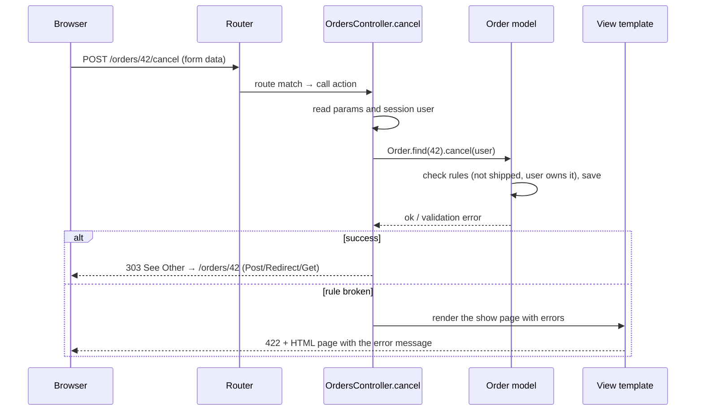

# MVC Architecture

> **Module 02 · Core Backend** · Prerequisites: [REST APIs](02-REST-APIs.md) · Next: [Service Layer Pattern](13-Service-Layer-Pattern.md)

---

## ⏱ If You Only Have 2 Minutes

- **MVC = Model–View–Controller.** Trygve Reenskaug described it at Xerox PARC in the late 1970s for Smalltalk GUIs. The **Model** holds data and business rules, the **View** shows it, and the **Controller** turns user input into actions on the Model.
- Server-rendered web frameworks (Rails, Django, Laravel, Spring MVC, ASP.NET MVC) adapted it to request/response: router → controller action → model → view template → HTML.
- **A model is not automatically an ORM table.** The model is your domain: data *plus* the rules that keep it valid. A table class with no behaviour is only half of it.
- In a **JSON API there is no template**. The serializer or response schema (FastAPI `response_model`, a `toOrderView()` mapper, a DRF serializer) plays the View's role: it decides exactly which fields leave the server.
- **"Controller → service → repository" is a layered architecture, not MVC.** Only the controller maps one-to-one. The service and repository are two layers that MVC never names; both live on the Model side.
- Controllers should coordinate HTTP concerns, not contain business policy: parse and validate input, call one use case, map the result to a status code and body.
- Both extremes hurt. **Fat controllers** copy business rules between endpoints. **Fat models** grow into god classes whose save callbacks send emails and call payment APIs.
- Django calls its flavour **MTV**: a Django "view" is the controller, and a Django "template" is the view.

---

## 1. What It Is and Why It Exists

**MVC** is a way to split the code that talks to a user into three parts with separate jobs:

| Part | Job | Must not |
|---|---|---|
| **Model** | Holds the application's data and the rules about it ("an order can be cancelled only before it ships") | Know how it is displayed or which HTTP request asked for it |
| **View** | Presents model data to the user (HTML page, GUI widget, or JSON body) | Make business decisions or change data |
| **Controller** | Receives input (click, form post, HTTP request), asks the model to act, then picks what to show | Hold business rules or build SQL |

**Analogy:** a restaurant. The kitchen (Model) knows the recipes and what is in stock. The plating (View) decides how the dish looks when it reaches the table. The waiter (Controller) takes the order, passes it to the kitchen, and carries the plate back. The waiter does not cook, and the kitchen never walks into the dining room. In a takeaway-only restaurant (a JSON API) there is no plating, but there is still a packing slip that decides what goes in the bag — that is the serializer.

**The problem it solves.** Early web code (CGI scripts, single-file PHP pages) mixed request parsing, SQL, business rules and HTML in one file. That caused three concrete failures:

1. A designer changing the HTML could break a query in the same file.
2. You could not test "cancelling a shipped order is rejected" without a browser and a database.
3. Adding a second interface (a mobile app that wants JSON) meant copying the business rules into a new script.

MVC fixes this by making the Model independent of both input and output. The same "cancel order" rule can then serve an HTML page, a JSON endpoint and an admin command.

**What MVC is *not*.** It is not "controller, service and repository". Those three names describe *layers* of a backend. MVC is about separating presentation from the model; it says nothing about how the model side is organised internally. Section 3 covers the difference in detail because interviewers often test it.

---

## 2. How It Works

### Classic MVC (Smalltalk, desktop GUIs)

In the original Smalltalk-80 design, every widget on screen had a View–Controller pair:

1. The **Controller** reads mouse and keyboard events and calls methods on the Model.
2. The **Model** changes its state and notifies its dependents (an early form of the Observer pattern).
3. Each **View** that observes the Model redraws itself.

There is no request/response here. The View stays alive and *watches* the Model. This is the part that did not survive the move to the web.

### Server-rendered web MVC (Rails, Django, Laravel)

HTTP is stateless, so the View cannot observe the Model across requests. Java's "Model 2" servlet/JSP design in the late 1990s, and later Rails, reshaped MVC into a per-request pipeline:



Two details are specific to server-rendered MVC:

- **Post/Redirect/Get.** After a successful form POST, the controller redirects (303) to a GET page instead of rendering directly. A browser refresh then repeats the harmless GET, not the POST.
- **Convention over configuration.** A Rails app finds the pieces by name: `app/controllers/orders_controller.rb`, `app/models/order.rb`, `app/views/orders/show.html.erb`. Laravel uses controllers plus Blade templates; Django uses `views.py` (controllers) and `templates/` (views).

### MVC in a JSON API

A JSON API drops the HTML template, but the three jobs remain. Most API codebases also split the Model side into more layers:

```text
HTTP request
   │
   ▼
Controller / route handler   ← MVC "C": parse, validate, authenticate, call use case, map result → HTTP
   │
   ▼
Service (use case)           ← not in MVC: workflow + transaction boundary
   │
   ▼
Domain model                 ← MVC "M": entities and their rules
   │
   ▼
Repository                   ← not in MVC: persistence behind an interface
   │
   ▼
Database

Response schema / serializer ← MVC "V": which fields, what names, what format
```

So when an API team says "we use MVC", they usually mean "we have controllers, and the rest of the code is split into service and repository layers". That is fine as everyday language. In an interview, name it precisely: **the controller is MVC's C; the service and repository are layered architecture.**

---

## 3. Key Concepts

### What each letter means in each style

| | Classic GUI MVC | Server-rendered web MVC | JSON API |
|---|---|---|---|
| **Model** | Domain objects; notify observers on change | Domain objects, often ActiveRecord classes with validations | Domain entities + the services and repositories behind them |
| **View** | Live widget that observes the Model | Template rendered once per request (ERB, Jinja, Blade, Thymeleaf) | Serializer / response schema / DTO mapper |
| **Controller** | Handles mouse and keyboard events | Action method chosen by the router | Route handler chosen by the router |
| **Data flow** | Model → View by notification | Controller passes data to the View | Controller passes a domain result to the serializer |

### MVC versus layered architecture

| | MVC | Layered (controller → service → repository) |
|---|---|---|
| Scope | The presentation boundary: input in, output out | The whole application, top to bottom |
| What it separates | Input handling, display, and the model | Transport, use cases, domain, persistence |
| Says where SQL goes? | No | Yes — the repository / data layer |
| Says where transactions go? | No | Yes — usually the service layer |
| Origin | Smalltalk GUIs, late 1970s | Classic n-tier / Fowler's *Patterns of Enterprise Application Architecture* (2002) |

They are compatible, not competing. Fowler's book lists Model View Controller under its *web presentation* patterns, separate from the domain-logic and data-source patterns. A typical backend uses MVC's ideas at the top layer and [layered architecture](../Module-07-Advanced-Backend-and-System-Design/48-Layered-Architecture.md) for everything underneath.

### What the "Model" really is

The Model is the part of the program that would still exist if you deleted the web framework. It includes:

- **Entities and value objects** — `Order`, `Money`, `OrderStatus`.
- **Rules** — "total must be positive", "only the owner can cancel", "shipped orders cannot be cancelled".
- **Use cases** that coordinate those objects (in layered systems this is the [service layer](13-Service-Layer-Pattern.md)).

An ORM class such as a Rails `ActiveRecord` model or a Django `models.Model` is a *persistence-aware* model: it mixes the rules with the table mapping. That is productive for CRUD-heavy apps. But "model = table" is a shortcut, not the definition. If a model's only content is column declarations, the business rules have moved somewhere else — usually into controllers.

### The thin controller

A controller earns its place by translating between HTTP and the application. Use this as a checklist:

| Belongs in the controller | Does not belong in the controller |
|---|---|
| Read path, query, body, headers | Price calculation, stock checks, state transitions |
| Validate *shape* (types, required fields, lengths) | Validate *business* rules ("coupon expired") |
| Get the authenticated user from middleware | Decide whether that user may cancel *this* order |
| Call one service / use case | Call three repositories and orchestrate them |
| Map result → status code + body | Open or commit database transactions |
| Set headers (`Location`, `Cache-Control`) | Send emails, publish events |

A good test: if a queue worker or a CLI command needs the same behaviour, can it call something *without* faking an HTTP request? If not, logic is stuck in the controller.

### Fat controller and fat model

| Anti-pattern | Symptom | Why it hurts | Fix |
|---|---|---|---|
| **Fat controller** | 200-line route handlers with SQL, `if` chains of business rules and email sending | Logic is duplicated between the web, mobile and admin endpoints; tests need HTTP and a database | Move the workflow into a service; keep the handler to validate → call → map |
| **Fat model** | One `User` or `Order` class with 3,000 lines, dozens of callbacks (`after_save :send_email`) | Saving a record in a test or migration triggers emails and API calls; hard to reason about order of effects | Keep invariants in the model; move workflows and side effects to services and the [outbox](19-Asynchronous-Processing.md) |
| **Anemic model + fat service** | Models are bags of getters; every rule is in services | Rules about one entity are scattered; easy to skip a check | Put rules about a single entity on the entity (see [Service Layer](13-Service-Layer-Pattern.md)) |

The Rails community's old advice "fat model, skinny controller" was a reaction to fat controllers. Taken too far, it simply moved the mess into the model.

---

## 4. Code Examples

Scenario: `POST /orders/:id/cancel`. The controller validates the input, calls an `OrderService`, maps the domain result to HTTP, and uses a view mapper so internal fields never leak. Authentication middleware (see [JWT Authentication](08-JWT-Authentication.md)) has already identified the user.

### Node.js / TypeScript

```ts
// npm i express zod && npm i -D @types/express   — Node.js 22+, TypeScript 5, ESM
import express, { type Request, type Response } from "express";
import { z } from "zod";

// ---- Model side: what the controller depends on (implemented in the service layer) ----
interface Order {
  id: string;
  customerId: string;
  status: "placed" | "paid" | "shipped" | "cancelled";
  totalCents: number;
  internalNotes: string;          // staff-only; must never reach a customer
  cancelledAt: Date | null;
}
type CancelResult =
  | { ok: true; order: Order }
  | { ok: false; error: "not_found" | "not_cancellable" };
export interface OrderService {
  cancelOrder(input: { orderId: string; requestedBy: string; reason: string }): Promise<CancelResult>;
}

// ---- View: the API's public shape, chosen field by field ----
function toOrderView(order: Order) {
  return {
    id: order.id,
    status: order.status,
    totalCents: order.totalCents,
    cancelledAt: order.cancelledAt?.toISOString() ?? null,
  };
}

// ---- Controller: HTTP in, use case call, HTTP out ----
const cancelRequest = z.object({
  params: z.object({ id: z.string().uuid() }),
  body: z.object({ reason: z.string().trim().min(3).max(500) }), // unknown keys are stripped
});

export function ordersController(service: OrderService): express.Router {
  const router = express.Router();

  // No try/catch: Express 5 forwards a rejected promise to the error middleware.
  router.post("/orders/:id/cancel", async (req: Request, res: Response) => {
    const userId: unknown = res.locals.userId; // set by auth middleware
    if (typeof userId !== "string") {
      res.status(401).json({ error: "not_authenticated" });
      return;
    }
    const parsed = cancelRequest.safeParse({ params: req.params, body: req.body });
    if (!parsed.success) {
      res.status(400).json({
        error: "validation_failed",
        issues: parsed.error.issues.map((i) => ({ path: i.path.join("."), message: i.message })),
      });
      return;
    }

    const result = await service.cancelOrder({
      orderId: parsed.data.params.id,
      requestedBy: userId,
      reason: parsed.data.body.reason,
    });

    // The service speaks in domain outcomes; only the controller knows status codes.
    if (!result.ok) {
      res.status(result.error === "not_found" ? 404 : 409).json({ error: result.error });
      return;
    }
    res.status(200).json(toOrderView(result.order));
  });

  return router;
}

// Composition: the service is created elsewhere and passed in.
declare const orderService: OrderService;
const app = express();
app.use(express.json({ limit: "16kb" }));
app.use(ordersController(orderService));
```

### Python

```python
# pip install fastapi pydantic   — Python 3.12+
from dataclasses import dataclass
from datetime import datetime
from typing import Annotated, Literal, Protocol
from uuid import UUID

from fastapi import APIRouter, Depends, HTTPException, Request, status
from pydantic import BaseModel, Field


# ---- Model side: domain object, domain errors, and the use case the route calls ----
@dataclass
class Order:
    id: UUID
    customer_id: UUID
    status: Literal["placed", "paid", "shipped", "cancelled"]
    total_cents: int
    internal_notes: str  # staff-only
    cancelled_at: datetime | None


class OrderNotFound(Exception): ...
class OrderNotCancellable(Exception): ...


class OrderService(Protocol):
    async def cancel_order(self, order_id: UUID, requested_by: UUID, reason: str) -> Order: ...


# ---- Request schema = input validation; response schema = the API's View ----
class CancelOrderRequest(BaseModel):
    reason: str = Field(min_length=3, max_length=500)


class OrderView(BaseModel):
    id: UUID
    status: str
    total_cents: int
    cancelled_at: datetime | None
    # internal_notes is not declared, so it can never be serialized.


# ---- Controller ----
def current_user_id(request: Request) -> UUID:
    user_id = getattr(request.state, "user_id", None)  # set by auth middleware
    if user_id is None:
        raise HTTPException(status.HTTP_401_UNAUTHORIZED, "not_authenticated")
    return user_id


def order_service(request: Request) -> OrderService:
    return request.app.state.order_service  # built once at startup (composition root)


router = APIRouter()


@router.post("/orders/{order_id}/cancel", response_model=OrderView)
async def cancel_order(
    order_id: UUID,  # FastAPI rejects a non-UUID with 422 before this function runs
    body: CancelOrderRequest,
    user_id: Annotated[UUID, Depends(current_user_id)],
    service: Annotated[OrderService, Depends(order_service)],
) -> OrderView:
    try:
        order = await service.cancel_order(order_id, requested_by=user_id, reason=body.reason)
    except OrderNotFound:
        raise HTTPException(status.HTTP_404_NOT_FOUND, "not_found") from None
    except OrderNotCancellable:
        raise HTTPException(status.HTTP_409_CONFLICT, "not_cancellable") from None
    return OrderView.model_validate(order, from_attributes=True)
```

**Differences worth noticing:**

- **Validation style.** Express gives you raw `req.params` and `req.body`, so the controller parses them explicitly (zod). FastAPI validates from the type hints *before* the handler runs, and its default status for bad input is `422`, not `400`. Pick one convention per API and document it.
- **Errors.** The TypeScript service returns a typed result union; the Python service raises domain exceptions. Both keep HTTP out of the service — the mapping to `404`/`409` happens only in the controller.
- **Blocking calls.** An Express handler that does slow synchronous work blocks every request on that process. In FastAPI, an `async def` route that calls a blocking library has the same effect; a plain `def` route runs in a thread pool instead.

---

## 5. Production Concerns

- **Mass assignment (over-posting).** Binding the request body straight onto a model lets a client set fields it should not, such as `role` or `isAdmin`. A public 2012 incident on GitHub exploited exactly this in a Rails app, and Rails later added *strong parameters* in response. Defence: an explicit request schema per endpoint. Zod's `z.object` and Pydantic models drop unknown keys by default; keep it that way for input.
- **Over-exposure.** Returning the ORM entity as JSON ships every column — `password_hash`, `internal_notes`, soft-delete flags. Always go through a view/response schema. A new column then stays private until someone adds it to the view on purpose.
- **N+1 queries in the view.** In server-rendered MVC, a template loop like `for item in order.items` can trigger one lazy-load query per row. Serializers do the same in APIs. Load what the view needs up front (Rails `includes`, Django `select_related` / `prefetch_related`, SQLAlchemy `selectinload`) or have the repository return complete aggregates. See [Repository Pattern](14-Repository-Pattern.md).
- **One place for error mapping.** Map expected domain errors in the controller (or a shared mapper), and let unexpected errors reach a single error middleware that logs them and returns a generic `500`. Stack traces and SQL messages must never reach the client. See [Error Handling](21-Error-Handling.md).
- **Async errors in Express.** Express 5 sends a rejected promise from an `async` handler to the error middleware. Express 4 did not: an unhandled rejection left the request hanging until timeout. If you maintain Express 4 code, wrap handlers or upgrade.
- **Observability.** Label metrics and logs with the *route template* (`POST /orders/:id/cancel`) and the controller action, not the raw URL. Raw URLs with IDs create one time series per order.

---

## 6. Common Mistakes

- **Calling controller → service → repository "MVC"** — interviewers hear that you do not know where the View went — say "layered architecture, with MVC-style controllers and response schemas as views".
- **Business rules in the controller** — the mobile endpoint and the admin endpoint enforce different rules for the same action — move rules into the model or service and call it from every controller.
- **Treating the ORM class as the whole model** — rules end up in controllers and callbacks because "the model is just the table" — put invariants on the domain object; keep mapping details in the repository.
- **Controllers opening transactions** — a transaction spans HTTP parsing and response formatting, and a second endpoint forgets to open one — let the service own the transaction boundary ([Service Layer](13-Service-Layer-Pattern.md)).
- **Returning entities directly as JSON** — sensitive or internal fields leak, and renaming a column breaks clients — map to an explicit response schema.
- **Throwing HTTP exceptions from the service** — the service cannot be reused from a worker or CLI, and tests have to inspect status codes — throw or return domain errors and translate them in the controller.
- **Model save callbacks with side effects** — every test, seed script and migration that saves a record sends real emails — trigger side effects from the use case, usually via an outbox event.

---

## 7. Comparison Table

| | Classic MVC | Web MVC (server-rendered) | MVVM | Controller → service → repository |
|---|---|---|---|---|
| Where it is used | Desktop GUIs (Smalltalk) | Rails, Django, Laravel, Spring MVC | Client UIs with data binding (WPF, many front-end frameworks) | JSON APIs and backends |
| How the UI updates | View observes the Model | Controller renders a new page per request | View binds to a ViewModel's state | No UI; serializer builds a JSON body |
| Who handles input | Controller per widget | Controller action per route | View + ViewModel commands | Route handler |
| Says how to organise business logic and data access? | No | Partly (ActiveRecord models) | No | Yes |
| Typical failure | Tangled observers | Fat controllers or fat models | Bloated ViewModels | Empty pass-through layers |

---

## 8. Interview Questions

**[Junior] What do Model, View and Controller each do?**
The Model holds the data and the business rules that keep it valid. The View presents that data — an HTML template on a server-rendered site, or a response schema in a JSON API. The Controller receives input, asks the Model to do something, and chooses what to send back. The point of the split is that the Model does not depend on how input arrives or how output looks.

**[Junior] Is "controller, service, repository" the same thing as MVC?**
No. That is a layered architecture. Only the controller is an MVC role. The service (use cases and transactions) and the repository (persistence) are layers that MVC does not define; both sit on the Model side. Many teams loosely call it MVC, but the precise answer is "MVC controllers on top of a layered backend".

**[Mid] Where is the View in a REST API that only returns JSON?**
It is the serializer or response schema: the code that decides which fields are returned, their names, and their format. In FastAPI that is the `response_model`; in Express it is usually a mapper function like `toOrderView`; in Django REST Framework it is a serializer. Treating it as a real layer stops internal fields from leaking and lets the database change without breaking clients.

**[Mid] What should a controller do, and what should it not do?**
It should parse and validate the shape of the input, read the authenticated identity, call one use case, and map the result to a status code, headers and body. It should not contain business rules, orchestrate several repositories, open transactions or send emails. A quick test is whether a CLI or queue worker could reuse the behaviour without simulating HTTP.

**[Mid] What are the fat controller and fat model anti-patterns?**
A fat controller holds business logic and data access inside route handlers, so rules are duplicated across endpoints and hard to test. A fat model puts every workflow and side effect into one entity class, often through save callbacks, so saving a record has surprising effects. The fix for both is the same: keep single-entity invariants on the model, put multi-step workflows in a service, and keep controllers as thin translators.

**[Senior] You inherit an API whose controllers are 500 lines each. How do you fix it without a rewrite?**
First add characterisation tests at the HTTP level for the most important endpoints, so behaviour is pinned down. Then extract one use case at a time into a service with a plain input object and a domain result, and make the controller call it. Move SQL out of the service into a repository only where it helps testing or reuse. Ship each extraction separately and watch error rates; stop when controllers are validate → call → map, not when every possible layer exists.

**[Senior] Server-rendered MVC or a SPA with a JSON API — how do you choose?**
Server-rendered MVC gives fast first page loads, simple SEO, one deployable unit, and forms that work with Post/Redirect/Get. A SPA plus JSON API suits rich interactive UIs and multiple clients (web, mobile, partners) sharing one backend, at the cost of an API contract, client-side state and separate deployments. Many teams mix them: server-rendered pages for content and admin screens, JSON endpoints for the interactive parts. The backend layering underneath can be the same in both cases.

**[Senior] Should your domain model be the ORM entity?**
For CRUD-heavy apps with simple rules, yes: an ActiveRecord-style model is fast to build and easy to read. As rules grow, the ORM's needs (lazy loading, mutable fields, framework base classes, callbacks) start to shape the domain. Then a separate domain model mapped by a [repository](14-Repository-Pattern.md) pays off, because rules can be tested without a database. The cost is mapping code, so make the switch per aggregate where the complexity actually lives.

---

## 9. Cheat Sheet

```text
MVC            Model = data + rules | View = presentation | Controller = input → model → output
Origin         Reenskaug, Xerox PARC, late 1970s, Smalltalk; View observed Model
Web MVC        router → controller action → model → template → HTML (Rails, Django, Laravel, Spring MVC)
Django         "MTV": Django view = controller, template = view
JSON API       View = serializer / response schema (response_model, toOrderView, DRF serializer)
Not MVC        controller → service → repository = layered architecture (only C is MVC)
Controller     validate shape → get user → call ONE use case → map result to status + body
Not in ctrl    business rules, transactions, SQL, emails, orchestration of repositories
Model ≠ table  rules belong on the domain object; ORM mapping is a persistence detail
Fat ctrl       duplicated rules across endpoints → extract a service
Fat model      god class + save callbacks with side effects → services + outbox
Security       explicit request schema (no mass assignment), explicit response schema (no leaks)
Forms          Post/Redirect/Get: POST → 303 → GET
Express 5      rejected promise in async handler → error middleware (Express 4 did not)
```

---

## Related Topics

- [Service Layer Pattern](13-Service-Layer-Pattern.md) — where the use case a thin controller calls actually lives
- [Repository Pattern](14-Repository-Pattern.md) — the persistence layer that MVC does not define
- [Clean Architecture](15-Clean-Architecture.md) — rules for which way dependencies between these layers point
- [Layered Architecture](../Module-07-Advanced-Backend-and-System-Design/48-Layered-Architecture.md) — the general pattern that controller → service → repository comes from
- [Error Handling](21-Error-Handling.md) — mapping domain errors to HTTP responses in one place
- [HTTP Status Codes](03-HTTP-Status-Codes.md) — choosing 400, 404, 409 and 422 in controllers
