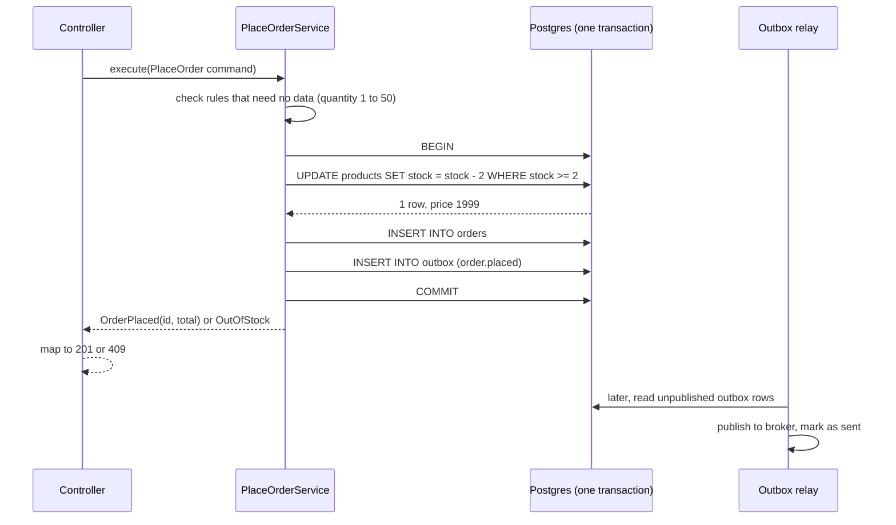

# Service Layer Pattern

> **Module 02 · Core Backend** · Prerequisites: [MVC Architecture](12-MVC-Architecture.md) · Next: [Repository Pattern](14-Repository-Pattern.md)

---

## ⏱ If You Only Have 2 Minutes

- A **service layer** is the set of operations your application offers — `PlaceOrder`, `CancelOrder`, `RefundPayment` — each one coordinating domain objects, repositories and external gateways. The pattern was named in Fowler's *Patterns of Enterprise Application Architecture* (2002).
- **The service owns the transaction.** One use case = one transaction, opened and committed in the service. Not in the controller (HTTP concern) and not per repository call (too small to protect the invariant).
- Keep the transaction around the smallest durable invariant. **No network calls inside it** — no payment API, no email, no message broker. Write an **outbox row** in the same transaction and let a relay publish it later.
- Services return **domain results or domain errors** (`OutOfStock`, `{ ok: false, error: "out_of_stock" }`), never HTTP responses. Then the same use case runs from a route, a queue consumer or a CLI.
- **Application service** (orchestrates: load → call domain → save → commit) is not the same as a **domain service** (a business rule that does not belong to one entity, such as pricing across many products).
- **Anemic domain model** = entities are data bags and every rule lives in services. Fine for simple CRUD; risky when rules grow, because each service re-implements the same checks.
- Prefer **one class or function per use case** over an `OrderService` with 40 methods. Skip the layer entirely for plain CRUD where it would only forward calls.

---

## 1. What It Is and Why It Exists

A **service layer** (also called the application layer or use-case layer) sits between the controllers and the domain/persistence code. Each public method is one thing a user or system can *do*. Inside, it:

1. accepts a plain input object (a **command**),
2. opens a transaction,
3. loads what it needs through repositories,
4. asks domain objects to apply their rules,
5. saves the changes and records events,
6. commits, and returns a result.

**Analogy:** a general contractor for a house renovation. You say "add a bathroom" — one request. The contractor books the plumber, the electrician and the inspector, in the right order, and signs off only if everything passes. The contractor does not lay tiles (domain objects and repositories do the work), and does not care whether you phoned or emailed (HTTP is the controller's business).

**What breaks without it:**

- **Duplicated workflows.** "Place order" is needed by the web API, the mobile API, a bulk-import job and an admin tool. If the steps live in a route handler, each entry point copies them, and one copy forgets the stock check.
- **No clear transaction boundary.** If each repository call commits on its own, a crash between "reserve stock" and "insert order" leaves stock reserved for an order that does not exist.
- **Tests need HTTP.** When the workflow lives in a controller, testing "out of stock is rejected" requires building a request, a server and a database.

The service layer gives each use case exactly one home, one transaction and one result type.

---

## 2. How It Works

### Anatomy of a use case



The steps, in order:

1. **Validate cheap rules first.** Rules that need no database (quantity range, currency supported) run before the transaction, so bad input never holds a connection or a lock.
2. **Open the unit of work.** One connection, one transaction for the whole use case.
3. **Load and decide.** Read aggregates through repositories and call domain methods (`order.cancel()`), or use an atomic conditional `UPDATE` for hot counters such as stock.
4. **Write state and events together.** The order row and the `order.placed` outbox row commit in the same transaction, so there is never an order without its event, or an event without its order. How the relay delivers the event is covered in [Asynchronous Processing](19-Asynchronous-Processing.md).
5. **Commit, then return.** Return only after the commit succeeds. A success response for an uncommitted order is a lie the client will act on.
6. **Translate at the edge.** The controller turns `OutOfStock` into `409` and `InvalidQuantity` into `400`/`422` ([MVC Architecture](12-MVC-Architecture.md)).

### Where external gateways go

A payment API call can take seconds and can time out with an unknown result. It must not run while a database transaction is open. The common shapes:

| Shape | Flow | Trade-off |
|---|---|---|
| **Two short transactions** | Tx 1: create order `pending_payment` + reserve stock → commit → call gateway (with an idempotency key) → Tx 2: mark `paid` or release stock | Simple; needs a sweeper for orders stuck in `pending_payment` after a crash |
| **Fully asynchronous** | Tx: create order + outbox `payment.requested` → commit → worker calls gateway → worker updates the order | Fast response, survives crashes; the client polls or gets notified |
| **Authorize first** | Authorize card → Tx: create order → if Tx fails, void the authorization | Common in checkout; the compensation step must itself be retried |

All three keep the network call *outside* any open transaction. The service still orchestrates the steps; it just does not hold locks while it waits.

---

## 3. Key Concepts

### Three things called "service"

| Term | What it is | Example |
|---|---|---|
| **Application service** (this chapter) | Orchestrates one use case: transaction, repositories, gateways, events. Thin on business rules. | `PlaceOrderService.execute(cmd)` |
| **Domain service** (from Domain-Driven Design) | A business rule that involves several entities and belongs to none of them. No transactions, no I/O. | `PricingPolicy.priceFor(cart, customerTier)` |
| **Microservice** | A separately deployed application | `orders-service` |

Interviewers ask about the first two. An application service *calls* domain services; it does not contain their math.

### Transaction boundaries

| Where the transaction lives | Problem |
|---|---|
| Each repository call (auto-commit) | Too small: a crash between two calls leaves half a use case committed |
| The controller / HTTP middleware ("transaction per request") | Too wide and wrong layer: holds a connection during parsing and serialization; workers and CLIs do not get one |
| **The application service** | Matches the business invariant; same behaviour from every entry point |

Rules that go with it:

- **One use case, one transaction.** If a use case truly needs two (see the payment table above), make each one leave the data in a valid state.
- **Short.** Each open transaction holds a pooled connection and its row locks. Node's `pg` pool defaults to 10 connections; SQLAlchemy's default pool is 5 plus 10 overflow. A few slow transactions can starve the whole service.
- **Retry the whole use case, not one statement.** Serialization failures (`40001`) and deadlocks (`40P01`) in Postgres are safe to retry only by re-running the entire transaction. That is safe only if nothing outside the database happened — another reason side effects go through the outbox. See [Transactions](../Module-03-Databases/27-Transactions.md).

### Returning results, not HTTP

The service's vocabulary is the business's vocabulary:

| Domain outcome | Service returns / raises | Controller maps to |
|---|---|---|
| Order placed | `OrderPlaced { orderId, totalCents }` | `201 Created` + `Location` |
| Quantity outside 1–50 | `InvalidQuantity` | `400` or `422` |
| Not enough stock | `OutOfStock` | `409 Conflict` |
| Order belongs to another user | `OrderNotFound` (do not reveal it exists) | `404` |
| Database down | Infrastructure exception, not caught | `500` / `503` via error middleware |

Two idiomatic styles: TypeScript code often returns a **discriminated union** (`{ ok: true, ... } | { ok: false, error: ... }`), so the compiler forces callers to handle failures. Python code usually **raises domain exceptions**. Both are fine. What matters is that expected business outcomes are distinguished from bugs and outages.

### Anemic versus rich domain model

Fowler's *PoEAA* describes two ways to organise business logic: **Transaction Script** (each use case is a procedure that does everything) and **Domain Model** (objects that hold both data and behaviour). In 2003 he named the **Anemic Domain Model** anti-pattern: classes that look like a domain model but only carry data, while all behaviour sits in services.

| | Anemic model + transaction-script services | Rich model + thin application services |
|---|---|---|
| Where `cancel` rules live | `if order.status == "shipped": raise ...` inside `CancelOrderService` | `order.cancel()` checks its own status |
| Duplication risk | High: `CancelOrder` and `AdminRefund` both re-check status | Low: every path calls `order.cancel()` |
| Unit tests | Need fakes for repositories | Plain object tests, no I/O |
| Best for | CRUD with few rules, short-lived code | Rules that change often and are reused across use cases |

A useful rule: **rules about one entity go on the entity; coordination between entities, I/O and transactions go in the application service.**

### When a service layer is overkill

Skip it when the endpoint is a direct read or a CRUD update with no rules — `GET /products/:id` can call a repository or a query function from the controller. A service whose methods only do `return this.repo.findById(id)` adds a file to every change and protects nothing. Add the layer when you see one of these triggers:

- a second entry point (worker, CLI, scheduled job) needs the same behaviour;
- the operation touches more than one aggregate or calls an external system;
- there is a transaction to own or an event to emit.

---

## 4. Code Examples

Scenario: a `PlaceOrder` use case. It checks the quantity, atomically reserves stock, inserts the order, and inserts an `order.placed` outbox row — all in one transaction. The service has no HTTP and no SQL; the Postgres adapters live in a second file. Dependencies are passed in through the constructor (see [Dependency Injection](16-Dependency-Injection.md)).

### Node.js / TypeScript

```ts
// place-order.ts — application service. No packages: no Express, no SQL here.
import { randomUUID } from "node:crypto";

export interface PlaceOrderCommand { customerId: string; sku: string; quantity: number }
export type PlaceOrderResult =
  | { ok: true; orderId: string; totalCents: number }
  | { ok: false; error: "invalid_quantity" | "out_of_stock" };

export interface NewOrder {
  id: string; customerId: string; sku: string; quantity: number; totalCents: number; createdAt: Date;
}

// Ports the service needs. The Postgres versions share one connection per transaction.
export interface UnitOfWork {
  inventory: { reserve(sku: string, quantity: number): Promise<{ unitPriceCents: number } | null> };
  orders: { add(order: NewOrder): Promise<void> };
  outbox: { add(eventType: string, payload: Record<string, unknown>): Promise<void> };
}
export type RunInTransaction = <T>(work: (uow: UnitOfWork) => Promise<T>) => Promise<T>;

class OutOfStock extends Error {}

export class PlaceOrderService {
  constructor(
    private readonly inTransaction: RunInTransaction,
    private readonly now: () => Date = () => new Date(), // injectable clock for tests
  ) {}

  async execute(cmd: PlaceOrderCommand): Promise<PlaceOrderResult> {
    // Cheap rule first: bad input never takes a connection or a lock.
    if (!Number.isInteger(cmd.quantity) || cmd.quantity < 1 || cmd.quantity > 50) {
      return { ok: false, error: "invalid_quantity" };
    }
    try {
      const order = await this.inTransaction(async (uow) => {
        const stock = await uow.inventory.reserve(cmd.sku, cmd.quantity);
        // Throw (not return) inside the transaction so the helper rolls back.
        if (!stock) throw new OutOfStock();
        const order: NewOrder = {
          id: randomUUID(),
          customerId: cmd.customerId,
          sku: cmd.sku,
          quantity: cmd.quantity,
          totalCents: stock.unitPriceCents * cmd.quantity,
          createdAt: this.now(),
        };
        await uow.orders.add(order);
        // Same transaction as the order: both commit or neither does.
        await uow.outbox.add("order.placed", { orderId: order.id, totalCents: order.totalCents });
        return order;
      });
      return { ok: true, orderId: order.id, totalCents: order.totalCents };
    } catch (err) {
      if (err instanceof OutOfStock) return { ok: false, error: "out_of_stock" };
      throw err; // infrastructure failures stay exceptions → 500 at the edge
    }
  }
}
```

The Postgres side — the transaction helper and the adapters:

```ts
// pg-unit-of-work.ts — npm i pg && npm i -D @types/pg
import pg, { type Pool, type PoolClient } from "pg";
import { randomUUID } from "node:crypto";
import { PlaceOrderService, type RunInTransaction, type UnitOfWork } from "./place-order.js";

export function pgTransaction(pool: Pool): RunInTransaction {
  return async (work) => {
    // Every statement must use this client. pool.query() may pick another
    // connection that is not inside the transaction.
    const client = await pool.connect();
    let broken = false;
    try {
      await client.query("BEGIN");
      const result = await work(pgUnitOfWork(client));
      await client.query("COMMIT");
      return result;
    } catch (err) {
      try { await client.query("ROLLBACK"); } catch { broken = true; }
      throw err;
    } finally {
      client.release(broken); // true = discard a connection in an unknown state
    }
  };
}

function pgUnitOfWork(client: PoolClient): UnitOfWork {
  return {
    inventory: {
      async reserve(sku, quantity) {
        // Check and decrement in one statement: two buyers cannot both take the last item.
        const { rows } = await client.query<{ price_cents: number }>(
          "UPDATE products SET stock = stock - $2 WHERE sku = $1 AND stock >= $2 RETURNING price_cents",
          [sku, quantity],
        );
        return rows[0] ? { unitPriceCents: rows[0].price_cents } : null;
      },
    },
    orders: {
      async add(o) {
        await client.query(
          `INSERT INTO orders (id, customer_id, sku, quantity, total_cents, status, created_at)
           VALUES ($1, $2, $3, $4, $5, 'placed', $6)`,
          [o.id, o.customerId, o.sku, o.quantity, o.totalCents, o.createdAt],
        );
      },
    },
    outbox: {
      async add(eventType, payload) {
        await client.query(
          "INSERT INTO outbox (id, event_type, payload, created_at) VALUES ($1, $2, $3, now())",
          [randomUUID(), eventType, JSON.stringify(payload)],
        );
      },
    },
  };
}

// Composition root: build once at startup, hand to the controllers.
const pool = new pg.Pool({ connectionString: process.env.DATABASE_URL, max: 10 });
export const placeOrder = new PlaceOrderService(pgTransaction(pool));
```

### Python

```python
# orders/place_order.py — application service. Standard library only.  Python 3.12+
import uuid
from collections.abc import Callable
from dataclasses import dataclass
from datetime import UTC, datetime
from types import TracebackType
from typing import Any, Protocol, Self


class InvalidQuantity(ValueError): ...


class OutOfStock(Exception):
    def __init__(self, sku: str) -> None:
        super().__init__(f"not enough stock for {sku}")
        self.sku = sku


@dataclass(frozen=True, slots=True)
class PlaceOrder:  # the command; its shape was already validated by the route
    customer_id: uuid.UUID
    sku: str
    quantity: int


@dataclass(frozen=True, slots=True)
class NewOrder:
    id: uuid.UUID
    customer_id: uuid.UUID
    sku: str
    quantity: int
    total_cents: int
    created_at: datetime


class Inventory(Protocol):
    async def reserve(self, sku: str, quantity: int) -> int | None: ...  # unit price or None


class OrderRepository(Protocol):
    async def add(self, order: NewOrder) -> None: ...


class Outbox(Protocol):
    async def add(self, event_type: str, payload: dict[str, Any]) -> None: ...


class UnitOfWork(Protocol):
    inventory: Inventory
    orders: OrderRepository
    outbox: Outbox

    async def __aenter__(self) -> Self: ...
    async def __aexit__(self, exc_type: type[BaseException] | None,
                        exc: BaseException | None, tb: TracebackType | None) -> None: ...


class PlaceOrderService:
    def __init__(self, uow_factory: Callable[[], UnitOfWork],
                 clock: Callable[[], datetime] = lambda: datetime.now(UTC)) -> None:
        self._uow_factory = uow_factory
        self._clock = clock

    async def execute(self, cmd: PlaceOrder) -> NewOrder:
        if not 1 <= cmd.quantity <= 50:
            raise InvalidQuantity(cmd.quantity)
        async with self._uow_factory() as uow:  # commits on normal exit, rolls back on any exception
            unit_price = await uow.inventory.reserve(cmd.sku, cmd.quantity)
            if unit_price is None:
                raise OutOfStock(cmd.sku)
            order = NewOrder(uuid.uuid4(), cmd.customer_id, cmd.sku, cmd.quantity,
                             unit_price * cmd.quantity, self._clock())
            await uow.orders.add(order)
            await uow.outbox.add("order.placed",
                                 {"order_id": str(order.id), "total_cents": order.total_cents})
        return order  # reached only after a successful commit
```

The SQLAlchemy side. `AsyncSession` already is a unit of work (it tracks changes and runs them in one transaction), so the adapter's main job is deciding *when* to commit:

```python
# orders/sql_unit_of_work.py — pip install "sqlalchemy[asyncio]>=2.0" asyncpg
import json
from types import TracebackType
from typing import Any, Self

from sqlalchemy import text
from sqlalchemy.ext.asyncio import AsyncSession, async_sessionmaker, create_async_engine

from orders.place_order import NewOrder, PlaceOrderService


class SqlInventory:
    def __init__(self, session: AsyncSession) -> None:
        self._s = session

    async def reserve(self, sku: str, quantity: int) -> int | None:
        # Check and decrement in one statement: two buyers cannot both take the last item.
        result = await self._s.execute(
            text("UPDATE products SET stock = stock - :qty "
                 "WHERE sku = :sku AND stock >= :qty RETURNING price_cents"),
            {"sku": sku, "qty": quantity},
        )
        return result.scalar_one_or_none()


class SqlOrders:
    def __init__(self, session: AsyncSession) -> None:
        self._s = session

    async def add(self, o: NewOrder) -> None:
        await self._s.execute(
            text("INSERT INTO orders (id, customer_id, sku, quantity, total_cents, status, created_at) "
                 "VALUES (:id, :customer_id, :sku, :quantity, :total_cents, 'placed', :created_at)"),
            {"id": o.id, "customer_id": o.customer_id, "sku": o.sku, "quantity": o.quantity,
             "total_cents": o.total_cents, "created_at": o.created_at},
        )


class SqlOutbox:
    def __init__(self, session: AsyncSession) -> None:
        self._s = session

    async def add(self, event_type: str, payload: dict[str, Any]) -> None:
        await self._s.execute(
            text("INSERT INTO outbox (id, event_type, payload, created_at) "
                 "VALUES (gen_random_uuid(), :event_type, CAST(:payload AS jsonb), now())"),
            {"event_type": event_type, "payload": json.dumps(payload)},
        )


class SqlAlchemyUnitOfWork:
    def __init__(self, sessions: async_sessionmaker[AsyncSession]) -> None:
        self._sessions = sessions

    async def __aenter__(self) -> Self:
        # One session per use case. An AsyncSession must never be shared by concurrent tasks.
        self._session = self._sessions()
        self.inventory = SqlInventory(self._session)
        self.orders = SqlOrders(self._session)
        self.outbox = SqlOutbox(self._session)
        return self

    async def __aexit__(self, exc_type: type[BaseException] | None,
                        exc: BaseException | None, tb: TracebackType | None) -> None:
        try:
            if exc_type is None:
                await self._session.commit()  # a failed commit raises, so the service never returns
            else:
                await self._session.rollback()
        finally:
            await self._session.close()  # returns the connection to the pool


# Composition root
engine = create_async_engine("postgresql+asyncpg://app@db:5432/shop", pool_size=5, max_overflow=10)
sessions = async_sessionmaker(engine, expire_on_commit=False)
place_order = PlaceOrderService(lambda: SqlAlchemyUnitOfWork(sessions))
```

**Differences worth noticing:**

- **Transaction scope.** In Node, the transaction is tied to one `PoolClient`. Calling `pool.query("BEGIN")` is a classic bug: the next `pool.query` may run on a different connection, outside the transaction. SQLAlchemy's `AsyncSession` holds its connection for you from the first statement until `commit()` or `rollback()`.
- **Failure style.** TypeScript returns a result union, so the compiler makes the controller handle every case. Python raises `OutOfStock`; raising inside `async with` is also what triggers the rollback in `__aexit__`. The TypeScript service throws internally for the same reason, then converts the error to a result at its boundary.
- **Testing.** Both services can be tested with an in-memory `UnitOfWork` fake that records the writes and a "committed" flag — no database, no HTTP. The SQL adapters get their own [integration tests](../Module-09-Testing-and-Code-Quality/05-Integration-Testing.md) against a real Postgres.

---

## 5. Production Concerns

- **Connection-pool starvation.** Each running use case holds one pooled connection from `BEGIN` to `COMMIT`. If someone adds `await paymentGateway.charge()` inside the transaction and the provider slows to 5 seconds, ten concurrent checkouts exhaust a 10-connection pool, and *every* endpoint — even reads — starts waiting. Watch pool wait time and how long each use case keeps its transaction open.
- **Lock contention on hot rows.** The conditional `UPDATE products ... WHERE stock >= $2` locks that product row until commit. A flash sale on one SKU queues all buyers on that row, so the shorter the transaction, the higher the throughput. For multi-line orders, reserve SKUs in a fixed order (for example, sorted by SKU) so two orders cannot lock rows in opposite order and deadlock.
- **Retries at the use-case level.** On a deadlock (`40P01`) or serialization failure (`40001`), re-run `execute()` from the start with a small bounded retry. Never retry a single statement inside a failed transaction — Postgres rejects every statement after an error until rollback. Re-running is safe only because side effects go through the outbox.
- **Idempotency.** A client that times out will retry `POST /orders`. Store the idempotency key and the result inside the same transaction as the order, and check it at the start of the use case. See [Idempotency](../Module-07-Advanced-Backend-and-System-Design/32-Idempotency.md).
- **Authorization belongs here too.** Authentication happens before the controller, but "may this user cancel *this* order?" is a business rule. Put it in the service (or the domain object) so the worker and admin paths cannot skip it.
- **Observability per use case.** Emit one span and one structured log line per `execute()` with the use-case name, the outcome (`placed`, `out_of_stock`, `invalid_quantity`, `error`) and the duration. Count business outcomes separately from errors: a spike in `out_of_stock` is a merchandising problem; a spike in `error` is an incident.

---

## 6. Common Mistakes

- **Transaction opened in the controller or per repository call** — partial writes on a crash, or connections held during JSON parsing — open and commit it in the service, once per use case.
- **Network calls inside the transaction** — locks and pooled connections are held while waiting on a slow API, and a rollback cannot undo a charge — commit first, then call the gateway or emit an outbox event.
- **Publishing to the broker directly around the commit** — publish after commit and a crash loses the event; publish before commit and you announce orders that may roll back — insert an outbox row in the same transaction.
- **Services that return HTTP responses or raise `HTTPException`** — the use case cannot run from a worker or CLI — return or raise domain outcomes and map them in the controller.
- **The god service** — `OrderService` grows to 40 methods and 2,000 lines with shared private helpers — split into one class or function per use case.
- **Pass-through services everywhere** — `getProduct(id) { return repo.findById(id) }` adds a layer that protects nothing — let simple reads skip the service, or use a dedicated query module.
- **Services calling services, each with its own transaction** — `PlaceOrder` calls `Loyalty.addPoints`, which commits separately, so a later failure leaves points without an order — pass the same unit of work, or let loyalty react to the `order.placed` event.

---

## 7. Comparison Table

| | Logic in controllers | Transaction-script services (anemic model) | Thin application service + rich domain model |
|---|---|---|---|
| Where business rules live | Route handlers | Service procedures | Entities and domain services |
| Transaction owner | Often unclear | Service | Service |
| Reuse from worker / CLI | Copy-paste | Call the service | Call the service |
| Unit-test cost | HTTP + database | Fakes for repositories | Plain object tests for rules; fakes only for orchestration |
| Fits | Prototypes, tiny CRUD apps | CRUD with a handful of rules | Complex rules shared across many use cases |
| Main risk | Duplication, no transaction boundary | Rules repeated in several services | Over-engineering simple CRUD |

---

## 8. Interview Questions

**[Junior] What is a service layer, and why not just put the logic in the route handler?**
It is the layer that implements use cases such as "place order": it coordinates domain objects, repositories and external systems, and it owns the transaction. Keeping that out of route handlers means a queue worker, a CLI and a second API version can run the same workflow. It also lets you test business behaviour without HTTP.

**[Junior] Where should the database transaction begin and end?**
In the application service, around exactly one use case. A transaction per repository call is too small, because a crash between calls leaves half the work committed. A transaction per HTTP request lives in the wrong layer and lasts too long, and non-HTTP entry points do not get one.

**[Mid] What is the difference between an application service and a domain service?**
An application service orchestrates: it opens the transaction, loads aggregates, calls the domain, saves, records events and returns a result. It contains little business logic. A domain service holds a business rule that spans several entities and does no I/O, such as calculating a price from a cart and a customer tier. Application services call domain services, not the other way round.

**[Mid] How should a service report "out of stock"?**
As a domain outcome: a typed result like `{ ok: false, error: "out_of_stock" }` or a domain exception like `OutOfStock`. It should not return `409` or raise an HTTP exception, because the service does not know it sits behind HTTP. The controller maps the outcome to `409 Conflict`; a queue worker might instead park the message and retry later.

**[Mid] Is an anemic domain model always bad?**
No. For CRUD-heavy code with few rules, transaction-script services over simple data classes are clear and cheap. It becomes a problem when the same rule must be enforced in many use cases: each service re-implements the check and one eventually forgets. Moving the rule onto the entity (`order.cancel()`) then gives one place to change and test it.

**[Senior] `PlaceOrder` must also charge a credit card. Where does the payment call go relative to the transaction?**
Outside it. Calling the provider inside a transaction holds row locks and a pooled connection for seconds, and a rollback cannot undo a charge that already happened. I would either commit an order in `pending_payment`, charge afterwards with an idempotency key and mark it paid in a second short transaction, or write a `payment.requested` outbox event and let a worker charge. Either way I need a sweeper or reconciliation job for orders stuck in `pending_payment`, because the provider can time out with an unknown result.

**[Senior] When would you *not* add a service layer?**
When the endpoint is a straightforward read or a CRUD write with no business rules, one entry point and no side effects. A service that only forwards to a repository adds files and indirection without protecting an invariant. I add the layer when a second caller appears, when the operation spans several aggregates or external systems, or when there is a transaction or event to own.

**[Senior] One use case needs to trigger another — placing an order also adds loyalty points. How do you structure it?**
If both changes must be atomic, they share one unit of work and one transaction; often the loyalty part is better as a domain method or domain service than as a second application service. If the points can lag a little, `PlaceOrder` writes an `order.placed` outbox event and a separate handler adds the points idempotently. What I avoid is two application services each opening their own transaction in one request, because a failure between them leaves the system half-updated.

---

## 9. Cheat Sheet

```text
Service layer   one operation per use case: PlaceOrder, CancelOrder (Fowler, PoEAA 2002)
Steps           cheap checks → BEGIN → load → domain rules → save + outbox row → COMMIT → result
Transaction     owned by the service; one use case = one tx; not in controller, not per repo call
Inside the tx   database work only; no HTTP calls, emails or broker publishes
Events          outbox row in the same tx; a relay publishes later (chapter 19)
Results         domain result / exception → controller maps to 201 / 400 / 404 / 409
App vs domain   application service = orchestration + tx; domain service = cross-entity rule, no I/O
Anemic model    data-only entities + rules in services; fine for CRUD, duplicates rules as they grow
Rich model      order.cancel() guards its own state; the service loads, calls, saves
Size            one class/function per use case, not a 40-method OrderService
Skip it when    simple read or CRUD, one entry point, no tx or side effect to own
Retries         re-run the whole use case on 40001 / 40P01; safe only if effects go via outbox
Pools           pg default max 10; SQLAlchemy default 5 + 10 overflow; slow tx = starved app
Node gotcha     BEGIN/COMMIT on one PoolClient — never pool.query("BEGIN")
```

---

## Related Topics

- [Repository Pattern](14-Repository-Pattern.md) — the persistence ports the service orchestrates
- [Dependency Injection](16-Dependency-Injection.md) — how the unit of work and gateways reach the service
- [Asynchronous Processing](19-Asynchronous-Processing.md) — the outbox relay that publishes the events written here
- [Transactions](../Module-03-Databases/27-Transactions.md) — the ACID guarantees behind the service's transaction boundary
- [Idempotency](../Module-07-Advanced-Backend-and-System-Design/32-Idempotency.md) — making retried use cases safe
- [Domain-Driven Design](../Module-09-Testing-and-Code-Quality/30-Domain-Driven-Design.md) — application services, domain services and aggregates

