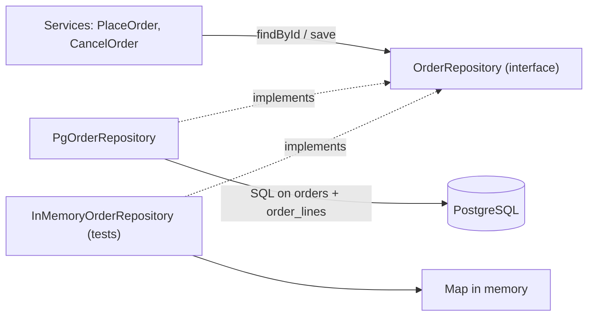

# Repository Pattern

> **Module 02 · Core Backend** · Prerequisites: [Service Layer Pattern](13-Service-Layer-Pattern.md) · Next: [Clean Architecture](15-Clean-Architecture.md)

---

## ⏱ If You Only Have 2 Minutes

- A **repository** gives the rest of the code a *collection-like* view of stored domain objects: `findById`, `findRecentByCustomer`, `save`. Callers ask for `Order`s, never for rows or SQL. The pattern comes from Fowler's *Patterns of Enterprise Application Architecture* and is central to Domain-Driven Design.
- **One repository per aggregate, not per table.** `OrderRepository` loads and saves an order *with its lines*. An `OrderLineRepository` usually means the aggregate boundary is wrong.
- The **interface lives next to the domain and services**; implementations (Postgres, in-memory fake) live in infrastructure. The service cannot tell which one it got — that is what makes fast unit tests possible.
- **Name query methods after the question** (`findOverdueInvoices(asOf)`), and do not leak the query builder (`find(where: any)`, returning an ORM query object). A leaked builder puts SQL knowledge back into every caller.
- **An ORM is not automatically a repository.** ORM sessions and entities are a data mapper plus a unit of work. Calling them from services, or returning ORM entities everywhere, is not persistence isolation.
- **Repository ≠ DAO.** A DAO (data access object) is table-shaped CRUD (`insertOrderLine(row)`); a repository is domain-shaped and returns whole aggregates.
- **Repositories do not commit.** The transaction belongs to the unit of work that the service controls.
- Repositories hide **N+1 queries** well: `findById` in a loop is N round trips. Offer batch methods and load each aggregate with a fixed number of queries. Complex reporting reads often belong in a separate query service, not in artificial repository methods.

---

## 1. What It Is and Why It Exists

A **repository** is an object that pretends to be an in-memory collection of domain objects. You can add an object, get one by ID, or ask for "all orders of customer X, newest first". Behind that interface, it translates to SQL (or a document store, or an HTTP API), runs the queries, and turns the rows back into domain objects.

**Analogy:** a library's front desk. You ask the librarian for "the three newest books by this author". You do not need to know the shelving codes, whether some books sit in an off-site warehouse, or that the catalogue moved to new software last year. If the library reorganises its basement, you still ask the same question at the same desk.

**What breaks without it:**

- **SQL spreads everywhere.** Thirty services each write their own `SELECT ... FROM orders JOIN order_lines`. Renaming a column means editing thirty files, and one of them is missed.
- **Mapping is duplicated and inconsistent.** One place converts `total_cents` to a number, another forgets and compares strings; one validates `status`, another lets `'canceled'` (one *l*) into the domain.
- **Business rules need a database to test.** If `PlaceOrder` calls `pool.query` directly, every test of "out of stock is rejected" needs Postgres running.

The repository puts all of that in one class per aggregate, behind an interface the domain owns.

---

## 2. How It Works

### Port and implementations



The arrows matter. The service depends on the interface. The Postgres class *also* depends on the interface (it implements it). Nothing in the domain imports `pg`, `asyncpg` or SQLAlchemy. Which implementation is used is decided once, at startup — see [Dependency Injection](16-Dependency-Injection.md) and [Clean Architecture](15-Clean-Architecture.md) for the dependency rule behind this.

### The life of an aggregate

1. **Load.** The service calls `orders.findById(id)`. The repository runs a fixed number of queries (here: one for the order, one for its lines) and maps rows to an `Order` object.
2. **Change.** The service calls domain methods, such as `order.cancel()`. The repository is not involved.
3. **Save.** The service calls `orders.save(order)`. The repository writes the order row and its lines, using the caller's transaction.
4. **Commit.** The unit of work (owned by the service) commits. The repository never calls `COMMIT` itself, so several repositories can take part in one transaction.

Some stacks skip step 3. An ORM **unit of work** — SQLAlchemy's `Session`, Hibernate's `Session`, EF Core's `DbContext` — tracks every object it loaded and writes the changed ones at flush/commit time. Repositories on top of such an ORM often have only `add()` and query methods, no `save()`.

### Mapping rows to domain objects

The repository is the only place that knows both shapes:

| Concern | Row (database) | Domain object | Where it is handled |
|---|---|---|---|
| Naming | `customer_id`, `unit_price_cents` | `customerId`, `unitPriceCents` | Mapping function |
| Enum values | `text` column, may hold anything | `"placed" \| "paid" \| "cancelled"` | Validate on load; reject unknown values |
| Big numbers | `bigint`, `numeric` | `number` / `int` / `Decimal` | Node `pg` returns `bigint` and `numeric` as **strings**; asyncpg returns `int` and `Decimal` |
| Time | `timestamptz` | `Date` / aware `datetime` | Both drivers parse it; store UTC |
| Children | Separate `order_lines` table | `order.lines` array | Load in one extra query, not one per order |
| Concurrency | `version` column | `order.version` | Checked in `save()` |

### Avoiding N+1 behind the interface

```text
N+1: the service loops over a list               Batched: one repository method
SELECT ... FROM orders WHERE customer_id = $1     SELECT ... FROM orders WHERE customer_id = $1 LIMIT 20
SELECT ... FROM order_lines WHERE order_id = $1   SELECT ... FROM order_lines WHERE order_id = ANY($1)
SELECT ... FROM order_lines WHERE order_id = $1
... 18 more round trips                           → 2 round trips, whatever the page size
```

The interface hides how many queries run, which is exactly why N+1 sneaks in. Design methods so that loading *N* aggregates costs a constant number of queries, and give callers a batch method (`findByIds(ids)`) instead of making them loop over `findById`.

---

## 3. Key Concepts

### Repository vs DAO vs ORM

| | Repository | DAO | ORM (data mapper style) | Active Record ORM |
|---|---|---|---|---|
| Shaped like | The domain (aggregates) | Tables | Tables mapped to classes | Tables mapped to classes |
| Typical API | `findRecentByCustomer`, `save(order)` | `insert(row)`, `update(row)`, `findByColumn` | `session.get`, `select(...)`, `session.add` | `Order.find(1)`, `order.save()` |
| Returns | Domain objects | Rows / DTOs | ORM entities | The model itself |
| Transactions | Joins the caller's unit of work | Often one per call | Session = unit of work | Per save or explicit |
| Examples | Hand-written `PgOrderRepository` | Classic Java EE DAOs | SQLAlchemy ORM, Hibernate, TypeORM | Rails ActiveRecord, Django ORM |

Naming does not settle the question. TypeORM's `Repository<Order>` and Spring Data's `JpaRepository` are generic data-access objects with "repository" in the name: they expose generic finders and return ORM entities. You can build a real repository *on top* of them — a class with domain methods that uses the ORM inside and returns domain objects (or carefully chosen ORM entities). See [ORM Fundamentals](../Module-03-Databases/33-ORM-Fundamentals.md).

### Aggregates decide the granularity

An **aggregate** is a cluster of objects that must stay consistent together and is always loaded and saved as a unit — an `Order` and its `OrderLine`s. Rules for repositories:

- **One repository per aggregate root.** Lines are reached through the order, never saved on their own, so the "total matches lines" rule cannot be bypassed.
- **Reference other aggregates by ID.** `order.customerId`, not an embedded `Customer` object that the order repository would also have to load.
- **Keep aggregates small.** If changing an order's status means loading 10,000 lines, the aggregate is too big; split it, or load the lines lazily through a separate read path.

### Query methods vs a leaked query builder

| Leaky (avoid) | Intention-revealing (prefer) |
|---|---|
| `find(where: Partial<OrderRow>)` | `findRecentByCustomer(customerId, limit)` |
| `query(): SelectQueryBuilder<OrderEntity>` | `findOverdue(asOf: Date)` |
| `findAll()` returning every row | Methods with a required `limit` or cursor |
| `findBy(column: string, value: unknown)` | `findByExternalPaymentId(paymentId)` |

A leaky method lets every caller write a new query shape, so the repository can no longer guarantee indexes, limits, or that the aggregate is fully loaded. The **generic repository** (`IRepository<T>` with `getAll()` and `find(predicate)` for every entity) is the most common form of this mistake: it adds a layer while hiding nothing.

When filters genuinely vary (a search screen with ten optional filters), take a typed criteria object (`{ status?, createdAfter?, limit }`) and build the SQL inside the repository. For dashboards and reports that join many tables, skip the repository and write a **query service** that returns read-only DTOs straight from SQL — this is the core idea of [CQRS](../Module-07-Advanced-Backend-and-System-Design/27-CQRS.md).

### Unit of Work

Fowler's **Unit of Work** keeps track of everything a business transaction changes and writes it out together. It answers "who commits?":

| Stack | Unit of work | What the repository receives |
|---|---|---|
| Node `pg` (hand-written) | A transaction on one `PoolClient` | That `PoolClient` |
| asyncpg | `conn.transaction()` on one connection | That `Connection` |
| SQLAlchemy | `Session` / `AsyncSession` | The session |
| Prisma | An interactive `$transaction` callback | The transaction client |

The service opens the unit of work, builds repositories that share it, and commits once (see the `PlaceOrder` example in [Service Layer Pattern](13-Service-Layer-Pattern.md)).

### Fakes and contract tests

An **in-memory fake** implements the same interface with a `Map` or `dict`. It makes service tests run in milliseconds. The risk is **drift**: the fake accepts something the real database rejects (a duplicate ID, a stale version). The fix is one shared **contract test suite** that runs against both implementations — the fake in every unit-test run, the Postgres version in integration tests. See [Fakes](../Module-09-Testing-and-Code-Quality/16-Fakes.md).

---

## 4. Code Examples

Scenario: an `Order` aggregate with lines and an optimistic-locking `version`. `OrderRepository` has three methods. The Postgres implementation loads any number of orders in two queries and detects concurrent updates. The in-memory fake follows the same rules.

### Node.js / TypeScript

```ts
// orders.ts — domain types, repository port and in-memory fake. No packages needed.
export type OrderStatus = "placed" | "paid" | "cancelled";
export const ORDER_STATUSES: readonly OrderStatus[] = ["placed", "paid", "cancelled"];

export interface OrderLine { sku: string; quantity: number; unitPriceCents: number }

export interface Order {
  id: string;
  customerId: string;
  status: OrderStatus;
  createdAt: Date;
  lines: OrderLine[];
  version: number; // 0 = never saved; save() increments it
}

export class ConcurrencyError extends Error {
  constructor(orderId: string) { super(`order ${orderId} was changed by another writer`); }
}

// The port speaks in Orders and business questions — never rows, never SQL.
export interface OrderRepository {
  findById(id: string): Promise<Order | null>;
  findRecentByCustomer(customerId: string, limit: number): Promise<Order[]>;
  save(order: Order): Promise<void>;
}

export class InMemoryOrderRepository implements OrderRepository {
  private readonly orders = new Map<string, Order>();

  async findById(id: string): Promise<Order | null> {
    const stored = this.orders.get(id);
    // Hand out copies: a test that forgets save() must fail, as it would against Postgres.
    return stored ? structuredClone(stored) : null;
  }

  async findRecentByCustomer(customerId: string, limit: number): Promise<Order[]> {
    return [...this.orders.values()]
      .filter((o) => o.customerId === customerId)
      .sort((a, b) => b.createdAt.getTime() - a.createdAt.getTime())
      .slice(0, limit)
      .map((o) => structuredClone(o));
  }

  async save(order: Order): Promise<void> {
    // Same optimistic-locking rule as the SQL version, so service tests catch lost updates.
    if ((this.orders.get(order.id)?.version ?? 0) !== order.version) {
      throw new ConcurrencyError(order.id);
    }
    order.version += 1;
    this.orders.set(order.id, structuredClone(order));
  }
}
```

```ts
// pg-order-repository.ts — npm i pg && npm i -D @types/pg   (Node.js 22+, TypeScript 5, ESM)
import type { PoolClient } from "pg";
import { ConcurrencyError, ORDER_STATUSES, type Order, type OrderLine,
         type OrderRepository, type OrderStatus } from "./orders.js";

interface OrderRow { id: string; customer_id: string; status: string; created_at: Date; version: number }
interface LineRow { order_id: string; sku: string; quantity: number; unit_price_cents: number }
const ORDER_COLUMNS = "id, customer_id, status, created_at, version";

export class PgOrderRepository implements OrderRepository {
  // Takes the transaction's client, so it joins the caller's unit of work and never commits.
  constructor(private readonly db: PoolClient) {}

  async findById(id: string): Promise<Order | null> {
    const { rows } = await this.db.query<OrderRow>(`SELECT ${ORDER_COLUMNS} FROM orders WHERE id = $1`, [id]);
    return (await this.withLines(rows))[0] ?? null;
  }

  async findRecentByCustomer(customerId: string, limit: number): Promise<Order[]> {
    const { rows } = await this.db.query<OrderRow>(
      `SELECT ${ORDER_COLUMNS} FROM orders WHERE customer_id = $1 ORDER BY created_at DESC LIMIT $2`,
      [customerId, limit],
    );
    return this.withLines(rows);
  }

  async save(order: Order): Promise<void> {
    const result = order.version === 0
      ? await this.db.query(
          `INSERT INTO orders (id, customer_id, status, created_at, version)
           VALUES ($1, $2, $3, $4, 1) ON CONFLICT (id) DO NOTHING`,
          [order.id, order.customerId, order.status, order.createdAt])
      : await this.db.query(
          "UPDATE orders SET status = $2, version = version + 1 WHERE id = $1 AND version = $3",
          [order.id, order.status, order.version]);
    if (result.rowCount === 0) throw new ConcurrencyError(order.id); // someone saved first

    // Replace the children: simple and correct for small collections.
    await this.db.query("DELETE FROM order_lines WHERE order_id = $1", [order.id]);
    await this.db.query(
      `INSERT INTO order_lines (order_id, sku, quantity, unit_price_cents)
       SELECT $1::uuid, l.sku, l.qty, l.price FROM unnest($2::text[], $3::int[], $4::int[]) AS l(sku, qty, price)`,
      [order.id, order.lines.map((l) => l.sku), order.lines.map((l) => l.quantity),
       order.lines.map((l) => l.unitPriceCents)],
    );
    order.version += 1;
  }

  private async withLines(rows: OrderRow[]): Promise<Order[]> {
    if (rows.length === 0) return [];
    // One query for all orders' lines: 2 round trips for N orders, not 1 + N.
    const { rows: lineRows } = await this.db.query<LineRow>(
      `SELECT order_id, sku, quantity, unit_price_cents FROM order_lines
       WHERE order_id = ANY($1::uuid[]) ORDER BY order_id, sku`,
      [rows.map((r) => r.id)],
    );
    const linesByOrder = new Map<string, OrderLine[]>();
    for (const l of lineRows) {
      const list = linesByOrder.get(l.order_id) ?? [];
      list.push({ sku: l.sku, quantity: l.quantity, unitPriceCents: l.unit_price_cents });
      linesByOrder.set(l.order_id, list);
    }
    return rows.map((r) => ({
      id: r.id, customerId: r.customer_id, status: toStatus(r.status),
      createdAt: r.created_at, lines: linesByOrder.get(r.id) ?? [], version: r.version,
    }));
  }
}

function toStatus(value: string): OrderStatus {
  // Reject bad data at the boundary instead of letting it reach business logic.
  const status = ORDER_STATUSES.find((s) => s === value);
  if (!status) throw new Error(`unknown order status in database: ${value}`);
  return status;
}
```

### Python

```python
# orders/domain.py — domain types, repository port and in-memory fake. Standard library only.
import copy
from dataclasses import dataclass, field
from datetime import datetime
from enum import StrEnum
from typing import Protocol
from uuid import UUID


class OrderStatus(StrEnum):
    PLACED = "placed"
    PAID = "paid"
    CANCELLED = "cancelled"


@dataclass(frozen=True, slots=True)
class OrderLine:
    sku: str
    quantity: int
    unit_price_cents: int


@dataclass
class Order:
    id: UUID
    customer_id: UUID
    status: OrderStatus
    created_at: datetime
    lines: list[OrderLine] = field(default_factory=list)
    version: int = 0  # 0 = never saved; save() increments it

    @property
    def total_cents(self) -> int:
        return sum(line.quantity * line.unit_price_cents for line in self.lines)


class ConcurrencyError(Exception):
    """Another writer saved this order after we loaded it."""


class OrderRepository(Protocol):
    async def get(self, order_id: UUID) -> Order | None: ...
    async def list_recent_for_customer(self, customer_id: UUID, limit: int) -> list[Order]: ...
    async def save(self, order: Order) -> None: ...


class InMemoryOrderRepository:
    """Satisfies OrderRepository structurally: a Protocol needs no inheritance."""

    def __init__(self) -> None:
        self._orders: dict[UUID, Order] = {}

    async def get(self, order_id: UUID) -> Order | None:
        stored = self._orders.get(order_id)
        return copy.deepcopy(stored) if stored is not None else None  # copies, like a real DB

    async def list_recent_for_customer(self, customer_id: UUID, limit: int) -> list[Order]:
        mine = sorted((o for o in self._orders.values() if o.customer_id == customer_id),
                      key=lambda o: o.created_at, reverse=True)
        return [copy.deepcopy(o) for o in mine[:limit]]

    async def save(self, order: Order) -> None:
        stored = self._orders.get(order.id)
        if (stored.version if stored is not None else 0) != order.version:
            raise ConcurrencyError(order.id)
        order.version += 1
        self._orders[order.id] = copy.deepcopy(order)
```

```python
# orders/postgres.py — pip install asyncpg   (Python 3.12+)
from collections import defaultdict
from uuid import UUID

import asyncpg

from orders.domain import ConcurrencyError, Order, OrderLine, OrderStatus

ORDER_COLUMNS = "id, customer_id, status, created_at, version"  # constant, never user input


class PostgresOrderRepository:
    def __init__(self, conn: asyncpg.Connection) -> None:
        # Bound to the caller's connection, so it joins the caller's transaction:
        #   async with pool.acquire() as conn, conn.transaction():
        #       repo = PostgresOrderRepository(conn)
        self._conn = conn

    async def get(self, order_id: UUID) -> Order | None:
        rows = await self._conn.fetch(f"SELECT {ORDER_COLUMNS} FROM orders WHERE id = $1", order_id)
        orders = await self._with_lines(rows)
        return orders[0] if orders else None

    async def list_recent_for_customer(self, customer_id: UUID, limit: int) -> list[Order]:
        rows = await self._conn.fetch(
            f"SELECT {ORDER_COLUMNS} FROM orders WHERE customer_id = $1 "
            "ORDER BY created_at DESC LIMIT $2", customer_id, limit)
        return await self._with_lines(rows)

    async def save(self, order: Order) -> None:
        if order.version == 0:
            status = await self._conn.execute(
                "INSERT INTO orders (id, customer_id, status, created_at, version) "
                "VALUES ($1, $2, $3, $4, 1) ON CONFLICT (id) DO NOTHING",
                order.id, order.customer_id, order.status.value, order.created_at)
        else:
            status = await self._conn.execute(
                "UPDATE orders SET status = $2, version = version + 1 WHERE id = $1 AND version = $3",
                order.id, order.status.value, order.version)
        if int(status.split()[-1]) == 0:  # "INSERT 0 0" or "UPDATE 0": another writer won
            raise ConcurrencyError(order.id)
        await self._conn.execute("DELETE FROM order_lines WHERE order_id = $1", order.id)
        await self._conn.executemany(
            "INSERT INTO order_lines (order_id, sku, quantity, unit_price_cents) VALUES ($1, $2, $3, $4)",
            [(order.id, ln.sku, ln.quantity, ln.unit_price_cents) for ln in order.lines])
        order.version += 1

    async def _with_lines(self, rows: list[asyncpg.Record]) -> list[Order]:
        if not rows:
            return []
        # One query for every order's lines: 2 round trips for N orders, not 1 + N.
        line_rows = await self._conn.fetch(
            "SELECT order_id, sku, quantity, unit_price_cents FROM order_lines "
            "WHERE order_id = ANY($1::uuid[]) ORDER BY order_id, sku", [r["id"] for r in rows])
        lines: defaultdict[UUID, list[OrderLine]] = defaultdict(list)
        for ln in line_rows:
            lines[ln["order_id"]].append(OrderLine(ln["sku"], ln["quantity"], ln["unit_price_cents"]))
        return [
            Order(id=r["id"], customer_id=r["customer_id"],
                  status=OrderStatus(r["status"]),  # unknown value → ValueError at the boundary
                  created_at=r["created_at"], lines=lines[r["id"]], version=r["version"])
            for r in rows
        ]
```

**Differences worth noticing:**

- **Driver types.** `pg` returns `uuid` columns as strings and would return `bigint` as a string too; asyncpg returns `uuid.UUID`, `int` and `datetime` objects directly. Either way, the mapping code in the repository is the one place that deals with it.
- **Bulk inserts.** `pg` has no `executemany`, so the TypeScript version sends the lines as arrays and expands them with `unnest` in a single statement. asyncpg's `executemany` runs one prepared statement for every tuple.
- **Interfaces.** The TypeScript fake `implements OrderRepository`, so the compiler checks it. The Python `Protocol` is checked structurally by a type checker (mypy, pyright); there is no runtime check unless you add `@runtime_checkable`.
- **Using SQLAlchemy instead.** With the ORM, `AsyncSession` is your unit of work. Keep `OrderRecord` classes private to the repository module, map them to the domain `Order`, and load children with `selectinload(...)`. Setting `lazy="raise"` on relationships turns a hidden lazy load (an N+1 in disguise) into an immediate error.

---

## 5. Production Concerns

- **Count queries per request.** Because the interface hides SQL, N+1 regressions show up only in metrics. Record query count and database time per request or span, and alert when an endpoint's query count grows with page size. Name spans after the repository method (`OrderRepository.findRecentByCustomer`) so slow queries point at the right code.
- **Lost updates.** Two admins load the same order, both change it, both save — the second silently overwrites the first. The `version` check in `save()` turns that into a `ConcurrencyError`, which the service can retry (reload, re-apply, save) or the controller can map to `409`. See [Optimistic vs Pessimistic Locking](../Module-03-Databases/32-Optimistic-vs-Pessimistic-Locking.md).
- **Unbounded reads.** A `findAll()` or `findByCustomer()` without a limit works in development and returns 2 million rows in production. Make `limit` (or a cursor) a required parameter of every list method.
- **Child-collection strategy.** "Delete all lines, insert them again" is simple and correct for small collections. It churns indexes, fires delete triggers, and breaks foreign keys that point at line IDs. For large or referenced children, compare old and new lines and issue only the needed inserts, updates and deletes.
- **SQL injection stays inside.** The repository is where parameterised queries are enforced. Values always go in `$1` placeholders. Things that cannot be parameters — sort column, sort direction — must come from an allow-list inside the repository, never from a string the caller passes through.
- **Index alignment.** Each query method is a known access path, which makes indexing straightforward: `findRecentByCustomer` needs an index on `orders (customer_id, created_at DESC)`, and the line lookup needs `order_lines (order_id)`. Review indexes whenever a method is added.

---

## 6. Common Mistakes

- **One repository per table** — `OrderLineRepository.insert()` lets code change lines without the order checking its total — one repository per aggregate root; children go through the root.
- **Leaking the query builder or ORM query** — every service builds its own query, and the repository can no longer guarantee limits, indexes or full loading — expose named query methods with typed parameters.
- **Returning ORM entities and calling it isolation** — lazy-loading proxies and session state escape into services and serializers, so an access outside the session fails or fires extra queries — map to domain objects, or at least load everything eagerly before returning.
- **Committing inside repository methods** — `save()` commits, so the outbox row written by another repository is in a different transaction — let the service's unit of work commit once.
- **`findById` in a loop** — 1 + N queries for a list page — add `findByIds` or a list method that loads children with `ANY($1)` / `IN (...)`.
- **A fake that is kinder than the database** — tests pass, production throws on duplicate keys or stale versions — copy objects in and out, enforce the same rules, and run one contract test suite against both implementations.
- **Forcing reports through repositories** — `OrderRepository` grows 40 reporting methods that return half-loaded aggregates — use a query service that returns read-only DTOs straight from SQL.

---

## 7. Comparison Table

| | Raw SQL in services | DAO per table | Active Record ORM | Repository per aggregate | Query service (read side) |
|---|---|---|---|---|---|
| Domain isolated from storage | No | Partly | No (the model *is* the table) | Yes | Not needed: read-only DTOs |
| Unit tests without a database | No | With mocks | Hard | Yes, with an in-memory fake | Usually integration-tested |
| Control over SQL | Full | Full | Limited; easy N+1 | Full, in one place | Full |
| Boilerplate | Low | Medium | Lowest | Medium–high (mapping) | Low |
| Best for | Scripts, tiny services | Legacy / table-centric apps | CRUD apps with simple rules | Rich domains, many use cases | Reports, dashboards, search pages |

Many production systems combine the last two: repositories for writes (load aggregate → apply rules → save), query services for complex reads.

---

## 8. Interview Questions

**[Junior] What is the Repository pattern?**
It is an object that gives the application a collection-like interface for domain objects — get by ID, list by some business criterion, save — while hiding how they are stored. Services depend on the interface, and the real implementation translates calls into SQL and maps rows back to domain objects. That keeps SQL in one place and lets tests swap in an in-memory version.

**[Junior] Why would you write an in-memory implementation?**
To test services and domain rules quickly without a database. The service receives the fake through its constructor and behaves exactly as in production. The fake must follow the real rules — return copies, reject stale versions — and should be checked by the same contract tests as the real implementation, or it will drift.

**[Mid] What is the difference between a repository and a DAO?**
A DAO is table-oriented: it offers CRUD on rows of one table and usually returns rows or simple DTOs. A repository is domain-oriented: it loads and saves whole aggregates, such as an order with its lines, and exposes business-named queries. A repository may use DAOs or an ORM internally.

**[Mid] If I use an ORM, do I still need repositories?**
Not automatically. The ORM already gives you a data mapper and a unit of work, and for CRUD-heavy apps calling it from services is fine. A repository adds value when you want domain objects free of ORM details, a stable set of tested query methods, and fast unit tests with a fake. Wrapping every ORM call in a generic `Repository<T>` with `find(predicate)` adds a layer without that benefit.

**[Mid] How do you avoid N+1 queries behind a repository?**
Design methods so loading N aggregates costs a constant number of queries: one query for the parents and one per child collection using `ANY($1)` / `IN (...)`, or a join. Offer batch methods like `findByIds` so callers do not loop. In ORMs, use eager loading such as SQLAlchemy's `selectinload`, and make lazy loads fail loudly (`lazy="raise"`). Track query count per request in production.

**[Senior] Where do transactions live when you have several repositories?**
Outside them, in a unit of work controlled by the application service. The service opens the transaction, creates repositories that share the same connection or session, calls them, and commits once. If each repository committed on its own, a failure between `orders.save()` and `outbox.add()` would leave half the use case persisted. That is also why the repository constructors take a transaction-scoped client rather than the pool.

**[Senior] A product manager wants a dashboard with ten filters, joins across five tables and aggregates. Do you add it to `OrderRepository`?**
No. The repository exists to load and save consistent aggregates for write use cases. A dashboard needs flat, read-only rows shaped for display, often from several aggregates. I would write a query service that runs optimised SQL (possibly against a read replica or a materialised view) and returns DTOs. This keeps the repository small and lets the read side be optimised separately — the basic CQRS split.

**[Senior] How do you handle two users editing the same order at once?**
With optimistic concurrency: a `version` column that `save()` checks with `UPDATE ... WHERE id = $1 AND version = $2` and increments. Zero updated rows means someone else saved first, so the repository raises a concurrency error. The service can reload and retry if the change is commutative, or return `409` so the user can review. Pessimistic locking (`SELECT ... FOR UPDATE`) suits short, high-contention operations, but holding locks across user think-time is not an option.

---

## 9. Cheat Sheet

```text
Repository     collection-like access to domain objects: findById, findRecentByX, save
Granularity    one per aggregate root (Order + lines), not per table
Interface      owned by domain/service; Postgres + in-memory fake implement it
Queries        named, typed, bounded (required limit/cursor); never leak a query builder
ORM            data mapper + unit of work ≠ repository; generic Repository<T> hides nothing
DAO            table-shaped CRUD; repository = aggregate-shaped
Transactions   repository never commits; service's unit of work does
Unit of Work   pg: one PoolClient | asyncpg: conn.transaction() | SQLAlchemy: Session
Mapping        snake_case → camelCase, validate enums, pg bigint/numeric = strings
N+1            parents query + children WHERE order_id = ANY($1) → 2 queries for N orders
Concurrency    version column; UPDATE ... WHERE version = $n; 0 rows → ConcurrencyError
Fakes          return copies, enforce same rules, share contract tests with the real impl
Reports        query service + DTOs (CQRS), not repository methods
```

---

## Related Topics

- [Service Layer Pattern](13-Service-Layer-Pattern.md) — the unit of work and use cases that call repositories
- [Clean Architecture](15-Clean-Architecture.md) — why the interface belongs to the domain and the SQL class to infrastructure
- [ORM Fundamentals](../Module-03-Databases/33-ORM-Fundamentals.md) — data mapper, active record and lazy loading in depth
- [Optimistic vs Pessimistic Locking](../Module-03-Databases/32-Optimistic-vs-Pessimistic-Locking.md) — the version check used in `save()`
- [CQRS](../Module-07-Advanced-Backend-and-System-Design/27-CQRS.md) — separating write repositories from read-side query services
- [Fakes](../Module-09-Testing-and-Code-Quality/16-Fakes.md) — building in-memory fakes that do not drift from production
