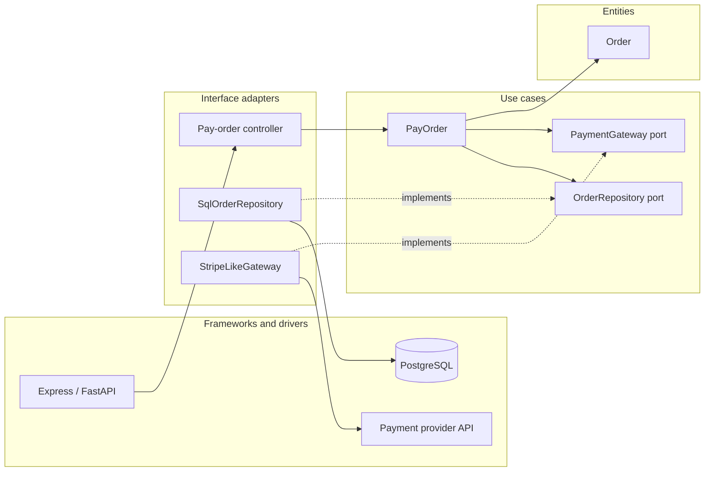

# Clean Architecture

> **Module 02 · Core Backend** · Prerequisites: [Repository Pattern](14-Repository-Pattern.md) · Next: [Dependency Injection](16-Dependency-Injection.md)

---

## ⏱ If You Only Have 2 Minutes

- **The dependency rule:** source-code dependencies point only inward, toward business policy. Inner code never imports a framework, ORM, SDK or HTTP type.
- Four rings, inside out: **Entities** (enterprise rules) → **Use cases** (application rules) → **Interface adapters** (controllers, repositories, gateways) → **Frameworks & drivers** (Express, FastAPI, PostgreSQL, Stripe).
- Control flow goes *out* (a use case calls the database), but the dependency still points *in*. The trick is a **port**: an interface the use case owns and an outer adapter implements. That is Dependency Inversion.
- **Ports and adapters** (Hexagonal Architecture) is the same idea with different vocabulary. Clean Architecture adds the explicit Entities / Use-cases split.
- Only plain data crosses a boundary: input and output **DTOs**, never an Express `req`, an ORM row or a provider's response object.
- The payoff: you can test every use case with fakes in milliseconds, and swap a payment provider by writing one adapter.
- The cost: more files, interfaces and mapping code. For a thin CRUD service with no real business rules, it is over-engineering.

---

## 1. What It Is and Why It Exists

**Clean Architecture** is a way of arranging a service's code so that business rules sit in the middle and every technical detail (web framework, database, message broker, third-party API) sits at the edge and depends on the middle — never the reverse. Robert C. Martin named it in a 2012 article and a 2017 book. It merges earlier ideas: Alistair Cockburn's Hexagonal Architecture (ports and adapters) and Jeffrey Palermo's Onion Architecture.

**Analogy:** a power socket. Your laptop's design does not depend on the power station; it depends on the socket standard (the port). Each country supplies an adapter. You can travel to any country, or plug into a battery pack, without redesigning the laptop.

**The problem it solves.** In a typical "framework-first" service, the code that decides *whether an order may be paid* lives inside an Express handler, reads a Sequelize model, and calls the Stripe SDK directly. Then:

- You cannot test the payment rule without an HTTP server, a database and a Stripe sandbox.
- Moving from Stripe to Adyen means editing the business logic, not just the integration.
- Upgrading the ORM or web framework touches every feature.
- The same rule gets re-implemented in a background worker, because it is welded to the HTTP handler.

Clean Architecture fixes this by making the business rules independent of all of those choices. A framework becomes a plug-in to the application, not the skeleton of it.

---

## 2. How It Works

### The rings and the dependency rule



Every arrow means "imports / knows about". All arrows cross ring borders pointing inward.

| Ring | Contains | May import | Changes when |
|---|---|---|---|
| Entities | `Order`, `Money`, domain errors, invariants such as "an order is paid at most once" | Nothing outside itself | The business itself changes |
| Use cases | `PayOrder`, `PlaceOrder`, the **ports** they need, input/output DTOs | Entities | A workflow of this application changes |
| Interface adapters | Controllers, presenters, repository and gateway implementations, mappers | Use cases, entities, and the outer libraries they wrap | A delivery mechanism or integration changes |
| Frameworks and drivers | Express/FastAPI app, DB driver, SDKs, `main` / composition root | Everything | You upgrade or replace a tool |

### Inverting a dependency

The use case must call the payment provider at runtime. Without care, `pay-order.ts` would `import Stripe from "stripe"`, which breaks the rule. Instead:

1. The use-cases ring declares `interface PaymentGateway { charge(req): Promise<ChargeResult> }` — written in the use case's language (cents, order IDs), not Stripe's.
2. The adapters ring has `StripeLikeGateway implements PaymentGateway`. It imports both the port and the HTTP client.
3. The composition root (see [Dependency Injection](16-Dependency-Injection.md)) creates the adapter and passes it into the use case.

Control flows outward (use case → adapter → provider), but the source dependency points inward (adapter → port). This is the Dependency Inversion Principle applied at the architecture level.

### One request, end to end

1. Express receives `POST /orders/42/pay`. The **controller** turns the request into a plain input DTO `{ orderId: "42", requestedBy: "user_7" }`.
2. The **use case** loads the `Order` through the `OrderRepository` port, asks the entity whether it can be paid, and calls the `PaymentGateway` port.
3. The **gateway adapter** translates the call into the provider's HTTP API, and translates the reply (or a 5xx / timeout) back into the port's result type or error.
4. The use case calls `order.markPaid()`, saves through the port, and returns an output DTO `{ status: "paid", chargeId }`.
5. The controller (acting as a **presenter**) maps the output DTO to `200`, `402`, `404` or `409`.

### Folder structure for a real service

```text
src/
  domain/                      # Entities: no imports from outside this folder
    order.ts
    money.ts
  application/                 # Use cases and the ports they own
    ports/
      payment-gateway.ts
      order-repository.ts
    pay-order.ts
    place-order.ts
  adapters/
    http/orders-router.ts      # controller + presenter
    persistence/pg-order-repository.ts
    payments/stripe-like-gateway.ts
    payments/fake-payment-gateway.ts
  main.ts                      # composition root: the only file that knows every concrete class
```

In a larger codebase, group by feature first (`orders/domain`, `orders/application`, `orders/adapters`) so a feature's code lives together. Enforce the rule with a tool rather than code review alone: `dependency-cruiser` or ESLint's `no-restricted-imports` in TypeScript, `import-linter` layer contracts in Python.

---

## 3. Key Concepts

### Entities vs use cases

**Entities** hold rules that would exist even without software: "an order cannot be paid twice", "a refund cannot exceed the captured amount". **Use cases** hold the steps of one application action: load the order, check ownership, charge, mark paid, save. If a rule would also apply in a back-office tool or a batch job, it belongs in the entity. An entity here is a plain class, not an ORM model; mapping between the two happens in the repository adapter.

### Ports and adapters (Hexagonal Architecture)

A **port** is an interface at the edge of the application. A **driving** (primary) port is how the world calls in — usually the use case's `execute` method. A **driven** (secondary) port is what the application needs from the world: `PaymentGateway`, `OrderRepository`, `EmailSender`. An **adapter** connects one port to one technology. [Hexagonal Architecture](../Module-07-Advanced-Backend-and-System-Design/49-Hexagonal-Architecture.md) is built on exactly these terms. Clean Architecture keeps them and adds a stricter inner split (entities vs use cases) plus named roles for presenters and controllers.

### Crossing a boundary: DTOs and error translation

Only simple data structures cross a ring boundary:

| Crossing | Do | Don't |
|---|---|---|
| Controller → use case | Input DTO: `{ orderId, requestedBy }` | Pass `req`, `Request`, headers or a Pydantic request model with HTTP concerns |
| Use case → controller | Output DTO or result union | Return the entity (it leaks setters) or an ORM row |
| Use case → repository port | Entities in, entities out | Leak query builders or sessions into the use case |
| Adapter → use case (errors) | Port-level errors such as `PaymentUnavailableError` | Let `Stripe.errors.CardError` or `httpx.ConnectTimeout` bubble inward |

Mapping code is the price of independence. When the input DTO and the HTTP body really are identical, sharing one shape is fine — the point is that the use case must not *depend* on the web framework type.

### Testing at the use-case level

Because every driven port is an interface, a use-case test wires `PayOrder` with an in-memory repository and a `FakePaymentGateway`. These tests run in milliseconds and cover the business branches (declined card, already paid, wrong owner). Each real adapter then gets a small number of integration tests against a real database or the provider's sandbox. See [Fakes](../Module-09-Testing-and-Code-Quality/16-Fakes.md).

### The cost: when it is over-engineering

| Service | Recommendation |
|---|---|
| Thin CRUD over one table, rules live in DB constraints | Controller → service → repository is enough. No ports. |
| A few rules, one database, no external providers | Keep a domain layer and use cases; skip interfaces for things with one implementation. |
| Payments, external providers, multiple delivery mechanisms (HTTP + worker + CLI) | Full rings with ports at every external dependency. |
| Long-lived core domain, several teams | Full rings, enforced by an import-linting tool in CI. |

Signs you overdid it: every field change touches five files; interfaces have exactly one implementation and no fake; mappers copy identical objects; new engineers cannot find where a request is handled. Start simple and extract a port the day a second implementation (or a fake for tests) is genuinely needed.

---

## 4. Code Examples

Scenario: `PayOrder` charges a customer for a pending order through a `PaymentGateway` port. The production adapter talks to a Stripe-like REST API; tests use a fake. The inner code has no npm or pip dependencies at all.

### Node.js / TypeScript

```ts
// application/pay-order.ts — inner rings: plain TypeScript 5, no npm packages, no framework imports.

// ── Entity ───────────────────────────────────────────────
export class OrderNotPayableError extends Error {}

export class Order {
  constructor(
    readonly id: string,
    readonly customerId: string,
    readonly totalCents: number,
    readonly currency: "USD" | "EUR",
    private status: "pending" | "paid" = "pending",
  ) {}

  get isPaid(): boolean { return this.status === "paid"; }

  markPaid(): void {
    // Enterprise rule: holds for HTTP, workers and admin tools alike.
    if (this.status !== "pending") throw new OrderNotPayableError(`order ${this.id} is ${this.status}`);
    this.status = "paid";
  }
}

// ── Ports: owned by the use case, written in its vocabulary ──
export class PaymentUnavailableError extends Error {}   // adapters translate timeouts/5xx into this

export interface ChargeRequest { amountCents: number; currency: string; customerRef: string; idempotencyKey: string }
export type ChargeResult = { kind: "charged"; chargeId: string } | { kind: "declined"; reason: string };

export interface PaymentGateway { charge(req: ChargeRequest): Promise<ChargeResult> }
export interface OrderRepository {
  findById(id: string): Promise<Order | null>;
  save(order: Order): Promise<void>;
}

// ── Use case with input/output DTOs ───────────────────────
export interface PayOrderInput { orderId: string; requestedBy: string }
export type PayOrderOutput =
  | { status: "paid"; orderId: string; chargeId: string }
  | { status: "declined"; reason: string }
  | { status: "not_found" }
  | { status: "already_paid" };

export class PayOrder {
  constructor(private readonly orders: OrderRepository, private readonly payments: PaymentGateway) {}

  async execute(input: PayOrderInput): Promise<PayOrderOutput> {
    const order = await this.orders.findById(input.orderId);
    if (!order || order.customerId !== input.requestedBy) return { status: "not_found" };
    if (order.isPaid) return { status: "already_paid" };

    const result = await this.payments.charge({
      amountCents: order.totalCents,
      currency: order.currency,
      customerRef: order.customerId,
      idempotencyKey: `pay-order-${order.id}`, // a retried request must not charge twice
    });
    if (result.kind === "declined") return { status: "declined", reason: result.reason };

    order.markPaid();
    await this.orders.save(order);
    return { status: "paid", orderId: order.id, chargeId: result.chargeId };
  }
}
```

Outer rings — the adapters and the controller:

```ts
// npm i express  — Node.js 22+ (global fetch), TypeScript 5, Express 5
import express from "express";
import { PayOrder, PaymentUnavailableError, type ChargeRequest, type ChargeResult, type PaymentGateway } from "./application/pay-order.js";

export class StripeLikeGateway implements PaymentGateway {
  constructor(private readonly baseUrl: string, private readonly apiKey: string) {}

  async charge(req: ChargeRequest): Promise<ChargeResult> {
    let res: Response;
    try {
      res = await fetch(`${this.baseUrl}/v1/charges`, {
        method: "POST",
        headers: {
          Authorization: `Bearer ${this.apiKey}`,
          "Content-Type": "application/json",
          "Idempotency-Key": req.idempotencyKey,
        },
        body: JSON.stringify({ amount: req.amountCents, currency: req.currency.toLowerCase(), customer: req.customerRef }),
        signal: AbortSignal.timeout(10_000),
      });
    } catch (err) {
      throw new PaymentUnavailableError("provider unreachable", { cause: err });
    }
    // Translate provider vocabulary into the port's. Nothing provider-specific leaks inward.
    if (res.status === 402) {
      const body = (await res.json()) as { error?: { code?: string } };
      return { kind: "declined", reason: body.error?.code ?? "card_declined" };
    }
    if (!res.ok) throw new PaymentUnavailableError(`provider returned ${res.status}`);
    const body = (await res.json()) as { id: string };
    return { kind: "charged", chargeId: body.id };
  }
}

// Same port, no network. Used by use-case tests and local development.
export class FakePaymentGateway implements PaymentGateway {
  readonly charges: ChargeRequest[] = [];
  constructor(private readonly decliningCustomers = new Set<string>()) {}

  async charge(req: ChargeRequest): Promise<ChargeResult> {
    if (this.decliningCustomers.has(req.customerRef)) return { kind: "declined", reason: "card_declined" };
    this.charges.push(req);
    return { kind: "charged", chargeId: `fake_${this.charges.length}` };
  }
}

// Controller + presenter: HTTP → input DTO → use case → output DTO → HTTP. No business rules here.
export function ordersRouter(payOrder: PayOrder): express.Router {
  const router = express.Router();
  router.post("/orders/:id/pay", async (req, res) => {
    const userId = res.locals.userId as string; // set by the auth middleware
    // PaymentUnavailableError is rethrown; Express 5 forwards it to the error handler, which maps it to 503.
    const out = await payOrder.execute({ orderId: req.params.id, requestedBy: userId });
    switch (out.status) {
      case "paid": res.status(200).json(out); return;
      case "declined": res.status(402).json({ error: "payment_declined", reason: out.reason }); return;
      case "already_paid": res.status(409).json({ error: "already_paid" }); return;
      case "not_found": res.status(404).json({ error: "not_found" }); return;
    }
  });
  return router;
}
```

### Python

```python
# application/pay_order.py — inner rings: standard library only, Python 3.12+
from dataclasses import dataclass
from typing import Literal, Protocol


class OrderNotPayableError(Exception): ...


class PaymentUnavailableError(Exception):
    """Part of the port's contract: adapters raise it for timeouts and provider 5xx."""


@dataclass
class Order:  # Entity: a plain class, not an ORM model
    id: str
    customer_id: str
    total_cents: int
    currency: str
    status: Literal["pending", "paid"] = "pending"

    def mark_paid(self) -> None:
        if self.status != "pending":
            raise OrderNotPayableError(f"order {self.id} is {self.status}")
        self.status = "paid"


@dataclass(frozen=True)
class Charged:
    charge_id: str


@dataclass(frozen=True)
class Declined:
    reason: str


class PaymentGateway(Protocol):  # driven port, owned by the use case
    async def charge(
        self, *, amount_cents: int, currency: str, customer_ref: str, idempotency_key: str
    ) -> Charged | Declined: ...


class OrderRepository(Protocol):
    async def get(self, order_id: str) -> Order | None: ...
    async def save(self, order: Order) -> None: ...


@dataclass(frozen=True)
class PayOrderResult:  # output DTO: plain data, safe to hand to any delivery mechanism
    status: Literal["paid", "declined", "not_found", "already_paid"]
    charge_id: str | None = None
    reason: str | None = None


class PayOrder:
    def __init__(self, orders: OrderRepository, payments: PaymentGateway) -> None:
        self._orders = orders
        self._payments = payments

    async def execute(self, order_id: str, requested_by: str) -> PayOrderResult:
        order = await self._orders.get(order_id)
        if order is None or order.customer_id != requested_by:
            return PayOrderResult("not_found")
        if order.status == "paid":
            return PayOrderResult("already_paid")

        result = await self._payments.charge(
            amount_cents=order.total_cents,
            currency=order.currency,
            customer_ref=order.customer_id,
            idempotency_key=f"pay-order-{order.id}",  # retries must not double-charge
        )
        if isinstance(result, Declined):
            return PayOrderResult("declined", reason=result.reason)

        order.mark_paid()
        await self._orders.save(order)
        return PayOrderResult("paid", charge_id=result.charge_id)
```

Outer rings — adapters and the FastAPI route:

```python
# pip install fastapi httpx
from typing import Annotated

import httpx
from fastapi import APIRouter, Depends, HTTPException, Request

from shop.application.pay_order import Charged, Declined, PaymentUnavailableError, PayOrder
from shop.auth import current_user_id  # verifies the bearer token (see the JWT chapter)


class StripeLikeGateway:  # satisfies PaymentGateway structurally; no inheritance needed
    def __init__(self, client: httpx.AsyncClient, api_key: str) -> None:
        self._client = client  # one shared AsyncClient (base_url set) = one connection pool
        self._api_key = api_key

    async def charge(
        self, *, amount_cents: int, currency: str, customer_ref: str, idempotency_key: str
    ) -> Charged | Declined:
        try:
            res = await self._client.post(
                "/v1/charges",
                json={"amount": amount_cents, "currency": currency.lower(), "customer": customer_ref},
                headers={"Authorization": f"Bearer {self._api_key}", "Idempotency-Key": idempotency_key},
                timeout=10.0,
            )
        except httpx.TransportError as exc:  # includes timeouts and connection failures
            raise PaymentUnavailableError("provider unreachable") from exc
        if res.status_code == 402:
            return Declined(reason=res.json().get("error", {}).get("code", "card_declined"))
        if res.is_error:
            raise PaymentUnavailableError(f"provider returned {res.status_code}")
        return Charged(charge_id=res.json()["id"])


class FakePaymentGateway:
    def __init__(self, declining_customers: set[str] | None = None) -> None:
        self.idempotency_keys: list[str] = []
        self._declining = declining_customers or set()

    async def charge(
        self, *, amount_cents: int, currency: str, customer_ref: str, idempotency_key: str
    ) -> Charged | Declined:
        if customer_ref in self._declining:
            return Declined(reason="card_declined")
        self.idempotency_keys.append(idempotency_key)
        return Charged(charge_id=f"fake_{len(self.idempotency_keys)}")


router = APIRouter()


def get_pay_order(request: Request) -> PayOrder:
    return request.app.state.pay_order  # built once by the composition root at startup


@router.post("/orders/{order_id}/pay")
async def pay_order(
    order_id: str,
    user_id: Annotated[str, Depends(current_user_id)],
    use_case: Annotated[PayOrder, Depends(get_pay_order)],
) -> dict[str, str | None]:
    try:
        result = await use_case.execute(order_id, requested_by=user_id)
    except PaymentUnavailableError:
        raise HTTPException(503, "payment_provider_unavailable") from None
    match result.status:
        case "paid":
            return {"status": "paid", "charge_id": result.charge_id}
        case "declined":
            raise HTTPException(402, result.reason)
        case "already_paid":
            raise HTTPException(409, "already_paid")
        case _:
            raise HTTPException(404, "not_found")
```

**Runtime differences to notice:**

- Both TypeScript interfaces and Python `Protocol`s are **structural**: the fake does not have to declare that it implements the port. TypeScript interfaces are erased at runtime, so they only exist for the compiler; a Python `Protocol` is checked by mypy or pyright, not at runtime.
- In Node, `fetch` is always non-blocking. In Python the adapter must be `async` and use an async client (`httpx.AsyncClient`). A synchronous `requests.post` inside an `async def` adapter would block the whole event loop for up to the 10 s timeout. The port signature (`async def charge`) forces adapters to get this right.

---

## 5. Production Concerns

- **Partial failure across ports.** The charge can succeed and `save` can then fail. The use case — not the controller — owns this sequence. The idempotency key derived from the order ID makes a retry return the original charge instead of charging again. For stronger guarantees, record a "payment pending" state first, or reconcile with the provider's webhooks.
- **Transactions are a use-case concern, implemented by an adapter.** If one use case writes through two repositories, expose a unit-of-work port (`await uow.run(async () => …)`) so the use case defines the transaction boundary without importing the database driver.
- **Performance.** Rings add function calls and object mapping, which cost microseconds. The real risk is a repository port that is too narrow (`findById` only), which tempts use cases into N+1 loops. Design ports around what the use case needs (`findPendingOlderThan(cutoff)`), not around tables.
- **Error translation at every outer boundary.** Adapters convert driver and SDK exceptions into port errors; the controller converts port errors into HTTP status codes; only the outer ring logs stack traces. This keeps provider names and SQL out of API responses.
- **Observability without breaking the rule.** Put tracing spans and timing logs in adapters (where the I/O happens) and in a thin wrapper around use cases. If the use case must emit business events, give it an `EventPublisher` port rather than importing a logger or OpenTelemetry directly into entities.
- **Enforce the rule in CI.** A single `import { Pool } from "pg"` inside `application/` quietly undoes the architecture. Fail the build on forbidden imports.

---

## 6. Common Mistakes

- **Using ORM models as entities** — business rules become tied to column mappings and lazy loading, and tests need a database — keep plain entity classes and map in the repository adapter (accept the duplication only where rules justify it).
- **Ports shaped like the vendor SDK** — `PaymentGateway.createPaymentIntent(params: Stripe.PaymentIntentCreateParams)` means swapping providers still edits the use case — write ports in your domain's words (`charge(amountCents, customerRef)`).
- **Passing framework objects inward** — `execute(req)` makes the use case unusable from a worker or CLI — map to an input DTO in the controller.
- **Business rules in controllers or adapters** — the "already paid" check lives in the Express handler, so the batch job skips it — rules go in entities or use cases; adapters only translate.
- **Interfaces for everything** — a port per class with one implementation and no fake adds indirection without protection — add a port at real boundaries: external services, persistence, clock, ID generation.
- **One giant "service" interface per ring** — every use case depends on a 40-method repository — give each use case narrow ports (see Interface Segregation in [SOLID Principles](24-SOLID-Principles.md)).
- **Letting adapter exceptions leak** — a `ConnectTimeout` surfaces as a 500 with a stack trace — translate to a port error and map it to 503 at the edge.

---

## 7. Comparison Table

| | Framework-first (MVC + ORM) | Layered (N-tier) | Hexagonal (ports and adapters) | Clean Architecture |
|---|---|---|---|---|
| Dependency direction | Everything depends on the framework | Top-down: UI → business → data access | Inward to the application core | Inward, through four named rings |
| Business logic depends on DB? | Usually yes | Yes (business layer imports the data layer) | No | No |
| Core split | None | By technical layer | Inside vs outside | Entities vs use cases inside |
| Test core without I/O | Hard | Partly | Yes | Yes |
| Boilerplate | Lowest | Low | Medium | Highest |
| Good fit | CRUD apps, prototypes | Most internal services | Services with many integrations | Complex, long-lived domains |

See [Layered Architecture](../Module-07-Advanced-Backend-and-System-Design/48-Layered-Architecture.md) and [Hexagonal Architecture](../Module-07-Advanced-Backend-and-System-Design/49-Hexagonal-Architecture.md). The key difference from classic layering is the direction of the arrow between business logic and data access.

---

## 8. Interview Questions

**[Junior] What is the dependency rule?**
Source-code dependencies may only point inward, toward higher-level policy. Code in the entities or use-cases rings never names anything in an outer ring — no framework, ORM, SDK or HTTP type. Outer rings know about inner rings, not the reverse. Data that crosses inward is plain DTOs.

**[Junior] What is the difference between an entity and a use case?**
An entity holds business rules that would exist even without this application, such as "an order is paid at most once". A use case is one application action that coordinates entities and ports: load the order, check ownership, charge, mark paid, save. If a rule must also apply in a batch job or admin tool, put it in the entity.

**[Mid] The use case has to save to PostgreSQL. How can it do that without depending on PostgreSQL?**
The use case defines a port, `OrderRepository`, in its own ring. A `PgOrderRepository` adapter in the outer ring implements it and imports the driver. The composition root creates the adapter and injects it. At runtime the call goes outward, but the source dependency points inward — that is dependency inversion.

**[Mid] How do Clean Architecture and Hexagonal Architecture relate?**
They share the core idea: the application core is independent, and it talks to the world through ports that adapters implement. Hexagonal talks about inside vs outside and driving vs driven ports. Clean Architecture adds named rings inside the core (entities vs use cases) and roles like presenter and controller. In practice, a well-built hexagonal service and a Clean Architecture service look very similar.

**[Mid] What crosses a boundary, and why not just pass the entity to the controller?**
Simple data: input and output DTOs or result unions. If the controller receives the entity, it can call mutating methods and bypass the use case. The JSON response also becomes coupled to the entity's internal shape, so a refactor breaks the API. Returning an output DTO keeps the API contract and the domain model free to change separately.

**[Senior] When is Clean Architecture the wrong choice?**
For a service that is mostly CRUD with rules enforced by database constraints, the rings add files, mappers and interfaces that protect nothing. A controller → service → repository structure is clearer and faster to change. I would adopt ports where there is a real boundary — an external provider, a second delivery mechanism, or a need for fast use-case tests — and grow toward full rings only as the domain gets richer. Architecture should follow the complexity of the business rules, not precede it.

**[Senior] The provider charges the card but saving the order fails. Where is that handled, and how?**
In the use case, because it owns the workflow across both ports. First, make the charge idempotent with a key derived from the order ID, so a retry of the whole use case returns the existing charge instead of charging again. Second, consider writing a "payment pending" state before calling the provider and reconciling stuck orders with provider webhooks or a scheduled job. The controller should only see a result or a port error, never the half-done state.

**[Senior] How do you stop a 30-engineer team from eroding the architecture?**
Make the rule machine-checked: import-linting in CI (`dependency-cruiser`, `import-linter`) that fails when `application/` imports an adapter or framework. Keep the composition root as the only place that names concrete classes. Use feature-first folders so ownership is clear, and document which ports exist and why. Review new ports for vendor leakage — a port that mirrors an SDK is the most common silent failure.

---

## 9. Cheat Sheet

```text
Rule          source dependencies point inward only; control flow may point outward
Rings         Entities → Use cases → Interface adapters → Frameworks & drivers
Entity        enterprise rules, plain class, no ORM/framework imports
Use case      one application action; owns its ports and its transaction boundary
Port          interface owned by the inner ring, in domain words (charge(amountCents))
Adapter       implements a port with a technology; translates data AND errors
Boundary      only DTOs cross: no req/res, no ORM rows, no SDK objects
Inversion     use case → port ← adapter; wired in the composition root
Hexagonal     same ports/adapters idea; Clean adds entities vs use cases split
Testing       use cases with fakes (ms); adapters with integration tests
Enforce       dependency-cruiser / no-restricted-imports (TS), import-linter (Python)
Overkill      thin CRUD, one implementation per interface, mappers copying identical shapes
```

---

## Related Topics

- [Repository Pattern](14-Repository-Pattern.md) — the most common driven port and its adapter
- [Dependency Injection](16-Dependency-Injection.md) — how the composition root wires adapters into use cases
- [SOLID Principles](24-SOLID-Principles.md) — Dependency Inversion and Interface Segregation at class level
- [Hexagonal Architecture](../Module-07-Advanced-Backend-and-System-Design/49-Hexagonal-Architecture.md) — the ports-and-adapters origin of these ideas
- [Clean Architecture Review](../Module-09-Testing-and-Code-Quality/31-Clean-Architecture-Review.md) — checking an existing codebase against the rule
- [Service Layer Pattern](13-Service-Layer-Pattern.md) — the simpler structure to start with before adding rings
