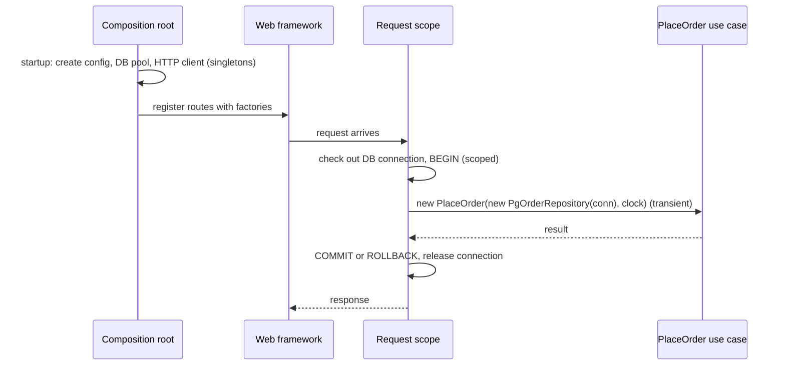

# Dependency Injection

> **Module 02 · Core Backend** · Prerequisites: [Clean Architecture](15-Clean-Architecture.md) · Next: [Background Workers](17-Background-Workers.md)

---

## ⏱ If You Only Have 2 Minutes

- **Dependency injection (DI)** = an object receives its collaborators from outside instead of creating them. It is a technique, not a framework.
- **Dependency Inversion (the D in SOLID)** is a design principle about *which way* dependencies point. An **IoC container** is a tool that automates wiring. Three different things — do not use the names interchangeably.
- Default to **constructor injection**: dependencies are visible in the signature, required at creation time, and easy to replace in tests.
- Build the object graph in one place, the **composition root** (`main.ts`, FastAPI `lifespan` plus `Depends`). Business code never calls `new PgOrderRepository()` itself.
- Three lifetimes: **singleton** (one per process: DB pool, HTTP client, config), **scoped** (one per request: DB session/transaction, current user), **transient** (new every time).
- The classic bug is a **captive dependency**: a singleton holding a request-scoped object, which leaks one request's DB session or user into everyone else's request.
- In FastAPI, `Depends` is the container: a `yield` dependency gives a per-request session, results are cached within one request, and `app.dependency_overrides` swaps implementations in tests.
- A service locator (`container.get("db")` inside business code) hides dependencies and is not DI.

---

## 1. What It Is and Why It Exists

**Dependency injection** means a class or function is *given* the things it needs — a repository, a payment client, a clock — as parameters, instead of constructing them or importing a global. The code that does the giving is the *injector*: your `main` function, a framework, or a container library.

**Analogy:** a restaurant kitchen. The chef does not grow vegetables or build the oven; suppliers deliver ingredients and the owner installs the equipment. Swap the supplier and the recipe still works. Bring a toy oven into a cooking class (a test) and the same recipe still runs.

**The problem it solves.** Compare:

```ts
// Hard-wired: the service decides which database, which pool, which config.
class OrderService {
  private repo = new PgOrderRepository(new Pool({ connectionString: process.env.DATABASE_URL }));
}
```

- Every `OrderService` creates its own connection pool — create one per request and you exhaust PostgreSQL's connection limit.
- A unit test needs a real database, or a module-mocking trick (`jest.mock`, `monkeypatch`) that depends on import paths.
- You cannot run the same service with a read replica, a fake, or a different tenant's database.
- Nobody can see from the outside what this class touches.

With DI, `OrderService` takes an `OrderRepository` in its constructor. *Who* creates the repository, *how long* it lives, and *which* implementation it is are decided once, at the edge of the program.

---

## 2. How It Works

### Lifetimes during a request



### The steps

1. **Declare needs.** Each class lists its collaborators as constructor parameters, typed by an interface it owns (`OrderRepository`, `Clock`), not by a concrete class.
2. **Create singletons at startup.** The composition root reads config once and builds the long-lived, thread-safe or concurrency-safe objects: connection pool, HTTP client with keep-alive, logger.
3. **Open a scope per unit of work.** For each request (or each queue message in a [worker](17-Background-Workers.md)), create the scoped objects: a connection or session, a transaction, the authenticated user.
4. **Build transient objects inside the scope.** Repositories and use cases that hold a scoped object are created per request, so they never outlive it.
5. **Close the scope.** Commit or roll back, release the connection. This must happen even when the handler throws.
6. **In tests, use a different composition root** that passes fakes into the same constructors.

### Composition root

The **composition root** is the single place where the object graph is assembled — ideally as close to the program's entry point as possible. It is the only code allowed to know every concrete class. A service usually has one per entry point: the HTTP server, the queue worker and the CLI each wire the same use cases with the adapters they need.

---

## 3. Key Concepts

### DI vs Dependency Inversion vs IoC container

| Term | What it is | Example |
|---|---|---|
| Dependency injection | A **technique**: pass collaborators in | `new PlaceOrder(repo, clock)` |
| Dependency Inversion Principle | A **design rule**: high-level policy depends on abstractions it owns; details implement them | `PlaceOrder` depends on `OrderRepository`; `PgOrderRepository` implements it |
| Inversion of Control (IoC) | The general idea that a framework calls your code, not the other way round | Express calls your handler; FastAPI resolves your `Depends` |
| IoC / DI container | A **library** that builds object graphs from registrations | NestJS, tsyringe, InversifyJS; FastAPI's dependency system |

You can do DI with no container (manual wiring), and you can use a container and still violate Dependency Inversion (inject a concrete `PgOrderRepository` everywhere). DI without Dependency Inversion still helps testing; Dependency Inversion without DI is impossible to wire.

### Injection styles

| Style | How | Use for |
|---|---|---|
| Constructor injection | Required collaborators are constructor parameters | Default for services, use cases, repositories |
| Parameter (method) injection | Passed to the one method that needs it | Values that change per call: `now`, the current user, a transaction |
| Property/setter injection | Assigned after construction | Rare: optional collaborators or framework constraints. The object can exist half-built. |

More than four or five constructor parameters is a design signal: the class probably has more than one responsibility.

### Lifetimes and the captive-dependency bug

| Lifetime | One instance per | Good for | Must be |
|---|---|---|---|
| Singleton | Process | DB pool, HTTP client, config, stateless services | Safe for concurrent use; no per-request state |
| Scoped | Request / message / job | DB session or transaction, current user, request ID | Released at scope end |
| Transient | Resolution | Cheap objects holding a scoped dependency | Cheap to build |

**Rule:** an object may only depend on objects that live *at least as long* as it does. A singleton that captures a scoped object is a **captive dependency**:

```ts
// BUG: built once at startup, so every request shares one connection.
const conn = await pool.connect();
const placeOrder = new PlaceOrder(new PgOrderRepository(conn), systemClock);
app.post("/orders", async (req, res) => { res.status(201).json(await placeOrder.execute(req.body)); });
```

Concurrent requests now share one connection and one transaction: request A's `COMMIT` commits request B's half-finished writes, and if that connection drops, every request fails. A similar bug: a singleton with a `currentUserId` field set by each request. Node's single thread does not save you — every `await` lets another request run and overwrite the field before the first one reads it. In Python, the SQLAlchemy docs state that an `AsyncSession` must not be shared between concurrent tasks, so a module-level session has the same problem.

### DI in Node.js

TypeScript interfaces are **erased at runtime**, so a container cannot look up "the `OrderRepository` implementation" by type. Containers work around this:

- **NestJS** — `@Injectable()` providers, modules, and scopes (`Scope.DEFAULT` singleton, `Scope.REQUEST`, `Scope.TRANSIENT`). Interfaces need an explicit token with `@Inject(TOKEN)`.
- **tsyringe** (Microsoft) and **InversifyJS** — decorator-based containers (`@injectable()`); tsyringe reads constructor parameter types through the `reflect-metadata` polyfill.

The decorator-metadata approach depends on TypeScript's legacy `experimentalDecorators` and `emitDecoratorMetadata` compiler options, which the newer standard decorators do not replace. Many teams therefore choose **manual wiring**: a plain `main.ts` with `new` calls. It is type-checked, has no magic, and scales well to dozens of services. Request scope in Express is just "build these objects inside the handler or middleware". `AsyncLocalStorage` (from `node:async_hooks`) can carry request context such as a correlation ID into loggers, but it is ambient state — use it for cross-cutting context, not to hide business dependencies.

### DI in FastAPI

- `Depends(fn)` declares a dependency. FastAPI calls `fn`, resolving *its* parameters (including other `Depends`) first.
- **Per-request caching:** within one request, each dependency function runs once and its value is shared with every other dependency that asks for it (disable with `Depends(fn, use_cache=False)`). That is what makes a session dependency "scoped".
- **`yield` dependencies:** code before `yield` is setup, code after is teardown, so `async with SessionFactory() as session: yield session` gives one session per request that is always closed.
- **Singletons** live at module level or are created in the `lifespan` context manager and stored on `app.state`.
- **`def` vs `async def`:** a plain `def` dependency runs in a thread pool, so blocking calls inside it do not stall the event loop; an `async def` dependency runs on the loop and must not block.
- **Testing:** `app.dependency_overrides[real_fn] = fake_fn` replaces a dependency everywhere it is used, including inside other dependencies.

### Service locator (the anti-pattern)

```python
class PlaceOrder:
    def execute(self, cmd):
        repo = container.resolve("order_repository")  # hidden dependency
```

The constructor looks dependency-free, so tests fail at runtime with "not registered", and readers cannot see what the class touches. Containers are fine in the composition root; calling them from business code turns DI back into a global lookup.

---

## 4. Code Examples

Scenario: `POST /orders` creates an order inside a per-request database transaction. The pool and clock are singletons; the connection or session is scoped to the request; the repository and use case are transient.

### Node.js / TypeScript

```ts
// npm i express pg ; npm i -D @types/express @types/pg  — Node.js 22+, TypeScript 5, Express 5
import express from "express";
import pg from "pg";

// ── Application code: knows nothing about how it is wired ──
interface Clock { now(): Date }
interface OrderRepository { insert(customerId: string, totalCents: number, at: Date): Promise<string> }

class PgOrderRepository implements OrderRepository {
  constructor(private readonly db: pg.PoolClient) {} // scoped: this request's connection

  async insert(customerId: string, totalCents: number, at: Date): Promise<string> {
    const { rows } = await this.db.query<{ id: string }>(
      "INSERT INTO orders (customer_id, total_cents, created_at) VALUES ($1, $2, $3) RETURNING id",
      [customerId, totalCents, at],
    );
    return rows[0].id;
  }
}

export class PlaceOrder {
  constructor(private readonly orders: OrderRepository, private readonly clock: Clock) {}

  async execute(customerId: string, totalCents: number): Promise<string> {
    if (!Number.isInteger(totalCents) || totalCents <= 0) throw new Error("total must be positive cents");
    return this.orders.insert(customerId, totalCents, this.clock.now());
  }
}

// ── Composition root: the only place that names concrete classes ──
export function createApp(config: { databaseUrl: string }) {
  // Singletons: one pool and one clock for the whole process.
  const pool = new pg.Pool({ connectionString: config.databaseUrl, max: 10 });
  const clock: Clock = { now: () => new Date() };

  // Opens a request scope: one connection + transaction, always released.
  async function inTransaction<T>(work: (db: pg.PoolClient) => Promise<T>): Promise<T> {
    const db = await pool.connect();
    try {
      await db.query("BEGIN");
      const result = await work(db);
      await db.query("COMMIT");
      return result;
    } catch (err) {
      await db.query("ROLLBACK");
      throw err;
    } finally {
      db.release();
    }
  }

  const app = express();
  app.use(express.json());
  app.post("/orders", async (req, res) => {
    const { customerId, totalCents } = req.body as { customerId: string; totalCents: number };
    // Transient: use case and repository are built per request around the scoped connection.
    const id = await inTransaction((db) => new PlaceOrder(new PgOrderRepository(db), clock).execute(customerId, totalCents));
    res.status(201).json({ id });
    return;
  });
  return { app, close: () => pool.end() };
}
```

A test needs no container — it calls the same constructor with fakes:

```ts
// node --test  (built-in runner, Node.js 22+)
import { test } from "node:test";
import assert from "node:assert/strict";
import { PlaceOrder } from "./app.js";

test("PlaceOrder stamps the order with the injected clock", async () => {
  const saved: Array<{ customerId: string; totalCents: number; at: Date }> = [];
  const repo = { insert: async (customerId: string, totalCents: number, at: Date) => { saved.push({ customerId, totalCents, at }); return "ord_1"; } };
  const fixedClock = { now: () => new Date("2026-01-01T00:00:00Z") };

  const id = await new PlaceOrder(repo, fixedClock).execute("cus_1", 2500);

  assert.equal(id, "ord_1");
  assert.deepEqual(saved[0].at, new Date("2026-01-01T00:00:00Z"));
});
```

### Python

```python
# pip install fastapi "sqlalchemy[asyncio]" asyncpg pydantic  — Python 3.12+
import os
from collections.abc import AsyncIterator
from typing import Annotated, Protocol
from uuid import UUID

from fastapi import Depends, FastAPI, status
from pydantic import BaseModel, Field
from sqlalchemy import text
from sqlalchemy.ext.asyncio import AsyncSession, async_sessionmaker, create_async_engine

# Singletons: one engine (and its connection pool) per process.
engine = create_async_engine(os.environ["DATABASE_URL"], pool_size=10)
SessionFactory = async_sessionmaker(engine, expire_on_commit=False)


async def get_session() -> AsyncIterator[AsyncSession]:
    # Scoped: one session per request. Leaving the block closes it and rolls back anything uncommitted.
    async with SessionFactory() as session:
        yield session


class OrderRepository(Protocol):
    async def add(self, customer_id: UUID, total_cents: int) -> UUID: ...


class SqlOrderRepository:
    def __init__(self, session: AsyncSession) -> None:
        self._session = session

    async def add(self, customer_id: UUID, total_cents: int) -> UUID:
        result = await self._session.execute(
            text("INSERT INTO orders (customer_id, total_cents) VALUES (:c, :t) RETURNING id"),
            {"c": customer_id, "t": total_cents},
        )
        return result.scalar_one()


class PlaceOrder:
    def __init__(self, orders: OrderRepository) -> None:
        self._orders = orders

    async def execute(self, customer_id: UUID, total_cents: int) -> UUID:
        return await self._orders.add(customer_id, total_cents)


def get_place_order(session: Annotated[AsyncSession, Depends(get_session)]) -> PlaceOrder:
    return PlaceOrder(SqlOrderRepository(session))  # transient, built around the scoped session


class CreateOrder(BaseModel):
    customer_id: UUID
    total_cents: int = Field(gt=0)


app = FastAPI()


@app.post("/orders", status_code=status.HTTP_201_CREATED)
async def create_order(
    body: CreateOrder,
    place_order: Annotated[PlaceOrder, Depends(get_place_order)],
    session: Annotated[AsyncSession, Depends(get_session)],  # same session object: cached per request
) -> dict[str, UUID]:
    order_id = await place_order.execute(body.customer_id, body.total_cents)
    # Commit in the request path, not in the dependency teardown, so a failed commit becomes an error response.
    await session.commit()
    return {"id": order_id}
```

The test swaps both the session and the use case with `dependency_overrides`:

```python
# pip install pytest httpx
from collections.abc import Iterator
from uuid import UUID, uuid4

import pytest
from fastapi.testclient import TestClient

from shop.main import PlaceOrder, app, get_place_order, get_session


class InMemoryOrders:
    def __init__(self) -> None:
        self.rows: dict[UUID, tuple[UUID, int]] = {}

    async def add(self, customer_id: UUID, total_cents: int) -> UUID:
        order_id = uuid4()
        self.rows[order_id] = (customer_id, total_cents)
        return order_id


class FakeSession:
    committed = False

    async def commit(self) -> None:
        self.committed = True


@pytest.fixture
def client_and_fakes() -> Iterator[tuple[TestClient, InMemoryOrders, FakeSession]]:
    orders, session = InMemoryOrders(), FakeSession()
    app.dependency_overrides[get_session] = lambda: session
    app.dependency_overrides[get_place_order] = lambda: PlaceOrder(orders)
    yield TestClient(app), orders, session
    app.dependency_overrides.clear()  # overrides are global to the app object; always reset


def test_create_order_commits(client_and_fakes) -> None:
    client, orders, session = client_and_fakes
    res = client.post("/orders", json={"customer_id": str(uuid4()), "total_cents": 2500})
    assert res.status_code == 201
    assert len(orders.rows) == 1
    assert session.committed
```

**Runtime differences to notice:**

- Node has no built-in request scope, so the TypeScript code opens one explicitly (`inTransaction`). FastAPI provides the scope: a `yield` dependency is set up and torn down per request, and its value is cached so `get_place_order` and the route receive the *same* session.
- TypeScript types vanish at runtime, so manual wiring (or a container with explicit tokens) is needed. FastAPI resolves dependencies from the function signature at runtime — `Annotated[..., Depends(...)]` is real runtime metadata, which is why overrides can be keyed by the original function.

---

## 5. Production Concerns

- **Pool sizing follows lifetimes.** One pool per process is the right lifetime. A pool created per request, or per use case, multiplies connections: 20 replicas × `max: 10` = 200 server connections already, before any leak. Watch pool "waiting clients" and checkout time.
- **Always release scoped resources.** A missing `release()` or a session never closed leaks connections until the pool is exhausted and every request hangs. Use `try/finally` in Node and `async with` / `yield` in Python, and alert on pool saturation.
- **Background work escapes the scope.** Scheduling a task that uses the request's session after the response (FastAPI `BackgroundTasks`, a fire-and-forget promise in Node) means the session may already be closed. Give background work its own scope, or pass IDs instead of live sessions.
- **Fail fast on wiring errors.** Build singletons during startup (FastAPI `lifespan`, Node `main`) so a bad `DATABASE_URL` crashes the deploy, not the first customer request. Containers that resolve lazily can hide a missing registration until production traffic hits that path.
- **Configuration is a dependency too.** Inject a typed settings object (Pydantic Settings, a validated config module) instead of reading environment variables inside services. Then tests and multi-tenant setups can pass different values.
- **Startup cost and request-scoped containers.** NestJS `Scope.REQUEST` providers make everything that depends on them request-scoped as well, so the graph is rebuilt per request. Use request scope only for what truly varies per request.

---

## 6. Common Mistakes

- **Singleton holding request state** — one user's session, transaction or ID leaks into another request — keep per-request data in scoped objects or method parameters; singletons stay stateless.
- **Calling the container from business code** — a hidden service locator; missing registrations fail at runtime — resolve only in the composition root and inject through constructors.
- **Creating clients per request** — a new `pg.Pool` or `httpx.AsyncClient` per request wastes TCP/TLS handshakes and exhausts connections — create them once at startup and inject them.
- **Interface for every class "for DI"** — DI works with concrete classes too; an interface with one implementation and no fake is noise — add an abstraction at real boundaries (I/O, time, randomness, external services).
- **Forgetting to clear `dependency_overrides`** — overrides on the shared `app` leak into later tests and cause order-dependent failures — reset them in a fixture's teardown.
- **Mocking imports instead of injecting** — `jest.mock("../db")` or `monkeypatch.setattr("shop.db.session", …)` couples tests to file paths and breaks on refactors — pass the dependency in.
- **Blocking work in an `async def` dependency** — a synchronous DB driver or `requests` call stalls every request on that worker — use an async client or make the dependency a plain `def` so FastAPI runs it in the thread pool.

---

## 7. Comparison Table

| | Manual wiring | DI container (NestJS, tsyringe, InversifyJS) | FastAPI `Depends` | Service locator | Import mocking |
|---|---|---|---|---|---|
| Dependencies visible in signatures | Yes | Yes | Yes | No | No |
| Wiring errors found | Compile time / startup | Startup or first resolution | First request using it | Runtime, deep in a call | Test time only |
| Request scope | Explicit in handler | Built-in scopes | Built-in (`yield`, per-request cache) | Manual | N/A |
| Test substitution | Pass fakes | Re-register providers | `dependency_overrides` | Re-register globals | Patch module paths |
| Magic / learning curve | None | Decorators, metadata, tokens | Low | Low, but hidden coupling | Low, brittle |
| Best for | Most Express services | Large Nest codebases with many modules | FastAPI apps | Avoid in new code | Legacy code you cannot change yet |

---

## 8. Interview Questions

**[Junior] What is dependency injection?**
Passing an object's collaborators to it from outside, usually through the constructor, instead of letting it create or import them. The class declares *what* it needs; the caller decides *which* implementation and *how long* it lives. The main benefits are testability (pass a fake) and explicit, centralized configuration.

**[Junior] Why prefer constructor injection?**
The dependencies are required and visible in one place, so an object can never exist half-initialized. Tests just call the constructor with fakes. A constructor with many parameters is also an honest warning that the class does too much — setter injection would hide that.

**[Mid] What is the difference between DI, the Dependency Inversion Principle and an IoC container?**
DI is the technique of supplying dependencies from outside. Dependency Inversion is a design rule: high-level policy depends on abstractions it owns, and low-level details implement them. An IoC container is a library that automates building the object graph. You can practise DI by hand with no container, and you can use a container while still depending on concrete low-level classes.

**[Mid] What is a composition root, and why only one per entry point?**
It is the place near `main` where all concrete classes are created and connected. Keeping it in one place means business code never names infrastructure, lifetimes are decided together, and swapping an implementation is a one-line change. An HTTP server, a worker and a CLI each get their own root because each needs different adapters and scopes.

**[Mid] How do you get a per-request database session in FastAPI, and how do you replace it in a test?**
Write a `yield` dependency that opens a session with `async with`, yields it, and closes it afterwards. Because FastAPI caches a dependency's value within a request, the route and any repository dependency receive the same session. In tests, set `app.dependency_overrides[get_session]` to a function returning a fake or a test-database session, and clear the overrides after the test.

**[Senior] Explain the captive-dependency bug and how it shows up in production.**
A longer-lived object holds a shorter-lived one — for example, a singleton service created at startup with a single DB connection or transaction. Under load, concurrent requests share that connection: transactions interleave, one request's commit includes another's writes, and a single dropped connection breaks everything. In Node it also happens with a singleton field like `currentUser`, because requests interleave at each `await`. The fix is the lifetime rule: objects depend only on things that live at least as long as they do; scoped resources are created per request and passed down.

**[Senior] Would you introduce a DI container into an Express codebase?**
Usually not at first. Manual wiring in a composition root is type-checked, has no decorator metadata, and is easy to read up to a large number of classes. A container starts paying off when there are many modules with shared providers, complex scopes, or when the team is already on NestJS. If I adopt one, I keep it in the composition root, use explicit tokens for interfaces, and make startup resolve the whole graph so wiring errors fail the deploy rather than a live request.

**[Senior] A request-scoped session is being used by a background task and randomly fails with "session closed". What happened?**
The task was scheduled during the request but ran after the request scope ended, so the yield dependency had already closed the session (or the Node handler had released the connection). The task captured a scoped dependency with a shorter lifetime than its own. Fix it by giving the background job its own scope — open a new session inside the task — and passing only plain data such as an order ID. For work that must not be lost, use a durable queue instead of in-process background tasks.

---

## 9. Cheat Sheet

```text
DI            pass collaborators in (constructor first); a technique, not a library
DIP           high-level owns the abstraction; low-level implements it
Container     automates wiring; keep it in the composition root
Comp. root    one per entry point (http, worker, cli); only place naming concrete classes
Singleton     pool, HTTP client, config, stateless services; must be concurrency-safe
Scoped        DB session/transaction, current user, request ID; released at scope end
Transient     repos/use cases wrapping a scoped resource; built per resolution
Lifetime rule depend only on things that live at least as long as you (else: captive dependency)
Node          manual wiring; Nest/tsyringe/Inversify need tokens or decorator metadata (types erased)
FastAPI       Depends; yield = setup/teardown; cached once per request; lifespan for singletons
Tests         pass fakes to constructors | app.dependency_overrides[...] (clear after)
Smells        service locator, new Pool() per request, jest.mock/monkeypatch instead of DI
```

---

## Related Topics

- [Clean Architecture](15-Clean-Architecture.md) — the ports that the composition root fills with adapters
- [SOLID Principles](24-SOLID-Principles.md) — the Dependency Inversion Principle, which DI makes practical
- [Service Layer Pattern](13-Service-Layer-Pattern.md) — the use-case objects that receive injected repositories
- [Background Workers](17-Background-Workers.md) — a second entry point that needs its own composition root and scopes
- [Test Doubles](../Module-09-Testing-and-Code-Quality/13-Test-Doubles.md) — the fakes and stubs that injection lets you pass in
- [Transactions](../Module-03-Databases/27-Transactions.md) — why the transaction must be request-scoped
