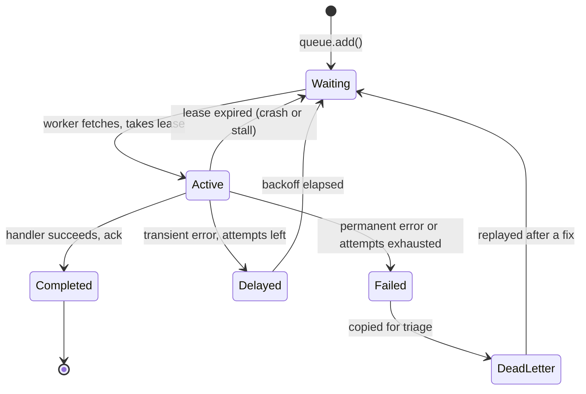

# Background Workers

> **Module 02 · Core Backend** · Prerequisites: [Dependency Injection](16-Dependency-Injection.md) · Next: [Cron Jobs](18-Cron-Jobs.md)

---

## ⏱ If You Only Have 2 Minutes

- A background worker is a **separate, long-running process** that pulls jobs from a durable queue. The API only **enqueues** and returns. It never waits for a worker or hands work to one directly.
- Almost every job queue (BullMQ, Celery, SQS) delivers **at least once**. The same job can run twice, so every handler must be **idempotent**: skip if a durable "done" marker exists, rely on unique constraints, or pass an idempotency key to the downstream API.
- **Acknowledge only after the effect is durable.** Celery acknowledges *before* running a task by default; set `task_acks_late=True` for work you cannot afford to lose.
- Every queue gives a running job a **lease**: BullMQ `lockDuration` (30 s default, renewed automatically), SQS visibility timeout (30 s default), Celery-on-Redis `visibility_timeout` (1 h default). A job that outlives its lease is handed to another worker and **runs twice**.
- Retry only **transient** errors (timeouts, `429`, `5xx`) with exponential backoff, jitter and a cap. Send permanent errors and exhausted jobs to a **dead-letter queue** that has an owner and a replay path.
- Bound concurrency (`concurrency` in BullMQ, pool size and `worker_prefetch_multiplier=1` in Celery). Unbounded workers move the overload from the API to your database.
- On `SIGTERM`, stop fetching new jobs and finish in-flight ones inside the grace period (Kubernetes default: 30 s). Anything still running must be safe to redeliver.

---

## 1. What It Is and Why It Exists

A **background worker** is a process that runs jobs outside the request/response cycle. The web process (the **producer**) writes a small message such as `{ "orderId": "o_42" }` to a **queue**. One or more worker processes (the **consumers**) take messages off that queue, do the work, and report success or failure.

The important word is *separate*. A common shorthand is "the worker picks up the job after the API responds". That is close, but not quite right. The worker runs **independently of any request**: it is always running, polling or blocking on the queue. The API's only job is to enqueue. The worker might start the job a millisecond later — even before the HTTP response has finished sending — or an hour later if the queue is backed up. Your code must not assume either order.

**Analogy:** a restaurant ticket rail. The waiter (API) clips an order ticket to the rail and goes back to the customers. Cooks (workers) take tickets from the rail at their own pace. If a cook burns a dish, the ticket goes back on the rail. If a ticket is impossible ("lobster, but we have none"), it goes on a separate spike for the manager — the dead-letter queue.

**What breaks without it:**

- **Latency.** Sending an email, resizing a photo or calling a slow partner API inside the request adds seconds to every response and ties up a connection.
- **Lost work.** Work done "after the response" inside the web process (for example FastAPI `BackgroundTasks` or an un-awaited promise) disappears if the process restarts during a deploy.
- **No retries.** If the email provider returns `503`, the request cannot wait 30 seconds and try again. A queue can.
- **Spikes.** A queue absorbs a burst of 50,000 sign-ups and lets a fixed number of workers drain it at a rate the database can handle.

---

## 2. How It Works

1. **Enqueue.** The API writes a job (name, small payload, options such as attempts and backoff) to a durable store — a Redis list or stream for BullMQ, a broker queue for Celery. To avoid "order saved but job never enqueued", enqueue through a [transactional outbox](19-Asynchronous-Processing.md).
2. **Fetch and lease.** A worker takes the job and gets a **lease**: the job becomes invisible to other workers until a deadline. BullMQ stores a lock key in Redis and renews it while the job runs; SQS hides the message for the visibility timeout.
3. **Process.** The handler re-reads current state from the database (payloads carry IDs, not data) and performs the side effect idempotently.
4. **Ack or fail.** On success the worker **acknowledges** (acks) the job, and it is removed or marked completed. On an error the job is scheduled for a retry after a backoff delay, or marked failed once attempts run out.
5. **Lease expiry.** If the worker crashes or freezes, the lease is not renewed. After it expires, the job becomes visible again and another worker runs it. This is the main reason delivery is at-least-once.



---

## 3. Key Concepts

### Delivery guarantees and idempotent handlers

| Guarantee | How you get it | Consequence |
|---|---|---|
| At-most-once | Ack when the message is received, before running | A crash mid-job loses the job. This is Celery's default. |
| At-least-once | Ack after the job succeeds | A crash after the effect but before the ack runs the job again |
| "Exactly-once" | At-least-once delivery + an idempotent handler | The *effect* happens once, even though delivery repeats |

Ways to make a handler idempotent, from strongest to weakest:

- **Unique constraint** on the effect: `UNIQUE (order_id)` on `receipts`, then `INSERT ... ON CONFLICT DO NOTHING`.
- **Conditional update**: `UPDATE orders SET status = 'shipped' WHERE id = $1 AND status = 'paid'`. A second run updates zero rows.
- **Idempotency key to the downstream API** (payment and email providers often accept an `Idempotency-Key` header) so a repeated call does not charge or send twice.
- **"Done" marker** checked before and written after the effect. This leaves a small window: a crash between the effect and the marker repeats the effect. Combine it with a downstream idempotency key when the effect is external.

The deep dive on keys and storage is in [Idempotency](../Module-07-Advanced-Backend-and-System-Design/32-Idempotency.md).

### Leases: lock duration and visibility timeout

| System | Lease name | Default | What happens when it runs out |
|---|---|---|---|
| BullMQ | `lockDuration` | 30 s, renewed automatically while the job runs | The job is marked **stalled** and moved back to waiting. After `maxStalledCount` stalls (default 1) it fails instead. |
| Amazon SQS | Visibility timeout | 30 s (max 12 h) | The message reappears and another consumer receives it |
| Celery + Redis | `visibility_timeout` | 1 h | An unacked message is redelivered to another worker |
| RabbitMQ | No timer for unacked messages | — | Redelivered when the consumer's channel or connection closes |

In BullMQ the lock is renewed by a timer on the worker's event loop. A CPU-heavy job that blocks the loop for longer than `lockDuration` cannot renew it, so the job is declared stalled and runs a second time elsewhere — while the first copy is still running. Fixes: keep handlers I/O-bound, move CPU work to a sandboxed processor or worker thread, and give each job a timeout shorter than its lease.

### Retries, backoff and error classes

| Error | Example | Action |
|---|---|---|
| Transient | Timeout, connection reset, `429`, `503` | Retry with exponential backoff and jitter |
| Permanent | `400` from the provider, row not found, schema mismatch | Fail immediately, dead-letter |
| Bug | `TypeError` in your handler | Fail, dead-letter, fix, replay |

Exponential backoff doubles the wait each attempt (2 s, 4 s, 8 s, …) up to a cap; jitter randomises it so 10,000 failed jobs do not retry in the same second. Always cap attempts (5–8 is typical) and total delay. Details: [Retry Pattern](../Module-07-Advanced-Backend-and-System-Design/35-Retry-Pattern.md) and [Exponential Backoff](../Module-07-Advanced-Backend-and-System-Design/36-Exponential-Backoff.md).

### Dead-letter queues and poison messages

A **dead-letter queue** (DLQ) holds jobs that will not succeed by retrying. It keeps the main queue moving and gives a human the payload, the error and the attempt count. A DLQ is only useful with an **alert on its size**, a named owner, and a **replay** command that re-enqueues jobs after the fix.

A **poison message** is one that fails every time — malformed JSON, a payload from an old schema, or input that crashes or out-of-memory-kills the worker. The crash case is the dangerous one: a killed process never reaches the "attempt failed" code, so the attempt counter may not move. Use a mechanism that counts *deliveries*, not handled errors: BullMQ's `maxStalledCount`, SQS's redrive policy `maxReceiveCount`. Celery's docs warn that `task_reject_on_worker_lost=True` can create exactly this redelivery loop.

### Concurrency, prefetch and rate limits

- **BullMQ `concurrency`** is how many jobs one worker process runs at once on its event loop. Total parallelism = processes × concurrency.
- **Celery** runs a prefork pool of child processes (default: one per CPU). Each worker also **prefetches** `worker_prefetch_multiplier × concurrency` messages (multiplier default 4). With long tasks, prefetched messages sit idle in one worker while other workers are free; set the multiplier to 1.
- Size parallelism to the **downstream** limit: if the mail provider allows 100 requests/s and the DB pool has 20 connections, 500 concurrent jobs only produce `429`s and pool timeouts. BullMQ also has a queue-wide `limiter: { max, duration }`.

### Graceful shutdown

Deploys and autoscaling stop workers all the time. On `SIGTERM`:

1. Stop fetching new jobs.
2. Let in-flight jobs finish, within the grace period (Kubernetes sends `SIGKILL` after `terminationGracePeriodSeconds`, default 30 s).
3. Jobs that cannot finish in time are released or simply left to lease expiry, and run again elsewhere. That is safe *only because* handlers are idempotent.

Jobs longer than the grace period should **checkpoint** progress (for example, "rows 0–40,000 done") so a rerun resumes rather than restarts.

---

## 4. Code Examples

Scenario: after an order is paid, the API enqueues a "send receipt" job. The worker loads the order, skips it if the receipt was already sent, calls an email API with an idempotency key, retries transient failures with backoff, and dead-letters everything else.

### Node.js / TypeScript

```ts
// npm i bullmq ioredis pg   — Node.js 22+, TypeScript 5, ESM
import { Queue, Worker, UnrecoverableError, type Job } from "bullmq";
import { Redis } from "ioredis";
import pg from "pg";

// Workers hold blocking Redis commands; BullMQ requires maxRetriesPerRequest: null.
const connection = new Redis(process.env.REDIS_URL!, { maxRetriesPerRequest: null });
const pool = new pg.Pool({ connectionString: process.env.DATABASE_URL, max: 20 });

type ReceiptJob = { orderId: string };
export const receipts = new Queue<ReceiptJob>("receipts", { connection });
const deadLetters = new Queue("receipts-dead", { connection });

// Producer side (called by the API or the outbox relay). A fixed jobId turns a
// duplicate enqueue into a no-op while the job is still stored in Redis.
export function enqueueReceipt(orderId: string) {
  return receipts.add("send", { orderId }, {
    jobId: `receipt-${orderId}`,
    attempts: 6,
    backoff: { type: "exponential", delay: 2_000 }, // 2s, 4s, 8s, 16s, 32s
    removeOnComplete: { age: 24 * 3600 },
    removeOnFail: false, // keep failed jobs as evidence
  });
}

async function sendReceipt(job: Job<ReceiptJob>): Promise<void> {
  const { orderId } = job.data;
  const { rows } = await pool.query<{ email: string; total_cents: number; receipt_sent_at: Date | null }>(
    "SELECT email, total_cents, receipt_sent_at FROM orders WHERE id = $1", [orderId]);
  const order = rows[0];
  if (!order) throw new UnrecoverableError(`order ${orderId} not found`); // retrying cannot help
  if (order.receipt_sent_at) return; // redelivery or duplicate enqueue: already done

  const resp = await fetch(process.env.MAIL_API_URL!, {
    method: "POST",
    // Covers the crash window between "email sent" and "marker written".
    headers: { "content-type": "application/json", "idempotency-key": `receipt-${orderId}` },
    body: JSON.stringify({ to: order.email, template: "receipt", totalCents: order.total_cents }),
    signal: AbortSignal.timeout(10_000), // far below lockDuration, so a hung call cannot cause a stall
  });
  if (resp.status >= 400 && resp.status < 500 && resp.status !== 429) {
    throw new UnrecoverableError(`mail API rejected the request: ${resp.status}`);
  }
  if (!resp.ok) throw new Error(`mail API ${resp.status}`); // 429/5xx: BullMQ retries with backoff

  await pool.query(
    "UPDATE orders SET receipt_sent_at = now() WHERE id = $1 AND receipt_sent_at IS NULL", [orderId]);
}

const worker = new Worker<ReceiptJob>("receipts", sendReceipt, {
  connection,
  concurrency: 20,     // ≤ DB pool size; I/O-bound jobs interleave on one event loop
  lockDuration: 60_000,
});

worker.on("failed", async (job, err) => {
  if (!job) return;
  const final = err instanceof UnrecoverableError || job.attemptsMade >= (job.opts.attempts ?? 1);
  if (final) {
    await deadLetters.add("dead", { ...job.data, error: err.message, attempts: job.attemptsMade },
      { jobId: job.id }); // same id: a second "failed" event does not create a second DLQ entry
  }
});

async function shutdown(): Promise<void> {
  await worker.close(); // stops fetching and waits for active jobs to finish
  await Promise.all([receipts.close(), deadLetters.close(), pool.end()]);
  await connection.quit();
  process.exit(0);
}
process.once("SIGTERM", shutdown);
process.once("SIGINT", shutdown);
```

### Python

```python
# pip install "celery[redis]" "psycopg[binary]" httpx   — Python 3.12+
import os

import httpx
import psycopg
from celery import Celery, Task
from psycopg.types.json import Jsonb

DSN = os.environ["DATABASE_URL"]
app = Celery("receipts", broker=os.environ["REDIS_URL"])
app.conf.update(
    task_acks_late=True,              # ack after the task returns, not when it is received
    task_reject_on_worker_lost=True,  # a SIGKILLed child means "redeliver", not "done"
    worker_prefetch_multiplier=1,     # do not hoard messages that idle workers could run
    # Must exceed the longest task *and* the longest retry countdown, or Redis redelivers early.
    broker_transport_options={"visibility_timeout": 3600},
    task_soft_time_limit=60,          # raises SoftTimeLimitExceeded inside the task
    task_time_limit=90,               # hard kill if the soft limit is ignored
)


class TransientError(Exception):
    """429 or 5xx from the mail provider: worth retrying."""


class DeadLetterTask(Task):
    def on_failure(self, exc, task_id, args, kwargs, einfo):
        # Runs only on the final failure (retries go through on_retry). Park the job for a human.
        with psycopg.connect(DSN) as conn:
            conn.execute(
                "INSERT INTO dead_letters (task_id, task_name, payload, error) VALUES (%s, %s, %s, %s)"
                " ON CONFLICT (task_id) DO NOTHING",
                (task_id, self.name, Jsonb({"args": list(args), "kwargs": kwargs}), repr(exc)),
            )


@app.task(
    base=DeadLetterTask, name="receipts.send",
    autoretry_for=(TransientError, httpx.TransportError),  # only transient errors are retried
    max_retries=5, retry_backoff=2, retry_backoff_max=600, retry_jitter=True,
)
def send_receipt(order_id: str) -> None:
    with psycopg.connect(DSN) as conn:
        row = conn.execute(
            "SELECT email, total_cents, receipt_sent_at FROM orders WHERE id = %s", (order_id,)
        ).fetchone()
    if row is None:
        raise LookupError(f"order {order_id} not found")  # not in autoretry_for: dead-lettered at once
    email, total_cents, sent_at = row
    if sent_at is not None:
        return  # duplicate delivery: the effect already happened

    resp = httpx.post(
        os.environ["MAIL_API_URL"],
        json={"to": email, "template": "receipt", "totalCents": total_cents},
        headers={"Idempotency-Key": f"receipt-{order_id}"},
        timeout=10,
    )
    if resp.status_code == 429 or resp.status_code >= 500:
        raise TransientError(f"mail API {resp.status_code}")
    resp.raise_for_status()  # any other 4xx is permanent

    with psycopg.connect(DSN) as conn:
        conn.execute(
            "UPDATE orders SET receipt_sent_at = now() WHERE id = %s AND receipt_sent_at IS NULL",
            (order_id,),
        )

# Producer (API side):  send_receipt.delay(order_id)
# Run:  celery -A receipts worker --concurrency=8
# SIGTERM triggers Celery's warm shutdown: stop consuming, finish running tasks, then exit.
```

**Runtime differences to notice:**

- **Concurrency model.** BullMQ's `concurrency: 20` runs 20 jobs on *one* event loop. That is ideal for I/O-bound jobs, but one CPU-heavy job freezes the other 19 and the lock renewals, so jobs stall and run twice. Celery's default prefork pool runs each task in its own child process, so CPU work is isolated, but each process costs memory. For I/O-heavy Celery tasks, teams often use `--pool threads` instead.
- **Retries.** In BullMQ the retry policy belongs to the *job* (set at `add()` time). In Celery it belongs to the *task definition*. Celery also has no built-in duplicate-enqueue check like BullMQ's `jobId`, so the handler's idempotency matters even more.
- **Dead letters.** Neither library has a separate DLQ by default. BullMQ keeps failed jobs in a "failed" set, and Celery stores failures in a result backend if you configure one. The code above adds an explicit DLQ that you can alert on and replay.

---

## 5. Production Concerns

- **Measure the age of the oldest waiting job, not just queue depth.** 10,000 jobs that drain in 20 s are fine; 50 jobs stuck for 2 hours are an incident. Also track processing time (p95), retry rate, stalled-job count, and DLQ size. Alert when the DLQ grows.
- **Redis is now a database.** BullMQ's documentation asks for `maxmemory-policy noeviction`. An eviction policy silently deletes jobs. Turn on persistence (AOF) if losing the queue on a Redis restart is unacceptable.
- **Payloads are stored in plain text** in Redis or the broker and often copied into logs and dashboards. Send IDs, not emails, tokens or card data. Re-reading the row also gives the worker the *current* state, not a stale snapshot.
- **Payload versioning.** During a rolling deploy, old workers receive new payloads and new workers receive old ones. Add fields in a backward-compatible way, and keep the old handler shape working until the queue has drained.
- **Separate queues by priority.** One queue for password-reset emails and another for a 2-million-row import. Otherwise the import starves the user-facing job.
- **Signals in containers.** Start the worker directly (`node dist/worker.js`, `celery -A ...`). A shell wrapper or `npm start` may not forward `SIGTERM`, so the process is `SIGKILL`ed mid-job after the grace period.
- **Log per job:** job ID, name, attempt number, duration, outcome and error class — and the trace ID copied from the request that enqueued it, so one search shows the API request and the worker run together.

---

## 6. Common Mistakes

- **Non-idempotent handlers** — a redelivered "charge card" job charges twice — use a unique constraint, a conditional update, or the provider's idempotency key.
- **Acking on receipt** (Celery's default) — a deploy or crash mid-task silently drops the job — set `task_acks_late=True` and make the task safe to rerun.
- **A lease shorter than the job** — a 10-minute export under a 30 s visibility timeout runs on several workers at once — set the lease above the worst-case runtime, add a job timeout, and keep the event loop free so locks renew.
- **Retrying every error forever** — a `400` is retried 50 times and a poison message blocks a worker — classify errors, cap attempts, dead-letter the rest.
- **Enqueueing before the database commit** — the worker reads an order that does not exist yet, or a rollback leaves a job for a non-existent order — enqueue after commit, or better, through an [outbox](19-Asynchronous-Processing.md).
- **"Fire-and-forget" in the web process** (`BackgroundTasks`, an un-awaited promise) for work that must happen — it is lost on restart and never retried — use a durable queue for anything you would be upset to lose.
- **A DLQ nobody watches** — failures pile up for weeks — alert on DLQ size and write a replay command before you need it.

---

## 7. Comparison Table

| | In-process after response (FastAPI `BackgroundTasks`, un-awaited promise) | BullMQ (Node, Redis) | Celery (Python, Redis/RabbitMQ) | Managed queue (SQS + worker or Lambda) |
|---|---|---|---|---|
| Survives a process restart | No | Yes (if Redis persists) | Yes | Yes |
| Retries and backoff | Write it yourself | Per job: `attempts`, `backoff` | Per task: `autoretry_for`, `retry_backoff` | Redelivery after visibility timeout; DLQ via redrive policy |
| Duplicate-enqueue guard | — | Custom `jobId` | None built in | FIFO queues: deduplication ID |
| Operations | None | Run Redis (`noeviction`) | Run broker + workers (+ result backend) | Managed; pay per request |
| Best for | Non-critical extras (cache warm-up, metrics) | Node services already using Redis | Python services, scheduled tasks via beat | AWS-native, spiky workloads |

Lighter Python options such as RQ, `arq` and Dramatiq follow the same model with fewer features. Kafka and RabbitMQ internals are covered in [Message Queues](../Module-07-Advanced-Backend-and-System-Design/21-Message-Queues.md).

---

## 8. Interview Questions

**[Junior] Why move work to a background worker instead of doing it in the request?**
Slow or unreliable work (email, image processing, partner API calls) would add latency to every response and fail the request when the dependency hiccups. A worker lets the API respond fast, retries failures with backoff, and smooths spikes with a fixed number of workers. The trade-off is that the user sees the result later, so the API must expose a status or accept eventual completion.

**[Junior] Does the worker run after the API responds?**
Not necessarily. The worker is a separate process that is always consuming the queue, independent of any request. The API only enqueues. The job might start before the response is even sent, or much later if the queue is busy. Code that assumes "the response has gone out first" — or that the job is done by the time the next request arrives — is buggy.

**[Mid] What does "at-least-once delivery" mean for your handler?**
The queue may deliver the same job more than once: after a crash before the ack, after a lease timeout, or after a duplicate enqueue. The handler must therefore be idempotent. I check a durable marker or unique constraint before doing the effect, use a conditional update, and pass an idempotency key to external APIs. Then a second run is a no-op.

**[Mid] Which errors do you retry, and how?**
Only transient ones: timeouts, connection errors, `429` and `5xx`. I use exponential backoff with jitter and a cap on attempts (5–8) and on the delay. Validation errors, missing rows and other `4xx` responses fail immediately and go to the dead-letter queue, because retrying cannot fix them and only wastes capacity.

**[Mid] How do you shut a worker down safely during a deploy?**
Handle `SIGTERM`: stop fetching, let in-flight jobs finish, then exit before the orchestrator's grace period ends (30 s by default in Kubernetes). BullMQ's `worker.close()` and Celery's warm shutdown do this. Jobs that cannot finish in time will be redelivered after their lease expires, which is safe because the handlers are idempotent. Long jobs should checkpoint progress.

**[Senior] A job sometimes runs twice at the same time. What is happening and how do you fix it?**
The classic cause is a job that outlives its lease: the visibility timeout or lock expires while the first worker is still running, so the queue hands the job to a second worker. In Node this often comes from CPU work blocking the event loop, so BullMQ cannot renew the lock and marks the job stalled. Fixes: lengthen the lease past the worst-case runtime, add a hard timeout below it, move CPU work to a separate process, and — because you can never fully prevent it — make the effect idempotent with a unique constraint or a row lock so the second copy is harmless.

**[Senior] Design the failure handling for a payment-capture worker.**
Payload carries only the payment ID. The handler loads the payment and does nothing if it is already captured. It calls the provider with an idempotency key equal to the payment ID, so a repeat call returns the original result instead of charging twice. Transient errors retry with capped exponential backoff and jitter. Declines and validation errors fail at once. Exhausted or permanent failures go to a DLQ that pages the payments team, with a replay tool. A reconciliation job compares our state with the provider's daily report, to catch the cases where we cannot know whether a timed-out call succeeded.

**[Senior] How do you size worker concurrency?**
Start from the bottleneck, not from CPU count. If each job holds a DB connection for its whole run, total concurrency across all worker processes must stay below the pool budget the database can serve. If jobs call a rate-limited API, concurrency × request rate per job must fit the provider's limit — or use a queue-wide rate limiter. Then watch oldest-job age: if it grows while the DB and provider still have headroom, add workers; if they are saturated, more workers only add timeouts.

---

## 9. Cheat Sheet

```text
Model         API enqueues → durable queue → independent worker processes consume
Delivery      at-least-once → idempotent handler (unique constraint / conditional UPDATE / idempotency key)
Ack           after the effect is durable; Celery: task_acks_late=True
Lease         BullMQ lockDuration 30s (auto-renewed) | SQS visibility 30s | Celery+Redis visibility_timeout 1h
Lease expiry  job runs again on another worker → duplicates; blocked event loop = stalled job
Retry         transient only (timeout, 429, 5xx); exp backoff + jitter; cap 5–8 attempts
Permanent     4xx / not found / bug → fail now → DLQ (alert, owner, replay)
Poison        crashes the worker → count deliveries (maxStalledCount, maxReceiveCount)
Concurrency   ≤ DB pool and downstream rate limit; Celery prefetch multiplier 1 for long tasks
Shutdown      SIGTERM → stop fetching → finish in-flight (K8s grace 30s) → rest redelivered
Payloads      IDs, not PII; backward-compatible across rolling deploys
Metrics       oldest-job age, depth, p95 duration, retries, stalled, DLQ size
```

---

## Related Topics

- [Asynchronous Processing](19-Asynchronous-Processing.md) — 202 responses, status resources and the transactional outbox that feeds workers
- [Cron Jobs](18-Cron-Jobs.md) — time-triggered work that usually just enqueues jobs for workers
- [Idempotency](../Module-07-Advanced-Backend-and-System-Design/32-Idempotency.md) — designing keys and storage for safe repeats
- [Exponential Backoff](../Module-07-Advanced-Backend-and-System-Design/36-Exponential-Backoff.md) — backoff formulas and jitter
- [Message Queues](../Module-07-Advanced-Backend-and-System-Design/21-Message-Queues.md) — broker internals, ordering and delivery semantics
- [Signals](../Module-04-Operating-Systems/29-Signals.md) — how `SIGTERM` and `SIGKILL` reach your process
