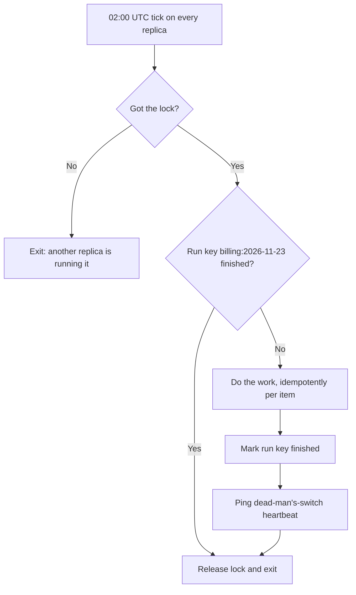

# Cron Jobs

> **Module 02 · Core Backend** · Prerequisites: [Background Workers](17-Background-Workers.md) · Next: [Asynchronous Processing](19-Asynchronous-Processing.md)

---

## ⏱ If You Only Have 2 Minutes

- A cron expression has five fields: `minute hour day-of-month month day-of-week`. `0 2 * * *` = every day at 02:00; `*/15 * * * *` = every 15 minutes; `@daily` = `0 0 * * *`.
- **A schedule is not a uniqueness guarantee.** An in-app scheduler on 6 replicas fires the job 6 times. Fix it with one scheduler process, a distributed lock (Redis `SET key token NX PX ttl`, Postgres `pg_try_advisory_lock`), or leader election.
- A lock only stops runs from **overlapping**. A replica whose clock fires 2 s later can still run the job again after the first finished. The real guarantee is an **idempotent run key** such as `billing:2026-11-23` stored under a unique constraint.
- Decide the **missed-run policy** up front: skip, run once to catch up, or run every missed period. Schedulers lose runs during deploys and outages.
- **Schedule and store in UTC.** In local time zones, 02:30 does not exist on the spring-forward day and 01:30 happens twice in autumn.
- Monitor with a **dead-man's switch**: the job pings a heartbeat URL on success, and an alert fires when the ping does *not* arrive. Errors you never see are the cron failure mode.
- On Kubernetes, use a `CronJob` with `concurrencyPolicy: Forbid`. The docs still say jobs should be idempotent, because the controller can occasionally create two jobs or none.

---

## 1. What It Is and Why It Exists

A **cron job** is work started by the clock instead of by a request: "bill every account at 02:00 UTC", "delete expired sessions every hour", "send the weekly digest on Monday at 09:00". The name comes from `cron`, the Unix daemon that reads a table of schedules (the *crontab*) and starts commands when the time matches.

**Analogy:** an office alarm clock that tells someone to lock the building at 22:00. With one guard, it works. With six guards who each have their own alarm, the door gets locked six times — harmless. But if the task is "pay the cleaners", they get paid six times. And if the only guard is off sick that night, nobody notices the door was left open.

**Why it exists.** Some work has no triggering event: periodic billing, report generation, data retention clean-up, retrying stuck records, reconciling with a payment provider. Something has to start it on time.

**What goes wrong without care.** On one server, `crontab` is enough. Modern backends run many identical replicas that restart all the time, so the hard problems are:

- **Duplicates** — every replica runs the job.
- **Overlaps** — the 10:00 run is still going when the 10:15 run starts.
- **Silent misses** — the pod was being redeployed at 02:00 and nothing ran.
- **Time zones** — "every day at 02:30 local" breaks twice a year.

---

## 2. How It Works

### Cron expression syntax

```text
┌───────── minute        (0–59)
│ ┌─────── hour          (0–23)
│ │ ┌───── day of month  (1–31)
│ │ │ ┌─── month         (1–12 or JAN–DEC)
│ │ │ │ ┌─ day of week   (0–6, Sunday = 0; most implementations also accept 7 and SUN–SAT)
│ │ │ │ │
* * * * *
```

| Expression | Meaning |
|---|---|
| `*/15 * * * *` | Every 15 minutes (:00, :15, :30, :45) |
| `0 2 * * *` | Every day at 02:00 |
| `0 9 * * 1-5` | 09:00, Monday to Friday |
| `30 3 1 * *` | 03:30 on the 1st of every month |
| `0 0 * * 0` | Midnight every Sunday (same as `@weekly`) |
| `@hourly` / `@daily` / `@monthly` / `@yearly` | `0 * * * *` / `0 0 * * *` / `0 0 1 * *` / `0 0 1 1 *` |

Two traps: `*/7` in the minute field restarts at the top of each hour (:56 then :00), so it is not "every 7 minutes". And in classic cron, if you restrict *both* day-of-month and day-of-week, the job runs when **either** matches — `0 0 13 * 5` runs on every 13th *and* every Friday, not just Friday the 13th. Some libraries also accept a sixth field for seconds; check before copying an expression between tools.

### A safe run across many replicas



1. Every replica's scheduler fires at roughly the same moment.
2. Each tries to take a lock. Only one succeeds; the others exit.
3. The winner checks the **run key** for this period. If it is already finished — for example, a replica with a slightly faster clock ran it a few seconds ago — it exits.
4. It does the work in a way that is safe to resume (unique constraints per item).
5. It records the run as finished, pings the heartbeat, and releases the lock.

---

## 3. Key Concepts

### The "every replica runs it" problem

| Fix | How | Weak spot |
|---|---|---|
| Single scheduler process | A dedicated deployment with `replicas: 1` that runs the schedule (or Celery beat) and enqueues jobs | Two copies during a rolling deploy; nothing runs while it is down |
| Redis lock | `SET lock:billing <random token> NX PX 900000`; delete only if the value is still your token | Lock expires if the job outlives the TTL; another replica can then start |
| Postgres advisory lock | `SELECT pg_try_advisory_lock(42)` on a dedicated connection | Released automatically if the connection dies (good), but breaks behind a transaction-mode connection pooler such as PgBouncer |
| Leader election | One replica holds a lease (Kubernetes `Lease`, etcd, a DB row) and runs all schedules | More moving parts; must handle leader change mid-run |
| Platform scheduler | Kubernetes `CronJob`, cloud scheduler | Still at-least-once; still needs idempotency |
| Idempotent run key | `INSERT INTO job_runs (run_key) ...` with `UNIQUE (run_key)` | Needs the work itself to be resumable |

In practice you combine them: a lock to avoid wasted parallel work, and a unique run key plus per-item uniqueness for correctness.

### Overlapping runs

If a job runs every 5 minutes but sometimes takes 7, two copies run at once. Options: skip the new run while the old one runs (Kubernetes `concurrencyPolicy: Forbid`, croner `protect: true`, APScheduler `max_instances=1`), replace the old run (`Replace`), or allow it only if the job processes disjoint batches using `SELECT ... FOR UPDATE SKIP LOCKED`. Also give the job a hard timeout, so one stuck run does not block every future run.

### Missed runs and catch-up

Schedulers miss ticks: the process was restarting, the node was drained, the event loop was blocked.

| Policy | When it fits | Example |
|---|---|---|
| Skip | Next run covers the same ground | Cache refresh, clean-up of expired rows |
| Run once to catch up | Only the latest state matters | Recompute a leaderboard |
| Run every missed period | Each period is its own unit of work | Daily billing, daily reports |

Make the job work in **periods**, not "since last run". A job that bills "the UTC day 2026-11-23" can be rerun or caught up safely. Run it on startup as well: the run key makes it a no-op if the period is already done. Note that in-memory schedulers do not remember missed ticks across restarts. APScheduler's `misfire_grace_time` and `coalesce` only help with late ticks while the process is alive (or with a persistent job store).

### Time zones and DST

Daylight saving time (DST) shifts local clocks by an hour twice a year. In `America/New_York`, 02:30 does not exist on the March change day, and 01:30 occurs twice on the November change day. Schedulers handle this differently — skip, run late, or run twice.

- Run servers and schedules in **UTC** and store timestamps as UTC.
- When the business really means local time ("send the digest at 09:00 *in the user's time zone*"), use an IANA zone name (`Europe/Berlin`, never "+01:00") and a library that documents its DST behaviour. Build the idempotency key from the **local date** (`digest:user_7:2026-11-23`) so a repeated 01:30 cannot send twice.
- Kubernetes `CronJob` defaults to the controller's local time zone. Set `spec.timeZone` explicitly.

### Platform schedulers

```yaml
apiVersion: batch/v1
kind: CronJob
metadata:
  name: daily-billing
spec:
  schedule: "0 2 * * *"
  timeZone: "Etc/UTC"
  concurrencyPolicy: Forbid        # skip a tick if the previous Job is still running
  startingDeadlineSeconds: 3600    # still start up to 1 h late (e.g. after a controller outage)
  successfulJobsHistoryLimit: 3
  failedJobsHistoryLimit: 5
  jobTemplate:
    spec:
      backoffLimit: 2              # pod retries before the Job is marked failed
      activeDeadlineSeconds: 3600  # hard timeout for the whole run
      template:
        spec:
          restartPolicy: Never
          containers:
            - name: billing
              image: registry.example.com/billing:1.42.0
              command: ["node", "dist/jobs/daily-billing.js"]
```

A platform scheduler starts a **fresh process per run**, so no web replica is involved and a crash cannot take the API down. Cloud schedulers (AWS EventBridge Scheduler, Google Cloud Scheduler) call an HTTP endpoint or a queue on a schedule. They also deliver at least once, so the target must be idempotent and authenticated.

### Observability: the dead-man's switch

A failing cron job often produces **no signal at all**: it did not run, so nothing logged an error. Monitor the absence of success:

- On success, the job pings a heartbeat URL (a dead-man's-switch service) or sets a `last_success_timestamp` metric. Alert if it is older than the period plus a margin, e.g. 26 hours for a daily job.
- Record each run in a `job_runs` table: run key, start, finish, attempts, rows processed. It answers "did billing run for the 23rd?" in one query.
- Alert on duration too: a job that took 4 minutes and now takes 50 will soon overlap with the next run.

---

## 4. Code Examples

Scenario: every day at 02:00 UTC, invoice each account for the UTC day that just ended. The scheduler runs inside every API replica. The job must run once per period, survive a crash halfway through, catch up after downtime, and report success to a heartbeat monitor.

Tables used by both examples:

```sql
CREATE TABLE job_runs (run_key text PRIMARY KEY, attempts int NOT NULL DEFAULT 1, finished_at timestamptz);
CREATE TABLE invoices (account_id bigint, period date, amount_cents bigint NOT NULL,
                       PRIMARY KEY (account_id, period));   -- one invoice per account per day
-- usage_events(account_id, usage_day date, amount_cents): usage_day is the UTC date, set on insert,
-- so the job never depends on the database session's time zone.
```

### Node.js / TypeScript

Postgres advisory lock + `croner`:

```ts
// npm i croner pg   — Node.js 22+, TypeScript 5, ESM
import { Cron } from "croner";
import pg from "pg";

const pool = new pg.Pool({ connectionString: process.env.DATABASE_URL });
const BILLING_LOCK_ID = 4_242_001; // any fixed bigint, unique per job in this database

// Bill the UTC day that has just ended, so a late or catch-up run bills the same period.
function billingPeriod(now = new Date()): string {
  return new Date(now.getTime() - 24 * 3600 * 1000).toISOString().slice(0, 10);
}

export async function runDailyBilling(): Promise<void> {
  // A session-level advisory lock belongs to one connection, so hold a dedicated client,
  // not pool.query(), which may use a different connection for each statement.
  const client = await pool.connect();
  try {
    const { rows } = await client.query<{ locked: boolean }>(
      "SELECT pg_try_advisory_lock($1) AS locked", [BILLING_LOCK_ID]);
    if (!rows[0].locked) return; // another replica is running it right now
    try {
      const period = billingPeriod();
      const run = await client.query<{ finished_at: Date | null }>(
        `INSERT INTO job_runs (run_key) VALUES ($1)
         ON CONFLICT (run_key) DO UPDATE SET attempts = job_runs.attempts + 1
         RETURNING finished_at`, [`billing:${period}`]);
      if (run.rows[0].finished_at) return; // done already, e.g. by a replica whose clock fired first

      // The (account_id, period) primary key makes a resumed run skip accounts already invoiced.
      await client.query(
        `INSERT INTO invoices (account_id, period, amount_cents)
         SELECT account_id, $1::date, sum(amount_cents) FROM usage_events
         WHERE usage_day = $1::date
         GROUP BY account_id
         ON CONFLICT (account_id, period) DO NOTHING`, [period]);
      await client.query("UPDATE job_runs SET finished_at = now() WHERE run_key = $1", [`billing:${period}`]);

      // Dead-man's switch: the monitor alerts when this ping does NOT arrive.
      await fetch(process.env.BILLING_HEARTBEAT_URL!, { signal: AbortSignal.timeout(5_000) });
    } finally {
      await client.query("SELECT pg_advisory_unlock($1)", [BILLING_LOCK_ID]);
    }
  } finally {
    client.release();
  }
}

const job = new Cron("0 2 * * *", {
  name: "daily-billing",
  timezone: "UTC",
  protect: true, // skip a tick if this process's previous run is still going
  catch: (err) => console.error({ event: "cron_failed", job: "daily-billing", err }),
}, runDailyBilling);

// Catch-up on boot: a no-op if yesterday is already billed, a recovery if 02:00 was missed.
runDailyBilling().catch((err) => console.error({ event: "cron_catchup_failed", err }));

process.once("SIGTERM", () => job.stop());
```

### Python

Redis lock + APScheduler 3.x inside a FastAPI app:

```python
# pip install fastapi "apscheduler<4" asyncpg "redis>=5" httpx   — Python 3.12+
import os
import secrets
from contextlib import asynccontextmanager
from datetime import UTC, datetime, timedelta

import asyncpg
import httpx
from apscheduler.schedulers.asyncio import AsyncIOScheduler
from apscheduler.triggers.cron import CronTrigger
from fastapi import FastAPI
from redis.asyncio import Redis

LOCK_KEY = "lock:daily-billing"
LOCK_TTL_MS = 30 * 60 * 1000  # well above the normal run time; the run key covers expiry anyway
# Delete the lock only if we still own it. A plain DEL could remove a lock that another
# replica took after ours expired.
RELEASE_LUA = "if redis.call('GET', KEYS[1]) == ARGV[1] then return redis.call('DEL', KEYS[1]) end return 0"

redis = Redis.from_url(os.environ["REDIS_URL"])
db: dict[str, asyncpg.Pool] = {}
scheduler = AsyncIOScheduler(timezone="UTC")


async def run_daily_billing() -> None:
    token = secrets.token_hex(16)
    if not await redis.set(LOCK_KEY, token, nx=True, px=LOCK_TTL_MS):
        return  # another replica holds the lock
    try:
        period = (datetime.now(UTC) - timedelta(days=1)).date()  # the UTC day that just ended
        run_key = f"billing:{period.isoformat()}"
        async with db["pool"].acquire() as conn:
            finished = await conn.fetchval(
                "INSERT INTO job_runs (run_key) VALUES ($1) ON CONFLICT (run_key)"
                " DO UPDATE SET attempts = job_runs.attempts + 1 RETURNING finished_at", run_key)
            if finished is not None:
                return
            # Per-item uniqueness keeps this correct even if the lock expired and two runs overlap.
            await conn.execute(
                """INSERT INTO invoices (account_id, period, amount_cents)
                   SELECT account_id, $1::date, sum(amount_cents) FROM usage_events
                   WHERE usage_day = $1::date
                   GROUP BY account_id
                   ON CONFLICT (account_id, period) DO NOTHING""", period)
            await conn.execute("UPDATE job_runs SET finished_at = now() WHERE run_key = $1", run_key)
        async with httpx.AsyncClient(timeout=5) as client:
            await client.get(os.environ["BILLING_HEARTBEAT_URL"])  # dead-man's switch
    finally:
        await redis.eval(RELEASE_LUA, 1, LOCK_KEY, token)


@asynccontextmanager
async def lifespan(app: FastAPI):
    db["pool"] = await asyncpg.create_pool(os.environ["DATABASE_URL"])
    scheduler.add_job(
        run_daily_billing, CronTrigger.from_crontab("0 2 * * *", timezone="UTC"),
        id="daily-billing", max_instances=1,      # no overlap inside this process
        coalesce=True, misfire_grace_time=3600,    # one late run, not a burst, if ticks were delayed
        next_run_time=datetime.now(UTC),           # catch-up on boot; the run key makes it safe
    )
    scheduler.start()
    yield
    scheduler.shutdown(wait=False)
    await db["pool"].close()
    await redis.aclose()


app = FastAPI(lifespan=lifespan)
```

**Runtime differences to notice:**

- **Lock lifetime.** The Postgres advisory lock lives as long as the *connection*: if the Node process dies, Postgres releases it at once, with no TTL to tune. The Redis lock lives for a *TTL*: a crashed holder blocks others until it expires, and a slow holder can lose the lock mid-run. That is why the Python version relies on the `ON CONFLICT` constraints for correctness and treats the lock as an optimisation.
- **Multiple processes per replica.** `uvicorn --workers 4` runs four Python processes, each with its own APScheduler, so even one container fires the job four times. Node usually runs one process per container, but PM2 cluster mode or `node:cluster` has the same effect. The lock handles both, but many teams prefer to run the scheduler in a separate one-replica process.
- **APScheduler 4** is a rewrite with a different API. The code above targets the 3.x series, hence `"apscheduler<4"`.

---

## 5. Production Concerns

- **Keep the cron trigger thin.** For heavy work, the scheduled function should just enqueue jobs (one per account or per batch) onto a [worker queue](17-Background-Workers.md). The tick stays fast, and retries, concurrency limits and the DLQ come from the queue.
- **Lock key hygiene.** Advisory lock IDs are a single 64-bit namespace shared by the whole database. Keep a registry of IDs, or derive them from the job name. A collision means two unrelated jobs block each other.
- **Connection poolers.** Session-level advisory locks need the same server connection for lock and unlock. Behind PgBouncer in transaction mode, use `pg_try_advisory_xact_lock` inside one transaction, or a Redis lock.
- **Redis lock caveats.** A single Redis node can lose a lock on failover. Use the lock to avoid duplicate *work*, never as the only protection against duplicate *effects* such as charging money.
- **Clock skew.** Replicas fire a few hundred milliseconds or seconds apart. That is fine with run keys, and dangerous with "check the lock, run, release" alone.
- **Deploys.** A rolling deploy at 01:59 can mean the old pod is stopping and the new one is not ready at 02:00. Catch-up on boot or `startingDeadlineSeconds` turns that into a late run instead of a missed one.
- **Log and measure per run:** run key, which replica won, duration, items processed, outcome; plus a `last_success_timestamp` gauge per job for alerting.

---

## 6. Common Mistakes

- **In-app cron on every replica with no coordination** — invoices sent 6 times after scaling to 6 pods — add a lock and an idempotent run key, or move the schedule to one scheduler.
- **Trusting the lock alone** — replica B fires 2 s later, after A released the lock, and runs again — record completion under a unique run key per period.
- **"Process everything since the last run"** — a crash or overlap double-counts or skips a window — work in explicit periods (`2026-11-23`) with per-item uniqueness.
- **Local-time schedules** — the 02:30 job skips a day in spring and runs twice in autumn — schedule in UTC, or use IANA zones with keys based on the local date.
- **Releasing a Redis lock with plain `DEL`** — you delete the lock another replica took after yours expired — compare the token and delete atomically in a Lua script.
- **No monitoring of absence** — the job has not run for 9 days and nobody knows — dead-man's-switch heartbeat and a `last_success` alert.
- **No timeout** — one hung run blocks every future run under `Forbid` or `max_instances=1` — set `activeDeadlineSeconds` or a job-level timeout.

---

## 7. Comparison Table

| | In-app scheduler + lock (croner, APScheduler) | Single scheduler process (Celery beat, one-replica deployment) | Kubernetes `CronJob` | Cloud scheduler (EventBridge Scheduler, Cloud Scheduler) |
|---|---|---|---|---|
| Duplicate runs | Prevented by lock + run key | One instance — unless two run during a deploy | `Forbid` prevents overlap; rare duplicates still possible | At-least-once delivery |
| Missed runs | Lost while all replicas are down unless you catch up on boot | Lost while it is down | `startingDeadlineSeconds` allows late starts | Retried by the provider |
| Isolation from the API | None: shares CPU and memory | Separate process | Fresh pod per run | Calls your endpoint or queue |
| Time zone | Library option | Config | `spec.timeZone` | Per schedule |
| Best for | Small apps, light jobs | Many schedules feeding a worker queue | Batch jobs in Kubernetes | Serverless and multi-service setups |

---

## 8. Interview Questions

**[Junior] What does `*/10 9-17 * * 1-5` mean?**
Every 10 minutes (minute 0, 10, …, 50) during hours 09 to 17, Monday to Friday. The fields are minute, hour, day of month, month and day of week. The last run each day is at 17:50, because the hour field includes 17 and the minute field goes up to 50.

**[Junior] Your app runs on 4 replicas and each has `node-cron` scheduling a daily email. What happens?**
The email goes out 4 times, because every replica has its own scheduler and nothing coordinates them. Fix it with a distributed lock (Postgres advisory lock or Redis `SET NX PX`) plus an idempotent run key, or move the schedule to a single scheduler such as a Kubernetes `CronJob`.

**[Mid] Postgres advisory lock or Redis lock?**
If the job already uses Postgres, an advisory lock is attractive: no TTL, and it is released automatically when the session ends, so a crashed holder cannot block others. It needs a dedicated connection for the whole run, and session-level locks do not work through a transaction-mode pooler. A Redis lock works across any service but has a TTL: too short and a slow job loses it mid-run, too long and a crash blocks the next run. Either way, neither replaces an idempotent run key.

**[Mid] How do you handle missed runs?**
First decide the policy per job: skip, catch up once, or run every missed period. I design jobs around explicit periods with a run key, and run the job on startup as well as on schedule. The run key makes a startup run a no-op when nothing was missed. A `last_success` alert tells me when catch-up is not happening.

**[Mid] Why schedule in UTC?**
UTC has no daylight-saving jumps, so every day has exactly one 02:00. In a local zone, a 02:30 schedule does not exist on the spring change day and a 01:30 schedule happens twice in autumn; libraries resolve this differently. When the business needs local times, I use IANA zone names and build idempotency keys from the local date.

**[Senior] The billing cron uses a Redis lock with a 10-minute TTL, and customers were billed twice. How?**
Most likely the run took longer than 10 minutes — a slow query or a GC pause — so the lock expired and another replica took it and started billing while the first was still going. Or a Redis failover lost the lock. The lock gives mutual exclusion only while its assumptions hold. Fix: make the effect idempotent with a unique `(account_id, period)` constraint, record the run under a unique run key, and only then tune the lock (longer TTL, renewal, or a Postgres advisory lock tied to the session).

**[Senior] Design reliable "send each user a digest at 09:00 in their own time zone".**
A cron tick every 5–15 minutes in UTC finds users whose local time has passed 09:00 today and who have no digest for their local date yet. It enqueues one job per user onto a worker queue, with the key `digest:<user>:<local date>`. The worker inserts that key under a unique constraint before sending, so duplicates and the repeated autumn hour are harmless, and a missed tick is caught by the next one. Monitor queue age and a daily count of digests sent against eligible users.

---

## 9. Cheat Sheet

```text
Fields        minute hour day-of-month month day-of-week   (0 2 * * * = daily 02:00)
Macros        @hourly 0 * * * * | @daily 0 0 * * * | @weekly 0 0 * * 0 | @monthly 0 0 1 * *
Traps         DOM + DOW both set → OR, not AND; */7 restarts every hour; some tools add a seconds field
Replicas      every replica fires → lock (Redis SET NX PX / pg_try_advisory_lock) or single scheduler
Lock ≠ once   lock stops overlap; unique run key (billing:2026-11-23) stops repeats
Redis lock    random token; release via Lua compare-and-delete; TTL > worst-case runtime
Advisory      same connection for lock/unlock; auto-released on disconnect; not via PgBouncer txn mode
Overlap       K8s concurrencyPolicy: Forbid | croner protect | APScheduler max_instances=1 + timeout
Missed runs   skip | catch up once | every period; run on boot; startingDeadlineSeconds
Time          schedule + store UTC; local schedules → IANA zone + local-date keys
Monitor       dead-man's switch heartbeat; last_success gauge; duration trend; job_runs table
Heavy work    cron tick only enqueues; workers do the work
```

---

## Related Topics

- [Background Workers](17-Background-Workers.md) — where heavy scheduled work should actually run
- [Asynchronous Processing](19-Asynchronous-Processing.md) — status resources and outbox when a schedule triggers user-visible work
- [Database Locks](../Module-03-Databases/30-Database-Locks.md) — row, table and advisory locks in depth
- [Redis Deep Dive](../Module-07-Advanced-Backend-and-System-Design/15-Redis-Deep-Dive.md) — `SET NX PX`, Lua scripts and failover behaviour
- [Idempotency](../Module-07-Advanced-Backend-and-System-Design/32-Idempotency.md) — designing run keys and unique constraints
- [Monitoring](22-Monitoring.md) — alerting on missing heartbeats and job duration
