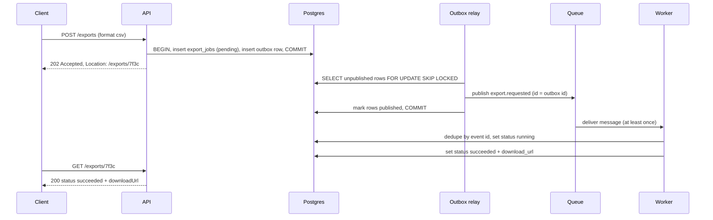

# Asynchronous Processing

> **Module 02 · Core Backend** · Prerequisites: [Background Workers](17-Background-Workers.md) · Next: [Logging](20-Logging.md)

---

## ⏱ If You Only Have 2 Minutes

- Go asynchronous when the work cannot finish reliably inside the request deadline, or the caller does not need the result right now. Proxies and load balancers often cut requests at 30–60 s (AWS ALB's default idle timeout is 60 s).
- Respond `202 Accepted` with a link to a **status resource** (`Location: /exports/7f3c…`). Per RFC 9110, a 202 is deliberately non-committal: **accepted is not done**.
- Tell the client it finished by **polling** the status resource (send `Retry-After`), a **webhook** (server-to-server), or **SSE/WebSocket** (a live UI).
- **Dual-write problem:** "commit to the database, then publish to the queue" loses the message if the process dies between the two steps. Publishing first can announce something that then rolls back.
- **Transactional outbox:** write the business row *and* an event row in the **same transaction**. A separate relay publishes unpublished rows using `SELECT … FOR UPDATE SKIP LOCKED`, then marks them sent.
- The relay is **at-least-once**: a crash after publishing but before marking means a re-publish. Consumers dedupe by event ID (the **inbox** / idempotent-consumer pattern).
- Ordering holds at best per queue or partition. Retries and parallel consumers reorder messages, so design consumers to tolerate it.
- Backpressure: bound the queue, limit enqueues per user or tenant, and answer `429`/`503` with `Retry-After` instead of letting the backlog grow without limit.

---

## 1. What It Is and Why It Exists

**Asynchronous processing** means the API accepts a request, records that work must be done, and returns **before** the work is finished. A [background worker](17-Background-Workers.md) completes it later. The client learns the outcome through a separate channel.

**Analogy:** a dry cleaner. You hand over a suit and get a numbered ticket — not a clean suit. The ticket is your status resource: you can come back and ask about it, or the shop can text you when it is ready. The shop's order book is the outbox: if it writes your suit in the book, the suit will be cleaned even if the person at the counter goes home sick.

**The problems it solves:**

- **Deadlines.** A 2-million-row export takes 90 s. Behind a load balancer with a 60 s idle timeout, the user gets a `504`, the server keeps working for nothing, and the user clicks again — now two exports are running.
- **Fragility.** A deploy or crash kills an in-flight request, and the work is lost halfway through with no record.
- **Coupling.** Placing an order should not fail because the analytics service or the email provider is slow. Those effects can happen a few seconds later.

**The cost:** the system becomes **eventually consistent** — for a while, the user's action is accepted but not yet reflected everywhere. This chapter is mostly about making that period safe and visible.

---

## 2. How It Works

1. The client calls `POST /exports`.
2. In **one database transaction**, the API inserts the job row (`status = 'pending'`) and an outbox row (`export.requested`).
3. The API returns `202 Accepted` with `Location: /exports/{id}`.
4. An **outbox relay** process, running independently, selects unpublished outbox rows, publishes them to the queue, and marks them published.
5. A worker consumes the message, checks it has not already handled this event, generates the file, and updates the job row to `succeeded` with a download URL.
6. The client polls `GET /exports/{id}` (or receives a webhook or SSE event) and sees the result.



---

## 3. Key Concepts

### Choosing async and the 202 contract

| Question | If yes |
|---|---|
| Does the caller need the result to continue (e.g. "was my payment authorised")? | Prefer synchronous, with a timeout |
| Can p99 latency exceed the request deadline? | Async |
| Does the work call flaky dependencies that need retries over minutes? | Async |
| Does one request fan out (notify 10,000 followers)? | Async |
| Is the work a side effect of the main action (email, analytics, search index)? | Async, via the outbox |

Keep the **core invariant** synchronous — reserving stock, creating the order — and move secondary effects out.

The status resource is a normal resource the client can `GET`:

```http
HTTP/1.1 202 Accepted
Location: /exports/7f3c9a2e-5b1d-4c6e-9f2a-0d8e1b7c4a55
Content-Type: application/json

{"id":"7f3c9a2e-5b1d-4c6e-9f2a-0d8e1b7c4a55","status":"pending"}
```

RFC 9110 says the body of a 202 should describe the request's current status and point to a status monitor. Returning that link in `Location` is a widespread convention (not a rule of the RFC), so many APIs put it in both the header and the body. The status resource moves through `pending → running → succeeded | failed`. While it is unfinished, send `Retry-After: 5` so clients do not poll in a tight loop. Also accept an `Idempotency-Key` on the `POST`, so a client retry after a timeout returns the same job instead of creating a second one.

### Telling the client it is done

| Method | How it works | Good for | Watch out for |
|---|---|---|---|
| Polling | Client `GET`s the status resource every few seconds | Any client; simplest | Wasted requests; honour `Retry-After` |
| Webhook | Server `POST`s to a URL the client registered | Server-to-server integrations | Sign payloads (HMAC); retry with backoff; receiver must dedupe |
| Server-Sent Events | One long-lived HTTP response streams events to the browser | Live progress bars | One-way only; proxies must not buffer the stream |
| WebSocket | Two-way persistent connection | Apps that already have a socket (chat, dashboards) | Overkill for one status change |
| Email / push | Out-of-band notice | Jobs that take minutes to hours | Still needs the status resource as the source of truth |

All of these are *notifications*. The status resource stays the source of truth: if a webhook is lost or an SSE connection drops, the client can always `GET` it.

### The dual-write problem and the transactional outbox

A **dual write** updates two systems — the database and the broker — that cannot share one transaction:

| Order of operations | Crash between the steps | Result |
|---|---|---|
| Commit to DB, then publish | After commit | Job row exists, no message: the export stays `pending` forever |
| Publish, then commit | After publish | Message for a job that was rolled back: the worker finds no row, or acts on phantom data |
| Publish inside the open transaction | Commit fails after publish | Same as above, and the transaction holds locks during a network call |

The **transactional outbox** removes the second system from the request path. The `outbox` table is in the same database, so the job row and event row commit or roll back **together**. A **relay** process then reads unpublished rows and publishes them:

- **Polling relay:** `SELECT … WHERE published_at IS NULL ORDER BY id LIMIT 100 FOR UPDATE SKIP LOCKED`. `SKIP LOCKED` lets several relay instances run side by side; each takes rows the others have not locked. Select by the "unpublished" flag, not by "id greater than the last one I saw": identity values are assigned at insert, not at commit, so a lower ID can become visible after a higher one and a high-water-mark cursor would skip it.
- **Change data capture (CDC):** a tool such as Debezium reads the database's write-ahead log and publishes outbox inserts. Lower latency and no polling load, but more infrastructure.
- **Wake-ups:** Postgres `LISTEN/NOTIFY` can wake a polling relay early. Notifications are not durable, so keep the poll as a fallback.

### The inbox: idempotent consumers

The relay can publish a row, crash before marking it, and publish it again. The broker can also redeliver. So the consumer records each event ID **in the same transaction as its own effect**:

```sql
-- Inside the consumer's transaction, before doing the work
INSERT INTO processed_events (consumer, event_id) VALUES ('export-worker', $1)
ON CONFLICT DO NOTHING;
-- 0 rows inserted → this event was already handled: commit and ack without doing anything
```

When the effect is outside your database (sending an email, calling a payment API), the inbox row cannot share a transaction with it; pass an idempotency key downstream instead. See [Idempotency](../Module-07-Advanced-Backend-and-System-Design/32-Idempotency.md).

### Ordering

Most systems give, at best, **ordering within one queue or partition** — and only with a single consumer at a time. Retries put a failed message behind newer ones. Parallel workers finish in any order. Several relay instances with `SKIP LOCKED` publish in any order too.

Ways to cope:

- Route all events for one entity to the same partition or queue, consumed one at a time ([Kafka](../Module-07-Advanced-Backend-and-System-Design/22-Kafka-Fundamentals.md) does this with a message key).
- Put a **version** or timestamp in each event and ignore events older than what you have stored: `UPDATE … WHERE id = $1 AND version < $2`.
- Send "something changed for order 42" and let the consumer read the current state, instead of relying on the order of deltas.

### Backpressure and eventual consistency as the user sees it

**Backpressure** means slowing producers down when consumers cannot keep up. Without it, a backlog grows until Redis runs out of memory or jobs are hours old and useless.

- Limit in-flight jobs per user or tenant at the API, and answer `429 Too Many Requests` with `Retry-After`.
- When the queue's oldest-message age passes a threshold, shed low-priority enqueues (`503` + `Retry-After`) to protect the important ones.
- Cap the relay's batch size and the workers' concurrency, so a backlog drains at a rate the database can handle. Details in [Rate Limiting](../Module-07-Advanced-Backend-and-System-Design/33-Rate-Limiting.md).

**Eventual consistency** is a UX decision as much as a technical one:

- Write the job row **synchronously**, so the user's next `GET` sees "Preparing your export…" (read-your-writes), even though the work has not started.
- Show honest states — `pending`, `running` (with progress if possible), `failed` with a retry button — instead of a spinner that never ends.
- Give jobs a deadline. A reaper marks jobs `running` for longer than the maximum expected time as `failed`, or re-enqueues them, so nothing stays "processing" forever.

---

## 4. Code Examples

Scenario: `POST /exports` creates an export job and its outbox event in one transaction and returns `202`. `GET /exports/{id}` reports status. A separate relay process publishes outbox rows to the worker queue.

```sql
CREATE TABLE export_jobs (
  id uuid PRIMARY KEY, user_id text NOT NULL, format text NOT NULL,
  status text NOT NULL CHECK (status IN ('pending', 'running', 'succeeded', 'failed')),
  download_url text, created_at timestamptz NOT NULL DEFAULT now());
CREATE TABLE outbox (
  id bigint GENERATED ALWAYS AS IDENTITY PRIMARY KEY, topic text NOT NULL, payload jsonb NOT NULL,
  created_at timestamptz NOT NULL DEFAULT now(), published_at timestamptz);
CREATE INDEX outbox_unpublished ON outbox (id) WHERE published_at IS NULL;  -- keeps the relay query fast
```

### Node.js / TypeScript

The API (Express 5 + `pg`):

```ts
// npm i express pg   — Node.js 22+, TypeScript 5, ESM
import express, { type Request } from "express";
import { randomUUID } from "node:crypto";
import pg from "pg";

const pool = new pg.Pool({ connectionString: process.env.DATABASE_URL });
const MAX_IN_FLIGHT_PER_USER = 3;
const UUID_RE = /^[0-9a-f]{8}-[0-9a-f]{4}-[0-9a-f]{4}-[0-9a-f]{4}-[0-9a-f]{12}$/i;
declare function currentUserId(req: Request): string; // from your auth middleware (see JWT chapter)

const app = express();
app.use(express.json());

app.post("/exports", async (req, res) => {
  const userId = currentUserId(req);
  const format: unknown = req.body?.format;
  if (format !== "csv" && format !== "xlsx") {
    res.status(400).json({ error: "format must be 'csv' or 'xlsx'" });
    return;
  }
  const jobId = randomUUID();
  const client = await pool.connect();
  try {
    await client.query("BEGIN");
    // Backpressure at the front door. Two concurrent requests can both pass; fine for a soft cap.
    const { rows } = await client.query<{ n: number }>(
      "SELECT count(*)::int AS n FROM export_jobs WHERE user_id = $1 AND status IN ('pending', 'running')",
      [userId]);
    if (rows[0].n >= MAX_IN_FLIGHT_PER_USER) {
      await client.query("ROLLBACK");
      res.status(429).set("Retry-After", "60").json({ error: "too_many_exports" });
      return;
    }
    // Job row and event row commit together: no job without an event, no event without a job.
    await client.query(
      "INSERT INTO export_jobs (id, user_id, format, status) VALUES ($1, $2, $3, 'pending')",
      [jobId, userId, format]);
    await client.query(
      "INSERT INTO outbox (topic, payload) VALUES ('export.requested', $1)",
      [{ jobId, userId, format }]); // pg serialises objects to JSON
    await client.query("COMMIT");
  } catch (err) {
    await client.query("ROLLBACK");
    throw err; // Express 5 passes rejected promises to the error handler
  } finally {
    client.release();
  }
  res.status(202).location(`/exports/${jobId}`).json({ id: jobId, status: "pending" });
});

app.get("/exports/:id", async (req, res) => {
  if (!UUID_RE.test(req.params.id)) {
    res.status(404).json({ error: "not_found" });
    return;
  }
  const { rows } = await pool.query<{ status: string; download_url: string | null }>(
    "SELECT status, download_url FROM export_jobs WHERE id = $1 AND user_id = $2",
    [req.params.id, currentUserId(req)]); // owner check: job IDs are not secrets
  const job = rows[0];
  if (!job) {
    res.status(404).json({ error: "not_found" });
    return;
  }
  if (job.status === "pending" || job.status === "running") res.set("Retry-After", "5");
  res.status(200).json({ id: req.params.id, status: job.status, downloadUrl: job.download_url });
});

app.listen(3000);
```

The relay (its own process):

```ts
// npm i bullmq ioredis pg   — run as a separate process: node dist/outbox-relay.js
import { setTimeout as sleep } from "node:timers/promises";
import { Queue } from "bullmq";
import { Redis } from "ioredis";
import pg from "pg";

const pool = new pg.Pool({ connectionString: process.env.DATABASE_URL });
const connection = new Redis(process.env.REDIS_URL!, { maxRetriesPerRequest: null });
const events = new Queue("events", { connection }); // workers dispatch on job.name (the topic)

async function relayBatch(): Promise<number> {
  const client = await pool.connect();
  try {
    await client.query("BEGIN");
    // SKIP LOCKED: several relays can run without waiting on, or double-sending, the same rows.
    const { rows } = await client.query<{ id: string; topic: string; payload: Record<string, unknown> }>(
      `SELECT id, topic, payload FROM outbox
       WHERE published_at IS NULL ORDER BY id LIMIT 100
       FOR UPDATE SKIP LOCKED`);
    for (const row of rows) {
      // jobId = outbox id: if we crash after add() but before COMMIT, the re-publish is
      // ignored while the first job is still in Redis. Consumers still dedupe by eventId.
      await events.add(row.topic, { ...row.payload, eventId: row.id }, {
        jobId: `outbox-${row.id}`, attempts: 5, backoff: { type: "exponential", delay: 5_000 },
      });
    }
    if (rows.length > 0) {
      await client.query("UPDATE outbox SET published_at = now() WHERE id = ANY($1::bigint[])",
        [rows.map((r) => r.id)]);
    }
    await client.query("COMMIT");
    return rows.length;
  } catch (err) {
    await client.query("ROLLBACK");
    throw err;
  } finally {
    client.release();
  }
}

let stopping = false;
process.once("SIGTERM", () => { stopping = true; }); // finish the current batch, then exit

while (!stopping) {
  try {
    if ((await relayBatch()) === 0) await sleep(500); // idle: poll gently; a full batch loops at once
  } catch (err) {
    console.error({ event: "outbox_relay_error", err });
    await sleep(2_000);
  }
}
await events.close();
await pool.end();
await connection.quit();
```

### Python

The API (FastAPI + `psycopg` 3 async pool):

```python
# pip install fastapi "psycopg[binary,pool]"   — Python 3.12+
import os
import uuid
from contextlib import asynccontextmanager
from typing import Annotated, Literal

from fastapi import Depends, FastAPI, Header, HTTPException, Response
from psycopg.types.json import Jsonb
from psycopg_pool import AsyncConnectionPool
from pydantic import BaseModel

pool = AsyncConnectionPool(os.environ["DATABASE_URL"], open=False)
MAX_IN_FLIGHT_PER_USER = 3


@asynccontextmanager
async def lifespan(app: FastAPI):
    await pool.open()
    yield
    await pool.close()


app = FastAPI(lifespan=lifespan)


class ExportRequest(BaseModel):
    format: Literal["csv", "xlsx"]  # anything else → automatic 422


def current_user_id(x_user_id: Annotated[str, Header()]) -> str:
    return x_user_id  # stand-in for the JWT dependency from the JWT chapter


@app.post("/exports", status_code=202)
async def create_export(body: ExportRequest, response: Response,
                        user_id: Annotated[str, Depends(current_user_id)]):
    job_id = uuid.uuid4()
    # transaction() commits on success and rolls back on any exception, including HTTPException.
    async with pool.connection() as conn, conn.transaction():
        cur = await conn.execute(
            "SELECT count(*) FROM export_jobs WHERE user_id = %s AND status IN ('pending', 'running')",
            (user_id,))
        (in_flight,) = await cur.fetchone()
        if in_flight >= MAX_IN_FLIGHT_PER_USER:
            raise HTTPException(429, "too_many_exports", headers={"Retry-After": "60"})
        await conn.execute(
            "INSERT INTO export_jobs (id, user_id, format, status) VALUES (%s, %s, %s, 'pending')",
            (job_id, user_id, body.format))
        await conn.execute(
            "INSERT INTO outbox (topic, payload) VALUES ('export.requested', %s)",
            (Jsonb({"jobId": str(job_id), "userId": user_id, "format": body.format}),))
    response.headers["Location"] = f"/exports/{job_id}"
    return {"id": str(job_id), "status": "pending"}


@app.get("/exports/{job_id}")
async def get_export(job_id: uuid.UUID, response: Response,  # non-UUID path → 422, never a DB error
                     user_id: Annotated[str, Depends(current_user_id)]):
    async with pool.connection() as conn:
        cur = await conn.execute(
            "SELECT status, download_url FROM export_jobs WHERE id = %s AND user_id = %s",
            (job_id, user_id))
        row = await cur.fetchone()
    if row is None:
        raise HTTPException(404, "not_found")
    status, download_url = row
    if status in ("pending", "running"):
        response.headers["Retry-After"] = "5"
    return {"id": str(job_id), "status": status, "downloadUrl": download_url}
```

The relay (its own process, publishing to Celery):

```python
# pip install "psycopg[binary]" "celery[redis]"   — run as a separate process: python outbox_relay.py
import os
import signal
import time

import psycopg
from celery import Celery

celery_app = Celery("relay", broker=os.environ["REDIS_URL"])
TASK_FOR_TOPIC = {"export.requested": "exports.generate"}
stopping = False


def request_stop(signum, frame) -> None:
    global stopping
    stopping = True  # finish the current batch, then leave the loop


signal.signal(signal.SIGTERM, request_stop)


def relay_batch(conn: psycopg.Connection) -> int:
    with conn.transaction():
        rows = conn.execute(
            "SELECT id, topic, payload FROM outbox"
            " WHERE published_at IS NULL AND topic = ANY(%s)"
            " ORDER BY id LIMIT 100 FOR UPDATE SKIP LOCKED",
            (list(TASK_FOR_TOPIC),)).fetchall()
        for event_id, topic, payload in rows:
            # The outbox id travels with the message so the consumer's inbox can dedupe re-publishes.
            celery_app.send_task(TASK_FOR_TOPIC[topic], kwargs={**payload, "event_id": event_id},
                                 task_id=f"outbox-{event_id}")
        if rows:
            conn.execute("UPDATE outbox SET published_at = now() WHERE id = ANY(%s)",
                         ([r[0] for r in rows],))
    return len(rows)


# Crash-only: any error ends the process and the orchestrator restarts it. Unpublished rows
# simply wait in the table, which is the whole point of the outbox.
with psycopg.connect(os.environ["DATABASE_URL"], autocommit=True) as conn:
    while not stopping:
        if relay_batch(conn) == 0:
            time.sleep(0.5)
```

**Runtime differences to notice:**

- **Transactions.** With `pg` you check out a client and write `BEGIN`/`COMMIT`/`ROLLBACK` yourself, and must always `release()` it. psycopg's `conn.transaction()` context manager does the same automatically, including rollback when `HTTPException` is raised for the `429`.
- **Blocking clients.** Celery's `send_task` is a synchronous network call. Inside an `async def` FastAPI handler it would block the event loop. That is one more reason the API only writes to the outbox and leaves publishing to a separate, plain synchronous process. BullMQ's `add()` is async, so the Node relay can share an event loop with other work.
- **Validation.** FastAPI returns `422` for a bad body or a non-UUID path automatically. Express needs explicit checks, and without the UUID check a malformed ID would reach Postgres and come back as a `500`.

---

## 5. Production Concerns

- **Relay lag is the key metric.** Alert on the age of the oldest unpublished outbox row (`now() - min(created_at) WHERE published_at IS NULL`). If it grows, every downstream effect is late. Run at least two relay instances; `SKIP LOCKED` makes that safe.
- **Outbox growth.** Published rows pile up and bloat the table and its indexes. Delete or archive rows older than a few days in small batches, or partition the table by day and drop old partitions.
- **Status resources need authorization.** Filter by owner, as in the code, and return `404` for other users' jobs. Download links should be short-lived signed URLs, not permanent public paths.
- **Stuck jobs.** A worker crash can leave a job `running` forever. Add a reaper that fails or re-enqueues jobs past their deadline, and store `attempts` and `last_error` on the job row so support can explain what happened.
- **Webhooks are outbound requests from your servers.** Sign them, set timeouts, retry with backoff, and validate customer URLs so they cannot point at internal addresses.
- **Measure end-to-end:** time from `POST` to `succeeded` (p50/p95), relay lag, queue age, worker failure rate, and the count of jobs per status. A rising `pending` count with an idle queue means the relay is down.

---

## 6. Common Mistakes

- **Publishing to the queue right after `COMMIT`** — a crash or broker outage between the two leaves jobs `pending` forever — use the outbox, or at least a reconciler that re-enqueues old `pending` jobs.
- **Calling the broker inside the open transaction** — the message can describe data that later rolls back, and locks are held during a network call — write an outbox row instead.
- **Assuming exactly-once from the outbox** — the relay re-publishes after a crash and the user gets two emails — dedupe in the consumer with an inbox table or downstream idempotency key.
- **Returning `200 OK` with no way to check progress** — clients cannot tell accepted from done and retry blindly — return `202` with a status resource and an `Idempotency-Key` on the create call.
- **Creating the job row in the worker** — the user's immediate `GET` returns `404` — create the row synchronously in the request transaction.
- **Polling the relay with a "last seen ID" cursor** — rows that commit out of ID order are skipped forever — select by `published_at IS NULL`.
- **Unbounded enqueues** — one tenant queues 100,000 exports and everyone waits hours — limit per tenant, return `429` with `Retry-After`, and alert on queue age.

---

## 7. Comparison Table

| | Commit, then publish (dual write) | Outbox + polling relay | Outbox + CDC (e.g. Debezium) |
|---|---|---|---|
| Message lost on crash | Possible | No: the row stays until published | No |
| Phantom messages (data rolled back) | Possible if published before commit | No | No |
| Duplicates | Possible on retry | Possible: at-least-once | Possible: at-least-once |
| Extra latency | None | Poll interval (sub-second to seconds) | Low (reads the write-ahead log) |
| Load on the database | None | Polling queries (cheap with a partial index) | Replication slot; WAL retention if the connector stalls |
| Operational cost | Lowest | One small extra process | Kafka Connect or similar to run and monitor |
| Use when | Losing the message is acceptable | Default for most services | High event volume, or Kafka is already in place |

---

## 8. Interview Questions

**[Junior] When should an endpoint return `202 Accepted`?**
When the server has accepted the request but will finish it later, so it cannot report the final result now — typical for exports, video processing or bulk imports. The response should point to a status resource (in the body, and conventionally in `Location`) that the client can poll. `202` promises nothing about success; the status resource will say `succeeded` or `failed` later.

**[Junior] How does the client find out the job is finished?**
By polling the status resource, honouring `Retry-After`, or by being notified through a webhook (for server clients) or SSE/WebSocket (for a browser that is open). Notifications can be lost, so the status resource stays the source of truth and the client can always fall back to `GET`.

**[Mid] What is the dual-write problem?**
It is writing to two systems that do not share a transaction, typically the database and a message broker. Whatever the order, a crash between the two writes leaves them inconsistent: either the data is saved but the event is lost, or the event is published for data that was rolled back. Retrying does not fix it, because the process that knew about the second write is gone.

**[Mid] Explain the transactional outbox.**
In the same transaction as the business change, insert a row describing the event into an `outbox` table. Both commit or neither does. A separate relay reads unpublished rows (`FOR UPDATE SKIP LOCKED`), publishes them, and marks them published. The relay can crash after publishing but before marking, so delivery is at-least-once and consumers must deduplicate by event ID.

**[Mid] What is an idempotent consumer, or inbox?**
A consumer that records each processed message ID, with a unique constraint, in the same transaction as its own database changes. If the message arrives again, the insert conflicts and the consumer skips the work but still acknowledges the message. For effects outside the database, it passes an idempotency key to the downstream service instead.

**[Senior] Can you guarantee events are processed in order?**
Only within narrow limits. A single queue or partition with one active consumer preserves order, but retries, parallel consumers and multiple relay instances all reorder messages. If per-entity order matters, I route by entity key to one partition and process it serially, and I still make consumers tolerant: each event carries a version, and the consumer ignores anything older than what it has stored. Often the simplest design is a "this entity changed" event, after which the consumer reads the current state.

**[Senior] The export queue is 3 hours behind. What do you do now, and what do you change?**
Now: check that workers are healthy and that the bottleneck is not the database. If there is headroom, scale workers; if not, pause low-priority producers. Then find who is flooding the queue — usually one tenant or a retry storm. Longer term: per-tenant limits at the API returning `429`, separate queues for interactive and bulk work, alerts on oldest-job age rather than depth, and a status page that tells users the expected wait instead of an endless spinner.

---

## 9. Cheat Sheet

```text
Go async      work > request deadline (LB ~60s) | flaky deps needing retries | fan-out | side effects
Contract      202 Accepted + status resource (body + Location); Retry-After while pending
States        pending → running → succeeded | failed; job row written synchronously
Notify        polling (default) | webhook (signed, retried) | SSE / WebSocket (live UI)
Dual write    DB commit + broker publish can't be atomic → lost or phantom events
Outbox        business row + outbox row in ONE transaction; relay publishes later
Relay SQL     WHERE published_at IS NULL ORDER BY id LIMIT n FOR UPDATE SKIP LOCKED
Relay rules   select by flag, not by last-seen id; partial index; 2+ instances; delete old rows
Delivery      at-least-once → inbox table (event_id unique) in the consumer's transaction
Ordering      per queue/partition at best; retries reorder; use entity keys + versions
Backpressure  per-tenant caps → 429 + Retry-After; separate bulk queues; alert on queue age
Metrics       relay lag (oldest unpublished row), queue age, POST→done p95, jobs per status
```

---

## Related Topics

- [Background Workers](17-Background-Workers.md) — the consumers on the other side of the queue: retries, leases and DLQs
- [HTTP Status Codes](03-HTTP-Status-Codes.md) — `202`, `429`, `503` and `Retry-After`
- [Message Queues](../Module-07-Advanced-Backend-and-System-Design/21-Message-Queues.md) — broker delivery and ordering guarantees in depth
- [Idempotency](../Module-07-Advanced-Backend-and-System-Design/32-Idempotency.md) — idempotency keys for the create call and for consumers
- [SAGA Pattern](../Module-07-Advanced-Backend-and-System-Design/31-SAGA-Pattern.md) — chaining outbox-driven steps across services with compensation
- [Server-Sent Events](../Module-06-Networking-and-Distributed-Basics/31-Server-Sent-Events.md) — pushing job progress to a browser
