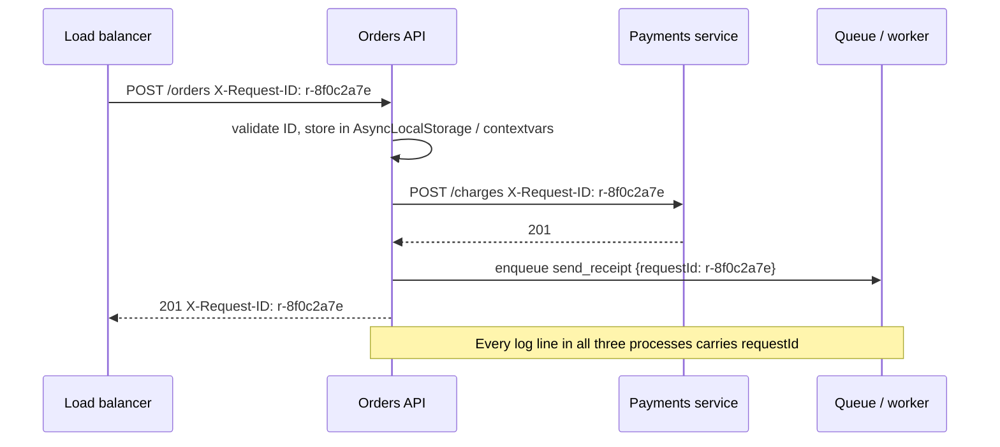

# Logging

> **Module 02 · Core Backend** · Prerequisites: [Asynchronous Processing](19-Asynchronous-Processing.md) · Next: [Error Handling](21-Error-Handling.md)

---

## ⏱ If You Only Have 2 Minutes

- A production log line is **one JSON object per line** with named fields (`level`, `time`, `msg`, `requestId`, `orderId`, `durationMs`), not a sentence. You query fields; you do not grep prose.
- Use `pino` in Node and `structlog` (or stdlib `logging` with a JSON formatter) in Python. `console.log` and `print` have no levels, no structure and no redaction.
- Levels: `error` = a request or job failed and someone may need to act; `warn` = unexpected but handled; `info` = business events and one summary line per request; `debug` = developer detail, off in production.
- Every line carries a **request ID**. Generate it (or accept a validated one from the edge), store it in `AsyncLocalStorage` (Node) or `contextvars` (Python), return it in the `X-Request-ID` response header, and forward it to downstream calls and queued jobs.
- **Never log** passwords, tokens, cookies, `Authorization` headers, full card numbers, or whole request bodies. Redact by key in the logger config so one forgotten call cannot leak.
- The app writes to **stdout**. A collector (Fluent Bit, Vector, the OpenTelemetry Collector, the CloudWatch agent) ships logs to ELK/OpenSearch, Loki, CloudWatch Logs or Datadog. The app should not know where logs end up.
- Logs are billed by volume. Keep every `error` and `warn`, keep one summary line per request, and sample the noisy success-path `info`/`debug` lines.

---

## 1. What It Is and Why It Exists

A **log** is a timestamped record of something that happened inside your program: "order o_123 created", "payment provider returned 502", "request finished in 840 ms with status 500". Logs are the most detailed evidence you have about a single event. Metrics ([chapter 22](22-Monitoring.md)) tell you *how often* something happens; logs tell you *what exactly happened this time*.

**Analogy:** an aircraft's flight recorder. It does not fly the plane. It records altitude, speed and control inputs in a fixed format, so that after an incident investigators can replay exactly what happened. A recorder that stored a pilot's free-form diary instead would be nearly useless.

**What breaks without good logging:**

- A user reports "my checkout failed at 10:14". You have 40 server instances printing unstructured text. There is no way to find *their* request among millions of lines.
- A developer writes `console.log(req.body)` while debugging and ships it. The log store now holds passwords and card numbers, and every engineer with log access is in scope of a security incident.
- A busy endpoint logs five lines per request at `info`. The log bill becomes larger than the compute bill, and the useful lines are buried.

Structured logging fixes the first problem, redaction the second, and levels plus sampling the third.

---

## 2. How It Works

### From a log call to a searchable record

```mermaid
flowchart LR
    A["Handler calls logger.info({orderId}, 'order_created')"] --> B["Logger merges context: level, time, service, requestId"]
    B --> C["Redaction removes secret fields"]
    C --> D["One JSON line written to stdout"]
    D --> E["Container runtime stores stdout"]
    E --> F["Collector: Fluent Bit / Vector / OTel Collector"]
    F --> G["Store: OpenSearch, Loki, CloudWatch Logs, Datadog"]
    G --> H["Query: requestId = 'r-8f0c' AND level = 'error'"]
```



1. **The call.** Code passes a message (used as a stable event name) and a field object.
2. **Context merge.** The logger adds fixed fields (`service`, `version`, `env`) and request-scoped fields (`requestId`, `userId`) from async-local context. The handler never passes these by hand.
3. **Level filter.** If the call is below the configured level, the logger returns before doing any formatting work.
4. **Redaction.** Configured paths such as `*.password` are replaced with `[REDACTED]`.
5. **Serialization.** The record becomes one line of JSON. One line per event matters: a multi-line stack trace printed as plain text is split into many unrelated records by most collectors, while a JSON-escaped stack stays in one record.
6. **Shipping.** Following the [twelve-factor](https://12factor.net/logs) rule, the process writes to stdout and nothing else. Docker, Kubernetes or ECS capture stdout; an agent tails it, adds metadata (pod, node, region) and forwards it.

### Text versus structured

```text
2026-11-24 10:14:07 INFO User 42 created order o_123 for $45.99 in 84ms
```

```json
{"level":"info","time":"2026-11-24T10:14:07.512Z","service":"orders-api","version":"1.8.2","requestId":"r-8f0c2a7e","userId":"42","msg":"order_created","orderId":"o_123","totalCents":4599,"durationMs":84}
```

To answer "how many orders over $100 failed for user 42 today?" from the first form, you need a regular expression that breaks the next time someone rewords the sentence. From the second form it is a field filter: `msg = "order_created" AND userId = "42" AND totalCents > 10000`.

### Request ID propagation



The ID lives in **async-local storage**: a per-request slot that follows the request through `await` calls without being passed as a function argument.

- **Node:** `AsyncLocalStorage` from `node:async_hooks`. `als.run(store, fn)` makes `store` visible to everything `fn` starts, including promises and timers created later.
- **Python:** `contextvars.ContextVar`. Each asyncio task gets a *copy* of the context that was current when it was created, so values bound in middleware before the endpoint runs are visible inside the endpoint. `structlog.contextvars` wraps this for you.

When you use OpenTelemetry tracing ([chapter 23](23-Observability-Fundamentals.md)), the `trace_id` does the same job across services. Many teams keep both: `trace_id` for engineers, a short request ID that support staff can read out to a customer.

---

## 3. Key Concepts

### Log levels

| Level | Use it for | Example | In production |
|---|---|---|---|
| `fatal` / `critical` | The process is about to exit | Uncaught exception, cannot bind port | Always on; usually pages someone |
| `error` | An operation failed and was not recovered | Unhandled exception → 500, job moved to the dead-letter queue | Always on |
| `warn` | Unexpected, but handled; may need attention if it repeats | Retry succeeded on attempt 3, deprecated API version used | Always on |
| `info` | Business events and one summary per request or job | `order_created`, `request_completed`, `job_finished` | On, sampled if very noisy |
| `debug` | Developer detail: branch taken, cache hit/miss | `pricing_rule_applied` | Off; turn on per service temporarily |
| `trace` | Very fine detail, loop iterations | Each row parsed | Off |

Two rules interviewers like: **a 404 or a validation failure is not an `error`** — it is normal client behaviour, so log it at `info` or `warn` at most. And **if nobody would act on an `error` line, it is not an error**. Error-level noise trains on-call engineers to ignore the level.

### Fields every line should have

| Field | Why |
|---|---|
| `time` (ISO 8601, UTC) | Ordering across hosts in different time zones |
| `level` | Filtering and alerting |
| `msg` / `event` | A **stable event name** like `payment_declined`, not a sentence with values inside |
| `service`, `version`, `env` | "Did this start with deploy 1.8.2?" |
| `requestId` and/or `trace_id` | Joins all lines for one request, across services |
| Business keys | `orderId`, `tenantId`, `userId` (an internal ID, not an email) |
| `err` (type, message, stack) | Only on failures, as structured fields |

Logs, unlike metric labels, can hold **high-cardinality** values such as order IDs and user IDs. That is exactly what makes them useful for finding one customer's request.

### Redaction and PII

**PII** (personally identifiable information) means data that identifies a person: email, phone, address, IP address in some jurisdictions. Logs are copied to many systems, kept for weeks, and readable by many engineers, so treat them as a lower-trust store than your database.

- **Deny-list by key** in the logger config: `password`, `token`, `authorization`, `cookie`, `secret`, `cardNumber`. This catches the case where someone logs a whole object.
- **Allow-list what you log** in handlers: log `{ orderId, itemCount }`, not `req.body`.
- **Never log credentials, even hashed or "temporarily".** A logged bearer token can be replayed until it expires.
- Under GDPR, a user's right to erasure is hard to honour if their email is in 90 days of immutable log archives. Log internal user IDs; look up the email when needed.
- Defence in depth: Pydantic's `SecretStr` prints as `**********`.

### Volume, cost and sampling

Log platforms charge per GB ingested and per GB stored. A rough sense of scale: 1,000 requests/second × 5 lines × 400 bytes ≈ 170 GB per day.

- **One summary line per request** (`request_completed` with route, status, duration) replaces "started / step 1 / step 2 / finished".
- **Sample success, keep failure.** Keep 100% of `warn`/`error` and slow requests; keep perhaps 1–10% of fast, successful `info` lines. Decide at the *end* of the request, when you know the outcome.
- **Rate-limit repeats.** A dependency outage can produce the same error a million times. Log the first occurrences and a periodic count.
- **Retention tiers.** Keep 7–30 days hot and searchable, then move to cheap object storage if compliance needs longer.

### Cost in hot paths

Logging is not free. Each call allocates objects, serializes JSON and writes to a file descriptor.

- **Disabled levels must be cheap.** Pino and structlog's filtering logger return almost immediately for levels below the threshold — but your *arguments* are still built. `logger.debug({ cart: expensiveSummary(cart) })` runs `expensiveSummary` even when debug is off. Guard with `logger.isLevelEnabled("debug")` (pino) or `logger.isEnabledFor(logging.DEBUG)` (stdlib).
- **Node:** serialization runs on the event loop. Logging a 2 MB object in a request handler blocks every other request while it is converted to JSON. `console.log` is also slow: it formats objects with `util.inspect`, and when stdout is a file (or a terminal on Linux) the write is synchronous.
- **Python:** stdlib handlers run synchronously and take a lock. In an `async def` endpoint, a handler that writes over the network blocks the event loop. Keep handlers on stdout, or use `logging.handlers.QueueHandler` with a `QueueListener` thread.
- **Pretty printing is for development only.** Pipe dev output through `pino-pretty` or use structlog's `ConsoleRenderer`; in production emit raw JSON.

---

## 4. Code Examples

Scenario: an Orders API that tags every log line with a request ID, writes one summary line per request, forwards the ID to a downstream service, and redacts secrets even when a whole object is logged.

### Node.js / TypeScript

```ts
// npm i express pino   — Node.js 22+, TypeScript 5, ESM
import { AsyncLocalStorage } from "node:async_hooks";
import { randomUUID } from "node:crypto";
import express, { type Request, type Response, type NextFunction } from "express";
import pino from "pino";

interface RequestContext { requestId: string; userId?: string }
const als = new AsyncLocalStorage<RequestContext>();

export const logger = pino({
  level: process.env.LOG_LEVEL ?? "info",
  base: { service: "orders-api", version: process.env.APP_VERSION },
  timestamp: pino.stdTimeFunctions.isoTime,
  formatters: { level: (label) => ({ level: label }) }, // "info" is easier to query than 30
  mixin: () => ({ ...als.getStore() }),                  // request context on every line, no manual passing
  redact: {
    // Key-based, so logging a whole object cannot leak these fields.
    paths: ["password", "*.password", "*.token", "*.cardNumber", "req.headers.authorization", "req.headers.cookie"],
    censor: "[REDACTED]",
  },
});

// Only trust a well-formed incoming ID; anything else could inject fake fields or huge strings.
const VALID_ID = /^[A-Za-z0-9-]{8,64}$/;

function requestContext(req: Request, res: Response, next: NextFunction): void {
  const incoming = req.get("x-request-id");
  const requestId = incoming && VALID_ID.test(incoming) ? incoming : randomUUID();
  res.set("x-request-id", requestId);
  const start = performance.now();

  res.on("finish", () => {
    // requestId passed explicitly: the 'finish' event is not guaranteed to run inside the ALS context.
    const level = res.statusCode >= 500 ? "error" : "info";
    logger[level]({
      requestId,
      method: req.method,
      route: req.route?.path ?? "unmatched",
      status: res.statusCode,
      durationMs: Math.round(performance.now() - start),
    }, "request_completed");
  });

  als.run({ requestId }, () => next());
}

const app = express();
app.use(express.json());
app.use(requestContext);

app.post("/orders", async (req, res) => {
  const ctx = als.getStore();
  if (ctx) ctx.userId = "42"; // normally set by auth middleware; later lines pick it up automatically

  // The payment body is logged whole only to show redaction: cardNumber becomes "[REDACTED]".
  logger.debug({ payment: req.body.payment }, "payment_payload_received");

  const charge = await fetch("http://payments.internal/charges", {
    method: "POST",
    headers: { "content-type": "application/json", "x-request-id": ctx?.requestId ?? "" },
    body: JSON.stringify({ amountCents: req.body.totalCents }),
  });
  if (!charge.ok) {
    logger.warn({ upstreamStatus: charge.status }, "payment_declined");
    res.status(402).json({ error: "payment_declined" });
    return;
  }

  const orderId = `o_${randomUUID().slice(0, 8)}`;
  logger.info({ orderId, totalCents: req.body.totalCents }, "order_created");
  res.status(201).json({ orderId });
});

app.listen(3000);
```

Notes:

- In production most teams use `pino-http`, which does the per-request child logger and summary line for you. The hand-written middleware above shows what it does.
- `AsyncLocalStorage` follows promises, timers and callbacks automatically. A few libraries that pool callbacks internally can lose the context; wrap such callbacks with `AsyncResource.bind`.

### Python

```python
# pip install fastapi uvicorn structlog   — Python 3.12+
import logging
import re
import time
import uuid

import structlog
from fastapi import FastAPI, Request
from pydantic import BaseModel
from structlog.contextvars import bind_contextvars, clear_contextvars, merge_contextvars
from structlog.typing import EventDict, WrappedLogger

SENSITIVE = {"password", "token", "authorization", "cookie", "card_number"}


def _scrub(value: object) -> object:
    if isinstance(value, dict):
        return {k: "[REDACTED]" if str(k).lower() in SENSITIVE else _scrub(v) for k, v in value.items()}
    if isinstance(value, list):
        return [_scrub(v) for v in value]
    return value


def redact(_: WrappedLogger, __: str, event_dict: EventDict) -> EventDict:
    return _scrub(event_dict)  # type: ignore[return-value]


structlog.configure(
    processors=[
        merge_contextvars,  # adds request_id / user_id bound earlier in this request
        structlog.processors.add_log_level,
        structlog.processors.TimeStamper(fmt="iso", utc=True),
        redact,             # runs before rendering, so nothing secret reaches stdout
        structlog.processors.format_exc_info,
        structlog.processors.JSONRenderer(),
    ],
    # Calls below INFO return before any processor runs.
    wrapper_class=structlog.make_filtering_bound_logger(logging.INFO),
    cache_logger_on_first_use=True,
)
log = structlog.get_logger(service="orders-api")
app = FastAPI()
VALID_ID = re.compile(r"[A-Za-z0-9-]{8,64}")


@app.middleware("http")
async def request_context(request: Request, call_next):
    clear_contextvars()  # never inherit fields from a previous request
    incoming = request.headers.get("x-request-id", "")
    request_id = incoming if VALID_ID.fullmatch(incoming) else str(uuid.uuid4())
    bind_contextvars(request_id=request_id)
    start, status = time.perf_counter(), 500  # if call_next raises, the client sees a 500
    try:
        response = await call_next(request)
        status = response.status_code
        response.headers["x-request-id"] = request_id
        return response
    finally:
        route = request.scope.get("route")
        log.log(logging.ERROR if status >= 500 else logging.INFO, "request_completed",
                method=request.method, route=getattr(route, "path", "unmatched"),
                status=status, duration_ms=round((time.perf_counter() - start) * 1000, 1))


class Payment(BaseModel):
    card_number: str
    total_cents: int


@app.post("/orders", status_code=201)
async def create_order(payment: Payment) -> dict:
    bind_contextvars(user_id="42")  # normally done by the auth dependency
    log.debug("payment_payload_received", payment=payment.model_dump())  # card_number → [REDACTED]
    order_id = f"o_{uuid.uuid4().hex[:8]}"
    log.info("order_created", order_id=order_id, total_cents=payment.total_cents)
    return {"order_id": order_id}
```

**Runtime differences to notice:**

- `bind_contextvars` in the middleware is visible inside the endpoint because the endpoint runs in a task created *after* the bind, and asyncio copies the context into new tasks. Values bound inside the endpoint do **not** flow back to the middleware. In Node the ALS store is one shared object, so a field the handler sets on it (like `userId`) is visible to every later reader in that request.
- Uvicorn writes its own access log through stdlib `logging` in plain text. Either run with `--no-access-log` (the middleware above replaces it) or route stdlib records through structlog's `ProcessorFormatter` so every line is JSON.

---

## 5. Production Concerns

- **Security.** Logs are an exfiltration path. Restrict who can read production logs, keep redaction in the logger config (not in reviewers' memory), and add a CI check or a collector rule that flags `Bearer ` or card-number patterns. Validate incoming request IDs; otherwise a client can push newlines (forged lines in any plain-text sink) or a 1 MB string into your log pipeline.
- **Delivery is best-effort.** Logs written just before a crash can be lost if the process exits before the buffer is flushed. Write the `fatal` line synchronously before exiting ([chapter 21](21-Error-Handling.md) covers the crash path). Do not treat logs as an audit trail that must never lose a record — write audit events to a database table.
- **Backpressure.** If the collector is down, the container runtime's log buffer or disk fills up. Docker's default `json-file` driver can fill a disk unless you set `max-size`. Kubernetes rotates container logs for you.
- **Measure the pipeline.** Track ingested GB per service per day and lines per request. A sudden jump usually means someone left `debug` on or a retry loop is logging every attempt.
- **Dynamic levels.** Being able to switch one service to `debug` for 15 minutes (via config or an admin endpoint) is worth more than permanently verbose logs.

---

## 6. Common Mistakes

- **Interpolating values into the message** — `logger.info(\`Order ${id} created for ${email}\`)` makes every line a unique string you cannot group, and leaks the email — use a fixed event name plus fields: `logger.info({ orderId: id }, "order_created")`.
- **Logging whole request bodies or headers** — passwords, tokens and card numbers end up in the log store — log selected fields, and configure key-based redaction as a safety net.
- **Logging the same error at every layer** — the repository, service and controller each log it, so one failure looks like three — log once at the boundary that handles it (the global error handler), and wrap/rethrow elsewhere.
- **Using `error` for client mistakes** — 404s and validation failures flood the error level and hide real failures — reserve `error` for failures the team must fix.
- **Writing log files from the app** — files fill disks, need rotation, and disappear with the container — write to stdout and let the platform collect.
- **No request ID, or a new ID per service** — you cannot join the API's lines with the worker's lines — accept and forward one ID (or use the trace ID) across every hop, including queued jobs.
- **Building expensive debug arguments** — `logger.debug({ dump: JSON.stringify(bigObject) })` costs CPU even when debug is off — guard with `isLevelEnabled` / `isEnabledFor`.

---

## 7. Comparison Table

| | `console.log` / `print` | Stdlib-style logger (`winston`, Python `logging`) | Structured, performance-focused (`pino`, `structlog`) |
|---|---|---|---|
| Output | Free text | Text by default; JSON via a formatter | JSON by default |
| Levels and filtering | No | Yes | Yes, with cheap no-op for disabled levels |
| Request context | Manual | Filters/adapters, manual wiring | `mixin` + ALS (pino), `contextvars` processor (structlog) |
| Redaction | No | Custom formatter/filter | Built-in `redact` paths (pino); one processor (structlog) |
| Overhead | `console.log` formats with `util.inspect` on every call | Moderate | Low |
| Best for | Scripts and local experiments | Existing codebases, many built-in handlers | New services that ship logs to a central store |

A common Python setup is structlog for application code, with stdlib `logging` records from libraries routed through structlog's formatter so they come out as JSON too.

---

## 8. Interview Questions

**[Junior] Why use structured logging instead of `console.log`?**
Structured logs are JSON objects with named fields, so a log platform can filter and aggregate on `orderId`, `status` or `durationMs` without fragile regular expressions. `console.log` has no levels, so you cannot turn noise off in production, and it has no redaction or request context. A logger like pino also adds timestamps, service name and version to every line automatically.

**[Junior] What should never appear in logs?**
Passwords, session cookies, bearer and refresh tokens, API keys, full card numbers and other secrets, plus personal data you do not need (emails, addresses). Logs are copied to many systems and read by many people, so a leaked token can be replayed. Configure redaction in the logger by key and log internal IDs instead of personal data.

**[Mid] How do you get a request ID onto every log line without passing it to every function?**
Middleware creates or validates the ID and stores it in async-local context: `AsyncLocalStorage.run()` in Node, a `ContextVar` (through `structlog.contextvars.bind_contextvars`) in Python. The logger reads that context on every call — pino through `mixin`, structlog through the `merge_contextvars` processor. The ID is also returned in `X-Request-ID`, sent on outgoing HTTP calls, and stored in queued job payloads so workers can bind it again.

**[Mid] What goes at each log level, and what level runs in production?**
`error` for failures nobody recovered from, `warn` for handled anomalies like a retry, `info` for business events and one summary line per request, `debug` for developer detail. Production normally runs at `info`, with a way to raise a single service to `debug` temporarily. Client errors like 404 or validation failures are not `error`, because no engineer needs to act on them.

**[Mid] Your log bill tripled. How do you investigate and fix it?**
Group ingested volume by service, then by `msg`, to find the top event names — usually one or two lines account for most of the volume. Common causes are a `debug` level left on, a per-item log inside a loop, a retry loop logging each attempt, or logging full payloads. Fixes: collapse per-step lines into one summary line, sample successful requests while keeping all errors and slow requests, rate-limit repeated errors, and shorten hot retention.

**[Senior] Logging in the request path made p99 latency worse. Why could that happen, and what do you do?**
Logging costs CPU for serialization and a write syscall per line. In Node that work runs on the event loop, so serializing a large object delays every concurrent request; in Python a synchronous handler that writes to a network endpoint blocks the event loop of an `async` app. Measure first (a profiler or a flame graph will show `JSON.stringify` or the handler). Then log less per request, never serialize large objects, write to stdout and let an external agent ship the data, and in Python move slow handlers behind a `QueueHandler`.

**[Senior] Request IDs versus trace IDs — do you need both?**
A trace ID from W3C Trace Context is generated by the tracing system, propagated automatically by OpenTelemetry instrumentation, and links logs to spans. A request ID is often created at the edge (load balancer or API gateway), shown to customers in error responses, and exists even for services that are not traced or traces that were sampled out. Many teams log both. If tracing is everywhere and always propagated, the trace ID alone can serve, as long as it appears in every log line and in error responses.

---

## 9. Cheat Sheet

```text
Format         one JSON object per line → stdout → collector → store (ELK/OpenSearch, Loki, CloudWatch, Datadog)
Libraries      Node: pino (+ pino-http)       Python: structlog (or logging + JSON formatter)
Message        stable event name ("order_created"), values go in fields, never interpolated
Every line     time (UTC ISO), level, msg, service, version, env, requestId / trace_id
Levels         error = unrecovered failure | warn = handled anomaly | info = business event + 1 line/request | debug = off in prod
Not errors     404, validation failures, expected 401s
Context        Node: AsyncLocalStorage.run(store, next) + pino mixin
               Python: contextvars via structlog bind_contextvars + merge_contextvars
Propagate      X-Request-ID in response, outgoing calls, and queued job payloads; validate incoming IDs
Redact         password, token, authorization, cookie, card numbers — by key in logger config
PII            log internal user IDs, not emails; logs are hard to erase
Volume         keep all warn/error + slow requests; sample fast successes; rate-limit repeats
Hot path       disabled level still builds arguments → guard expensive ones; no large objects
Log once       at the boundary that handles the error, not at every layer
```

---

## Related Topics

- [Error Handling](21-Error-Handling.md) — which failures to log, at what level, and logging once at the boundary
- [Observability Fundamentals](23-Observability-Fundamentals.md) — putting `trace_id` in every line to join logs with traces
- [Monitoring](22-Monitoring.md) — when a counter is cheaper and more reliable than counting log lines
- [Node Event Loop and Concurrency](06-Node-Event-Loop-and-Concurrency.md) — why synchronous serialization in a handler hurts every request
- [Logging in AWS](../Module-10-DevOps-and-Cloud/34-Logging-in-AWS.md) — the infrastructure side: CloudWatch Logs, retention and shipping
- [Secrets Management](../Module-10-DevOps-and-Cloud/16-Secrets-Management.md) — keeping secrets out of code, config and logs
