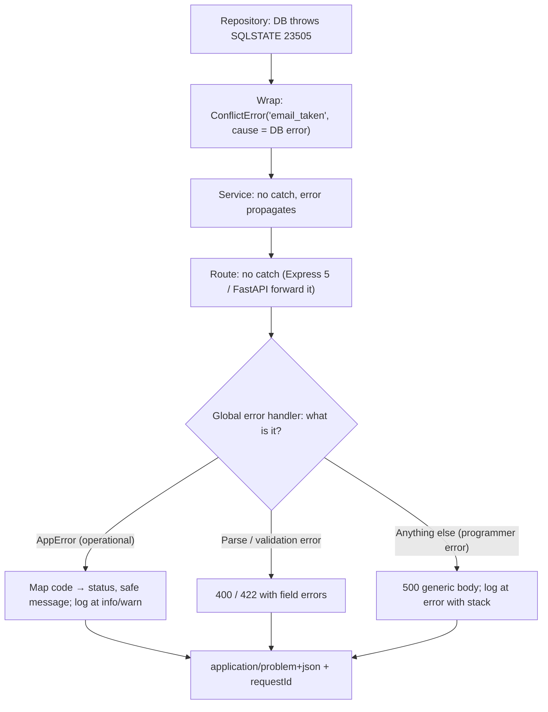

# Error Handling

> **Module 02 · Core Backend** · Prerequisites: [Logging](20-Logging.md), [HTTP Status Codes](03-HTTP-Status-Codes.md) · Next: [Monitoring](22-Monitoring.md)

---

## ⏱ If You Only Have 2 Minutes

- There are two kinds of errors. **Operational errors** are expected failures of correct code: invalid input, record not found, unique-key conflict, dependency timeout. **Programmer errors** are bugs: reading a property of `undefined`, a wrong type, a forgotten `await`. You handle the first kind; you can only fix the second.
- Throw **typed errors** from the domain (`NotFoundError`, `ConflictError`, `DependencyUnavailableError`) and translate them to HTTP in **one global error handler**. Routes do not build error responses by hand.
- The client gets a stable machine-readable `code` and a safe message in [Problem Details](03-HTTP-Status-Codes.md) format (`application/problem+json`, RFC 9457). Stack traces, SQL and driver messages go to logs only.
- Let the database enforce rules, then translate: Postgres `23505` unique violation → `409 Conflict`. A "check, then insert" in code is a race condition.
- Wrap, do not replace: `new ConflictError(msg, { cause: err })` in JS, `raise ConflictError(msg) from exc` in Python. The response shows the wrapper; the logs keep the root cause.
- In Node, an error outside the request chain (`uncaughtException`, or an unhandled rejection, which Node 15+ turns into one) means unknown process state: **log `fatal`, stop accepting traffic, exit non-zero**, and let the supervisor restart you.
- Mark errors **retryable or not**. Timeouts, `503`, deadlocks and serialization failures may be retried (with backoff, and only for idempotent work). Validation, `404` and `409` never succeed on retry.

---

## 1. What It Is and Why It Exists

Error handling is the set of rules for what your service does when something goes wrong: which failures it recovers from, what the caller is told, what is recorded for engineers, and when the process should give up and restart.

**Analogy:** a hospital emergency department. Triage sorts arrivals by kind, not by who walked in first: a sprained ankle (operational, handle and send home), a heart attack (escalate now), a patient who is actually a staff member's mistake (incident report and process fix). Every patient leaves with a clear, calm explanation — not a copy of the internal chart.

**What breaks without it:**

- Each route has its own `try/catch` that returns a different JSON shape. Clients cannot write one piece of code to handle your errors.
- A database error reaches the client as `500 duplicate key value violates unique constraint "users_email_key"`. You leaked your schema and still gave the wrong status code: the client made a conflicting request (409), the server did not fail.
- An exception thrown inside a `setTimeout` callback crashes the Node process, and every in-flight request on it fails.
- Workers retry a "card declined" error 10 times and charge-attempt the customer repeatedly, while a real timeout is never retried.

A common slip when writing this down from memory is "two types of errors: operational errors and… operational errors". The real split is **operational vs programmer** errors, and it matters because the two are handled in completely different ways — see Section 3.

---

## 2. How It Works

### The path of an error



1. **Detect** the failure where it happens. Low-level code (repository, HTTP client) catches *specific* driver errors it understands.
2. **Translate and wrap** them into domain errors, keeping the original as `cause`. Unknown errors are **not** caught — they propagate untouched.
3. **Propagate.** Services and routes usually have no `try/catch` at all. In Express 5, a rejected promise from an `async` handler is passed to the error middleware automatically (Express 4 needed a wrapper for this). FastAPI does the same for exceptions raised in endpoints and dependencies.
4. **Handle once** in the global handler: classify, choose a status, build the problem body, log once, and add `Retry-After` when the error is retryable.

### What the client receives

```http
HTTP/1.1 409 Conflict
Content-Type: application/problem+json

{
  "type": "https://api.example.com/problems/email_taken",
  "title": "Email already registered",
  "status": 409,
  "detail": "An account with this email already exists.",
  "instance": "/users",
  "code": "email_taken",
  "requestId": "r-8f0c2a7e"
}
```

The `code` is part of your API contract: clients branch on it, so never rename it. The `requestId` lets support find the matching log lines ([chapter 20](20-Logging.md)). Status-code choice and the full Problem Details format are covered in [HTTP Status Codes](03-HTTP-Status-Codes.md); this chapter is about producing them reliably from code.

---

## 3. Key Concepts

### Operational vs programmer errors

| | Operational error | Programmer error |
|---|---|---|
| What it is | A correct program meeting a hostile world | A bug in the program |
| Examples | Invalid input, not found, conflict, timeout, connection refused, rate-limited by a provider | `TypeError: Cannot read properties of undefined`, wrong argument type, missing `await`, broken invariant |
| Can code recover? | Yes: return 4xx, retry, fall back, queue for later | No: the code does not know what went wrong |
| Client sees | Specific status and `code` | Generic `500`, no details |
| Log level | `info` (client mistakes) or `warn` (dependency trouble) | `error`, with stack trace, and an alert if the rate rises |
| Fix | Usually nothing; it is normal traffic | Change the code |

The practical rule: **catch only errors you expected and know how to handle.** A `catch (err) { return null }` around a whole function turns programmer errors into silent wrong answers.

### A small error hierarchy

```text
AppError  (operational; has code, safe message, retryable flag, optional cause)
├── ValidationError            → 422 (or 400 for unparseable input)
├── NotFoundError              → 404
├── ConflictError              → 409   (unique violation, version mismatch, invalid state transition)
├── ForbiddenError             → 403
└── DependencyUnavailableError → 503 + Retry-After   (retryable)
Everything else                → 500   (treated as a programmer error)
```

Keep it shallow: five or six classes plus a `code` string cover almost every API. Whether the class or the edge decides the HTTP status is a design choice. Putting `status` on the error class is simple. Keeping a mapping table in the HTTP layer keeps domain code reusable from a queue worker or a CLI, where HTTP status codes mean nothing. The examples below use the mapping table.

### Translating database errors

Constraints in the database are the only reliable way to enforce uniqueness under concurrency. Two requests can both run `SELECT ... WHERE email = ?`, both see nothing, and both insert. So: insert, and translate the violation.

| Postgres SQLSTATE | Name | Translate to | Retryable? |
|---|---|---|---|
| `23505` | `unique_violation` | `ConflictError` → 409 | No |
| `23503` | `foreign_key_violation` | `ValidationError` (unknown referenced ID) → 422, or 409 on delete | No |
| `23514` | `check_violation` | `ValidationError` → 422 | No |
| `40001` | `serialization_failure` | Retry the whole transaction | Yes |
| `40P01` | `deadlock_detected` | Retry the whole transaction | Yes |

In Node, `pg` exposes these as `err.code` (with `err.constraint`). In Python, psycopg 3 raises specific classes such as `psycopg.errors.UniqueViolation`; SQLAlchemy wraps them in `IntegrityError` with the driver error in `.orig`. Check the **constraint name** when one table has several unique keys, so "email taken" and "username taken" get different codes.

### Wrapping with a cause

| Language | Wrap | Effect |
|---|---|---|
| JavaScript (ES2022) | `throw new ConflictError("...", { cause: err })` | `err.cause` holds the original; loggers print the chain |
| Python | `raise ConflictError("...") from exc` | Sets `__cause__`; the traceback shows "The above exception was the direct cause of…" |
| Python | `raise ConflictError("...") from None` | Hides the original — use only when it adds nothing |

Never throw away the original error (`throw new Error("failed")` inside a `catch`). The cause is what tells you *why*.

### Retryable vs non-retryable

| Retryable (transient) | Not retryable (permanent) |
|---|---|
| Timeout, `ECONNRESET`, `ECONNREFUSED` | `400`, `422` validation |
| `503`, `502`, `504` from a dependency | `401`, `403`, `404` |
| `429` (after `Retry-After`) | `409` conflict |
| Postgres `40001`, `40P01` | Business rejections ("card declined") |

Retry only if the operation is **idempotent** (or carries an idempotency key), with exponential backoff, jitter and a small attempt limit. Put the `retryable` flag on the error itself, so the HTTP layer can send `Retry-After` and a queue worker can decide between "retry later" and "send to the dead-letter queue". Details: [Retry Pattern](../Module-07-Advanced-Backend-and-System-Design/35-Retry-Pattern.md).

### Errors outside a request

| Situation | Node.js | Python |
|---|---|---|
| Exception in a route handler | Express 5 catches it → error middleware → 500. Process keeps running. | Starlette catches it → exception handler → 500. Process keeps running. |
| Exception in a timer, event emitter, or callback | `uncaughtException` → default is to print and **exit with code 1** | In the main thread, `sys.excepthook` runs and the program ends; in other threads, `threading.excepthook` logs it and only that thread dies |
| Promise / task that nobody awaits | Since Node 15, `unhandledRejection` defaults to "throw", so it becomes an `uncaughtException` and crashes the process | An `asyncio` task's exception is only reported as "Task exception was never retrieved" when the task is garbage-collected — it is **silently lost** until then |
| Recommended | Log `fatal`, close the server, exit non-zero; the supervisor (Kubernetes, systemd, PM2) restarts it | Keep references to tasks; use `asyncio.TaskGroup` or a done-callback that logs; let the process manager restart crashed workers |

Why crash in Node? After an uncaught exception, the code that threw was interrupted halfway: a lock may be held, a connection half-used, a counter half-updated. The Node docs say it is not safe to resume normal operation after `uncaughtException`. A clean restart is cheaper than serving traffic from a corrupt process.

---

## 4. Code Examples

Scenario: `POST /users` creates a user. A duplicate email becomes `409 email_taken`; a dead database becomes a retryable `503`; malformed JSON is a `400`; any bug becomes a generic `500`. All errors leave in Problem Details format.

### Node.js / TypeScript

```ts
// errors.ts — npm i pg @types/pg   — Node.js 22+, TypeScript 5 (lib ES2022 for Error `cause`), ESM
import pg from "pg";

export type ErrorCode = "validation_failed" | "not_found" | "conflict" | "email_taken" | "dependency_unavailable";

/** Operational error: expected, and its message is safe to show the client. */
export class AppError extends Error {
  constructor(readonly code: ErrorCode, message: string, readonly retryable = false, options?: ErrorOptions) {
    super(message, options);
    this.name = new.target.name; // "ConflictError" in logs instead of "Error"
  }
}
export class ValidationError extends AppError {
  constructor(readonly fields: Record<string, string>) { super("validation_failed", "The request body is invalid."); }
}
export class NotFoundError extends AppError {
  constructor(resource: string) { super("not_found", `${resource} was not found.`); }
}
export class ConflictError extends AppError {
  constructor(code: "conflict" | "email_taken", message: string, options?: ErrorOptions) {
    super(code, message, false, options);
  }
}
export class DependencyUnavailableError extends AppError {
  constructor(dependency: string, options?: ErrorOptions) {
    super("dependency_unavailable", `${dependency} is temporarily unavailable.`, true, options);
  }
}

// Both pg (SQLSTATE) and Node system errors (ECONNREFUSED) put their identifier in `code`.
function errorCode(err: unknown): string | undefined {
  return typeof err === "object" && err !== null && "code" in err && typeof err.code === "string" ? err.code : undefined;
}

export async function createUser(pool: pg.Pool, email: string): Promise<string> {
  try {
    const { rows } = await pool.query<{ id: string }>(
      "INSERT INTO users (email) VALUES ($1) RETURNING id", [email]);
    return rows[0].id;
  } catch (err) {
    // The unique index decides; a SELECT-then-INSERT check would race under concurrency.
    if (errorCode(err) === "23505") {
      throw new ConflictError("email_taken", "An account with this email already exists.", { cause: err });
    }
    if (errorCode(err) === "ECONNREFUSED") throw new DependencyUnavailableError("Database", { cause: err });
    throw err; // unknown: do not guess, let the global handler treat it as a bug
  }
}
```

```ts
// app.ts — npm i express pino pg   — Node.js 22+, TypeScript 5, ESM
import express, { type Request, type Response, type NextFunction } from "express";
import pg from "pg";
import pino from "pino";
import { AppError, ValidationError, createUser, type ErrorCode } from "./errors.js";

const logger = pino();
const pool = new pg.Pool();
const PROBLEM = "application/problem+json";

// HTTP mapping lives at the edge, so the same errors work unchanged in a queue worker.
const HTTP: Record<ErrorCode, { status: number; title: string }> = {
  validation_failed: { status: 422, title: "Validation failed" },
  not_found: { status: 404, title: "Resource not found" },
  conflict: { status: 409, title: "Conflict" },
  email_taken: { status: 409, title: "Email already registered" },
  dependency_unavailable: { status: 503, title: "Service temporarily unavailable" },
};

const app = express();
app.use(express.json());

app.post("/users", async (req, res) => {
  const email: unknown = req.body?.email;
  if (typeof email !== "string" || !email.includes("@")) {
    throw new ValidationError({ email: "Must be an email address." });
  }
  const id = await createUser(pool, email); // a rejection here reaches the error middleware (Express 5)
  res.status(201).json({ id });
});

app.use((req: Request, res: Response) => {
  res.status(404).type(PROBLEM).json({ type: "about:blank", title: "Not Found", status: 404, instance: req.path });
});

app.use((err: unknown, req: Request, res: Response, next: NextFunction): void => {
  if (res.headersSent) { next(err); return; } // too late for a body; Express's default handler closes the socket
  const base = { instance: req.path, requestId: res.getHeader("x-request-id") }; // set by chapter 20's middleware

  if (err instanceof AppError) {
    const { status, title } = HTTP[err.code];
    logger[status >= 500 ? "warn" : "info"]({ err, code: err.code }, "request_failed"); // err.cause is logged too
    if (err.retryable) res.set("Retry-After", "5");
    res.status(status).type(PROBLEM).json({
      type: `https://api.example.com/problems/${err.code}`, title, status, detail: err.message, code: err.code,
      ...base, ...(err instanceof ValidationError ? { errors: err.fields } : {}),
    });
    return;
  }
  // express.json() tags malformed bodies with this type: the client's fault, not a bug.
  if (typeof err === "object" && err !== null && "type" in err && err.type === "entity.parse.failed") {
    res.status(400).type(PROBLEM).json({ type: "about:blank", title: "Bad Request", status: 400, ...base });
    return;
  }
  logger.error({ err }, "unhandled_error"); // programmer error: full stack in logs, nothing internal to the client
  res.status(500).type(PROBLEM).json({ type: "about:blank", title: "Internal Server Error", status: 500, ...base });
});

const server = app.listen(3000);

// Errors that escaped every handler (timers, emitters, un-awaited promises). With no 'unhandledRejection'
// listener, Node 15+ rethrows an unhandled rejection as an uncaught exception, so this sees both.
process.on("uncaughtException", (err, origin) => {
  logger.fatal({ err, origin }, "process_crashing");
  process.exitCode = 1;
  server.close();                                    // stop accepting; let in-flight requests finish
  setTimeout(() => process.exit(1), 10_000).unref(); // but never hang; the supervisor restarts us
});
```

### Python

```python
# errors.py — pip install "psycopg[binary]"   — Python 3.12+
from psycopg import AsyncConnection, errors as pg_errors


class AppError(Exception):
    """Operational error: expected, and `detail` is safe to show the client."""

    code = "app_error"
    retryable = False

    def __init__(self, detail: str, *, code: str | None = None) -> None:
        super().__init__(detail)
        self.detail = detail
        if code:
            self.code = code


class ValidationFailed(AppError):
    code = "validation_failed"


class NotFoundError(AppError):
    code = "not_found"


class ConflictError(AppError):
    code = "conflict"


class DependencyUnavailable(AppError):
    code = "dependency_unavailable"
    retryable = True


async def create_user(conn: AsyncConnection, email: str) -> int:
    try:
        async with conn.transaction():  # rolls back the failed statement so the connection stays usable
            cur = await conn.execute("INSERT INTO users (email) VALUES (%s) RETURNING id", (email,))
            row = await cur.fetchone()
    except pg_errors.UniqueViolation as exc:
        # `from exc` keeps the driver error (constraint name, SQLSTATE) as __cause__ for the logs.
        raise ConflictError("An account with this email already exists.", code="email_taken") from exc
    except pg_errors.OperationalError as exc:
        raise DependencyUnavailable("Database is temporarily unavailable.") from exc
    if row is None:
        raise RuntimeError("INSERT ... RETURNING returned no row")  # a bug, not a client problem
    return row[0]
```

```python
# main.py — pip install fastapi uvicorn structlog   — Python 3.12+
import structlog
from fastapi import FastAPI, Request
from fastapi.exceptions import RequestValidationError
from fastapi.responses import JSONResponse
from structlog.contextvars import get_contextvars

from errors import AppError, ConflictError, DependencyUnavailable, NotFoundError, ValidationFailed

log = structlog.get_logger()
app = FastAPI()

# Looked up along the class hierarchy, so a subclass inherits its parent's mapping.
HTTP: dict[type[AppError], tuple[int, str]] = {
    ValidationFailed: (422, "Validation failed"),
    NotFoundError: (404, "Resource not found"),
    ConflictError: (409, "Conflict"),
    DependencyUnavailable: (503, "Service temporarily unavailable"),
}


def problem(request: Request, status: int, title: str, headers: dict | None = None, **extra) -> JSONResponse:
    body = {"type": "about:blank", "title": title, "status": status, "instance": request.url.path,
            "request_id": get_contextvars().get("request_id"), **extra}  # bound by chapter 20's middleware
    return JSONResponse(body, status_code=status, media_type="application/problem+json", headers=headers)


@app.exception_handler(AppError)
async def handle_app_error(request: Request, exc: AppError) -> JSONResponse:
    status, title = next((HTTP[c] for c in type(exc).__mro__ if c in HTTP), (500, "Internal Server Error"))
    if status >= 500:  # dependency trouble: worth a warning, with the driver error that caused it
        log.warning("request_failed", code=exc.code, cause=repr(exc.__cause__))
    else:              # client mistake: normal traffic
        log.info("request_failed", code=exc.code)
    return problem(request, status, title, headers={"Retry-After": "5"} if exc.retryable else None,
                   type=f"https://api.example.com/problems/{exc.code}", detail=exc.detail, code=exc.code)


@app.exception_handler(RequestValidationError)
async def handle_validation(request: Request, exc: RequestValidationError) -> JSONResponse:
    # Return only loc/msg/type: the raw error also contains the submitted input (maybe a password).
    errors = [{"loc": e["loc"], "msg": e["msg"], "type": e["type"]} for e in exc.errors()]
    return problem(request, 422, "Validation failed", code="validation_failed", errors=errors)


@app.exception_handler(Exception)
async def handle_unexpected(request: Request, exc: Exception) -> JSONResponse:
    log.error("unhandled_error", exc_info=exc)  # stack trace to logs only
    return problem(request, 500, "Internal Server Error")
```

**Runtime differences to notice:**

- FastAPI's handler for `Exception` is called by Starlette's outermost `ServerErrorMiddleware`, which sends your response and then **re-raises** the exception so the server logs it too. Expect two log entries for a 500 unless you silence one of them.
- A Python web worker keeps running after an unhandled exception in a request, just like Express. The "crash and restart" rule in Node applies to errors *outside* the request chain. Python's equivalent risk is the opposite: an exception in a fire-and-forget `asyncio.create_task` is not reported until the task is garbage-collected. Use `asyncio.TaskGroup` (3.11+) or keep a reference and add a done-callback that logs.
- In TypeScript, `catch (err)` gives you `unknown`, so the code narrows with `instanceof` or a type guard. Python's `except UniqueViolation` does the narrowing for you, so you never inspect error-code strings by hand.

---

## 5. Production Concerns

- **Information leakage.** Stack traces reveal file paths and library versions; SQL errors reveal table and column names. Only `AppError` messages, written for clients, may reach a response. Turn off debug pages in production (`debug=False` in FastAPI; `NODE_ENV=production` for Express's default handler).
- **Enumeration.** Error differences can leak data. "Email not registered" vs "wrong password" tells an attacker which emails exist; a 403 vs 404 on `/orders/42` tells them order 42 exists. Use the same error for both cases where that matters.
- **Log once, at the boundary.** The global handler logs; lower layers wrap and rethrow without logging. Otherwise one failure shows up three times and error counts are inflated.
- **Measure.** Count errors by `code` and status class (a counter, see [chapter 22](22-Monitoring.md)). Alert on the rate of 5xx and of `unhandled_error`, not on 4xx — a spike in 4xx is usually a client release, but should still be visible on a dashboard.
- **Crash loops.** "Log and exit" is safe only with a supervisor and multiple replicas. Watch restart counts (for example, Kubernetes `CrashLoopBackOff`); a crash on every request of one type takes the whole fleet down one pod at a time.
- **Timeouts are errors too.** A dependency call without a timeout never produces an error — it just hangs and consumes a connection. Every outgoing call needs a timeout that turns into a retryable `DependencyUnavailableError`.

---

## 6. Common Mistakes

- **Catching everything and returning a default** — `catch { return [] }` hides a bug and returns wrong data with a `200` — catch only specific, expected errors; let the rest reach the global handler.
- **Sending `err.message` to the client for every error** — driver messages expose SQL, hostnames and schema — send `detail` only for operational errors; send a generic body for everything else.
- **Check-then-insert for uniqueness** — two concurrent requests both pass the check and one fails with a raw 500 — rely on the unique constraint and translate `23505` / `UniqueViolation` into `409`.
- **Losing the cause** — `throw new Error("save failed")` inside `catch` drops the original stack and SQLSTATE — wrap with `{ cause: err }` or `raise ... from exc`.
- **Retrying every failure** — retries on `400` or `409` waste capacity and can repeat side effects — retry only errors marked retryable, only idempotent operations, with backoff and a limit.
- **Swallowing `uncaughtException` and continuing** — the process keeps serving with half-updated state and leaked resources — log at `fatal`, drain, exit non-zero, let the supervisor restart.
- **Using `500` for client mistakes** — malformed JSON or a duplicate email shows up as a server error, pages on-call and misleads the client — classify parse, validation and conflict errors explicitly.

---

## 7. Comparison Table

| | Exceptions + global handler | Result / Either values (`neverthrow`, `returns`) | Error codes in return values (Go style) |
|---|---|---|---|
| How a failure travels | Thrown; skips frames until a handler catches it | Returned as a value; the type says it can fail | Returned as a second value; caller checks it |
| Forgetting to handle it | Global handler still catches it (as a 500) | Type checker forces you to deal with it | Easy to ignore unless a linter checks |
| Boilerplate | Low in services and routes | Medium: map/chain at each step | High: a check after every call |
| Fits Express / FastAPI | Natively: both frameworks route thrown errors to handlers | Must convert to a throw or response at the edge | Unidiomatic in JS and Python |
| Best for | Most web APIs | Domain logic where every failure mode must be handled explicitly | Go; low-level code |

Many TypeScript teams mix them: expected business outcomes ("insufficient stock") as typed result values inside the domain, exceptions for everything that should become an HTTP error.

---

## 8. Interview Questions

**[Junior] What is the difference between operational and programmer errors?**
Operational errors are expected failures of correct code: bad input, a missing record, a conflict, a timeout from a dependency. You handle them by returning a specific 4xx/5xx, retrying, or falling back. Programmer errors are bugs, such as reading a property of `undefined` or passing the wrong type. Code cannot recover from those; you return a generic 500, log the stack trace, and fix the code.

**[Junior] Why should stack traces never reach the client?**
They reveal internal file paths, library versions, SQL statements and sometimes data, which helps attackers. They are also useless to API clients, who need a stable error code and a clear message. The full detail belongs in logs, joined to the response by a request ID.

**[Mid] Why use a single global error handler instead of `try/catch` in every route?**
It guarantees one consistent response format, one place that decides status codes, and one log entry per failure. Routes stay focused on the happy path. Adding a new error type means adding one mapping, not editing every route. In Express 5 and FastAPI, errors thrown in async handlers reach the global handler automatically.

**[Mid] Two users sign up with the same email at the same moment. How do you return the right error?**
Put a unique index on `email` and just insert. One insert succeeds; the other gets a unique-violation error (`23505` in Postgres). The repository catches that specific error, wraps it as `ConflictError("email_taken")` with the original as `cause`, and the global handler returns `409`. A "SELECT first, then INSERT" check does not work, because both requests can pass the check before either inserts.

**[Mid] What do you do on `uncaughtException` in Node, and why not just keep running?**
Log the error at `fatal` with its origin, stop accepting new connections, give in-flight requests a few seconds to finish, then exit with a non-zero code so the supervisor starts a fresh process. The code that threw was interrupted halfway, so locks, connections or in-memory state may be inconsistent; the Node docs say resuming is unsafe. Since Node 15, unhandled promise rejections take the same path by default.

**[Senior] How do you decide whether an error is retryable, and who should retry?**
Classify at the point where you translate the error: timeouts, connection resets, `502/503/504`, `429`, and database serialization or deadlock failures are transient; validation, auth, not-found, conflict and business rejections are permanent. Put the flag on the error object. Retry at only one layer — usually the closest caller — with backoff, jitter and a small cap, and only for idempotent operations or ones with an idempotency key. Retrying at every layer multiplies load (3 layers × 3 attempts = 27 calls) and turns a slow dependency into an outage.

**[Senior] Should domain errors carry HTTP status codes?**
It is simpler if they do, and many codebases accept that coupling. The cost appears when the same service code runs from a queue worker, a CLI or a gRPC endpoint, where HTTP statuses mean nothing and each transport needs its own mapping. Keeping a stable `code` and `retryable` flag on the error and mapping to HTTP at the edge keeps the domain transport-neutral at the cost of one lookup table.

---

## 9. Cheat Sheet

```text
Two kinds       operational (expected: invalid, not found, conflict, timeout) → handle
                programmer (bug: undefined access, wrong type)                → 500, log stack, fix code
Hierarchy       AppError{code, safe message, retryable, cause} → Validation 422 | NotFound 404 |
                Conflict 409 | Forbidden 403 | DependencyUnavailable 503 + Retry-After
Handle once     one global handler: classify → status → problem+json → log once
Express 5       async rejections reach error middleware; 4-arg (err, req, res, next); check res.headersSent
FastAPI         @app.exception_handler(AppError / RequestValidationError / Exception)
Response        type, title, status, detail, instance + code, requestId; never stack/SQL
DB errors       23505 unique → 409 | 23503 FK → 422/409 | 23514 check → 422 | 40001/40P01 → retry tx
Wrap            new X(msg, { cause: err })   |   raise X(msg) from exc
Retry           only transient + idempotent, backoff + jitter + cap, one layer only
Node crash      uncaughtException (and unhandled rejections, Node 15+) → log fatal, close, exit 1, supervisor restarts
Python          request errors → 500, worker lives; un-awaited asyncio tasks lose errors → TaskGroup / done-callback
Log level       4xx → info, dependency 5xx → warn, unhandled → error
```

---

## Related Topics

- [HTTP Status Codes](03-HTTP-Status-Codes.md) — choosing the status and the Problem Details (RFC 9457) format
- [Logging](20-Logging.md) — request IDs in error responses and logging each failure once
- [Monitoring](22-Monitoring.md) — error-rate metrics and alerting on 5xx rather than every exception
- [Retry Pattern](../Module-07-Advanced-Backend-and-System-Design/35-Retry-Pattern.md) — what to do with errors marked retryable
- [Failure Handling](../Module-06-Networking-and-Distributed-Basics/34-Failure-Handling.md) — timeouts, partial failures and dependency errors across services
- [Signals](../Module-04-Operating-Systems/29-Signals.md) — how supervisors stop and restart crashed processes
