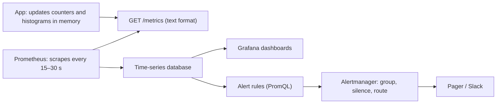

# Monitoring

> **Module 02 · Core Backend** · Prerequisites: [Error Handling](21-Error-Handling.md) · Next: [Observability Fundamentals](23-Observability-Fundamentals.md)

---

## ⏱ If You Only Have 2 Minutes

- Four metric types: **counter** (only goes up — requests, errors; query it with `rate()`), **gauge** (goes up and down — in-flight requests, queue depth, pool usage), **histogram** (counts per latency bucket; percentiles computed at query time), **summary** (percentiles computed inside the process).
- Google's **four golden signals**: latency, traffic, errors, saturation. **RED** (Rate, Errors, Duration) is the same idea for each service endpoint; **USE** (Utilization, Saturation, Errors) is for each resource — CPU, memory, connection pool, event loop.
- Watch **p95/p99, not the average**. An average of 120 ms can hide 1% of users waiting 4 s. You cannot average percentiles across instances; histograms let you add the buckets first and then compute p99, summaries do not.
- **SLI** = a measured ratio (good requests / all requests). **SLO** = the target (99.9% over 30 days). **Error budget** = what is left (0.1% ≈ 43 minutes of full outage per 30 days). Page on **burn rate** (for example 14.4× budget speed over 1 hour), not on single errors.
- **Alert on symptoms** users feel (error rate, latency), not causes (CPU at 80%). Causes go on dashboards for diagnosis.
- Every unique combination of label values is a separate time series. Label by **route template** (`/orders/:id`), never by user ID, order ID or raw URL.
- **Liveness** (`/healthz`): is the process alive? No dependency checks, or a database outage restarts every pod. **Readiness** (`/readyz`): should I get traffic now? Fails while starting, draining, or unable to reach a critical dependency.

---

## 1. What It Is and Why It Exists

**Monitoring** is collecting numeric measurements from your service at regular intervals, storing them as **time series** (value over time), drawing them on dashboards and alerting when they cross a threshold. It answers questions you decided on in advance: "How many requests per second? How many fail? How slow is the slowest 1%? Is anything running out?"

**Analogy:** a car dashboard. The speedometer (traffic), the warning light (errors), the trip timer (latency) and the fuel gauge (saturation) are cheap, always on, and readable at a glance. They do not tell you *why* the engine light is on — for that a mechanic plugs in a diagnostic tool, which is [observability](23-Observability-Fundamentals.md).

**What breaks without it:** you learn about outages from customers on social media. You cannot say whether last week's deploy made checkout slower. You scale up servers because "it feels slow" when the real bottleneck is a 10-connection database pool.

The classic first list — **latency, throughput, error rate, resource usage**, plus "log request durations, flag slow endpoints, track recurring errors, add a health-check route" — is the right instinct. This chapter turns each item into its proper tool:

| Starting idea | Proper tool |
|---|---|
| Latency, "flag slow endpoints" | Duration **histogram** per route → p50/p95/p99 per route |
| Throughput | Request **counter** → `rate()` = requests per second (Traffic / Rate) |
| Error rate | Same counter split by status → 5xx ratio (Errors) |
| Resources | **Gauges** for CPU, memory, pool usage, event-loop lag (Saturation / USE) |
| "Track recurring errors" | Error counter by `code` from the global error handler |
| "Health check route" | Separate **liveness** and **readiness** endpoints |

---

## 2. How It Works

### The Prometheus pull model



1. Your code keeps metrics **in memory**: incrementing a counter is a few nanoseconds, with no network call per request.
2. The app exposes everything at `GET /metrics` in a plain-text format.
3. Prometheus (or a compatible agent) **scrapes** that endpoint on a schedule and stores each sample with a timestamp.
4. Dashboards and alert rules query the stored series with **PromQL**.

A scrape of the histogram from Section 4 looks like this. Buckets are **cumulative**: `le="0.25"` counts every request that took at most 0.25 s.

```text
# HELP http_request_duration_seconds Time to serve an HTTP request
# TYPE http_request_duration_seconds histogram
http_request_duration_seconds_bucket{method="POST",route="/orders",status_code="201",le="0.1"} 912
http_request_duration_seconds_bucket{method="POST",route="/orders",status_code="201",le="0.25"} 1340
http_request_duration_seconds_bucket{method="POST",route="/orders",status_code="201",le="0.5"} 1391
http_request_duration_seconds_bucket{method="POST",route="/orders",status_code="201",le="+Inf"} 1400
http_request_duration_seconds_sum{method="POST",route="/orders",status_code="201"} 171.3
http_request_duration_seconds_count{method="POST",route="/orders",status_code="201"} 1400
```

### The queries you actually need

```promql
# Traffic: requests per second per route
sum by (route) (rate(http_request_duration_seconds_count[5m]))

# Errors: share of requests that returned 5xx
sum(rate(http_request_duration_seconds_count{status_code=~"5.."}[5m]))
  / sum(rate(http_request_duration_seconds_count[5m]))

# Latency: p99 per route, across ALL instances (add buckets first, then compute the quantile)
histogram_quantile(0.99,
  sum by (le, route) (rate(http_request_duration_seconds_bucket[5m])))

# Latency SLI: share of requests faster than 500 ms (exact because 0.5 is a bucket edge)
sum(rate(http_request_duration_seconds_bucket{le="0.5"}[5m]))
  / sum(rate(http_request_duration_seconds_count[5m]))
```

`rate()` turns an ever-growing counter into "per second over the last 5 minutes" and handles counter resets when a process restarts. The `_count` series of a histogram is itself a request counter, so you rarely need a separate `http_requests_total`. `histogram_quantile` interpolates inside a bucket, so its accuracy depends on your bucket edges — put an edge at your SLO threshold.

---

## 3. Key Concepts

### Metric types

| Type | Behaviour | Examples | Query with | Pitfall |
|---|---|---|---|---|
| Counter | Only increases (resets to 0 on restart) | Requests, errors by `code`, bytes sent, jobs processed | `rate()`, `increase()` | Never graph the raw value; never use a gauge for counts |
| Gauge | Goes up and down | In-flight requests, queue depth, pool connections in use, memory | Value, `max_over_time()` | Sampled every scrape — spikes between scrapes are missed |
| Histogram | Counts observations into fixed buckets, plus `_sum` and `_count` | Request duration, payload size | `histogram_quantile()` over `rate(..._bucket)` | Bucket edges set accuracy; each bucket is a series |
| Summary | Computes chosen quantiles (e.g. p99) inside the process over a sliding window | Latency in a single process | Read the quantile directly | **Cannot be aggregated** across instances; Python's client exports only `_sum`/`_count`, no quantiles |

### Golden signals, RED and USE

| Framework | Applies to | Signals | Backend examples |
|---|---|---|---|
| Four golden signals (Google SRE book) | A user-facing service | Latency, Traffic, Errors, Saturation | p99 of `POST /checkout`; RPS; 5xx ratio; pool usage |
| RED (Tom Wilkie) | Each service / endpoint | Rate, Errors, Duration | Same as the first three golden signals, per route |
| USE (Brendan Gregg) | Each resource | Utilization, Saturation, Errors | DB pool: % busy, callers waiting for a connection, connection errors |

**Saturation** is "how full is the most constrained resource, and is work queueing?" For backends the best saturation signals are usually not CPU:

- **Node:** event-loop lag (`nodejs_eventloop_lag_seconds` from `prom-client`'s default metrics). If the loop is blocked for 200 ms, every request waits 200 ms.
- **FastAPI:** plain `def` endpoints run on AnyIO's thread pool (40 threads by default). When all 40 are busy, requests queue invisibly.
- **Both:** DB connection pool waiters, queue depth and age of the oldest message, memory close to the container limit.

### Percentiles, and why histograms aggregate

A **percentile** p99 = 250 ms means 99% of requests finished in 250 ms or less. Averages hide the tail: if 99 requests take 100 ms and one takes 10 s, the average is ~200 ms, which matches no real user. Tail latency matters more than it looks: a page that makes 20 backend calls hits at least one p99-slow call about 18% of the time (1 − 0.99²⁰).

Ten instances each report their own p99. The fleet-wide p99 is **not** the average of the ten — percentiles are not additive. A **histogram** exports bucket *counts*, and counts are additive: sum the buckets across all instances, then compute the quantile once (the `sum by (le)` in the query above). A **summary** has already turned its data into a percentile inside each process, so the raw counts are gone and there is no correct way to combine them. Use histograms for anything served by more than one instance.

### SLI, SLO, error budget and burn rate

- **SLI** (service level indicator): a ratio of good events to valid events. "Share of `POST /checkout` requests that return non-5xx in under 500 ms."
- **SLO** (objective): the target for the SLI over a window. "99.9% over 30 days."
- **SLA** (agreement): a contract with customers, with penalties. Set it looser than your SLO.
- **Error budget**: `1 − SLO`. At 99.9% over 30 days that is 0.1% of requests, or **43.2 minutes** of total outage. While budget remains, ship features; when it is spent, prioritise reliability.
- **Burn rate**: how fast you spend the budget. Burn rate 1 spends exactly the budget in 30 days. Burn rate 14.4 sustained for 1 hour spends 2% of a 30-day budget.

The Google SRE Workbook's multi-window alerts for a 99.9% SLO:

| Severity | Burn rate | Long window | Short window | Budget spent when it fires |
|---|---|---|---|---|
| Page | 14.4× | 1 h | 5 min | 2% |
| Page | 6× | 6 h | 30 min | 5% |
| Ticket | 1× | 3 days | 6 h | 10% |

The short window makes the alert stop quickly once the problem is fixed.

```promql
# Page: error ratio over 1h AND over 5m are both above 14.4 × 0.1%
(
  sum(rate(http_request_duration_seconds_count{route="/checkout",status_code=~"5.."}[1h]))
    / sum(rate(http_request_duration_seconds_count{route="/checkout"}[1h])) > 14.4 * 0.001
)
and
(
  sum(rate(http_request_duration_seconds_count{route="/checkout",status_code=~"5.."}[5m]))
    / sum(rate(http_request_duration_seconds_count{route="/checkout"}[5m])) > 14.4 * 0.001
)
```

### Alert on symptoms, not causes

| Symptom alert (page) | Cause signal (dashboard, maybe a ticket) |
|---|---|
| Checkout error budget burning 14× | One pod's CPU at 90% |
| p99 of `POST /orders` > 1 s for 10 min | DB pool 100% used |
| Oldest message in the email queue > 15 min | Worker restarted |

Users do not feel "CPU 90%". They feel errors and slowness. Cause-based pages fire when nothing is wrong (a batch job uses CPU at night) and stay silent for failures you did not predict. Every page should be **actionable** and have a runbook link.

### Label cardinality

Each unique label set is one time series in memory. The histogram in Section 4 has 10 bucket edges, so each label set produces 13 series: 10 buckets + the `+Inf` bucket + `_sum` + `_count`. Then:

```text
5 methods × 40 routes × 6 status codes × 13 series ≈ 15,600 series per instance
× 30 instances                                       ≈ 468,000 series
add user_id with 100,000 active users                → tens of billions: Prometheus falls over
```

Rules: labels come from **small, bounded sets** (method, route template, status code or class, error `code`). User IDs, order IDs, emails and raw paths belong in logs and traces, which are built for high cardinality.

### Health checks

| Probe | Question | Should check | Should not check | On failure |
|---|---|---|---|---|
| Liveness `/healthz` | Is the process stuck or dead? | That the server can answer at all | Database, cache, other services | Orchestrator **restarts** the container |
| Readiness `/readyz` | Should this instance receive traffic now? | Startup finished, not draining, critical dependency reachable | Non-critical dependencies | Instance is **removed** from the load balancer; not restarted |
| Startup (Kubernetes) | Has a slow-starting app finished booting? | Same as readiness | — | Liveness is not checked until it passes |

If liveness checks the database, a 30-second database blip restarts every pod at once — turning a small incident into a full outage. Even readiness should be careful with shared dependencies: if *every* pod becomes unready because the database is down, the load balancer has nowhere to send traffic, and clients get connection errors instead of a clear `503`.

---

## 4. Code Examples

Scenario: record RED metrics for every route with a duration histogram labelled by route template, track in-flight requests, expose `/metrics`, and serve separate liveness and readiness probes.

### Node.js / TypeScript

```ts
// npm i express prom-client   — Node.js 22+, TypeScript 5, ESM
import express, { type Request, type Response, type NextFunction } from "express";
import client from "prom-client";

// CPU, memory, heap, GC and nodejs_eventloop_lag_seconds: the USE view of this process.
client.collectDefaultMetrics();

const httpDuration = new client.Histogram({
  name: "http_request_duration_seconds",
  help: "Time to serve an HTTP request",
  labelNames: ["method", "route", "status_code"] as const,
  // An edge at the SLO threshold (0.5 s) makes "share of requests under 500 ms" exact.
  buckets: [0.01, 0.025, 0.05, 0.1, 0.25, 0.5, 1, 2.5, 5, 10],
});
const inFlight = new client.Gauge({ name: "http_requests_in_flight", help: "Requests being served now" });

function recordMetrics(req: Request, res: Response, next: NextFunction): void {
  const stopTimer = httpDuration.startTimer();
  inFlight.inc();
  res.once("close", () => { // fires for finished and aborted responses, so the gauge never leaks
    inFlight.dec();
    // Route template ("/orders/:id"), never req.path: one series per route, not one per order.
    const route = req.route ? `${req.baseUrl}${req.route.path}` : "unmatched";
    stopTimer({ method: req.method, route, status_code: String(res.statusCode) });
  });
  next();
}

declare const db: { ping(): Promise<void> }; // e.g. () => pool.query("SELECT 1")
const withTimeout = <T>(p: Promise<T>, ms: number): Promise<T> =>
  Promise.race([p, new Promise<never>((_, reject) => setTimeout(() => reject(new Error("timeout")), ms))]);

let draining = false;
const app = express();

// Registered before the middleware, so scrapes and probes do not count as user traffic.
app.get("/metrics", async (_req, res) => {
  res.set("Content-Type", client.register.contentType);
  res.send(await client.register.metrics());
});
app.get("/healthz", (_req, res) => {
  res.status(200).json({ status: "ok" }); // liveness: no dependency checks
});
app.get("/readyz", async (_req, res) => {
  if (draining) {
    res.status(503).json({ status: "draining" });
    return;
  }
  try {
    await withTimeout(db.ping(), 1000);
    res.status(200).json({ status: "ready" });
  } catch {
    res.status(503).json({ status: "db_unreachable" });
  }
});

app.use(recordMetrics);
app.get("/orders/:id", (req, res) => {
  res.status(200).json({ id: req.params.id });
});

const server = app.listen(3000);
process.on("SIGTERM", () => {
  draining = true;                        // fail readiness so the load balancer stops sending traffic
  setTimeout(() => server.close(), 5000); // removal from endpoints is asynchronous; keep serving meanwhile
});
```

### Python

```python
# pip install fastapi uvicorn prometheus-client   — Python 3.12+
import asyncio
import time

from fastapi import FastAPI, Request, Response
from prometheus_client import CONTENT_TYPE_LATEST, Gauge, Histogram, generate_latest

REQUEST_DURATION = Histogram(
    "http_request_duration_seconds", "Time to serve an HTTP request",
    ["method", "route", "status_code"],
    buckets=(0.01, 0.025, 0.05, 0.1, 0.25, 0.5, 1, 2.5, 5, 10),  # edge at the 0.5 s SLO threshold
)
IN_FLIGHT = Gauge("http_requests_in_flight", "Requests being served now")
NOT_TRAFFIC = {"/metrics", "/healthz", "/readyz"}

app = FastAPI()


@app.middleware("http")
async def record_metrics(request: Request, call_next):
    if request.url.path in NOT_TRAFFIC:
        return await call_next(request)
    start, status = time.perf_counter(), 500  # an exception escaping call_next is a 500 to the client
    IN_FLIGHT.inc()
    try:
        response = await call_next(request)
        status = response.status_code
        return response
    finally:
        IN_FLIGHT.dec()
        # After routing, scope["route"] is the matched route; .path is the template "/orders/{order_id}".
        route = getattr(request.scope.get("route"), "path", "unmatched")
        REQUEST_DURATION.labels(request.method, route, str(status)).observe(time.perf_counter() - start)


@app.get("/metrics")
def metrics() -> Response:
    return Response(generate_latest(), media_type=CONTENT_TYPE_LATEST)


@app.get("/healthz")
async def healthz() -> dict:
    return {"status": "ok"}  # liveness: no dependency checks


async def ping_db() -> None:
    """Stand-in for `await pool.execute("SELECT 1")` with your real driver."""
    await asyncio.sleep(0)


@app.get("/readyz")
async def readyz(response: Response) -> dict:
    try:
        async with asyncio.timeout(1):  # a hanging dependency must not hang the probe
            await ping_db()
    except (TimeoutError, OSError):
        response.status_code = 503
        return {"status": "db_unreachable"}
    return {"status": "ready"}


@app.get("/orders/{order_id}")
async def get_order(order_id: str) -> dict:
    return {"id": order_id}
```

**Runtime differences to notice:**

- **Process model.** A Node service is usually one process per container, so one in-memory registry holds everything. Python apps often run several worker processes (`gunicorn -w 4`, `uvicorn --workers 4`); each has its **own** registry, and a scrape reaches one random worker. Either run one worker per container, or use `prometheus_client`'s multiprocess mode (`PROMETHEUS_MULTIPROC_DIR` plus `MultiProcessCollector`). Node's `cluster` module has the same problem; `prom-client` offers `AggregatorRegistry` for it.
- **Saturation signal.** `prom-client` exports event-loop lag out of the box. Python's client exports process CPU and memory (on Linux) but nothing about the asyncio loop or the thread pool; add a gauge yourself if those are your bottleneck.
- **Naming.** Python's `Counter("orders", ...)` is exported as `orders_total` automatically; `prom-client` uses the name exactly as given, so include `_total` yourself.

---

## 5. Production Concerns

- **Protect `/metrics`.** It reveals routes, versions and traffic levels. Serve it on an internal port or block it at the ingress; do not expose it to the internet.
- **Rate windows vs scrape interval.** A `rate()` window must cover several scrapes (a common rule is at least 4× the scrape interval) or it returns gaps. With a 30 s scrape, use `[2m]` or longer.
- **Choose buckets deliberately.** The default buckets (5 ms to 10 s) fit typical web latency. If your SLO is 300 ms, add a 0.3 edge. Every extra bucket multiplies series by label combinations.
- **Missing data is not "zero errors".** If a pod stops reporting, error-rate queries may look healthy. Alert on `up == 0` (the scrape itself failing) and on absent series for critical jobs.
- **Graceful shutdown.** On `SIGTERM`, fail readiness, keep serving for a few seconds while load balancers notice (a Kubernetes `preStop` sleep does the same), then stop accepting connections and drain.
- **Batch jobs and cron.** A job that runs for 20 seconds may finish before it is ever scraped. Push its final metrics to a Prometheus Pushgateway, or record `last_success_timestamp` and alert when it is too old.
- **Synthetic checks.** Internal metrics cannot see a broken DNS record or an expired TLS certificate. Add an external probe that calls a real endpoint from outside your network.
- **Infrastructure view.** CloudWatch, managed Prometheus and dashboards at the platform level are covered in [Module 10 · Monitoring](../Module-10-DevOps-and-Cloud/35-Monitoring.md) and [CloudWatch](../Module-10-DevOps-and-Cloud/33-CloudWatch.md).

---

## 6. Common Mistakes

- **Labelling with `req.path` or user IDs** — `/orders/123`, `/orders/124`… create a new series per value until Prometheus runs out of memory — use the route template and bounded labels; put IDs in logs and traces.
- **Graphing averages** — a healthy-looking mean hides a slow tail that real users hit — graph p50, p95 and p99 from histograms.
- **Averaging per-instance p99s, or using summaries across a fleet** — the result is mathematically meaningless — use histograms and `histogram_quantile` over summed buckets.
- **Checking dependencies in liveness** — a database blip causes every pod to restart at once — keep liveness trivial; put dependency checks (carefully) in readiness.
- **Paging on causes** — CPU and memory alerts wake people for harmless spikes and miss unknown failures — page on SLO burn rate and user-facing latency; keep causes on dashboards.
- **Using a gauge for counts** — "requests in the last minute" stored as a gauge loses data between scrapes and across restarts — use a counter and `rate()`.
- **Counting health checks and scrapes as traffic** — probes every few seconds inflate RPS and hide low real traffic — exclude them from request metrics.

---

## 7. Comparison Table

| | Pull (Prometheus scrapes `/metrics`) | Push (StatsD, OTLP metrics, CloudWatch `PutMetricData`) |
|---|---|---|
| Who sends | Monitoring server fetches from each target | App sends to a collector or backend |
| Knowing a target is down | Built in: the scrape fails, `up == 0` | Needs a separate "no data received" alert |
| Short-lived jobs | Awkward: may finish before a scrape; needs Pushgateway | Natural: push before exit |
| Behind NAT / serverless | Hard: the server must reach the target | Easy |
| Aggregation | Raw counters/buckets stored; aggregate at query time | Often pre-aggregated by an agent (StatsD) — percentiles may be lost |
| Typical stack | Prometheus + Grafana + Alertmanager | Datadog agent, CloudWatch, OpenTelemetry Collector |

The OpenTelemetry metrics SDK can do either: expose a Prometheus endpoint or push over OTLP. The metric types and the RED/USE thinking stay the same.

---

## 8. Interview Questions

**[Junior] What is the difference between a counter and a gauge?**
A counter only increases (and resets to zero when the process restarts): requests served, errors, bytes sent. You query it with `rate()` to get "per second". A gauge is a current value that can go up or down: requests in flight, queue depth, connections in use. Using a gauge for something that should be counted loses events between scrapes.

**[Junior] What are the four golden signals?**
Latency (how long requests take, measured as percentiles, and separately for successes and failures), traffic (requests per second), errors (rate of failed requests), and saturation (how full the most constrained resource is — connection pool, event loop, memory). They come from Google's SRE book. RED covers the first three per endpoint; USE covers resources.

**[Mid] Why p99 instead of average latency?**
The average blends fast and slow requests into a number no user experiences, and a small slow tail barely moves it. p99 shows the experience of the slowest 1% of requests, which is often where queueing, lock contention or a slow dependency first appears. Pages that call many backends hit the tail often, so p99 of a backend becomes the typical experience of the page.

**[Mid] Liveness vs readiness — what goes in each?**
Liveness asks "is this process hopelessly stuck?" and its failure triggers a restart, so it should only check that the server can respond. Readiness asks "should I receive traffic now?" and its failure only removes the instance from the load balancer; it fails during startup, during graceful shutdown, and when a critical dependency is unreachable. Putting the database check into liveness causes mass restarts during a short database outage.

**[Mid] Why should you not label a metric with the user ID?**
Each distinct label value creates a new time series, held in memory by the monitoring system and stored separately. User IDs, order IDs or raw URLs are unbounded, so series count grows with your user base until queries slow down and the server runs out of memory. Use bounded labels (route template, status class, error code) and put IDs in logs and traces, which are designed for high-cardinality data.

**[Senior] Ten instances each export a summary with p99. How do you get the p99 for the whole service?**
You cannot get it correctly: percentiles are not additive, and the summary has already discarded the counts needed to recombine them. Averaging the ten values gives a number that can be far from the true p99, especially when instances receive different traffic. Switch to a histogram: each instance exports cumulative bucket counts, you `sum by (le)` across instances, and `histogram_quantile(0.99, ...)` computes one fleet-wide value, accurate to the bucket resolution.

**[Senior] Design alerting for a checkout service with a 99.9% availability SLO.**
Define the SLI as non-5xx responses (excluding client errors) divided by all requests to checkout routes, from the server-side histogram or load-balancer metrics. The error budget is 0.1%, about 43 minutes per 30 days. Page on multi-window burn rate — for example 14.4× over 1 h confirmed by 5 min, and 6× over 6 h confirmed by 30 min — and open a ticket for 1× over 3 days. Add a latency SLO the same way using the bucket at the threshold. Keep CPU, pool and queue metrics on the dashboard for diagnosis, not as pages, and link a runbook from each alert.

**[Senior] Dashboards look green, but users report errors. What could be wrong?**
The metrics may not see the failure: errors happen before requests reach the app (DNS, TLS, load balancer, CDN), the failing instances stopped reporting so their errors vanished from the ratio, or the error is a `200` with a wrong body. Averages or wide time windows can also hide a short or partial outage. Fixes: alert on scrape failures and missing data, add load-balancer and synthetic external checks, measure business outcomes (orders completed per minute), and slice by version and region.

---

## 9. Cheat Sheet

```text
Types         counter ↑ (rate) | gauge ↕ | histogram (buckets, aggregatable) | summary (per-process quantiles, not aggregatable)
Golden        latency, traffic, errors, saturation
RED / USE     services: rate, errors, duration | resources: utilization, saturation, errors
Saturation    Node event-loop lag; FastAPI thread pool (40); DB pool waiters; queue age
p99           histogram_quantile(0.99, sum by (le, route) (rate(x_bucket[5m])))
Error ratio   sum(rate(x_count{status_code=~"5.."}[5m])) / sum(rate(x_count[5m]))
Percentiles   never average them; sum buckets, then compute
Buckets       put an edge at the SLO threshold
SLO math      99.9% / 30 days = 43.2 min budget; burn 14.4× for 1 h = 2% budget
Alerts        page on symptoms (burn rate, p99); causes on dashboards; every page has a runbook
Labels        bounded only: method, route template, status, error code — never IDs or raw paths
Probes        /healthz = alive, no deps → restart | /readyz = ready, draining, critical deps → remove from LB
Multi-worker  Python: one registry per process → multiprocess mode or 1 worker/container
```

---

## Related Topics

- [Observability Fundamentals](23-Observability-Fundamentals.md) — tracing and logs for the questions metrics cannot answer
- [Error Handling](21-Error-Handling.md) — where error codes for the error counter come from
- [Node Event Loop and Concurrency](06-Node-Event-Loop-and-Concurrency.md) — why event-loop lag is Node's key saturation signal
- [Cron Jobs](18-Cron-Jobs.md) — monitoring jobs that finish before a scrape
- [Monitoring (Module 10)](../Module-10-DevOps-and-Cloud/35-Monitoring.md) — the infrastructure and platform view
- [CloudWatch](../Module-10-DevOps-and-Cloud/33-CloudWatch.md) — the AWS-managed push-based alternative
