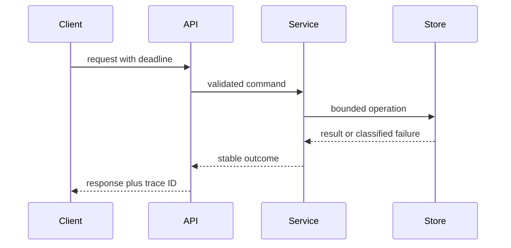
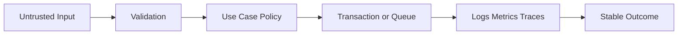

# Observability Fundamentals

---

# ⏱ If You Only Have 2 Minutes

- Observability lets you ask new questions from emitted evidence.
- Metrics aggregate trends; logs preserve events; traces show a request path.
- High-cardinality labels can make metrics systems fail or become unaffordable.
- Context propagation is required to connect distributed work.
- In an interview, state the invariant, failure mode, trade-off, and how you would observe it.

---

# Simple Explanation

Observability Fundamentals exists because backend systems need a predictable way to handle **logs, metrics, traces, context propagation, cardinality, sampling, and unknown unknowns**. Think of it as a rulebook: it tells the team what is allowed, what must be protected, and what to do when the normal path fails. The important question is not “can I use this tool?” but “what problem does it prevent in production?”

---

# 1. What is it?

Observability Fundamentals is the set of design rules and runtime behavior around logs, metrics, traces, context propagation, cardinality, sampling, and unknown unknowns. Its purpose is to keep a request or background operation understandable when traffic grows, clients retry, dependencies slow down, and multiple engineers change the same system.

**Why it matters:** interviewers look for engineers who can connect a definition to a concrete invariant. An invariant is a fact that must remain true, such as “one payment is charged once” or “an unauthorized user cannot read another tenant’s data.”

# 2. Why do we need it?

Without a deliberate approach, the happy path may work while production fails:

- A client times out and retries, creating duplicate work.
- A dependency is slow and exhausts all request workers.
- A new deployment changes an implicit contract.
- An incident cannot be explained because logs and metrics lack context.

For Observability Fundamentals, write down the expected outcome, owner, timeout, retry behavior, durable boundary, and measurement before implementation. This is simpler than retrofitting safety after a customer-visible failure.

# 3. How does it work?

1. **Accept input at a boundary.** Parse and validate untrusted values early.
2. **Apply policy.** Authenticate, authorize, enforce business rules, and decide whether the work is synchronous.
3. **Use a bounded dependency.** Set a deadline, size limit, connection limit, or queue limit.
4. **Make the result durable when needed.** Database constraints and transactions protect state; queues/outboxes protect deferred effects.
5. **Return or publish a classified outcome.** Callers need stable success, validation, conflict, and retryable-failure semantics.
6. **Emit evidence.** A request ID, trace ID, duration, outcome, and safe domain identifiers make later diagnosis possible.



# 4. Internal Workflow

Internally, the key is separating **policy** from **mechanism**. The transport layer should understand HTTP or a queue message. The application layer should understand the use case. The data layer should protect storage invariants. Infrastructure should provide clients, pools, and telemetry.



The dangerous part is usually the gap between two steps: a request may be retried after a timeout, a database may commit before a message is published, or a process may stop halfway through cleanup. Design that gap explicitly.

# 5. Important Concepts

## Invariant
The rule that must stay true. Write it in plain language before selecting a pattern.

## Boundary
The place where input is validated and internal failures become a stable external contract.

## Idempotency
Repeating an operation produces the same intended effect. This is essential for retried writes and at-least-once messages.

## Time budget
Every remote call needs a deadline. A timeout is not merely an error setting; it limits resource consumption and controls tail latency.

## Observability
Logs explain events, metrics show trends, and traces show one request path. None replaces the others.

# 6. Real Backend Examples

```python
from fastapi import HTTPException

async def perform(command, repository, request_id: str):
    # The service owns the business outcome, not HTTP serialization.
    existing = await repository.get_idempotency_result(command.key)
    if existing:
        return existing
    try:
        return await repository.execute(command, request_id)
    except TimeoutError as exc:
        # Translate only at the boundary; callers receive a stable retryable outcome.
        raise HTTPException(503, "dependency temporarily unavailable") from exc
```

The production concern is not the syntax. The repository must enforce the relevant unique constraint or transaction rule, and the caller must have a bounded retry policy. Add structured logs with `request_id`, outcome, duration, and safe IDs; never include credentials or full sensitive payloads.

| Choice | Good when | Main risk |
|---|---|---|
| Synchronous work | Caller needs an immediate answer | Cascading latency and coupling |
| Queue/worker | Work is slow or retryable | Duplicate delivery and delayed result |
| Process-local state | One process owns the state | Breaks across replicas/restarts |
| Durable store | Cross-process correctness matters | Latency and operational cost |

# 7. Common Mistakes

- **Treating framework defaults as policy.** Defaults rarely match your timeout, auth, or error-contract needs.
- **Retrying every exception.** Validation, conflicts, and non-idempotent effects should not be blindly retried.
- **Holding a transaction while calling another service.** It increases lock duration and creates deadlock/latency risk.
- **Logging a secret to help debugging.** Secrets spread faster than incidents end.
- **Measuring only averages.** Queueing and slow dependencies show up in p95/p99 first.

# 8. Comparison Table

| Question | Weak answer | Strong answer |
|---|---|---|
| “How does it work?” | Names a library or pattern | Explains flow, invariant, and failure boundaries |
| “How does it scale?” | “Add servers” | Describes state ownership, limits, backpressure, and hot keys |
| “How do you retry?” | “Retry three times” | Classifies errors, checks idempotency, uses deadlines and jitter |
| “How do you debug?” | “Read logs” | Correlates logs, metrics, traces, deploy changes, and dependency timing |

# 9. Things I Must Remember

- Observability lets you ask new questions from emitted evidence.
- Metrics aggregate trends; logs preserve events; traces show a request path.
- High-cardinality labels can make metrics systems fail or become unaffordable.
- Context propagation is required to connect distributed work.
- Design the unhappy path before the happy path becomes public.
- Keep resource use bounded: time, memory, connections, queue depth, and retries.
- Make security checks explicit at the boundary and authorization specific to the resource.
- Prefer a database constraint over a race-prone application check for shared durable data.
- Use stable machine-readable errors; keep diagnostic detail inside the service.
- Test timeout, retry, restart, duplicate, and concurrent paths.
- Deploy compatible changes progressively and keep rollback practical.
- Document the owner, SLO, alert, and runbook for important behavior.

# 10. Interview Questions

**Q: What problem does Observability Fundamentals solve?**  
It protects a stated invariant around logs, metrics, traces, context propagation, cardinality, sampling, and unknown unknowns, especially when requests overlap, retry, or fail partially.

**Q: What would you monitor?**  
Traffic, errors by class, p50/p95/p99 latency, saturation, dependency timing, queue age where applicable, and a business outcome tied to the invariant.

**Q: What is the senior-level trade-off?**  
Choose the minimum coordination and abstraction that preserves correctness. Stronger consistency, global availability, and more layers all cost latency, complexity, or operational work.

# 11. Cheat Sheet

- State the invariant first.
- Validate untrusted input at the boundary.
- Authenticate identity; authorize the action.
- Propagate deadlines.
- Bound retries and add jitter.
- Make retried writes idempotent.
- Use durable constraints for durable invariants.
- Keep transactions short.
- Separate request latency from background work.
- Measure tail latency and saturation.
- Use structured, redacted logs.
- Propagate trace context.
- Avoid high-cardinality metric labels.
- Test failure paths.
- Deploy progressively.
- Keep rollback and recovery documented.

## Deep Interview Drill

Before an interview, rehearse this topic with one realistic story. Start with the user action and name the invariant. Draw the request path and mark where input becomes trusted, where a timeout applies, and where the state becomes durable. Then introduce a failure: the client retries, a dependency is slow, a worker restarts, or two requests overlap. Explain what prevents corruption and what the user sees while recovery happens.

Next, challenge the first design. Ask whether a database constraint is safer than an application check, whether a queue is better than a synchronous dependency, and whether extra abstraction makes the policy clearer or merely hides it. Finish with evidence: the integration test that protects the bug, the metric that detects impact, the trace that identifies the slow hop, and the runbook action that restores service. This pattern turns a definition into a senior-level answer. Name the bound, the owner, the failure class, the observable signal, and the recovery decision; those details make an answer concrete and credible.

## Related Topics

Study these next:

- [Monitoring](22-Monitoring.md)
- [SOLID Principles](24-SOLID Principles.md)
- [Logging](20-Logging.md)
- [Error Handling](21-Error Handling.md)
