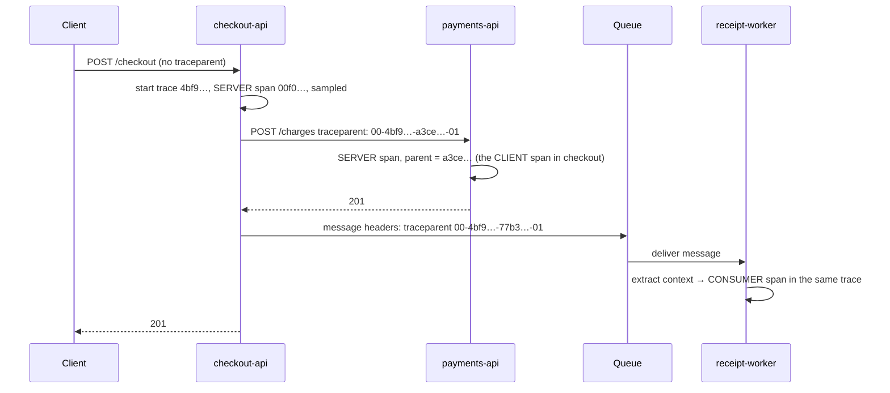
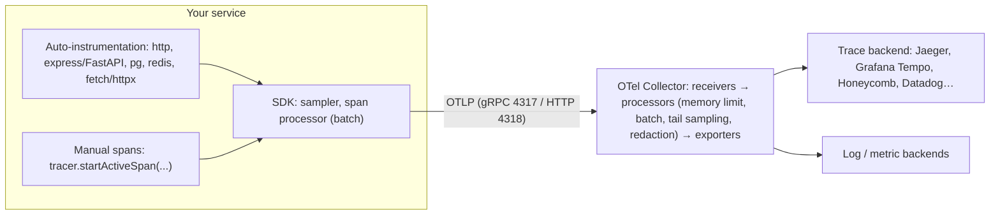

# Observability Fundamentals

> **Module 02 · Core Backend** · Prerequisites: [Monitoring](22-Monitoring.md) · Next: [SOLID Principles](24-SOLID-Principles.md)

---

## ⏱ If You Only Have 2 Minutes

- **Monitoring** answers questions you planned in advance ("is the error rate above 1%?"). **Observability** is being able to answer *new* questions from the data you already emit ("why are only enterprise customers with large carts slow, and only since 14:02?") without shipping new code.
- The three pillars: **metrics** (cheap, aggregated, no detail), **logs** (detailed, but disconnected from each other), **traces** (one request's path across services). Each alone has blind spots; the value comes from **linking** them — `trace_id` in every log line, exemplars from metrics to traces.
- A **trace** is a tree of **spans**. Each span has a name, start and end time, a parent, **attributes** (key/value facts), **events** (timestamped points inside it) and a status.
- Context crosses process boundaries in the **W3C `traceparent` header**: `00-<32-hex trace-id>-<16-hex parent span-id>-<2-hex flags>`, where flag `01` means "sampled".
- **OpenTelemetry** (OTel) is the vendor-neutral standard: an API, SDKs, auto-instrumentation for HTTP/DB/queue libraries, the **OTLP** protocol, and the **Collector**, which receives, processes and forwards telemetry to any backend.
- **Head sampling** decides at the start of a trace (cheap, but blind to the outcome). **Tail sampling** decides after the trace finishes, in the Collector, so it can keep all errors and slow traces (more memory and infrastructure).
- High-cardinality attributes (user ID, cart ID, build version) are **forbidden in metric labels but valuable on spans** — they are what let you slice a slow request population and find what the slow ones have in common.

---

## 1. What It Is and Why It Exists

**Observability** is a property of a system: how well you can understand what is happening inside it by looking only at what it outputs. The term comes from control theory. For a backend, the outputs are telemetry — metrics, logs and traces — and a system is observable when an engineer can explain a new, never-seen-before failure using that telemetry, without adding print statements and redeploying.

**Analogy:** a parcel-tracking system. The warehouse dashboard (monitoring) shows "parcels per hour" and "late deliveries: 3%". When a customer asks "where is *my* parcel, and why is it late?", you need the scan history of that one parcel — each depot, each handover, each delay — which is a trace. And when you notice that all late parcels went through the same depot on Tuesday, you are slicing by a high-cardinality attribute.

**The problem it solves.** A single request to `POST /checkout` may touch an API gateway, the checkout service, inventory, payments, Postgres, Redis and a queue. Metrics tell you checkout p99 rose from 400 ms to 2.4 s ([chapter 22](22-Monitoring.md)). Logs from seven services, each with their own timestamps, tell you many things happened. Neither tells you **where this particular request spent its 2.4 seconds** or **what slow requests have in common**. Distributed tracing, with rich attributes and links to logs, does.

---

## 2. How It Works

### Traces and spans

A **trace** represents one end-to-end operation (usually one incoming request). It is made of **spans**, each representing one unit of work, linked by parent IDs into a tree.

```text
trace_id 4bf92f3577b34da6a3ce929d0e0e4736                         0 s          1 s          2 s
POST /checkout              SERVER   checkout-api   [=================================================] 2.41 s
└─ checkout.place_order     INTERNAL checkout-api   [================================================ ] 2.39 s
   ├─ SELECT carts          CLIENT   postgres        [=]                                                0.01 s
   ├─ UPDATE inventory      CLIENT   postgres         [=]                                               0.02 s
   └─ POST /charges         CLIENT   checkout-api       [============================================ ] 2.31 s
      └─ POST /charges      SERVER   payments-api       [=========================================== ] 2.30 s
         ├─ pool.acquire    INTERNAL payments-api       [=====================================]         2.05 s
         └─ INSERT charges  CLIENT   postgres                                                [==]       0.04 s
```

Each span records:

| Field | Example | Purpose |
|---|---|---|
| `trace_id` (16 bytes) | `4bf92f35…0e4736` | Same for every span in the trace |
| `span_id` (8 bytes), `parent_span_id` | `00f067aa0ba902b7` | Builds the tree |
| Name | `POST /charges`, `checkout.place_order` | Low-cardinality operation name (no IDs in it) |
| Kind | `SERVER`, `CLIENT`, `INTERNAL`, `PRODUCER`, `CONSUMER` | Which side of a call this is |
| Start, end | Timestamps | Duration and the waterfall |
| Attributes | `http.route="/charges"`, `app.cart.item_count=212` | Facts you can filter and group by |
| Events | `payment.authorized` at t+2.35 s | Points in time inside the span; exceptions are recorded as events |
| Status | `OK` / `ERROR` (+ message) | Error traces can be found and kept |
| Links | Pointers to other traces | Batch consumers that process messages from many traces |

Attribute names follow OTel **semantic conventions** (`http.request.method`, `http.response.status_code`, `http.route`, `db.system`), so every backend and dashboard understands them. Your own attributes should use a namespace such as `app.`.

### Context propagation



**Inside a process**, the current span is held in async-local context — the same mechanisms as request IDs in [chapter 20](20-Logging.md): `AsyncLocalStorage` in Node (the Node SDK registers a context manager built on it) and `contextvars` in Python.

**Between processes**, a **propagator** writes the context into the carrier — HTTP headers, gRPC metadata or message headers — and the receiver reads it back. The default is [W3C Trace Context](https://www.w3.org/TR/trace-context/):

```text
traceparent: 00-4bf92f3577b34da6a3ce929d0e0e4736-00f067aa0ba902b7-01
             │  │                                │                └─ trace-flags: 01 = sampled
             │  │                                └─ parent-id: the caller's span (16 hex)
             │  └─ trace-id (32 hex, never all zeros)
             └─ version
tracestate:  vendor-specific key=value pairs (optional)
```

Separately, the W3C **`baggage`** header carries application key/values (for example `tenant=acme`) to every downstream service. Baggage is sent on every hop and is visible to every service, so never put secrets or personal data in it.

### The OpenTelemetry pipeline



- **API:** stable, vendor-neutral interfaces. Libraries depend only on the API; with no SDK installed it is a no-op.
- **SDK:** the implementation you configure once per service: resource (`service.name`, `service.version`), sampler, span processors, exporters.
- **Auto-instrumentation:** patches common libraries so every incoming request, outgoing HTTP call and DB query gets a span and propagates context with no code changes.
- **Collector:** a separate process (a sidecar, a per-node agent, or a central gateway). Apps send to it over **OTLP**; it batches, drops or samples, scrubs attributes and forwards to one or many backends. Changing vendor becomes a Collector config change, not an app redeploy.

### A worked investigation: "why is checkout slow?"

1. **Detect (metrics).** The burn-rate alert fires: `POST /checkout` p99 is 2.4 s against a 500 ms SLO. Metrics say *that* and *where (which route)*, not *why*.
2. **Find examples (traces).** Query traces: `service.name = checkout-api AND http.route = /checkout AND duration > 2s`, last 30 minutes. If your metrics backend supports **exemplars** (a sample trace ID attached to a histogram bucket), click straight from the latency graph to such a trace.
3. **Read the waterfall.** The trace above shows 2.05 s inside `pool.acquire` in `payments-api` — the request was waiting for a database connection, not running a query.
4. **Find what slow requests share (high-cardinality slicing).** Group slow vs fast traces by attribute. Every slow trace went through pods with `service.version = 2.7.0`, deployed at 14:02. Cart size, region and customer tier make no difference.
5. **Read the details (logs by `trace_id`).** Logs for one slow trace in `payments-api` show `pool_exhausted in_use=10 waiting=37`, and a new log line `fraud_check_started` *between* `BEGIN` and `COMMIT`.
6. **Explain and fix.** Version 2.7.0 calls an external fraud API while holding a DB connection inside a transaction, so 10 slow external calls exhaust the pool for everyone. Roll back now; later, move the external call outside the transaction.

Each signal answered one question: metrics *that*, traces *where*, attributes *which ones*, logs *what exactly*.

---

## 3. Key Concepts

### The three pillars and their limits

| Pillar | Strength | Limit |
|---|---|---|
| Metrics | Cheap, fast to query, reliable for alerting, long retention | Pre-aggregated: individual requests and high-cardinality detail are gone |
| Logs | Full detail of single events, any cardinality | Expensive at volume; lines from different services are hard to connect without a shared ID |
| Traces | Causality and timing across services; shows where time went | Usually sampled, so a specific request may be missing; only as good as the instrumentation and attributes |

Teams that treat the pillars as three separate tools ("logs in one product, metrics in another, traces somewhere else, no shared IDs") get three partial views. The fix is correlation:

- `trace_id` and `span_id` in **every log line** (pino gets them automatically from OTel's pino instrumentation; structlog via a small processor, shown in Section 4).
- **Exemplars** from metric buckets to trace IDs.
- The same **resource attributes** (`service.name`, `service.version`, `deployment environment`) on all three signals.

Continuous profiling (CPU and memory flame graphs over time) is often called a fourth signal; it explains *why code is slow* once a trace tells you *which code*.

### High-cardinality, wide events

**Cardinality** is the number of distinct values a field can have. `http.method` has a handful; `user.id` has millions. Metrics systems store one series per label combination, so high cardinality is forbidden there ([chapter 22](22-Monitoring.md)). Trace and event stores index each event instead, so high cardinality is cheap per event.

A **wide event** is one record per request per service with many fields: route, status, duration, user ID, tenant, cart size, feature flags, build version, region, DB time, cache hit. A server span with rich attributes is exactly that. With wide events, "slow requests all have `app.cart.item_count > 200` and the `new-pricing` flag on" is one query, even though nobody built a dashboard for it.

### Sampling

Tracing every request is often too expensive at high traffic. Sampling keeps a representative subset.

| | Head sampling | Tail sampling |
|---|---|---|
| When decided | When the root span starts | After the whole trace has finished |
| Where | In the SDK (`ParentBased(TraceIdRatioBased(0.1))`) | In the Collector (`tail_sampling` processor) |
| Can keep "all errors and all slow traces" | No — it decides before the outcome is known | Yes |
| Cost | Nearly free; unsampled spans are not recorded | Must buffer all spans of every trace for seconds; all spans of a trace must reach the same Collector instance |
| Consistency | `ParentBased` follows the caller's sampled flag, so traces are complete | Complete if routed by trace ID |

A common setup: the SDK sends 100% (or a high head rate) to a Collector tier, which keeps 100% of error traces, 100% of traces slower than the SLO threshold and a few percent of the rest. Also, standard env vars configure head sampling in every OTel SDK: `OTEL_TRACES_SAMPLER=parentbased_traceidratio`, `OTEL_TRACES_SAMPLER_ARG=0.1`.

### Manual vs automatic instrumentation

Auto-instrumentation gives you the technical shape of every request (HTTP, framework, DB, Redis, queue spans) for one-time setup. Manual spans add business meaning: `checkout.place_order` with attributes like cart size, tier and payment outcome. Instrument everything automatically, then add manual spans around the 5–10 operations you would want to see during an incident. A span around every function is noise and cost.

### Asynchronous work and messaging

When a request enqueues a job, inject the trace context into the **message headers**, and have the consumer extract it. A single message consumer usually creates a `CONSUMER` span as a child of the producer's span. A batch consumer handling 100 messages from 100 different traces cannot have 100 parents — it starts its own trace and adds **span links** to each producer's context.

---

## 4. Code Examples

Scenario: the checkout service exports traces over OTLP to a Collector, auto-instruments HTTP and database calls, wraps the business operation in a manual span with attributes and events, propagates context into a queued job, and puts `trace_id` into its logs.

### Node.js / TypeScript

```ts
// instrumentation.ts — npm i @opentelemetry/api @opentelemetry/sdk-node
//                       @opentelemetry/auto-instrumentations-node @opentelemetry/exporter-trace-otlp-http
// Load it BEFORE the app so the instrumentations can patch http, express, pg… as they are first required:
//   node --require ./dist/instrumentation.js dist/server.js   (CommonJS output; ESM needs OTel's loader hook)
// Standard env vars, read by every OTel SDK:
//   OTEL_SERVICE_NAME=checkout-api  OTEL_EXPORTER_OTLP_ENDPOINT=http://otel-collector:4318
//   OTEL_TRACES_SAMPLER=parentbased_traceidratio  OTEL_TRACES_SAMPLER_ARG=0.1
import { NodeSDK } from "@opentelemetry/sdk-node";
import { getNodeAutoInstrumentations } from "@opentelemetry/auto-instrumentations-node";
import { OTLPTraceExporter } from "@opentelemetry/exporter-trace-otlp-http";

const sdk = new NodeSDK({
  traceExporter: new OTLPTraceExporter(), // endpoint from env; spans are batched before export
  instrumentations: [
    getNodeAutoInstrumentations({
      "@opentelemetry/instrumentation-fs": { enabled: false }, // a span per file read is pure noise
    }),
  ],
});
sdk.start();

// Call from your graceful-shutdown path after server.close(): flushes spans still in the batch buffer.
export const shutdownTelemetry = (): Promise<void> => sdk.shutdown();
```

```ts
// checkout.ts — npm i express pino @opentelemetry/api
import express from "express";
import pino from "pino";
import { context, propagation, trace, SpanStatusCode } from "@opentelemetry/api";

const tracer = trace.getTracer("checkout-api");
const logger = pino(); // OTel's pino instrumentation adds trace_id and span_id to every line

interface Cart { id: string; itemCount: number; totalCents: number }
declare const carts: { load(id: string): Promise<Cart> };
declare const queue: { add(name: string, data: object): Promise<void> };

async function placeOrder(cartId: string, tier: string): Promise<string> {
  // One manual span for the business step; HTTP and DB calls inside get auto-instrumented child spans.
  return tracer.startActiveSpan("checkout.place_order", async (span) => {
    try {
      const cart = await carts.load(cartId);
      // High-cardinality values are fine here — never as metric labels.
      span.setAttributes({ "app.cart.id": cart.id, "app.cart.item_count": cart.itemCount, "app.customer.tier": tier });

      const res = await fetch("http://payments.internal/charges", { // instrumentation adds `traceparent`
        method: "POST",
        headers: { "content-type": "application/json" },
        body: JSON.stringify({ amountCents: cart.totalCents }),
      });
      if (!res.ok) throw new Error(`payments returned ${res.status}`);
      const { chargeId } = (await res.json()) as { chargeId: string };
      span.addEvent("payment.authorized", { "app.payment.charge_id": chargeId });

      // Queues are not auto-propagated everywhere: inject the context into the message ourselves.
      const otel: Record<string, string> = {};
      propagation.inject(context.active(), otel); // → { traceparent: "00-…-…-01" }
      await queue.add("send_receipt", { chargeId, otel });

      logger.info({ cartId, chargeId }, "order_placed");
      return chargeId;
    } catch (err) {
      span.recordException(err as Error);
      span.setStatus({ code: SpanStatusCode.ERROR, message: (err as Error).message });
      throw err;
    } finally {
      span.end(); // a span that is never ended is never exported
    }
  });
}

const app = express();
app.use(express.json());
app.post("/checkout", async (req, res) => {
  const chargeId = await placeOrder(req.body.cartId, req.body.tier ?? "standard");
  res.status(201).json({ chargeId });
});
app.listen(3000);
```

### Python

```python
# telemetry.py — pip install opentelemetry-sdk opentelemetry-exporter-otlp-proto-http
#                opentelemetry-instrumentation-fastapi opentelemetry-instrumentation-httpx
from fastapi import FastAPI
from opentelemetry import trace
from opentelemetry.exporter.otlp.proto.http.trace_exporter import OTLPSpanExporter
from opentelemetry.instrumentation.fastapi import FastAPIInstrumentor
from opentelemetry.instrumentation.httpx import HTTPXClientInstrumentor
from opentelemetry.sdk.resources import Resource
from opentelemetry.sdk.trace import TracerProvider
from opentelemetry.sdk.trace.export import BatchSpanProcessor
from opentelemetry.sdk.trace.sampling import ParentBased, TraceIdRatioBased


def setup_telemetry(app: FastAPI) -> TracerProvider:
    provider = TracerProvider(
        resource=Resource.create({"service.name": "checkout-api", "service.version": "1.8.2"}),
        # New traces: keep 10%. Traces started upstream: follow the caller's sampled flag.
        sampler=ParentBased(TraceIdRatioBased(0.1)),
    )
    # Exports from a background thread in batches, so requests never wait on the network.
    provider.add_span_processor(BatchSpanProcessor(OTLPSpanExporter()))  # endpoint from OTEL_EXPORTER_OTLP_ENDPOINT
    trace.set_tracer_provider(provider)
    FastAPIInstrumentor.instrument_app(app)  # SERVER span per request; reads incoming traceparent
    HTTPXClientInstrumentor().instrument()   # CLIENT span per call; injects traceparent
    return provider
```

```python
# main.py — pip install fastapi uvicorn httpx structlog   (plus the packages above)
from contextlib import asynccontextmanager

import httpx
import structlog
from fastapi import FastAPI
from opentelemetry import propagate, trace
from pydantic import BaseModel
from structlog.typing import EventDict, WrappedLogger

from telemetry import setup_telemetry


def add_trace_ids(_: WrappedLogger, __: str, event_dict: EventDict) -> EventDict:
    ctx = trace.get_current_span().get_span_context()
    if ctx.is_valid:  # same hex format as traceparent, so log search and trace search use one ID
        event_dict["trace_id"] = format(ctx.trace_id, "032x")
        event_dict["span_id"] = format(ctx.span_id, "016x")
    return event_dict


structlog.configure(processors=[add_trace_ids, structlog.processors.add_log_level,
                                structlog.processors.JSONRenderer()])
log = structlog.get_logger()


@asynccontextmanager
async def lifespan(_: FastAPI):
    yield
    await http.aclose()
    provider.shutdown()  # flush spans still waiting in the batch processor


app = FastAPI(lifespan=lifespan)
provider = setup_telemetry(app)           # before the first request: instrumentation adds middleware
http = httpx.AsyncClient(timeout=2.0)     # created after instrument(), so its calls are traced
tracer = trace.get_tracer("checkout-api")


async def enqueue(name: str, payload: dict) -> None:
    """Stand-in for your queue client (Celery, arq, SQS…)."""


class CheckoutIn(BaseModel):
    cart_id: str
    tier: str = "standard"


@app.post("/checkout", status_code=201)
async def checkout(body: CheckoutIn) -> dict:
    # Exceptions raised inside are recorded on the span and set its status to ERROR automatically.
    with tracer.start_as_current_span("checkout.place_order") as span:
        span.set_attributes({"app.cart.id": body.cart_id, "app.customer.tier": body.tier})
        resp = await http.post("http://payments.internal/charges", json={"cart_id": body.cart_id})
        resp.raise_for_status()
        charge_id = resp.json()["charge_id"]
        span.add_event("payment.authorized", {"app.payment.charge_id": charge_id})

        carrier: dict[str, str] = {}
        propagate.inject(carrier)  # traceparent for the worker, which continues this trace
        await enqueue("send_receipt", {"charge_id": charge_id, "otel": carrier})
        log.info("order_placed", charge_id=charge_id)  # carries trace_id: jump from this line to the trace
        return {"charge_id": charge_id}
```

**Runtime differences to notice:**

- **Start-up order.** Node instrumentation works by patching modules as they are loaded, so the SDK must start before `express` or `pg` is imported — hence `--require`. Python's FastAPI instrumentation wraps the app object instead, so it only has to run before the app serves its first request (adding middleware after startup is an error in Starlette).
- **Error recording.** Python's `start_as_current_span` records the exception and sets `ERROR` status for you. In Node's `startActiveSpan` callback you must catch, call `recordException` and `setStatus`, and always `end()` the span yourself.
- **Context.** Both SDKs keep the active span in the same async-local mechanism you used for request IDs. Work started outside that context — a thread you create yourself in Python, a callback-pooling library in Node — loses the parent and shows up as a separate, broken trace.

---

## 5. Production Concerns

- **Send to a Collector, not directly to a vendor.** The Collector absorbs backend outages with buffering, applies a memory limit, does tail sampling and redaction, and lets you switch vendors without touching services.
- **Overhead.** Auto-instrumentation adds a little CPU and memory per span. Batch export keeps network work off the request path. Disable noisy instrumentations (Node's `fs`, DNS) and do not create spans inside tight loops.
- **Sensitive data in attributes.** Spans are telemetry, with the same exposure as logs. Do not put tokens, passwords or emails in attributes or baggage. Database instrumentations may record full SQL statements; prefer parameterized queries (values are not inlined) and configure sanitization. Scrub in the Collector as a second line of defence.
- **Untrusted incoming context.** A `traceparent` from the public internet lets a client choose your trace ID and force sampling on. At the edge, many teams start a new trace (optionally linking to the incoming one) rather than trusting it.
- **Flush on shutdown.** Spans sit in a batch buffer for a few seconds. Call `sdk.shutdown()` / `provider.shutdown()` during graceful shutdown, or the traces around every deploy — exactly the ones you need — are lost.
- **Broken traces.** Missing propagation (an uninstrumented HTTP client, a queue without injected headers, a proxy that strips headers) splits one request into several traces. Watch for many root spans arriving at internal services; they should almost always have a parent.
- **Platform view.** Collector deployment, retention and vendor choices are covered in [Module 10 · Observability](../Module-10-DevOps-and-Cloud/36-Observability.md).

---

## 6. Common Mistakes

- **Treating the three pillars as separate tools** — you see a slow trace but cannot find its logs — put `trace_id`/`span_id` in every log line and use the same `service.name` everywhere.
- **IDs in span names** — `GET /orders/123` as a name makes every span unique and breaks grouping — use the route template as the name and put the ID in an attribute.
- **Initialising the Node SDK after importing the app** — `http` and `express` are already loaded, so no spans appear — load instrumentation first with `--require` (or the ESM loader hook).
- **Never ending manual spans** — an exception path skips `span.end()`, and the span is never exported — end spans in `finally` (Node) or use a `with` block (Python).
- **Head sampling at 1% and hoping to see errors** — 99% of failing requests are discarded before anyone knows they failed — tail-sample in the Collector to keep all errors and slow traces.
- **Forgetting propagation across queues** — the worker's spans start new, unrelated traces — inject context into message headers on publish and extract it in the consumer.
- **Secrets in attributes or baggage** — baggage is forwarded to every downstream service, including third parties — keep both to non-sensitive identifiers.

---

## 7. Comparison Table

| | Metrics | Logs | Traces | Wide events (rich spans) |
|---|---|---|---|---|
| Unit | Number per time interval | One line per event | Tree of spans per request | One record per request per service |
| Cardinality | Must be low | Any | Any (in attributes) | Any, by design |
| Cost driver | Number of series | Bytes ingested | Spans stored (controlled by sampling) | Events stored (sampling) |
| Best question | "Is something wrong, and how bad?" | "What exactly happened in this step?" | "Where did this request spend its time?" | "What do the slow/failing requests have in common?" |
| Alerting | Primary | Possible but costly and noisy | Rare | Possible (query-based) |
| Retention | Months to years | Days to weeks | Days | Days to weeks |

They are complements, not alternatives. A practical stack alerts on metrics, investigates with traces and wide events, and confirms details with logs — all joined by `trace_id`.

---

## 8. Interview Questions

**[Junior] What is the difference between monitoring and observability?**
Monitoring tracks predefined signals and alerts when they cross thresholds, so it answers questions you knew to ask, like "is the error rate above 1%?". Observability is the ability to answer new questions about the system's behaviour from its telemetry without deploying new code, such as "which customers are slow and what do they share?". Monitoring tells you something is wrong; observability helps you find out why.

**[Junior] What are a trace and a span?**
A trace is the full record of one request as it moves through your system, identified by a trace ID. It is made of spans: each span is one operation (an incoming request, a DB query, an outgoing call) with a start time, duration, parent span, attributes and status. Parent–child links turn the spans into a tree, which tools draw as a waterfall.

**[Mid] How does a trace continue from one service to another?**
The caller's instrumentation injects the current context into the outgoing request, by default as the W3C `traceparent` header: version, 32-hex trace ID, 16-hex parent span ID, and flags where `01` means sampled. The receiving service's instrumentation extracts it and starts its server span as a child of that parent. For queues you inject the same header into message metadata; inside a process the context travels via `AsyncLocalStorage` or `contextvars`.

**[Mid] How do you connect logs to traces?**
Add the active `trace_id` and `span_id` to every log line, in the same hex format as `traceparent`. In Node, OTel's pino instrumentation does this automatically; in Python, a small structlog processor or the OTel logging instrumentation reads the current span context. Then a trace view can show its logs, and a log line can open its trace.

**[Mid] What is OpenTelemetry, and what does the Collector do?**
OpenTelemetry is a vendor-neutral standard for producing telemetry: an API, language SDKs, auto-instrumentation libraries, semantic conventions for attribute names, and the OTLP protocol. The Collector is a separate service that receives OTLP (and other formats), processes it — batching, memory limiting, sampling, scrubbing attributes — and exports it to one or more backends. It decouples your services from the vendor you use.

**[Senior] Head sampling or tail sampling — how do you choose?**
Head sampling decides at the root span, is nearly free, and keeps traces complete because downstream services follow the sampled flag, but it drops errors and slow requests at the same rate as everything else. Tail sampling waits for the trace to finish, so it can keep all errors and all slow traces plus a small baseline, but the Collector must buffer every span for several seconds and all spans of a trace must reach the same instance (routing by trace ID). At low traffic, sample 100%. At high traffic, a common answer is a generous head rate into a tail-sampling Collector tier.

**[Senior] Why can you put a user ID on a span but not on a metric?**
A metrics system keeps one time series per unique label combination, in memory and indexed, so an unbounded label like user ID multiplies series until the system fails or becomes unaffordable. Trace and event stores store each span as a separate record with attributes, so the cost is per event, not per distinct value. That is why detailed, high-cardinality questions belong in traces and wide events, and metrics stay low-cardinality and aggregate.

**[Senior] Checkout p99 doubled after a release, but only for some users. Walk through the investigation.**
Start from the metric alert to confirm scope: which route, since when, which version. Pull example slow traces (via exemplars or a duration filter) and read the waterfall to find the span where time goes, such as waiting on a connection pool or a slow downstream call. Compare attributes of slow and fast traces — version, region, tenant, cart size, feature flags — to find what slow ones share. Open logs for a slow trace by `trace_id` for the detail, roll back or disable the flag if the new version is the cause, then fix the root cause and add an attribute or span for anything you were missing.

---

## 9. Cheat Sheet

```text
Monitoring      known questions, dashboards, alerts       Observability  new questions from existing telemetry
Pillars         metrics (that/how bad) · traces (where) · logs (what exactly) — join with trace_id
Span            name, trace_id, span_id, parent, kind, start/end, attributes, events, status, links
Kinds           SERVER · CLIENT · INTERNAL · PRODUCER · CONSUMER
traceparent     00-<32 hex trace-id>-<16 hex parent-id>-<flags; 01 = sampled>
Baggage         separate header, sent everywhere → no secrets or PII
In-process      Node AsyncLocalStorage · Python contextvars
OTel            API (no-op alone) → SDK (sampler, batch processor, exporter) → OTLP 4317/4318 → Collector → backend
Node setup      NodeSDK + getNodeAutoInstrumentations + OTLPTraceExporter; load with --require before the app
Python setup    TracerProvider + BatchSpanProcessor(OTLPSpanExporter) + FastAPIInstrumentor + HTTPXClientInstrumentor
Sampling        head: ParentBased(TraceIdRatioBased(0.1)) cheap, blind · tail: Collector, keep errors + slow
Cardinality     IDs on spans: yes · IDs as metric labels: never · span names: templates only
Queues          inject context into message headers; batch consumers use span links
Shutdown        flush (sdk.shutdown / provider.shutdown) or lose traces around deploys
```

---

## Related Topics

- [Logging](20-Logging.md) — structured logs and context propagation that traces build on
- [Monitoring](22-Monitoring.md) — the metrics and SLO alerts that start an investigation
- [Asynchronous Processing](19-Asynchronous-Processing.md) — carrying trace context through queues and workers
- [Observability (Module 10)](../Module-10-DevOps-and-Cloud/36-Observability.md) — Collector deployment, backends and retention
- [Microservices](../Module-07-Advanced-Backend-and-System-Design/52-Microservices.md) — why distributed tracing becomes essential with many services
- [Service Mesh](../Module-07-Advanced-Backend-and-System-Design/53-Service-Mesh.md) — proxies that emit spans but still need your app to forward `traceparent`
