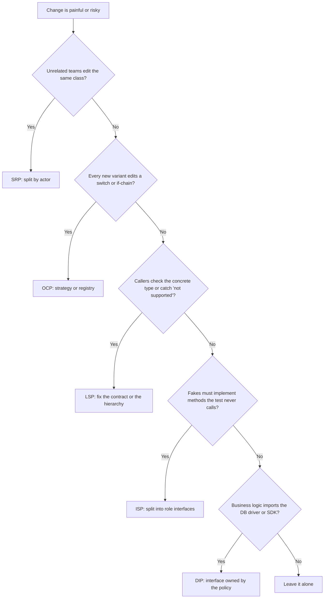

# SOLID Principles

> **Module 02 · Core Backend** · Prerequisites: [Dependency Injection](16-Dependency-Injection.md) · Next: [Clean Code](25-Clean-Code.md)

---

## ⏱ If You Only Have 2 Minutes

- SOLID is five design heuristics collected by Robert C. Martin: **S**ingle Responsibility, **O**pen/Closed, **L**iskov Substitution, **I**nterface Segregation, **D**ependency Inversion. They are a diagnostic vocabulary, not a checklist to apply everywhere.
- **SRP:** a module should be responsible to one *actor* — one group of people who request its changes. "One reason to change", not "does one tiny thing".
- **OCP:** add new behaviour (a new payment method, a new notification channel) by adding code, not by editing a growing `if/else` in tested code.
- **LSP:** a subtype must honour its base type's **contract**: it may not strengthen preconditions, weaken postconditions, or break invariants. It is about *behaviour*, not just matching method signatures.
- Swapping a MySQL repository for a PostgreSQL one is **programming to an interface / Dependency Inversion**. LSP is what makes that swap *safe*: both must behave the same way (same case-sensitivity, same "not found" result, same errors).
- **ISP:** callers should not depend on methods they do not use. Split a 20-method `UserRepository` into small role interfaces.
- **DIP:** high-level policy owns the abstraction; low-level details implement it. The interface lives with the use case, not with the database code.
- Over-applied, SOLID produces interface-per-class code that is harder to read. Add an abstraction when there is a real second implementation, a test fake, or a volatile dependency.

---

## 1. What It Is and Why It Exists

**SOLID** is a set of five object-oriented design principles that Robert C. Martin gathered around 2000; the acronym was coined later by Michael Feathers. Each principle targets one way code becomes expensive to change: classes that change for unrelated reasons, features that require editing old code, subclasses that surprise their callers, fat interfaces, and business logic welded to infrastructure.

**Analogy:** standardised shipping containers. Each container holds one consignment (SRP). Ports handle new cargo types without rebuilding the cranes (OCP). Any container that claims to be a standard 40-foot unit must really fit the standard slot and lifting points — a container that "mostly" fits breaks the crane (LSP). A crane operator needs the lifting points, not the cargo manifest (ISP). The port is designed around the container standard, not around one shipping company's boxes (DIP).

**The problem it solves.** A backend that ignores these ideas tends to grow an `OrderService` that validates input, writes SQL, formats emails, calls Stripe, and has a `switch` over payment methods. Every new feature edits that class, every edit risks breaking checkout, and testing it needs a database and an SMTP server. SOLID gives you names for *why* it hurts and directions for splitting it.

---

## 2. How It Works

SOLID works as a set of questions you ask when code is painful to change. Each symptom points to one principle and one refactoring.



The order of work in practice:

1. **Find the axis of change.** Look at the git history: which files change together, and who asked for the change?
2. **Draw the seam there.** Split responsibilities (SRP) or introduce an abstraction (OCP, DIP) at that axis only.
3. **Write the contract down.** For every abstraction, state what callers may assume: inputs accepted, results guaranteed, errors raised. This is what LSP checks.
4. **Keep interfaces narrow** to what each caller needs (ISP).
5. **Wire concrete classes in the composition root** ([Dependency Injection](16-Dependency-Injection.md)).

---

## 3. Key Concepts

### S — Single Responsibility Principle

Martin's later wording: *a module should be responsible to one, and only one, actor*. An actor is a group of stakeholders — finance, marketing, the platform team.

- **Bad:** `InvoiceService` computes tax (finance rules), renders the PDF (design team), and emails it (CRM team). A designer's font change redeploys tax logic; a merge conflict between two teams is the first symptom.
- **Good:** `TaxCalculator`, `InvoicePdfRenderer`, `InvoiceMailer`, plus a small use case that calls them in order. Each changes for one actor.

SRP is not "one method per class". A `Money` class with ten methods that all serve the same rules is cohesive and fine.

### O — Open/Closed Principle

*Software entities should be open for extension but closed for modification* (Bertrand Meyer, 1988; Martin's version uses polymorphism instead of inheritance).

- **Bad:** `if (method === "card") … else if (method === "paypal") … else if (method === "wallet")` inside checkout. Adding Apple Pay edits and re-tests the checkout core.
- **Good:** a `PaymentMethod` interface, one class per method, and a registry keyed by method name. Adding Apple Pay = one new class + one registration line.

OCP is always relative to an *expected* kind of change. You cannot be closed against every change; pick the axis that history shows actually varies.

### L — Liskov Substitution Principle

Barbara Liskov (1987, formalised with Jeannette Wing in 1994): if `S` is a subtype of `T`, a program written against `T` must keep working correctly when given an `S`. "Correctly" means the **behavioural contract**, which has three rules:

| Rule | Meaning | Backend violation |
|---|---|---|
| Preconditions cannot be **strengthened** | The subtype must accept every input the base accepts | Base `refund(amount)` allows partial refunds; `VoucherProvider` throws unless the amount is the full value |
| Postconditions cannot be **weakened** | The subtype must guarantee at least what the base guarantees | Base `save()` means "durable when it resolves"; a "fast" subtype returns before the write is flushed |
| Invariants must be **preserved** | Facts that are always true for the base stay true | Base `Account` invariant "balance ≥ 0"; a subclass allows overdrafts while callers still rely on the invariant |

Also: a subtype must not throw new kinds of errors that callers of the base were never told to handle (`NotImplementedError` on an inherited method is the classic case).

**What LSP is not.** "We can swap the MySQL repository for a PostgreSQL repository" is *programming to an interface*, which is Dependency Inversion. LSP is the extra condition that makes the swap safe. Example: `findByEmail("Alice@Example.com")` matches `alice@example.com` on MySQL because its default collations are case-insensitive. On PostgreSQL, `=` on `text` is case-sensitive, so the same call returns `null` and login fails. Both classes compile against `UserRepository`; only one honours the contract callers relied on. The fix is to write the contract down ("email lookup is case-insensitive") and run the same contract tests against every implementation.

### I — Interface Segregation Principle

*Clients should not be forced to depend on methods they do not use.*

- **Bad:** one `UserRepository` with `findById`, `findByEmail`, `save`, `delete`, `updatePasswordHash`, `listForAdminExport`, `streamAllForAnalytics`, … The login use case depends on all of it. Its test fake must stub fifteen methods, and adding an admin-only method touches every fake in the codebase.
- **Good:** role interfaces per caller:

```ts
interface UserCredentialsReader { findByEmail(email: string): Promise<UserCredentials | null> }
interface LoginRecorder { recordLogin(userId: string, at: Date): Promise<void> }
interface UserExportSource { streamAll(): AsyncIterable<UserRow> }
// One PgUserRepository class can implement all three. Each caller sees only its slice.
```

Another everyday case: a read-only pricing service that receives a full Redis client (with `FLUSHALL`) when it only needs `get(key)`. Give it a `PriceCache { get(sku) }` interface.

### D — Dependency Inversion Principle

*High-level modules should not depend on low-level modules; both should depend on abstractions. Abstractions should not depend on details.*

- **Bad:** `InvoiceService` does `import { S3Client } from "@aws-sdk/client-s3"` and `new PgInvoiceRepository(pool)`. Business rules now depend on AWS and PostgreSQL; tests need both.
- **Good:** `InvoiceService` depends on `InvoiceStore` and `DocumentStorage` interfaces **defined next to the service**, in its vocabulary (`storePdf(invoiceId, bytes)`). `S3DocumentStorage` and `PgInvoiceStore` live in the infrastructure layer and implement them. The composition root connects them.

The word "inversion" refers to ownership: the interface belongs to the high-level policy, so the source-code arrow points from the database code *up* to the business code. Placing `IInvoiceRepository` in the `postgres/` folder next to its implementation is not inversion — the policy would still depend on the persistence package. This is the class-level version of the dependency rule in [Clean Architecture](15-Clean-Architecture.md).

### The honest critique

- **Heuristics, not laws.** Each principle trades simplicity for flexibility along one axis. Apply them where change actually happens.
- **Over-abstraction is the common failure.** `IUserService` with one `UserService` implementation, factories for factories, and five files to add a field. Indirection makes code harder to follow and debug.
- **Written for class-based OO.** In TypeScript and Python, a function parameter or a dictionary of functions often achieves OCP or DIP without a class hierarchy.
- **YAGNI still applies.** Introduce the abstraction when the second implementation, a test fake, or a volatile vendor arrives — not "in case".
- Alternatives such as Kent Beck's four rules of simple design (passes the tests, reveals intention, no duplication, fewest elements) or Dan North's CUPID properties are often a better first lens.

---

## 4. Code Examples

Two scenarios: (1) SRP + OCP — an order-notification feature split by responsibility, with channels added without editing the dispatcher; (2) LSP — a payment provider subtype that breaks the refund contract, and the fix.

### Node.js / TypeScript

```ts
// SRP + OCP — plain TypeScript 5, no packages.
export interface OrderPlaced { orderId: string; totalCents: number; currency: string }
export interface Recipient { email: string | null; phone: string | null; preferredChannels: string[] }
export interface Message { subject: string; body: string }

export interface NotificationChannel {
  readonly name: string;
  canReach(to: Recipient): boolean;
  send(to: Recipient, message: Message): Promise<void>;
}

// Changes only when copy/marketing changes the wording (one actor).
export class OrderPlacedTemplate {
  render(e: OrderPlaced): Message {
    const total = new Intl.NumberFormat("en-US", { style: "currency", currency: e.currency }).format(e.totalCents / 100);
    return { subject: `Order ${e.orderId} confirmed`, body: `Thanks! We received your order for ${total}.` };
  }
}

export interface Mailer { send(to: string, subject: string, text: string): Promise<void> }
export interface SmsClient { send(to: string, text: string): Promise<void> }

export class EmailChannel implements NotificationChannel {
  readonly name = "email";
  constructor(private readonly mailer: Mailer) {}
  canReach(to: Recipient): boolean { return to.email !== null; }
  async send(to: Recipient, m: Message): Promise<void> { await this.mailer.send(to.email!, m.subject, m.body); }
}

export class SmsChannel implements NotificationChannel {
  readonly name = "sms";
  constructor(private readonly sms: SmsClient) {}
  canReach(to: Recipient): boolean { return to.phone !== null; }
  async send(to: Recipient, m: Message): Promise<void> { await this.sms.send(to.phone!, m.subject); }
}

// Closed for modification: adding "push" or "whatsapp" means a new class + one entry in the composition root.
export class OrderNotifier {
  private readonly channels: Map<string, NotificationChannel>;

  constructor(channels: NotificationChannel[], private readonly template: OrderPlacedTemplate) {
    this.channels = new Map(channels.map((c) => [c.name, c]));
  }

  async notify(event: OrderPlaced, to: Recipient): Promise<string | null> {
    const message = this.template.render(event);
    for (const name of to.preferredChannels) {
      const channel = this.channels.get(name);
      if (channel?.canReach(to)) {
        await channel.send(to, message);
        return name; // first reachable preferred channel wins
      }
    }
    return null;
  }
}
```

```ts
// LSP — violation and fix. Plain TypeScript 5.
export class RefundRejectedError extends Error {}

// Contract of refund(): pre  0 < amountCents <= refundable amount of the charge
//                       post resolves with a refund ID once the provider accepted it
//                       errors RefundRejectedError only
export abstract class PaymentProvider {
  abstract refund(chargeId: string, amountCents: number): Promise<string>;
}

// VIOLATION: strengthens the precondition (full refunds only) and throws an error the contract never mentioned.
export class VoucherProvider extends PaymentProvider {
  constructor(private readonly voucherValues: Map<string, number>) { super(); }
  async refund(chargeId: string, amountCents: number): Promise<string> {
    if (amountCents !== this.voucherValues.get(chargeId)) throw new Error("vouchers are refundable only in full");
    return `vref_${chargeId}`;
  }
}

// Correct against the base type, broken at runtime by the subtype.
export async function refundReturnedItem(p: PaymentProvider, chargeId: string, itemCents: number): Promise<string> {
  return p.refund(chargeId, itemCents);
}

// FIX: make the capability part of the type, so the compiler rejects the bad substitution.
export interface FullRefunds { refundInFull(chargeId: string): Promise<string> }
export interface PartialRefunds extends FullRefunds { refund(chargeId: string, amountCents: number): Promise<string> }

export class Vouchers implements FullRefunds {
  async refundInFull(chargeId: string): Promise<string> { return `vref_${chargeId}`; }
}

export class Cards implements PartialRefunds {
  async refundInFull(chargeId: string): Promise<string> { return `cref_${chargeId}_full`; }
  async refund(chargeId: string, amountCents: number): Promise<string> { return `cref_${chargeId}_${amountCents}`; }
}

// Needs partial refunds, so it asks for exactly that. Passing a Vouchers instance is now a type error.
export async function refundItem(p: PartialRefunds, chargeId: string, itemCents: number): Promise<string> {
  return p.refund(chargeId, itemCents);
}
```

### Python

```python
# SRP + OCP — standard library only, Python 3.12+
from dataclasses import dataclass, field
from typing import Protocol


@dataclass(frozen=True)
class OrderPlaced:
    order_id: str
    total_cents: int
    currency: str


@dataclass(frozen=True)
class Recipient:
    email: str | None
    phone: str | None
    preferred_channels: list[str] = field(default_factory=list)


@dataclass(frozen=True)
class Message:
    subject: str
    body: str


class NotificationChannel(Protocol):
    name: str

    def can_reach(self, to: Recipient) -> bool: ...
    async def send(self, to: Recipient, message: Message) -> None: ...


class OrderPlacedTemplate:  # one actor: whoever owns the customer-facing wording
    def render(self, e: OrderPlaced) -> Message:
        total = f"{e.total_cents / 100:.2f} {e.currency}"
        return Message(f"Order {e.order_id} confirmed", f"Thanks! We received your order for {total}.")


class Mailer(Protocol):
    async def send(self, to: str, subject: str, text: str) -> None: ...


class EmailChannel:
    name = "email"

    def __init__(self, mailer: Mailer) -> None:
        self._mailer = mailer

    def can_reach(self, to: Recipient) -> bool:
        return to.email is not None

    async def send(self, to: Recipient, message: Message) -> None:
        assert to.email is not None  # guaranteed by can_reach; narrows the type for mypy
        await self._mailer.send(to.email, message.subject, message.body)


class OrderNotifier:
    def __init__(self, channels: list[NotificationChannel], template: OrderPlacedTemplate) -> None:
        self._channels = {c.name: c for c in channels}  # new channel = new class, no edit here
        self._template = template

    async def notify(self, event: OrderPlaced, to: Recipient) -> str | None:
        message = self._template.render(event)
        for name in to.preferred_channels:
            channel = self._channels.get(name)
            if channel is not None and channel.can_reach(to):
                await channel.send(to, message)
                return name
        return None
```

```python
# LSP — violation and fix. Standard library only, Python 3.12+
from abc import ABC, abstractmethod
from typing import Protocol


class PaymentProvider(ABC):
    @abstractmethod
    async def refund(self, charge_id: str, amount_cents: int) -> str:
        """pre: 0 < amount_cents <= refundable amount. post: provider accepted the refund.
        raises: RefundRejectedError only."""


class VoucherProvider(PaymentProvider):
    def __init__(self, voucher_values: dict[str, int]) -> None:
        self._values = voucher_values

    async def refund(self, charge_id: str, amount_cents: int) -> str:
        # VIOLATION: mypy is happy (same signature), but the precondition is stronger than the base's.
        if amount_cents != self._values[charge_id]:
            raise ValueError("vouchers are refundable only in full")
        return f"vref_{charge_id}"


# FIX: separate capabilities, so callers state which one they need.
class FullRefunds(Protocol):
    async def refund_in_full(self, charge_id: str) -> str: ...


class PartialRefunds(FullRefunds, Protocol):
    async def refund(self, charge_id: str, amount_cents: int) -> str: ...


class Vouchers:
    async def refund_in_full(self, charge_id: str) -> str:
        return f"vref_{charge_id}"


class Cards:
    async def refund_in_full(self, charge_id: str) -> str:
        return f"cref_{charge_id}_full"

    async def refund(self, charge_id: str, amount_cents: int) -> str:
        return f"cref_{charge_id}_{amount_cents}"


async def refund_item(provider: PartialRefunds, charge_id: str, item_cents: int) -> str:
    # mypy/pyright reject refund_item(Vouchers(), ...): it has no partial refund.
    return await provider.refund(charge_id, item_cents)
```

**Language differences to notice:**

- **Signature-level LSP checks differ.** mypy reports an override whose argument or return types are incompatible with the base class, and its error message explicitly says it violates the Liskov substitution principle. TypeScript checks *method* parameters bivariantly even under `strict` (`strictFunctionTypes` applies only to function-typed properties), so a subclass method that narrows a parameter type can slip through.
- **Neither checker sees behaviour.** Both `VoucherProvider` versions type-check. Behavioural LSP needs a written contract plus a shared contract-test suite run against every implementation.
- Python's `Protocol` lets `Cards` and `Vouchers` satisfy the interfaces without inheriting from them, just like TypeScript's structural interfaces.

---

## 5. Production Concerns

- **Contract tests protect LSP across adapters.** Write one test suite for the `UserRepository` or `PaymentProvider` contract and run it against the in-memory fake *and* the real adapter (against a test database or provider sandbox). This is how you catch the case-sensitivity and "not found returns null vs throws" differences before production does.
- **OCP and runtime configuration.** A channel registry built in the composition root lets you enable a channel per environment or behind a [feature flag](../Module-07-Advanced-Backend-and-System-Design/39-Feature-Flags.md). Log which channel was used per notification so a silent fallback from push to SMS shows up in metrics (and in the SMS bill).
- **Failure semantics are part of the contract.** If one `PaymentProvider` raises on timeout and another returns a "pending" status, callers that retry will double-charge with one and not the other. Define timeouts, retryability and idempotency in the abstraction, not per implementation.
- **Abstraction overhead is negligible at runtime** (one virtual call). The real cost is in debugging: stack traces through five layers of interfaces and factories. Keep the indirection shallow.
- **ISP and blast radius.** Narrow interfaces also limit what a compromised or buggy component can do — a pricing service holding only a `get` interface cannot flush the cache.

---

## 6. Common Mistakes

- **Reading SRP as "one function per class"** — dozens of anaemic classes with no clear owner — split by actor and reason for change, keep cohesive behaviour together.
- **Interface for every class "for SOLID"** — `IOrderService` with one implementation and no fake adds a file and a jump-to-definition hop — add the interface when a second implementation or a test double appears.
- **Calling a swappable repository "LSP"** — that is Dependency Inversion; the substitute can still violate LSP by behaving differently — document the contract and run contract tests on every implementation.
- **Subclasses that throw `NotImplementedError` / "not supported"** — callers written against the base crash on one subtype — split the interface by capability (ISP) or remove the inheritance.
- **Abstractions shaped like the vendor** — `PaymentProvider.createPaymentIntent(stripeParams)` keeps the policy dependent on Stripe even behind an interface — design the abstraction from the caller's needs.
- **OCP everywhere** — plugin registries for things that have never varied — use a plain `if` until a second or third variant actually arrives.
- **Interfaces placed with the implementation** — `postgres/IUserRepository.ts` means the domain imports the persistence package — the abstraction belongs to the high-level module that uses it.

---

## 7. Comparison Table

| | SOLID | Kent Beck's four rules of simple design | CUPID (Dan North) | YAGNI / KISS |
|---|---|---|---|---|
| Focus | Class and module dependencies | Code that is easy to change right now | Properties that make code pleasant to work with | Avoid speculative complexity |
| Form | Five principles | Ordered rules: passes tests, reveals intention, no duplication, fewest elements | Composable, Unix philosophy, Predictable, Idiomatic, Domain-based | Rules of thumb |
| Strength | Precise names for coupling problems | Pushes toward the smallest working design | Language- and paradigm-neutral | Prevents over-engineering |
| Risk | Over-abstraction, interface explosion | Can under-design known future variation | Less precise for code review arguments | Can be used to excuse real design debt |
| Use when | Reviewing boundaries, integrations, plug-in points | Day-to-day TDD and refactoring | Judging a codebase's overall feel | Deciding whether to add an abstraction at all |

---

## 8. Interview Questions

**[Junior] What does the Single Responsibility Principle mean?**
A module should have one reason to change, which Martin later phrased as being responsible to one actor — one group of stakeholders. An `InvoiceService` that calculates tax, renders PDFs and sends emails changes for finance, design and CRM requests, so their changes collide. Split it so each class changes for one group, and keep a small use case that coordinates them.

**[Junior] Give a backend example of the Open/Closed Principle.**
Payment methods or notification channels. Instead of a growing `switch` in checkout, define a `PaymentMethod` interface and register one implementation per method. Adding a new method adds a class and a registration line; the tested checkout code does not change.

**[Mid] What is the Liskov Substitution Principle, really?**
A subtype must be usable anywhere its base type is expected without the caller noticing a difference in behaviour. Concretely: it may not demand more of its inputs (stronger preconditions), promise less about its results (weaker postconditions), break the base type's invariants, or throw errors the base contract does not allow. A subclass that throws "not supported" for an inherited method is the most common violation.

**[Mid] "LSP means we can swap MySQL for PostgreSQL." Is that right?**
Not quite. Being able to swap implementations behind an interface is programming to an interface, which Dependency Inversion enables. LSP is the condition that the swap is behaviourally safe. For instance, MySQL's default collations make email lookups case-insensitive while PostgreSQL's `=` on text is case-sensitive, so a PostgreSQL repository can compile against the same interface and still break login. Contract tests run against both implementations catch that.

**[Mid] Give a concrete Interface Segregation example from a backend.**
A large `UserRepository` interface used by login, admin export and analytics. The login use case only needs `findByEmail` and `recordLogin`, yet its fake must implement every method and it is recompiled or re-checked whenever admin methods change. Split it into `UserCredentialsReader`, `LoginRecorder` and `UserExportSource`; one PostgreSQL class can still implement all three.

**[Senior] What does "inversion" mean in Dependency Inversion, and how do you see it in a folder structure?**
It means the abstraction is owned by the high-level policy, so the low-level module depends upward on it. In a codebase, the `InvoiceStore` interface lives in the application or domain package, and the PostgreSQL implementation imports it from there. If the interface sits in `infrastructure/postgres/`, the business code still imports the persistence package and nothing was inverted. Import-lint rules can enforce the direction.

**[Senior] When does applying SOLID make a codebase worse?**
When abstractions are added for variation that never comes: interfaces with one implementation, registries for two hard-coded cases, ten tiny classes to express one rule. Readers have to jump through layers to find behaviour, and stack traces get longer. I treat SOLID as a way to diagnose real change pain shown by history, and I add an abstraction when there is a second implementation, a needed test double, or a volatile external dependency.

**[Senior] How would you enforce LSP for a `PaymentProvider` abstraction with four implementations?**
Write the contract explicitly: accepted amounts, idempotency behaviour, timeout semantics, which errors mean "declined" versus "retry later". Encode it as one parametrised contract-test suite run against a fake and against each provider's sandbox in CI. Where a provider genuinely cannot meet the contract (no partial refunds), change the type model — separate capability interfaces — rather than throwing at runtime.

---

## 9. Cheat Sheet

```text
SRP   one actor / one reason to change; split InvoiceService into tax, render, mail
OCP   new variant = new class + registration; strategy/registry over growing switch
LSP   subtype keeps base contract: no stronger pre, no weaker post, invariants kept, no new errors
      swap MySQL→Postgres repo = DIP; LSP = the swap behaves the same (case, nulls, errors)
      smell: throw "not supported", instanceof checks in callers
ISP   role interfaces per caller (CredentialsReader, ExportSource); fakes stay small
DIP   policy owns the interface, details implement it; wire in composition root
      interface in infra folder = not inverted
Check mypy flags incompatible overrides (LSP); TS method params are bivariant
      behaviour needs contract tests against fake + real adapter
Limit heuristics, not laws; abstraction needs a 2nd impl, a fake, or a volatile vendor
```

---

## Related Topics

- [Clean Architecture](15-Clean-Architecture.md) — DIP scaled up to the whole service as the dependency rule
- [Dependency Injection](16-Dependency-Injection.md) — how abstractions get their concrete implementations
- [Clean Code](25-Clean-Code.md) — the function- and naming-level counterpart to these class-level rules
- [Repository Pattern](14-Repository-Pattern.md) — where ISP and LSP problems most often appear
- [Code Smells](../Module-09-Testing-and-Code-Quality/23-Code-Smells.md) — symptoms that point to a violated principle
- [Refactoring](../Module-09-Testing-and-Code-Quality/25-Refactoring.md) — the safe steps for moving code toward these principles
