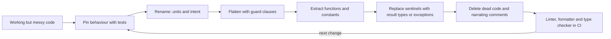

# Clean Code

> **Module 02 · Core Backend** · Prerequisites: [SOLID Principles](24-SOLID-Principles.md) · Next: [SQL vs NoSQL](../Module-03-Databases/01-SQL-vs-NoSQL.md)

---

## ⏱ If You Only Have 2 Minutes

- Clean code makes the next safe change cheap. Code is read far more often than it is written, so optimise for the reader — usually you, at 3 a.m., during an incident.
- **Names carry units and intent:** `timeoutMs`, `totalCents`, `isEligibleForRefund` — not `data`, `tmp`, `flag`, `process()`.
- **Guard clauses** return early for invalid cases, so the happy path stays at one level of indentation.
- **No boolean flag parameters.** `refund(order, true)` hides a second function; split it or pass a named option.
- **Expected business outcomes are values; unexpected failures are exceptions.** Never signal failure with `null`, `-1` or `-2`, and never swallow an exception with `console.log(e)`.
- **No magic numbers:** `REFUND_WINDOW_DAYS = 30`, not `2592000000`. Store money as integer cents, never floats.
- **Comments explain *why*** (a legal rule, a provider quirk); the code explains *what*. Delete commented-out code — git remembers it.
- **Let tools enforce consistency:** Prettier or Biome + ESLint (`typescript-eslint`) for TypeScript; Ruff (lint + format) or Black, plus mypy, for Python — run in CI, not by reviewers.

---

## 1. What It Is and Why It Exists

**Clean code** is code another engineer can read, understand and change correctly without asking the author. The term comes from Robert C. Martin's 2008 book of the same name, but the ideas are older and shared across many authors. This chapter is the **code-level view**: what a single function or module looks like. The team and process view — reviews, quality gates, metrics — is in [Module 09 · Clean Code](../Module-09-Testing-and-Code-Quality/24-Clean-Code.md).

**Analogy:** a well-run professional kitchen. Every container is labelled with contents and date (names). Each station does one job (small functions). Spoiled food is thrown out, not kept "just in case" (dead code). A new cook can find the salt on day one, because every kitchen in the chain is laid out the same way (formatters and conventions).

**The problem it solves.** Backend bugs often hide in code that *works* but cannot be read:

- A refund handler returns `-1`, `-2` or `null`, and a caller treats `null` as "refunded zero" — customers get no money and no error.
- A `try/catch` logs and returns `null`, so a database outage looks like "order not found".
- `amount * 0.1` on floats produces `899.9999999` cents in the ledger.
- Nested `if`s six levels deep hide the one branch that skips the ownership check.

Clean code makes these mistakes *visible* during review instead of during an incident.

---

## 2. How It Works

Clean code is mostly produced by refactoring working code in small, safe steps, with tests holding the behaviour still.



1. **Pin behaviour.** Before touching anything, write or run tests that cover the current behaviour, including the error paths.
2. **Rename.** Good names are the cheapest, highest-value change. Include units (`Ms`, `Cents`, `Days`) and use the domain's words (`refund`, `capture`), not technical filler (`handle`, `process`, `manager`).
3. **Flatten.** Turn nested conditionals into guard clauses that exit early.
4. **Extract.** Pull each idea into a function whose name says what it decides; replace literals with named constants.
5. **Make errors explicit.** Expected outcomes become typed results; unexpected failures propagate as exceptions to one boundary handler (see [Error Handling](21-Error-Handling.md)).
6. **Delete.** Remove dead branches, unused parameters, commented-out code and comments that repeat the code.
7. **Automate.** Anything a tool can check — formatting, unused imports, floating promises, type errors — goes into the toolchain so reviews can focus on design.

---

## 3. Key Concepts

### Naming

| Bad | Better | Why |
|---|---|---|
| `data`, `obj`, `res2` | `refundRequest`, `order`, `providerResponse` | Says *which* data |
| `timeout = 30` | `timeoutMs = 30_000` | Units prevent 1000× bugs |
| `amount` (float) | `amountCents` (integer) | Money in cents avoids float rounding |
| `check(order)` | `isWithinRefundWindow(order, now)` | Boolean names read as questions |
| `process()`, `handle()` | `refundOrder()`, `sendRefundConfirmation()` | Verb + domain noun |
| `UserManager`, `Helper`, `Utils` | `PasswordHasher`, `SlugGenerator` | Vague names attract unrelated code |

Use one word per concept across the codebase: if it is `customer` in the API, it is not `client` in the service and `user` in the repository.

### Small, focused functions

A function should do one thing at **one level of abstraction**: either orchestrate steps (`load → check → compute → save`) or perform a low-level detail (date arithmetic, SQL), not both. Length is a symptom, not the rule — a 40-line function that reads top to bottom is fine; a 12-line one mixing HTTP parsing, SQL and tax rules is not. Keep parameters to about three; beyond that, pass an object with named fields.

### Guard clauses and flag parameters

**Guard clauses** check the invalid cases first and return (or throw) immediately. The main logic then runs without nesting, and each rejection reason sits next to its condition.

**Boolean flag parameters** (`refund(order, true, false)`) mean the function does two things and the call site is unreadable. Options:

- Split it: `refundOrder()` and `sendRefundConfirmation()`, and let the caller compose them.
- If both paths share most of the logic, use a named options object (`{ notifyCustomer: true }`) or keyword-only argument in Python (`*, notify_customer: bool`).

Ruff's `flake8-boolean-trap` (`FBT`) rules flag boolean positional parameters in Python.

### Errors: result values vs exceptions

| Situation | Use | Example |
|---|---|---|
| Expected business outcome the caller must handle | A result value (TypeScript discriminated union; Python dataclass or a specific domain exception) | `refund_window_closed`, `card_declined`, `already_refunded` |
| Programmer error or broken invariant | Exception — crash loudly | `amountCents` is negative inside the domain |
| Infrastructure failure | Exception, propagated to one boundary handler | DB connection lost, provider timeout |
| Never | Sentinel values or swallowed errors | `return -1`, `return null` on any failure, `catch (e) { console.log(e) }` |

TypeScript has no checked exceptions, so a returned union is the only way to make the compiler force callers to handle a business outcome. Python culture leans on exceptions ("easier to ask forgiveness than permission"), and specific domain exceptions such as `RefundWindowClosed` are idiomatic there too — the important part is that the failure is named, typed and not silently turned into `None`. Pick one style per codebase layer and use it consistently.

### Magic numbers, comments and dead code

- **Magic numbers:** `2592000000` should be `REFUND_WINDOW_DAYS * MS_PER_DAY`. Named constants document the rule and give one place to change it. Status strings belong in a union type or `Enum`, not scattered literals.
- **Comments:** write *why* — `// Damaged goods are our fault, so no restocking fee (policy RF-2)`, `# Provider returns 200 with status=failed for declined cards`. Delete *what* comments (`// get the order`) — rename the code instead. A wrong comment is worse than none.
- **Dead code:** commented-out blocks, unreachable branches, unused exports and feature flags that were rolled out a year ago. They mislead readers and searches. Version control keeps history; delete it.

### Consistency through tooling

| Job | TypeScript | Python |
|---|---|---|
| Formatter (no style debates) | Prettier, or Biome | Black, or `ruff format` (Black-compatible) |
| Linter (bug patterns, unused code) | ESLint with `typescript-eslint` (flat config `eslint.config.js`), or Biome | Ruff (replaces flake8, isort, pyupgrade and many plugins) |
| Type checker | `tsc --noEmit` with `strict: true` | mypy or pyright in strict mode |
| Rules worth turning on | `@typescript-eslint/no-floating-promises`, `switch-exhaustiveness-check`, `no-unused-vars` | `F401` unused import, `B006` mutable default argument, `PLR2004` magic value comparison, `FBT` boolean trap |

Run formatters on save and in a pre-commit hook; run linters and type checks in CI as a required check. A reviewer comment about formatting is a missing tool.

---

## 4. Code Examples

Scenario: refund a delivered order. Customers can return items within 30 days; a 10 % restocking fee applies unless the item arrived damaged. The "before" code works on the happy path. The "after" code has the same business behaviour, but fixes the hidden bugs.

### Node.js / TypeScript

**Before**

```ts
// Plain TypeScript 5. Works on the happy path — count the problems.
export async function process(data: any, flag: boolean, db: any, mailer: any) {
  // get the order
  const o = await db.orders.find(data.id);
  if (o) {
    if (o.status == "DELIVERED") {
      if (Date.now() - o.deliveredAt.getTime() < 2592000000) {
        let amt = o.total;
        if (data.reason == "DAMAGED") {
          amt = amt;
        } else {
          amt = amt - o.total * 0.1; // 10%
        }
        try {
          await db.refunds.insert({ orderId: o.id, amount: amt, reason: data.reason });
          // await db.orders.update(o.id, { status: "REFUNDED" });
          if (flag) await mailer.send(o.email, "Refund", "Your refund of " + amt + " is on its way");
          return amt;
        } catch (e) {
          console.log(e);
          return null;
        }
      } else return -1;
    } else return -2;
  }
  return null;
}
```

Problems: `any` everywhere; meaningless names; a boolean flag; a magic number of milliseconds; float money (`total * 0.1`); `amt = amt`; a comment narrating the code; commented-out code; three different failure sentinels, and `null` means both "order not found" and "database is down".

**After**

```ts
// Plain TypeScript 5, no packages. Db and Mailer are small interfaces defined in ./ports.ts.
import type { Db, Mailer, Order } from "./ports.js";

// Refund policy owned by legal: changes here need their sign-off.
const REFUND_WINDOW_DAYS = 30;
const MS_PER_DAY = 24 * 60 * 60 * 1000;
const RESTOCKING_FEE_BASIS_POINTS = 1_000; // 10.00 %
const BASIS_POINTS_PER_WHOLE = 10_000;

export type RefundReason = "damaged" | "changed_mind";

export type RefundOutcome =
  | { ok: true; refundCents: number }
  | { ok: false; error: "order_not_found" | "not_delivered" | "refund_window_closed" };

export async function refundOrder(
  db: Db,
  orderId: string,
  reason: RefundReason,
  now: Date = new Date(),
): Promise<RefundOutcome> {
  const order = await db.orders.find(orderId);
  if (!order) return { ok: false, error: "order_not_found" };
  if (order.status !== "delivered") return { ok: false, error: "not_delivered" };
  if (!isWithinRefundWindow(order, now)) return { ok: false, error: "refund_window_closed" };

  const refundCents = refundAmountCents(order.totalCents, reason);
  // No try/catch: a DB failure is not a business outcome. It propagates to the error middleware as a 500.
  await db.refunds.insert({ orderId: order.id, amountCents: refundCents, reason });
  return { ok: true, refundCents };
}

function isWithinRefundWindow(order: Order, now: Date): boolean {
  return now.getTime() - order.deliveredAt.getTime() <= REFUND_WINDOW_DAYS * MS_PER_DAY;
}

export function refundAmountCents(totalCents: number, reason: RefundReason): number {
  // Damaged goods are our fault, so the customer pays no restocking fee.
  if (reason === "damaged") return totalCents;
  // Integer maths only; round the fee up so we never refund more than policy allows.
  const feeCents = Math.ceil((totalCents * RESTOCKING_FEE_BASIS_POINTS) / BASIS_POINTS_PER_WHOLE);
  return totalCents - feeCents;
}

// The old boolean flag is now a separate step the caller chooses to run.
export async function sendRefundConfirmation(mailer: Mailer, order: Order, refundCents: number): Promise<void> {
  const amount = new Intl.NumberFormat("en-US", { style: "currency", currency: order.currency }).format(refundCents / 100);
  await mailer.send(order.email, "Your refund is on its way", `We have refunded ${amount} to your original payment method.`);
}
```

The Express handler now reads as a sentence: call `refundOrder`, and if `outcome.ok` is false, map `outcome.error` to `404` or `409`; otherwise call `sendRefundConfirmation` and return `200`. Because `RefundOutcome` is a union, TypeScript will not let the handler read `refundCents` until it has checked `ok`.

### Python

**Before**

```python
# Python 3.12+. Works on the happy path — count the problems.
from datetime import datetime


def process(data, flag, db, mailer):
    # get the order
    o = db.orders.find(data["id"])
    if o:
        if o.status == "DELIVERED":
            if (datetime.now() - o.delivered_at).days < 30:
                amt = o.total
                if data["reason"] != "DAMAGED":
                    amt = amt - o.total * 0.1  # 10%
                try:
                    db.refunds.insert(order_id=o.id, amount=amt, reason=data["reason"])
                    # db.orders.update(o.id, status="REFUNDED")
                    if flag:
                        mailer.send(o.email, "Refund", "Your refund of " + str(amt) + " is on its way")
                    return amt
                except Exception as e:
                    print(e)
                    return None
            else:
                return -1
        else:
            return -2
    return None
```

Extra Python-specific problem: `datetime.now()` is a naive local time; comparing it with a timezone-aware `delivered_at` raises `TypeError`, and comparing two naive values from servers in different time zones is silently wrong.

**After**

```python
# Python 3.12+, standard library only. Db and Mailer are Protocols defined in shop.ports.
import math
from dataclasses import dataclass
from datetime import UTC, datetime, timedelta
from enum import StrEnum
from typing import Literal

from shop.ports import Db, Mailer, Order

# Refund policy owned by legal: changes here need their sign-off.
REFUND_WINDOW = timedelta(days=30)
RESTOCKING_FEE_BASIS_POINTS = 1_000  # 10.00 %
BASIS_POINTS_PER_WHOLE = 10_000


class RefundReason(StrEnum):
    DAMAGED = "damaged"
    CHANGED_MIND = "changed_mind"


@dataclass(frozen=True)
class Refunded:
    refund_cents: int


@dataclass(frozen=True)
class RefundRejected:
    error: Literal["order_not_found", "not_delivered", "refund_window_closed"]


def refund_order(
    db: Db, order_id: str, reason: RefundReason, *, now: datetime | None = None
) -> Refunded | RefundRejected:
    now = now or datetime.now(UTC)
    order = db.orders.find(order_id)
    if order is None:
        return RefundRejected("order_not_found")
    if order.status != "delivered":
        return RefundRejected("not_delivered")
    if not is_within_refund_window(order, now):
        return RefundRejected("refund_window_closed")

    refund_cents = refund_amount_cents(order.total_cents, reason)
    # No blanket except: a DB failure is not a business outcome; let the boundary handler log it and return 500.
    db.refunds.insert(order_id=order.id, amount_cents=refund_cents, reason=reason)
    return Refunded(refund_cents)


def is_within_refund_window(order: Order, now: datetime) -> bool:
    return now - order.delivered_at <= REFUND_WINDOW  # both aware datetimes in UTC


def refund_amount_cents(total_cents: int, reason: RefundReason) -> int:
    # Damaged goods are our fault, so the customer pays no restocking fee.
    if reason is RefundReason.DAMAGED:
        return total_cents
    fee_cents = math.ceil(total_cents * RESTOCKING_FEE_BASIS_POINTS / BASIS_POINTS_PER_WHOLE)
    return total_cents - fee_cents


def send_refund_confirmation(mailer: Mailer, order: Order, refund_cents: int) -> None:
    amount = f"{refund_cents / 100:.2f} {order.currency}"
    mailer.send(order.email, "Your refund is on its way", f"We have refunded {amount} to your original payment method.")
```

**Language differences to notice:**

- TypeScript's discriminated union plus `switch-exhaustiveness-check` makes the compiler reject a caller that forgets an error case. In Python, mypy narrows `Refunded | RefundRejected` after an `isinstance` check or a `match` with class patterns; many Python teams would instead raise `RefundWindowClosed(...)` domain exceptions and map them in a FastAPI exception handler. Both are clean if they are consistent.
- `now` is injectable in both versions, which makes the 30-day boundary testable without freezing the system clock. In Python it is keyword-only (`*`), so a positional `True` or a date cannot be passed by accident.

---

## 5. Production Concerns

- **Swallowed errors become wrong data.** `catch (e) { console.log(e); return null }` turns an outage into a business answer ("not found"), skips the error middleware, and loses the stack trace from structured logs. Let unexpected errors propagate to one handler that logs with a correlation ID and returns a stable 500 body.
- **Money and time are where unclean code costs real money.** Integer cents (or a decimal type), explicit rounding direction, timezone-aware UTC timestamps, and constants with units remove whole classes of reconciliation bugs.
- **Readable code is faster to debug in an incident.** Functions named after business steps produce meaningful stack traces and span names (`refundOrder`, `isWithinRefundWindow`) instead of `process` and `<anonymous>`.
- **Unhandled promises are a production bug, not a style issue.** A missing `await` on `db.refunds.insert` returns success before the write — and may crash the process with an unhandled rejection later. `@typescript-eslint/no-floating-promises` catches this before review.
- **Tooling must be fast and blocking.** Formatter on save, linter and type checker in pre-commit or CI as a required check. Ruff and Biome are fast enough to run on every save even in large repos. Adopt rules gradually on legacy code (baseline existing violations) rather than disabling the linter.
- **Clean code is not slower.** Extracted functions and constants have no measurable runtime cost in V8 or CPython for request-handling code. Optimise only after profiling, and when you must write clever code, explain why in a comment next to it.

---

## 6. Common Mistakes

- **Sentinel return values** (`-1`, `-2`, `null` for "anything went wrong") — callers mistake failure for a valid value — return a typed result or raise a named exception.
- **Catch, log, return null** — outages look like "not found" and stack traces are lost — catch only what you can handle; let the rest reach the boundary handler.
- **Boolean flag parameters** — `refund(order, true)` is unreadable and hides two behaviours — split the function or use a named option or keyword-only argument.
- **Names without units** — `timeout = 30` is read as ms by one engineer and seconds by another — suffix units (`timeoutMs`, `ttlSeconds`) or use typed durations (`timedelta`).
- **Floats for money** — `0.1 + 0.2` style errors reach the ledger — store integer minor units or `Decimal`, and state the rounding direction.
- **Comments that narrate or lie; commented-out code** — readers trust the comment over the code, and dead blocks show up in every search — rename instead of narrating, explain *why*, delete dead code.
- **Style arguments in code review** — reviews spend time on spacing instead of correctness — adopt a formatter and linter config once and enforce it in CI.

---

## 7. Comparison Table

How to report a failure from a function — the decision that most affects backend readability:

| | Sentinel values (`null`, `-1`) | Exceptions | Result values (union / dataclass) |
|---|---|---|---|
| Caller forced to handle it | No | No (no checked exceptions in TS or Python) | Yes in TypeScript with exhaustive checks; with mypy narrowing in Python |
| Distinguishes failure kinds | Poorly, by magic value | Yes, by exception class | Yes, by tag or class |
| Visible in the signature | No | No | Yes |
| Good for | Nothing in new code | Unexpected and infrastructure failures; idiomatic Python domain errors | Expected business outcomes callers must branch on |
| Main risk | Silent wrong data | Swallowed by broad `catch`/`except`; hidden control flow | Verbose if used for every possible failure |

---

## 8. Interview Questions

**[Junior] What makes a good variable or function name?**
It says what the thing is or does in the domain's language, with units where relevant: `refundCents`, `timeoutMs`, `isWithinRefundWindow`. Functions are verb + noun (`sendRefundConfirmation`), booleans read as questions. Avoid generic words like `data`, `handle`, `process` or `Manager`, which say nothing and attract unrelated code.

**[Junior] What is a guard clause and why use it?**
A check at the start of a function that returns or throws as soon as an invalid case is found: `if (!order) return notFound`. It removes nesting, keeps the happy path flat at the end of the function, and puts each rejection reason right next to its condition. It also makes missing checks (such as ownership) easier to spot in review.

**[Mid] Why avoid boolean flag parameters?**
A flag means the function does two different things, and the call site `refund(order, true)` gives the reader no clue which. It also doubles the paths to test. Split it into two functions the caller composes, or, if most logic is shared, use a named option (`{ notifyCustomer: true }`) or a keyword-only argument in Python.

**[Mid] When do you return an error value and when do you throw?**
Expected business outcomes the caller must handle — card declined, refund window closed — are returned as typed results, or raised as specific domain exceptions in Python where that is idiomatic. Unexpected failures such as a lost DB connection or a broken invariant are exceptions that propagate to a single boundary handler, which logs them and returns a 500. Never use sentinel values or catch-and-return-null, because they turn outages into wrong answers.

**[Mid] What comments do you keep and which do you delete?**
Keep comments that explain *why*: a legal rule, a provider quirk, a non-obvious performance trade-off, a link to an incident. Delete comments that repeat *what* the code does — improve the names instead — and delete commented-out code, since git keeps history. Outdated comments are actively harmful because readers believe them.

**[Senior] How do you introduce clean-code standards into a large legacy service without stopping feature work?**
Start with tools that need no debate: a formatter applied in one dedicated commit (listed in `.git-blame-ignore-revs`), then a linter with a small set of bug-catching rules such as floating promises and unused imports. Baseline existing violations so CI only fails on new code. Refactor opportunistically — leave each file you touch slightly better — and target hot spots that change often and cause incidents, using tests to pin behaviour first.

**[Senior] Isn't "clean code" subjective? How do you settle disagreements in review?**
Parts are subjective, so remove those from human review: formatting and many conventions belong to the formatter and linter config, decided once. For the rest, argue from concrete cost: "this `null` hides a DB outage", "this flag doubles the test matrix", "this name has no unit and we had a 1000× timeout bug last quarter". If a rule cannot be justified by a failure mode or a measurable cost, it is a preference and should not block a merge.

**[Senior] A colleague says extracting many small functions hurts performance and readability. How do you respond?**
On performance: for backend request handling, function-call overhead is negligible compared to I/O, and V8 inlines hot small functions; profile before optimising. On readability, they have a point when extraction is mechanical — tiny functions that just forward arguments, or names that hide what happens, force readers to jump around. The goal is functions at one level of abstraction with names that make the caller read like a sentence, not the smallest possible functions.

---

## 9. Cheat Sheet

```text
Names       domain words + units: refundCents, timeoutMs, isEligible…; no data/tmp/process/Manager
Functions   one level of abstraction; ~≤3 params, else an options object
Guards      reject invalid cases first, happy path last and flat
Flags       no boolean params: split, named option, or Python keyword-only (*)
Errors      business outcome → result value / named domain exception
            unexpected → exception to one boundary handler
            never: -1/null sentinels, catch-log-return-null
Constants   REFUND_WINDOW_DAYS, MS_PER_DAY; money in integer cents; UTC aware datetimes
Comments    why, not what; delete commented-out code
Dead code   delete; git remembers
TS tools    Prettier or Biome, ESLint + typescript-eslint (no-floating-promises), tsc --strict
Py tools    Ruff (lint + format) or Black, mypy/pyright; rules F401, B006, PLR2004, FBT
Process     tests first → rename → guard → extract → delete → automate in CI
```

---

## Related Topics

- [Clean Code (Module 09)](../Module-09-Testing-and-Code-Quality/24-Clean-Code.md) — the team and quality-process view of the same topic
- [SOLID Principles](24-SOLID-Principles.md) — class- and module-level design rules
- [Error Handling](21-Error-Handling.md) — the boundary handler that unexpected exceptions should reach
- [Refactoring](../Module-09-Testing-and-Code-Quality/25-Refactoring.md) — safe, behaviour-preserving steps from "before" to "after"
- [Code Smells](../Module-09-Testing-and-Code-Quality/23-Code-Smells.md) — the warning signs listed in the "before" examples
