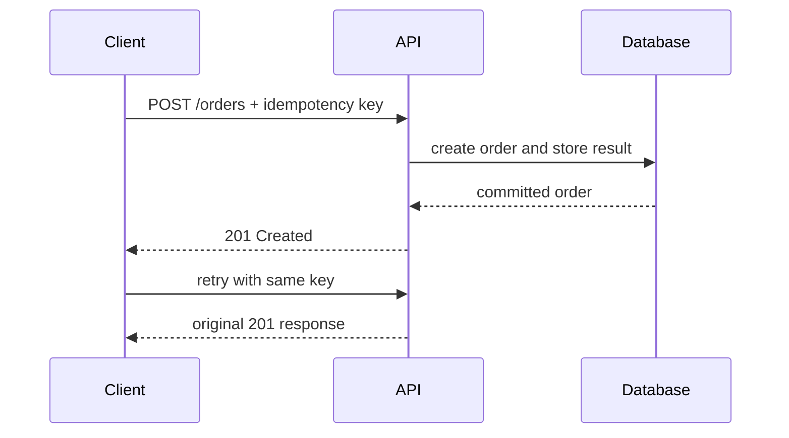
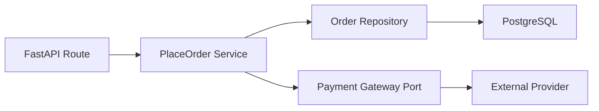
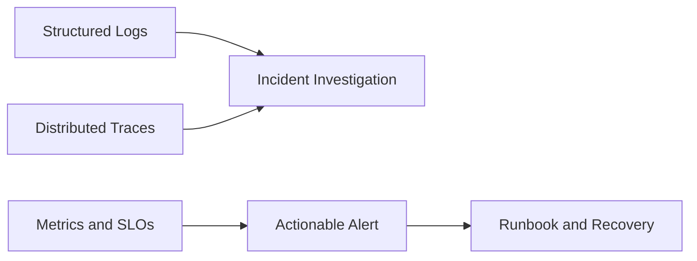
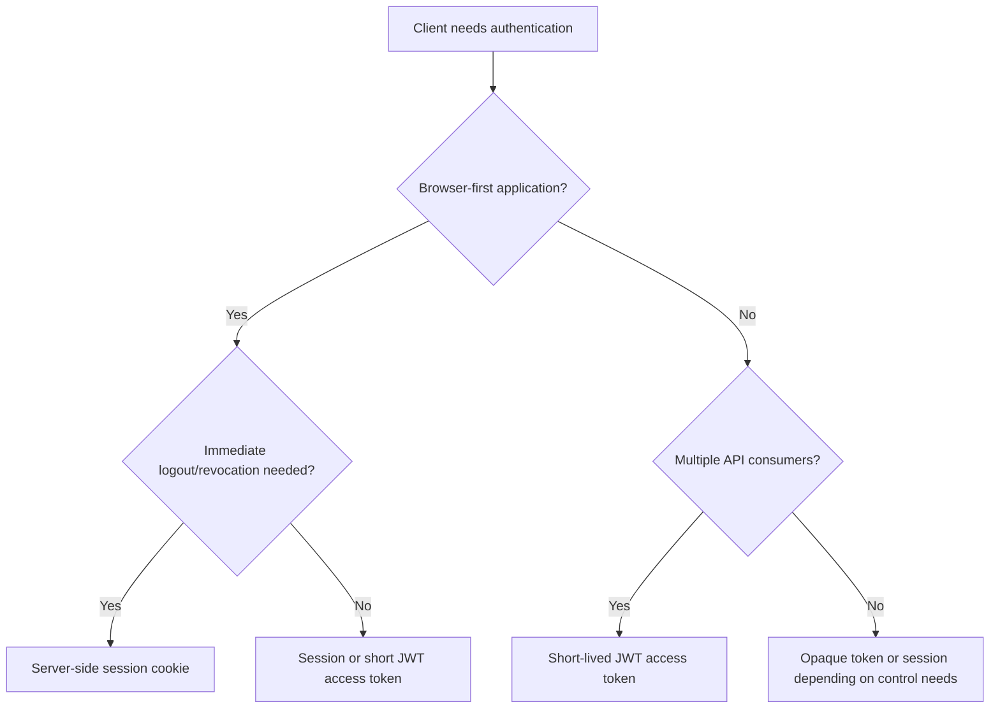
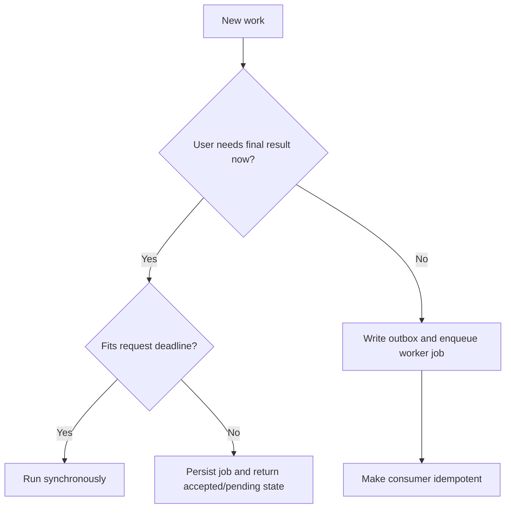

# Module 2: Core Backend Engineering — Full Revision Guide

This guide connects the Module 2 chapters into one backend-service story: a client calls an API, the service authenticates the caller, applies business rules, persists data, triggers asynchronous work, and exposes enough evidence to operate safely.

## Essential Definitions

| Term | Meaning | Why it matters |
|---|---|---|
| HTTP | Request/response protocol used by clients and servers. | It defines the public contract of most backend services. |
| Resource | A business object exposed by an API, such as an order or user. | It guides REST URL and response design. |
| Idempotency | Repeating an operation has the same intended effect. | Networks retry; payments and orders must not duplicate. |
| Authentication | Proving who the caller is. | A service cannot apply permissions without identity. |
| Authorization | Deciding whether that identity may perform an action. | Authentication alone does not permit access to every resource. |
| Session | Server-side login state referenced by a browser cookie. | Enables revocation and immediate logout at the cost of shared state. |
| JWT | Signed token containing claims. | Allows stateless access-token verification, but its payload is not secret. |
| Refresh token | Long-lived credential used to obtain new short-lived access tokens. | Limits the exposure window of access tokens. |
| Password hash | Slow one-way password representation, usually Argon2id. | Passwords must never be encrypted or stored in plaintext. |
| Service layer | Application use-case boundary. | Keeps business workflows out of routes and ORM models. |
| Repository | Persistence-facing interface for a domain aggregate. | Keeps SQL/ORM details from leaking into use-case policy. |
| Dependency injection | Supplying collaborators from outside an object. | Makes lifetimes, configuration, and tests explicit. |
| Background worker | Process that consumes durable deferred work. | Keeps slow/retryable work off user-facing requests. |
| Outbox | Database row/event written in the same transaction as business state. | Prevents losing an event after a successful database commit. |
| Structured log | Machine-queryable event with named fields. | Supports incident investigation without parsing sentences. |
| Metric | Aggregated numeric signal. | Shows trends such as p99 latency, error rate, and queue age. |
| Trace | Correlated spans for one request or workflow. | Shows where a distributed request spent time. |
| SLO | Measurable promise about reliability, such as 99.9% successful checkout requests. | Turns “reliable” into a decision-making target. |

---

## Part 1: HTTP, REST, and API Contracts

### The simple model

An API is a contract between two independently changing programs. The client needs a stable way to request work; the server needs a stable way to explain success and failure.

### What to design

- **Resources:** `/orders/123`, not `/getOrder?id=123`.
- **Methods:** `GET` reads, `POST` creates/actions, `PUT` replaces, `PATCH` partially updates, `DELETE` removes.
- **Status codes:** use `201` for a created resource, `400` for malformed input, `401` for missing/invalid identity, `403` for denied permission, `404` for absent resource, `409` for a state conflict, and `5xx` for server/dependency failure.
- **Errors:** return stable machine-readable codes; keep stack traces internal.
- **Versioning:** prefer additive changes. Removing or changing a field’s meaning breaks clients.
- **Pagination:** use a cursor/keyset for large changing lists.

### Example: retry-safe order creation

```http
POST /v1/orders
Idempotency-Key: 8a56...
Content-Type: application/json

{"sku":"book-42","quantity":1}
```

The service stores the idempotency key and final response with the order transaction. If the client times out and sends the same key again, it receives the original result rather than a duplicate order.



**Interview shortcut:** HTTP is stateless; idempotency is how a backend makes retried writes safe.

---

## Part 2: Authentication and Session Security

### The simple model

Authentication answers “who are you?” Authorization answers “may you do this to this resource?” Keep them separate in your explanation and code.

### Main choices

| Choice | Strength | Cost |
|---|---|---|
| Cookie session | Easy revocation; browser-friendly | Shared session store and CSRF protection |
| JWT access token | Stateless verification; good for APIs | Logout/revocation is harder; claims can become stale |
| Opaque access token | Central control and introspection | Token lookup latency/dependency |

### A safe login flow

1. Accept email/password over HTTPS.
2. Look up the account without exposing whether it exists.
3. Verify the Argon2id password hash.
4. Create a session or issue a short-lived access token.
5. Create/rotate a refresh token if renewable login is supported.
6. Log a safe security event: account ID, outcome, request/trace ID, IP risk context—not credentials.
7. Authorize every later request against the target resource.

### Example: refresh-token rotation

The database stores only a hash of each refresh token plus a family ID, expiry, device metadata, and revoked time. On refresh:

- Verify the presented token.
- Mark it used/revoked.
- Issue a new refresh token in the same family.
- If a previously used token appears, revoke the entire family and require login again.

**Why:** token reuse strongly suggests token theft.

**Interview shortcut:** JWT payloads are readable; trust comes from signature verification, not encryption.

---

## Part 3: Application Architecture

### The simple model

Routes translate HTTP. Services express use cases. Repositories persist aggregates. Infrastructure implements technical details. This is not about adding folders; it is about putting decisions in the correct place.



### MVC

- **Controller:** parses request, calls application code, maps output to HTTP.
- **Model:** represents application/domain data; it is not automatically an ORM table.
- **View:** renders output; for JSON APIs this is often a response schema.

### Service layer

Use a service for a business workflow involving rules or multiple dependencies.

```ts
async function placeOrder(cmd: PlaceOrderCommand, deps: { db: Db; orders: OrderRepo; inventory: InventoryRepo; outbox: Outbox }) {
  return deps.db.transaction(async (tx) => {
    await deps.inventory.reserve(tx, cmd.sku, cmd.quantity);
    const order = await deps.orders.create(tx, cmd);
    await deps.outbox.add(tx, "order.created", { orderId: order.id });
    return order;
  });
}
```

```python
async def place_order(command, orders, inventory, outbox):
    async with orders.transaction():
        await inventory.reserve(command.sku, command.quantity)
        order = await orders.create(command)
        await outbox.add("order.created", {"order_id": str(order.id)})
    return order
```

The service owns the transaction and the business sequence. The route should not.

### Repository and Clean Architecture

Use repositories when they protect domain policy from persistence mechanics. Use ports/adapters when an external dependency is likely to vary or needs a test double.

Avoid extremes:

- Do not put all SQL behind empty CRUD wrappers.
- Do not create interfaces for objects with one stable implementation and no boundary.
- Do not let framework/ORM entities become the entire domain model by accident.

### Dependency injection

The composition root creates the real application:

```ts
const service = new PlaceOrderService(
  new PostgresOrderRepository(pool),
  new PostgresInventoryRepository(pool),
  new OutboxPublisher(pool),
);
```

```python
service = PlaceOrderService(
    orders=PostgresOrderRepository(pool),
    inventory=PostgresInventoryRepository(pool),
    publisher=OutboxPublisher(pool),
)
```

Tests replace these dependencies with fakes or disposable real adapters.

**Interview shortcut:** clean architecture means dependencies point toward business policy, not toward frameworks.

---

## Part 4: Background Work and Asynchronous Processing

### The simple model

Do the minimum needed for the user’s immediate invariant synchronously. Move slow, retryable, or fan-out work to a durable queue/worker.

Examples:

- send email after an order commits;
- generate a large report;
- resize uploaded images;
- reconcile a payment provider webhook;
- process analytics events.

### Delivery rules

| Rule | Meaning |
|---|---|
| At-most-once | A message may be lost but never repeated. |
| At-least-once | A message may repeat; consumers must be idempotent. |
| Exactly-once | Usually an end-to-end business illusion built from idempotency and durable state. |

### Worker flow

1. Business transaction writes state and an outbox event.
2. Relay publishes the event to a queue.
3. Worker receives the message.
4. Worker performs an idempotent durable update/effect.
5. Worker acknowledges after success.
6. Retries use bounded exponential backoff and jitter.
7. Poison messages go to a dead-letter queue with an owner and replay plan.

### Cron jobs

Cron is scheduling, not uniqueness. In a multi-replica deployment, use leader election, a database advisory lock, or—preferably—an idempotent job key.

**Example:** `reconcile:2026-08-06` is unique in a jobs table. Any replica can attempt it; one wins, others observe completion.

**Interview shortcut:** an outbox solves “database commit succeeded but publish failed.”

---

## Part 5: Errors, Logging, Monitoring, and Observability

### Error handling

Classify failures:

| Class | API behavior | Retry? |
|---|---|---|
| Validation | `400` / `422` | No |
| Authentication/authorization | `401` / `403` | No |
| Conflict | `409` | Usually caller resolves |
| Transient dependency | `503` / timeout | Bounded, only if safe |
| Internal defect | `500` | Fix; do not expose internals |

Translate exceptions at one boundary. A route returns a stable problem response; internal logs/traces retain technical detail.

### Structured logging

Good event:

```json
{"event":"order_created","order_id":"o_123","request_id":"r_456","duration_ms":42,"outcome":"success"}
```

Bad event:

```text
user=alice@example.com password=... card=... order thing failed maybe
```

### Monitoring and observability

Use the four golden signals:

- **Traffic:** requests/second, jobs/second.
- **Errors:** failures by operation and class.
- **Latency:** p50, p95, p99—not only average.
- **Saturation:** queue age/depth, CPU, memory, connection-pool usage, event-loop lag.

An SLO makes the user promise concrete:

> 99.9% of successful `POST /orders` requests complete in under 500 ms during a 30-day window.



**Interview shortcut:** metrics tell you *that* a problem exists; traces help show *where* one request waited; logs explain *what* happened.

---

## Module 2 Shortcuts

### Authentication

- Authentication proves identity; authorization checks permission.
- Hash passwords with Argon2id; never encrypt/store plaintext passwords.
- Use `HttpOnly`, `Secure`, and appropriate `SameSite` for browser cookies.
- Verify JWT signature, algorithm, issuer, audience, expiry, and not-before.
- Access tokens should be short-lived; refresh tokens should rotate.

### API design

- Use nouns for resources and HTTP verbs for operations.
- Use stable error codes and additive contract changes.
- Make externally retried writes idempotent.
- Return `409` for state conflicts; do not misuse `500`.
- Use cursor pagination for large mutable lists.

### Architecture

- Routes handle transport; services handle use cases; repositories handle persistence.
- Keep transactions short.
- Depend on ports/interfaces at genuine boundaries.
- Create dependencies in a composition root.

### Async and operations

- Queue slow/retryable work; make consumers idempotent.
- Acknowledge a message only after durable success.
- Use an outbox for transactional event publication.
- Bound timeouts, retries, pools, workers, and queue depth.
- Log structured, redacted events; monitor SLOs and saturation.

## Next Files

- [HTTP Fundamentals](01-HTTP-Fundamentals.md)
- [Authentication Flow](11-Authentication-Flow.md)
- [Clean Architecture](15-Clean-Architecture.md)
- [Asynchronous Processing](19-Asynchronous-Processing.md)
- [Observability Fundamentals](23-Observability-Fundamentals.md)

---

## Two-Minute Recap

- HTTP is stateless; applications carry state through cookies, tokens, or server-side stores.
- `GET` should not change state; `PUT` and `DELETE` should be idempotent by design.
- Idempotency keys make externally retried writes safe.
- Authentication proves identity; authorization checks permission for a specific action and resource.
- Passwords are hashed with Argon2id; they are never encrypted or logged.
- JWTs are signed, not encrypted; validate signature, issuer, audience, and lifetime.
- Refresh tokens rotate and need replay detection plus family revocation.
- Routes translate HTTP; services own use cases; repositories own persistence mechanics.
- Use an outbox for database state plus reliable asynchronous publication.
- At-least-once workers require idempotent consumers.
- Timeouts, bounded retries, and backpressure protect capacity.
- Metrics show trends, logs record events, and traces connect a request path.

## Decision Trees

### Session or JWT?



| Choose | When | Avoid when |
|---|---|---|
| Session cookie | Browser application, immediate revocation, server-controlled state | Cross-domain API clients need simple bearer-token integration |
| JWT access token | API/mobile/service clients, short-lived stateless verification | You need immediate claim changes or cannot manage signing-key rotation |
| Opaque token | Central introspection/revocation is more important than token self-containment | The lookup dependency would be an unacceptable request-path bottleneck |

### Request path or background worker?



Use a worker for email, report generation, fan-out notifications, image processing, and reconciliation. Keep an inventory reservation or core order creation synchronous when its result is the immediate business invariant.

## Interview Answer Templates

### 30-second definition

> “`<concept>` solves `<problem>` by `<mechanism>`. The important trade-off is `<cost/risk>`. In a backend service, I would observe it with `<metric/log/trace>`.”

Example:

> “Idempotency prevents duplicate effects when clients retry by storing a stable key and replaying the original outcome. It costs storage and lifecycle management. I would monitor duplicate-key reuse and conflict/error rates.”

### Two-minute design answer

1. Name the user-facing invariant.
2. Describe the normal request/data flow.
3. Name the dangerous failure or retry path.
4. Explain the durable protection: constraint, transaction, idempotency record, or queue.
5. State timeout/retry/backpressure policy.
6. Finish with telemetry and rollback/recovery.

### Senior-level trade-off answer

> “I would start with `<simpler choice>` because it preserves `<invariant>` at lower operational cost. I would move to `<more complex choice>` only when measurement shows `<trigger>`. The extra complexity introduces `<risk>`, so I would add `<operational control>` and keep `<rollback/reconciliation path>`.”

## Failure Scenarios: Symptom → Investigation → Fix

| Symptom | Likely cause | Investigate | Safe fix |
|---|---|---|---|
| Duplicate orders | Client retry after timeout; missing idempotency | Search by idempotency key and trace ID | Persist the key/result in the transaction; replay original outcome |
| Random `401` errors | Token expiry, clock skew, wrong issuer/audience | Inspect token metadata safely and verifier configuration | Use short skew tolerance; correct issuer/audience; refresh/re-login flow |
| p99 latency spike | Dependency queueing, pool saturation, event-loop blocking | Trace slow requests; inspect pool/queue/event-loop metrics | Add deadline/bulkhead; remove blocking work; scale only after bottleneck evidence |
| Emails missing after orders | Commit succeeded; publish failed | Compare outbox rows with queue delivery and worker outcome | Use transactional outbox relay and replay/reconciliation |
| Repeated worker side effect | At-least-once delivery without deduplication | Inspect event IDs and consumer writes | Add unique event/effect record and idempotent consumer behavior |
| Alert storm | Every exception pages; no SLO policy | Compare alerts to user impact | Alert on SLO burn/actionable saturation; keep logs for individual faults |

## Common Anti-patterns

| Anti-pattern | Why it fails | Preferred approach |
|---|---|---|
| Password encryption | Reversible secret storage increases breach impact | Argon2id hash with unique salt and controlled parameters |
| Long-lived JWT | Theft remains useful for too long; claims become stale | Short access token plus rotated refresh session |
| Route contains all business logic | Hard to test/reuse; transaction policy leaks into HTTP | Route → service/use case → repository/ports |
| Network call inside DB transaction | Holds locks while waiting; increases deadlocks | Commit core state, then publish via outbox/worker |
| Retry every exception | Repeats bad input and amplifies overload | Classify errors; retry only safe transient failures |
| Full request-body logging | Leaks secrets/PII and raises cost | Structured, redacted event fields |

## Flashcards

| Question | Answer |
|---|---|
| Is a JWT payload secret? | No. It is usually encoded and signed, not encrypted. |
| What protects a retry-safe write? | A durable idempotency key plus stored/replayable outcome. |
| Authentication vs authorization? | Identity proof vs permission for a specific action/resource. |
| When acknowledge a queue message? | After the idempotent durable effect succeeds. |
| Why an outbox? | It closes the gap between database commit and event publication. |
| What does `HttpOnly` do? | Prevents browser JavaScript from reading the cookie. |
| Why is a timeout important? | It bounds waiting work and protects capacity. |
| What does p99 reveal? | Tail latency and queueing hidden by averages. |
| Metrics vs traces? | Metrics aggregate trends; traces show one request/workflow path. |
| Where should a transaction boundary live? | Usually in the application service/use case that owns the invariant. |

## When to Use / When Not to Use

| Technique | Use it when | Do not use it when |
|---|---|---|
| Repository | Domain policy must be isolated from persistence mechanics | It only wraps trivial CRUD and hides useful queries |
| Dependency injection | Dependencies vary by environment/test or need explicit lifetime | It adds indirection without a real boundary |
| Cron | Work is naturally time-based and idempotent | Correctness depends on exactly one replica running without coordination |
| Background worker | Work is slow, fan-out, or retryable | Caller must receive the final invariant inside its deadline |
| Circuit breaker | A failing dependency is consuming capacity | It is used as a substitute for fixing missing timeouts/limits |
| Structured logging | Incidents need queryable evidence | Fields include secrets or uncontrolled high-cardinality payloads |

## End-to-End Case Study: Create an Order

1. Client sends `POST /orders` with bearer/session identity and idempotency key.
2. API validates schema and authorizes the customer/tenant.
3. `PlaceOrderService` starts a short transaction.
4. Inventory is reserved with an atomic database update.
5. Order plus idempotency result plus `order.created` outbox event commit together.
6. API returns `201` and order ID; a duplicate key returns the same response.
7. Relay publishes the outbox event.
8. Email/analytics workers consume idempotently and record safe structured outcomes.
9. Dashboard tracks order success, p99 latency, DB pool usage, outbox age, worker retries, and business conversion.

**Key lesson:** the request path protects the immediate order invariant; asynchronous components handle secondary effects without extending user latency.

## Debugging Commands and Evidence

```bash
# Reproduce an API request with explicit headers
curl -i -X POST http://localhost:8000/v1/orders \
  -H "Idempotency-Key: demo-key" \
  -H "Content-Type: application/json" \
  -d '{"sku":"book-42","quantity":1}'

# Inspect a container's resource use
docker stats

# Follow structured application logs
docker compose logs -f api
```

During an incident, gather:

- request/trace ID;
- deployment version and configuration change;
- dependency latency, pool saturation, queue depth/age;
- safe business identifier such as order ID;
- error class and retry count.

## Self-Test Checklist

You are ready to move on when you can:

- [ ] Explain sessions, JWTs, and refresh rotation without confusing authentication and authorization.
- [ ] Design a retry-safe create endpoint with an idempotency key.
- [ ] Place a business transaction boundary in a service layer.
- [ ] Explain why an outbox and idempotent consumer work together.
- [ ] Diagnose a p99 latency rise using metrics, traces, and logs.
- [ ] Name safe retry rules and why unbounded retries cause outages.
- [ ] Defend a session/JWT or sync/async design choice using trade-offs.

## Cross-Module Study Links

- Module 3: [Transactions](../Module-03-Databases/27-Transactions.md), [Indexes](../Module-03-Databases/19-Indexes.md)
- Module 4: [Race Conditions](../Module-04-Operating-Systems/13-Race-Conditions.md), [Backend Concurrency Patterns](../Module-04-Operating-Systems/32-Backend-Concurrency-Patterns.md)
- Module 6: [TCP](../Module-06-Networking-and-Distributed-Basics/08-TCP.md), [Failure Handling](../Module-06-Networking-and-Distributed-Basics/34-Failure-Handling.md)
- Module 7: [Idempotency](../Module-07-Advanced-Backend-and-System-Design/32-Idempotency.md), [Retry Pattern](../Module-07-Advanced-Backend-and-System-Design/35-Retry-Pattern.md)
- Module 9: [Integration Testing](../Module-09-Testing-and-Code-Quality/05-Integration-Testing.md)

## Interview Drills

1. **Design a login system for a browser and mobile app.** Compare sessions, JWT access tokens, refresh-token rotation, logout, key rotation, CSRF, and monitoring.
2. **A user says “I clicked pay twice and was charged twice.”** Explain idempotency, provider uncertainty, durable ledger state, retry behavior, and reconciliation.
3. **Order creation p99 rose from 300 ms to 4 seconds after a deployment.** State your investigation order and rollback threshold.
4. **Email delivery must never be silently lost.** Design an outbox, queue, worker, DLQ, replay path, and dashboard.
