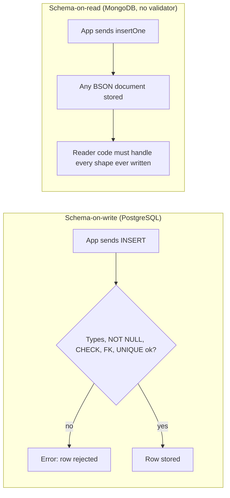

# SQL vs NoSQL

> **Module 03 · Databases** · Prerequisites: [Module 03 overview](README.md) · Next: [CAP Theorem](02-CAP-Theorem.md)

---

## ⏱ If You Only Have 2 Minutes

- "NoSQL" is not one thing. It is an umbrella for **document** (MongoDB), **key-value** (Redis, DynamoDB), **wide-column** (Cassandra), **graph** (Neo4j) stores, and is often stretched to cover **time-series** and **search** engines. Compare data models, not labels.
- Relational databases are **schema-on-write**: the database rejects a row that breaks a type, `NOT NULL`, `CHECK`, `UNIQUE` or foreign-key rule. Most document stores are **schema-on-read**: the shape lives in application code unless you add validation (MongoDB `$jsonSchema`).
- Relational models **normalize and join at read time**. Document models **embed** data that is read together, so one read returns the whole aggregate, but shared data gets copied and every copy must be updated. A MongoDB document is capped at **16 MB**.
- "NoSQL scales, SQL doesn't" is a myth. PostgreSQL scales reads with replicas and big tables with partitioning; Citus and distributed SQL (CockroachDB, YugabyteDB, Spanner) shard SQL. What is hard in *every* database is cross-shard joins and transactions.
- The families have converged: MongoDB has multi-document ACID transactions (replica sets since 4.0, sharded clusters since 4.2), and PostgreSQL has had indexed `jsonb` since 9.4.
- Key-value and wide-column stores make you **design one table per query**. Fast for known access patterns, painful for a new ad-hoc question.
- A sensible default for a new system of record is a relational database. Add a specialized store when one specific access pattern needs it, and say which one.

---

## 1. What It Is and Why It Exists

A **relational (SQL) database** stores data in tables of typed columns. Rows link to each other through keys, and you query them with SQL, a declarative language: you describe the result and a query planner decides how to get it. The model goes back to Edgar Codd's 1970 paper. PostgreSQL, MySQL, SQL Server and Oracle are the common examples. They share three habits: a schema enforced by the database, joins, and multi-statement transactions.

**NoSQL** is a loose name, popular since about 2009, for databases that give up some of those habits to get something else: a data shape closer to the application object, a simpler key-based API that is easy to spread over many machines, or a structure built for one kind of question (graph traversal, text relevance, time windows).

**Analogy:** a relational database is a set of linked ledgers. Customers are in one book, orders in another, and you cross-reference by customer number. A document store is a filing cabinet with one folder per customer, holding copies of the papers you usually need together. The folder is fast to pull out. But if a product name changes, you have to fix every folder that mentions it.

**The problem this choice solves.** Each model makes some operations cheap and others awkward or impossible. Pick the wrong one and you fight it daily:

- A ledger of payments in a store without transactions or unique constraints ends up with double charges that only a nightly reconciliation job notices.
- A social graph in SQL turns "friends of friends who like this band" into a recursive query that gets slower at every hop.
- A product catalog with 400 category-specific attributes, forced into rigid columns, becomes a 400-column table full of `NULL` or an entity-attribute-value mess that cannot be indexed well.
- A Cassandra table designed for "orders by customer" cannot answer "orders by product" at all. You need a second table, written on every order.

The interview question "SQL or NoSQL?" really asks: *what are the access patterns and invariants, and which data model serves them with the fewest moving parts?*

---

## 2. How It Works

Take one access pattern from the sample schema: **show a customer with their last 5 orders.** Here is how each family stores and serves it.

| Family | How the data is laid out | How the read works |
|---|---|---|
| Relational (PostgreSQL) | `customers` and `orders` tables; B-tree index on `orders (customer_id, created_at DESC)` | Join (or `LATERAL` subquery): find the customer by primary key, then read the first 5 index entries for that customer |
| Document (MongoDB) | `customers` document embeds `recent_orders` (a capped copy); full orders live in an `orders` collection | One `findOne` by `_id` returns everything; no join |
| Key-value (DynamoDB) | One table; partition key `CUSTOMER#42`, sort keys `PROFILE` and `ORDER#2026-11-24T10:00Z#9001` | One `Query` on the partition key, newest first, limit 6 |
| Wide-column (Cassandra) | Table `orders_by_customer` with `PRIMARY KEY ((customer_id), created_at)` and clustering order `created_at DESC` | Read one partition, take the first 5 rows; the profile comes from another table |
| Graph (Neo4j) | `(:Customer)-[:PLACED]->(:Order)` nodes and relationships | Start at the customer node and follow `PLACED` edges |

The relational and document rows differ in one important way: **who keeps the data consistent.**



With schema-on-write, bad data is stopped at the door, and changing the shape means a migration (`ALTER TABLE`). With schema-on-read, writes are flexible, and the cost moves to readers: every reader must cope with old documents that lack a field, have it as a string instead of a number, or use a renamed key. Teams handle this with a `schema_version` field and code that upgrades documents when it reads them.

Writes differ too. In PostgreSQL, placing an order writes one `orders` row and some `order_items` rows in a transaction; the "last 5 orders" view is computed at read time. In the MongoDB embedding design, placing an order writes the `orders` document **and** pushes a summary into the customer document. That is two writes, which is why the code in section 4 wraps them in a transaction. In DynamoDB or Cassandra, every extra query shape usually means another copy of the data (a global secondary index or another table), kept in sync on write.

---

## 3. Key Concepts

### The data-model families

| Family | Real examples | Unit of data | Queried by | Strong at | Weak at |
|---|---|---|---|---|---|
| Relational | PostgreSQL, MySQL, SQL Server | Row in a typed table | Any column, joins, aggregates (SQL) | Invariants, transactions, ad-hoc questions, reporting | Deeply nested or highly variable shapes (though `jsonb` helps) |
| Document | MongoDB, Couchbase, Firestore | JSON/BSON document | Fields inside documents, secondary indexes, aggregation pipeline | Aggregates read and written together, evolving shapes | Many-to-many data, data shared across many documents |
| Key-value | Redis, DynamoDB, etcd | Value behind a key | Key (DynamoDB: partition key + optional sort key) | Predictable single-digit-ms lookups, huge scale, caches, counters | Queries you did not design the key for |
| Wide-column | Apache Cassandra, ScyllaDB, HBase | Rows inside a partition, sorted by clustering columns | Partition key, then clustering-column ranges | Very high write rates, multi-datacenter replication | Joins, ad-hoc filters, read-modify-write |
| Graph | Neo4j, Amazon Neptune | Nodes and relationships with properties | Traversals (Cypher, Gremlin) | Variable-depth relationship queries | Bulk aggregates over all data, simple CRUD |
| Time-series | TimescaleDB, InfluxDB, Prometheus | Timestamped measurement | Time ranges plus tags, downsampling | Append-heavy metrics, retention, rollups | Updates to old data, relational joins (except TimescaleDB, which is PostgreSQL) |
| Search | Elasticsearch, OpenSearch | Document in an inverted index | Full-text relevance, facets | Text search, ranking, typo tolerance, log exploration | Being the system of record; transactions |

Two of these are often misfiled. **DynamoDB** is a key-value *and* document store: items are JSON-like, but you can only `Query` efficiently by partition key (plus a sort-key range). **TimescaleDB** is a PostgreSQL extension, so it is SQL. Its hypertables split data into time-based chunks automatically.

### Schema-on-write vs schema-on-read

| | Schema-on-write | Schema-on-read |
|---|---|---|
| Where the rules live | In the database (DDL, constraints) | In application code (and optional validators) |
| Changing shape | Migration, may need care to avoid locks | Write the new shape; old documents stay as they were |
| Bad data | Rejected at write time | Found later, by a reader that crashes or shows nonsense |
| Good for | Data with many writers and long life | Fast-changing prototypes, truly variable payloads |

This is a spectrum, not a binary. MongoDB can enforce a `$jsonSchema` validator on a collection. PostgreSQL can hold a schemaless `jsonb` column next to strict columns. A common, healthy design is strict columns for what the business depends on (`customer_id`, `status`, `total_cents`) and `jsonb` for the long tail (product attributes).

### Joins vs embedding

Normalization stores each fact once and joins at read time ([Normalization](06-Normalization.md)). Embedding stores related data inside the parent document ([Document Modeling](36-Document-Modeling.md)).

| Embed when | Reference (or use SQL joins) when |
|---|---|
| The child belongs to one parent (order lines belong to one order) | The child is shared (a product appears in thousands of orders) |
| The child list is bounded (a few addresses) | The list grows without limit (all orders ever) |
| Parent and child are read together almost always | The child is often read or updated on its own |
| Copies may be historical snapshots on purpose (price at time of order) | Copies must always show the current value |

MongoDB can join with `$lookup`, and it works, but it is not the model's sweet spot. If most of your reads need `$lookup`, the data is relational.

### Transactions and constraints across families

- **PostgreSQL:** multi-statement transactions over any rows, plus declarative constraints. Uniqueness and referential integrity hold even when ten app servers race.
- **MongoDB:** single-document writes have always been atomic. Multi-document transactions exist (4.0 for replica sets, 4.2 for sharded clusters), but MongoDB's own guidance is to model so that most writes touch one document. There are no foreign keys; unique indexes exist.
- **DynamoDB:** single-item conditional writes (`ConditionExpression`) are the main tool; `TransactWriteItems` covers a limited number of items in one all-or-nothing call.
- **Cassandra:** writes are not read-modify-write. "Lightweight transactions" (`INSERT ... IF NOT EXISTS`, `UPDATE ... IF`) give compare-and-set on one partition at the cost of several extra round trips (they use Paxos).
- **Redis:** each command is atomic because commands execute one at a time. `MULTI`/`EXEC` and Lua scripts group commands, but there is no rollback.

### Scaling: the honest version

The myth says relational databases cannot scale and NoSQL ones can. The facts:

- **One PostgreSQL primary goes a long way.** A single node with fast disks handles many thousands of transactions per second and tables of billions of rows, *if* queries are indexed.
- **Read scaling:** streaming replication feeds read replicas. Reads on a replica may be slightly stale ([Consistency Models](03-Consistency-Models.md)).
- **Big tables:** declarative partitioning (range, list, hash) splits a table so old partitions can be dropped instantly and queries prune to the partitions they need.
- **Write scaling past one node:** sharding with Citus, or a distributed SQL database. This is where it gets hard. But it is hard everywhere: Cassandra and DynamoDB scale writes horizontally precisely *because* they forbid cross-partition joins and limit multi-item transactions.

So the real trade is not "SQL vs scale". It is "general queries and cross-row invariants" vs "automatic horizontal partitioning with restricted queries". Most products never outgrow a well-run single primary with replicas.

### Query flexibility vs designed-for-queries

In SQL you add an index and ask a new question tomorrow. In DynamoDB and Cassandra you design the keys from a list of access patterns *before* you write data (single-table design, query-first modeling). A new question means a new index or table and a backfill. That is a fine trade when the access patterns are stable and the scale is huge; it is a bad one for a young product that is still discovering what it needs to ask.

---

## 4. Code Examples

Scenario: the account page shows a customer and their 5 newest orders. We implement it twice: PostgreSQL with a join, and MongoDB with embedding. The point is to see where each model puts the work.

Setup for PostgreSQL. The sample schema deliberately has no index on `orders.customer_id`; this access pattern needs one:

```sql
CREATE INDEX orders_customer_created_idx ON orders (customer_id, created_at DESC);
```

Shape of a MongoDB customer document (the subset pattern: a capped copy of recent orders):

```json
{
  "_id": 42,
  "name": "Ada Lovelace",
  "email": "ada@example.com",
  "recent_orders": [
    { "order_id": 9001, "status": "paid", "total_cents": 4999, "created_at": { "$date": "2026-11-24T10:00:00Z" } }
  ]
}
```

### Node.js / TypeScript

PostgreSQL: one round trip, no duplicated data. The `LATERAL` subquery runs once for the customer row and reads at most 5 index entries.

```ts
// npm i pg && npm i -D @types/pg   — Node.js 22+, TypeScript 5, ESM
import pg from "pg";

const pool = new pg.Pool({ connectionString: process.env.DATABASE_URL, max: 10 });

export interface OrderSummary { order_id: number; status: string; total_cents: number; created_at: Date }
export interface CustomerPage { id: number; name: string; email: string; recent_orders: OrderSummary[] }

type JsonOrder = Omit<OrderSummary, "created_at"> & { created_at: string };

export async function getCustomerPagePg(customerId: number): Promise<CustomerPage | null> {
  const { rows } = await pool.query<{ id: string; name: string; email: string; recent_orders: JsonOrder[] }>(
    `SELECT c.id, c.name, c.email, COALESCE(r.orders, '[]'::json) AS recent_orders
       FROM customers c
      CROSS JOIN LATERAL (
            SELECT json_agg(o ORDER BY o.created_at DESC) AS orders
              FROM (SELECT id AS order_id, status, total_cents, created_at
                      FROM orders
                     WHERE customer_id = c.id
                     ORDER BY created_at DESC
                     LIMIT 5) o
           ) r
      WHERE c.id = $1`,
    [customerId],
  );
  const row = rows[0];
  if (!row) return null;
  return {
    // pg returns bigint columns as strings (they can exceed 2^53); our ids are small enough for number.
    id: Number(row.id),
    name: row.name,
    email: row.email,
    // pg parses json for us, but timestamps inside JSON arrive as ISO strings.
    recent_orders: row.recent_orders.map((o) => ({ ...o, created_at: new Date(o.created_at) })),
  };
}
```

MongoDB: the read is a single document fetch. The cost moved to the write path: every order is written twice, so both writes share a transaction.

```ts
// npm i mongodb   — Node.js 22+, TypeScript 5, ESM. Requires a replica set (transactions).
import { MongoClient } from "mongodb";

interface OrderSummary { order_id: number; status: string; total_cents: number; created_at: Date }
interface CustomerPage { id: number; name: string; email: string; recent_orders: OrderSummary[] }
interface CustomerDoc { _id: number; name: string; email: string; recent_orders: OrderSummary[] }
interface OrderDoc {
  _id: number; customer_id: number; status: string; total_cents: number; created_at: Date;
  items: { product_id: number; quantity: number; unit_price_cents: number }[];
}

const client = new MongoClient(process.env.MONGO_URL!);
const db = client.db("shop");
const customers = db.collection<CustomerDoc>("customers");
const orders = db.collection<OrderDoc>("orders");

// The full history page still needs this index on the referenced collection.
await orders.createIndex({ customer_id: 1, created_at: -1 });

export async function getCustomerPageMongo(customerId: number): Promise<CustomerPage | null> {
  const doc = await customers.findOne({ _id: customerId });
  return doc && { id: doc._id, name: doc.name, email: doc.email, recent_orders: doc.recent_orders ?? [] };
}

export async function placeOrderMongo(order: OrderDoc): Promise<void> {
  const summary: OrderSummary = {
    order_id: order._id, status: order.status, total_cents: order.total_cents, created_at: order.created_at,
  };
  const session = client.startSession();
  try {
    // withTransaction retries the whole callback on transient errors (e.g. a primary election).
    await session.withTransaction(async () => {
      await orders.insertOne(order, { session });
      await customers.updateOne(
        { _id: order.customer_id },
        // $sort + $slice keep the embedded array bounded at 5: no unbounded document growth.
        { $push: { recent_orders: { $each: [summary], $sort: { created_at: -1 }, $slice: 5 } } },
        { session },
      );
    });
  } finally {
    await session.endSession();
  }
}
```

### Python

PostgreSQL with psycopg 3. A Pydantic model turns the ISO timestamp strings produced by `json_agg` into `datetime` objects, so the mapping code is shorter than in TypeScript.

```python
# pip install "psycopg[binary]" pydantic   — Python 3.12+
from datetime import datetime

import psycopg
from psycopg.rows import dict_row
from pydantic import BaseModel


class OrderSummary(BaseModel):
    order_id: int
    status: str
    total_cents: int
    created_at: datetime  # Pydantic parses the ISO string from json_agg


class CustomerPage(BaseModel):
    id: int
    name: str
    email: str
    recent_orders: list[OrderSummary]


CUSTOMER_PAGE_SQL = """
SELECT c.id, c.name, c.email, COALESCE(r.orders, '[]'::json) AS recent_orders
  FROM customers c
 CROSS JOIN LATERAL (
       SELECT json_agg(o ORDER BY o.created_at DESC) AS orders
         FROM (SELECT id AS order_id, status, total_cents, created_at
                 FROM orders
                WHERE customer_id = c.id
                ORDER BY created_at DESC
                LIMIT 5) o
      ) r
 WHERE c.id = %s
"""


def get_customer_page_pg(conn: psycopg.Connection, customer_id: int) -> CustomerPage | None:
    # psycopg loads json columns into Python lists/dicts; bigint arrives as int (no string dance).
    with conn.cursor(row_factory=dict_row) as cur:
        cur.execute(CUSTOMER_PAGE_SQL, (customer_id,))
        row = cur.fetchone()
    return CustomerPage.model_validate(row) if row else None
```

MongoDB with PyMongo. Same embedding design, same transaction on the write path.

```python
# pip install pymongo   — Python 3.12+. Requires a replica set (transactions).
import os
from typing import Any

from pymongo import ASCENDING, DESCENDING, MongoClient
from pymongo.client_session import ClientSession

client: MongoClient = MongoClient(os.environ["MONGO_URL"])
db = client["shop"]
db.orders.create_index([("customer_id", ASCENDING), ("created_at", DESCENDING)])


def get_customer_page_mongo(customer_id: int) -> dict[str, Any] | None:
    # One document read by _id: the whole page, no join.
    return db.customers.find_one({"_id": customer_id}, {"name": 1, "email": 1, "recent_orders": 1})


def list_order_history(customer_id: int, limit: int = 20) -> list[dict[str, Any]]:
    # Older orders are referenced, not embedded, so history pages query the orders collection.
    cursor = db.orders.find({"customer_id": customer_id}).sort("created_at", DESCENDING).limit(limit)
    return list(cursor)


def place_order_mongo(order: dict[str, Any]) -> None:
    summary = {
        "order_id": order["_id"],
        "status": order["status"],
        "total_cents": order["total_cents"],
        "created_at": order["created_at"],
    }

    def write_both(session: ClientSession) -> None:
        db.orders.insert_one(order, session=session)
        db.customers.update_one(
            {"_id": order["customer_id"]},
            {"$push": {"recent_orders": {"$each": [summary], "$sort": {"created_at": -1}, "$slice": 5}}},
            session=session,
        )

    with client.start_session() as session:
        # Retries the callback on TransientTransactionError and the commit on UnknownTransactionCommitResult.
        session.with_transaction(write_both)
```

**What to notice.** The PostgreSQL version stores each order once and computes the page on read; the index is what keeps it fast. The MongoDB version makes the read trivial and pays on every write, plus a rule (`$slice: 5`) to keep the array bounded. If an order's status changes from `paid` to `shipped`, the MongoDB design must update the copy in `recent_orders` too. That is the embedding trade-off in one example. **Runtime difference:** `pg` returns `bigint` as a string in Node, because JavaScript numbers lose precision above 2^53; psycopg returns a Python `int`, which has no such limit.

---

## 5. Production Concerns

- **Schema drift in schemaless stores.** Without a validator, a bug in one service can write `total_cents: "4999"` (a string) for a week before anyone notices. Add a `$jsonSchema` validator for fields the business depends on, and a `schema_version` field so readers know which shape they hold.
- **Unbounded embedded arrays.** Embedding "all orders" in a customer document grows it on every purchase, makes every update rewrite a larger document, and eventually hits the 16 MB limit. Embed only bounded lists, or cap them as in the example.
- **Hot partitions.** In DynamoDB and Cassandra, throughput is spread by partition key. A key like `status = "pending"` or "today's date" sends most traffic to one partition, which throttles while the rest of the cluster idles. Choose high-cardinality keys.
- **Migrations move, they do not disappear.** In PostgreSQL you run `ALTER TABLE` (carefully: see [Database Migrations](34-Database-Migrations.md)). In MongoDB you either backfill old documents or keep upgrade-on-read code forever. Either way someone owns it.
- **Connection model.** PostgreSQL uses one server process per connection, so hundreds of app instances need a pooler such as PgBouncer. MongoDB drivers keep their own pools and route to replica-set members. Size pools on purpose in both cases.
- **What to measure.** Relational: slow queries (`pg_stat_statements`), lock waits, replication lag. Document: document size distribution, index size versus RAM, `$lookup` frequency (a sign the data wants to be relational). Wide-column/key-value: per-partition throughput, throttled requests, and (Cassandra) tombstones read per query.
- **Durability defaults differ.** Redis with the default `appendfsync everysec` can lose about one second of writes on a crash, which is fine for a cache and wrong for a ledger. Know the durability setting of each store before you put money in it.

---

## 6. Common Mistakes

- **Treating "NoSQL" as one technology** — the answer compares PostgreSQL to "NoSQL" in general and says nothing useful — name the family and product (MongoDB, DynamoDB, Cassandra) and the access pattern it serves.
- **Choosing a document store to avoid "doing a schema"** — the schema still exists, now spread across services and enforced by nobody — design the document shape deliberately and add validation for core fields.
- **Embedding shared, mutable data** — the product name is copied into 50,000 orders and a rename means a mass update, or worse, stale names forever — embed snapshots on purpose (price at purchase), reference everything that must stay current.
- **Picking Cassandra or DynamoDB without a list of queries** — the first new feature needs a query the keys cannot answer, so the team adds a full-table scan — write down every access pattern first; if you can't, use a relational database.
- **Saying "SQL can't scale"** — the interviewer asks about read replicas, partitioning and Citus and the answer falls apart — explain the real limit: cross-shard joins and transactions are hard in any system.
- **Using `$lookup` everywhere in MongoDB** — joins in an aggregation pipeline on every request, slower than the SQL they replaced — if the data is relational, store it in a relational database.
- **Making the search index or cache the source of truth** — Elasticsearch or Redis loses data on a bad reindex or eviction — keep the system of record in a durable, transactional store and rebuild the rest from it.

---

## 7. Comparison Table

| | PostgreSQL | MongoDB | DynamoDB | Cassandra | Redis | Neo4j |
|---|---|---|---|---|---|---|
| Model | Relational | Document | Key-value / document | Wide-column | In-memory key-value with data structures | Property graph |
| Schema | On write (plus `jsonb`) | On read (optional validator) | On read, keys fixed | Table schema, query-first design | None | Optional constraints |
| Joins | Yes | `$lookup` (limited) | No | No | No | Traversals |
| Multi-record transactions | Yes | Yes (4.0+ / 4.2+ sharded) | Limited (`TransactWriteItems`) | No (single-partition LWT only) | `MULTI`/Lua, no rollback | Yes |
| Horizontal write scaling | Extensions (Citus) or distributed SQL | Built-in sharding | Built-in, automatic | Built-in | Redis Cluster (hash slots) | Mostly scale-up |
| Ad-hoc queries | Excellent | Good with indexes | Poor (`Scan`) | Poor | None | Good for graph questions |
| Typical role | System of record | Aggregate-shaped data, content | Massive key-based workloads | High write volume, multi-DC | Cache, rate limits, queues | Relationship-heavy queries |

---

## 8. Interview Questions

**[Junior] What is the difference between SQL and NoSQL databases?**
SQL databases store rows in tables with a schema the database enforces, support joins, and run multi-statement transactions. "NoSQL" covers several different models: document, key-value, wide-column and graph. They usually trade some of those features for a data shape closer to the application or easier horizontal partitioning. The useful answer names the model and the access pattern, not just the label.

**[Junior] What do schema-on-write and schema-on-read mean?**
Schema-on-write means the database checks every write against the declared structure and rejects bad rows. Schema-on-read means the database stores whatever it is given and the reading code interprets it. The second is more flexible but moves validation and migration work into application code. MongoDB can add a `$jsonSchema` validator to get some of the first back.

**[Mid] When would you embed data in a MongoDB document, and when would you reference it?**
Embed when the child belongs to one parent, the list is bounded, and both are read together, like order lines inside an order. Reference when the data is shared by many parents, grows without limit, or is updated on its own, like products or a customer's full order history. A common middle ground is the subset pattern: embed the 5 most recent orders and reference the rest.

**[Mid] Does MongoDB support transactions?**
Yes. Single-document operations have always been atomic, and multi-document ACID transactions arrived in 4.0 for replica sets and 4.2 for sharded clusters. They cost more than single-document writes, so MongoDB recommends modeling so that most writes touch one document. If nearly every operation needs a multi-document transaction, the data is probably relational.

**[Mid] Why is "NoSQL scales better" misleading?**
Relational databases scale reads with replicas, scale large tables with partitioning, and scale writes with sharding extensions or distributed SQL systems. Stores like Cassandra and DynamoDB scale writes automatically because they restrict what you can do: no joins, limited transactions, queries only by key. The scalability comes from the restrictions, and you can impose the same restrictions on a sharded SQL design.

**[Senior] A team wants DynamoDB for a new product whose features are still changing every week. What do you say?**
DynamoDB works best when the access patterns are known up front, because each query shape needs a key or index designed for it. A product still finding its features will keep needing new queries, and each one means a new GSI, a backfill, or a scan. I would start with PostgreSQL, which answers new questions with a new index, and revisit if we reach a measured scale or latency need that one primary plus replicas cannot meet. If they have a strong operational reason (serverless, no database team), I would ask them to write down the access patterns first and accept the redesign cost.

**[Senior] Design storage for an e-commerce site: orders, product catalog with variable attributes, search, sessions.**
Orders, payments and inventory go in PostgreSQL, because they need transactions, unique constraints and reporting. Variable product attributes fit a `jsonb` column with a GIN index in the same database, which avoids a second store. Sessions and rate limits go in Redis with TTLs, because losing them is cheap. Search starts with PostgreSQL full-text search; I would add Elasticsearch or OpenSearch only when relevance tuning, facets at scale, or typo tolerance justify it. It would be fed from PostgreSQL via change data capture or an outbox, never written to as the source of truth.

**[Senior] How would you move a hot table from PostgreSQL to Cassandra, and what would you lose?**
First list every query on that table, because each one becomes a Cassandra table keyed for that query. Then dual-write (preferably via an outbox or CDC), backfill, compare reads, and switch reads table by table. You lose joins, ad-hoc queries, foreign keys, and multi-row transactions; uniqueness becomes a lightweight transaction or an application concern. In return you get horizontal write scaling and multi-datacenter replication, so the move only makes sense when one PostgreSQL primary truly cannot absorb the writes.

---

## 9. Cheat Sheet

```text
Families     relational | document | key-value | wide-column | graph | time-series | search
Examples     Postgres | MongoDB | Redis, DynamoDB | Cassandra | Neo4j | TimescaleDB | Elasticsearch/OpenSearch
Schema       on-write = DB rejects bad rows; on-read = readers cope with every shape ever written
Model        normalize + join  vs  embed what is read together (bounded, owned, snapshot-ok)
Mongo        16 MB document cap; multi-doc txns 4.0 (replica set), 4.2 (sharded); $jsonSchema validator
Postgres     jsonb + GIN since 9.4; replicas for reads; declarative partitioning; Citus for sharding
DynamoDB     partition key (+ sort key); Query by key, Scan = whole table; design from access patterns
Cassandra    PRIMARY KEY ((partition), clustering); one table per query; LWT = Paxos compare-and-set
Redis        in-memory, commands atomic one at a time; cache/limits/queues, not a ledger
Scaling      hard part everywhere = cross-shard joins + transactions, not "SQL"
Default      relational system of record; add a specialized store per proven access pattern
```

---

## Related Topics

- [CAP Theorem](02-CAP-Theorem.md) — what replicated stores must give up during a network partition
- [Database Selection](04-Database-Selection.md) — turning these trade-offs into a decision for a real system
- [Document Modeling](36-Document-Modeling.md) — embedding vs referencing in depth
- [MongoDB Fundamentals](35-MongoDB-Fundamentals.md) — indexes, write concerns and transactions in MongoDB
- [Partitioning](../Module-07-Advanced-Backend-and-System-Design/19-Partitioning.md) — how both SQL and NoSQL stores split data across machines
- [Normalization](06-Normalization.md) — why relational models store each fact once
