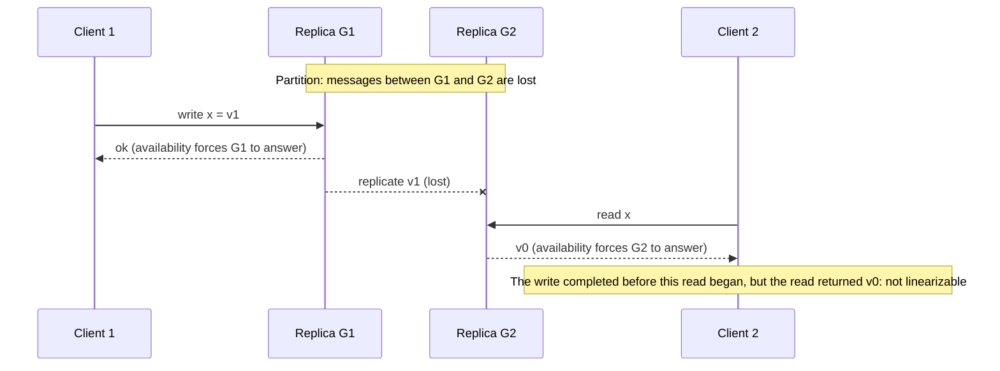
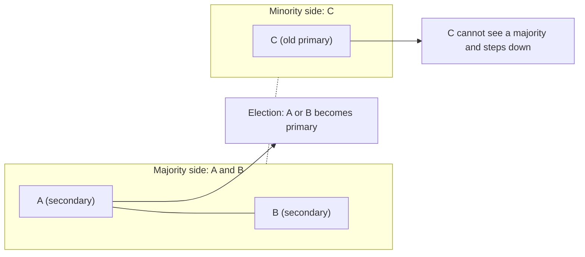

# CAP Theorem

> **Module 03 · Databases** · Prerequisites: [SQL vs NoSQL](01-SQL-vs-NoSQL.md) · Next: [Consistency Models](03-Consistency-Models.md)

---

## ⏱ If You Only Have 2 Minutes

- **The statement:** when the network between replicas is partitioned, a replicated read/write store cannot guarantee both **linearizable consistency** and **availability**. Eric Brewer stated it as a conjecture in 2000; Seth Gilbert and Nancy Lynch proved it in 2002.
- **C** means *linearizability*: the system behaves as if there were a single copy, and every read sees the latest completed write. It is **not** the C in ACID.
- **A** means *every request received by a non-failing node gets a non-error response*. It has no time limit and is not "99.99% uptime".
- **P is not optional.** Networks drop and delay messages, so the real choice is **CP or AP, during a partition**. "CA" only describes a single node, or a system that has not yet met a partition.
- **PACELC** (Daniel Abadi, 2012): if **P**artition, choose **A** or **C**; **E**lse, choose **L**atency or **C**onsistency. The "else" branch is the trade you pay on every normal request.
- **Quorums:** with N replicas, writing to W and reading from R where **R + W > N** makes every read overlap the latest write's replicas. It helps, but on its own it does not guarantee linearizability.
- **The choice is per operation, not per product.** MongoDB with `w: "majority"` and primary reads behaves CP; the same cluster read with `secondaryPreferred` behaves AP. Cassandra and DynamoDB let you pick per request.

---

## 1. What It Is and Why It Exists

The CAP theorem is a limit on replicated data. If you keep copies of the same data on several machines, and the network between those machines fails, you must choose between two behaviours:

- **Refuse** some requests until the network heals, so no one ever sees an out-of-date or conflicting answer (consistency).
- **Answer** every request using whatever copy is reachable, accepting that some answers are stale and some writes will conflict (availability).

**Analogy:** two branches of a bank share one account ledger by phone. The phone line goes dead. A customer walks into branch B and asks to withdraw the balance. Branch B can refuse ("we can't confirm your balance right now"), which is consistent but unavailable. Or it can pay out based on its last known balance, which is available but risks the same money being withdrawn at branch A too. No clever procedure lets branch B be both safe and helpful while the line is down.

**Why it matters for a backend engineer.** Every replicated database (a PostgreSQL primary with replicas, a MongoDB replica set, a Cassandra cluster) has already made this choice for you through its defaults. CAP gives you the vocabulary to find out what those defaults are and to change them per operation. You want a payment write to fail loudly during a partition rather than be silently lost. You want the product catalog to keep loading even if it is a few seconds stale.

**What CAP is not.** It is not a menu where you "pick two of three" for your whole system. It says nothing about latency, single-node crashes, or performance when the network is healthy. It is also a narrow formal result: one read/write register, linearizability, and an asynchronous network. Most of the practical value comes from understanding its definitions precisely, then moving on to the richer models in [Consistency Models](03-Consistency-Models.md).

---

## 2. How It Works

### The proof idea in four messages

Gilbert and Lynch's proof is short. Take two replicas, G1 and G2, both holding `v0`. Cut the network between them, so no message from one reaches the other.



1. Client 1 writes `v1` to G1. To be available, G1 must eventually reply.
2. G1 cannot tell G2, because the network is partitioned.
3. Client 2 then reads from G2. To be available, G2 must eventually reply.
4. G2 has never heard of `v1`, so it returns `v0`. A read that started after a completed write returned the old value. That violates linearizability.

The only ways out are to make G1 or G2 not answer (give up A) or to let G2 return stale data (give up C). There is no third option, because G2 has no information about the write.

### What real systems do when the network splits

Consider a three-member MongoDB replica set split into a group of two (A, B) and a group of one (C, the old primary):



- **The minority side stops accepting writes.** C notices it cannot reach a majority and steps down. Any write sent to it fails. That is the CP choice, made by the replica set protocol.
- **The majority side elects a new primary** (by default after the election timeout, `electionTimeoutMillis`, 10 seconds) and keeps serving writes.
- **Clients that read from secondaries keep getting answers** on both sides, possibly stale. That is the AP choice, made by your read preference.
- **When the partition heals**, C rejoins. Any write that C accepted but never replicated to a majority is **rolled back** and saved to a rollback file. A client that wrote with `w: 1` and got "ok" has lost that write. A client that used `w: "majority"` was never told "ok" for it.

So one cluster made both choices at once, per operation. That is the most useful way to talk about CAP in an interview.

---

## 3. Key Concepts

### The three letters, precisely

| Letter | Definition in the theorem | Common misreading |
|---|---|---|
| C — Consistency | Linearizability: operations appear to take effect atomically at one point between their start and end, in an order consistent with real time | ACID consistency (constraints hold), or "eventually the replicas agree" |
| A — Availability | Every request received by a non-failing node eventually gets a non-error response | High availability as an SLA ("99.99%"), or "the system responds fast" |
| P — Partition tolerance | The system keeps meeting its guarantees even if the network loses any number of messages between nodes | "The system rarely has partitions" |

Two consequences follow from these definitions. First, a CP system is allowed to be very available in practice: it only refuses requests on the minority side of a real partition. Second, an AP system under CAP's definition must answer even from a single isolated node. Many real systems that are called "AP" do not quite do that either. This is why Martin Kleppmann argued in 2015 that labelling whole databases "CP" or "AP" is misleading.

### Why "CA" is misleading

"CA" would mean consistent and available, but not partition tolerant. In a distributed system you do not get to opt out of partitions: switches fail, cables get cut, a long garbage-collection pause makes a node look dead, and cloud availability zones lose connectivity. When a partition happens, a "CA" design must still do *something*, and whatever it does is either refusing requests (it was really CP) or diverging (it was really AP).

The honest uses of "CA":

- **A single-node database.** One PostgreSQL server has no replicas to disagree with. If its network fails, it is simply unreachable. CAP does not really apply.
- **Brewer's description of Google Spanner** (2017): technically CP, but partitions on Google's private network are rare enough that users experience it as "effectively CA". That is a claim about probability, not about the theorem.

### PACELC: the trade you pay every day

Partitions are rare. Replication lag is constant. Daniel Abadi's PACELC (IEEE Computer, 2012) adds the missing half:

> If there is a **P**artition, trade **A**vailability against **C**onsistency; **E**lse, trade **L**atency against **C**onsistency.

Even with a healthy network, a strongly consistent write must wait for other replicas to confirm. If those replicas are in another region, that is a cross-region round trip on every write. Reading from the nearest replica is fast but may be stale. Examples:

| System and setting | Partition (P) | Else (E) |
|---|---|---|
| Dynamo-style store, low consistency levels (Cassandra `ONE`) | A | L |
| MongoDB, `w: "majority"`, primary reads, majority read concern | C | C |
| MongoDB, `w: 1`, reads from nearest secondary | A | L |
| PostgreSQL, synchronous replication, reads on primary | C | C |
| PostgreSQL, async replicas, reads on replicas | A (for reads) | L |

The table shows again that the label belongs to a configuration and an operation, not to a product.

### Quorums: R + W > N

Amazon's Dynamo paper (2007) popularized tunable quorums, which Cassandra and Riak adopted. With **N** replicas per key, a write waits for **W** acknowledgements and a read asks **R** replicas and takes the newest value.

| N | W | R | R + W > N? | Behaviour |
|---|---|---|---|---|
| 3 | 1 | 1 | No | Fastest; reads can miss the latest write |
| 3 | 2 | 2 | Yes | `QUORUM`/`QUORUM`: every read overlaps at least one replica with the latest write |
| 3 | 3 | 1 | Yes | Fast reads; any single replica down blocks writes |
| 3 | 1 | 3 | Yes | Fast writes; any single replica down blocks reads |

In Cassandra, `QUORUM` is a majority of the replication factor (`floor(RF / 2) + 1`), and `LOCAL_QUORUM` counts only replicas in the coordinator's datacenter, so a write does not wait for another region.

**Why R + W > N is not linearizability.** Overlap guarantees that a read *sees* the newest write's replica, but:

- **Sloppy quorums and hinted handoff** (from Dynamo) let a write count acknowledgements from nodes outside the key's normal replica set during failures, so the overlap can be broken.
- **Concurrent writes** are usually resolved by last-write-wins timestamps, which depend on clocks and can silently drop a write.
- **A write that fails** after reaching fewer than W replicas is not rolled back. Later reads may or may not see it.
- **Two readers** can see different results while a write is in progress, unless reads also repair stale replicas before returning.

So quorums give a strong *probabilistic* freshness guarantee, not the atomic, single-copy behaviour of linearizability. For compare-and-set, Cassandra offers lightweight transactions (Paxos, `SERIAL` consistency).

### Where real systems sit

| System | Default behaviour | Knobs |
|---|---|---|
| PostgreSQL, one primary, async streaming replicas | Writes only on the primary. A replica cut off from the primary keeps serving stale reads. Failover can lose the last committed transactions not yet shipped | `synchronous_standby_names` (e.g. `ANY 1 (r1, r2)`) plus `synchronous_commit` per transaction. If no synchronous standby answers, commits wait: CP for writes |
| MongoDB replica set | Majority-based elections; implicit default write concern `w: "majority"` since 5.0 (some arbiter layouts fall back to `w: 1`); default read concern `local` from the primary | Write concern `w`, `j`, `wtimeout`; read concern `local`, `majority`, `linearizable`, `snapshot`; read preference |
| Cassandra | Leaderless; you choose a consistency level per query | `ONE`, `QUORUM`, `LOCAL_QUORUM`, `ALL`, `SERIAL` for lightweight transactions |
| DynamoDB | Reads are eventually consistent by default | `ConsistentRead: true` per read (costs twice the read capacity; not available on global secondary indexes). Strongly consistent reads may return a server error during a network problem: CP for that read |
| Redis with replicas | Asynchronous replication; a failover can lose acknowledged writes | `WAIT` blocks until N replicas acknowledge, but Redis still does not promise strong consistency |

A PostgreSQL example of choosing per transaction (requires a synchronous standby to be configured):

```sql
BEGIN;
-- Wait until the synchronous standby has applied this commit, so a read on it sees the payment.
SET LOCAL synchronous_commit = remote_apply;
INSERT INTO payments (order_id, amount_cents, status, provider_ref)
VALUES (42, 4999, 'captured', 'pi_3Q8x');
COMMIT;
```

---

## 4. Code Examples

Scenario: one MongoDB replica set holds both payments and the product catalog. Payments must never be acknowledged and then lost, so they use majority write and read concern on the primary (CP). Catalog browsing should keep working even if the primary is unreachable, so it reads from secondaries (AP). A unique index on `provider_ref` makes retries safe.

### Node.js / TypeScript

```ts
// npm i mongodb   — Node.js 22+, TypeScript 5, ESM. MONGO_URL names a 3-member replica set.
import { MongoClient, MongoServerError, MongoWriteConcernError, ReadPreference } from "mongodb";

interface Payment {
  order_id: number; amount_cents: number; provider_ref: string;
  status: "authorized" | "captured" | "refunded" | "failed"; created_at: Date;
}
interface Product { _id: number; sku: string; name: string; category: string; price_cents: number }

const client = new MongoClient(process.env.MONGO_URL!, {
  // With no reachable primary, fail in 5 s instead of the 30 s default: for CP operations
  // a quick, honest error beats a hung request.
  serverSelectionTimeoutMS: 5_000,
});
const db = client.db("shop");

// CP: acknowledged only after a majority has journaled the write, so losing any minority
// (including the current primary) cannot lose it. Reads see only majority-committed data.
const payments = db.collection<Payment>("payments", {
  writeConcern: { w: "majority", journal: true, wtimeoutMS: 5_000 },
  readConcern: { level: "majority" },
  readPreference: ReadPreference.PRIMARY,
});
await payments.createIndex({ provider_ref: 1 }, { unique: true });

// AP: any member may answer, possibly behind. maxStalenessSeconds (minimum 90) skips
// secondaries that have fallen too far behind the primary.
const products = db.collection<Product>("products", {
  readConcern: { level: "local" },
  readPreference: new ReadPreference("secondaryPreferred", undefined, { maxStalenessSeconds: 90 }),
});

export type RecordResult = "recorded" | "unconfirmed";

export async function recordPayment(p: Payment): Promise<RecordResult> {
  try {
    await payments.insertOne(p);
    return "recorded";
  } catch (err) {
    // Check the subclass first: MongoWriteConcernError extends MongoServerError.
    if (err instanceof MongoWriteConcernError) {
      // Applied on the primary, but no majority confirmed within wtimeoutMS (a partition is likely).
      // MongoDB does not undo it; it may replicate later or be rolled back. Never report success.
      return "unconfirmed";
    }
    if (err instanceof MongoServerError && err.code === 11000) {
      // A previous attempt wrote this provider_ref. Count it only if a majority has it
      // (the collection's read concern is "majority").
      const existing = await payments.findOne({ provider_ref: p.provider_ref });
      return existing ? "recorded" : "unconfirmed";
    }
    throw err; // e.g. MongoServerSelectionError: no primary on our side of the partition
  }
}

export function getPaymentLinearizable(providerRef: string): Promise<Payment | null> {
  // The primary confirms with a majority that it is still primary before answering.
  // Slowest read, valid for a filter matching one document; maxTimeMS bounds the wait.
  return payments.findOne({ provider_ref: providerRef }, { readConcern: { level: "linearizable" }, maxTimeMS: 2_000 });
}

export function browseCategory(category: string): Promise<Product[]> {
  return products.find({ category }).sort({ _id: 1 }).limit(50).toArray();
}
```

### Python

The same policy in PyMongo, exposed through FastAPI so each CAP outcome maps to an HTTP answer.

```python
# pip install pymongo fastapi   — Python 3.12+. MONGO_URL names a 3-member replica set.
import os
from datetime import UTC, datetime

from fastapi import FastAPI, HTTPException
from pydantic import BaseModel
from pymongo import MongoClient, ReadPreference, WriteConcern
from pymongo.errors import DuplicateKeyError, ServerSelectionTimeoutError, WriteConcernError
from pymongo.read_concern import ReadConcern
from pymongo.read_preferences import SecondaryPreferred

client: MongoClient = MongoClient(os.environ["MONGO_URL"], serverSelectionTimeoutMS=5000)
db = client["shop"]

payments = db.get_collection(
    "payments",
    write_concern=WriteConcern(w="majority", j=True, wtimeout=5000),  # CP for money
    read_concern=ReadConcern("majority"),
    read_preference=ReadPreference.PRIMARY,
)
payments.create_index("provider_ref", unique=True)

products = db.get_collection(
    "products",
    read_concern=ReadConcern("local"),
    read_preference=SecondaryPreferred(max_staleness=90),  # AP for browsing
)

app = FastAPI()


class PaymentIn(BaseModel):
    order_id: int
    amount_cents: int
    provider_ref: str


# Plain `def` handlers: PyMongo blocks, so FastAPI runs them in its thread pool
# instead of stalling the event loop while a majority acknowledgement is pending.
@app.post("/payments", status_code=201)
def record_payment(p: PaymentIn) -> dict[str, str]:
    doc = {**p.model_dump(), "status": "captured", "created_at": datetime.now(UTC)}
    try:
        payments.insert_one(doc)
    except DuplicateKeyError:
        # An earlier attempt wrote it. Succeed only if it is majority-committed.
        if payments.find_one({"provider_ref": p.provider_ref}) is None:
            raise HTTPException(503, "previous attempt not yet confirmed; retry later") from None
    except WriteConcernError:
        raise HTTPException(503, "write not confirmed by a majority; retry with the same provider_ref") from None
    except ServerSelectionTimeoutError:
        raise HTTPException(503, "no primary reachable") from None  # the CP choice: refuse
    return {"provider_ref": p.provider_ref, "state": "recorded"}


@app.get("/payments/{provider_ref}")
def get_payment(provider_ref: str) -> dict:
    linearizable = payments.with_options(read_concern=ReadConcern("linearizable"))
    doc = linearizable.find_one({"provider_ref": provider_ref}, {"_id": 0}, max_time_ms=2000)
    if doc is None:
        raise HTTPException(404, "not_found")
    return doc


@app.get("/categories/{category}/products")
def browse(category: str) -> list[dict]:
    # Keeps answering from a secondary while the primary is unreachable: stale beats down here.
    return list(products.find({"category": category}, {"_id": 0}).sort("sku", 1).limit(50))
```

**What to notice.** The 503 responses are the "C" in CP made visible: during a partition the payment endpoint refuses instead of pretending. Retrying is safe because `provider_ref` is unique. The duplicate-key branch re-reads with majority read concern, because a duplicate found only on an isolated primary might still be rolled back. Note that a `WriteConcernError` (Node: `MongoWriteConcernError`) does **not** mean the write failed; it means "not confirmed". **Runtime difference:** the Node driver is non-blocking, so a slow majority acknowledgement only parks one promise; PyMongo's `MongoClient` blocks its thread, which is why the FastAPI handlers are plain `def` (run in a thread pool) rather than `async def`.

---

## 5. Production Concerns

- **Failover is a partition you will actually see.** Every primary election, planned or not, is a short window in which writes fail. Retryable writes (on by default in current drivers) retry a write once after a failover. Make the retried write idempotent, as with `provider_ref` above.
- **`wtimeout` errors do not roll back.** After a write-concern timeout the document may be on the primary only. If that primary later loses its seat, MongoDB rolls the write back and saves it to a rollback file. Treat "unconfirmed" as its own state and reconcile it, for example by checking the payment provider by `provider_ref`.
- **Majority across regions costs a WAN round trip.** Spreading voting members over three regions survives a region loss, but every `w: "majority"` write waits for the second-closest region. That is PACELC's E branch. Measure write latency per region before choosing the layout.
- **Arbiters weaken majority writes.** An arbiter votes but stores no data. In a primary-secondary-arbiter set, losing the secondary leaves no data-bearing majority, so majority writes cannot be acknowledged. Check the effective default with `db.adminCommand({ getDefaultRWConcern: 1 })`.
- **PostgreSQL synchronous replication can stop writes.** With `synchronous_standby_names` set and every listed standby down, commits on the primary wait forever. That is CP behaviour by design. Use `ANY 1 (r1, r2)` with at least two standbys, and alert on it.
- **Asynchronous failover loses data.** Promoting an async PostgreSQL replica (or a Redis replica) discards whatever the old primary committed but had not shipped. Monitor replication lag in bytes and seconds, because that lag is the size of your possible loss.
- **What to log and measure.** Count write-concern timeouts, server-selection timeouts and elections; record replication lag; track how many reads go to secondaries. A spike in "unconfirmed" payments is a partition or overloaded secondaries, and someone should be paged.

---

## 6. Common Mistakes

- **"Pick any two of C, A and P"** — implies you can drop P and keep CA in a distributed system — say that partitions happen, so the choice is CP or AP during a partition, and PACELC covers the rest of the time.
- **Confusing CAP's C with ACID's C** — the answer talks about foreign keys when asked about replicas — CAP C is linearizability across replicas; ACID C is constraints holding within one database.
- **Calling a whole product "CP" or "AP"** — MongoDB, Cassandra and DynamoDB all change behaviour with per-request settings — classify the configuration and the operation.
- **Treating R + W > N as strong consistency** — sloppy quorums, last-write-wins and partial failed writes still produce anomalies — use quorums for freshness and a consensus-based operation (Cassandra `SERIAL`, a single primary) for compare-and-set.
- **Reading CAP's availability as an uptime SLA** — a CP system can still be "highly available" in the business sense — explain that CAP A means every non-failing node responds, even when partitioned.
- **Writing money with `w: 1`** — the client gets "ok", the primary is partitioned off, and the write is rolled back on rejoin — use `w: "majority"` for anything you cannot lose.
- **Reporting success after a write-concern timeout** — the order is shown as paid and later disappears — return an "unconfirmed" state and reconcile by an idempotency key.

---

## 7. Comparison Table

How the same request behaves on the minority side of a partition:

| | CP choice | AP choice |
|---|---|---|
| Write | Fails or times out (no majority, no primary) | Accepted locally; may conflict with writes on the other side |
| Read | Refused, or served only after confirming leadership | Served from the local copy, possibly stale |
| After healing | Nothing to reconcile | Conflicts resolved: last-write-wins, merge (CRDTs), or application logic |
| Client experience | Errors / 503 while the partition lasts | Always an answer, sometimes wrong or later changed |
| Good for | Payments, inventory counts, unique usernames, leader election | Catalogs, feeds, likes, shopping-cart additions, metrics |
| Example settings | MongoDB `w: "majority"` + primary reads; Postgres sync replication; Cassandra `SERIAL` | MongoDB `secondaryPreferred`; Cassandra `ONE`; DynamoDB default reads |

---

## 8. Interview Questions

**[Junior] What does the CAP theorem say?**
In a distributed data store, if the network between replicas is partitioned, you cannot guarantee both linearizable consistency and availability. You must either refuse some requests (CP) or answer with possibly stale or conflicting data (AP). Brewer conjectured it in 2000 and Gilbert and Lynch proved it in 2002.

**[Junior] Why can't you choose CA?**
Because partitions are not something you choose; networks fail. When one happens, a system that claimed CA must either refuse requests, which makes it CP, or let replicas diverge, which makes it AP. CA only really describes a single-node database, where there are no replicas to disagree.

**[Mid] What is PACELC and why does it matter more day to day?**
PACELC says: during a Partition choose Availability or Consistency; Else choose Latency or Consistency. Partitions are rare, but the latency cost of strong consistency is paid on every request, because a consistent write must wait for other replicas. For example, majority writes across three regions add a cross-region round trip to every write, while reading from the nearest replica is fast but may be stale.

**[Mid] Explain R + W > N.**
With N replicas, if each write waits for W acknowledgements and each read queries R replicas, then R + W > N means the read set and the write set always share at least one replica, so the read can see the latest write. With N = 3, `QUORUM` writes and reads (2 + 2) satisfy it. It is not full linearizability, because sloppy quorums, concurrent last-write-wins writes, and partially failed writes can still produce anomalies.

**[Mid] Where does PostgreSQL with streaming replicas sit in CAP?**
Writes go only to the primary, so a replica cut off from it keeps serving reads but cannot take writes. Reads on that replica are available but stale, which is AP for reads. With asynchronous replication, a failover can also lose recently committed transactions. With synchronous replication, the primary waits for the standby and stops committing if no synchronous standby is reachable, which is CP for writes.

**[Senior] Your MongoDB payment write returns a write-concern timeout. What happened and what do you do?**
The primary applied the write but a majority did not confirm within `wtimeout`, usually because secondaries are lagging or partitioned. The write is not rolled back. It may replicate later, or be rolled back if this primary loses an election. I would not report success. I would return an "unconfirmed" state, make the retry idempotent on a unique key such as `provider_ref`, and have a reconciler confirm with a majority read or with the payment provider. I would also alert, because repeated timeouts mean the replica set is unhealthy.

**[Senior] Design a shopping cart and checkout for a multi-region deployment. Where do you choose AP and where CP?**
Cart edits can be AP: accept them in the local region and merge conflicts as a union of items, as Amazon's Dynamo paper described. A briefly duplicated item is cheap to fix. Checkout, payment capture and inventory decrement must be CP: route them to a single primary or a consensus-based store, use majority writes, and fail with a retryable error during a partition. Overselling or double charging is far more expensive than a few seconds of unavailability.

**[Senior] Is a system that uses Raft "CP"? Is it highly available?**
A Raft or Paxos group with a majority quorum is CP in the CAP sense: the minority side cannot elect a leader or commit, so it refuses writes. It can still be highly available in the business sense, because it tolerates the loss of any minority of nodes, and partitions that isolate a majority from clients are rare. The precise answer is "it stays available on the majority side and unavailable on the minority side".

---

## 9. Cheat Sheet

```text
CAP           partition => choose linearizable (CP) or every-node-answers (AP)
Sources       Brewer 2000 (conjecture), Gilbert & Lynch 2002 (proof), Brewer 2012 ("12 years later")
C             linearizability, NOT ACID consistency
A             every non-failing node returns a non-error response (no time bound), NOT an SLA
P             not optional; "CA" = single node or wishful thinking
PACELC        Partition: A vs C; Else: Latency vs C (Abadi 2012)
Quorum        R + W > N => read overlaps latest write; still not linearizable alone
Cassandra     ONE | QUORUM | LOCAL_QUORUM | ALL | SERIAL (LWT); QUORUM = floor(RF/2)+1
MongoDB       w:"majority" (default since 5.0), j; readConcern local|majority|linearizable|snapshot
              readPreference primary|primaryPreferred|secondary|secondaryPreferred|nearest
DynamoDB      reads eventual by default; ConsistentRead=true (2x RCU, not on GSIs)
Postgres      async replicas = stale reads + failover loss; sync standby = commits wait (CP)
wtimeout      "not confirmed", not "failed" -> unconfirmed state + idempotent retry
Per operation money/inventory/uniqueness = CP; catalog/feed/likes/cart = AP
```

---

## Related Topics

- [Consistency Models](03-Consistency-Models.md) — the models between linearizable and eventual, and how replicas expose them
- [Database Selection](04-Database-Selection.md) — using consistency needs as one input to picking a store
- [MongoDB Fundamentals](35-MongoDB-Fundamentals.md) — replica sets, write concern and read concern in detail
- [Replication](../Module-07-Advanced-Backend-and-System-Design/18-Replication.md) — leader-based, multi-leader and leaderless replication
- [Consistency in Distributed Systems](../Module-07-Advanced-Backend-and-System-Design/28-Consistency-in-Distributed-Systems.md) — consensus and consistency at system-design scale
- [Network Failures](../Module-06-Networking-and-Distributed-Basics/21-Network-Failures.md) — what partitions look like on real networks
