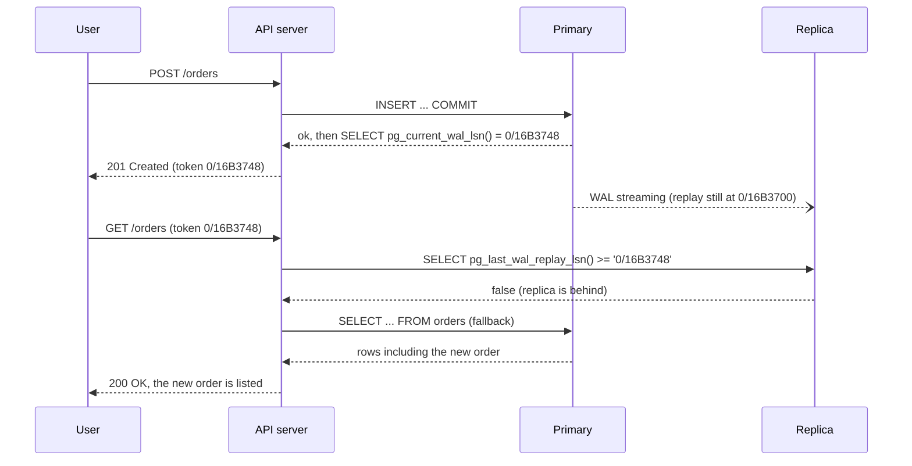

# Consistency Models

> **Module 03 · Databases** · Prerequisites: [CAP Theorem](02-CAP-Theorem.md) · Next: [Database Selection](04-Database-Selection.md)

---

## ⏱ If You Only Have 2 Minutes

- A **consistency model** is a contract between a replicated store and its clients: given the writes that happened, which values may a read return? Stronger models forbid more anomalies and cost more latency or availability.
- From strongest to weakest: **linearizable → sequential → causal → session guarantees (read-your-writes, monotonic reads, …) → eventual.**
- **Linearizable:** once a write completes, every later read, from anyone, sees it. **Sequential:** everyone sees the same order of operations, but that order may lag behind real time.
- **Causal:** if B depends on A (a reply to a comment), nobody sees B without A. Unrelated writes may appear in different orders. Unlike linearizability, it can stay available during a partition for clients that keep talking to the same side.
- **Read-your-writes** fails in the classic replica bug: a user saves something, the next page reads from a lagging replica, and the change "disappears". Fix it by reading from the primary just after a write, or by saving the primary's WAL position (`pg_current_wal_lsn()`) and using only a replica whose `pg_last_wal_replay_lsn()` has passed it.
- **Monotonic reads** fail when consecutive reads hit replicas with different lag, so data seems to go back in time. Pin a user to one replica, or carry the highest position seen.
- **MongoDB causally consistent sessions** give read-your-writes, monotonic reads, monotonic writes and writes-follow-reads, even on secondaries, when combined with `"majority"` read and write concern.
- This "consistency" is about **replicas**. It is not ACID's C (constraints hold) and not [isolation levels](29-Isolation-Levels.md) (how concurrent transactions interleave).

---

## 1. What It Is and Why It Exists

As soon as a database keeps more than one copy of the data, a read can be answered by a copy that has not yet received the latest write. A **consistency model** states exactly how stale or out of order those answers may be. Application code can then be written against that promise instead of against luck.

**Analogy:** a company posts notices on boards in three offices, and a courier carries each new notice from head office to the others. "Eventual consistency" means every board will show every notice once the courier finishes. "Read-your-writes" means that if *you* pinned a notice, you will see it on whichever board you look at next. "Causal" means nobody will see the notice "Meeting moved to 3 pm" on a board that does not yet show "Meeting today at 2 pm". "Linearizable" means the boards behave like a single board: once a notice is up, everyone everywhere sees it.

**The problem it solves.** Read replicas are the cheapest way to scale reads, and every replica lags a little: usually milliseconds, sometimes seconds or minutes during a heavy batch job. Without a clear model, the anomalies look like random bugs:

- A customer updates their shipping address, the confirmation page shows the old one, and they submit the form again.
- A support agent refunds an order; the next screen, read from a replica, still offers "Refund", and the agent clicks again.
- A user sees a reply to a comment before the comment itself.
- A dashboard total goes up, then down, then up on successive refreshes.

Each of these is a precise, named violation, and each has a precise fix. This chapter is the application-and-replica view. The system-design view (consensus, multi-region, conflict resolution) is in [Consistency in Distributed Systems](../Module-07-Advanced-Backend-and-System-Design/28-Consistency-in-Distributed-Systems.md).

---

## 2. How It Works

### Replication lag in PostgreSQL

PostgreSQL streaming replication works by shipping the write-ahead log (WAL), the ordered record of every change.

1. A transaction commits on the primary. Its changes are in WAL records, each at a **log sequence number (LSN)**, a byte position such as `0/16B3748`.
2. The primary's WAL sender streams those records to each standby.
3. The standby's WAL receiver writes and flushes them to its own disk.
4. The standby's startup process **replays** them into its data files. Queries on the standby (a "hot standby") see the database as of its current replay LSN.

Lag is the gap between the primary's current LSN and the standby's replay LSN. With default asynchronous replication, `COMMIT` returns on the primary before any standby has replayed it. That gap is where read-your-writes breaks:



Without the token check, the second request would read from the replica and the new order would be missing. The token turns "eventually" into "at least as new as my own write".

### Measuring lag

```sql
-- On the primary: one row per standby, with lag in bytes and time (PostgreSQL 10+).
SELECT application_name,
       pg_wal_lsn_diff(pg_current_wal_lsn(), replay_lsn) AS replay_lag_bytes,
       write_lag, flush_lag, replay_lag
FROM pg_stat_replication;

-- On a standby: where replay is, and when the last replayed transaction committed.
SELECT pg_last_wal_replay_lsn(), now() - pg_last_xact_replay_timestamp() AS approx_lag;
```

The time-based figure on the standby is misleading when the primary is idle: no new transactions means the "last replayed commit" gets older even though the standby is fully caught up. Byte lag from `pg_stat_replication` does not have that problem.

---

## 3. Key Concepts

### The models, strongest to weakest

| Model | Guarantee | Anomaly it forbids (what a user would see) |
|---|---|---|
| Linearizable | Each operation appears to happen at one instant between its start and end; all clients agree, in real-time order | Alice's write completes, Bob's later read on another replica returns the old value |
| Sequential | All clients see one common order of operations, consistent with each client's own order, but not tied to real time | Two observers disagree about which of two posts came first |
| Causal | Operations that are causally related (B was written after reading A) are seen in that order by everyone | A reply is visible while the comment it answers is not |
| Read-your-writes | A client always sees its own earlier writes | The user edits their address; the next page shows the old one |
| Monotonic reads | A client never sees data older than data it already saw | A like count shows 12, then 9, then 12 on refresh |
| Eventual | If writes stop, all replicas converge to the same value | Nothing during updates; only "it will be right eventually" |

Linearizability is the C in [CAP](02-CAP-Theorem.md). Herlihy and Wing defined it in 1990; Lamport defined sequential consistency in 1979.

### Linearizable vs sequential

Both give a single global order. The difference is **real time**. Suppose Alice sets a flag to `on` and the write returns; then she phones Bob, who reads the flag. Under linearizability Bob must see `on`, because his read started after her write finished. Under sequential consistency Bob may still see `off`, as long as every client sees the writes in the same order and nobody sees `on` then `off`. Sequential consistency is enough for many uses, but not for anything that relies on an outside channel, like "I just told you I paid, so check".

### Causal consistency

Causality links an operation to what its author had already seen. If Bob reads Alice's comment and then replies, the reply causally depends on the comment. Causal consistency guarantees every reader sees the comment before the reply. Two unrelated comments on different posts may appear in different orders to different readers, and that is allowed.

It is useful because it matches what users notice. It can also be provided while staying available during a partition (as long as each client keeps talking to replicas on its own side), which linearizability cannot. Implementations track dependencies with logical clocks. MongoDB uses a cluster-wide logical time (`clusterTime`) and a per-session `operationTime`.

### Session guarantees

Terry and colleagues defined four guarantees for one client's session (1994). They are cheaper than global models because they only constrain what *one* client sees:

| Guarantee | Meaning | Typical fix with replicas |
|---|---|---|
| Read-your-writes | Reads reflect the client's own earlier writes | Read from the primary for a short window after a write, or wait for a replica to pass the write's LSN |
| Monotonic reads | Successive reads never go back in time | Pin the session to one replica, or carry the highest LSN seen |
| Monotonic writes | A client's writes are applied in the order issued | Single primary does this; multi-leader systems need care |
| Writes-follow-reads | A write made after reading X is ordered after X everywhere | Causal tracking (MongoDB causal sessions) |

MongoDB's causally consistent sessions provide all four, including when reading from secondaries, if the session uses `"majority"` read concern and `"majority"` write concern. With weaker concerns the guarantees can break across failovers.

### Eventual consistency

Werner Vogels popularized the term (2008). It promises only **convergence**: if no new writes arrive, all replicas eventually return the same value. It says nothing about what you read in the meantime, how long "eventually" is, or which of two concurrent writes wins. Every replicated system is at least eventually consistent. Saying a store is "eventually consistent" is therefore a statement about what it does *not* promise. In practice, combine it with session guarantees for the user who made the change, and with idempotent writes so retries during the stale window do no harm.

### Three different meanings of "consistency"

| Term | Scope | Question it answers | Where to read more |
|---|---|---|---|
| Consistency model (this chapter) | Replicas of the same data | Can a read return a value older than a completed write? | This chapter |
| ACID consistency | One database, one transaction | Do constraints and invariants hold after commit? | [ACID](28-ACID.md) |
| Isolation level | Concurrent transactions on one database | Can a transaction see another's uncommitted or concurrent changes? | [Isolation Levels](29-Isolation-Levels.md) |

They combine. A PostgreSQL replica gives you full `REPEATABLE READ` isolation *within* a transaction that runs there, against a snapshot that may be two seconds old. The isolation is strong; the replica consistency is not. The research term **strict serializability** names the combination of serializable isolation with linearizability.

---

## 4. Code Examples

Scenario: an orders service writes to a PostgreSQL primary and reads from replicas. After a customer places an order, their next "my orders" page must include it (read-your-writes), while other traffic keeps using replicas. The write returns a **consistency token**, the primary's WAL LSN after commit. The API returns it to the client (for example in a short-lived cookie), and reads present it back.

### Node.js / TypeScript

```ts
// npm i pg && npm i -D @types/pg   — Node.js 22+, TypeScript 5, ESM
import pg from "pg";

const primary = new pg.Pool({ connectionString: process.env.PRIMARY_URL, max: 10 });
const replicas = (process.env.REPLICA_URLS ?? "")
  .split(",")
  .filter(Boolean)
  .map((url) => new pg.Pool({ connectionString: url, max: 10, connectionTimeoutMillis: 1_000 }));

/** Primary WAL position after a commit, e.g. "0/16B3748". Store it per user, e.g. in a cookie. */
export type ConsistencyToken = string;

export async function placeOrder(customerId: number, totalCents: number) {
  const client = await primary.connect();
  try {
    await client.query("BEGIN");
    const { rows } = await client.query<{ id: string }>(
      "INSERT INTO orders (customer_id, status, total_cents) VALUES ($1, 'pending', $2) RETURNING id",
      [customerId, totalCents],
    );
    await client.query("COMMIT");
    // Read after COMMIT returns, so our commit record is at or before this position.
    const pos = await client.query<{ lsn: string }>("SELECT pg_current_wal_lsn()::text AS lsn");
    return { orderId: rows[0].id, token: pos.rows[0].lsn as ConsistencyToken };
  } catch (err) {
    await client.query("ROLLBACK").catch(() => undefined);
    throw err;
  } finally {
    client.release();
  }
}

/** Read from a replica that has replayed past `token`, otherwise from the primary. */
export async function readAfter<T extends pg.QueryResultRow>(
  sql: string,
  params: unknown[],
  token?: ConsistencyToken,
): Promise<T[]> {
  const replica = replicas[Math.floor(Math.random() * replicas.length)];
  const client = replica ? await replica.connect().catch(() => null) : null; // replica down -> primary
  if (client) {
    try {
      // NULL (this server is no longer a standby, e.g. promoted) counts as "not caught up".
      const caughtUp =
        token === undefined ||
        (await client.query<{ ok: boolean | null }>(
          "SELECT pg_last_wal_replay_lsn() >= $1::pg_lsn AS ok", [token],
        )).rows[0].ok === true;
      // Replay only moves forward, so the next statement on this connection sees our write too.
      if (caughtUp) return (await client.query<T>(sql, params)).rows;
    } finally {
      client.release();
    }
  }
  return (await primary.query<T>(sql, params)).rows; // the primary always has its own writes
}

// Usage: const rows = await readAfter("SELECT id, status, total_cents FROM orders
//   WHERE customer_id = $1 ORDER BY created_at DESC LIMIT 20", [customerId], req.cookies.rywToken);
```

MongoDB gets the same effect with a causally consistent session: a secondary read in the session waits until that secondary has caught up to the session's last operation.

```ts
// npm i mongodb   — Node.js 22+, TypeScript 5, ESM
import { MongoClient, ReadPreference } from "mongodb";

interface Review { product_id: number; customer_id: number; rating: number; body: string; created_at: Date }

const client = new MongoClient(process.env.MONGO_URL!);
const reviews = client.db("shop").collection<Review>("reviews");

export async function addReviewAndList(review: Review): Promise<Review[]> {
  const session = client.startSession({ causalConsistency: true });
  try {
    // "majority" on both sides keeps the causal guarantees across a failover.
    await reviews.insertOne(review, { session, writeConcern: { w: "majority" } });
    return await reviews
      .find(
        { product_id: review.product_id },
        { session, readConcern: { level: "majority" }, readPreference: ReadPreference.SECONDARY_PREFERRED },
      )
      .sort({ created_at: -1 })
      .limit(20)
      .toArray(); // includes the review just written, even when served by a secondary
  } finally {
    await session.endSession();
  }
}
```

### Python

The same router with psycopg 3's async pool, for use from FastAPI `async def` handlers.

```python
# pip install "psycopg[binary,pool]"   — Python 3.12+
import os
import random
from typing import Any, LiteralString

import psycopg
from psycopg.rows import dict_row
from psycopg_pool import AsyncConnectionPool, PoolTimeout

# autocommit: reads on replicas must not sit "idle in transaction" and hold back cleanup.
POOL_KW: dict[str, Any] = {"autocommit": True, "row_factory": dict_row}
primary = AsyncConnectionPool(os.environ["PRIMARY_URL"], open=False, kwargs=POOL_KW)
replicas = [
    AsyncConnectionPool(url, open=False, kwargs=POOL_KW)
    for url in os.environ.get("REPLICA_URLS", "").split(",") if url
]


async def open_pools() -> None:  # call from the FastAPI lifespan handler
    for pool in (primary, *replicas):
        await pool.open()


async def place_order(customer_id: int, total_cents: int) -> tuple[int, str]:
    async with primary.connection() as conn:
        async with conn.transaction():  # BEGIN ... COMMIT
            cur = await conn.execute(
                "INSERT INTO orders (customer_id, status, total_cents)"
                " VALUES (%s, 'pending', %s) RETURNING id",
                (customer_id, total_cents),
            )
            order = await cur.fetchone()
        # After the commit: this position is at or past our commit record.
        cur = await conn.execute("SELECT pg_current_wal_lsn()::text AS lsn")
        pos = await cur.fetchone()
    return order["id"], pos["lsn"]


async def read_after(sql: LiteralString, params: tuple[Any, ...], token: str | None = None) -> list[dict]:
    if replicas:
        try:
            async with random.choice(replicas).connection(timeout=1.0) as conn:
                caught_up = True
                if token is not None:
                    cur = await conn.execute("SELECT pg_last_wal_replay_lsn() >= %s::pg_lsn AS ok", (token,))
                    caught_up = (await cur.fetchone())["ok"] is True  # None after promotion
                if caught_up:
                    cur = await conn.execute(sql, params)
                    return await cur.fetchall()
        except (PoolTimeout, psycopg.OperationalError):
            pass  # replica busy or down: the primary is always correct, just more loaded
    async with primary.connection() as conn:
        cur = await conn.execute(sql, params)
        return await cur.fetchall()
```

MongoDB causal session with PyMongo:

```python
# pip install pymongo   — Python 3.12+
import os
from typing import Any

from pymongo import MongoClient, ReadPreference, WriteConcern
from pymongo.read_concern import ReadConcern

client: MongoClient = MongoClient(os.environ["MONGO_URL"])
reviews = client["shop"]["reviews"]


def add_review_and_list(review: dict[str, Any]) -> list[dict[str, Any]]:
    writer = reviews.with_options(write_concern=WriteConcern(w="majority"))
    reader = reviews.with_options(
        read_concern=ReadConcern("majority"),
        read_preference=ReadPreference.SECONDARY_PREFERRED,
    )
    with client.start_session(causal_consistency=True) as session:
        writer.insert_one(review, session=session)
        # The secondary waits until it has applied the insert before answering this read.
        cursor = reader.find({"product_id": review["product_id"]}, session=session)
        return list(cursor.sort("created_at", -1).limit(20))
```

**What to notice.** The token makes the guarantee *per user*: only the customer who just wrote pays the cost of a primary read, and only until a replica catches up. Everyone else keeps reading from replicas. MongoDB does the same tracking for you inside a session, but a session lives within one request. To carry it across HTTP requests, you would save the session's `operationTime` and `clusterTime` and pass them to a new session (`advanceOperationTime` / `advance_operation_time`). **Runtime difference:** `pg` returns the `pg_lsn` value as a string and leaves comparison to the server; psycopg does the same (no Python type for `pg_lsn`), so in both languages the comparison is done in SQL with `::pg_lsn`, never by comparing strings in code, because `"0/9"` sorts after `"0/10"` as text.

**MySQL difference.** MySQL uses global transaction IDs (GTIDs) instead of LSNs. After a write, read `@@GLOBAL.gtid_executed` on the source; on a replica, `WAIT_FOR_EXECUTED_GTID_SET(gtid_set, timeout)` blocks until that set has been applied.

---

## 5. Production Concerns

- **Fallback can overload the primary.** If a replica falls far behind (a long batch job, a vacuum, a network problem), every token-carrying read lands on the primary. Cap how long tokens are honoured (a cookie of about one minute is typical), alert on replica lag, and consider a short wait-and-recheck on the replica before falling back.
- **Long replica queries conflict with replay.** If a replica query needs row versions that the primary has since vacuumed away, replay must either wait or cancel the query. `max_standby_streaming_delay` (default 30 s) sets how long replay waits, which adds lag. `hot_standby_feedback = on` avoids cancellations but lets replica queries hold back vacuum on the primary. Choose per replica: analytics replicas tolerate lag; read-your-writes replicas should not.
- **Treat tokens as untrusted input.** A client can send any LSN. A huge value only forces primary reads, so the harm is load, not wrong data. Still, validate the format, cast it in SQL, and rate-limit as usual.
- **Failover resets the promise.** With asynchronous replication, a promoted replica may lack the last commits of the old primary. A token pointing at a lost write will keep sending that user to the primary, which does not have it either. The router can only guarantee read-your-writes for writes that survived. If that is not acceptable, use synchronous replication.
- **Caches break session guarantees too.** A CDN or Redis cache in front of the replica can serve a page from before the user's write. Bypass or invalidate cache entries for the writing user, or include a version in the cache key.
- **What to measure.** Replay lag per replica in bytes and seconds, the share of reads that fell back to the primary, the token age distribution, and replica query cancellations (`pg_stat_database_conflicts`). A rising fallback rate is an early warning of replica trouble.

---

## 6. Common Mistakes

- **Sending all reads to replicas after a write** — the user's change "vanishes" and they submit it again, creating duplicates — route that user's reads by token or to the primary for a short window.
- **Load-balancing each request to a random replica** — successive pages show data going backwards in time — pin the session to one replica or carry the highest position seen (monotonic reads).
- **Assuming the replica is "basically real time"** — works in testing, fails during a nightly batch when lag reaches minutes — monitor lag and design for the worst case, not the median.
- **Comparing LSNs as strings in code** — `"0/9"` sorts after `"0/10"`, so the router picks a stale replica — compare in SQL with `::pg_lsn`, or parse both halves as hexadecimal.
- **Doing read-check-write against a replica** — "is this coupon unused?" reads stale data and the coupon is redeemed twice — run checks that guard writes on the primary, inside the transaction, ideally as a constraint or conditional update.
- **Mixing up consistency models and isolation levels** — raising isolation to `SERIALIZABLE` to fix a stale replica read, which changes nothing — isolation governs concurrent transactions on one server; replica freshness is a routing problem.
- **Using a MongoDB causal session with default concerns and expecting it to survive failover** — guarantees break if a `w: 1` write is rolled back — use `"majority"` read and write concern in causal sessions.

---

## 7. Comparison Table

Ways to give a user read-your-writes with PostgreSQL replicas:

| Strategy | How | Guarantee | Cost |
|---|---|---|---|
| All reads on the primary | No replicas for this data | Linearizable for single-primary reads | No read scaling |
| Time-window pinning | After a write, route that user to the primary for N seconds | Read-your-writes only if lag stays below N | Simple; breaks when lag spikes |
| LSN token (this chapter) | Save `pg_current_wal_lsn()` after commit; use a replica only once its replay LSN passes it | Read-your-writes and, if you keep the max, monotonic reads | One extra tiny query per read; fallback load during lag |
| `synchronous_commit = remote_apply` | Commit waits until synchronous standbys have applied the change | Read-your-writes on those standbys for everyone | Every such commit waits for a standby round trip; standby outage stalls commits |
| Sticky replica per session | Session always uses the same replica | Monotonic reads only, not read-your-writes | Uneven load; breaks when that replica fails |
| MongoDB causal session | Session tracks `operationTime`; secondaries wait to catch up | All four session guarantees | Reads may wait on a lagging secondary; needs majority concerns |

---

## 8. Interview Questions

**[Junior] What is eventual consistency?**
It means that if no new writes arrive, all replicas will eventually hold the same value. It does not say how long that takes or what readers see in the meantime, so a read may return old data. Most systems with asynchronous replicas are eventually consistent for replica reads. Applications cope by adding guarantees such as read-your-writes for the user who made the change.

**[Junior] A user updates their profile, refreshes, and sees the old data. Why?**
The write went to the primary but the read was served by a replica that had not yet replayed the change. That violates read-your-writes. Fix it by sending that user's reads to the primary for a short period, or by recording the primary's WAL position after the write and only using a replica that has replayed past it.

**[Mid] What is the difference between linearizability and serializability?**
Linearizability is about single operations on replicated data: each appears to happen instantly at some point between its start and end, in real-time order. Serializability is an isolation guarantee about transactions: the result equals *some* serial order, not necessarily real-time order. A database can be serializable but serve stale snapshots, or linearizable for single keys without multi-key transactions. Having both is called strict serializability.

**[Mid] What is causal consistency, and give an example where eventual consistency is not enough?**
Causal consistency guarantees that if one operation depends on another, every reader sees them in that order. On a comment thread, a reply must never be visible without the comment it answers. Eventual consistency allows that anomaly while replication catches up. Causal consistency forbids it, without needing a global order for unrelated comments.

**[Mid] How do MongoDB causally consistent sessions work?**
Each operation returns an `operationTime` and the session remembers it. A later read in the same session sends `afterClusterTime`, so a secondary waits until it has applied operations up to that time before answering. This gives read-your-writes, monotonic reads, monotonic writes and writes-follow-reads within the session. They hold across failovers only with `"majority"` read and write concern.

**[Senior] Design read-your-writes for a PostgreSQL setup with five replicas behind a pool of API servers.**
After each write, the API reads `pg_current_wal_lsn()` on the primary and returns it as a token in a short-lived cookie. On reads, the router picks a replica and checks `pg_last_wal_replay_lsn() >= token`. If it is caught up, the query runs there; otherwise it tries another replica or falls back to the primary. Keeping the highest token seen also gives monotonic reads. I would monitor fallback rate and replica lag, expire tokens after about a minute, and accept that writes lost in an async failover cannot be shown.

**[Senior] Replica lag spikes to five minutes every night. What breaks and what do you do?**
Read-your-writes and monotonic reads break for anyone routed to that replica, and if the router falls back, the primary suddenly takes most of the read load. First find the cause: a bulk load or long transaction on the primary generating WAL faster than replay, replay waiting on conflicting replica queries, or I/O limits on the replica. Then fix it there: batch the job, move analytics to a separate replica with different conflict settings, add capacity. Meanwhile, make the router lag-aware so it skips lagging replicas, and protect the primary with a limit on fallback reads.

**[Senior] When would you pay for linearizable reads?**
When a decision outside the database depends on the latest value: checking that a lock or lease is still held, confirming a payment before shipping, or enforcing a unique claim. In MongoDB that is `readConcern: "linearizable"` on the primary; in PostgreSQL it means reading from the primary. For browsing, feeds and dashboards, read-your-writes plus monotonic reads usually covers what users notice, at a fraction of the cost.

---

## 9. Cheat Sheet

```text
Order        linearizable > sequential > causal > session guarantees > eventual
Linearizable real-time order; = CAP "C"; read after completed write sees it
Sequential   one global order, may lag real time
Causal       dependencies seen in order (comment before reply); available under partition
Session      read-your-writes | monotonic reads | monotonic writes | writes-follow-reads (Terry 1994)
Eventual     only convergence when writes stop
PG primary   SELECT pg_current_wal_lsn()            -- after COMMIT, return as token
PG replica   SELECT pg_last_wal_replay_lsn() >= $1::pg_lsn   -- caught up?
PG lag       pg_stat_replication: replay_lsn, replay_lag; pg_wal_lsn_diff()
RYW fixes    primary-after-write window | LSN token | remote_apply | (sticky replica = monotonic only)
Mongo        startSession({causalConsistency:true}) + readConcern/w "majority"
MySQL        GTIDs + WAIT_FOR_EXECUTED_GTID_SET()
Not this     ACID C = constraints; isolation = concurrent txns (see 29)
```

---

## Related Topics

- [CAP Theorem](02-CAP-Theorem.md) — why linearizability and availability conflict during a partition
- [Isolation Levels](29-Isolation-Levels.md) — the other kind of "consistency": concurrent transactions on one server
- [ACID](28-ACID.md) — where the C means constraints, and how WAL makes commits durable
- [Replication](../Module-07-Advanced-Backend-and-System-Design/18-Replication.md) — how primaries, replicas and failover work
- [Consistency in Distributed Systems](../Module-07-Advanced-Backend-and-System-Design/28-Consistency-in-Distributed-Systems.md) — consensus, conflict resolution and multi-region consistency
- [MongoDB Fundamentals](35-MongoDB-Fundamentals.md) — replica sets, read concern and sessions
