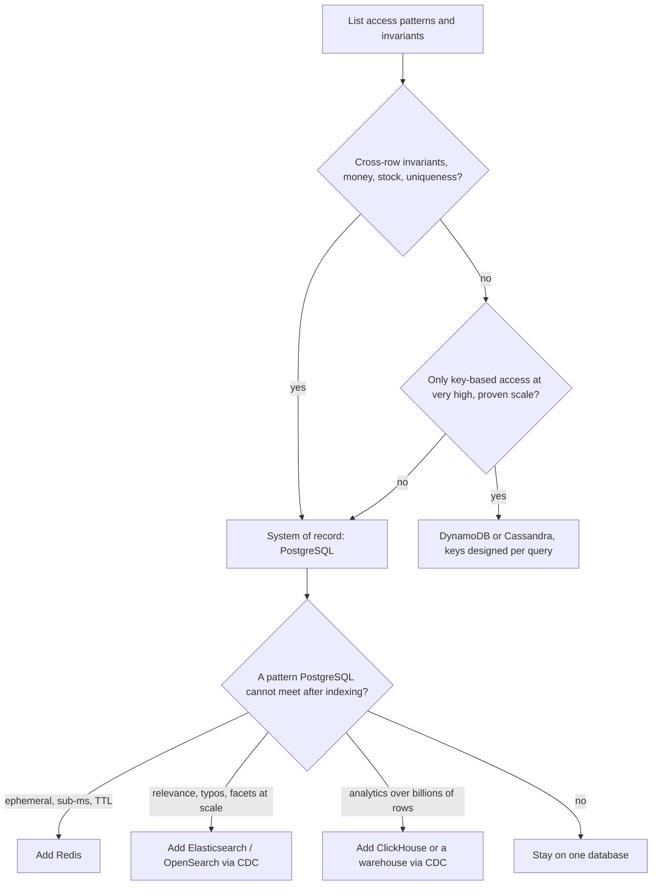

# Database Selection

> **Module 03 · Databases** · Prerequisites: [Consistency Models](03-Consistency-Models.md) · Next: [Schema Design](05-Schema-Design.md)

---

## ⏱ If You Only Have 2 Minutes

- Choose from **access patterns and invariants** first, then consistency needs, query flexibility, data volume and growth, latency targets, operating cost, and team skills. Popularity and "web scale" are not criteria.
- **Default to PostgreSQL** for the system of record. One engine gives transactions, constraints, joins, `jsonb` with GIN indexes, full-text search, PostGIS, pgvector, and declarative partitioning. That covers most products for years.
- Add a specialized store only for a **named, measured need**: Redis for sub-millisecond ephemeral state; Elasticsearch/OpenSearch for relevance tuning, typo tolerance and facets at scale; ClickHouse or a warehouse for analytics over billions of rows; DynamoDB/Cassandra for key-based workloads beyond one primary.
- Every extra database is a **sync pipeline, a consistency gap, and an operations burden** (backups, upgrades, monitoring, on-call knowledge). Count that cost out loud.
- Never **dual-write** from application code to two stores. One write will eventually fail and the stores will diverge. Feed derived stores from the system of record with an outbox or change data capture (CDC).
- Do the arithmetic: 10,000 orders a day for three years is about 11 million orders. That is a small table for PostgreSQL with the right indexes.
- **Managed** databases (RDS/Aurora, Cloud SQL, Atlas, DynamoDB) cost more per hour but include backups, failover and patching that a small team should not build.

---

## 1. What It Is and Why It Exists

Database selection is deciding where each piece of data lives: which store is the **system of record** (the authoritative copy) and which stores, if any, hold **derived copies** for specific reads. It is a design decision with a long tail. Data is heavy: once a product has two years of orders in a store, moving them is a project measured in months, not days.

**Analogy:** a new delivery company buys vans. Vans carry almost anything. When it starts shipping frozen food, it adds a refrigerated truck, because vans genuinely cannot do that job. It does not buy a motorbike, a lorry and a cargo bike on day one "in case". Every new vehicle type needs trained drivers, spare parts and a mechanic who knows it.

**The problem it solves.** Two opposite failures are common:

- **Under-fitting:** forcing a workload into a store that cannot serve it. Examples: running analytics dashboards on the OLTP primary until checkout slows down, or doing `ILIKE '%term%'` searches on a 50-million-row table.
- **Over-fitting:** a "polyglot" stack chosen on day one. MongoDB for products, PostgreSQL for orders, Redis for carts, Elasticsearch for search, Cassandra for events. Five backup procedures, four sync jobs, and a support ticket every week about search results that do not match the product page.

A good selection process makes the first database boring and capable, and makes every additional one justify itself with a specific access pattern it serves better.

---

## 2. How It Works

### The process

1. **List the access patterns.** For each read and write: what is the query, how often, what latency target, how many rows returned. "Show a customer's last 20 orders, 500/s, p99 < 50 ms, 20 rows" is useful. "Fast reads" is not.
2. **List the invariants.** Which rules must never break: no negative stock, one payment per provider reference, unique emails. These need transactions and constraints, which points to a relational store or careful single-document design.
3. **Estimate volume and growth.** Rows per day, bytes per row, retention, read and write rates. Then multiply by growth for two or three years.
4. **Pick the system of record** that serves the invariants and most access patterns.
5. **For each pattern it cannot meet**, after indexing and query tuning, add a derived store fed from the system of record.
6. **Price the operations:** who backs it up, restores it, upgrades it, and gets paged for it.



### Back-of-the-envelope check

An online shop expects 10,000 orders a day, 3 items per order, and keeps 3 years online:

| Table | Rows | Approx. size per row incl. overhead | Total |
|---|---|---|---|
| `orders` | 10,000 × 365 × 3 ≈ 11 million | ~100 bytes | ~1.1 GB |
| `order_items` | ≈ 33 million | ~60 bytes | ~2 GB |
| Indexes | — | — | roughly the same again |

Peak traffic of, say, 50 orders per second is about 200 row writes per second. A single PostgreSQL primary handles that easily, with replicas for read scaling. Nothing in these numbers calls for a distributed database. The numbers above are rough and illustrative; the habit of doing them is what matters. See [Back-of-the-Envelope Calculations](../Module-07-Advanced-Backend-and-System-Design/04-Back-Of-The-Envelope-Calculations.md).

---

## 3. Key Concepts

### The decision criteria

| Criterion | Questions to ask | Pushes toward |
|---|---|---|
| Access patterns | Known and stable, or still changing? By key, by range, ad hoc, by text relevance, by graph distance? | Changing/ad hoc → SQL. Stable key-only → key-value/wide-column. Relevance → search engine |
| Consistency and invariants | Money, stock, uniqueness, multi-row rules? Can readers tolerate stale data? | Strong invariants → single-primary relational, majority writes |
| Query flexibility | Will product and analysts ask new questions monthly? | SQL with secondary indexes |
| Volume and growth | Rows per day, retention, working set vs RAM, write rate | Billions of append-only rows → partitioning, TimescaleDB, or a column store |
| Latency | p99 target, and from which regions? | Sub-ms → in-memory (Redis). Multi-region low-latency writes → specialized distributed stores |
| Operations cost | Who runs backups, upgrades, failover, capacity? Managed option? | Fewer engines; managed services for small teams |
| Team skills | What can the team debug at 3 a.m.? | The store the team already operates well, unless it clearly cannot do the job |

### "Start with PostgreSQL" and how far it stretches

The argument is not "PostgreSQL is best at everything". It is that one well-understood engine with strong guarantees, plus extensions, covers most needs at acceptable quality, and every store you do not add is work you do not do.

| Need | PostgreSQL feature or extension | Signs it is no longer enough |
|---|---|---|
| Flexible attributes | `jsonb` with GIN indexes (`@>`, jsonpath) | Most queries are on nested fields with poor planner estimates; documents are large and rewritten often |
| Text search | `tsvector`, `websearch_to_tsquery`, `ts_rank`, GIN | You need BM25-style relevance tuning, synonyms per locale, typo tolerance at scale, rich facets on large result sets |
| Fuzzy matching, `LIKE '%x%'` | `pg_trgm` with `gin_trgm_ops` | Search-as-you-type across tens of millions of rows with tight latency |
| Geospatial | PostGIS (`geography`, `ST_DWithin`, GiST) | Rarely; PostGIS is a reference implementation |
| Vector similarity | pgvector (HNSW, IVFFlat indexes; `<->`, `<=>` operators) | Very large vector sets with high query rates and filtering needs beyond what the indexes handle well |
| Time series | Declarative partitioning; TimescaleDB hypertables | Sustained very high ingest with analytic queries across all history |
| Very large tables | Range/hash partitioning; Citus for sharding | Write rate beyond one primary even after partitioning |
| Queues and jobs | `SELECT ... FOR UPDATE SKIP LOCKED` | Very high message rates, fan-out to many consumers, replay: use a broker |

### When to add Redis

Add Redis for data that is **hot, small, and cheap to lose or rebuild**: cache entries, sessions, rate-limit counters, leaderboards (sorted sets), short-lived locks, deduplication keys with a TTL. Redis keeps the dataset in memory, so size it for RAM. Its durability depends on configuration. Do not make it the only copy of anything that matters, such as orders, balances or inventory. See [Redis Deep Dive](../Module-07-Advanced-Backend-and-System-Design/15-Redis-Deep-Dive.md).

### When to add a search engine or a column store

**Search engine (Elasticsearch/OpenSearch).** They use an inverted index with BM25 scoring, language analyzers, synonyms, fuzzy queries and aggregations for facets. Add one when search quality is a product feature that someone will tune. Treat it as a **derived index**: fed from PostgreSQL, rebuildable from scratch, and updated in near real time (by default a refresh makes new documents searchable about once per second).

**Column store (ClickHouse, or a warehouse such as BigQuery, Snowflake, Redshift).** OLTP databases store rows together, which suits "fetch order 42". Analytics reads a few columns across millions of rows ("revenue by category by day for two years"). A column store reads only those columns, compresses them well, and scans them in parallel. Add one when analytic queries threaten the primary's latency or take minutes on a replica. Load it by CDC or batch; it is not designed for high-rate single-row updates.

### When DynamoDB or Cassandra is the right primary

Choose them when the access patterns are **few, known, and key-based**, and the scale or availability need is beyond a single primary: very high write rates, many terabytes of hot data, or (Cassandra) active writes in several datacenters. Typical fits: device telemetry by device and time, message inboxes by user, session or event stores. Expect to design keys per query, to give up ad-hoc joins, and to handle uniqueness with conditional writes. DynamoDB is only available as an AWS managed service; Cassandra can be self-hosted or bought as a managed service.

### The hidden cost of polyglot persistence

"Polyglot persistence" means using several storage technologies, each for what it does best. The benefit is real, but so is the bill:

- **Synchronization.** Each derived store needs a pipeline: an [outbox](../Module-02-Core-Backend/19-Asynchronous-Processing.md) table written in the same transaction as the change, or CDC reading the PostgreSQL WAL (for example with Debezium). Pipelines lag, fail, and need replays.
- **Consistency gaps.** The search index can show a product that was just deleted, or a price that was just changed. You must design the UI and the API for that, for example by re-checking price and stock against PostgreSQL at checkout.
- **Operations.** Each engine needs backups *and tested restores*, version upgrades, security patches, capacity planning, dashboards, alerts, and people who understand its failure modes.
- **Cross-store queries.** "Products in search results that are also in stock in warehouse 3" now spans two systems with no join and no shared transaction.

### Managed vs self-hosted

| | Managed (RDS/Aurora, Cloud SQL, Atlas, DynamoDB) | Self-hosted (VMs, Kubernetes operators) |
|---|---|---|
| Backups and point-in-time recovery | Built in; you still test restores | You build, schedule and test them |
| Failover | Automated, typically within a minute or two | You configure (Patroni, replica sets) and rehearse |
| Upgrades and patches | Scheduled windows, provider-tested | Your work, your testing |
| Control | Limited superuser access; extension list chosen by the provider | Any extension, any setting, any version |
| Cost | Higher per unit of capacity | Lower infrastructure cost, higher people cost |
| Good for | Most teams, especially without database specialists | Teams with DBAs, unusual extensions, or strict data-location needs |

Check the extension list before committing to a managed PostgreSQL. Whether PostGIS, pgvector, TimescaleDB or `pg_trgm` is available decides how far "start with PostgreSQL" can stretch on that platform.

---

## 4. Code Examples

Scenario: product search on the catalog. Each category has different attributes (a laptop has `ram_gb`, a shoe has `size`), and customers type free text like `waterproof hiking boots`. The team asks: "Do we need MongoDB for the attributes and Elasticsearch for the search?" For the first version, PostgreSQL covers both with a `jsonb` column, a generated `tsvector` column, and two GIN indexes.

### SQL

```sql
-- Core fields stay typed columns; the long tail of attributes is jsonb.
ALTER TABLE products
  ADD COLUMN description text  NOT NULL DEFAULT '',
  ADD COLUMN attributes  jsonb NOT NULL DEFAULT '{}' CHECK (jsonb_typeof(attributes) = 'object');

-- A stored generated column rewrites the table under an ACCESS EXCLUSIVE lock.
-- Fine for a small catalog; on a large table, schedule it or use a trigger-maintained column.
ALTER TABLE products
  ADD COLUMN search tsvector GENERATED ALWAYS AS (
    setweight(to_tsvector('english', name), 'A') ||        -- name matches rank higher
    setweight(to_tsvector('english', description), 'B')
  ) STORED;

CREATE INDEX products_search_idx     ON products USING gin (search);
-- jsonb_path_ops: smaller and faster than the default for @> containment; no key-exists operators.
CREATE INDEX products_attributes_idx ON products USING gin (attributes jsonb_path_ops);

-- Search: text match + attribute filter + price cap, best matches first.
SELECT id, sku, name, price_cents, ts_rank(search, query) AS rank
  FROM products, websearch_to_tsquery('english', 'waterproof hiking boots') AS query
 WHERE search @@ query
   AND attributes @> '{"brand": "Trailcraft", "gore_tex": true}'
   AND price_cents <= 20000
 ORDER BY rank DESC, id
 LIMIT 20;
```

`websearch_to_tsquery` accepts what users type (quoted phrases, `or`, `-excluded`) without raising syntax errors. Check the plan with `EXPLAIN (ANALYZE, BUFFERS)`: you want a Bitmap Index Scan on `products_search_idx`, and often a `BitmapAnd` with `products_attributes_idx` when both filters are selective. `ts_rank` is not indexed: it is computed for every matching row before the top 20 are kept. That is cheap for hundreds of matches and expensive for hundreds of thousands. That is one of the signals that a search engine is due.

### Node.js / TypeScript

```ts
// npm i pg && npm i -D @types/pg   — Node.js 22+, TypeScript 5, ESM
import pg from "pg";

const pool = new pg.Pool({ connectionString: process.env.DATABASE_URL, max: 10 });

export interface ProductSearch {
  text: string;
  attributes?: Record<string, string | number | boolean>; // flat filters, e.g. { brand: "Trailcraft" }
  maxPriceCents?: number;
  limit?: number;
}
interface Hit { id: string; sku: string; name: string; price_cents: number; rank: number }
interface Facet { brand: string | null; products: number }

const SEARCH_SQL = `
  SELECT id, sku, name, price_cents, ts_rank(search, query) AS rank
    FROM products, websearch_to_tsquery('english', $1) AS query
   WHERE search @@ query
     AND attributes @> $2::jsonb
     AND ($3::int IS NULL OR price_cents <= $3)
   ORDER BY rank DESC, id
   LIMIT $4`;

// Facet counts, the job people often reach for Elasticsearch aggregations to do.
const FACETS_SQL = `
  SELECT attributes->>'brand' AS brand, count(*)::int AS products
    FROM products, websearch_to_tsquery('english', $1) AS query
   WHERE search @@ query
   GROUP BY 1
   ORDER BY 2 DESC
   LIMIT 10`;

export async function searchProducts(s: ProductSearch): Promise<{ hits: Hit[]; brands: Facet[] }> {
  const text = s.text.trim().slice(0, 200); // bound the work a single request can ask for
  if (!text) return { hits: [], brands: [] };
  const limit = Math.min(Math.max(s.limit ?? 20, 1), 100);

  // Two pooled connections run the queries in parallel; one connection would serialize them.
  const [hits, brands] = await Promise.all([
    pool.query<Hit>(SEARCH_SQL, [text, JSON.stringify(s.attributes ?? {}), s.maxPriceCents ?? null, limit]),
    pool.query<Facet>(FACETS_SQL, [text]),
  ]);
  // id is bigint, so pg returns it as a string; rank is real, so it arrives as a number.
  return { hits: hits.rows, brands: brands.rows };
}
```

### Python

```python
# pip install "psycopg[binary]"   — Python 3.12+. Pipeline mode needs libpq 14+ (bundled in the binary wheel).
from typing import Any

import psycopg
from psycopg.rows import dict_row
from psycopg.types.json import Jsonb

SEARCH_SQL = """
SELECT id, sku, name, price_cents, ts_rank(search, query) AS rank
  FROM products, websearch_to_tsquery('english', %(q)s) AS query
 WHERE search @@ query
   AND attributes @> %(attrs)s
   AND (%(max_price)s::int IS NULL OR price_cents <= %(max_price)s)
 ORDER BY rank DESC, id
 LIMIT %(limit)s
"""

FACETS_SQL = """
SELECT attributes->>'brand' AS brand, count(*) AS products
  FROM products, websearch_to_tsquery('english', %(q)s) AS query
 WHERE search @@ query
 GROUP BY 1
 ORDER BY 2 DESC
 LIMIT 10
"""


def search_products(
    conn: psycopg.Connection,
    text: str,
    attributes: dict[str, str | int | bool] | None = None,
    max_price_cents: int | None = None,
    limit: int = 20,
) -> dict[str, list[dict[str, Any]]]:
    text = text.strip()[:200]
    if not text:
        return {"hits": [], "brands": []}
    params = {
        "q": text,
        "attrs": Jsonb(attributes or {}),  # adapts the dict as jsonb, still a bound parameter
        "max_price": max_price_cents,
        "limit": max(1, min(limit, 100)),
    }
    # Pipeline mode sends both queries before waiting for either: one network round trip
    # on one connection, where Node needed two pooled connections and Promise.all.
    with conn.pipeline(), conn.cursor(row_factory=dict_row) as hits, conn.cursor(row_factory=dict_row) as facets:
        hits.execute(SEARCH_SQL, params)
        facets.execute(FACETS_SQL, {"q": text})
        # bigint ids and counts arrive as Python ints; no string conversion needed.
        return {"hits": hits.fetchall(), "brands": facets.fetchall()}
```

**What to notice.** No second database was needed for flexible attributes, full-text search, or facets. The `CHECK` keeps `attributes` an object, the generated column keeps the search vector in sync inside the same transaction as the product update, and there is no pipeline to lag behind. **Runtime difference:** a single `pg` client in Node runs one query at a time, so parallelism comes from the pool plus `Promise.all`. psycopg 3 offers pipeline mode, which queues several statements on one connection and reads all the results after one round trip.

**MySQL (InnoDB) difference.** MySQL has a `JSON` type and `FULLTEXT` indexes, but no GIN-style index over a whole JSON document. You index specific JSON paths through generated columns or multi-valued indexes (8.0.17+), so each new attribute filter needs its own index.

---

## 5. Production Concerns

- **GIN indexes cost writes.** Every product update that changes text or attributes updates many GIN entries. PostgreSQL buffers them in a pending list (`fastupdate`, sized by `gin_pending_list_limit`, default 4 MB) that vacuum or a full list flushes, so an occasional write or search can be slow. Watch write latency on hot tables and tune autovacuum before blaming the engine.
- **Planner estimates for `jsonb` are rough.** PostgreSQL keeps only coarse statistics for values inside a `jsonb` column, so row estimates for `@>` filters are often guesses and plans can be poor. When one attribute is filtered constantly (`brand`), promote it to a real column or an expression index with its own statistics.
- **Large documents are slow to rewrite.** When a row grows past about 2 KB, PostgreSQL compresses its large values and may move them out of line (TOAST). A `jsonb` value is always rewritten whole, so changing one key in a big document rewrites all of it. Keep frequently updated counters out of big `jsonb` blobs.
- **Derived stores need replay.** If you do add Elasticsearch or ClickHouse, feed them from an outbox or CDC with idempotent consumers, keep a full-reindex job, and alert on pipeline lag. Re-check price and stock against PostgreSQL at checkout, never against the search index.
- **Connection limits shape architecture.** PostgreSQL uses one process per connection, so hundreds of serverless functions or pods need a pooler (PgBouncer, or the provider's proxy). That is a selection factor for serverless stacks, and one reason teams pick DynamoDB there.
- **Managed platform limits.** Before relying on an extension, confirm your managed provider supports it and which versions. Plan the major-version upgrade path too; it is the most common long-term operational task.
- **What to measure.** p95/p99 per access pattern, search queries per second and the share that return thousands of matches (the ranking cost), replica lag, storage growth per month, and, for every derived store, pipeline lag and reindex duration.

---

## 6. Common Mistakes

- **Choosing by popularity or hype** — the team picks a store nobody can operate, and the first incident becomes a week-long outage — choose from written access patterns, invariants and team skills.
- **Adding a store for a problem an index would fix** — Elasticsearch is introduced for a filter that a B-tree or GIN index would serve in milliseconds — exhaust indexing and query tuning in the system of record first, with `EXPLAIN` as evidence.
- **Dual writes from application code** — the PostgreSQL write succeeds, the Elasticsearch write times out, and the two disagree forever — use a transactional outbox or CDC and make consumers idempotent.
- **Making a derived store the source of truth** — prices are read from the search index at checkout and stale prices are charged — derived stores serve discovery; decisions read the system of record.
- **Ignoring the operations bill** — five engines, no tested restore for three of them — budget backups, restore drills, upgrades and on-call for every store before adding it.
- **Designing for imagined scale** — Cassandra chosen for 10,000 rows a day, and every new feature fights its query model — do the arithmetic; plan the migration path, not the destination.
- **Never reconsidering** — the analytics dashboard keeps running on the OLTP primary until checkout times out — set thresholds (query time, replica lag, primary CPU) that trigger adding a column store or replica.

---

## 7. Comparison Table

PostgreSQL feature versus the dedicated store people usually reach for:

| Need | Stay in PostgreSQL with | Move to | Move when |
|---|---|---|---|
| Flexible documents | `jsonb` + GIN, `CHECK` constraints | MongoDB | Data is aggregate-shaped, rarely joined, and the team wants document-native tooling and built-in sharding |
| Full-text search | `tsvector` + GIN, `ts_rank`, `pg_trgm` | Elasticsearch / OpenSearch | Relevance tuning, typo tolerance, multilingual analyzers, heavy faceting at scale |
| Cache / ephemeral state | `UNLOGGED` tables, materialized views | Redis | Sub-millisecond latency, TTL-driven data, very high request rates |
| Analytics | Partitioning, materialized views, a reporting replica | ClickHouse / a warehouse | Scans over hundreds of millions of rows, or analytics load hurting OLTP |
| Time series | Partitioning, TimescaleDB | ClickHouse, InfluxDB | Ingest and retention beyond what one node plus compression handles |
| Vectors | pgvector (HNSW) | A dedicated vector database | Very large indexes, high query rates, or filtering needs beyond pgvector |
| Massive key-value | Hash partitioning, Citus | DynamoDB / Cassandra | Proven write rates or data sizes beyond one primary, with key-only access |

---

## 8. Interview Questions

**[Junior] How would you choose a database for a new service?**
I would write down the main reads and writes with their frequency and latency targets, and the rules that must never break, like unique emails or non-negative stock. I would estimate data volume and growth. If there are cross-row invariants or the access patterns are still changing, I would start with PostgreSQL, and add other stores only for specific patterns it cannot serve.

**[Junior] When would you use Redis next to PostgreSQL?**
For data that is hot, small and safe to lose or rebuild: cached query results, sessions, rate-limit counters, leaderboards, short-lived locks. Redis keeps data in memory and answers in well under a millisecond. Orders, payments and inventory stay in PostgreSQL, because Redis is not the right system of record for them.

**[Mid] Why "just use Postgres"? What are its limits?**
One engine gives transactions, constraints, joins, `jsonb`, full-text search, geospatial, vectors and partitioning, so a team operates and backs up one thing and avoids sync pipelines. The limits are write throughput beyond one primary (without sharding), very large analytic scans, and advanced search relevance. Those are real but usually far away, and you can add a specialized store when you reach one.

**[Mid] What is the dual-write problem and how do you avoid it?**
If application code writes to PostgreSQL and then to Elasticsearch, a crash or timeout between the two leaves them inconsistent, and nothing will fix it later. Instead, write an outbox row in the same transaction as the change, and have a relay publish it to the other store. Or use CDC to read changes from the WAL. Consumers must be idempotent, because relays deliver at least once.

**[Mid] When would you add a column store like ClickHouse?**
When analytic queries scan large parts of big tables, such as revenue by day over two years, and either take too long on a replica or put load on the primary. Column stores read only the needed columns, compress them well and scan in parallel. I would load it by CDC or batch and keep transactional work in PostgreSQL.

**[Senior] The team wants MongoDB for products and PostgreSQL for orders. How do you evaluate it?**
I would ask what MongoDB gives the product data that a `jsonb` column with GIN indexes does not, and what the cost is. Orders reference products, so reports that join them now span two databases. Prices copied into orders must be snapshotted correctly. The team gets two backup stories and a sync path if search needs both. If products are truly aggregate-shaped, huge, and owned by a separate team and service, the split can make sense. Otherwise one PostgreSQL database with `jsonb` is simpler and keeps the joins.

**[Senior] Search results show deleted products and stale prices. Diagnose and redesign.**
The search index is a derived store and its pipeline is lagging or losing events. Common causes are dual writes that fail silently, a consumer that crashed without alerting, or deletes not being propagated. I would move to an outbox or CDC feed with idempotent upserts and deletes, alert on pipeline lag, and run a periodic reconciliation or full reindex. In the product, I would re-validate price and availability against PostgreSQL on the product page and at checkout, so staleness costs a little UX and never money.

**[Senior] Managed or self-hosted PostgreSQL for a five-person startup?**
Managed. Backups with point-in-time recovery, automated failover, patching and monitoring are table stakes, and building them well takes more time than the team has. The trade-offs are cost, less superuser control, and the provider's extension list and upgrade windows. So I would check that the extensions we need are supported before committing. Self-hosting makes sense later, with database specialists, unusual requirements, or a cost profile that justifies it.

---

## 9. Cheat Sheet

```text
Inputs        access patterns (query, rate, p99, rows) + invariants + volume/growth + latency + ops + skills
Default       PostgreSQL as system of record
PG stretches  jsonb+GIN | tsvector+GIN, websearch_to_tsquery | pg_trgm | PostGIS | pgvector | partitioning | Timescale | Citus
GIN ops       jsonb_ops (default: @>, ?, ?|, ?&, jsonpath) vs jsonb_path_ops (@>, jsonpath; smaller)
Redis         hot, small, rebuildable: cache, sessions, rate limits, leaderboards, locks (TTL)
Search engine relevance tuning, typos, analyzers, facets at scale; derived + rebuildable
Column store  scans over huge tables (ClickHouse, warehouse); load via CDC/batch
DynamoDB/C*   few known key-based patterns at proven large scale; keys designed per query
Polyglot tax  sync pipeline + consistency gap + backups/upgrades/on-call per engine
Sync          outbox or CDC (Debezium) + idempotent consumers; never dual-write
Truth         decisions (price, stock, payment) read the system of record
Managed       backups/PITR/failover/patching included; check extension list
Math          10k orders/day x 3 yr ~ 11M rows: small for one Postgres primary
```

---

## Related Topics

- [SQL vs NoSQL](01-SQL-vs-NoSQL.md) — the data-model families this chapter chooses between
- [CAP Theorem](02-CAP-Theorem.md) — consistency and availability needs as a selection input
- [Schema Design](05-Schema-Design.md) — the next step once PostgreSQL is chosen
- [Indexes](19-Indexes.md) — B-tree and GIN indexes that often make a second store unnecessary
- [Redis Deep Dive](../Module-07-Advanced-Backend-and-System-Design/15-Redis-Deep-Dive.md) — when and how to add Redis next to the system of record
- [Back-of-the-Envelope Calculations](../Module-07-Advanced-Backend-and-System-Design/04-Back-Of-The-Envelope-Calculations.md) — the arithmetic behind volume and growth estimates
