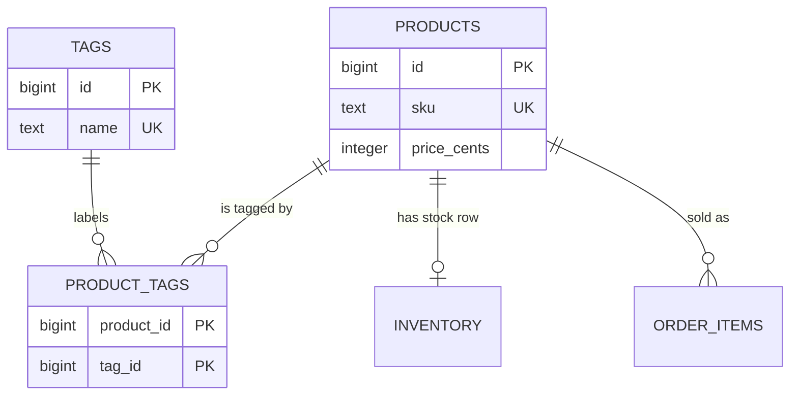

# Schema Design

> **Module 03 · Databases** · Prerequisites: [Database Selection](04-Database-Selection.md) · Next: [Normalization](06-Normalization.md)

---

## ⏱ If You Only Have 2 Minutes

- Give every table a **surrogate primary key** (`bigint GENERATED ALWAYS AS IDENTITY` or a time-ordered UUID) and put a `UNIQUE` constraint on the natural key (email, SKU). Natural keys change; primary keys should not.
- **Random UUIDv4 keys scatter inserts across the whole B-tree.** Time-ordered UUIDv7 or ULID keys append at the right edge like a sequence, so they keep index pages hot in cache.
- Store money as **integer minor units** (`price_cents`) or `numeric(p,s)`, never `float`/`double`. Store instants as **`timestamptz`**. In PostgreSQL, `text` and `varchar(n)` perform the same.
- Constraints are business rules that hold even when ten app replicas race: `NOT NULL`, `UNIQUE`, `CHECK`, `FOREIGN KEY`. An app-side "check then insert" is not a guarantee.
- `CHECK` passes when its expression is `NULL`, and `UNIQUE` allows many `NULL`s by default. Pair them with `NOT NULL` when the value is required.
- N:M needs a **join table** with a composite primary key, plus a second index in the reverse direction.
- Polymorphic `(commentable_type, commentable_id)` columns cannot have a foreign key. Use separate FKs with a `CHECK (num_nonnulls(...) = 1)` or one link table per parent.
- Name your constraints. The driver reports the constraint name and the SQLSTATE (`23505` unique, `23503` FK, `23514` check), which is how you turn a database error into a clean `409` or `422`.

---

## 1. What It Is and Why It Exists

**Schema design** is deciding which tables exist, what each row means, how rows are identified, which types the columns use, how tables relate, and which rules the database itself enforces. The result is a contract that every service, script and analyst query must obey.

**Analogy:** a schema is the layout of a warehouse. Each shelf holds one kind of item (a table), every box has a barcode that never changes (the primary key), and the loading dock refuses boxes with no destination (a `NOT NULL` foreign key).

**The problem it solves.** Data outlives code. The service you write today will be rewritten, a Python batch job will be added, and someone will run a manual `UPDATE` at 2 a.m. If the rule "a payment amount is positive" lives only in one service's validation code, every other writer can break it. If it lives in the schema as `CHECK (amount_cents > 0)`, nobody can.

What breaks without deliberate schema design:

- Duplicate customers, because uniqueness was checked with a `SELECT` before the `INSERT` and two requests raced.
- Orders that point at deleted customers, because there was no foreign key.
- Totals off by a cent, because prices were stored as `float`.
- Orders that appear on the wrong day, because times were stored as `timestamp` without a time zone.
- A primary key type that must be changed on a huge table, one of the most painful migrations there is.

A useful order of questions, before you write any DDL: which **entities** exist, what is their **cardinality** (one customer, many orders), who **owns** each fact, which **invariants** must never be broken, and which **queries** must be fast.

---

## 2. How It Works

You turn requirements into tables in a fixed sequence:

1. **One table per entity, one row per thing.** If you cannot say in one sentence what a row means, the table is doing two jobs.
2. **Pick the identity:** a primary key that is unique, never `NULL` and never changes, plus `UNIQUE` constraints on real-world identifiers (email, SKU).
3. **Pick types that reject bad data:** `integer` cents, not `float`; `timestamptz`, not a string.
4. **Express relationships with foreign keys.** The "many" side holds the FK; N:M gets its own table.
5. **Write the invariants as constraints:** ranges, allowed states and "exactly one of these" rules become `CHECK`s.
6. **Index the known queries,** including FK columns you join or delete through. PostgreSQL does **not** create these for you.

Here is the sample schema's product catalogue with the tag feature this chapter adds:



When a statement breaks a constraint, PostgreSQL aborts the statement (and, inside an explicit transaction, the whole transaction) and returns an error with a five-character **SQLSTATE** code, the constraint name, the table and a detail message. Your application catches that error and maps it to a domain error. The database is the referee; the application only translates the verdict.

---

## 3. Key Concepts

### Primary keys: identity, UUIDv4, UUIDv7/ULID

| Key type | Size | Insert locality in a B-tree | Exposes | Generated where |
|---|---|---|---|---|
| `bigint` identity | 8 bytes | Always appends to the rightmost leaf page | Row counts and growth rate; easy to enumerate | Database (needs a round trip) |
| UUIDv4 (random) | 16 bytes | Random leaf page every insert | Nothing | Anywhere (`gen_random_uuid()`, `crypto.randomUUID()`, `uuid.uuid4()`) |
| UUIDv7 ([RFC 9562](https://www.rfc-editor.org/rfc/rfc9562)) | 16 bytes | Near the right edge: first 48 bits are a Unix millisecond timestamp | Creation time | Anywhere; PostgreSQL 18 adds `uuidv7()`, otherwise in the app |
| ULID | 16 bytes (26-char text form) | Same as UUIDv7: 48-bit ms timestamp + 80 random bits | Creation time | App library; store in a `uuid` column |

**Why locality matters.** A B-tree keeps keys sorted. With a sequence or UUIDv7, each new key is the largest so far, so inserts land on the same few right-hand pages, which stay in memory. With UUIDv4, each insert hits a random page. Once the index is bigger than RAM, many inserts must first read a page from disk. Pages split in the middle and stay half empty, and after each checkpoint the first change to every page writes a full page image to the WAL. Result: a bigger index, more I/O and more WAL for the same rows.

**Rules of thumb:**

- `bigint` identity is the default for a single database. `GENERATED ALWAYS` stops anyone inserting a hand-picked ID by accident.
- Use UUIDv7 when IDs must be created outside the database (offline clients, several writers, merging shards).
- Never use `int` for a growing table: changing a key type later rewrites the table and every referencing FK.
- Store UUIDs in the `uuid` type, not `text` (16 bytes versus 37+).
- Sequences have gaps (rolled-back transactions still consume values), so never use one for gap-free invoice numbers.
- A guessable ID is not a security hole if every read checks ownership, but it leaks business volume. Some teams keep a `bigint` key internally and expose a random public ID.

### Natural vs surrogate keys

A **natural key** comes from the real world: email, SKU, ISO country code. A **surrogate key** is a meaningless number or UUID that exists only to identify the row.

Natural keys look attractive, but emails change, SKUs get renamed, and a natural key used as a primary key is copied into every child table as a foreign key. Changing it means updating every reference. The standard answer is: **surrogate primary key + `UNIQUE` constraint on the natural key.** You get stable joins and still reject duplicates.

Natural keys are fine when they are truly fixed and small: `country char(2)` holding ISO 3166 codes, or a currency code. Join tables are the other exception. `order_items` uses `(order_id, product_id)` as its key because that pair *is* the identity of a line.

### Data types that matter

| Data | Use | Avoid | Why |
|---|---|---|---|
| Money | `integer`/`bigint` minor units, or `numeric(12,2)` | `real`, `double precision`, `money` | Binary floats cannot represent 0.10 exactly; `money` output depends on the `lc_monetary` setting and holds one currency |
| Sums of money | `bigint` cents | `integer` | `integer` tops out at 2,147,483,647 cents (about 21.4 million) |
| A moment in time | `timestamptz` | `timestamp`, `text` | `timestamptz` stores an absolute instant (UTC internally) and converts to the session `TimeZone` on output |
| A calendar date (birthday) | `date` | `timestamptz` | No time zone shift can move it to the previous day |
| Strings | `text` (+ `CHECK (char_length(x) <= n)` if a limit is a real rule) | `char(n)` for variable data | In PostgreSQL there is no performance difference between `text` and `varchar(n)`; `char(n)` pads with spaces |
| Flags | `boolean` | `'Y'/'N'`, `0/1` | The type itself rejects a third value |
| Semi-structured extras | `jsonb` | `json`, `text` holding JSON | `jsonb` is parsed once and can be indexed |

The `text` versus `varchar(n)` point is PostgreSQL-specific. In MySQL, `VARCHAR(n)` length affects row format and index key limits, so it matters there.

### Constraints and `ON DELETE` choices

| Constraint | Rule it enforces | Detail worth knowing |
|---|---|---|
| `NOT NULL` | Value is required | Cheapest constraint; add it to almost every column |
| `UNIQUE` | No two rows share the value | Creates a unique B-tree index. `NULL`s are distinct by default; PostgreSQL 15+ supports `UNIQUE NULLS NOT DISTINCT` |
| `CHECK` | A per-row condition holds | Passes when the result is `NULL`; cannot look at other rows or tables |
| `PRIMARY KEY` | `UNIQUE` + `NOT NULL` | One per table |
| `FOREIGN KEY` | Referenced row exists | The **referencing** column is not indexed automatically |
| `EXCLUDE` | No two rows "overlap" | E.g. no two bookings for the same room with overlapping time ranges |

`DEFAULT` is often listed with constraints, but it is not one. It fills in a value when the `INSERT` omits the column; it rejects nothing. `DEFAULT now()` on `created_at` plus `NOT NULL` is the pair that both fills and protects.

What happens to children when a parent row is deleted:

| `ON DELETE` | Effect | Use for | Sample schema |
|---|---|---|---|
| `NO ACTION` (default) | Error if children exist; checked at end of statement, can be deferred | Most references | `payments.order_id`: you must not delete an order that has money attached |
| `RESTRICT` | Error immediately, cannot be deferred | Same, when you want no deferral | — |
| `CASCADE` | Delete the children too | Children that are *part of* the parent | `order_items.order_id`: lines have no meaning without the order |
| `SET NULL` | Set the FK to `NULL` | Optional links | e.g. `orders.coupon_id` when a coupon is purged |
| `SET DEFAULT` | Set the FK to its default | Rare | — |

`products` is referenced by `order_items` without `CASCADE`, so a product that was ever sold cannot be deleted. That is correct: order history must not change. Mark products as discontinued instead.

### Modelling 1:1, 1:N and N:M

- **1:N** — the FK sits on the "many" side: `orders.customer_id REFERENCES customers(id)`. One customer, many orders.
- **1:1** — make the child's primary key also its foreign key: `inventory.product_id bigint PRIMARY KEY REFERENCES products(id)`. The PK guarantees at most one row per product. Split a 1:1 out of the main table when the columns are optional, large, updated much more often (stock counts change on every sale, product names rarely), or owned by another team.
- **N:M** — a join table with two FKs and a composite primary key, such as `product_tags (product_id, tag_id)`. The PK index answers "tags for product X". Add an index on `(tag_id, product_id)` for "products with tag Y". The join table can carry facts about the *relationship* itself, like `tagged_at`. A product–category N:M works the same way.

**Inheritance (table per type).** When several kinds of thing share an identity (say `customers` that are either `people` or `companies`), keep the shared columns in a parent table and put each subtype's columns in a child table whose PK is also an FK to the parent. Every subtype row has exactly one parent row, and FKs from other tables can point at the parent.

### Polymorphic associations, enums, soft delete, tenants

**Polymorphic association.** A `comments` table with `commentable_type text` and `commentable_id bigint` that points at a product *or* an order looks flexible. But no foreign key can reference "one of several tables", so orphans and typos (`'Prodcut'`) are allowed. Two sound designs:

```sql
-- Exclusive arc: one nullable FK per parent, and exactly one must be set.
CREATE TABLE comments (
  id          bigint GENERATED ALWAYS AS IDENTITY PRIMARY KEY,
  product_id  bigint REFERENCES products(id) ON DELETE CASCADE,
  order_id    bigint REFERENCES orders(id)   ON DELETE CASCADE,
  body        text   NOT NULL,
  CONSTRAINT comments_one_parent CHECK (num_nonnulls(product_id, order_id) = 1)
);
```

The other option is one link table per parent (`product_comments`, `order_comments`). Both keep real foreign keys.

**Enumerations.** Three ways to restrict `orders.status`:

| Option | Add a value | Remove or rename | Extra data per value | Notes |
|---|---|---|---|---|
| `CHECK (status IN (...))` (sample schema) | Drop and re-add the constraint | Same | No | Simple; the list lives in the DDL |
| `CREATE TYPE ... AS ENUM` | `ALTER TYPE ... ADD VALUE` (cheap) | `RENAME VALUE` works; **removing a value is not supported** | No | Sorts by declaration order; 4 bytes per value |
| Lookup table + FK | `INSERT` a row | `UPDATE`/`DELETE` (FK protects use) | Yes (label, sort order, is_terminal) | Best when non-developers manage the list |

**Soft delete.** Adding `deleted_at timestamptz` and filtering `WHERE deleted_at IS NULL` keeps data for undo and audit, but it has costs. Every query must remember the filter. FKs still see the "deleted" row as present. Deleted rows keep taking space in tables and indexes. Uniqueness breaks: a customer who deleted their account cannot sign up again because `email` is still taken. Fix that with a **partial unique index** that only covers live rows:

```sql
ALTER TABLE customers ADD COLUMN deleted_at timestamptz;
ALTER TABLE customers DROP CONSTRAINT customers_email_key;
CREATE UNIQUE INDEX customers_email_live_key ON customers (email) WHERE deleted_at IS NULL;
```

Privacy laws that require real erasure still apply. Moving deleted rows to an archive table is often simpler than filtering forever.

**Multi-tenant `tenant_id`.** In a shared-schema SaaS, put `tenant_id` on every tenant-owned table. Scope uniqueness per tenant: `UNIQUE (tenant_id, sku)`, not `UNIQUE (sku)`. Stop cross-tenant references with **composite foreign keys**: give `customers` a `UNIQUE (tenant_id, id)` and make `orders` reference `(tenant_id, customer_id)`. The database then rejects an order from tenant A that points at a customer of tenant B. Lead most indexes with `tenant_id`. Row-level security (`CREATE POLICY ... USING (tenant_id = current_setting('app.tenant_id')::bigint)`) adds a second guard, but table owners bypass it unless you use `FORCE ROW LEVEL SECURITY`, and superusers always bypass it.

---

## 4. Code Examples

Scenario: add free-form **tags** to products (an N:M relationship), then make the API return a precise error when a constraint fires: duplicate SKU, unknown product, invalid tag, or deleting a tag that is still in use.

### SQL

```sql
CREATE TABLE tags (
  id    bigint GENERATED ALWAYS AS IDENTITY PRIMARY KEY,
  name  text NOT NULL,
  CONSTRAINT tags_name_key    UNIQUE (name),
  -- The app lowercases input, but the database is what guarantees it.
  CONSTRAINT tags_name_format CHECK (name = lower(name) AND char_length(name) BETWEEN 1 AND 40)
);

CREATE TABLE product_tags (
  product_id  bigint      NOT NULL,
  tag_id      bigint      NOT NULL,
  tagged_at   timestamptz NOT NULL DEFAULT now(),   -- a fact about the link itself
  CONSTRAINT product_tags_pkey       PRIMARY KEY (product_id, tag_id),
  CONSTRAINT product_tags_product_fk FOREIGN KEY (product_id) REFERENCES products (id) ON DELETE CASCADE,
  CONSTRAINT product_tags_tag_fk     FOREIGN KEY (tag_id)     REFERENCES tags (id)     ON DELETE RESTRICT
);

-- The PK index serves "tags of product X"; this one serves "products with tag Y".
CREATE INDEX product_tags_tag_product_idx ON product_tags (tag_id, product_id);

-- Products carrying BOTH tags.
SELECT p.id, p.name
FROM products p
JOIN product_tags pt ON pt.product_id = p.id
JOIN tags t          ON t.id = pt.tag_id
WHERE t.name IN ('vegan', 'gift')
GROUP BY p.id, p.name
HAVING count(*) = 2;
```

What the application receives when a rule fires (illustrative output):

```text
ERROR:  insert or update on table "product_tags" violates foreign key constraint "product_tags_product_fk"
DETAIL:  Key (product_id)=(999) is not present in table "products".
-- SQLSTATE 23503, constraint = product_tags_product_fk, table = product_tags
```

`ON DELETE CASCADE` on the product side means removing a product removes its tag links. `RESTRICT` on the tag side means you cannot delete a tag that is still attached, which the API reports as `409 tag_in_use`.

### Node.js / TypeScript

```ts
// npm i express pg  (+ -D @types/express @types/pg) — Node.js 22+, TypeScript 5, ESM
import express, { type NextFunction, type Request, type Response } from "express";
import pg from "pg";

const pool = new pg.Pool({ connectionString: process.env.DATABASE_URL });

export class DomainError extends Error {
  constructor(readonly code: string, readonly status: number, message: string) { super(message); }
}

// Keyed by constraint name — the reason the DDL names every constraint explicitly.
const BY_CONSTRAINT: Record<string, [string, number, string]> = {
  products_sku_key:           ["sku_taken", 409, "A product with this SKU already exists"],
  products_price_cents_check: ["invalid_price", 422, "Price must be zero or more"],
  tags_name_format:           ["invalid_tag", 422, "Tags are lowercase, 1-40 characters"],
  product_tags_product_fk:    ["product_not_found", 404, "Product does not exist"],
  product_tags_tag_fk:        ["tag_in_use", 409, "Tag is still attached to products"],
};

function translate(err: unknown): unknown {
  if (!(err instanceof pg.DatabaseError)) return err;
  const known = err.constraint ? BY_CONSTRAINT[err.constraint] : undefined;
  if (known) return new DomainError(...known);
  // Fallback by SQLSTATE for constraints added later without a mapping. Never echo err.detail:
  // it contains key values (e.g. someone else's email).
  if (err.code === "23505") return new DomainError("conflict", 409, "Duplicate value");
  if (err.code === "23503") return new DomainError("reference_conflict", 409, "Related row missing or in use");
  if (err.code === "23514" || err.code === "23502") return new DomainError("invalid_value", 422, "Invalid value");
  return err;
}

async function inTransaction<T>(work: (c: pg.PoolClient) => Promise<T>): Promise<T> {
  const client = await pool.connect();
  try {
    await client.query("BEGIN");
    const result = await work(client);
    await client.query("COMMIT");
    return result;
  } catch (err) {
    await client.query("ROLLBACK");
    throw translate(err);
  } finally {
    client.release();
  }
}

export function tagProduct(productId: string, rawTag: string): Promise<void> {
  const name = rawTag.trim().toLowerCase();
  return inTransaction(async (c) => {
    await c.query("INSERT INTO tags (name) VALUES ($1) ON CONFLICT (name) DO NOTHING", [name]);
    // A separate statement on purpose: under READ COMMITTED it takes a fresh snapshot,
    // so it also sees a tag that a concurrent request committed a moment ago.
    const { rows } = await c.query<{ id: string }>("SELECT id FROM tags WHERE name = $1", [name]);
    await c.query(
      "INSERT INTO product_tags (product_id, tag_id) VALUES ($1, $2) ON CONFLICT DO NOTHING",
      [productId, rows[0]?.id],
    );
  });
}

export const deleteTag = (tagId: string) =>
  inTransaction(async (c) => { await c.query("DELETE FROM tags WHERE id = $1", [tagId]); });

const app = express();
app.use(express.json());

app.post("/products/:id/tags", async (req, res) => {
  if (!/^\d+$/.test(req.params.id)) { res.status(400).json({ error: "bad_id" }); return; }
  await tagProduct(req.params.id, String(req.body?.tag ?? ""));   // Express 5 forwards rejections
  res.status(204).end();
});

app.delete("/tags/:id", async (req, res) => { await deleteTag(req.params.id); res.status(204).end(); });

app.use((err: unknown, _req: Request, res: Response, _next: NextFunction) => {
  if (err instanceof DomainError) { res.status(err.status).json({ error: err.code, message: err.message }); return; }
  res.status(500).json({ error: "internal" });
});
```

IDs travel as strings here because `pg` returns `bigint` columns as strings: a JavaScript `number` loses precision above 2^53.

### Python

```python
# pip install fastapi "psycopg[binary]" psycopg-pool   — Python 3.12+
import os

from fastapi import FastAPI, Request
from fastapi.responses import JSONResponse
from psycopg import errors
from psycopg_pool import ConnectionPool
from pydantic import BaseModel, Field

pool = ConnectionPool(os.environ["DATABASE_URL"], open=True)


class DomainError(Exception):
    def __init__(self, code: str, status: int, message: str) -> None:
        super().__init__(message)
        self.code, self.status = code, status


BY_CONSTRAINT = {
    "products_sku_key": ("sku_taken", 409, "A product with this SKU already exists"),
    "tags_name_format": ("invalid_tag", 422, "Tags are lowercase, 1-40 characters"),
    "product_tags_product_fk": ("product_not_found", 404, "Product does not exist"),
    "product_tags_tag_fk": ("tag_in_use", 409, "Tag is still attached to products"),
}


def translate(exc: errors.IntegrityError) -> Exception:
    if known := BY_CONSTRAINT.get(exc.diag.constraint_name or ""):
        return DomainError(*known)
    # psycopg raises one subclass per SQLSTATE, so we can match on the class.
    match exc:
        case errors.UniqueViolation():
            return DomainError("conflict", 409, "Duplicate value")
        case errors.ForeignKeyViolation():
            return DomainError("reference_conflict", 409, "Related row missing or in use")
        case errors.CheckViolation() | errors.NotNullViolation():
            return DomainError("invalid_value", 422, "Invalid value")
    return exc


def tag_product(product_id: int, raw_tag: str) -> None:
    name = raw_tag.strip().lower()
    try:
        with pool.connection() as conn, conn.transaction():
            conn.execute("INSERT INTO tags (name) VALUES (%s) ON CONFLICT (name) DO NOTHING", (name,))
            row = conn.execute("SELECT id FROM tags WHERE name = %s", (name,)).fetchone()
            conn.execute(
                "INSERT INTO product_tags (product_id, tag_id) VALUES (%s, %s) ON CONFLICT DO NOTHING",
                (product_id, row[0] if row else None),
            )
    except errors.IntegrityError as exc:  # the transaction block already rolled back
        raise translate(exc) from exc


class TagIn(BaseModel):
    tag: str = Field(min_length=1, max_length=40)  # friendly 422 early; the CHECK is the guarantee


app = FastAPI()


@app.exception_handler(DomainError)
async def on_domain_error(_: Request, exc: DomainError) -> JSONResponse:
    return JSONResponse({"error": exc.code, "message": str(exc)}, status_code=exc.status)


@app.post("/products/{product_id}/tags", status_code=204)
def add_tag(product_id: int, body: TagIn) -> None:
    # Plain `def`: psycopg's sync pool blocks, so FastAPI runs this in its thread pool.
    tag_product(product_id, body.tag)
```

**Runtime differences to notice:** psycopg maps every SQLSTATE to its own exception class (`UniqueViolation`, `ForeignKeyViolation`, all under `IntegrityError`), and exposes details on `exc.diag`. node-postgres throws one `DatabaseError` class and you switch on `err.code` and `err.constraint`. psycopg returns `bigint` as a Python `int`, which has arbitrary precision, so no string conversion is needed.

---

## 5. Production Concerns

- **Key choice is close to permanent.** Moving a busy table from `int` to `bigint`, or from UUIDv4 to UUIDv7, rewrites the table and every FK that points at it. Decide before the first deploy. If you already have UUIDv4 keys, new tables can still use UUIDv7.
- **Index foreign keys you join or delete through.** Deleting a customer makes PostgreSQL look for referencing `orders` rows. Without an index on `orders.customer_id`, each such check is a sequential scan of `orders`. The sample schema leaves this gap on purpose; the [Indexes](19-Indexes.md) chapter closes it.
- **Error details leak data.** `DETAIL: Key (email)=(ann@example.com) already exists.` must never reach the client. Map to a code and a fixed message. Also think about enumeration: a signup endpoint that returns "email taken" tells an attacker which emails have accounts.
- **Measure constraint failures.** Count domain errors by constraint name. A rising `products_sku_key` rate may be a client retry bug. A non-zero `*_fk` rate in steady state usually means a race between a delete and an insert, or a missing step in a workflow.
- **Soft-delete bloat.** Soft-deleted rows are still scanned and indexed. Partial indexes `WHERE deleted_at IS NULL` keep hot indexes small; purge or archive on a schedule.
- **Tenant isolation is a security boundary.** One query that forgets `WHERE tenant_id = $1` leaks another customer's data. Composite FKs stop bad writes and RLS stops bad reads. Test both in CI with two tenants.
- **Adding constraints to a live table takes locks.** [SQL DDL](08-SQL-DDL.md) covers `NOT VALID` + `VALIDATE CONSTRAINT`.

---

## 6. Common Mistakes

- **Checking uniqueness with a `SELECT` before `INSERT`** — two concurrent requests both see "no row" and both insert — add a `UNIQUE` constraint and handle `23505` (or use `ON CONFLICT`).
- **Storing money as `float`** — `0.1 + 0.2` becomes `0.30000000000000004`, and totals drift by cents — use integer minor units or `numeric`, and keep the currency in its own column if you have several.
- **`timestamp` without time zone for events** — values written from servers in different zones cannot be compared, and DST shifts corrupt ordering — use `timestamptz`, and convert to the user's zone only for display.
- **Relying on `CHECK (price_cents >= 0)` to reject missing prices** — a `NULL` passes the check — add `NOT NULL` as well.
- **Polymorphic `type` + `id` columns** — no FK is possible, so orphans and misspelled types pile up — use an exclusive arc with `num_nonnulls(...) = 1`, or one link table per parent.
- **Soft delete with a plain `UNIQUE (email)`** — deleted users block re-registration forever — use a partial unique index `WHERE deleted_at IS NULL`.
- **Unnamed constraints** — error-mapping code ends up depending on generated names, and migrations cannot refer to constraints reliably across environments — name every constraint in the DDL.

---

## 7. Comparison Table

Primary-key strategies, the decision interviewers push on most:

| | `bigint` identity | UUIDv4 | UUIDv7 / ULID | Natural key (email, SKU) |
|---|---|---|---|---|
| Size | 8 bytes | 16 bytes | 16 bytes | Variable, often larger |
| B-tree insert pattern | Right-edge append | Random pages, more splits | Roughly right-edge append | Random |
| Created without the DB | No | Yes | Yes | Yes |
| Safe to show publicly | Leaks counts | Yes | Leaks creation time | Often personal data |
| Stable over time | Yes | Yes | Yes | No (emails, SKUs change) |
| Typical use | Default for one database | Legacy and simple distributed IDs | Distributed or client-generated IDs | Small fixed codes (`country`, `currency`) |

---

## 8. Interview Questions

**[Junior] What is the difference between a primary key and a unique constraint?**
Both reject duplicates and both are backed by a unique index. A primary key also implies `NOT NULL`, and a table has only one. It is the identity that foreign keys normally point at. A table can have many unique constraints, and their columns may be `NULL` (many `NULL`s are allowed by default). Typical pattern: surrogate `id` as the primary key, `UNIQUE (email)` for the natural key.

**[Junior] How do you model a many-to-many relationship between products and tags?**
Create a join table `product_tags (product_id, tag_id)` with a foreign key to each side and a composite primary key on the pair, so a tag cannot be attached twice. The PK index serves lookups by product. Add a second index on `(tag_id, product_id)` for lookups by tag. Columns that describe the link itself, like `tagged_at`, belong in the join table.

**[Mid] Why should money not be stored as a float, and what do you use instead?**
Binary floating point cannot represent most decimal fractions exactly, so 0.10 is stored as an approximation and sums drift. Use integer minor units (`bigint` cents), which are exact and fast, or `numeric(p,s)` when you need fractional cents or several currencies with different precision. Keep the currency code in its own column. Do rounding once, at a defined step, with a defined rule.

**[Mid] What `ON DELETE` behaviour would you choose for order items, payments and products?**
Order items are part of the order, so `ON DELETE CASCADE` from `orders` is right. Payments are financial records, so the default `NO ACTION` should block deleting an order that has payments. Products referenced by past order items should never be deleted. Keep the restricting FK and use a discontinued flag. The general rule: cascade only to rows that have no meaning without their parent.

**[Mid] How does soft delete interact with unique constraints?**
A plain `UNIQUE (email)` still counts soft-deleted rows, so a user who closed their account cannot sign up again. Replace it with a partial unique index: `CREATE UNIQUE INDEX ... ON customers (email) WHERE deleted_at IS NULL`. You still have to filter deleted rows in every query and plan for real erasure, which is why some teams move deleted rows to an archive table instead.

**[Senior] UUIDv4, UUIDv7 or bigint for a new high-write table, and why?**
`bigint` identity is smallest and appends to the right edge of the B-tree, but it needs the database to issue IDs and it exposes counts. UUIDv4 can be created anywhere, but random keys hit random index pages. Once the index exceeds memory, that means more reads, more page splits and more WAL. UUIDv7 keeps the "create anywhere" property and is time-ordered, so inserts stay local. The costs are 16 bytes per key and a visible creation time. For a single Postgres I default to `bigint`; for client-generated or multi-writer IDs I pick UUIDv7.

**[Senior] How would you design a shared-schema multi-tenant database so that one tenant can never see or reference another's data?**
Put `tenant_id NOT NULL` on every tenant-owned table, make uniqueness per tenant (`UNIQUE (tenant_id, sku)`), and lead indexes with `tenant_id`. Use composite foreign keys, `(tenant_id, customer_id) REFERENCES customers (tenant_id, id)`, so cross-tenant references fail at write time. Add row-level security policies based on a session setting, and connect as a role that does not own the tables (or use `FORCE ROW LEVEL SECURITY`). Test with two tenants in CI. If a few tenants are huge or need isolation for contracts, move them to their own schema or database.

---

## 9. Cheat Sheet

```text
PK default      bigint GENERATED ALWAYS AS IDENTITY; never int for growing tables
Distributed IDs UUIDv7 / ULID (time-ordered, B-tree friendly); UUIDv4 = random inserts
Natural keys    surrogate PK + UNIQUE(natural key); natural PK only for fixed codes
Money           bigint cents or numeric(p,s); never float, avoid the money type
Time            timestamptz for instants; date for calendar days
Strings (PG)    text = varchar(n) in speed; add CHECK (char_length(x) <= n) if needed
NULL traps      CHECK passes on NULL; UNIQUE allows many NULLs (PG15+: NULLS NOT DISTINCT)
DEFAULT         fills a value, rejects nothing — not a constraint
ON DELETE       CASCADE only for owned children; NO ACTION for records with history
1:1             child PK = FK;  1:N  FK on many side;  N:M  join table + reverse index
Polymorphic     no FK possible → exclusive arc CHECK (num_nonnulls(a,b) = 1)
Enum            CHECK IN (...) | CREATE TYPE AS ENUM (can't drop values) | lookup table
Soft delete     partial UNIQUE ... WHERE deleted_at IS NULL; still need real erasure
Tenants         tenant_id everywhere, UNIQUE(tenant_id, x), composite FKs, RLS
SQLSTATE        23505 unique · 23503 FK · 23514 check · 23502 not null
```

---

## Related Topics

- [Normalization](06-Normalization.md) — deciding which table each fact belongs in
- [SQL DDL](08-SQL-DDL.md) — writing these constraints and changing them on a live table
- [Indexes](19-Indexes.md) — B-tree internals behind the key-locality argument, and indexing FK columns
- [Error Handling](../Module-02-Core-Backend/21-Error-Handling.md) — mapping domain errors to HTTP responses without leaking internals
- [Data Modeling](../Module-07-Advanced-Backend-and-System-Design/13-Data-Modeling.md) — modelling at system-design scale
