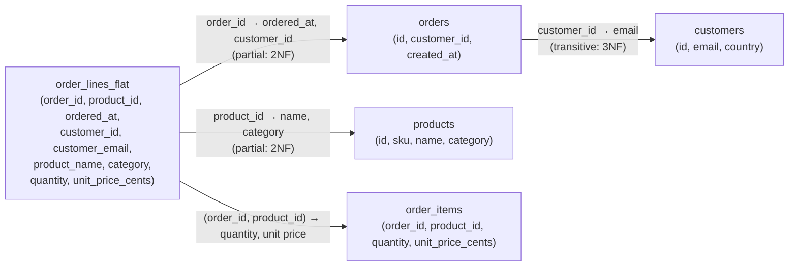

# Normalization

> **Module 03 · Databases** · Prerequisites: [Schema Design](05-Schema-Design.md) · Next: [Denormalization](07-Denormalization.md)

---

## ⏱ If You Only Have 2 Minutes

- A **functional dependency** (FD) `X → Y` means: any two rows with the same `X` must have the same `Y`. Example: `product_id → product_name`. Normal forms are rules about which FDs a table may contain.
- Storing one fact in many rows causes three **anomalies**: *update* (you change some copies and miss others), *insert* (you cannot record a fact until an unrelated one exists) and *delete* (removing one fact destroys another).
- **1NF:** one value per cell, no repeating groups (`tag1, tag2, tag3`), every row identified by a key.
- **2NF:** no non-key column depends on only *part* of a composite key. Only tables with a composite key can break it.
- **3NF:** no non-key column depends on another non-key column (no transitive dependency such as `order → customer_id → customer_email`). Mnemonic: "the key, the whole key, and nothing but the key".
- **BCNF:** the left side of every FD is a candidate key. It differs from 3NF only when candidate keys overlap. Reaching BCNF can make some rules impossible to enforce with a single unique constraint.
- `order_items.unit_price_cents` is **not** a violation. It is the price agreed *at purchase time*, so it depends on `(order_id, product_id)`, not on `product_id` alone.
- Normalize the source-of-truth tables to 3NF/BCNF by default, then [denormalize](07-Denormalization.md) on purpose for measured read paths.

---

## 1. What It Is and Why It Exists

**Normalization** is the process of arranging columns into tables so that every fact is stored exactly once, in the table whose key determines it. It was formalised by Edgar Codd in the early 1970s as part of the relational model. Each **normal form** (1NF, 2NF, 3NF, BCNF, 4NF) removes one kind of redundancy.

**Analogy:** a company phone list. If every project document copies a person's phone number, then when Maria changes her number someone must find and fix every document. Some will be missed, and two documents will disagree. A normalized company keeps one staff directory, and documents say "call Maria". You look the number up when you need it.

**The problem it solves.** Redundant copies drift apart. Picture a single spreadsheet-style table with one row per order line that also holds the customer's email and the product's name and category:

- **Update anomaly.** A product is renamed. The `UPDATE` touches 40,000 rows, takes locks on all of them, and a parallel import writes three more rows with the old name. Reports now show two products.
- **Insert anomaly.** Merchandising wants to add a new product before anyone buys it. The table's key is `(order_id, product_id)`, so there is no row to put it in.
- **Delete anomaly.** The only order containing a niche product is deleted for GDPR. The product's name and category disappear with it.

After normalization, each of these becomes a one-row change in the right table, and the database can enforce every rule with a key.

---

## 2. How It Works

Normalizing is a repeatable procedure, not a feeling:

1. **List the attributes** the system stores.
2. **Write down the FDs** from business rules: "a product has one name", "an order belongs to one customer", "a line's quantity depends on the order and the product". FDs come from rules, not from the current data. Data can only *disprove* an FD.
3. **Find the candidate keys:** the minimal sets of columns that determine every other column.
4. **Check each FD against the normal forms.** Any FD whose left side is not a candidate key (and whose right side is not part of a key) is a violation.
5. **Decompose** by moving the dependent columns into a table keyed by the FD's left side. Keep the left side in the original table as a foreign key. This split is **lossless**: joining the pieces back on that key gives exactly the original rows.
6. **Repeat** until no violating FD is left.

Applied to a flat order-lines table:



The result is the sample schema. Every remaining FD has a key on its left side. That means every FD is enforced by a `PRIMARY KEY` or `UNIQUE` constraint, and that is the practical payoff: **in a normalized schema the database enforces your dependencies; in a denormalized one, nobody does.**

---

## 3. Key Concepts

### Functional dependencies and keys

- **FD `X → Y`:** `X` determines `Y`. In the sample schema: `customers.id → email, name, country`, and `email → id` (email is `UNIQUE`, so it is also a candidate key).
- **Candidate key:** a minimal set of columns that determines all the others. A table can have several. `customers` has `{id}` and `{email}`.
- **Prime attribute:** a column that is part of *some* candidate key. The 3NF and BCNF definitions treat these differently.
- **Trivial FD:** `Y` is a subset of `X`, as in `(order_id, product_id) → order_id`. It is always true and never a problem.
- **Transitive dependency:** `A → B` and `B → C`, so `A → C` passes "through" a non-key column `B`.

### First normal form (1NF)

Each column holds one value of its type, there are no **repeating groups** (`phone1, phone2, phone3` or `tag1..tag5`), and rows are distinguishable by a key.

Violation: `products.tags text` holding `'vegan,gift,organic'`. You cannot put a foreign key on one tag, cannot index "products tagged gift" without string tricks, and cannot stop `'gift'` and `'Gift '` from both appearing. The fix is the `tags` + `product_tags` tables from [Schema Design](05-Schema-Design.md).

"Atomic" depends on how you *use* the value. A customer's whole address in one `text` field is fine if you only print it. It violates 1NF in spirit once you need to filter by city. PostgreSQL arrays and `jsonb` follow the same rule. An array of image URLs that is always read and written as a whole is one value. An array you search, constrain or join on element by element should be a child table.

### Second normal form (2NF)

1NF, and no non-prime column depends on **part** of a candidate key. This can only happen with a composite key.

Violation: `order_items (order_id, product_id, quantity, product_name)` with key `(order_id, product_id)`. `product_name` depends on `product_id` alone. Every order of the iPhone repeats "iPhone 14", and a rename must touch every line. Fix: `product_name` lives in `products`. `quantity` stays, because it depends on the whole key.

### Third normal form (3NF)

2NF, and no non-prime column depends on another non-prime column. Formally: for every non-trivial FD `X → A`, either `X` is a superkey or `A` is a prime attribute.

Violations:
- `orders (id, customer_id, customer_email)`: `id → customer_id → customer_email`. Changing an email means updating every order. Fix: email lives only in `customers`.
- `employees (employee_id, department_id, department_name)`: `department_name` depends on `department_id`, not on the employee. Fix: a `departments` table.

### Boyce–Codd normal form (BCNF) and 4NF

**BCNF:** for every non-trivial FD `X → Y`, `X` is a superkey. Unlike 3NF, there is no exception for prime attributes. Most 3NF tables are already in BCNF. The gap shows up only with overlapping candidate keys.

Example: `category_managers (country, category, manager_id)`. Rules: each `(country, category)` has one manager, and each manager handles exactly one category (across several countries). FDs: `{country, category} → manager_id` and `manager_id → category`. Candidate keys: `{country, category}` and `{country, manager_id}`. Every column is prime, so the table is in 3NF. But `manager_id` is not a superkey, so it breaks BCNF. If a manager moves to another category, you must update many rows. And you cannot record a manager's category until they have a country.

BCNF decomposition gives `managers (manager_id PK, category)` and `manager_countries (manager_id, country)`. Now the rule "one manager per country and category" spans two tables, so no single unique constraint enforces it. That is the textbook trade-off: **BCNF may not preserve dependencies; 3NF always can.** In PostgreSQL you can recover the rule by keeping `category` in `manager_countries` with a composite FK `(manager_id, category) REFERENCES managers (manager_id, category)` plus `UNIQUE (country, category)`. That is a controlled copy that the FK keeps correct.

**4NF** removes **multi-valued dependencies**: two independent lists stored in one table. `product_options (product_id, color, size)`, where colors and sizes are chosen independently, forces you to store every color × size combination. Adding a color means adding one row per size. Split it into `product_colors` and `product_sizes`. If the combination itself is the fact (only some sizes exist in some colors), it is one table of variants and not a violation.

### Facts in time are not redundancy

`order_items.unit_price_cents` looks like a copy of `products.price_cents`, but it records a different fact: *the price this customer agreed to on this order*. Its FD is `(order_id, product_id) → unit_price_cents`. When the product price changes tomorrow, yesterday's order must **not** change. The same reasoning applies to a shipping-address snapshot on an order, or a tax rate on an invoice line.

The test is one question: **"If the source changes, should this value change too?"**

- No → it is its own historical fact. Store it. It is not a normalization problem.
- Yes → it is a copy. Either remove it or treat it as a deliberate denormalization with an owner and a sync mechanism.

`orders.total_cents` needs the same question. If it always equals the sum of the lines, it is derived data, a denormalization covered in the next chapter. If it is the amount actually charged after discounts and shipping were decided at checkout, it is a fact of its own.

### Spotting violations in a real table

Warning signs when you open an unfamiliar schema:

- Column names that carry another entity's prefix: `customer_email` in `orders`, `product_category` in `order_items`.
- Numbered columns (`address1..address3`, `tag1..tag5`) or comma-separated values filtered with `LIKE '%gift%'`.
- `UPDATE` statements in the code base that change many rows to change one real-world fact.
- Data that already contradicts itself. Group by the suspected determinant and look for more than one dependent value (the query is in the next section). Zero rows does not *prove* the FD, but any row proves that the copies have drifted.

---

## 4. Code Examples

Scenario: a legacy flat table shows an update anomaly. We detect the drift, then read the same data from the normalized sample schema. A rename there is a single-row change.

### SQL

```sql
-- Legacy "export-shaped" table: one row per order line, other entities copied in.
CREATE TABLE order_lines_flat (
  order_id          bigint      NOT NULL,
  product_id        bigint      NOT NULL,
  ordered_at        timestamptz NOT NULL,
  customer_email    text        NOT NULL,   -- depends on the order's customer (3NF break)
  product_name      text        NOT NULL,   -- depends on product_id only (2NF break)
  category          text        NOT NULL,   -- same
  quantity          integer     NOT NULL,
  unit_price_cents  integer     NOT NULL,   -- price at purchase: legitimately per line
  PRIMARY KEY (order_id, product_id)
);

INSERT INTO order_lines_flat VALUES
  (1, 10, '2026-11-01 09:00+00', 'ann@example.com', 'Oat Milk 1L', 'drinks', 2, 199),
  (2, 10, '2026-11-02 10:30+00', 'bob@example.com', 'Oat Milk 1L', 'drinks', 1, 219),
  (2, 11, '2026-11-02 10:30+00', 'bob@example.com', 'Rye Bread',   'bakery', 1, 349);

-- Update anomaly: a rename that only touched the rows someone remembered.
UPDATE order_lines_flat SET product_name = 'Oat Drink 1L' WHERE order_id = 2 AND product_id = 10;

-- Detect drift: one determinant, several dependent values.
SELECT product_id, array_agg(DISTINCT product_name) AS names
FROM order_lines_flat
GROUP BY product_id
HAVING count(DISTINCT product_name) > 1;
```

Illustrative output:

```text
 product_id |             names
------------+--------------------------------
         10 | {"Oat Drink 1L","Oat Milk 1L"}
(1 row)
```

Run the same check on `unit_price_cents` and product 10 also shows two values (199 and 219). That is **not** a defect. The price changed between the two orders, and each line records what was paid. The SQL query cannot tell you which case you are in; the business rule does.

In the normalized schema, the rename is one row and the read is a join on keys:

```sql
UPDATE products SET name = 'Oat Drink 1L' WHERE id = 10;   -- one fact, one row

SELECT o.id, o.created_at, c.email, p.name, p.category, oi.quantity, oi.unit_price_cents
FROM orders o
JOIN customers c    ON c.id = o.customer_id
JOIN order_items oi ON oi.order_id = o.id
JOIN products p     ON p.id = oi.product_id
WHERE o.id = $1
ORDER BY p.name;
```

### Node.js / TypeScript

```ts
// npm i express pg  (+ -D @types/express @types/pg) — Node.js 22+, TypeScript 5, ESM
import express from "express";
import pg from "pg";

const pool = new pg.Pool({ connectionString: process.env.DATABASE_URL });

interface OrderLineRow {
  order_id: string; created_at: Date; email: string;
  product_id: string; name: string; category: string;
  quantity: number; unit_price_cents: number;
}

interface OrderView {
  id: string;
  createdAt: string;
  customerEmail: string;
  items: { productId: string; name: string; category: string; quantity: number;
           unitPriceCents: number; lineTotalCents: number }[];
  totalCents: number;
}

export async function getOrder(orderId: string): Promise<OrderView | null> {
  // One round trip. The join repeats order and customer columns on every line,
  // so we fold the rows back into one object here instead of storing them that way.
  const { rows } = await pool.query<OrderLineRow>(
    `SELECT o.id AS order_id, o.created_at, c.email,
            p.id AS product_id, p.name, p.category, oi.quantity, oi.unit_price_cents
       FROM orders o
       JOIN customers c    ON c.id = o.customer_id
       JOIN order_items oi ON oi.order_id = o.id
       JOIN products p     ON p.id = oi.product_id
      WHERE o.id = $1
      ORDER BY p.name`,
    [orderId],
  );
  if (rows.length === 0) return null;

  const items = rows.map((r) => ({
    productId: r.product_id, name: r.name, category: r.category, quantity: r.quantity,
    unitPriceCents: r.unit_price_cents,                 // historical price, not products.price_cents
    lineTotalCents: r.quantity * r.unit_price_cents,    // derived on read, never stored
  }));
  return {
    id: rows[0].order_id,
    createdAt: rows[0].created_at.toISOString(),
    customerEmail: rows[0].email,
    items,
    totalCents: items.reduce((sum, i) => sum + i.lineTotalCents, 0),
  };
}

export async function renameProduct(productId: string, name: string): Promise<boolean> {
  // The normalization payoff: one row, one short lock, every past order shows the new name.
  const { rowCount } = await pool.query("UPDATE products SET name = $2 WHERE id = $1", [productId, name]);
  return rowCount === 1;
}

const app = express();
app.get("/orders/:id", async (req, res) => {
  if (!/^\d+$/.test(req.params.id)) { res.status(400).json({ error: "bad_id" }); return; }
  const order = await getOrder(req.params.id);
  if (!order) { res.status(404).json({ error: "not_found" }); return; }
  res.json(order);
});
```

An inner join returns no rows for an order that has no items yet. If that state can exist, use `LEFT JOIN order_items` and skip the `NULL` line.

### Python

```python
# pip install fastapi "psycopg[binary]" psycopg-pool   — Python 3.12+
import os
from contextlib import asynccontextmanager
from datetime import datetime

from fastapi import FastAPI, HTTPException
from psycopg.rows import dict_row
from psycopg_pool import AsyncConnectionPool
from pydantic import BaseModel

pool = AsyncConnectionPool(os.environ["DATABASE_URL"], open=False)

ORDER_SQL = """
SELECT o.id AS order_id, o.created_at, c.email,
       p.id AS product_id, p.name, p.category, oi.quantity, oi.unit_price_cents
  FROM orders o
  JOIN customers c    ON c.id = o.customer_id
  JOIN order_items oi ON oi.order_id = o.id
  JOIN products p     ON p.id = oi.product_id
 WHERE o.id = %s
 ORDER BY p.name
"""


class Item(BaseModel):
    product_id: int
    name: str
    category: str
    quantity: int
    unit_price_cents: int  # price at purchase time: a fact of the line
    line_total_cents: int  # derived on read


class OrderView(BaseModel):
    id: int
    created_at: datetime
    customer_email: str
    items: list[Item]
    total_cents: int


@asynccontextmanager
async def lifespan(_: FastAPI):
    await pool.open()
    yield
    await pool.close()


app = FastAPI(lifespan=lifespan)


@app.get("/orders/{order_id}", response_model=OrderView)
async def get_order(order_id: int) -> OrderView:
    async with pool.connection() as conn, conn.cursor(row_factory=dict_row) as cur:
        await cur.execute(ORDER_SQL, (order_id,))
        rows = await cur.fetchall()
    if not rows:
        raise HTTPException(404, "not_found")
    items = [
        Item(**{k: r[k] for k in ("product_id", "name", "category", "quantity", "unit_price_cents")},
             line_total_cents=r["quantity"] * r["unit_price_cents"])
        for r in rows
    ]
    head = rows[0]  # order and customer columns repeat on every joined row
    return OrderView(id=head["order_id"], created_at=head["created_at"], customer_email=head["email"],
                     items=items, total_cents=sum(i.line_total_cents for i in items))


@app.put("/products/{product_id}/name", status_code=204)
async def rename_product(product_id: int, name: str) -> None:
    async with pool.connection() as conn:  # commits on clean exit
        cur = await conn.execute("UPDATE products SET name = %s WHERE id = %s", (name, product_id))
    if cur.rowcount == 0:
        raise HTTPException(404, "not_found")
```

**Runtime difference:** this Python version uses psycopg's async pool, so `async def` endpoints are right here and no thread pool is involved. The Node `pg` driver is always async. psycopg returns `timestamptz` as a timezone-aware `datetime` and `bigint` as `int`. `pg` returns a JavaScript `Date` and a string.

---

## 5. Production Concerns

- **Joins on keys are cheap; missing FK indexes are not.** A normalized order read is four index lookups if `order_items (order_id, ...)` and the parent primary keys are indexed. The sample schema still lacks an index on `orders.customer_id`, so "orders for customer X" scans the table. Normalization moves cost into joins, and indexes make those joins cheap.
- **Normalizing a live legacy table is a data-cleaning project.** When you split `product_name` out of `order_lines_flat`, the drift query will find products with several names. Someone has to decide which one wins (the most recent, the most common, or a manual review). Do it as an expand–contract migration ([Database Migrations](34-Database-Migrations.md)): create the new tables, backfill, dual-write, switch reads, drop the old columns.
- **Analysts like flat tables.** Give them a [view](16-Views.md) or a reporting copy that joins the normalized tables, rather than denormalizing the write model for them.
- **Hot single rows.** After normalization, one popular product row is shared by every order read. That is fine for reads (MVCC readers do not block writers). It matters only if you also *write* that row on every order, which is a denormalization concern.
- **Measure drift where copies exist.** If a legacy flat table must stay, run the group-by drift query on a schedule and alert when it returns rows. A copy without a check eventually goes wrong.

---

## 6. Common Mistakes

- **Treating "1NF = no arrays" as absolute** — teams either ban useful `jsonb`/array columns or put searchable lists in strings — ask whether you query or constrain the elements; if yes, use a child table.
- **Calling `order_items.unit_price_cents` redundant and "fixing" it** — old orders silently re-price when the catalogue changes — keep historical facts on the record they describe.
- **Deriving FDs from current data** — a column that happens to be unique in 1,000 test rows becomes a key, and production data breaks it — derive FDs from business rules; use data only to find violations.
- **Normalizing a single-column fact into its own table** — a `first_names` table with an FK from `customers` adds a join and protects nothing — split only when the dependent columns describe a separate entity.
- **Copying a value "for convenience" without an owner** — `orders.customer_email` drifts the first time a customer changes their email — either join, or document it as a snapshot ("email at order time") or a managed denormalization.
- **Stopping at "the key" and forgetting "the whole key"** — 2NF violations hide in join tables (`order_items.product_name`) — check every non-key column of a composite-key table against each part of the key.
- **Ignoring overlapping candidate keys** — a 3NF table with a BCNF violation still has update anomalies — check whether any determinant is not a superkey, and decide consciously between BCNF and dependency preservation.

---

## 7. Comparison Table

| Form | Rule | Anomaly it removes | Violation on the sample domain | Fix |
|---|---|---|---|---|
| 1NF | One value per cell, no repeating groups, has a key | Cannot query, constrain or join individual values | `products.tags = 'vegan,gift'` | `tags` + `product_tags` |
| 2NF | No non-key column depends on part of a composite key | Update/insert/delete anomalies on the part-key fact | `order_items.product_name` | Move to `products` |
| 3NF | No non-key column depends on another non-key column | Same anomalies for transitive facts | `orders.customer_email` | Keep only in `customers` |
| BCNF | Every determinant is a candidate key | Anomalies with overlapping candidate keys | `category_managers` with `manager_id → category` | Split, or keep a FK-guarded copy |
| 4NF | No independent multi-valued facts in one table | Cross-product rows | `product_options (product_id, color, size)` | `product_colors`, `product_sizes` |

---

## 8. Interview Questions

**[Junior] What is normalization and why do we do it?**
It means arranging data so that each fact is stored once, in the table whose key determines it. It removes update, insert and delete anomalies: contradictory copies, facts you cannot record yet, and facts lost by unrelated deletes. It also lets the database enforce dependencies with primary-key and unique constraints, instead of trusting every writer to keep copies in sync.

**[Junior] Explain 1NF, 2NF and 3NF with one example each.**
1NF: no lists in a cell. A `tags` string like `'vegan,gift'` becomes a join table. 2NF: in `order_items` with key `(order_id, product_id)`, `product_name` depends only on `product_id`, so it moves to `products`. 3NF: in `orders`, `customer_email` depends on `customer_id`, which is not the key, so it lives only in `customers`. In short: "the key, the whole key, and nothing but the key".

**[Mid] What is a functional dependency, and where do you get them from?**
`X → Y` means any two rows that agree on `X` agree on `Y`. You get them from business rules ("a product has exactly one category"), not from sample data. Data can disprove an FD, by showing two categories for one product, but it cannot prove one. Once you have the FDs, you derive the candidate keys and check each FD against the normal forms.

**[Mid] `order_items` stores `unit_price_cents` although `products` has `price_cents`. Is that a normalization violation?**
No. They are different facts. `products.price_cents` is today's catalogue price and depends on `product_id`. `order_items.unit_price_cents` is the price on that order and depends on `(order_id, product_id)`. If the catalogue price changes, past orders must not change, so the value is not a copy. The test is: should this value follow the source when the source changes?

**[Mid] What is the difference between 3NF and BCNF?**
3NF allows an FD `X → A` where `X` is not a superkey if `A` is part of some candidate key. BCNF does not allow that exception. The difference shows up only when candidate keys overlap, as with `category_managers (country, category, manager_id)` where `manager_id → category`. Decomposing to BCNF removes the anomaly but may split a rule across tables so no single constraint enforces it. That is why 3NF is the usual practical target.

**[Senior] Are PostgreSQL arrays and `jsonb` columns a 1NF violation?**
Under the classical definition, yes. In practice the question is whether the database ever needs to see inside the value. A list of image URLs that is always read and replaced as a whole behaves as one value, and an array is fine. Tags you filter on, line items with prices, or anything that needs a foreign key or a per-element constraint should be rows in a child table. GIN indexes make array and `jsonb` searches possible, but they still cannot give you referential integrity.

**[Senior] You inherit a 60-column `orders_flat` table used by three services. How do you normalize it without downtime?**
First, write down the FDs and run drift queries to measure how much the copies already disagree. Agree with the business on which value wins. Then expand: create the normalized tables, backfill them in batches, and make writers dual-write, either from the application or with a trigger. Switch readers service by service, using a view with the old shape where a reader cannot change yet. Keep running the drift check, and drop the old columns only when no reader uses them. Each step must be reversible on its own.

**[Senior] When would you stop normalizing?**
When the next split adds joins without removing a real anomaly, for example when the "dependent" column is only a historical snapshot, or when the BCNF split would lose a constraint you need. I normalize the write model to 3NF (BCNF where it costs nothing). Then I add denormalized read structures only for measured hot paths, each with a named owner, a sync mechanism and a drift check.

---

## 9. Cheat Sheet

```text
FD X → Y        same X ⇒ same Y; comes from business rules, data can only disprove
Anomalies       update (copies drift) · insert (can't record yet) · delete (lose other facts)
1NF             one value per cell, no tag1..tag5, has a key
2NF             no column depends on PART of a composite key  (order_items.product_name)
3NF             no column depends on a non-key column          (orders.customer_email)
BCNF            every determinant is a candidate key; may lose dependency preservation
4NF             no independent multi-valued facts in one table (colors × sizes)
Mnemonic        the key, the whole key, and nothing but the key
Snapshot test   "if the source changes, should this change?" no → fact, yes → copy
Not violations  order_items.unit_price_cents, order shipping-address snapshot
Drift query     GROUP BY determinant HAVING count(DISTINCT dependent) > 1
Payoff          every FD enforced by a PK/UNIQUE constraint
Default target  3NF/BCNF for source of truth; denormalize measured read paths
```

---

## Related Topics

- [Schema Design](05-Schema-Design.md) — keys, types and constraints that enforce the dependencies found here
- [Denormalization](07-Denormalization.md) — the deliberate, managed way to add copies back
- [SQL JOINs](10-SQL-JOINs.md) — reading normalized data back without multiplying rows
- [Views](16-Views.md) — giving readers a flat shape without a flat table
- [Database Migrations](34-Database-Migrations.md) — normalizing a live table with expand–contract
