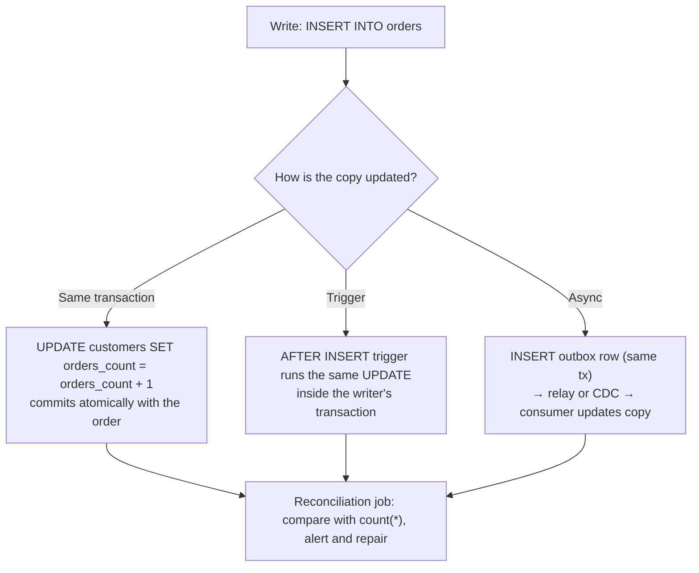

# Denormalization

> **Module 03 · Databases** · Prerequisites: [Normalization](06-Normalization.md) · Next: [SQL DDL](08-SQL-DDL.md)

---

## ⏱ If You Only Have 2 Minutes

- **Denormalization** means storing a fact twice, or storing a precomputed result, so that a hot read avoids a join or an aggregate. It trades write cost and drift risk for read speed.
- Do it only for a **measured** problem: a frequent read whose `EXPLAIN (ANALYZE, BUFFERS)` shows an expensive join or aggregate that an index cannot fix.
- Common techniques: a duplicated column, a stored counter or total (`customers.orders_count`), a `jsonb` snapshot, a summary table (`daily_sales`). [Materialized views](17-Materialized-Views.md) are the database-managed version.
- Every copy needs an **owner and a sync mechanism**: the same transaction (strongest), a trigger (cannot be bypassed, but hidden), or async through an outbox/CDC (decoupled, but eventually consistent).
- Increment counters **atomically in SQL** (`SET n = n + 1`), never read–modify–write in the app, and do it **last** in the transaction so the row lock is held for the shortest time.
- A counter row that every transaction updates becomes a **hot row**: writers queue on its lock. The fix is a **sharded counter** (N rows, sum on read) or an append-only delta table rolled up later.
- Run a **reconciliation job** that compares each copy with its source, reports drift as a metric, and repairs it. Drift above zero means some code path skips the sync. Find it.

---

## 1. What It Is and Why It Exists

**Denormalization** is the deliberate addition of redundant or derived data to a normalized schema, so that important reads become cheaper. The normalized tables remain the **source of truth**. The denormalized data is a **copy** that can always be rebuilt from them.

**Analogy:** a shop's running till total. The real truth is the pile of receipts. Adding them up every time someone asks "how much have we sold today?" is exact but slow, so the cashier keeps a running total and updates it with each sale. It is fast to read, but if the cashier forgets one sale, the total is wrong until someone recounts the receipts. Denormalization is the running total, and reconciliation is the recount.

**The problem it solves.** In the sample schema, the admin customer list shows each customer's number of orders. Normalized, that is:

```sql
SELECT c.id, c.name, count(o.id) AS orders_count
FROM customers c LEFT JOIN orders o ON o.customer_id = c.id
GROUP BY c.id
ORDER BY orders_count DESC
LIMIT 50;
```

With 2 million customers and 40 million orders, this reads every order row to sort by the count, on every page view. No index can answer "top 50 by count of child rows". A stored `customers.orders_count` column with an index turns it into a 50-row index scan.

Typical reasons that hold up in an interview:

- **Read-heavy paths** where the same derived value is read thousands of times per write.
- **Expensive joins or aggregates** that indexes cannot fix: counts, sums, "latest child" lookups, joins across many tables for one screen.
- **Precomputed values** for dashboards: daily revenue per category.
- **Historical snapshots** that must not follow the source anyway. These are facts, not denormalization, as [Normalization](06-Normalization.md) explains.

"Schema flexibility like NoSQL" is sometimes listed as a reason too. That is a different decision: a `jsonb` column for attributes that vary by product type. It counts as denormalization only when it *copies* data that lives somewhere else.

---

## 2. How It Works

Every denormalized value needs four decisions:

1. **Source of truth:** which normalized rows define the correct value (`count(*) FROM orders WHERE customer_id = c.id`).
2. **Write paths:** every operation that can change the source. For the order counter that is insert order, delete order, and move an order to another customer. Missing one is how drift starts.
3. **Sync mechanism:** same transaction, trigger, or async event.
4. **Repair path:** a query that detects drift, and a job that rebuilds the copy from the source.



With the first two options, the copy and the source commit together, so a reader never sees one without the other. With the async option, there is a window (usually milliseconds to seconds, unbounded if the consumer is down) where the copy is stale. The reconciliation job sits behind all three, because bugs, manual SQL and bulk imports bypass every mechanism sooner or later.

---

## 3. Key Concepts

### Techniques

| Technique | Example on the sample schema | Read win | Write cost | Main risk |
|---|---|---|---|---|
| Duplicated column | `orders.customer_country` copied from `customers.country` for sales-by-country reports | Removes a join | Update all of a customer's orders when they move | Copies drift if a customer update path forgets them |
| Stored counter / total | `customers.orders_count`, `customers.lifetime_value_cents` | Removes an aggregate; becomes indexable | One extra `UPDATE` per write | Hot rows; drift |
| Derived total on parent | `orders.total_cents` = sum of `order_items` | Order lists without touching items | Recompute when items change | Total and lines disagree |
| `jsonb` snapshot | `orders.items_snapshot jsonb` with names and prices for the order page | One-row read, no joins | Build at write time | Becomes a second source of truth if anyone edits it |
| Summary table | `daily_sales (day, category, units, revenue_cents)` | Dashboards read a few hundred rows | Upsert per order, or a periodic rebuild | Late or corrected data must flow back in |
| Materialized view | Same summary as `CREATE MATERIALIZED VIEW` | Same | Full refresh | Stale between refreshes — see [Materialized Views](17-Materialized-Views.md) |

### Keeping copies correct

| Mechanism | Consistency | Can be bypassed? | Cost and coupling | Good for |
|---|---|---|---|---|
| Same transaction in app code | Atomic with the write | Yes, by any writer that does not use this code (other service, manual SQL) | Explicit and visible in code review; adds latency to the write | Counters and totals owned by one service |
| Database trigger | Atomic with the write | Only by `session_replication_role = replica` or disabling the trigger | Hidden logic; row-level triggers run once per row, which slows bulk writes | Copies that many writers touch |
| Async: outbox → consumer | Eventually consistent | Not if the outbox row is written in the same transaction | Needs a relay, idempotent consumers and ordering rules | Copies in other services, search indexes, heavy summaries |
| Async: CDC (logical decoding, e.g. Debezium) | Eventually consistent | No; it reads the WAL | Extra infrastructure; schema changes affect consumers | Many downstream read models |

The **transactional outbox** pattern means inserting an `outbox` row in the same transaction as the business change. A relay then publishes it to a queue. You never get "order committed but event lost", and never "event sent but order rolled back". Consumers must be idempotent, because the relay can deliver an event twice. Apply a counter delta only once per event ID, or recompute the value from the source instead of incrementing it.

A row-level trigger for the counter:

```sql
CREATE FUNCTION orders_count_sync() RETURNS trigger LANGUAGE plpgsql AS $$
BEGIN
  IF TG_OP IN ('INSERT', 'UPDATE') THEN
    UPDATE customers SET orders_count = orders_count + 1 WHERE id = NEW.customer_id;
  END IF;
  IF TG_OP IN ('DELETE', 'UPDATE') THEN
    UPDATE customers SET orders_count = orders_count - 1 WHERE id = OLD.customer_id;
  END IF;
  RETURN NULL;   -- return value is ignored for AFTER triggers
END $$;

CREATE TRIGGER orders_count_sync
AFTER INSERT OR DELETE OR UPDATE OF customer_id ON orders
FOR EACH ROW EXECUTE FUNCTION orders_count_sync();
```

`UPDATE OF customer_id` fires whenever that column appears in the `UPDATE`'s `SET` list, even if the value does not change. The function then adds one and subtracts one, so the net effect is zero.

### Atomic increments and lock duration

Write `UPDATE customers SET orders_count = orders_count + 1 WHERE id = $1`. The database reads and writes the value under the row lock, so two concurrent orders cannot both read 7 and both write 8. The app-side version (`SELECT orders_count`, add one in code, `UPDATE ... SET orders_count = $2`) is a classic **lost update**.

The `UPDATE` takes a row lock that is held **until commit**. Every other transaction that wants to update the same customer waits. So put the counter update at the **end** of the transaction, after the slower inserts. Then the lock is held only for the commit itself.

### Hot rows and sharded counters

A counter shared by many writers, such as `products.sold_count` during a flash sale or a global "orders today" row, turns parallel transactions into a single queue. Each one waits for the previous one to commit. Every `UPDATE` also creates a new row version under MVCC, so the row's table and index pages churn and vacuum has more to clean up.

**Sharded counter:** keep N rows per counter and update a random one. The total is a small `SUM`.

```sql
CREATE TABLE product_sales_shards (
  product_id  bigint   NOT NULL REFERENCES products(id),
  shard       smallint NOT NULL CHECK (shard BETWEEN 0 AND 15),
  units       bigint   NOT NULL DEFAULT 0,
  PRIMARY KEY (product_id, shard)
);

-- Write: contention is spread over 16 rows instead of 1.
INSERT INTO product_sales_shards (product_id, shard, units)
VALUES ($1, floor(random() * 16)::smallint, $2)
ON CONFLICT (product_id, shard) DO UPDATE SET units = product_sales_shards.units + EXCLUDED.units;

-- Read: 16 rows through the primary key.
SELECT coalesce(sum(units), 0) AS units_sold FROM product_sales_shards WHERE product_id = $1;
```

Another approach is an append-only `sales_deltas` table that writers only `INSERT` into (no lock conflicts), plus a job that folds the deltas into the counter every few seconds. Reads become slightly stale, but writes never wait.

Per-customer counters, like `orders_count`, are rarely hot, because one customer does not place hundreds of orders per second. Shard only the counters that monitoring shows waiting on locks.

### Reconciliation

A reconciliation job compares each copy with a recomputation from the source:

1. **Detect** with a set-based query over a key range (the drift query in section 4).
2. **Report** the number of drifted rows as a metric, with a few example IDs in the log.
3. **Repair** by recomputing from the source. Do not apply a delta: you do not know which delta was lost.
4. **Investigate** any non-zero result. Steady drift means a write path bypasses the sync: a new endpoint, a bulk import, a manual fix, a consumer that drops events.

Run it in small batches, off-peak for large tables, and with a `statement_timeout`, so the check itself does not hurt production.

---

## 4. Code Examples

Scenario: the customer list needs `orders_count`. We add the column, keep it correct in the same transaction as each new order, and run a drift check with a safe repair.

### SQL

```sql
-- PG 11+: a constant default is stored in the catalog, so this does not rewrite the table.
ALTER TABLE customers ADD COLUMN orders_count integer NOT NULL DEFAULT 0;
-- NOT VALID skips the full-table check under the strong lock; VALIDATE scans with a weaker one.
ALTER TABLE customers ADD CONSTRAINT customers_orders_count_nonneg CHECK (orders_count >= 0) NOT VALID;
ALTER TABLE customers VALIDATE CONSTRAINT customers_orders_count_nonneg;

-- The read this whole chapter is about. With this index, it is a 50-row index scan.
CREATE INDEX CONCURRENTLY customers_orders_count_idx ON customers (orders_count DESC, id);

-- Backfill in key ranges (repeat for each range) to keep each transaction short.
UPDATE customers c
SET orders_count = (SELECT count(*) FROM orders o WHERE o.customer_id = c.id)
WHERE c.id BETWEEN 1 AND 10000;

-- Drift check: one statement = one snapshot, so in-flight orders are never half-counted.
-- Grouping by the PK lets us select c.orders_count without listing it in GROUP BY.
SELECT c.id, c.orders_count AS stored, count(o.id) AS actual
FROM customers c
LEFT JOIN orders o ON o.customer_id = c.id
WHERE c.id BETWEEN $1 AND $2
GROUP BY c.id
HAVING c.orders_count <> count(o.id);
```

Illustrative output after a bulk import bypassed the counter:

```text
  id   | stored | actual
-------+--------+--------
 10442 |      3 |      5
 10987 |      0 |      1
(2 rows)
```

The correlated `count(*)` in the backfill and the `LEFT JOIN` in the drift check both read `orders` by `customer_id`. Without an index on `orders (customer_id)`, each is a sequential scan. That is the deliberate gap in the sample schema, which [Indexes](19-Indexes.md) fixes.

### Node.js / TypeScript

```ts
// npm i pg  (+ -D @types/pg) — Node.js 22+, TypeScript 5, ESM
import pg from "pg";

const pool = new pg.Pool({ connectionString: process.env.DATABASE_URL });

export interface Line { productId: string; quantity: number }

export async function placeOrder(customerId: string, lines: Line[]): Promise<string> {
  const client = await pool.connect();
  try {
    await client.query("BEGIN");
    const { rows: [order] } = await client.query<{ id: string }>(
      "INSERT INTO orders (customer_id, status, total_cents) VALUES ($1, 'pending', 0) RETURNING id",
      [customerId],
    );
    // Prices come from the catalogue now and are frozen onto the line (a fact, not a copy).
    const { rows: [sum] } = await client.query<{ n: string; total: string }>(
      `WITH ins AS (
         INSERT INTO order_items (order_id, product_id, quantity, unit_price_cents)
         SELECT $1, p.id, l.qty, p.price_cents
           FROM unnest($2::bigint[], $3::int[]) AS l(product_id, qty)
           JOIN products p ON p.id = l.product_id
         RETURNING quantity * unit_price_cents AS line_total)
       SELECT count(*) AS n, coalesce(sum(line_total), 0) AS total FROM ins`,
      [order.id, lines.map((l) => l.productId), lines.map((l) => l.quantity)],
    );
    if (Number(sum.n) !== lines.length) throw new Error("unknown product in order");
    await client.query("UPDATE orders SET total_cents = $2 WHERE id = $1", [order.id, sum.total]);

    // Denormalized counter: atomic increment (no lost update), done LAST so the
    // customer row lock is held only from here until COMMIT.
    await client.query("UPDATE customers SET orders_count = orders_count + 1 WHERE id = $1", [customerId]);
    await client.query("COMMIT");
    return order.id;
  } catch (err) {
    await client.query("ROLLBACK");   // order, items and counter all disappear together
    throw err;
  } finally {
    client.release();
  }
}

export async function topCustomers(limit = 50) {
  // The read we paid for: no aggregate over orders at request time.
  const { rows } = await pool.query<{ id: string; name: string; orders_count: number }>(
    "SELECT id, name, orders_count FROM customers ORDER BY orders_count DESC, id LIMIT $1",
    [limit],
  );
  return rows;
}
```

Every write path that changes `orders.customer_id` or deletes an order needs the matching decrement. If several services write `orders`, use the trigger from section 3 instead, so that no code path can forget it.

### Python

```python
# pip install "psycopg[binary]"   — Python 3.12+ (run as a scheduled job)
import logging
import os

import psycopg

log = logging.getLogger("reconcile.orders_count")

DRIFT_SQL = """
SELECT c.id FROM customers c
LEFT JOIN orders o ON o.customer_id = c.id
WHERE c.id BETWEEN %s AND %s
GROUP BY c.id
HAVING c.orders_count <> count(o.id)
"""

REPAIR_SQL = """
UPDATE customers c
SET orders_count = (SELECT count(*) FROM orders o WHERE o.customer_id = c.id)
WHERE c.id = ANY(%s)
RETURNING c.id, c.orders_count
"""


def reconcile_orders_count(batch: int = 5_000) -> int:
    repaired = 0
    # Own connection in autocommit mode: each `conn.transaction()` below is then a real
    # BEGIN/COMMIT per batch (not a savepoint inside one giant transaction), and the
    # session-level timeout does not leak into a shared pool.
    with psycopg.connect(os.environ["DATABASE_URL"], autocommit=True) as conn:
        conn.execute("SET statement_timeout = '30s'")  # the checker must not become the incident
        max_id = conn.execute("SELECT coalesce(max(id), 0) FROM customers").fetchone()[0]
        for lo in range(1, max_id + 1, batch):
            with conn.transaction():
                ids = [r[0] for r in conn.execute(DRIFT_SQL, (lo, lo + batch - 1))]
                if not ids:
                    continue
                # Lock the drifted customers first, in id order. Writers increment the counter
                # under this same row lock, so the UPDATE below (a new statement with a fresh
                # snapshot) counts exactly the orders whose increments have already committed.
                conn.execute("SELECT id FROM customers WHERE id = ANY(%s) ORDER BY id FOR UPDATE", (ids,))
                for cid, fixed in conn.execute(REPAIR_SQL, (ids,)):
                    log.warning("orders_count drift repaired", extra={"customer_id": cid, "now": fixed})
                    repaired += 1
    log.info("reconcile finished", extra={"repaired": repaired})  # export as a gauge; alert if > 0
    return repaired


if __name__ == "__main__":
    logging.basicConfig(level=logging.INFO)
    reconcile_orders_count()
```

The lock-then-recount order matters. A single `UPDATE ... SET orders_count = (SELECT count(*) ...)` that has to wait for a concurrent writer's row lock rechecks its `WHERE` clause against the new row version, but its subquery still uses the snapshot taken when the statement started. It could then overwrite a fresh increment with a stale count. Taking the locks in one statement and counting in the next avoids that, because PostgreSQL's default READ COMMITTED level gives each statement a new snapshot.

---

## 5. Production Concerns

- **Measure the read before and after.** Keep the `EXPLAIN (ANALYZE, BUFFERS)` of the slow aggregate and of the new index scan. If the gain is small, the copy is not worth its upkeep.
- **Lock waits on counter rows.** Watch `pg_stat_activity` for `wait_event_type = 'Lock'` with the counter's `UPDATE` as the query, and watch write p99. Rising waits on one row is the signal to shard that counter, not all of them.
- **Lock ordering and deadlocks.** If one code path locks a customer and then an order, and another locks an order and then the customer, they can deadlock. Updating the counter last in every path, and taking multiple counter locks in ID order, keeps the order consistent. See [Deadlocks](31-Deadlocks.md).
- **Bulk operations.** A row-level trigger runs once per row. A 5-million-row import becomes 5 million extra `UPDATE`s on `customers`. For bulk loads, disable the trigger in a maintenance window and recompute affected counters afterwards, or use a statement-level trigger with transition tables.
- **Async copies and read-your-writes.** With an outbox or CDC, a user who just placed an order may see the old count. Either read the source for the user's own data, or show the value as "updated a moment ago". Track **projection lag** (time from commit to consumer apply) as a metric.
- **Drift is a metric, not a log line.** Export "rows repaired per run" and alert when it is non-zero for two runs in a row. The repair hides the symptom, so the alert is what makes someone find the leaking write path.
- **Rebuilds must be possible.** Keep a script or job that recomputes every copy from scratch. You will need it after a bad deploy, and it doubles as the proof that the copy is derived data.

---

## 6. Common Mistakes

- **Denormalizing before measuring** — you take on write cost and drift for a join that an index would have made fast — run `EXPLAIN ANALYZE` first and try an index or a covering index.
- **Read–modify–write counters in the app** — two concurrent orders both write `orders_count = 8` — use `SET orders_count = orders_count + 1` in SQL.
- **Updating the counter first in a long transaction** — the customer row stays locked while items and payments are inserted, so that customer's other requests queue — update counters last.
- **Handling only the insert path** — deletes, cancellations that should not count, and moving orders between customers leave the counter wrong — list every write path, or use a trigger.
- **Non-idempotent async consumers** — a redelivered `order.created` event increments twice — store processed event IDs, or recompute from the source instead of applying deltas.
- **One global counter row** — every write in the system serializes on it — shard it, or use append-only deltas with a rollup.
- **No reconciliation** — drift is found by a customer or an auditor months later — schedule a drift check with a metric and a repair path from day one.

---

## 7. Comparison Table

| | Denormalized column / counter | Summary table | Materialized view | Cache (e.g. Redis) | Separate read model (CQRS) |
|---|---|---|---|---|---|
| Freshness | Exact if same tx or trigger | Exact or periodic | As of last refresh | TTL or invalidation | Eventually consistent |
| Lives in | Same row as the entity | Same database | Same database | Outside the database | Another table, database or service |
| Write cost | Extra `UPDATE` per write | Upsert per write or batch job | None until refresh, then a full recompute | Invalidation on write | Event per write + consumer |
| Can be indexed and joined in SQL | Yes | Yes | Yes | No | Depends on the store |
| Typical use | Counts and totals shown in lists | Dashboards, reports | Expensive reports that tolerate staleness | Hot keys, rendered fragments | Very different read shapes, search |

---

## 8. Interview Questions

**[Junior] What is denormalization, and is it the opposite of normalization?**
It is adding redundant or precomputed data on purpose to make reads cheaper. It is not the opposite, because you normalize first and keep the normalized tables as the source of truth. The denormalized values are copies you could rebuild. Normalization is the default for correctness. Denormalization is a targeted optimisation with a maintenance cost.

**[Junior] When would you denormalize?**
When a frequent read is slow because of a join or aggregate that indexes cannot fix, and the read rate is much higher than the write rate. Examples: showing order counts in a customer list, sorting by lifetime value, or a dashboard of daily revenue by category. I want a query plan that proves the problem, and a plan for keeping the copy correct, before I add it.

**[Mid] How do you keep `customers.orders_count` correct?**
Increment it with an atomic `UPDATE ... SET orders_count = orders_count + 1` in the same transaction that inserts the order, and decrement it on delete or reassignment. If several services write `orders`, use a trigger so no path can skip it. In both cases, run a reconciliation job that compares the column with `count(*)` and repairs and reports any drift.

**[Mid] Same transaction, trigger or async event: how do you choose?**
Same transaction when one service owns all the writes. It is explicit, atomic and easy to test. A trigger when many writers or manual SQL touch the source, because it cannot be forgotten. The costs are hidden logic and slower bulk writes. Async through an outbox or CDC when the copy lives in another service or store, or is expensive to compute, and the product can accept short staleness. Consumers must then be idempotent, and you must track lag.

**[Mid] Why should the counter update come last in the transaction?**
The `UPDATE` takes a row lock that is held until commit. If it runs first, the customer row stays locked while the order, items and payment are inserted. Any other transaction for that customer waits the whole time. Running it last shortens the lock to roughly the commit time. A consistent order also makes deadlocks less likely.

**[Senior] A flash sale makes `products.sold_count` the bottleneck. What is happening and how do you fix it?**
Every purchase updates the same row, so transactions queue on its row lock one after another. Each update also creates a new row version that vacuum must clean up. Throughput drops to roughly one commit at a time for that product. Fixes: a sharded counter, with N rows per product, a random shard per write and `SUM` on read. Or an append-only delta table with a rollup every few seconds, if the displayed number can be slightly stale. I would also check whether the number needs to be exact in real time at all.

**[Senior] Your reconciliation job repairs about 200 counters every night. What do you do?**
The repair is hiding a bug, so I treat the metric as an alert. I look at the repaired IDs for a pattern: same creation path, same time window, a recent deploy, imported data. Then I list all write paths to `orders` (API endpoints, admin tools, batch jobs, other services, manual SQL) and find the one that skips the sync. If several teams write the table, I move the logic into a trigger. I also check that the repair itself is race-free: lock the row, then recount in a new statement.

**[Senior] When would you choose a materialized view or a cache over a denormalized column?**
A materialized view fits a heavy aggregate that can be minutes stale and is read as a whole, like a report. It needs no write-path code, but a refresh recomputes everything. A cache fits hot reads of rendered data that can tolerate TTL staleness, and it keeps load off the database. A denormalized column fits a per-row value that must be exact, must be indexable, and must be joinable in SQL, such as sorting customers by order count. The choice comes from the freshness requirement and how the value is queried.

---

## 9. Cheat Sheet

```text
Rule            normalize for truth; denormalize a MEASURED hot read; copy must be rebuildable
Techniques      duplicated column · counter/total · jsonb snapshot · summary table · mat. view
Sync options    same tx (explicit) · trigger (unbypassable, hidden) · outbox/CDC (async, lag)
Atomic incr     UPDATE t SET n = n + 1 WHERE id = $1   (never read-modify-write in app)
Lock time       row lock held until COMMIT → update counters LAST
Write paths     insert, delete, reassign (UPDATE OF customer_id), bulk import, manual SQL
Hot row         one counter, many writers → sharded counter (N rows, SUM) or delta table
Async           consumers idempotent; track projection lag; mind read-your-writes
Drift check     GROUP BY pk HAVING stored <> count(child)  — one statement, one snapshot
Repair          lock rows (FOR UPDATE, id order) → recompute in NEXT statement
Alert           repaired_rows > 0 means a write path bypasses the sync
Add column      ADD COLUMN ... NOT NULL DEFAULT 0 is instant on PG 11+; backfill in batches
```

---

## Related Topics

- [Normalization](06-Normalization.md) — the source-of-truth design that every copy is derived from
- [Materialized Views](17-Materialized-Views.md) — database-managed precomputed results and their refresh
- [Database Locks](30-Database-Locks.md) — row locks behind hot-row contention and `FOR UPDATE`
- [Optimistic vs Pessimistic Locking](32-Optimistic-vs-Pessimistic-Locking.md) — preventing lost updates on shared values
- [CQRS](../Module-07-Advanced-Backend-and-System-Design/27-CQRS.md) — separate read models kept in sync by events
- [Cache Invalidation](../Module-07-Advanced-Backend-and-System-Design/16-Cache-Invalidation.md) — the same staleness problem outside the database
