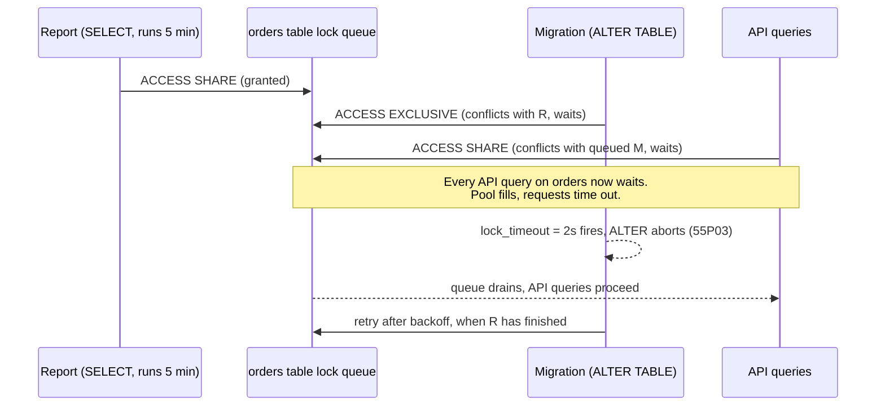

# SQL DDL

> **Module 03 · Databases** · Prerequisites: [Schema Design](05-Schema-Design.md), [Denormalization](07-Denormalization.md) · Next: [SQL DML](09-SQL-DML.md)

---

## ⏱ If You Only Have 2 Minutes

- **DDL** (Data Definition Language: `CREATE`, `ALTER`, `DROP`) changes structure. **DML** (Data Manipulation Language: `INSERT`, `UPDATE`, `DELETE`, and usually `SELECT`) changes or reads rows.
- Most `ALTER TABLE` forms take an **ACCESS EXCLUSIVE** lock, which blocks even `SELECT`. The change itself may take milliseconds. The danger is *waiting* for the lock.
- **Lock queue pile-up:** an `ALTER` waiting behind one long transaction makes every new query on that table queue behind the `ALTER`. Always run DDL with `SET lock_timeout = '2s'` (or similar) and retry with backoff.
- PG 11+: `ADD COLUMN ... DEFAULT <constant>` is a **catalog-only change**, with no table rewrite. A volatile default such as `clock_timestamp()` still rewrites the table.
- Safe `NOT NULL` on a big table: `ADD CONSTRAINT ... CHECK (col IS NOT NULL) NOT VALID` → backfill → `VALIDATE CONSTRAINT` → `SET NOT NULL` (PG 12+ skips the scan) → drop the check.
- Foreign keys work the same way: `ADD CONSTRAINT ... FOREIGN KEY ... NOT VALID`, then `VALIDATE CONSTRAINT`, which does not block reads or writes.
- `CREATE INDEX CONCURRENTLY` doesn't block writes but **cannot run inside a transaction block**. If it fails, it leaves an `INVALID` index that you must drop.
- PostgreSQL DDL is **transactional** (you can `ROLLBACK` an `ALTER`). In MySQL, each DDL statement **commits implicitly**.

---

## 1. What It Is and Why It Exists

**DDL** is the part of SQL that defines the containers for data: tables, columns, types, constraints, indexes, views, sequences and schemas. **DML** works with the rows inside those containers. People sometimes write "DDM" for the second one; the standard name is **DML**.

**Analogy:** DDL is the building work in a shop: putting up shelves, moving a wall, changing the door. DML is customers taking things off the shelves. Putting up a new shelf in an empty corner is quick and nobody notices. Moving a wall means closing that aisle. If the builders have to wait until the aisle is empty, and customers keep lining up behind the builders, the whole shop stops.

**The problem it solves.** The schema must change as the product changes: new columns, new rules, new indexes. On a laptop every `ALTER TABLE` finishes instantly. In production the same statement runs against a table that serves thousands of queries per second, and some forms:

- **rewrite the whole table** (changing a column type, adding a column with a volatile default) while holding a lock that blocks all access;
- **scan the whole table** to check a new constraint, again under a strong lock;
- **wait in a queue** for a lock and block everything behind them, even if the change itself would take a millisecond.

Knowing which statement does which, and the safe variant of each, is what separates "migration ran" from "migration caused an outage at noon". The *process* of shipping migrations (versioning, expand–contract, rollbacks, tools like Prisma Migrate and Alembic) is in [Database Migrations](34-Database-Migrations.md). This chapter is about the statements and their locks.

---

## 2. How It Works

Every DDL statement takes a **table-level lock** in one of eight modes. A lock request is granted only if it does not conflict with locks already held **or with requests already waiting in front of it** in the queue. That second rule prevents starvation, and it is also why one waiting `ALTER` can freeze a table.



Without `lock_timeout`, the `ALTER` waits for the full five minutes and the API is down for those five minutes. With it, the migration fails fast, traffic recovers within two seconds, and the runner tries again later.

What a given statement costs depends on three things:

1. **The lock mode**, which decides what it blocks.
2. **Whether it scans** the table (validating a constraint) or **rewrites** it (copying every row into a new file, rebuilding all indexes).
3. **How long it holds the lock.** Inside a transaction, a lock is held until `COMMIT`, not just until the statement ends. One slow statement after a fast `ALTER` keeps the table blocked.

---

## 3. Key Concepts

### PostgreSQL lock levels for common DDL

| Statement | Lock taken | Blocks | Scan or rewrite |
|---|---|---|---|
| `SELECT` | ACCESS SHARE | Only ACCESS EXCLUSIVE | — |
| `INSERT` / `UPDATE` / `DELETE` | ROW EXCLUSIVE | SHARE and stronger | — |
| `CREATE INDEX` | SHARE | Writes (reads continue) | Full scan |
| `CREATE INDEX CONCURRENTLY` | SHARE UPDATE EXCLUSIVE | Other DDL and `VACUUM`; not reads or writes | Two scans, slower |
| `ALTER TABLE ... VALIDATE CONSTRAINT` | SHARE UPDATE EXCLUSIVE | Other DDL; not reads or writes | Full scan |
| `ALTER TABLE ... ADD FOREIGN KEY` | SHARE ROW EXCLUSIVE on **both** tables | Writes on both tables | Full scan unless `NOT VALID` |
| Most other `ALTER TABLE` forms (`ADD COLUMN`, `DROP COLUMN`, `ADD CHECK`, `SET NOT NULL`, `ALTER TYPE`, `RENAME`) | ACCESS EXCLUSIVE | Everything, including `SELECT` | Varies (next table) |
| `DROP TABLE`, `TRUNCATE`, `VACUUM FULL` | ACCESS EXCLUSIVE | Everything | — / rewrite |

### Which ALTERs are instant and which are not

| Change | Cost on a large table | Safe approach |
|---|---|---|
| `ADD COLUMN x text` (nullable, no default) | Catalog only | Fine, with `lock_timeout` |
| `ADD COLUMN x int NOT NULL DEFAULT 0` | Catalog only (PG 11+, non-volatile default) | Fine, with `lock_timeout` |
| `ADD COLUMN x timestamptz DEFAULT now()` | Catalog only: `now()` is stable, so every existing row gets the same value | Fine |
| `ADD COLUMN x uuid DEFAULT gen_random_uuid()` | **Rewrite** (volatile default) | Add without default, set default, backfill in batches |
| `DROP COLUMN` | Catalog only (space is reclaimed later) | Stop reading it in code first |
| `RENAME COLUMN` / `RENAME TO` | Catalog only | Breaks running code; use expand–contract |
| `ALTER COLUMN TYPE int → bigint` | **Rewrite** of table and indexes | New column + backfill + swap |
| `ALTER COLUMN TYPE varchar(50) → varchar(100)` or `→ text` | Catalog only (binary-compatible) | Fine |
| `ADD CONSTRAINT ... CHECK (...)` | **Scan** under ACCESS EXCLUSIVE | `NOT VALID`, then `VALIDATE` |
| `ALTER COLUMN SET NOT NULL` | **Scan** under ACCESS EXCLUSIVE | Valid `CHECK (x IS NOT NULL)` first (PG 12+ then skips the scan) |
| `ADD FOREIGN KEY` | **Scan** blocking writes on both tables | `NOT VALID`, then `VALIDATE` |
| `ADD UNIQUE` / `ADD PRIMARY KEY` | Index build under a strong lock | `CREATE UNIQUE INDEX CONCURRENTLY`, then `ADD CONSTRAINT ... USING INDEX` |

### Named constraints and `NOT VALID`

Unnamed constraints get generated names (`orders_status_check`, `orders_customer_id_fkey`). They are predictable for simple cases, but break down with multi-column constraints, renames, and objects created by different tools. Name every constraint explicitly, `<table>_<what>_<kind>`, so that migrations can `DROP CONSTRAINT` or `VALIDATE CONSTRAINT` it by name, and so that application code can map violations to errors (see [Schema Design](05-Schema-Design.md)).

`NOT VALID` (for `CHECK` and `FOREIGN KEY`) means: enforce the rule for **new and updated rows immediately**, but do not check existing rows now. The `ALTER` then needs its strong lock only for a moment. A later `VALIDATE CONSTRAINT` scans the existing rows under a lock that allows normal reads and writes. Until it is validated, the planner cannot rely on the constraint. `SET NOT NULL` will not use it to skip the scan either.

### `CREATE INDEX CONCURRENTLY`

A plain `CREATE INDEX` blocks writes for the whole build. `CONCURRENTLY` builds the index in phases. It scans the table twice and waits for transactions that started before each phase. Writes continue throughout. The costs:

- It **cannot run inside a transaction block** (`BEGIN ... COMMIT`). Migration tools that wrap every file in a transaction need a per-migration opt-out.
- It is slower, and it waits for every older transaction, so one long-running transaction stalls it.
- On failure (deadlock, unique violation, cancel), it leaves an index marked **INVALID**. That index is not used for reads, but it is still updated on every write. Find leftovers with `SELECT indexrelid::regclass FROM pg_index WHERE NOT indisvalid;` and remove them with `DROP INDEX CONCURRENTLY`. Watch out: `CREATE INDEX CONCURRENTLY IF NOT EXISTS` treats the invalid leftover as "exists" and silently does nothing.
- `REINDEX CONCURRENTLY` (PG 12+) rebuilds a bloated or invalid index the same way.

### Transactional DDL: PostgreSQL vs MySQL

In PostgreSQL, almost all DDL is transactional. You can `BEGIN`, add a column, add a constraint, create a table, and `ROLLBACK`, and nothing happened. A migration that fails halfway leaves no half-applied schema. The exceptions include `CREATE INDEX CONCURRENTLY`, `CREATE DATABASE` and `VACUUM`. The flip side: every lock taken in the transaction is held until `COMMIT`. A migration file with three `ALTER`s and a backfill holds ACCESS EXCLUSIVE from the first `ALTER` to the end of the backfill. Keep DDL transactions small, and never put a large `UPDATE` in the same transaction.

In **MySQL**, a DDL statement causes an **implicit commit**: it commits any open transaction before and after itself. You cannot roll back a group of DDL statements. MySQL 8.0 made each *single* DDL statement atomic, but a failed multi-step migration still leaves a partly changed schema, so MySQL migration tools must be written to be re-runnable.

**MySQL (InnoDB) difference — online DDL.** `ALTER TABLE ... ALGORITHM=INSTANT` changes only metadata, for example when adding a column in MySQL 8.0. `ALGORITHM=INPLACE` rebuilds without blocking DML for many operations. `ALGORITHM=COPY` copies the table and blocks writes. If you state the algorithm explicitly and MySQL cannot use it, the statement fails instead of silently falling back to a slower one. MySQL has the same lock-queue problem through **metadata locks**. Its guard is `lock_wait_timeout`, which defaults to one year, so set it low in migration sessions. For big tables, teams often use gh-ost or pt-online-schema-change, which copy the table in the background and swap it in.

---

## 4. Code Examples

Scenario: create a new `shipments` table with named constraints, then change the large existing `customers`, `orders` and `payments` tables without blocking traffic. Finally, a small DDL runner that applies steps with `lock_timeout` and retries.

### SQL

```sql
-- New table: every constraint named, so migrations and error mapping can refer to it.
CREATE TABLE shipments (
  id           bigint      GENERATED ALWAYS AS IDENTITY,
  order_id     bigint      NOT NULL,
  carrier      text        NOT NULL,
  tracking_no  text,
  shipped_at   timestamptz NOT NULL DEFAULT now(),
  CONSTRAINT shipments_pkey          PRIMARY KEY (id),
  CONSTRAINT shipments_order_fk      FOREIGN KEY (order_id) REFERENCES orders (id),
  CONSTRAINT shipments_carrier_check CHECK (carrier IN ('dhl', 'ups', 'fedex')),
  CONSTRAINT shipments_tracking_key  UNIQUE (carrier, tracking_no)
);
-- Empty table: a plain CREATE INDEX is fine here; CONCURRENTLY matters only for live data.
CREATE INDEX shipments_order_id_idx ON shipments (order_id);

-- Transactional DDL: both changes vanish. In MySQL each ALTER would already be committed.
BEGIN;
ALTER TABLE orders ADD COLUMN gift_note text;
ALTER TABLE orders ADD CONSTRAINT orders_gift_note_len CHECK (char_length(gift_note) <= 500);
ROLLBACK;
```

Safe changes to large, busy tables. Each statement runs in its own short transaction:

```sql
SET lock_timeout = '2s';   -- fail fast instead of queueing in front of live traffic

-- 1. Fast column add (PG 11+): constant default stored in the catalog, no rewrite.
ALTER TABLE orders ADD COLUMN currency char(3) NOT NULL DEFAULT 'EUR';

-- 2. Make an existing nullable column NOT NULL without a long ACCESS EXCLUSIVE scan.
ALTER TABLE customers ADD CONSTRAINT customers_phone_not_null
  CHECK (phone IS NOT NULL) NOT VALID;                                  -- instant; new rows checked
-- ...backfill NULL phones in batches here (DML; see the SQL DML chapter)...
ALTER TABLE customers VALIDATE CONSTRAINT customers_phone_not_null;     -- scans; reads/writes continue
ALTER TABLE customers ALTER COLUMN phone SET NOT NULL;                  -- PG 12+: proven by the CHECK, no scan
ALTER TABLE customers DROP CONSTRAINT customers_phone_not_null;

-- 3. Foreign key on a big table (imagine payments had been created without one).
ALTER TABLE payments ADD CONSTRAINT payments_order_fk
  FOREIGN KEY (order_id) REFERENCES orders (id) NOT VALID;              -- brief lock, no scan
ALTER TABLE payments VALIDATE CONSTRAINT payments_order_fk;             -- scan without blocking writes

-- 4. Index without blocking writes. Must NOT be inside BEGIN/COMMIT.
CREATE INDEX CONCURRENTLY payments_order_id_idx ON payments (order_id);

-- If a concurrent build failed, find and drop the INVALID leftover before retrying.
SELECT indexrelid::regclass AS invalid_index FROM pg_index WHERE NOT indisvalid;
```

`customers.phone` is not in the sample schema. Assume an earlier migration added it as a nullable column.

### Node.js / TypeScript

```ts
// npm i pg  (+ -D @types/pg) — Node.js 22+, TypeScript 5, ESM; run as a CLI, not inside the API
import pg from "pg";
import { setTimeout as sleep } from "node:timers/promises";

export interface DdlStep {
  name: string;
  sql: string;
  concurrent?: boolean;   // CREATE/DROP INDEX CONCURRENTLY: no transaction block allowed
  cleanup?: string;       // run before a retry, e.g. drop an INVALID index left by a failed build
}

const LOCK_NOT_AVAILABLE = "55P03";   // raised when lock_timeout expires

async function applyOnce(client: pg.Client, step: DdlStep, lockTimeout: string): Promise<void> {
  if (step.concurrent) {
    // Session-level setting: there is no transaction for SET LOCAL to attach to.
    await client.query("SELECT set_config('lock_timeout', $1, false)", [lockTimeout]);
    await client.query(step.sql);
    return;
  }
  await client.query("BEGIN");
  try {
    // SET cannot take bind parameters; set_config(name, value, true) is a parameterised SET LOCAL.
    await client.query("SELECT set_config('lock_timeout', $1, true)", [lockTimeout]);
    await client.query(step.sql);
    await client.query("COMMIT");   // releases the ACCESS EXCLUSIVE lock as early as possible
  } catch (err) {
    await client.query("ROLLBACK");
    throw err;
  }
}

export async function runDdl(steps: DdlStep[], lockTimeout = "2s", maxAttempts = 8): Promise<void> {
  const client = new pg.Client({ connectionString: process.env.DATABASE_URL, application_name: "ddl-runner" });
  await client.connect();
  try {
    for (const step of steps) {
      for (let attempt = 1; ; attempt++) {
        try {
          await applyOnce(client, step, lockTimeout);
          console.log(JSON.stringify({ step: step.name, attempt, status: "applied" }));
          break;
        } catch (err) {
          const lockTimeoutHit = err instanceof pg.DatabaseError && err.code === LOCK_NOT_AVAILABLE;
          if (!lockTimeoutHit || attempt === maxAttempts) throw err;
          if (step.cleanup) await client.query(step.cleanup);
          // Exponential backoff with full jitter, capped at 60 s: gives the blocking
          // transaction time to finish without hammering the lock queue.
          const delayMs = Math.random() * Math.min(60_000, 1_000 * 2 ** attempt);
          console.warn(JSON.stringify({ step: step.name, attempt, status: "lock_timeout", retryInMs: Math.round(delayMs) }));
          await sleep(delayMs);
        }
      }
    }
  } finally {
    await client.end();
  }
}

await runDdl([
  { name: "orders.currency", sql: "ALTER TABLE orders ADD COLUMN IF NOT EXISTS currency char(3) NOT NULL DEFAULT 'EUR'" },
  {
    name: "payments_order_id_idx", concurrent: true,
    sql: "CREATE INDEX CONCURRENTLY payments_order_id_idx ON payments (order_id)",
    cleanup: "DROP INDEX CONCURRENTLY IF EXISTS payments_order_id_idx",
  },
]);
```

### Python

```python
# pip install "psycopg[binary]"   — Python 3.12+; run as a CLI step in the deploy pipeline
import json
import os
import random
import time
from dataclasses import dataclass

import psycopg
from psycopg import errors


@dataclass(frozen=True)
class DdlStep:
    name: str
    sql: str
    concurrent: bool = False  # CREATE/DROP INDEX CONCURRENTLY must run outside a transaction
    cleanup: str | None = None  # e.g. drop an INVALID index before retrying


def apply_once(conn: psycopg.Connection, step: DdlStep, lock_timeout: str) -> None:
    if step.concurrent:
        # autocommit=True means this statement is not wrapped in BEGIN, as CONCURRENTLY requires.
        conn.execute("SELECT set_config('lock_timeout', %s, false)", (lock_timeout,))
        conn.execute(step.sql)
        return
    with conn.transaction():  # BEGIN ... COMMIT, or ROLLBACK on any exception
        conn.execute("SELECT set_config('lock_timeout', %s, true)", (lock_timeout,))  # = SET LOCAL
        conn.execute(step.sql)


def run_ddl(steps: list[DdlStep], lock_timeout: str = "2s", max_attempts: int = 8) -> None:
    dsn = os.environ["DATABASE_URL"]
    with psycopg.connect(dsn, autocommit=True, application_name="ddl-runner") as conn:
        for step in steps:
            for attempt in range(1, max_attempts + 1):
                try:
                    apply_once(conn, step, lock_timeout)
                    print(json.dumps({"step": step.name, "attempt": attempt, "status": "applied"}))
                    break
                except errors.LockNotAvailable:  # SQLSTATE 55P03: lock_timeout expired
                    if attempt == max_attempts:
                        raise
                    if step.cleanup:
                        conn.execute(step.cleanup)
                    delay = random.uniform(0, min(60.0, 2.0**attempt))  # full jitter, capped
                    print(json.dumps({"step": step.name, "attempt": attempt,
                                      "status": "lock_timeout", "retry_in_s": round(delay, 2)}))
                    time.sleep(delay)  # fine: a CLI process, no event loop to block


if __name__ == "__main__":
    run_ddl([
        DdlStep("customers_phone_not_null",
                "ALTER TABLE customers ADD CONSTRAINT customers_phone_not_null "
                "CHECK (phone IS NOT NULL) NOT VALID"),
        DdlStep("validate customers_phone_not_null",
                "ALTER TABLE customers VALIDATE CONSTRAINT customers_phone_not_null"),
        DdlStep("customers.phone SET NOT NULL",
                "ALTER TABLE customers ALTER COLUMN phone SET NOT NULL"),
    ])
```

**Runtime differences:** psycopg needs `autocommit=True` on the connection, otherwise the first statement opens an implicit transaction and `CREATE INDEX CONCURRENTLY` fails with "cannot run inside a transaction block". node-postgres sends each `query()` in autocommit mode unless you send `BEGIN` yourself, so the Node runner gets that behaviour for free. psycopg also raises a dedicated `errors.LockNotAvailable` class, while `pg` exposes the SQLSTATE as `err.code`.

---

## 5. Production Concerns

- **Always set `lock_timeout` for DDL.** A value of 1–5 s is typical for busy OLTP tables, combined with automatic retries. Without it, one forgotten `idle in transaction` session can turn a 5 ms `ALTER` into an outage. Also consider an `idle_in_transaction_session_timeout` for application roles, so such sessions cannot live for hours.
- **Find the blocker before retrying forever.** If every attempt times out, something holds a lock for a long time:

  ```sql
  SELECT pid, pg_blocking_pids(pid) AS blocked_by, state, wait_event_type,
         now() - xact_start AS xact_age, left(query, 60) AS query
  FROM pg_stat_activity
  WHERE datname = current_database() AND (wait_event_type = 'Lock' OR state = 'idle in transaction')
  ORDER BY xact_age DESC NULLS LAST;
  ```

- **Autovacuum and DDL.** A normal autovacuum cancels itself when it blocks a conflicting lock request. One running to prevent transaction-ID wraparound does not, so a migration can wait on it.
- **One risky change per transaction.** Locks are held until `COMMIT`. Separate the brief `ALTER`, the long `VALIDATE`, and any backfill into different transactions or steps.
- **Rewrites need disk and time.** A rewrite (type change, `VACUUM FULL`, volatile default) needs roughly the table's size plus its indexes in free disk space, generates WAL that replicas must replay, and holds ACCESS EXCLUSIVE throughout. Treat any rewrite of a large table as a project, not a migration file.
- **Replication lag.** `CREATE INDEX CONCURRENTLY` and `VALIDATE CONSTRAINT` do not block the primary, but the WAL from big builds and backfills can delay replicas. Watch replica lag during migrations if reads go to replicas.
- **Measure per step:** time spent waiting for the lock, time holding it, number of `55P03` retries, and statement duration. Log the step name and attempt, never the data.

---

## 6. Common Mistakes

- **Running DDL without `lock_timeout`** — the `ALTER` queues behind a long transaction and every query on the table queues behind the `ALTER` — set `lock_timeout` and retry with backoff.
- **`ADD CONSTRAINT ... CHECK` or `FOREIGN KEY` directly on a big table** — full scan under a lock that blocks writes (or everything) — add it `NOT VALID`, then `VALIDATE CONSTRAINT`.
- **`SET NOT NULL` straight away** — scans the whole table under ACCESS EXCLUSIVE — first add and validate `CHECK (col IS NOT NULL)`; on PG 12+ the `SET NOT NULL` then skips the scan.
- **`CREATE INDEX CONCURRENTLY` inside a migration transaction** — fails with "cannot run inside a transaction block" — disable the tool's transaction wrapper for that migration.
- **Ignoring a failed concurrent build** — an `INVALID` index slows every write and `IF NOT EXISTS` skips the rebuild — check `pg_index.indisvalid` and drop leftovers.
- **Changing a column type in place** (`int → bigint`) — rewrites the table and indexes under ACCESS EXCLUSIVE — add a new column, backfill in batches, then swap in a short transaction.
- **Renaming or dropping a column that running code still uses** — old pods error until the deploy finishes — expand–contract: stop using it first, drop it in a later release.

---

## 7. Comparison Table

| | PostgreSQL 16+ | MySQL 8.0 (InnoDB) |
|---|---|---|
| DDL inside a transaction | Yes; can roll back a group of DDL statements | No; each DDL statement commits implicitly |
| Single-statement atomicity | Yes | Yes (atomic DDL since 8.0) |
| Add column cheaply | `ADD COLUMN` with non-volatile default is catalog-only (PG 11+) | `ALGORITHM=INSTANT` |
| Build an index without blocking writes | `CREATE INDEX CONCURRENTLY` | Online DDL `ALGORITHM=INPLACE, LOCK=NONE` for most index adds |
| Add a constraint without a long lock | `NOT VALID` + `VALIDATE CONSTRAINT` | Depends on the operation; often an external tool |
| Lock-queue guard | `lock_timeout` | `lock_wait_timeout` (metadata locks) |
| Typical big-table tool | Built-in features above | gh-ost, pt-online-schema-change |

---

## 8. Interview Questions

**[Junior] What is the difference between DDL and DML?**
DDL defines structure: `CREATE`, `ALTER` and `DROP` for tables, indexes, constraints and views. DML works with the data inside: `INSERT`, `UPDATE`, `DELETE`, and `SELECT` (sometimes listed separately as DQL). The difference matters operationally. DDL takes table-level locks that can block all traffic, and in MySQL it commits implicitly. DML takes row locks.

**[Junior] Why give constraints explicit names?**
So that migrations can refer to them reliably (`DROP CONSTRAINT orders_status_check`, `VALIDATE CONSTRAINT ...`) in every environment, and so that application code can map a violation to a domain error by constraint name. Generated names depend on the column list and on which tool created the object. A naming convention like `<table>_<what>_<kind>` also makes error logs readable.

**[Mid] An `ALTER TABLE ... ADD COLUMN` that takes 5 ms took production down for minutes. How?**
`ADD COLUMN` needs ACCESS EXCLUSIVE. A long-running query or an `idle in transaction` session held a weaker lock on the table, so the `ALTER` waited. New `SELECT`s conflicted with the *queued* `ALTER` and lined up behind it, so the whole table stopped. The fix is `SET lock_timeout` (a few seconds) so the `ALTER` gives up and retries with backoff, plus timeouts that stop sessions from sitting idle in a transaction.

**[Mid] How do you add `NOT NULL` to a column on a 500-million-row table?**
Add `CHECK (col IS NOT NULL) NOT VALID`, which is instant and enforces the rule for new writes. Backfill existing `NULL`s in small batches. Run `VALIDATE CONSTRAINT`, which scans under a lock that allows reads and writes. Then `ALTER COLUMN ... SET NOT NULL`: on PostgreSQL 12+ it uses the validated check and skips its own scan. Finally drop the redundant check. Each step runs with `lock_timeout`.

**[Mid] Why can't `CREATE INDEX CONCURRENTLY` run in a transaction, and what happens when it fails?**
It works in several phases. Between phases it must commit internally and wait for older transactions to finish, so it cannot live inside one outer transaction. If it fails (unique violation, deadlock, cancellation), it leaves an index marked invalid. That index is maintained on writes but never used for reads. Drop it with `DROP INDEX CONCURRENTLY` and run the build again. `IF NOT EXISTS` will not notice the problem.

**[Senior] How does transactional DDL change how you write migrations in PostgreSQL vs MySQL?**
In PostgreSQL you can wrap a migration in a transaction, and a failure rolls everything back. That makes migrations all-or-nothing, but every lock is held until commit. So you keep DDL transactions tiny, never mix in backfills, and run `CONCURRENTLY` steps outside any transaction. In MySQL each DDL statement commits implicitly, so a multi-step migration can stop halfway. Steps must be idempotent and re-runnable, and you rely on online DDL (`ALGORITHM=INSTANT/INPLACE`) or a copy-and-swap tool for big tables.

**[Senior] How would you change `orders.id` from `integer` to `bigint` with no downtime?**
An in-place `ALTER COLUMN TYPE` rewrites the table and all its indexes under ACCESS EXCLUSIVE, so it is out. Add a nullable `id_new bigint` column and keep it in sync for new rows with a trigger. Backfill old rows in batches, then build a unique index on it with `CREATE UNIQUE INDEX CONCURRENTLY`. Referencing columns such as `order_items.order_id` and `payments.order_id` need the same treatment. Then, in one short transaction with `lock_timeout`, swap the primary key using the prepared index (`ADD CONSTRAINT ... PRIMARY KEY USING INDEX`), rename the columns, switch the sequence or identity, and recreate FKs as `NOT VALID` before validating them. Rehearse it on a production-sized copy first.

**[Senior] What policy would you build into a migration runner?**
Every DDL step runs with a short `lock_timeout` and retries with jittered exponential backoff on SQLSTATE `55P03`. One risky DDL per transaction. `CONCURRENTLY` steps run outside transactions, with a cleanup of invalid indexes before each retry. Backfills are batched DML steps, separate from DDL. CI lints the migrations to reject known-dangerous forms: constraints without `NOT VALID`, plain `CREATE INDEX` on existing tables, in-place type changes. The runner also logs lock-wait time and attempts per step, so operators can see when a blocker needs attention.

---

## 9. Cheat Sheet

```text
DDL vs DML      CREATE/ALTER/DROP (structure)  vs  INSERT/UPDATE/DELETE/SELECT (rows) — "DML", not "DDM"
Most ALTERs     ACCESS EXCLUSIVE → blocks SELECT too; held until COMMIT
Lock queue      waiting ALTER blocks every newer query → SET lock_timeout = '2s' + retry w/ backoff
lock_timeout    SQLSTATE 55P03 (lock_not_available); SET can't be parameterised → set_config()
Fast add col    PG 11+: ADD COLUMN ... DEFAULT <non-volatile> = catalog only; volatile = rewrite
NOT NULL        CHECK (c IS NOT NULL) NOT VALID → backfill → VALIDATE → SET NOT NULL → drop CHECK
FK              ADD ... FOREIGN KEY ... NOT VALID → VALIDATE CONSTRAINT (no write block)
UNIQUE / PK     CREATE UNIQUE INDEX CONCURRENTLY → ADD CONSTRAINT ... USING INDEX
Index           CREATE INDEX blocks writes; CONCURRENTLY doesn't, but no tx block; INVALID on failure
Rewrites        int→bigint, volatile default, VACUUM FULL: need disk, WAL, ACCESS EXCLUSIVE
Free changes    nullable ADD COLUMN, DROP COLUMN, varchar(n)→text, RENAME (but breaks old code)
Transactional   PG: yes (ROLLBACK works); MySQL: implicit commit per DDL statement
MySQL online    ALGORITHM=INSTANT/INPLACE/COPY, LOCK=NONE; metadata locks; lock_wait_timeout
Diagnose        pg_stat_activity + pg_blocking_pids(pid); look for idle in transaction
```

---

## Related Topics

- [Schema Design](05-Schema-Design.md) — which keys, types and constraints to write in the first place
- [SQL DML](09-SQL-DML.md) — batched backfills that sit between the DDL steps
- [Database Locks](30-Database-Locks.md) — lock modes, conflicts and lock queues in depth
- [Database Migrations](34-Database-Migrations.md) — expand–contract process and migration tooling around these statements
- [Indexes](19-Indexes.md) — what you are building with `CREATE INDEX CONCURRENTLY`
- [Exponential Backoff](../Module-07-Advanced-Backend-and-System-Design/36-Exponential-Backoff.md) — the retry strategy the DDL runner uses
