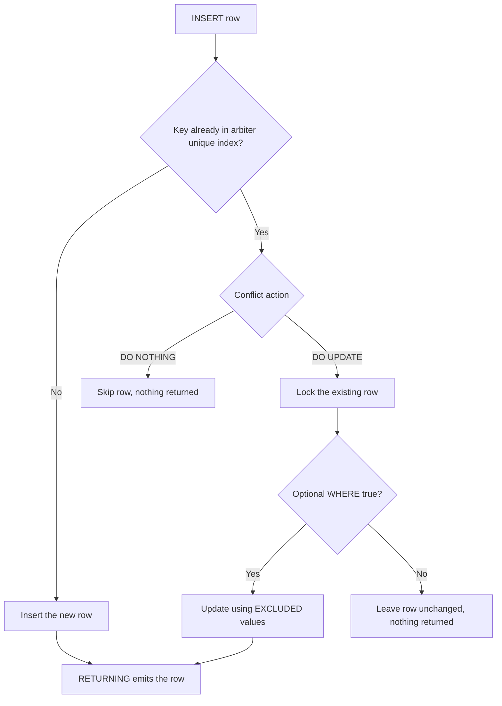

# SQL DML

> **Module 03 · Databases** · Prerequisites: [SQL DDL](08-SQL-DDL.md) · Next: [SQL JOINs](10-SQL-JOINs.md)

---

## ⏱ If You Only Have 2 Minutes

- `RETURNING` hands back generated IDs, defaults and new values from the same `INSERT`, `UPDATE` or `DELETE`. No second `SELECT`, no race between the write and the read.
- `INSERT ... ON CONFLICT (key) DO UPDATE SET col = EXCLUDED.col` is an atomic upsert. The conflict target must match a unique index or constraint. `EXCLUDED` is the row you tried to insert.
- Replace read-check-write with one conditional statement: `UPDATE inventory SET available = available - $2 WHERE product_id = $1 AND available >= $2`, then check the row count. `0` means "not enough stock".
- Write many rows in one round trip: a multi-row `VALUES`, or `unnest($1::bigint[], $2::int[])` with one array per column. Use `COPY` for bulk loads. One statement can bind at most 65,535 parameters.
- `UPDATE ... FROM` and `DELETE ... USING` join other tables. If several source rows match one target row, PostgreSQL uses only one of them, and which one is not predictable.
- Update or delete millions of rows in batches of a few thousand, each in its own transaction. PostgreSQL has no `DELETE ... LIMIT`; select the batch in a subquery.
- Bind every value as a parameter. Table names, column names and sort directions cannot be parameters, so pick them from an allow-list.
- MySQL difference: `INSERT ... ON DUPLICATE KEY UPDATE` fires on a conflict in *any* unique index, and MySQL has no `RETURNING`.

---

## 1. What It Is and Why It Exists

**DML** (Data Manipulation Language) is the part of SQL that changes rows: `INSERT`, `UPDATE`, `DELETE`, and in PostgreSQL also `MERGE` and `COPY`. ([DDL](08-SQL-DDL.md) changes the *structure*; DML changes the *data*.) `SELECT` is often grouped with DML too, but the next chapters cover reading.

Everyone can write `INSERT INTO t VALUES (...)`. Interviews and production incidents are about the harder parts:

- **Concurrency.** Two requests run the same write at the same moment. Does stock go negative? Is a payment recorded twice?
- **Round trips.** An order with 30 items written as 31 separate statements costs 31 network round trips, each one holding the transaction open longer.
- **Size.** One `DELETE` that removes 50 million rows locks them all, produces a burst of WAL (write-ahead log) that replicas must replay, and cannot be cleaned up by vacuum until it commits.
- **Safety.** Values glued into SQL text are SQL injection.

**Analogy:** a warehouse clerk. A bad clerk walks to the shelf, counts the boxes, walks back to the desk, writes "take 2", walks back to the shelf and takes 2 — by then someone else has taken the last one. A good clerk says one sentence at the shelf: "take 2 *if* at least 2 are there", and reports whether it worked. Modern DML lets you say the whole sentence in one statement.

**What breaks without it:** lost updates and overselling (read-check-write), duplicate rows from retried requests (no upsert), slow checkouts (one statement per item), and outages from giant one-shot deletes.

---

## 2. How It Works

### One statement, one atomic step

Every single SQL statement is atomic. Either all its row changes happen or none do. A statement also sees a consistent snapshot of the data. This is why pushing a condition *into* the statement is safer than checking it in application code first.

When two transactions run `UPDATE inventory SET available = available - 1 WHERE product_id = 7 AND available >= 1` at the same time under the default `READ COMMITTED` isolation level:

1. Transaction A finds the row, checks `available >= 1`, locks the row, writes a new version.
2. Transaction B finds the same row but it is locked. B **waits**.
3. A commits.
4. B wakes up, re-reads the **newest** version of that row and evaluates the `WHERE` clause again. If `available` is now `0`, B updates nothing and reports `0` rows.

PostgreSQL documents this re-check in its description of Read Committed. The outcome: no oversell, no explicit lock, one round trip.

### How an upsert decides

`INSERT ... ON CONFLICT` uses a unique index (the **arbiter index**) to detect a conflict.



The PostgreSQL docs guarantee that `ON CONFLICT DO UPDATE` ends in either an insert or an update, even under heavy concurrency, as long as no other error happens. That is the property you need for idempotent writes.

### The main statement shapes

```sql
-- Multi-row insert: one statement, one round trip, one WAL flush at commit
INSERT INTO products (sku, name, category, price_cents)
VALUES ('BK-001', 'Clean Code', 'books', 3200),
       ('BK-002', 'DDIA',       'books', 4500)
RETURNING id, sku;

-- UPDATE ... FROM: change rows using another table (a PostgreSQL extension)
UPDATE orders o
   SET status = 'paid'
  FROM payments p
 WHERE p.order_id = o.id
   AND p.status = 'captured'
   AND o.status = 'pending'
RETURNING o.id;

-- DELETE ... USING: delete rows using another table
DELETE FROM order_items oi
 USING orders o
 WHERE o.id = oi.order_id
   AND o.status = 'cancelled'
   AND o.created_at < now() - interval '1 year';
```

Illustrative output of the multi-row insert:

| id | sku |
|---|---|
| 101 | BK-001 |
| 102 | BK-002 |

---

## 3. Key Concepts

### `RETURNING`

`RETURNING` works on `INSERT`, `UPDATE` and `DELETE` (and on `MERGE` since PostgreSQL 17). It returns the row *as written*, after defaults, identity values and `BEFORE` triggers. Use it to:

- get the new `id` of an inserted row;
- return the new balance after a decrement (`RETURNING available`);
- know exactly which rows a conditional update touched (`RETURNING product_id`).

Without it you need a follow-up `SELECT`, which costs another round trip and can see a different state if other transactions write in between.

### Upsert: `ON CONFLICT`

```sql
INSERT INTO inventory (product_id, available)
VALUES ($1, $2)
ON CONFLICT (product_id) DO UPDATE
   SET available = inventory.available + EXCLUDED.available,
       version   = inventory.version + 1
RETURNING product_id, available;
```

| Piece | Meaning |
|---|---|
| `ON CONFLICT (product_id)` | Conflict target. Must match a unique index or constraint. `ON CONFLICT ON CONSTRAINT name` also works. |
| `EXCLUDED` | The row that was proposed for insertion. |
| `inventory.available` | The existing row (use the table name or its alias). |
| `DO UPDATE ... WHERE cond` | Update only if `cond` is true. The existing row is locked either way. |
| `DO NOTHING` | Skip conflicting rows. `RETURNING` returns nothing for them. |

Facts interviewers like:

- **Same key twice in one statement** with `DO UPDATE` fails: `ON CONFLICT DO UPDATE command cannot affect row a second time`. De-duplicate the input first.
- **Identity and sequence gaps.** The default value (for example the next identity number) is computed *before* the conflict check. Upserts that end up updating still burn IDs. Gaps are normal; never rely on IDs being consecutive.
- **Partial unique indexes** work as arbiters if you repeat their predicate: `ON CONFLICT (email) WHERE deleted_at IS NULL`.
- **`DO NOTHING` and "get or create".** `DO NOTHING ... RETURNING id` returns no row when the key exists. A follow-up `SELECT` in the same statement may not see a row that a concurrent transaction committed after your snapshot was taken. A common workaround is a no-op `DO UPDATE SET email = EXCLUDED.email`, which always returns the row but writes a new row version every time.

**`MERGE`** (PostgreSQL 15+) is the SQL-standard way to "insert, update or delete depending on a match". It is good for syncing a staging table into a target. It is not a drop-in replacement for `ON CONFLICT`: under concurrent inserts of the same key, `MERGE` can still fail with a unique violation, and the PostgreSQL docs point to `INSERT ... ON CONFLICT` for that case.

**MySQL (InnoDB) difference:**

```sql
INSERT INTO inventory (product_id, available) VALUES (7, 10) AS new
ON DUPLICATE KEY UPDATE available = inventory.available + new.available;
```

There is no conflict target: a duplicate in **any** unique index (primary key or other) triggers the update, which surprises people when a table has two unique keys. The row alias (`AS new`) replaces the older `VALUES(col)` function, which is deprecated in MySQL 8.0. The affected-row count is 1 for an insert and 2 for an update. MySQL has no `RETURNING`; you read `LAST_INSERT_ID()` instead.

### Atomic conditional updates

The rule: **put the business condition into the `WHERE` clause and check how many rows changed.**

```sql
UPDATE inventory
   SET available = available - $2,
       version   = version + 1
 WHERE product_id = $1
   AND available >= $2
RETURNING available;
```

- 1 row → reserved; `RETURNING` shows what is left.
- 0 rows → not enough stock (or the product does not exist). Report "out of stock". Do not retry in a loop.

The `CHECK (available >= 0)` constraint in the schema is the safety net. The `WHERE` clause is the normal path. A constraint violation turns into an error, not a quiet 0-row result, so you want the `WHERE` to catch the normal case.

The same pattern covers state machines: `UPDATE orders SET status = 'cancelled' WHERE id = $1 AND status = 'pending'`. If the order was paid a millisecond earlier, the update matches 0 rows and you return `409 Conflict`. [Optimistic locking](32-Optimistic-vs-Pessimistic-Locking.md) is the same idea with a `version` column.

### Bulk writes

| Technique | Round trips | Parameters | Upsert support | Notes |
|---|---|---|---|---|
| Loop of single `INSERT`s | N | per row | Yes | Slowest; latency × N |
| Multi-row `VALUES ($1,$2), ($3,$4)...` | 1 | rows × columns | Yes | Hits the 65,535-parameter limit; every batch size is a new SQL text |
| `unnest($1::bigint[], $2::int[])` | 1 | one per column | Yes | Fixed SQL text, any row count |
| `COPY ... FROM STDIN` | 1 stream | none | No | Fastest load path; no `ON CONFLICT`, no `RETURNING` |
| `COPY` into a temp table, then `INSERT ... SELECT ... ON CONFLICT` | 2–3 | none | Yes | Best for large imports that must upsert |

`unnest` with several arrays "zips" them into rows: `unnest(ARRAY[1,2], ARRAY[5,3])` yields `(1,5)` and `(2,3)`. If the arrays have different lengths, the shorter one is padded with `NULL`, so check lengths in the application.

The 65,535 limit comes from the wire protocol: the Bind message stores the parameter count in a 16-bit field. A 6-column multi-row insert therefore tops out around 10,900 rows per statement. Arrays avoid the limit because each array is one parameter.

### Batched updates and deletes

A single huge `DELETE` or `UPDATE`:

- holds row locks on every affected row until commit, blocking other writers;
- writes all its WAL at once, so replicas fall behind;
- creates dead row versions that vacuum cannot remove until the transaction ends;
- if it fails at 90%, rolls back everything and you start over.

Batch it instead. PostgreSQL has no `DELETE ... LIMIT`, so choose the batch with a subquery:

```sql
-- Run in a loop, one transaction per batch, until it deletes 0 rows
DELETE FROM payments
 WHERE id IN (
   SELECT id FROM payments
    WHERE status = 'failed'
      AND created_at < now() - interval '90 days'
    ORDER BY id
    LIMIT 5000
    FOR UPDATE SKIP LOCKED      -- skip rows another worker is touching right now
 );
```

For backfills (`UPDATE` every row), walk the primary key in ranges (`WHERE id > $last AND id <= $last + 5000`) so each batch uses the index and the job can resume after a crash. Pause between batches if replica lag grows. [Database migrations](34-Database-Migrations.md) use the same loop for backfills.

### Parameterization vs SQL injection

With a parameterized query, the driver sends the SQL text and the values **separately** (the extended protocol's Parse and Bind messages). The server parses the SQL before it ever sees the values, so a value like `'; DROP TABLE orders; --` is only ever a string.

- **Values** (`WHERE id = $1`, `LIMIT $2`, arrays): always parameters.
- **Identifiers** (table or column names) and **keywords** (`ASC`/`DESC`) cannot be parameters. Map user input to a fixed set: `{ newest: "created_at DESC", total: "total_cents DESC" }`. In Python, `psycopg.sql.Identifier` quotes an identifier safely when it truly must be dynamic.
- **`LIKE` patterns:** the parameter is safe from injection, but `%` and `_` in user input are still wildcards. Escape them if you mean a literal match.
- In `pg` (node-postgres), a query with parameters uses the extended protocol, which allows **one** statement per call. A query without parameters uses the simple protocol, which accepts several statements separated by `;` — one more reason never to concatenate.

---

## 4. Code Examples

Scenario: checkout. Reserve stock for every line and create the order with its items, all in one transaction with few round trips. Then an idempotent payment webhook: the payment provider may send the same event twice or out of order.

### SQL

```sql
-- 1) Reserve stock for all lines at once. Returns one row per reserved product.
UPDATE inventory AS i
   SET available = i.available - r.qty,
       version   = i.version + 1
  FROM unnest($1::bigint[], $2::int[]) AS r(product_id, qty)
 WHERE i.product_id = r.product_id
   AND i.available >= r.qty
RETURNING i.product_id;

-- 2) Insert the order and its items in ONE statement.
WITH lines AS (
  SELECT l.product_id, l.quantity, p.price_cents
    FROM unnest($2::bigint[], $3::int[]) AS l(product_id, quantity)
    JOIN products p ON p.id = l.product_id
), new_order AS (
  INSERT INTO orders (customer_id, status, total_cents)
  SELECT $1::bigint, 'pending', sum(quantity * price_cents) FROM lines
  RETURNING id, total_cents, created_at
), new_items AS (
  INSERT INTO order_items (order_id, product_id, quantity, unit_price_cents)
  SELECT o.id, l.product_id, l.quantity, l.price_cents
    FROM new_order o CROSS JOIN lines l
)
SELECT id, total_cents, created_at FROM new_order;
-- new_items is never read, but data-modifying CTEs always run to completion.

-- 3) Idempotent, forward-only payment upsert keyed by the provider's reference.
INSERT INTO payments (order_id, amount_cents, status, provider_ref)
VALUES ($1, $2, $3, $4)
ON CONFLICT (provider_ref) DO UPDATE
   SET status = EXCLUDED.status
 WHERE (payments.status, EXCLUDED.status) IN
       (('authorized', 'captured'), ('authorized', 'failed'), ('captured', 'refunded'))
RETURNING id, status;
```

Illustrative output of statement 1 when product 12 has only 1 unit left and the order asks for 2:

| product_id |
|---|
| 7 |
| 31 |

Three lines in, two rows out: the application sees the mismatch and rolls back, which also undoes the reservations for products 7 and 31.

### Node.js / TypeScript

```ts
// npm i pg && npm i -D @types/pg   — Node.js 22+, TypeScript 5, ESM
// orders.ts
import pg from "pg";

const RESERVE_SQL = `
  UPDATE inventory AS i
     SET available = i.available - r.qty, version = i.version + 1
    FROM unnest($1::bigint[], $2::int[]) AS r(product_id, qty)
   WHERE i.product_id = r.product_id AND i.available >= r.qty
  RETURNING i.product_id`;

const INSERT_ORDER_SQL = `
  WITH lines AS (
    SELECT l.product_id, l.quantity, p.price_cents
      FROM unnest($2::bigint[], $3::int[]) AS l(product_id, quantity)
      JOIN products p ON p.id = l.product_id
  ), new_order AS (
    INSERT INTO orders (customer_id, status, total_cents)
    SELECT $1::bigint, 'pending', sum(quantity * price_cents) FROM lines
    RETURNING id, total_cents, created_at
  ), new_items AS (
    INSERT INTO order_items (order_id, product_id, quantity, unit_price_cents)
    SELECT o.id, l.product_id, l.quantity, l.price_cents FROM new_order o CROSS JOIN lines l
  )
  SELECT id, total_cents, created_at FROM new_order`;

export const pool = new pg.Pool({ connectionString: process.env.DATABASE_URL });

export interface OrderLine { productId: string; quantity: number }

export class OutOfStockError extends Error {
  constructor(readonly productIds: string[]) {
    super(`out of stock: ${productIds.join(", ")}`);
  }
}

// pg returns bigint columns as strings (a JS number loses precision above 2^53),
// so IDs stay strings end to end. total_cents is integer, so it arrives as a number.
interface CreatedOrder { id: string; total_cents: number; created_at: Date }

export async function createOrder(customerId: string, lines: OrderLine[]): Promise<CreatedOrder> {
  const productIds = lines.map((l) => l.productId);
  // Duplicate product IDs would make UPDATE ... FROM apply only one of the quantities.
  if (lines.length === 0 || new Set(productIds).size !== productIds.length) {
    throw new Error("order needs at least one line and unique product ids");
  }
  const quantities = lines.map((l) => l.quantity);

  const client = await pool.connect();
  try {
    await client.query("BEGIN");

    const reserved = await client.query<{ product_id: string }>(RESERVE_SQL, [productIds, quantities]);
    if (reserved.rowCount !== lines.length) {
      const ok = new Set(reserved.rows.map((r) => r.product_id));
      throw new OutOfStockError(productIds.filter((id) => !ok.has(id))); // caught below → ROLLBACK
    }

    const created = await client.query<CreatedOrder>(INSERT_ORDER_SQL, [customerId, productIds, quantities]);
    await client.query("COMMIT");
    return created.rows[0];
  } catch (err) {
    await client.query("ROLLBACK");
    throw err;
  } finally {
    client.release();
  }
}
```

The webhook. Duplicate deliveries hit the conflict path, fail the `WHERE`, and return zero rows — which is a success, not an error:

```ts
// npm i express pg && npm i -D @types/express @types/pg
import express from "express";
import { pool } from "./orders.js";

const UPSERT_PAYMENT_SQL = `
  INSERT INTO payments (order_id, amount_cents, status, provider_ref)
  VALUES ($1, $2, $3, $4)
  ON CONFLICT (provider_ref) DO UPDATE
     SET status = EXCLUDED.status
   WHERE (payments.status, EXCLUDED.status) IN
         (('authorized', 'captured'), ('authorized', 'failed'), ('captured', 'refunded'))
  RETURNING id, status`;

const STATUSES = new Set(["authorized", "captured", "refunded", "failed"]);

interface PaymentEvent { orderId: string; amountCents: number; status: string; providerRef: string }

function isPaymentEvent(b: unknown): b is PaymentEvent {
  const e = b as Partial<PaymentEvent>;
  return typeof e?.orderId === "string" && /^\d+$/.test(e.orderId)
    && Number.isInteger(e.amountCents) && (e.amountCents ?? 0) > 0
    && typeof e.status === "string" && STATUSES.has(e.status)
    && typeof e.providerRef === "string" && e.providerRef.length > 0;
}

const app = express();
app.use(express.json());

// Verify the provider's signature before this handler in real code (see the Idempotency chapter).
app.post("/webhooks/payments", async (req, res) => {
  if (!isPaymentEvent(req.body)) {
    res.status(400).json({ error: "invalid_event" });
    return;
  }
  const e = req.body;
  try {
    const result = await pool.query(UPSERT_PAYMENT_SQL, [e.orderId, e.amountCents, e.status, e.providerRef]);
    // 0 rows: duplicate or out-of-order event. Acknowledge it so the provider stops retrying.
    res.status(200).json({ applied: result.rowCount === 1 });
  } catch (err) {
    if ((err as { code?: string }).code === "23503") { // foreign_key_violation: unknown order
      res.status(422).json({ error: "unknown_order" });
      return;
    }
    throw err; // Express 5 forwards rejected promises to the error handler
  }
});

app.listen(3000);
```

### Python

```python
# pip install "psycopg[binary]" psycopg-pool   — Python 3.12+
# orders.py
from dataclasses import dataclass

from psycopg_pool import AsyncConnectionPool

# Named placeholders can repeat (%(ids)s appears in both statements), so psycopg code
# does not need to track $1/$2/$3 positions the way pg code does.
RESERVE_SQL = """
    UPDATE inventory AS i
       SET available = i.available - r.qty, version = i.version + 1
      FROM unnest(%(ids)s::bigint[], %(qtys)s::int[]) AS r(product_id, qty)
     WHERE i.product_id = r.product_id AND i.available >= r.qty
    RETURNING i.product_id
"""
INSERT_ORDER_SQL = """
    WITH lines AS (
      SELECT l.product_id, l.quantity, p.price_cents
        FROM unnest(%(ids)s::bigint[], %(qtys)s::int[]) AS l(product_id, quantity)
        JOIN products p ON p.id = l.product_id
    ), new_order AS (
      INSERT INTO orders (customer_id, status, total_cents)
      SELECT %(customer_id)s::bigint, 'pending', sum(quantity * price_cents) FROM lines
      RETURNING id, total_cents, created_at
    ), new_items AS (
      INSERT INTO order_items (order_id, product_id, quantity, unit_price_cents)
      SELECT o.id, l.product_id, l.quantity, l.price_cents FROM new_order o CROSS JOIN lines l
    )
    SELECT id, total_cents, created_at FROM new_order
"""

pool = AsyncConnectionPool(open=False)  # conninfo from PG* env vars; open in app startup


@dataclass(frozen=True)
class OrderLine:
    product_id: int
    quantity: int


class OutOfStockError(Exception):
    def __init__(self, product_ids: list[int]) -> None:
        super().__init__(f"out of stock: {product_ids}")
        self.product_ids = product_ids


async def create_order(customer_id: int, lines: list[OrderLine]) -> tuple[int, int]:
    ids = [line.product_id for line in lines]
    if not lines or len(set(ids)) != len(ids):
        raise ValueError("order needs at least one line and unique product ids")
    qtys = [line.quantity for line in lines]

    # psycopg adapts Python lists to PostgreSQL arrays; the ::bigint[] cast also
    # makes an empty list typed, which avoids an "unknown type" error.
    async with pool.connection() as conn, conn.transaction():
        cur = await conn.execute(RESERVE_SQL, {"ids": ids, "qtys": qtys})
        reserved = {row[0] for row in await cur.fetchall()}
        if len(reserved) != len(ids):
            # Raising inside conn.transaction() rolls back the partial reservations.
            raise OutOfStockError([i for i in ids if i not in reserved])

        cur = await conn.execute(
            INSERT_ORDER_SQL, {"customer_id": customer_id, "ids": ids, "qtys": qtys}
        )
        row = await cur.fetchone()
        assert row is not None
        order_id, total_cents, _created_at = row  # bigint arrives as a Python int, not a string
        return order_id, total_cents
```

The webhook in FastAPI:

```python
# pip install fastapi "psycopg[binary]" psycopg-pool
from contextlib import asynccontextmanager
from typing import Literal

import psycopg
from fastapi import FastAPI, HTTPException
from pydantic import BaseModel, Field

from orders import pool

UPSERT_PAYMENT_SQL = """
    INSERT INTO payments (order_id, amount_cents, status, provider_ref)
    VALUES (%(order_id)s, %(amount_cents)s, %(status)s, %(provider_ref)s)
    ON CONFLICT (provider_ref) DO UPDATE
       SET status = EXCLUDED.status
     WHERE (payments.status, EXCLUDED.status) IN
           (('authorized', 'captured'), ('authorized', 'failed'), ('captured', 'refunded'))
    RETURNING id, status
"""


class PaymentEvent(BaseModel):
    order_id: int = Field(gt=0)
    amount_cents: int = Field(gt=0)
    status: Literal["authorized", "captured", "refunded", "failed"]
    provider_ref: str = Field(min_length=1, max_length=200)


@asynccontextmanager
async def lifespan(_: FastAPI):
    await pool.open()
    yield
    await pool.close()


app = FastAPI(lifespan=lifespan)


@app.post("/webhooks/payments")
async def payment_webhook(event: PaymentEvent) -> dict[str, bool]:
    try:
        # pool.connection() commits when the block exits without an exception.
        async with pool.connection() as conn:
            cur = await conn.execute(UPSERT_PAYMENT_SQL, event.model_dump())
    except psycopg.errors.ForeignKeyViolation:
        raise HTTPException(422, "unknown_order") from None
    # rowcount 0 means a duplicate or stale event: already applied, still a 200.
    return {"applied": cur.rowcount == 1}
```

**Runtime differences to notice:**

- `pg` returns `bigint` and `numeric` as **strings**; psycopg returns `int` and `Decimal`. In TypeScript, decide once whether IDs are strings or `BigInt`, and never `Number()` a value that can exceed 2^53.
- `pool.query()` in `pg` runs each call in its own implicit transaction. A multi-statement transaction needs one checked-out client and explicit `BEGIN`/`COMMIT`. In psycopg, a connection is *not* in autocommit mode: the first statement opens a transaction, and `pool.connection()` commits or rolls back when the block exits.
- Error handling: `pg` exposes the SQLSTATE as `err.code` (`23503`), psycopg maps it to exception classes (`psycopg.errors.ForeignKeyViolation`).

---

## 5. Production Concerns

- **Deadlocks in multi-row updates.** The `unnest` reservation locks inventory rows in whatever order the plan visits them. Two checkouts touching products {7, 12} and {12, 7} can deadlock. PostgreSQL detects it after `deadlock_timeout` (1 s by default) and aborts one transaction with SQLSTATE `40P01`. Retry the whole transaction, or lock rows in a fixed order first (`SELECT ... ORDER BY product_id FOR UPDATE`). See [Deadlocks](31-Deadlocks.md).
- **Hot rows.** A conditional update on one very popular row (a flash-sale product) serializes every buyer on that row lock. Throughput drops to one commit at a time. Options: shorter transactions, splitting stock across several rows, or a queue.
- **Keep transactions short.** Never call the payment provider while the reservation transaction is open. Reserve, commit, then call out, and compensate on failure.
- **Upsert and triggers.** `ON CONFLICT DO UPDATE` fires `BEFORE INSERT` triggers even when it ends up updating, and then the `UPDATE` triggers. Audit triggers can log both.
- **Batch size and lag.** For large deletes and backfills, measure rows per second, statement duration, and replica lag. Keep each batch well under your `statement_timeout` and `lock_timeout`, and stop the job automatically if lag passes a threshold.
- **Table bloat.** Every `UPDATE` writes a new row version. A backfill that updates every row roughly doubles the table until vacuum catches up. Watch `n_dead_tup` in `pg_stat_user_tables`.
- **What to log.** Log the statement name, row counts and duration. Never log bound parameter values that contain personal data or secrets; `pg` and psycopg do not log them by default, but query loggers in ORMs often do.

---

## 6. Common Mistakes

- **Read-check-write in application code** — `SELECT available`, `if (available >= qty)`, then `UPDATE` lets two requests both pass the check — put the condition in the `UPDATE ... WHERE` and check the row count.
- **Ignoring the row count** — an `UPDATE` that matched 0 rows is not an error, so the code reports success for an order that was never cancelled — check `rowCount`/`rowcount` or use `RETURNING`.
- **`SELECT` then `INSERT` for "create if missing"** — two concurrent requests both see "missing", and one gets a unique violation (or worse, there is no unique index and you get duplicates) — add the unique constraint and use `ON CONFLICT`.
- **Duplicate keys in one upsert batch** — `cannot affect row a second time` fails the whole batch — de-duplicate (or pre-aggregate) the input before the statement.
- **One giant `DELETE`/`UPDATE`** — long locks, replica lag, and an all-or-nothing rollback — batch by primary key in separate transactions.
- **`UPDATE ... FROM` with a one-to-many source** — only one arbitrary source row is applied per target row, so totals come out wrong without any error — aggregate the source first so it has one row per target.
- **Concatenating identifiers or `ORDER BY` from user input** — SQL injection through the part you could not parameterize — map input to an allow-list of fixed SQL fragments.

---

## 7. Comparison Table

Ways to write "insert or update":

| | `INSERT ... ON CONFLICT` | `MERGE` (PG 15+) | `SELECT` then `INSERT`/`UPDATE` | MySQL `ON DUPLICATE KEY UPDATE` |
|---|---|---|---|---|
| Atomic under concurrency | Yes, guaranteed insert-or-update | Can raise unique violation on concurrent inserts | No — race between read and write | Yes |
| Which key triggers it | The named conflict target | The `ON` join condition | Whatever the code checks | Any unique index |
| Conditional update | `DO UPDATE ... WHERE` | `WHEN MATCHED AND ...` | In code | `IF()` expressions in `SET` |
| Can delete on match | No | Yes (`THEN DELETE`) | Yes | No |
| Returns rows | `RETURNING` | `RETURNING` from PG 17 | Separate query | No (`LAST_INSERT_ID()`) |
| Best for | Idempotent API writes, counters, webhooks | Syncing a staging table into a target | Nothing that runs concurrently | MySQL equivalents of the above |

---

## 8. Interview Questions

**[Junior] What does `RETURNING` do, and why use it?**
It makes `INSERT`, `UPDATE` or `DELETE` return the affected rows, including generated values such as the identity `id` and defaults like `created_at`. Without it you would run a second `SELECT`, which is another round trip and may see a different state if another transaction writes in between. It is also how you learn exactly which rows a conditional update touched.

**[Junior] How do you insert 1,000 rows efficiently?**
Not with 1,000 separate statements, because each costs a network round trip. Use one multi-row `INSERT ... VALUES`, or pass one array per column and `INSERT ... SELECT * FROM unnest($1::bigint[], $2::int[])`. For tens of thousands of rows or more, use `COPY`, which streams rows with very little per-row overhead. Wrap the batch in one transaction so it commits once.

**[Mid] Explain `ON CONFLICT DO UPDATE` and `EXCLUDED`.**
PostgreSQL tries to insert. If the row would violate the unique index named by the conflict target, it locks the existing row and runs the `DO UPDATE` instead. `EXCLUDED` refers to the proposed row, and the table name refers to the existing row, so `SET qty = t.qty + EXCLUDED.qty` adds to a counter. An optional `WHERE` makes the update conditional. The conflict target must match a unique index or constraint, or the statement fails.

**[Mid] How do you prevent overselling stock without explicit locks?**
Use one conditional update: `UPDATE inventory SET available = available - $2 WHERE product_id = $1 AND available >= $2`, and check the row count. Under Read Committed, a concurrent update waits for the row lock, then re-evaluates the `WHERE` on the newest row version, so the second buyer gets 0 rows when stock ran out. Keep `CHECK (available >= 0)` as a safety net.

**[Mid] What is the difference between `DELETE` and `TRUNCATE`?**
`DELETE` removes rows one by one, can have a `WHERE`, fires row triggers, and leaves dead row versions for vacuum. `TRUNCATE` removes all rows by replacing the table's storage, so it is nearly instant and frees space right away. It takes an `ACCESS EXCLUSIVE` lock that blocks even reads, does not fire `DELETE` triggers, and fails if other tables reference it by foreign key unless you add `CASCADE`. In PostgreSQL both are transactional and can be rolled back.

**[Senior] You must delete 200 million old rows from a busy table. How?**
Not in one statement: it would hold locks for a long time, flood WAL so replicas lag, and lose all progress if it fails. Delete in batches of a few thousand rows selected by primary key, each in its own short transaction, with a pause or throttle based on replica lag. Make sure the batch selection uses an index. If the data is time-based and this is recurring, partition the table by time so retention becomes `DROP` or `DETACH PARTITION`, which is almost free. Afterwards, vacuum reclaims space for reuse, but the file does not shrink without a rewrite.

**[Senior] A webhook endpoint receives the same event several times, sometimes out of order. Design the write.**
Give each event or payment a unique external key (`provider_ref`) with a unique constraint. Write with `INSERT ... ON CONFLICT (provider_ref) DO UPDATE SET status = EXCLUDED.status WHERE <transition is allowed>`, so duplicates and stale events update nothing. Treat a 0-row result as success and return 200, otherwise the provider keeps retrying. The database constraint, not an in-memory check, makes this safe across many app instances.

**[Senior] When would you use `MERGE` instead of `ON CONFLICT`?**
`MERGE` fits batch synchronization: compare a staging table to a target and insert, update or delete depending on whether rows match, all in one statement. `ON CONFLICT` is the better choice for concurrent single-row writes from an API, because PostgreSQL guarantees an insert-or-update outcome even under concurrency, while `MERGE` can still fail with a unique violation if another session inserts the same key at the same time. Also, `ON CONFLICT` requires a unique index; `MERGE` can match on any condition.

---

## 9. Cheat Sheet

```text
RETURNING        INSERT/UPDATE/DELETE (MERGE from PG17) return written rows; no follow-up SELECT
Upsert           INSERT ... ON CONFLICT (key) DO UPDATE SET c = EXCLUDED.c [WHERE ...]
                 DO NOTHING → conflicting rows skipped and not returned
                 needs a unique index/constraint; same key twice in one batch = error
Conditional      UPDATE ... SET x = x - $2 WHERE id = $1 AND x >= $2  → check rowCount (0 = rejected)
UPDATE ... FROM  join another table; many matches → one arbitrary match applied
DELETE ... USING join another table to choose rows to delete
Bulk             multi-row VALUES (≤ 65,535 params) | unnest($1::t[], ...) arrays | COPY (fastest)
COPY + upsert    COPY into temp table → INSERT ... SELECT ... ON CONFLICT
Big changes      batches of ~1k–10k by PK, one txn each, watch replica lag; no DELETE ... LIMIT in PG
Deadlock         multi-row updates in different orders → 40P01 → retry or lock in fixed order
Injection        values = parameters; identifiers/ASC/DESC = allow-list; escape LIKE wildcards
MySQL            ON DUPLICATE KEY UPDATE (any unique key), row alias AS new, no RETURNING
pg vs psycopg    pg: bigint/numeric → string, err.code; psycopg: int/Decimal, psycopg.errors.*
```

---

## Related Topics

- [SQL DDL](08-SQL-DDL.md) — the unique and check constraints that upserts and conditional updates rely on
- [Transactions](27-Transactions.md) — grouping several DML statements into one atomic unit
- [Optimistic vs Pessimistic Locking](32-Optimistic-vs-Pessimistic-Locking.md) — the `version` column and conditional updates in depth
- [Deadlocks](31-Deadlocks.md) — why multi-row updates in different orders deadlock
- [Database Migrations](34-Database-Migrations.md) — batched backfills during expand–contract
- [Idempotency](../Module-07-Advanced-Backend-and-System-Design/32-Idempotency.md) — idempotency keys built on unique constraints and upserts
