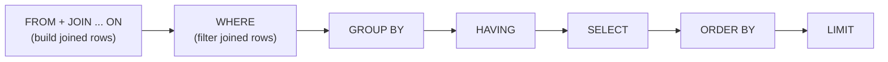

# SQL JOINs

> **Module 03 · Databases** · Prerequisites: [SQL DML](09-SQL-DML.md) · Next: [Subqueries](11-Subqueries.md)

---

## ⏱ If You Only Have 2 Minutes

- `INNER JOIN` keeps only rows that match on both sides. `LEFT JOIN` keeps every left row and fills missing right columns with `NULL`. `FULL JOIN` keeps unmatched rows from both sides. `CROSS JOIN` pairs every row with every row.
- **The ON vs WHERE trap:** a condition on the right table placed in `WHERE` (`WHERE o.status = 'paid'`) removes the `NULL`-extended rows and silently turns a `LEFT JOIN` into an inner join. Put it in `ON` instead.
- With a `LEFT JOIN`, count the right side with `count(o.id)`, not `count(*)`. `count(*)` returns 1 for a customer with no orders.
- **Fan-out:** joining two independent one-to-many tables (items *and* payments of an order) multiplies rows, so `SUM`s come out 2×, 3×, n× too big. Aggregate each child table first, then join.
- Anti-join ("rows with no match"): `LEFT JOIN ... WHERE right.pk IS NULL` or `NOT EXISTS`. Test a column that can never be `NULL` in a real match, such as the primary key.
- PostgreSQL picks one of three join algorithms: **nested loop** (small outer side, index on the inner side), **hash join** (equality, large unsorted inputs), **merge join** (both inputs sorted). Hash and merge joins only work for equality conditions.
- Always know the cardinality before you join: 1:1, 1:N or N:M. It tells you how many rows come out.

---

## 1. What It Is and Why It Exists

A **join** combines rows from two tables into one result row whenever a condition between them is true. Normalized schemas split facts into separate tables — a customer lives in `customers`, their orders in `orders`, the lines of each order in `order_items`. Joins put them back together at read time.

**Analogy:** two printed lists on a desk — guests and table assignments. An inner join is "everyone who has a table". A left join is "every guest, with their table if they have one, otherwise a blank". A full join adds "tables nobody sat at". A cross join is "every guest at every table", which is only useful when you really want all combinations.

**The problem it solves.** Without joins you fetch customers, then loop and fetch orders per customer — the N+1 query pattern, one round trip per row. A join answers the question in one query and lets the database choose the fastest way to match rows.

**What goes wrong.** Joins are easy to write and easy to get silently wrong. The query runs, returns numbers, and the numbers are wrong: customers vanish because a filter sat in the wrong clause, or revenue doubles because two one-to-many joins multiplied each other. Most of this chapter is about those two traps.

---

## 2. How It Works

### Logical order of a query

SQL is written `SELECT ... FROM ... WHERE`, but it is *evaluated* (logically) in a different order. Knowing it explains the ON vs WHERE trap.



The `ON` condition decides **which rows match** while the join is built. For a `LEFT JOIN`, a left row with no match still survives, padded with `NULL`s. `WHERE` runs **afterwards** on the finished rows. A `WHERE` test on a right-table column is never true for those `NULL`-padded rows, so they disappear.

### The ON vs WHERE trap

Goal: every German customer and their number of paid orders, including customers with zero.

```sql
-- WRONG: customers without a paid order disappear
SELECT c.id, c.name, count(o.id) AS paid_orders
FROM customers c
LEFT JOIN orders o ON o.customer_id = c.id
WHERE c.country = 'DE'
  AND o.status = 'paid'          -- NULL for unmatched customers → row removed
GROUP BY c.id;

-- RIGHT: the right-side filter belongs in ON
SELECT c.id, c.name, count(o.id) AS paid_orders
FROM customers c
LEFT JOIN orders o
       ON o.customer_id = c.id
      AND o.status = 'paid'
WHERE c.country = 'DE'           -- filters on the LEFT table stay in WHERE
GROUP BY c.id;
```

Illustrative output of the right query:

| id | name | paid_orders |
|---|---|---|
| 1 | Anna | 3 |
| 2 | Jonas | 0 |
| 5 | Lea | 1 |

The wrong query returns only Anna and Lea. PostgreSQL even notices the `WHERE o.status = 'paid'` rejects `NULL`s and quietly plans it as an inner join — a useful hint when you read `EXPLAIN` output.

Rule of thumb for `LEFT JOIN`: conditions on the **right** table go in `ON`; conditions on the **left** table go in `WHERE`. The only right-table test that belongs in `WHERE` is `IS NULL`, for an anti-join. For an `INNER JOIN`, `ON` and `WHERE` give the same result; put join keys in `ON` and filters in `WHERE` for readability.

### Fan-out (row multiplication)

`orders` has two independent child tables: `order_items` and `payments`. Joining both to one order produces every *combination* of an item and a payment.

```sql
-- WRONG: order 42 has 3 items and 2 payments → 3 × 2 = 6 joined rows
SELECT o.id,
       sum(oi.quantity)      AS units,
       sum(p.amount_cents)   AS paid_cents
FROM orders o
JOIN order_items oi ON oi.order_id = o.id
LEFT JOIN payments p ON p.order_id = o.id
WHERE o.id = 42
GROUP BY o.id;
```

Illustrative output (true values: 4 units, 5,000 cents paid):

| id | units | paid_cents |
|---|---|---|
| 42 | 8 | 15000 |

Each item row was repeated once per payment (units × 2), and each payment once per item (paid × 3). Nothing errors. The fix is to reduce each child to **one row per order** before joining:

```sql
SELECT o.id, i.units, coalesce(p.paid_cents, 0) AS paid_cents
FROM orders o
JOIN (SELECT order_id, sum(quantity) AS units
        FROM order_items GROUP BY order_id) i ON i.order_id = o.id
LEFT JOIN (SELECT order_id, sum(amount_cents) AS paid_cents
             FROM payments WHERE status = 'captured' GROUP BY order_id) p ON p.order_id = o.id
WHERE o.id = 42;
```

`count(DISTINCT ...)` hides the symptom for counts but not for sums, and it is slower. Pre-aggregating is the real fix. A `LATERAL` subquery per order also works ([Subqueries](11-Subqueries.md)).

---

## 3. Key Concepts

### Join types

| Join | Keeps | Typical use on the sample schema |
|---|---|---|
| `[INNER] JOIN` | Only matching pairs | Order lines with their product names |
| `LEFT [OUTER] JOIN` | All left rows; right columns `NULL` if no match | Every customer with their orders, including customers with none |
| `RIGHT [OUTER] JOIN` | All right rows | Same as a `LEFT JOIN` with the tables swapped; most teams write only `LEFT` |
| `FULL [OUTER] JOIN` | All rows from both sides | Reconciliation: paid orders vs captured payments |
| `CROSS JOIN` | Every combination (rows × rows) | A grid of every day × every category for a report |
| Self join | A table joined to itself with aliases | Possible duplicate orders by the same customer |

`USING (col)` is shorthand for `ON a.col = b.col` and outputs the column once. `NATURAL JOIN` joins on *every* column with the same name, so adding a `created_at` column to both tables later silently changes the result. Avoid it.

### Anti-join and semi-join

- **Semi-join:** "customers who have at least one order". Each customer appears once, however many orders match. Write it with `EXISTS` — a plain join would repeat the customer once per order.
- **Anti-join:** "products that were never ordered".

```sql
SELECT p.id, p.sku
FROM products p
LEFT JOIN order_items oi ON oi.product_id = p.id
WHERE oi.product_id IS NULL;    -- a column that is never NULL in a real match
```

PostgreSQL plans this as a `Hash Anti Join`, the same as `NOT EXISTS`. Both are covered in [EXISTS vs IN](12-EXISTS-vs-IN.md), including why `NOT IN` is the wrong tool.

### Full outer join for reconciliation

```sql
SELECT coalesce(o.id, p.order_id) AS order_id, o.total_cents, p.captured_cents
FROM (SELECT id, total_cents FROM orders WHERE status IN ('paid', 'shipped')) o
FULL JOIN (SELECT order_id, sum(amount_cents) AS captured_cents
             FROM payments WHERE status = 'captured'
            GROUP BY order_id) p ON p.order_id = o.id
WHERE o.id IS NULL                       -- money captured for an order not marked paid
   OR p.order_id IS NULL                 -- order marked paid with no captured payment
   OR o.total_cents <> p.captured_cents; -- amounts disagree
```

Every row in the result is a discrepancy for a human or a job to investigate. In PostgreSQL a `FULL JOIN` needs a condition that a merge or hash join can use (an equality); otherwise it fails with "FULL JOIN is only supported with merge-joinable or hash-joinable join conditions".

### Self join

```sql
-- Same customer, two orders less than 2 minutes apart: likely a double submit
SELECT a.customer_id, a.id AS first_id, b.id AS second_id, b.created_at - a.created_at AS gap
FROM orders a
JOIN orders b
  ON b.customer_id = a.customer_id
 AND b.id > a.id                                  -- each pair once, never a row with itself
 AND b.created_at < a.created_at + interval '2 minutes'
 AND b.created_at >= a.created_at
WHERE a.created_at > now() - interval '1 day';
```

The `b.id > a.id` condition matters: without it every row pairs with itself, and every pair appears twice.

### Join algorithms (high level)

| Algorithm | How it works | Good when | Limits |
|---|---|---|---|
| Nested loop | For each outer row, look up matching inner rows | Outer side is small and the inner side has an index on the join key | Very slow if the inner side is scanned fully for each outer row |
| Hash join | Build a hash table on the smaller input, probe it with the other | Large inputs, no useful order, equality condition | Equality only; needs `work_mem`, spills to disk in batches if the hash does not fit |
| Merge join | Walk two inputs sorted on the join key side by side | Both inputs already sorted (an index or an earlier sort) | Equality-style conditions; sorting first can be expensive |

Non-equality conditions such as `b.created_at < a.created_at + interval '2 minutes'` can only run as a nested loop (an index on `(customer_id, created_at)` makes it cheap). The planner also reorders joins freely for inner joins: the order you write tables in does not matter, up to `join_collapse_limit` (8 tables by default). Reading the plan output in detail is [Query Execution Plans](22-Query-Execution-Plans.md).

### NULLs never join

`NULL = NULL` is not true in SQL, so rows with a `NULL` join key never match anything. `payments.provider_ref` is nullable; joining two tables on it drops every payment without a reference. If you really need `NULL`s to match, use `IS NOT DISTINCT FROM`, but it disables hash and merge joins for that condition.

---

## 4. Code Examples

Scenario: an admin API. (1) A leaderboard of customers with their order count and paid revenue, including customers with no orders. (2) One customer's order history as nested JSON: customer → orders → items.

### SQL

```sql
-- The deliberate gap from the README: orders.customer_id has no index.
-- Every per-customer join below needs one.
CREATE INDEX orders_customer_id_idx ON orders (customer_id);

-- (1) Leaderboard: LEFT JOIN + filter in ON + count(o.id)
SELECT c.id, c.name, c.email,
       count(o.id)                     AS paid_orders,
       coalesce(sum(o.total_cents), 0) AS paid_cents
FROM customers c
LEFT JOIN orders o
       ON o.customer_id = c.id
      AND o.status IN ('paid', 'shipped')
WHERE c.country = $1
GROUP BY c.id                         -- c.name, c.email are allowed: c.id is the primary key
ORDER BY paid_cents DESC, c.id
LIMIT $2;

-- (2a) Flat rows: one row per order item, customer and order columns repeated
SELECT c.id AS customer_id, c.name,
       o.id AS order_id, o.status, o.total_cents, o.created_at,
       p.sku, oi.quantity, oi.unit_price_cents
FROM customers c
LEFT JOIN orders o       ON o.customer_id = c.id
LEFT JOIN order_items oi ON oi.order_id = o.id
LEFT JOIN products p     ON p.id = oi.product_id
WHERE c.id = $1
ORDER BY o.created_at DESC, o.id, p.sku;

-- (2b) Same shape built by the database with json_agg (one row, already nested)
SELECT json_build_object(
         'id', c.id::text, 'name', c.name,
         'orders', coalesce((
           SELECT json_agg(json_build_object(
                    'id', o.id::text, 'status', o.status, 'totalCents', o.total_cents,
                    'items', (SELECT json_agg(json_build_object('sku', p.sku, 'quantity', oi.quantity))
                                FROM order_items oi JOIN products p ON p.id = oi.product_id
                               WHERE oi.order_id = o.id))
                  ORDER BY o.created_at DESC)
             FROM orders o WHERE o.customer_id = c.id), '[]'::json)) AS doc
FROM customers c
WHERE c.id = $1;
```

Illustrative flat output of (2a) — note the repeated customer and order columns, which is fan-out you must fold back up in code:

| customer_id | name | order_id | status | sku | quantity |
|---|---|---|---|---|---|
| 1 | Anna | 900 | paid | BK-001 | 1 |
| 1 | Anna | 900 | paid | BK-002 | 2 |
| 1 | Anna | 871 | shipped | MUG-07 | 1 |

In (2b) IDs are cast to text on purpose: `json_agg` emits `bigint` as a JSON number, and JavaScript's `JSON.parse` loses precision above 2^53.

### Node.js / TypeScript

```ts
// npm i express pg && npm i -D @types/express @types/pg   — Node.js 22+, TypeScript 5, ESM
import express from "express";
import pg from "pg";

const pool = new pg.Pool({ connectionString: process.env.DATABASE_URL });
const app = express();

const LEADERBOARD_SQL = `
  SELECT c.id, c.name, c.email,
         count(o.id)                     AS paid_orders,
         coalesce(sum(o.total_cents), 0) AS paid_cents
  FROM customers c
  LEFT JOIN orders o ON o.customer_id = c.id AND o.status IN ('paid', 'shipped')
  WHERE c.country = $1
  GROUP BY c.id
  ORDER BY paid_cents DESC, c.id
  LIMIT $2`;

// count() is bigint and sum(integer) is bigint, so pg hands both back as strings.
interface LeaderboardRow { id: string; name: string; email: string; paid_orders: string; paid_cents: string }

app.get("/admin/customers/leaderboard", async (req, res) => {
  const country = String(req.query.country ?? "");
  if (!/^[A-Z]{2}$/.test(country)) {
    res.status(400).json({ error: "country must be an ISO 3166 alpha-2 code" });
    return;
  }
  const limit = Math.min(Math.max(Math.trunc(Number(req.query.limit)) || 20, 1), 100); // LIMIT -1 is an error

  const { rows } = await pool.query<LeaderboardRow>(LEADERBOARD_SQL, [country, limit]);
  res.json(rows.map((r) => ({
    id: r.id,
    name: r.name,
    email: r.email,
    paidOrders: Number(r.paid_orders),  // safe: far below 2^53
    paidCents: Number(r.paid_cents),
  })));
});

app.listen(3000);
```

Folding the flat rows of query (2a) back into a tree. The `Map` keeps insertion order, so the SQL `ORDER BY` survives:

```ts
interface FlatRow {
  customer_id: string; name: string;
  order_id: string | null; status: string | null; total_cents: number | null; created_at: Date | null;
  sku: string | null; quantity: number | null; unit_price_cents: number | null;
}
interface Item { sku: string; quantity: number; unitPriceCents: number }
interface Order { id: string; status: string; totalCents: number; createdAt: Date; items: Item[] }
interface CustomerHistory { id: string; name: string; orders: Order[] }

export function toHistory(rows: FlatRow[]): CustomerHistory | null {
  if (rows.length === 0) return null; // customer does not exist
  const orders = new Map<string, Order>();
  for (const r of rows) {
    // LEFT JOIN: a customer with no orders yields one row whose order columns are all NULL.
    if (r.order_id === null) continue;
    let order = orders.get(r.order_id);
    if (!order) {
      order = { id: r.order_id, status: r.status!, totalCents: r.total_cents!, createdAt: r.created_at!, items: [] };
      orders.set(r.order_id, order);
    }
    if (r.sku !== null) {
      order.items.push({ sku: r.sku, quantity: r.quantity!, unitPriceCents: r.unit_price_cents! });
    }
  }
  return { id: rows[0].customer_id, name: rows[0].name, orders: [...orders.values()] };
}
```

### Python

```python
# pip install fastapi "psycopg[binary]" psycopg-pool   — Python 3.12+
from contextlib import asynccontextmanager
from typing import Annotated

from fastapi import FastAPI, Query
from psycopg.rows import dict_row
from psycopg_pool import AsyncConnectionPool
from pydantic import BaseModel

pool = AsyncConnectionPool(open=False, kwargs={"row_factory": dict_row})

LEADERBOARD_SQL = """
    SELECT c.id, c.name, c.email,
           count(o.id)                     AS paid_orders,
           coalesce(sum(o.total_cents), 0) AS paid_cents
    FROM customers c
    LEFT JOIN orders o ON o.customer_id = c.id AND o.status IN ('paid', 'shipped')
    WHERE c.country = %(country)s
    GROUP BY c.id
    ORDER BY paid_cents DESC, c.id
    LIMIT %(limit)s
"""


class LeaderboardEntry(BaseModel):
    id: int          # psycopg returns bigint as int: no string juggling like in pg
    name: str
    email: str
    paid_orders: int
    paid_cents: int


@asynccontextmanager
async def lifespan(_: FastAPI):
    await pool.open()
    yield
    await pool.close()


app = FastAPI(lifespan=lifespan)


@app.get("/admin/customers/leaderboard")
async def leaderboard(
    country: Annotated[str, Query(pattern=r"^[A-Z]{2}$")],
    limit: Annotated[int, Query(ge=1, le=100)] = 20,
) -> list[LeaderboardEntry]:
    async with pool.connection() as conn:
        cur = await conn.execute(LEADERBOARD_SQL, {"country": country, "limit": limit})
        return [LeaderboardEntry(**row) for row in await cur.fetchall()]
```

Folding flat rows from query (2a). `dict.setdefault` plays the role of the `Map` lookup; dicts keep insertion order too:

```python
from datetime import datetime
from typing import Any

from pydantic import BaseModel


class Item(BaseModel):
    sku: str
    quantity: int
    unit_price_cents: int


class Order(BaseModel):
    id: int
    status: str
    total_cents: int
    created_at: datetime
    items: list[Item] = []


class CustomerHistory(BaseModel):
    id: int
    name: str
    orders: list[Order]


def to_history(rows: list[dict[str, Any]]) -> CustomerHistory | None:
    if not rows:
        return None  # customer does not exist
    orders: dict[int, Order] = {}
    for r in rows:
        if r["order_id"] is None:  # LEFT JOIN row for a customer with no orders
            continue
        order = orders.setdefault(
            r["order_id"],
            Order(id=r["order_id"], status=r["status"],
                  total_cents=r["total_cents"], created_at=r["created_at"]),
        )
        if r["sku"] is not None:
            order.items.append(Item(sku=r["sku"], quantity=r["quantity"],
                                    unit_price_cents=r["unit_price_cents"]))
    return CustomerHistory(id=rows[0]["customer_id"], name=rows[0]["name"],
                           orders=list(orders.values()))
```

**Which to choose:** flat rows plus folding in code keep SQL simple and stream well, but repeat the customer and order columns on every item row. `json_agg` (2b) sends exactly the nested shape once, at the cost of harder-to-read SQL and losing column types (everything becomes JSON). Both `pg` and psycopg parse `json` columns into native objects automatically. Pydantic's `items: list[Item] = []` is safe because Pydantic copies mutable defaults per instance, unlike a plain Python default argument.

---

## 5. Production Concerns

- **Index the foreign keys you join on.** PostgreSQL does not index `orders.customer_id` automatically. Without the index, "orders for customer 42" is a sequential scan of `orders`, and a nested loop over 100 customers becomes 100 scans. `order_items` is covered for `order_id` (first column of its primary key) but not for `product_id`, which the "never ordered" anti-join needs.
- **Result size.** Joins can return far more rows than either table has. A missing join condition (`FROM orders, payments` with a typo in `WHERE`) is a cross join: 1 million × 1 million rows. Set `statement_timeout` for API connections so one bad query cannot run for hours.
- **Hash join memory.** Each hash join can use up to `work_mem` (times `hash_mem_multiplier`, 2.0 by default since PostgreSQL 15). If the hash table does not fit, it spills to temporary files. Watch `temp_files` / `temp_bytes` in `pg_stat_database`.
- **Wide flat results over the network.** Repeating a 2 KB customer row for 500 order items transfers about 1 MB for a 2 KB fact. Select only needed columns, use `json_agg`, or run two queries (customer, then its orders with `= ANY($1)`).
- **Pagination with joins.** `LIMIT 20` on a one-to-many join limits *joined rows*, not parents, so a page can end in the middle of an order. Paginate the parent table first (in a subquery or CTE), then join children to that page.
- **Measure.** Compare the row count each join step produces with what you expect from the cardinality; a step with far more rows than expected is fan-out. `EXPLAIN (ANALYZE)` shows the actual rows per node.

---

## 6. Common Mistakes

- **Right-table filter in `WHERE` on a `LEFT JOIN`** — rows with no match disappear and the join behaves as inner — move the filter into `ON`.
- **`count(*)` with a `LEFT JOIN`** — customers with no orders show 1 — count a right-side column, `count(o.id)`.
- **Joining two one-to-many children, then `SUM`** — totals multiplied by the other child's row count — aggregate each child in a subquery first, or use `LATERAL`.
- **Using a join for "has at least one"** — customers repeated once per order, then "fixed" with `DISTINCT` — use `EXISTS` (a semi-join).
- **Anti-join testing a nullable column** — `WHERE p.provider_ref IS NULL` also matches real rows whose `provider_ref` is `NULL` — test the right table's primary key or the join key.
- **`NATURAL JOIN` or `USING` on columns that change** — a new same-named column changes the join condition silently — write explicit `ON` conditions.
- **No index on the join key** — every lookup scans the child table — index foreign-key columns used in joins.

---

## 7. Comparison Table

Ways to load a parent with its children:

| | One query with joins (flat) | One query with `json_agg` | Two queries (parent, then children `= ANY`) | N+1 (query per parent) |
|---|---|---|---|---|
| Round trips | 1 | 1 | 2 | 1 + N |
| Duplicate data on the wire | Parent columns repeated per child | None | None | None |
| Mapping work in app | Fold rows into tree | Parse JSON | Group children by parent ID | Trivial |
| Pagination of parents | Tricky (limit applies to joined rows) | Easy | Easy | Easy |
| Types preserved | Yes | No — everything is JSON | Yes | Yes |
| Typical in | Hand-written SQL | Read APIs returning nested JSON | ORMs ("select in" loading) | Bugs |

---

## 8. Interview Questions

**[Junior] What is the difference between `INNER JOIN` and `LEFT JOIN`?**
An inner join returns only rows that have a match on both sides. A left join returns every row of the left table; when there is no match, the right table's columns are `NULL`. "Customers and their orders" with an inner join drops customers who never ordered; with a left join they appear once with `NULL` order columns.

**[Junior] How do you find customers who have never placed an order?**
An anti-join: `SELECT c.* FROM customers c LEFT JOIN orders o ON o.customer_id = c.id WHERE o.id IS NULL`, or `WHERE NOT EXISTS (SELECT 1 FROM orders o WHERE o.customer_id = c.id)`. Both are planned as an anti-join in PostgreSQL. Avoid `NOT IN (SELECT customer_id FROM orders)`, which returns nothing if that column ever contains a `NULL`.

**[Mid] A `LEFT JOIN` query is returning fewer rows than expected. What do you check first?**
Whether a condition on the right table sits in `WHERE`. `WHERE o.status = 'paid'` is false or unknown for the `NULL`-extended rows, so it removes them and the query acts as an inner join. Move that condition into the `ON` clause. Next, check for a later inner join that requires a right-side column to be non-null, which has the same effect.

**[Mid] Revenue on a report is exactly double for some orders. Why?**
Classic fan-out: the query joins orders to two one-to-many tables, such as items and payments, and sums a column. Every item row is repeated once per payment, so sums scale with the other child's row count. Fix it by aggregating each child to one row per order in a subquery before joining. `DISTINCT` inside `sum` is not a fix, because two different items can have the same amount.

**[Mid] What are hash, merge and nested loop joins?**
Nested loop: for each row of the outer input, look up matches in the inner input, ideally with an index; best when the outer side is small. Hash join: build a hash table from the smaller input and probe it with the larger one; good for big unsorted inputs, but only for equality and it needs memory. Merge join: walk two inputs sorted by the join key in step; good when both are already sorted, for example from indexes. The planner chooses based on estimated row counts.

**[Senior] A query joining 5 tables was fast yesterday and is slow today. How do you approach it?**
Get `EXPLAIN (ANALYZE, BUFFERS)` and compare estimated vs actual rows at each join. A common cause is a bad estimate — for example stale statistics after a bulk load — so the planner chose a nested loop expecting 10 outer rows and got 500,000, with an inner scan per row. Run `ANALYZE` on the affected tables, check for a missing index on the join key, and check whether a parameter value is far more common than average. Fixing the estimate usually fixes the join choice; forcing a plan is a last resort.

**[Senior] When would you join in the application instead of in SQL?**
When the data lives in different databases or services, a SQL join is not possible: fetch one side, then fetch the other with a batched `= ANY($1)` lookup and merge in memory. Even in one database, splitting a wide parent-children join into two queries avoids repeating parent columns and makes parent pagination correct, which is what many ORMs do. Within one database, prefer SQL joins otherwise: the planner has statistics and indexes, and you avoid transferring rows you would discard.

---

## 9. Cheat Sheet

```text
INNER       matches only            LEFT   all left + NULLs     FULL   all both sides
CROSS       rows × rows             SELF   table twice, aliases, b.id > a.id to dedupe pairs
Order       FROM/JOIN ON → WHERE → GROUP BY → HAVING → SELECT → ORDER BY → LIMIT
LEFT rule   right-table filters in ON; left-table filters in WHERE; WHERE right.pk IS NULL = anti-join
Counting    LEFT JOIN → count(right.id), never count(*)
Fan-out     2+ one-to-many joins + SUM = inflated totals → pre-aggregate each child, then join
Semi-join   "has any" → EXISTS, not JOIN + DISTINCT
NULL keys   never match; IS NOT DISTINCT FROM if needed (no hash/merge)
NATURAL     avoid; USING ok when names are stable
Algorithms  nested loop (small outer + index) | hash (equality, big, work_mem) | merge (sorted)
FULL JOIN   needs hash- or merge-joinable (equality) condition in PostgreSQL
Indexes     FK columns are NOT auto-indexed in PostgreSQL → index orders.customer_id
Nested JSON fold flat rows in code or json_agg; cast bigint ids to text for JS clients
```

---

## Related Topics

- [Subqueries](11-Subqueries.md) — derived tables and `LATERAL`, the main fix for fan-out
- [EXISTS vs IN](12-EXISTS-vs-IN.md) — semi-joins and anti-joins in depth
- [Aggregate Functions](13-Aggregate-Functions.md) — `GROUP BY` rules behind the leaderboard query
- [Query Execution Plans](22-Query-Execution-Plans.md) — reading join nodes and row estimates
- [Normalization](06-Normalization.md) — why the data is split into tables that need joining
- [ORM Fundamentals](33-ORM-Fundamentals.md) — how ORMs choose between joins and separate queries
