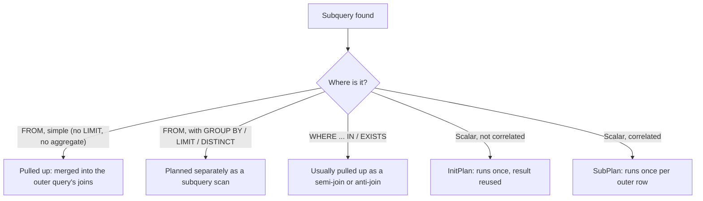

# Subqueries

> **Module 03 · Databases** · Prerequisites: [SQL JOINs](10-SQL-JOINs.md) · Next: [EXISTS vs IN](12-EXISTS-vs-IN.md)

---

## ⏱ If You Only Have 2 Minutes

- A subquery is a `SELECT` inside another statement. By what it returns: **scalar** (one value), **row** (one row, several columns), **table** (any number of rows).
- A scalar subquery that returns two rows is a runtime error: `more than one row returned by a subquery used as an expression`. Zero rows gives `NULL`.
- **Uncorrelated** subqueries run once (an `InitPlan` in `EXPLAIN`). **Correlated** subqueries reference the outer row and conceptually run once per outer row (a `SubPlan`). A correlated scalar subquery in the `SELECT` list over 100,000 rows means 100,000 executions.
- A subquery in `FROM` is a **derived table**. Since PostgreSQL 16 it no longer needs an alias.
- `LATERAL` lets a subquery in `FROM` reference columns of tables to its left. `JOIN LATERAL (... ORDER BY created_at DESC LIMIT 3)` is the standard "top-N per group" query, and with an index on `(customer_id, created_at DESC)` it reads only N rows per group.
- Use `LEFT JOIN LATERAL (...) ON true` to keep outer rows that have no matches.
- Correlated subqueries in the `SELECT` list can usually be rewritten as a join to a pre-aggregated derived table, which turns N small queries into one hash join.
- `EXISTS` / `IN` subqueries in `WHERE` are planned as semi-joins — see [EXISTS vs IN](12-EXISTS-vs-IN.md).

---

## 1. What It Is and Why It Exists

A **subquery** (also called an inner query or sub-select) is a complete `SELECT` statement in parentheses, used inside another query wherever a value, a row, or a table is allowed.

```sql
SELECT id, total_cents
FROM orders
WHERE total_cents > (SELECT avg(total_cents) FROM orders);   -- "orders above average"
```

**Analogy:** asking a colleague a side question while you work. "Which orders are above average?" needs a side answer first: "what is the average?". A *correlated* subquery is like asking the same colleague a fresh question for every row in your list — "what was *this* customer's last order?" — which is fine for ten rows and painful for a million.

**The problem it solves.** Some questions are naturally in two steps: compute something, then use it. Subqueries let you write the second step in terms of the first without a temporary table or a second round trip from the application. They also let you express "per row" logic, such as "the three most recent orders of each customer", which a plain join plus `LIMIT` cannot do — `LIMIT` applies to the whole result, not to each customer.

**The cost.** The same question can be written as a subquery or a join, and the planner does not always treat them the same. Knowing which forms PostgreSQL flattens into joins, and which it runs row by row, is the senior-level part of this topic.

---

## 2. How It Works

### Where a subquery can appear

| Position | Must return | Example |
|---|---|---|
| `SELECT` list | One value (scalar) | `(SELECT max(created_at) FROM orders o WHERE o.customer_id = c.id) AS last_order_at` |
| `FROM` / `JOIN` | A table (derived table) | `FROM (SELECT customer_id, sum(total_cents) AS spent FROM orders GROUP BY customer_id) s` |
| `WHERE` / `HAVING` with `=`, `<`, … | One value, or one row for a row comparison | `WHERE total_cents > (SELECT avg(total_cents) FROM orders)` |
| `WHERE` with `IN`, `EXISTS`, `ANY`, `ALL` | A set of rows | `WHERE EXISTS (SELECT 1 FROM payments p WHERE p.order_id = o.id)` |
| `INSERT ... SELECT`, `UPDATE ... SET col = (...)` | A table, or one value | Copying or recomputing data |

### How PostgreSQL executes them



- **Pull-up** means the planner rewrites the subquery as part of the outer join tree, so it can choose join order and algorithm freely. A simple derived table `FROM (SELECT * FROM orders WHERE status = 'paid') o` behaves exactly as if you had joined `orders` directly.
- An **InitPlan** is computed once before it is needed. `(SELECT avg(total_cents) FROM orders)` scans `orders` once, not once per row.
- A **SubPlan** is re-executed for each outer row with the outer values as parameters. PostgreSQL does not automatically rewrite a correlated scalar subquery in the `SELECT` list into a join. That is your job when it is slow.

Illustrative `EXPLAIN ANALYZE` shape for `SELECT c.id, (SELECT count(*) FROM orders o WHERE o.customer_id = c.id) FROM customers c` on 50,000 customers:

```text
Seq Scan on customers c  (actual rows=50000 loops=1)
  SubPlan 1
    ->  Aggregate  (actual rows=1 loops=50000)
          ->  Index Only Scan using orders_customer_created_id_idx on orders o
                Index Cond: (customer_id = c.id)   (actual rows=12 loops=50000)
```

`loops=50000` is the tell: the inner plan ran once per customer. With the index it is 50,000 cheap lookups; without it, 50,000 scans of `orders`.

---

## 3. Key Concepts

### Scalar, row and table subqueries

```sql
-- Scalar: one column, at most one row. Zero rows → NULL.
SELECT c.id,
       (SELECT max(o.created_at) FROM orders o WHERE o.customer_id = c.id) AS last_order_at
FROM customers c;

-- Row: compare several columns at once
SELECT *
FROM orders
WHERE (customer_id, created_at) = (SELECT customer_id, max(created_at)
                                     FROM orders WHERE customer_id = $1
                                    GROUP BY customer_id);

-- Table: any number of rows and columns, used in FROM or with IN / EXISTS
SELECT s.customer_id, s.spent
FROM (SELECT customer_id, sum(total_cents) AS spent
        FROM orders WHERE status IN ('paid', 'shipped')
       GROUP BY customer_id) AS s
WHERE s.spent > 100000;
```

A scalar subquery without an aggregate is a time bomb: `(SELECT id FROM orders WHERE customer_id = c.id)` works in tests where each customer has one order and fails in production with "more than one row returned". Add an aggregate or `ORDER BY ... LIMIT 1` so the "one row" rule is guaranteed by the query, not by the data.

### Correlated subqueries and their cost

A subquery is **correlated** when it references a column of the outer query (`o.customer_id = c.id`). Its result depends on the outer row, so it cannot be computed once.

Cost model in plain terms: outer rows × cost of one inner execution. That is fine when:

- the outer side is small (a page of 20 customers), and
- each inner execution is an index lookup.

It is bad when the outer side is large or the inner side has no usable index. Two correlated subqueries in the same `SELECT` list over the same child table scan it twice per outer row.

### Rewriting a correlated subquery as a join

```sql
-- Correlated: two SubPlans, each runs once per customer
SELECT c.id, c.name,
       (SELECT count(*)          FROM orders o WHERE o.customer_id = c.id) AS order_count,
       (SELECT sum(total_cents)  FROM orders o WHERE o.customer_id = c.id) AS spent
FROM customers c
WHERE c.country = 'DE';

-- Rewritten: aggregate once, then join (one hash join, one pass over orders)
SELECT c.id, c.name,
       coalesce(s.order_count, 0) AS order_count,
       s.spent
FROM customers c
LEFT JOIN (SELECT customer_id, count(*) AS order_count, sum(total_cents) AS spent
             FROM orders GROUP BY customer_id) s ON s.customer_id = c.id
WHERE c.country = 'DE';
```

Two details make the rewrite correct:

- **`LEFT JOIN`**, because the scalar subquery returned `NULL`/0 for customers with no orders. An inner join would drop them.
- **`coalesce(..., 0)`** for the count: `count(*)` in the scalar form returns `0` for no rows, but the joined derived table has no row at all, so the column is `NULL`.

The rewrite is not always faster. If the outer side is 20 rows, the correlated version does 20 index lookups, while the derived table aggregates *every* order. Measure with `EXPLAIN ANALYZE`; [Query Optimization](23-Query-Optimization.md) covers the method.

### Derived tables

A derived table is a subquery in `FROM`. Use it to:

- aggregate before joining, which avoids fan-out ([SQL JOINs](10-SQL-JOINs.md));
- give a computed column a name you can filter on — you cannot use a `SELECT` alias in the same query's `WHERE`;
- paginate a parent table before joining its children.

```sql
-- Filter on a computed column: wrap it, then filter
SELECT *
FROM (SELECT id, total_cents, total_cents * 0.19 AS vat_cents FROM orders)
WHERE vat_cents > 1000;      -- PostgreSQL 16+: alias optional; older versions need "AS t"
```

A [CTE](15-Common-Table-Expressions.md) (`WITH name AS (...)`) is a named derived table. Since PostgreSQL 12, a CTE referenced once is inlined like a derived table unless you write `MATERIALIZED`.

### `LATERAL` and top-N per group

Normally a subquery in `FROM` cannot see other tables in the same `FROM`. The keyword `LATERAL` removes that restriction: the subquery may reference columns of tables listed **before** it, and it is evaluated once per row of those tables. It is a correlated subquery that returns a *table*.

```sql
-- Latest 3 orders for each customer on the page
SELECT c.id, c.name, o.id AS order_id, o.status, o.created_at
FROM customers c
LEFT JOIN LATERAL (
    SELECT id, status, created_at
    FROM orders
    WHERE orders.customer_id = c.id          -- the lateral reference
    ORDER BY created_at DESC, id DESC
    LIMIT 3
) o ON true
WHERE c.id = ANY($1::bigint[])
ORDER BY c.id, o.created_at DESC;
```

- `CROSS JOIN LATERAL` (or `, LATERAL`) drops customers whose subquery returns no rows. `LEFT JOIN LATERAL ... ON true` keeps them with `NULL`s. `ON true` is needed because `LEFT JOIN` syntax requires a condition; the real condition is inside the subquery.
- With `CREATE INDEX ON orders (customer_id, created_at DESC, id DESC)`, each lateral execution is an index scan that stops after 3 entries. The cost depends on the number of customers, not on how many orders each customer has.
- Set-returning functions in `FROM` are implicitly lateral: `FROM orders o, jsonb_array_elements(o.meta->'tags') t` needs no keyword.

Illustrative output for customers 1 and 2 (customer 2 has no orders):

| id | name | order_id | status | created_at |
|---|---|---|---|---|
| 1 | Anna | 900 | paid | 2026-11-20 10:15 |
| 1 | Anna | 871 | shipped | 2026-11-02 08:01 |
| 1 | Anna | 640 | shipped | 2026-09-14 19:40 |
| 2 | Jonas | NULL | NULL | NULL |

---

## 4. Code Examples

Scenario: a customer list page shows, for each of the 20 customers on the page, their 3 most recent orders. One query, using `LATERAL`, backed by an index.

### SQL

```sql
-- The index that makes each LATERAL execution a short index scan
CREATE INDEX orders_customer_created_id_idx ON orders (customer_id, created_at DESC, id DESC);

-- Variant A: flat rows (one per order), customers without orders kept
SELECT c.id AS customer_id, c.name, o.id AS order_id, o.status, o.total_cents, o.created_at
FROM customers c
LEFT JOIN LATERAL (
    SELECT id, status, total_cents, created_at
    FROM orders
    WHERE customer_id = c.id
    ORDER BY created_at DESC, id DESC
    LIMIT $2
) o ON true
WHERE c.id = ANY($1::bigint[])
ORDER BY c.id, o.created_at DESC, o.id DESC;

-- Variant B: one row per customer, orders already nested as JSON.
-- An aggregate without GROUP BY always returns exactly one row, so CROSS JOIN LATERAL
-- cannot drop a customer here; json_agg over zero rows returns NULL, hence coalesce.
SELECT c.id, c.name, coalesce(r.recent, '[]'::json) AS recent_orders
FROM customers c
CROSS JOIN LATERAL (
    SELECT json_agg(json_build_object('id', o.id::text, 'status', o.status,
                                      'totalCents', o.total_cents, 'createdAt', o.created_at)
                    ORDER BY o.created_at DESC, o.id DESC) AS recent
    FROM (SELECT id, status, total_cents, created_at
            FROM orders
           WHERE customer_id = c.id
           ORDER BY created_at DESC, id DESC
           LIMIT $2) o
) r
WHERE c.id = ANY($1::bigint[])
ORDER BY c.id;
```

Illustrative plan for Variant A with 20 customers:

```text
Nested Loop Left Join  (actual rows=54 loops=1)
  ->  Index Scan using customers_pkey on customers c  (actual rows=20 loops=1)
        Index Cond: (id = ANY ('{...}'::bigint[]))
  ->  Limit  (actual rows=3 loops=20)
        ->  Index Scan using orders_customer_created_id_idx on orders  (actual rows=3 loops=20)
              Index Cond: (customer_id = c.id)
```

`rows=3 loops=20`: each customer reads at most 3 index entries, whether they have 5 orders or 50,000.

### Node.js / TypeScript

```ts
// npm i express pg && npm i -D @types/express @types/pg   — Node.js 22+, TypeScript 5, ESM
import express from "express";
import pg from "pg";

const pool = new pg.Pool({ connectionString: process.env.DATABASE_URL });
const app = express();

const RECENT_ORDERS_SQL = `
  SELECT c.id AS customer_id, c.name, o.id AS order_id, o.status, o.total_cents, o.created_at
  FROM customers c
  LEFT JOIN LATERAL (
      SELECT id, status, total_cents, created_at
      FROM orders
      WHERE customer_id = c.id
      ORDER BY created_at DESC, id DESC
      LIMIT $2
  ) o ON true
  WHERE c.id = ANY($1::bigint[])
  ORDER BY c.id, o.created_at DESC, o.id DESC`;

interface Row {
  customer_id: string; name: string;                    // bigint → string in pg
  order_id: string | null; status: string | null;       // NULL when the customer has no orders
  total_cents: number | null; created_at: Date | null;
}
interface RecentOrder { id: string; status: string; totalCents: number; createdAt: Date }
interface CustomerCard { id: string; name: string; recentOrders: RecentOrder[] }

// GET /customers/cards?ids=1,2,3
app.get("/customers/cards", async (req, res) => {
  const ids = String(req.query.ids ?? "").split(",").filter((s) => /^\d{1,18}$/.test(s));
  if (ids.length === 0 || ids.length > 100) {
    res.status(400).json({ error: "ids must contain 1-100 numeric ids" });
    return;
  }

  // One array parameter, whatever the number of ids: the SQL text never changes.
  const { rows } = await pool.query<Row>(RECENT_ORDERS_SQL, [ids, 3]);

  const cards = new Map<string, CustomerCard>();
  for (const r of rows) {
    let card = cards.get(r.customer_id);
    if (!card) {
      card = { id: r.customer_id, name: r.name, recentOrders: [] };
      cards.set(r.customer_id, card);
    }
    if (r.order_id !== null) {
      card.recentOrders.push({ id: r.order_id, status: r.status!, totalCents: r.total_cents!, createdAt: r.created_at! });
    }
  }
  res.json([...cards.values()]);
});

app.listen(3000);
```

### Python

```python
# pip install fastapi "psycopg[binary]" psycopg-pool   — Python 3.12+
from contextlib import asynccontextmanager
from datetime import datetime
from typing import Annotated

from fastapi import FastAPI, HTTPException, Query
from psycopg.rows import class_row
from psycopg_pool import AsyncConnectionPool
from pydantic import BaseModel, ConfigDict
from pydantic.alias_generators import to_camel

RECENT_ORDERS_JSON_SQL = """
    SELECT c.id, c.name, coalesce(r.recent, '[]'::json) AS recent_orders
    FROM customers c
    CROSS JOIN LATERAL (
        SELECT json_agg(json_build_object('id', o.id::text, 'status', o.status,
                                          'totalCents', o.total_cents, 'createdAt', o.created_at)
                        ORDER BY o.created_at DESC, o.id DESC) AS recent
        FROM (SELECT id, status, total_cents, created_at FROM orders
               WHERE customer_id = c.id
               ORDER BY created_at DESC, id DESC
               LIMIT %(per_customer)s) o
    ) r
    WHERE c.id = ANY(%(ids)s)
    ORDER BY c.id
"""


class CamelModel(BaseModel):
    # JSON from json_build_object uses camelCase keys; Python code uses snake_case names.
    model_config = ConfigDict(alias_generator=to_camel, populate_by_name=True)


class RecentOrder(CamelModel):
    id: int                # the SQL sent it as text; Pydantic converts "900" → 900
    status: str
    total_cents: int
    created_at: datetime   # ISO string inside JSON → datetime


class CustomerCard(CamelModel):
    id: int
    name: str
    recent_orders: list[RecentOrder]  # psycopg already parsed the json column into dicts


pool = AsyncConnectionPool(open=False)


@asynccontextmanager
async def lifespan(_: FastAPI):
    await pool.open()
    yield
    await pool.close()


app = FastAPI(lifespan=lifespan)


@app.get("/customers/cards")
async def customer_cards(ids: Annotated[list[int], Query()]) -> list[CustomerCard]:
    if not ids or len(ids) > 100:
        raise HTTPException(400, "ids must contain 1-100 ids")
    async with pool.connection() as conn:
        # class_row builds Pydantic models straight from the result rows.
        async with conn.cursor(row_factory=class_row(CustomerCard)) as cur:
            # psycopg turns the Python list into a PostgreSQL array for = ANY(...).
            await cur.execute(RECENT_ORDERS_JSON_SQL, {"ids": ids, "per_customer": 3})
            return await cur.fetchall()
```

**Why the two versions differ:** the TypeScript version takes flat rows and folds them, so column types stay native (`created_at` arrives as a `Date`). The Python version lets PostgreSQL nest the data with `json_agg` and lets Pydantic validate and convert the JSON, including parsing `createdAt` strings back into `datetime`. Both are one round trip; the JSON variant sends each customer's columns once instead of once per order. In FastAPI, repeat the parameter for lists: `?ids=1&ids=2`.

---

## 5. Production Concerns

- **Index the correlation column.** Every correlated subquery and `LATERAL` join turns into "per outer row, look up by `customer_id`". Without an index on it, each lookup scans the child table, and cost becomes outer rows × table size.
- **Bound the outer side.** A `LATERAL` top-N is great for a page of 20 customers and wasteful for "all 2 million customers"; for whole-table reports, a [window function](14-Window-Functions.md) with `row_number()` and one pass over `orders` is usually cheaper. Always paginate or limit the outer query in API paths.
- **Scalar subqueries that "can't" return two rows.** They fail at runtime when data changes, for example when a customer gets a second address. Make the single-row guarantee part of the query (`LIMIT 1` with a deterministic `ORDER BY`, or an aggregate), or back it with a unique constraint.
- **Watch `loops=` in plans.** A `SubPlan` with a large loop count and a sequential scan inside is the most common subquery performance bug. Track slow statements with `pg_stat_statements`, then check the plan.
- **Deterministic ordering.** `ORDER BY created_at DESC LIMIT 3` is not deterministic when two orders share a timestamp. Add a unique tie-breaker (`id DESC`) so pages and caches are stable — and include it in the index.
- **`json_agg` result size.** Nesting everything into one JSON value per parent is convenient, but a parent with 10,000 children becomes one huge value in memory on both server and client. Keep the `LIMIT` inside the lateral subquery.

---

## 6. Common Mistakes

- **Scalar subquery without an aggregate or `LIMIT 1`** — "more than one row returned by a subquery used as an expression" once real data arrives — guarantee one row in the query or with a unique constraint.
- **Several correlated subqueries over the same child table in one `SELECT`** — the child is read once per subquery per outer row — compute them together in one derived table or one `LATERAL` subquery.
- **Rewriting a correlated subquery with an inner join** — parents with no children disappear and counts become `NULL` — use `LEFT JOIN` and `coalesce(count, 0)`.
- **Top-N per group with a plain `LIMIT`** — `ORDER BY created_at DESC LIMIT 3` returns 3 orders in total, not 3 per customer — use `LATERAL` or a window function.
- **`CROSS JOIN LATERAL` when parents without children must stay** — they vanish — use `LEFT JOIN LATERAL ... ON true`.
- **Filtering on a `SELECT` alias in the same query's `WHERE`** — "column does not exist", because `WHERE` runs before `SELECT` — wrap the query in a derived table or repeat the expression.
- **Assuming `NOT IN (subquery)` is safe** — it returns no rows if the subquery yields a `NULL` — use `NOT EXISTS` ([EXISTS vs IN](12-EXISTS-vs-IN.md)).

---

## 7. Comparison Table

Top-N per group ("latest 3 orders per customer"):

| | `LATERAL` + `LIMIT` | Window function `row_number()` | Correlated scalar subquery | `DISTINCT ON` |
|---|---|---|---|---|
| N per group | Any N | Any N | Only 1 value per column | Only 1 row |
| Work done | One index probe of N rows per outer row | Reads and ranks all candidate rows, then filters | One execution per outer row per column | Reads all candidate rows in sorted order, keeps the first per group |
| Best when | Few outer rows, many children each, matching index | Report over most of the table | Need one extra value for a small page | Top-1 per group, PostgreSQL only |
| Keeps parents with no children | With `LEFT JOIN LATERAL ... ON true` | Only if you outer-join the parents | Yes (`NULL`) | Only if you outer-join the parents |
| Portability | PostgreSQL, MySQL 8.0.14+, Oracle 12c+; SQL Server uses `APPLY` | Standard SQL | Standard SQL | PostgreSQL only |

---

## 8. Interview Questions

**[Junior] What is the difference between a correlated and an uncorrelated subquery?**
An uncorrelated subquery does not refer to the outer query, so it can be computed once and its result reused — for example, the overall average order value. A correlated subquery refers to a column of the outer row, such as `o.customer_id = c.id`, so its result changes per row and it is executed once per outer row. That makes it cheap for a small outer set with an index, and expensive for a large one.

**[Junior] What happens if a scalar subquery returns no rows, or two rows?**
No rows: the value is `NULL`. Two or more rows: the whole query fails with "more than one row returned by a subquery used as an expression". So a scalar subquery should be shaped to return one row by construction, with an aggregate or `ORDER BY ... LIMIT 1`.

**[Mid] What is a `LATERAL` join and when do you need it?**
`LATERAL` allows a subquery in `FROM` to reference columns from tables earlier in the same `FROM`, and it runs once per row of those tables. You need it when the inner query depends on each outer row and returns more than one value or row — the classic case is "top N orders per customer" with `ORDER BY ... LIMIT N` inside. Use `LEFT JOIN LATERAL ... ON true` to keep outer rows with no results.

**[Mid] How would you rewrite a slow correlated subquery?**
Turn it into a join against a derived table that computes the value for all keys at once: `LEFT JOIN (SELECT customer_id, count(*) ... GROUP BY customer_id) s ON s.customer_id = c.id`. Keep it a left join and `coalesce` counts to 0 so parents with no children behave the same. This turns N executions into one aggregation and one hash join, which wins when the outer side is large.

**[Mid] Can you reference a column alias from `SELECT` in `WHERE`?**
No. `WHERE` is evaluated before `SELECT` in SQL's logical order, so the alias does not exist yet. Either repeat the expression or wrap the query in a derived table or CTE and filter in the outer query. PostgreSQL does allow output aliases in `ORDER BY` and `GROUP BY`.

**[Senior] `LATERAL` top-N vs a window function: how do you choose?**
`LATERAL` with `LIMIT N` and an index on `(group_key, sort_key)` does a few index reads per group, so its cost scales with the number of groups you ask for. A window function ranks all candidate rows and then filters `rn <= N`, so its cost scales with total rows. For an API page of 20 customers with thousands of orders each, `LATERAL` wins by orders of magnitude. For a nightly report over every customer, the window function's single sequential pass and hash or sort is often cheaper than millions of index probes. I would check both with `EXPLAIN ANALYZE` on production-sized data.

**[Senior] A report query uses three correlated subqueries in the `SELECT` list and got slow as data grew. Walk through the fix.**
`EXPLAIN ANALYZE` will show three `SubPlan`s, each with loops equal to the outer row count, possibly with sequential scans inside. First check that the correlation column is indexed; that alone can be enough. If the outer side is large, compute all three values in one derived table grouped by the key (or one `LATERAL` subquery returning three columns), left-join it once, and `coalesce` counts. Verify the results match on a sample before switching, because `NULL` vs `0` differences are the usual regression.

---

## 9. Cheat Sheet

```text
Scalar        1 col, ≤1 row; 0 rows → NULL; 2 rows → runtime error → use agg or LIMIT 1
Row           (a, b) = (SELECT x, y ...)
Table         FROM (SELECT ...) [alias optional in PG16+]  |  IN / EXISTS (SELECT ...)
Uncorrelated  runs once → InitPlan
Correlated    references outer row → SubPlan, loops = outer rows; needs index on correlation col
Rewrite       correlated → LEFT JOIN (SELECT key, agg ... GROUP BY key) + coalesce(count, 0)
LATERAL       FROM subquery may use earlier tables' columns; runs per outer row
Top-N/group   LEFT JOIN LATERAL (... WHERE fk = p.id ORDER BY ts DESC, id DESC LIMIT N) x ON true
              index (fk, ts DESC, id DESC) → reads N entries per group
CROSS vs LEFT CROSS JOIN LATERAL drops parents with no rows; LEFT ... ON true keeps them
SRFs          functions in FROM (unnest, jsonb_array_elements) are implicitly LATERAL
Alias rule    no SELECT aliases in WHERE/HAVING; wrap in derived table or CTE
CTE           PG12+: single-use CTE inlined like a derived table unless MATERIALIZED
EXISTS/IN     semi-joins → chapter 12; NOT IN + NULL = no rows
```

---

## Related Topics

- [SQL JOINs](10-SQL-JOINs.md) — the joins that subqueries are often rewritten into
- [EXISTS vs IN](12-EXISTS-vs-IN.md) — subqueries in `WHERE`, semi-joins and the `NOT IN` trap
- [Window Functions](14-Window-Functions.md) — the other way to do top-N per group
- [Common Table Expressions](15-Common-Table-Expressions.md) — named subqueries and recursion
- [Composite Indexes](20-Composite-Indexes.md) — the `(customer_id, created_at DESC, id DESC)` index behind `LATERAL`
- [Query Execution Plans](22-Query-Execution-Plans.md) — reading `InitPlan`, `SubPlan` and `loops`
