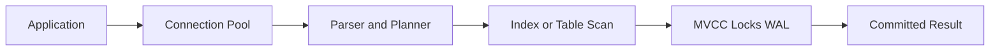
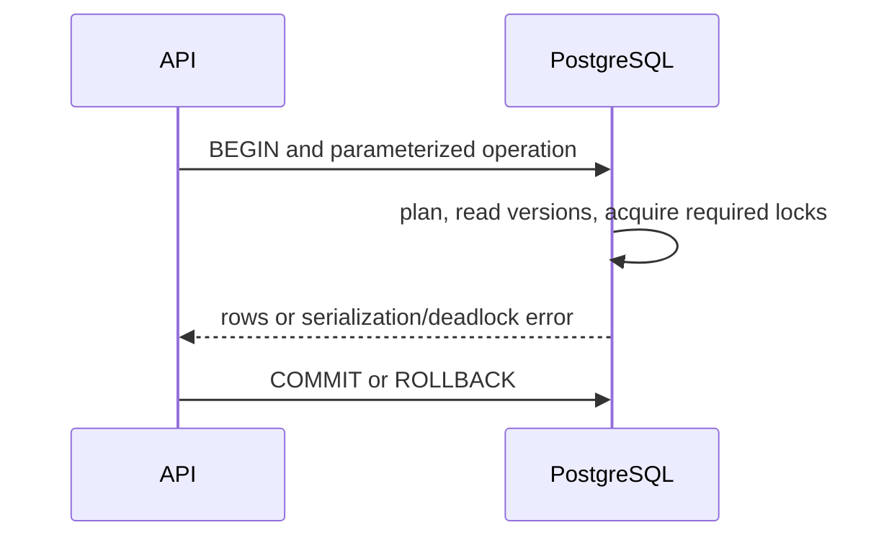

# Subqueries

---

# ⏱ If You Only Have 2 Minutes

- Choose a datastore from correctness, access patterns, latency, operations, and cost—not popularity.
- Schema design starts with ownership, cardinality, and invariants.
- Normalization reduces update anomalies; denormalization buys read speed at consistency cost.
- Measure production-shaped workloads before changing the data model.
- The database is a shared concurrent system: correctness and performance are linked.
- In interviews, explain the invariant, query shape, concurrency behavior, and evidence from execution plans/metrics.

---

# Simple Explanation

Subqueries is about making stored data useful without making it wrong or slow. A database is like a busy library: many people read and change the same books. The design must make the correct book easy to find, prevent contradictory updates, and still work when many people arrive at once.

---

# 1. What is it?

Subqueries covers the decisions and mechanics behind **subqueries**. Its job is to protect data invariants while making common reads and writes affordable. The best design begins with questions: who owns this data, how is it queried, which facts must be atomic, and what failure can the product tolerate?

# 2. Why do we need it?

Without a deliberate data design, failures are predictable:

- Queries scan growing tables and become slow only at production volume.
- Concurrent updates overwrite or contradict each other.
- A denormalized value becomes stale because no one owns its update path.
- A migration locks a table or breaks an older application version.

The database is often the final authority for a business fact. Use its constraints, transactions, and durable logs rather than trusting a request-local check.

# 3. How does it work?

1. The application borrows a bounded connection from a pool.
2. It sends parameterized SQL or a database command with a timeout.
3. The parser and planner select a physical plan from statistics and available indexes.
4. The executor reads/writes pages while MVCC and locks enforce concurrency rules.
5. For writes, the WAL makes recovery possible before a commit is acknowledged.
6. The application maps a classified result into its API or worker contract.



# 4. Internal Workflow

The logical query is not the physical work. PostgreSQL can use a sequential scan, index scan, bitmap scan, hash join, nested loop, sort, or aggregation strategy. Its choice depends on table statistics, predicates, cardinality estimates, memory settings, indexes, and data distribution.

For concurrent writes, PostgreSQL uses MVCC: readers normally see a consistent version without blocking writers, but conflicting writes and explicit locks still wait. Under stronger isolation, a transaction may be aborted to preserve a guarantee. Treat that abort as a retryable business workflow, not as an impossible database error.



# 5. Important Concepts

## Invariant
A fact that must remain true: an account cannot have a negative balance, an email is unique, or an order state transition is valid. Put invariants in constraints and transactions whenever possible.

## Cardinality
The number of rows/documents matched or produced. Wrong cardinality creates slow plans and duplicate join results. Always ask “one-to-one, one-to-many, or many-to-many?”

## Selectivity
How much a predicate filters. Highly selective predicates benefit more from ordinary B-tree indexes than predicates matching most rows.

## Query shape
The columns filtered, joined, sorted, and returned. Index design follows the real query shape, not column names in isolation.

## Consistency boundary
The scope in which readers and writers agree. A local transaction is easier than a cross-service workflow; do not claim global atomicity without a real protocol and recovery plan.

# 6. Real Backend Examples

```python
async def reserve_inventory(conn, sku: str, quantity: int) -> bool:
    async with conn.transaction():
        row = await conn.fetchrow(
            """
            UPDATE inventory
            SET available = available - $2
            WHERE sku = $1 AND available >= $2
            RETURNING available
            """,
            sku, quantity,  # Bound parameters prevent SQL injection.
        )
        return row is not None  # The check and update are one atomic statement.
```

This is safer than `SELECT available`, checking in Python, then issuing `UPDATE`: two requests can observe the same stock before either writes. Keep the transaction short, set a statement timeout, and return a conflict/availability result rather than an internal database message.

| Choice | Best for | Cost/risk |
|---|---|---|
| Normalized tables | Strong invariants and frequent writes | More joins |
| Denormalized projection | Read-heavy known views | Invalidation and stale copies |
| Offset pagination | Small stable admin lists | Deep scans and page drift |
| Cursor pagination | Large changing feeds | Requires stable ordering/index |
| Optimistic concurrency | Low contention | Caller must retry conflict |
| Pessimistic locking | High-value contested records | Lock waits and deadlocks |

# 7. Common Mistakes

- **Adding an index without an execution plan.** It may not match the predicate/order or may harm writes.
- **Using `SELECT *`.** It couples callers to schema, transfers unnecessary data, and can defeat covering-index benefits.
- **Holding transactions across HTTP calls.** It increases contention and can create deadlocks.
- **Assuming an ORM removes SQL knowledge.** ORMs still emit queries, run transactions, and can create N+1 reads.
- **Applying migrations as one destructive change.** Use expand/backfill/contract for rolling deployments.

# 8. Comparison Table

| Concern | Weak approach | Strong approach |
|---|---|---|
| Query tuning | Guess an index | Inspect `EXPLAIN (ANALYZE, BUFFERS)` on representative data |
| Concurrency | Read then write in app | Constraint, atomic update, or explicit transaction rule |
| Pagination | Deep `OFFSET` | Keyset cursor plus matching index |
| Migration | Deploy breaking schema and code together | Backward-compatible expand/contract rollout |
| Cache | Treat cache as truth | Keep database invariant; define TTL/invalidation/rebuild |

# 9. Things I Must Remember

- Choose a datastore from correctness, access patterns, latency, operations, and cost—not popularity.
- Schema design starts with ownership, cardinality, and invariants.
- Normalization reduces update anomalies; denormalization buys read speed at consistency cost.
- Measure production-shaped workloads before changing the data model.
- Parameters protect SQL values; identifiers need allowlisted construction.
- A unique constraint is stronger than “we checked first.”
- B-tree indexes help equality, range, and ordered access; column order matters.
- Indexes speed reads and slow writes.
- Statistics influence plans; stale statistics create bad estimates.
- Explain actual rows, loops, timing, and buffers.
- Short transactions reduce lock duration.
- Deadlocks must be retried at the transaction boundary.
- Serializable transactions can fail and must be retried.
- Never expose raw database errors to API clients.
- Back up data and prove restores.
- Measure connection pool saturation, slow queries, lock waits, replication lag, and cache hit rate.

# 10. Interview Questions

**Q: How do you decide whether to add an index?**  
Start from a slow, frequent, or SLO-critical query; inspect its plan and data distribution; propose an index matching filtering and ordering; measure read improvement and write/storage cost.

**Q: Why can a transaction still fail after correct code?**  
Concurrency can cause deadlock or serialization conflict. The database preserves correctness by aborting one transaction; the application retries the complete idempotent unit with a bounded policy.

**Q: When do you denormalize?**  
When measured read cost or access patterns justify duplicated data and the team can name the owner, update mechanism, stale-read tolerance, reconciliation method, and operational metrics.

# 11. Cheat Sheet

- Model ownership and invariants first.
- Use constraints for durable rules.
- Bind parameters; set timeouts.
- Inspect query plans, not guesses.
- Index actual filter/order shapes.
- Keep transactions short.
- Retry serialization/deadlock failures safely.
- Use cursor pagination for large mutable feeds.
- Avoid N+1 queries.
- Migrate with expand/backfill/contract.
- Monitor pools, locks, plans, lag, and storage.
- Test restore and reconciliation.

## Related Topics

Study these next:

- [SQL JOINs](10-SQL-JOINs.md)
- [EXISTS vs IN](12-EXISTS-vs-IN.md)
