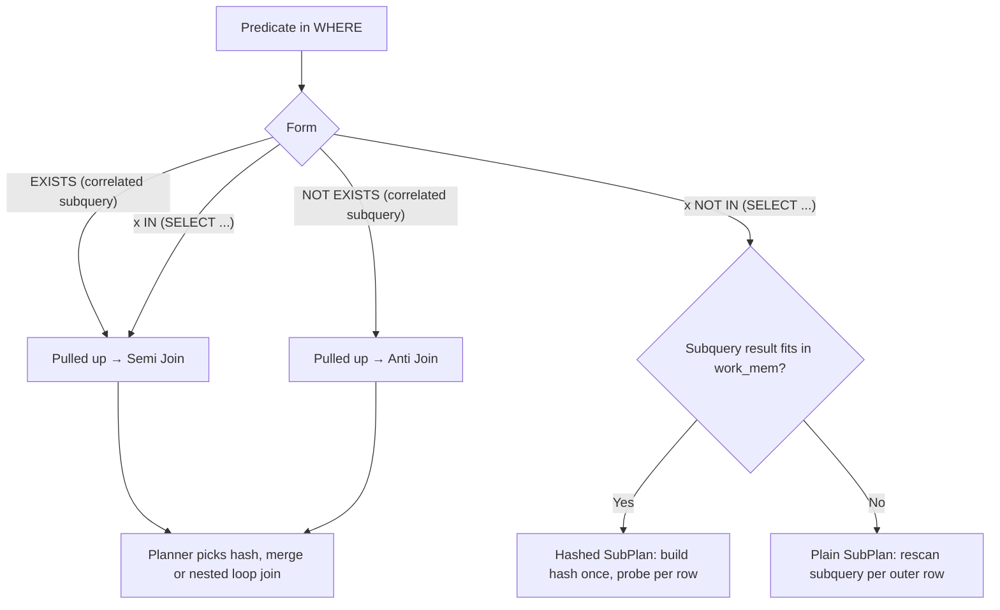

# EXISTS vs IN

> **Module 03 · Databases** · Prerequisites: [Subqueries](11-Subqueries.md) · Next: [Aggregate Functions](13-Aggregate-Functions.md)

---

## ⏱ If You Only Have 2 Minutes

- A **semi-join** returns each outer row at most once if it has *at least one* match. An **anti-join** returns outer rows that have *no* match. `EXISTS` / `IN` express semi-joins; `NOT EXISTS` expresses anti-joins.
- `EXISTS (subquery)` is true if the subquery returns any row. It never returns `NULL`. The subquery's select list is ignored — `SELECT 1` is a convention.
- `IN` is `= ANY`: true if equal to some value, `NULL` if no value is equal but a `NULL` is present, false otherwise.
- **The `NOT IN` trap:** if the subquery returns even one `NULL`, `x NOT IN (...)` is never true, so the query returns **no rows**. `NOT EXISTS` does not have this problem. Use `NOT EXISTS` for anti-joins.
- Modern PostgreSQL plans `IN (subquery)` and `EXISTS` the same way: as a semi-join (hash, merge or nested loop). "EXISTS is faster than IN" is folklore from older optimizers. `NOT IN` is different: PostgreSQL cannot turn it into an anti-join, so it can be much slower.
- From app code, pass a list as **one array parameter**: `WHERE id = ANY($1::bigint[])` in `pg`, `= ANY(%s)` with a Python list in psycopg 3. Never build `IN (1, 2, 3)` strings. An empty array matches nothing; an empty `IN ()` is a syntax error.
- For very large lists (tens of thousands of IDs and up), join to `unnest($1::bigint[])`, or `COPY` the IDs into a temp table, `ANALYZE` it, and join.

---

## 1. What It Is and Why It Exists

Many questions are about whether something **exists** in another table, not about its columns:

- customers who placed at least one order;
- orders that have no captured payment;
- products in a given list of IDs.

A plain join answers the first one badly: a customer with 12 orders comes back 12 times, and you then add `DISTINCT` to undo damage you did not need to do. SQL has dedicated forms for "has a match" (**semi-join**) and "has no match" (**anti-join**): `EXISTS`, `IN`, `NOT EXISTS`, and `NOT IN`.

**Analogy:** a club door. A semi-join is the bouncer checking "is this name on the guest list?" — you get in once, no matter how many times your name is written there. An anti-join is "let in everyone *not* on the banned list". The `NOT IN` trap is a banned list with one smudged, unreadable name on it: the bouncer cannot be sure anyone is not that person, so he lets nobody in.

**Why it matters:** these four forms look interchangeable, but they treat `NULL` differently and are planned differently. One of them (`NOT IN`) can return an empty result for a correct-looking query, and can be orders of magnitude slower. The other half of this chapter is the application side: how to pass a list of IDs from TypeScript or Python safely and efficiently.

---

## 2. How It Works

### Semantics with three-valued logic

SQL comparisons return `true`, `false` or `NULL` (unknown). `WHERE` keeps a row only when the condition is `true`.

| Expression | Means | Result when the list is `(1, NULL)` |
|---|---|---|
| `2 IN (1, NULL)` | `2 = 1 OR 2 = NULL` | `false OR NULL` → `NULL` → row dropped |
| `1 IN (1, NULL)` | `1 = 1 OR 1 = NULL` | `true` |
| `2 NOT IN (1, NULL)` | `2 <> 1 AND 2 <> NULL` | `true AND NULL` → `NULL` → row dropped |
| `1 NOT IN (1, NULL)` | `1 <> 1 AND 1 <> NULL` | `false` |
| `NULL IN (1, 2)` | `NULL = 1 OR NULL = 2` | `NULL` |

Look at the `NOT IN` rows: with a `NULL` in the list, the result is either `false` or `NULL` — **never `true`**. Every row is filtered out.

`EXISTS` is simpler: it asks "did the subquery produce at least one row?", which is always `true` or `false`. A `NULL` inside the subquery's rows does not matter, because the correlation condition (`p.order_id = o.id`) already decided which rows are produced.

### The trap on the sample schema

`payments.provider_ref` is nullable (a failed payment may never get a provider reference).

```sql
-- A provider's settlement file, loaded for reconciliation
CREATE TABLE import_refs (ref text NOT NULL);

-- "Provider references in our import file that we have never seen"
SELECT r.ref
FROM import_refs r
WHERE r.ref NOT IN (SELECT provider_ref FROM payments);
-- Returns 0 rows as soon as one payment has provider_ref = NULL.

SELECT r.ref
FROM import_refs r
WHERE NOT EXISTS (SELECT 1 FROM payments p WHERE p.provider_ref = r.ref);
-- Correct: rows with NULL provider_ref simply never match.
```

The bug is silent. The query worked in development, when every payment had a reference, and returned nothing in production after the first failed payment.

### How PostgreSQL plans them



`IN` and `EXISTS` both become a **Semi Join** node; `NOT EXISTS` becomes an **Anti Join** node. Because they are real joins, the planner can reorder them and choose the algorithm from statistics. `NOT IN` cannot become an anti-join, because its `NULL` behaviour is different from an anti-join's, so PostgreSQL runs it as a filter with a SubPlan. If the subquery's result is too big to hash in `work_mem`, that SubPlan is re-scanned for each outer row — quadratic time.

Illustrative plans on 1 million orders and 800,000 payments:

```text
-- NOT EXISTS
Hash Anti Join  (actual time=298..655 rows=210000 loops=1)
  Hash Cond: (o.id = p.order_id)
  ->  Seq Scan on orders o  (actual rows=1000000 loops=1)
  ->  Hash  (actual rows=800000 loops=1)
        ->  Seq Scan on payments p  (actual rows=800000 loops=1)

-- NOT IN, same question
Seq Scan on orders o  (actual time=301..655 rows=210000 loops=1)
  Filter: (NOT (hashed SubPlan 1))
  SubPlan 1
    ->  Seq Scan on payments  (actual rows=800000 loops=1)
```

With enough memory both finish in well under a second ("hashed SubPlan"). Shrink `work_mem` or grow `payments` and the `NOT IN` version switches to a plain SubPlan and runs for hours, while the anti-join just spills its hash to disk.

---

## 3. Key Concepts

### Semi-join vs inner join

```sql
-- Join: Anna appears once per paid order
SELECT c.id, c.name FROM customers c JOIN orders o ON o.customer_id = c.id WHERE o.status = 'paid';

-- Semi-join: each customer at most once, and the planner may stop at the first match
SELECT c.id, c.name
FROM customers c
WHERE EXISTS (SELECT 1 FROM orders o WHERE o.customer_id = c.id AND o.status = 'paid');
```

Use a join when you need the related row's columns. Use `EXISTS` or `IN` when you only need to know it is there. `SELECT DISTINCT` after a join gives the same rows but does more work: it builds every duplicate, then removes them.

### `EXISTS` vs `IN` — when each reads better

| Situation | Clearer form |
|---|---|
| Match on one column against a subquery | `WHERE c.id IN (SELECT customer_id FROM orders WHERE status = 'paid')` |
| Match on several columns, or with extra conditions on the outer row | `WHERE EXISTS (SELECT 1 FROM ... WHERE a = o.a AND b = o.b AND p.created_at > o.created_at)` |
| Match against a list of constants or an array parameter | `WHERE id = ANY($1::bigint[])` (or `IN (1, 2, 3)` written by hand) |
| No match (anti-join) | `NOT EXISTS` — always |

For the positive case, pick whichever reads better; the plans are the same in PostgreSQL. Row-value `IN` works too: `WHERE (customer_id, status) IN (SELECT ...)`.

### Fixing `NOT IN`

Three correct alternatives:

```sql
-- 1. NOT EXISTS (preferred: correct and planned as an anti-join)
WHERE NOT EXISTS (SELECT 1 FROM payments p WHERE p.provider_ref = r.ref)

-- 2. LEFT JOIN anti-join (same plan; test a column that is never NULL in a match)
LEFT JOIN payments p ON p.provider_ref = r.ref WHERE p.id IS NULL

-- 3. NOT IN with NULLs excluded — correct, but still not an anti-join plan
WHERE r.ref NOT IN (SELECT provider_ref FROM payments WHERE provider_ref IS NOT NULL)
```

A `NOT NULL` constraint on the subquery column removes the correctness problem (`orders.customer_id` is `NOT NULL`, so `NOT IN (SELECT customer_id FROM orders)` returns correct rows), but not the planning problem. The same trap exists for arrays: `x <> ALL($1)` is `NOT IN` for arrays and is never true if the array holds a `NULL`.

### Passing ID lists from application code

The wrong way builds SQL text:

```ts
// DON'T: injection risk, a new SQL text for every list length, and IN () fails when empty
const sql = `SELECT * FROM orders WHERE id IN (${ids.join(",")})`;
```

Even "safe" generated placeholders (`IN ($1, $2, ..., $n)`) have costs: each list length is a different statement text, so prepared-statement caches and `pg_stat_statements` see hundreds of "different" queries, and you hit the 65,535-parameter limit around 65k IDs.

The right way is **one array parameter**:

| Driver | SQL | Value passed |
|---|---|---|
| `pg` (Node) | `WHERE id = ANY($1::bigint[])` | a JS array (`["1", "2"]` or `[1, 2]`) |
| psycopg 3 | `WHERE id = ANY(%s)` | a Python `list` |
| asyncpg | `WHERE id = ANY($1::bigint[])` | a Python `list` |
| psycopg2 (legacy) | `WHERE id IN %s` | a Python `tuple` (client-side expansion) |

psycopg 3 binds parameters on the server, so the psycopg2 habit of `IN %s` with a tuple does not work; its docs recommend `= ANY(%s)` with a list. Add the `::bigint[]` cast when the list might be empty — an empty Python list has no element type otherwise. `= ANY` over an empty array is `false`, so an empty list returns no rows instead of a syntax error. PostgreSQL itself rewrites a literal `IN (1, 2, 3)` to `= ANY ('{1,2,3}')` — you will see that in `EXPLAIN`.

### Very large lists

An array parameter of 10,000 IDs is fine. At hundreds of thousands, two things hurt: the planner has to guess how many rows match, and `= ANY` with a huge array can be slow to evaluate per row when it is not used as an index condition. Options:

| List size | Approach |
|---|---|
| Up to a few thousand | `= ANY($1::bigint[])` |
| Thousands to ~100k | `JOIN unnest($1::bigint[]) AS t(id) ON t.id = o.id` — a real join the planner can hash |
| Hundreds of thousands and up, or reused in several queries | `CREATE TEMP TABLE ... ON COMMIT DROP`, `COPY` the IDs in, `ANALYZE` it, join |

Autovacuum never processes temporary tables, so run `ANALYZE` yourself; otherwise the planner guesses the temp table's size. If the list comes from the database in the first place, do not round-trip it through the application at all — express it as a subquery.

---

## 4. Code Examples

Scenario: a back-office "send payment reminders" action. The client posts a list of order IDs; the API returns the pending orders among them that have **no** captured or authorized payment. The Python version also shows the temp-table path for a nightly job that checks a large file of IDs.

### SQL

```sql
-- Semi-join on an array parameter + anti-join with NOT EXISTS
SELECT o.id, o.customer_id, o.total_cents, o.created_at
FROM orders o
WHERE o.id = ANY($1::bigint[])
  AND o.status = 'pending'
  AND NOT EXISTS (
        SELECT 1 FROM payments p
        WHERE p.order_id = o.id
          AND p.status IN ('authorized', 'captured'))
ORDER BY o.created_at;

-- payments.order_id has no index in the sample schema; the anti-join probes it per order.
CREATE INDEX payments_order_id_idx ON payments (order_id);
```

Illustrative output for `$1 = '{900, 901, 902, 903}'` (901 is already captured, 903 is not pending):

| id | customer_id | total_cents | created_at |
|---|---|---|---|
| 900 | 1 | 7700 | 2026-11-20 10:15 |
| 902 | 4 | 1250 | 2026-11-21 16:03 |

### Node.js / TypeScript

```ts
// npm i express pg && npm i -D @types/express @types/pg   — Node.js 22+, TypeScript 5, ESM
import express from "express";
import pg from "pg";

const pool = new pg.Pool({ connectionString: process.env.DATABASE_URL });
const app = express();
app.use(express.json({ limit: "200kb" }));

const UNPAID_SQL = `
  SELECT o.id, o.customer_id, o.total_cents, o.created_at
  FROM orders o
  WHERE o.id = ANY($1::bigint[])
    AND o.status = 'pending'
    AND NOT EXISTS (SELECT 1 FROM payments p
                     WHERE p.order_id = o.id AND p.status IN ('authorized', 'captured'))
  ORDER BY o.created_at`;

// For big lists, joining unnest() gives the planner a real relation to hash-join against.
const UNPAID_BIG_SQL = `
  SELECT o.id, o.customer_id, o.total_cents, o.created_at
  FROM unnest($1::bigint[]) AS wanted(id)
  JOIN orders o ON o.id = wanted.id
  WHERE o.status = 'pending'
    AND NOT EXISTS (SELECT 1 FROM payments p
                     WHERE p.order_id = o.id AND p.status IN ('authorized', 'captured'))
  ORDER BY o.created_at`;

interface UnpaidOrder { id: string; customer_id: string; total_cents: number; created_at: Date }

const MAX_IDS = 50_000;

app.post("/orders/unpaid", async (req, res) => {
  const raw: unknown = req.body?.orderIds;
  // Keep IDs as strings: they are bigint, and pg serializes the array as '{"1","2"}' text.
  if (!Array.isArray(raw) || raw.length > MAX_IDS || !raw.every((v) => typeof v === "string" && /^\d{1,18}$/.test(v))) {
    res.status(400).json({ error: `orderIds must be up to ${MAX_IDS} numeric strings` });
    return;
  }
  const ids = [...new Set(raw as string[])]; // duplicates would duplicate rows in the unnest join
  if (ids.length === 0) {
    res.json([]); // no query needed; = ANY('{}') would also just return nothing
    return;
  }

  const sql = ids.length > 1_000 ? UNPAID_BIG_SQL : UNPAID_SQL;
  const { rows } = await pool.query<UnpaidOrder>(sql, [ids]);
  res.json(rows.map((r) => ({
    id: r.id,
    customerId: r.customer_id,
    totalCents: r.total_cents,
    createdAt: r.created_at.toISOString(),
  })));
});

app.listen(3000);
```

Note the different de-duplication needs: `= ANY` is a semi-join, so `[5, 5]` returns order 5 once. The `unnest` join is a real join, so duplicates in the input duplicate output rows — the `Set` matters there.

### Python

```python
# pip install fastapi "psycopg[binary]" psycopg-pool   — Python 3.12+
from contextlib import asynccontextmanager
from datetime import datetime

from fastapi import FastAPI, HTTPException
from psycopg.rows import dict_row
from psycopg_pool import AsyncConnectionPool
from pydantic import BaseModel, Field

UNPAID_SQL = """
    SELECT o.id, o.customer_id, o.total_cents, o.created_at
    FROM orders o
    WHERE o.id = ANY(%(ids)s::bigint[])
      AND o.status = 'pending'
      AND NOT EXISTS (SELECT 1 FROM payments p
                       WHERE p.order_id = o.id AND p.status IN ('authorized', 'captured'))
    ORDER BY o.created_at
"""

pool = AsyncConnectionPool(open=False, kwargs={"row_factory": dict_row})


class UnpaidRequest(BaseModel):
    order_ids: list[int] = Field(max_length=50_000)


class UnpaidOrder(BaseModel):
    id: int
    customer_id: int
    total_cents: int
    created_at: datetime


@asynccontextmanager
async def lifespan(_: FastAPI):
    await pool.open()
    yield
    await pool.close()


app = FastAPI(lifespan=lifespan)


@app.post("/orders/unpaid")
async def unpaid_orders(body: UnpaidRequest) -> list[UnpaidOrder]:
    if any(i <= 0 for i in body.order_ids):
        raise HTTPException(400, "order ids must be positive")
    async with pool.connection() as conn:
        # psycopg 3 adapts the list to an integer array: one parameter, any length.
        # (psycopg2's  "IN %s" + tuple  idiom does not work with server-side binding.)
        cur = await conn.execute(UNPAID_SQL, {"ids": body.order_ids})
        return [UnpaidOrder(**row) for row in await cur.fetchall()]
```

The nightly job checks a file of up to a few million order IDs, so it loads them with `COPY` instead of one giant array:

```python
# pip install "psycopg[binary]"   — Python 3.12+
from collections.abc import Iterable

import psycopg


async def find_unpaid_bulk(conn: psycopg.AsyncConnection, order_ids: Iterable[int]) -> list[int]:
    async with conn.transaction():
        # ON COMMIT DROP: the table disappears with the transaction, so a pooled
        # connection is returned clean (this also works behind PgBouncer in transaction mode).
        await conn.execute("CREATE TEMP TABLE wanted (id bigint PRIMARY KEY) ON COMMIT DROP")
        async with conn.cursor() as cur:
            async with cur.copy("COPY wanted (id) FROM STDIN") as copy:
                for order_id in order_ids:
                    await copy.write_row((order_id,))
            # Autovacuum never analyzes temp tables; without this the planner guesses its size.
            await cur.execute("ANALYZE wanted")
            await cur.execute(
                """
                SELECT o.id
                FROM wanted w
                JOIN orders o ON o.id = w.id
                WHERE o.status = 'pending'
                  AND NOT EXISTS (SELECT 1 FROM payments p
                                   WHERE p.order_id = o.id
                                     AND p.status IN ('authorized', 'captured'))
                """
            )
            return [row[0] for row in await cur.fetchall()]
```

**Runtime differences:** `pg` sends a JS array as a PostgreSQL array literal in text form; the `::bigint[]` cast tells the server how to read it, and string IDs avoid precision loss above 2^53. psycopg 3 sends the list as a typed integer array and returns `bigint` as Python `int`. The `PRIMARY KEY` on the temp table both de-duplicates input (a duplicate makes `COPY` fail) and gives the join an index; drop it and use `SELECT DISTINCT` if the input file may legitimately repeat IDs.

---

## 5. Production Concerns

- **Correctness first: ban `NOT IN (subquery)`.** It is a latent bug that appears the day a nullable column gets its first `NULL`. Many teams add a lint rule or code-review check for it. `NOT IN` over a short hand-written constant list (`status NOT IN ('cancelled', 'failed')`) is fine.
- **Index the inner side.** A semi- or anti-join probing `payments.order_id` per order needs an index on `payments.order_id`, which the sample schema does not have. Without it, the planner can still hash-join, but only by reading all of `payments`.
- **Cap list sizes at the API.** A request body with 5 million IDs is a denial-of-service vector: request parsing, array building and planning all cost memory and CPU. Set a limit (and a body-size limit), and move bigger jobs to a background worker using the temp-table path.
- **Statement-shape explosion.** Generated `IN ($1..$n)` lists create a distinct query text per length. That defeats prepared-statement reuse, bloats `pg_stat_statements`, and makes dashboards show "hundreds of different slow queries" that are really one. A single `= ANY($1)` keeps one shape.
- **Temp tables and connection poolers.** A temp table lives in the session. With PgBouncer in transaction mode, the next transaction may land on another server connection, so create, fill and use the temp table inside **one** transaction and use `ON COMMIT DROP`.
- **Estimates for `= ANY` with arrays.** For a parameter array the planner may not know its length at plan time (generic plans), so row estimates can be far off. If a query on a large list chooses a bad plan, the `unnest` join or temp table + `ANALYZE` gives the planner real numbers.

---

## 6. Common Mistakes

- **`NOT IN (SELECT nullable_col ...)`** — returns zero rows once one `NULL` appears — use `NOT EXISTS`.
- **`JOIN` + `DISTINCT` for "has at least one"** — builds and then removes duplicates, and breaks if you add a column that differs between duplicates — use `EXISTS`.
- **Building `IN (...)` strings from user input** — SQL injection, one query shape per list length, and a syntax error for an empty list — pass one array parameter with `= ANY($1::bigint[])`.
- **Using psycopg2's `IN %s` with a tuple in psycopg 3** — fails, because psycopg 3 binds on the server — use `= ANY(%s)` with a list.
- **Forgetting the array cast for empty lists** — `could not determine data type of parameter $1` or an operator error — write `$1::bigint[]` / `%s::bigint[]`.
- **Converting bigint IDs to JS `number`** — IDs above 2^53 silently change and match the wrong rows — keep them as strings (or `BigInt`) in TypeScript.
- **Not de-duplicating when switching from `= ANY` to an `unnest` join** — duplicate result rows — de-duplicate input, or keep the semi-join form.

---

## 7. Comparison Table

| Form | Kind | `NULL` in inner values | PostgreSQL plan | Use it for |
|---|---|---|---|---|
| `EXISTS (subquery)` | Semi-join | Irrelevant | Semi Join | "Has a match", multi-column or complex conditions |
| `x IN (subquery)` | Semi-join | Non-matching rows become `NULL` (dropped, same as false) | Semi Join | "Has a match" on one column |
| `x = ANY($1::type[])` | Semi-join on a list | Same as `IN` | Index or filter condition | ID lists from application code |
| `JOIN unnest($1::type[])` | Inner join | — | Hash or nested loop join | Large ID lists |
| `NOT EXISTS (subquery)` | Anti-join | Irrelevant | Anti Join | "Has no match" — default choice |
| `LEFT JOIN ... WHERE b.pk IS NULL` | Anti-join | Irrelevant (if you test the PK) | Anti Join | Same as `NOT EXISTS`, older style |
| `x NOT IN (subquery)` | Not a true anti-join | **Any `NULL` → zero rows** | Filter with (hashed) SubPlan | Avoid |
| `EXCEPT` | Set difference | Treats `NULL`s as equal | Set operation | Comparing whole result sets |

---

## 8. Interview Questions

**[Junior] What does `EXISTS` return, and why do people write `SELECT 1` inside it?**
`EXISTS` returns true if the subquery produces at least one row and false otherwise; it never returns `NULL`. The database does not look at the select list, only at whether a row exists, so `SELECT 1`, `SELECT *` or `SELECT NULL` behave the same. `SELECT 1` is just a convention that signals "I only care about existence".

**[Junior] Why can `NOT IN` return no rows at all?**
`x NOT IN (a, b, NULL)` expands to `x <> a AND x <> b AND x <> NULL`. The comparison with `NULL` is unknown, so the whole expression is either false or unknown, never true, and `WHERE` drops the row. One `NULL` in the subquery result therefore empties the result. `NOT EXISTS` does not have this problem.

**[Mid] Is `EXISTS` faster than `IN`?**
In PostgreSQL, not for the positive case: both `IN (subquery)` and `EXISTS` are pulled up into the same semi-join, and the planner picks hash, merge or nested loop from statistics. The advice comes from older optimizers that ran `IN` subqueries row by row. The real difference is in the negative forms: `NOT EXISTS` becomes an anti-join, while `NOT IN` stays a filter with a SubPlan, which is slower and has the `NULL` trap.

**[Mid] How do you pass a list of IDs from Node or Python into a query?**
As one array parameter: `WHERE id = ANY($1::bigint[])` with a JS array in `pg`, or `= ANY(%s)` with a Python list in psycopg 3. That keeps the query parameterized, gives one statement shape for any list length, avoids the parameter-count limit, and handles an empty list without a syntax error. Building `IN (1,2,3)` strings is an injection risk and fragments query caches.

**[Mid] What is a semi-join, and why not just use an inner join?**
A semi-join returns each left row at most once if any right row matches, without returning right-side columns. An inner join returns one row per matching pair, so a customer with five matching orders appears five times. A semi-join also lets the executor stop looking after the first match for each row.

**[Senior] You need to filter by 2 million IDs coming from a file. Design it.**
Do not send them as an `IN` list or one huge array in an API request. In a background job, open a transaction, create a temp table with `ON COMMIT DROP` and a primary key, stream the IDs in with `COPY`, run `ANALYZE` on it (autovacuum never does that for temp tables), then join or semi-join against it. The planner then has accurate row counts and can choose a hash join. Keep everything in one transaction so it works behind a transaction-mode pooler, and process the results in chunks with a server-side cursor if the output is also large.

**[Senior] A report using `NOT IN` was fast for a year and now times out. What happened?**
`NOT IN (subquery)` cannot be planned as an anti-join, so PostgreSQL uses a hashed SubPlan: it hashes the subquery result once and probes it per row. That only works while the hash fits in `work_mem`. As the inner table grew past that limit, the planner switched to a plain SubPlan that re-scans the subquery for every outer row, which is quadratic. Rewriting with `NOT EXISTS` gives a Hash Anti Join that spills to disk gracefully, and it also fixes the latent `NULL` bug.

---

## 9. Cheat Sheet

```text
Semi-join      EXISTS (SELECT 1 ... WHERE inner.fk = outer.pk)   |  x IN (SELECT col ...)
Anti-join      NOT EXISTS (...)   |  LEFT JOIN b ... WHERE b.pk IS NULL
EXISTS         true/false only, never NULL; select list ignored
IN             = ANY; no match + NULL present → NULL (row dropped)
NOT IN trap    any NULL in subquery → zero rows. Use NOT EXISTS.
               also: x <> ALL(array_with_null) → never true
PG planning    IN(subq) and EXISTS → Semi Join; NOT EXISTS → Anti Join
               NOT IN(subq) → (hashed) SubPlan filter; plain SubPlan if > work_mem → quadratic
ID lists       pg: id = ANY($1::bigint[]) + JS array (strings for bigint)
               psycopg 3: id = ANY(%s) + list (NOT "IN %s" + tuple — that's psycopg2)
Empty list     = ANY('{}') → no rows;  IN () → syntax error
Big lists      JOIN unnest($1::bigint[]) | temp table ON COMMIT DROP + COPY + ANALYZE + join
Inner index    index the probed column (e.g. payments.order_id) for semi/anti-joins
```

---

## Related Topics

- [Subqueries](11-Subqueries.md) — correlated subqueries and how PostgreSQL pulls them up
- [SQL JOINs](10-SQL-JOINs.md) — the `LEFT JOIN ... IS NULL` anti-join and fan-out from plain joins
- [SQL DML](09-SQL-DML.md) — `unnest` arrays and `COPY` for bulk writes
- [Query Execution Plans](22-Query-Execution-Plans.md) — reading Semi Join, Anti Join and SubPlan nodes
- [Query Anti-Patterns](26-Query-Anti-Patterns.md) — `NOT IN`, string-built SQL and other traps
