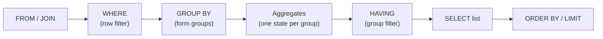

# Aggregate Functions

> **Module 03 · Databases** · Prerequisites: [SQL JOINs](10-SQL-JOINs.md) · Next: [Window Functions](14-Window-Functions.md)

---

## ⏱ If You Only Have 2 Minutes

- `count(*)` counts rows. `count(col)` counts rows where `col` is not `NULL`. `count(DISTINCT col)` counts distinct non-`NULL` values. All other aggregates ignore `NULL` inputs.
- Over zero rows, `count` returns `0` but `sum`, `avg`, `min` and `max` return **`NULL`**. Wrap them in `coalesce(sum(x), 0)` when the API expects a number.
- Every column in `SELECT` must be inside an aggregate or in `GROUP BY` — unless you group by a table's primary key, which lets you select that table's other columns.
- `WHERE` filters rows **before** grouping; `HAVING` filters groups **after**. Aggregates are not allowed in `WHERE`.
- `FILTER (WHERE ...)` computes several conditional aggregates in one pass: `count(*) FILTER (WHERE status = 'cancelled')`.
- Types: `sum(integer)` → `bigint`, `sum(bigint)` → `numeric`, `avg(integer)` → `numeric`, `count` → `bigint`. `integer / integer` truncates: `7 / 2 = 3`. node-postgres returns `bigint` and `numeric` as **strings**.
- Bucket by day with `date_trunc('day', created_at, 'Europe/Berlin')` (PostgreSQL 12+) or `(created_at AT TIME ZONE tz)::date`. Without a time zone, "day" means the session's `TimeZone` — usually UTC on servers, which is wrong for a local dashboard.
- Exact `count(*)` on a huge table scans it (MVCC keeps no row counter). For "about 48 million rows", read `pg_class.reltuples`.

---

## 1. What It Is and Why It Exists

An **aggregate function** takes many input rows and returns one value: `count`, `sum`, `avg`, `min`, `max`, `string_agg`, `json_agg` and more. Combined with `GROUP BY`, it returns one value **per group** — revenue per day, orders per customer, products per category.

**Analogy:** counting votes. Every ballot is a row. `GROUP BY candidate` puts ballots into piles. `count(*)` counts each pile. Spoiled ballots (`NULL`s) are in the box, but `count(candidate)` skips them, while `count(*)` does not. And if a district had no voters at all, the "total votes" is zero, but the "average age of voters" is unknown — which is exactly how `count` and `avg` behave over zero rows.

**The problem it solves.** Without aggregates, the application would fetch every order and add up totals in a loop: millions of rows sent over the network to produce a 30-row chart. Aggregating in the database sends only the answer, and the database can use indexes, parallel workers and hash tables to compute it.

**Where people get it wrong:** `NULL` handling, integer division, double counting after joins, and time zones. A revenue chart can be wrong by a whole day of sales at the edges if "day" is UTC and the business is in Sydney.

---

## 2. How It Works

### Evaluation order



This order explains several rules: `WHERE` cannot use `sum()` (groups do not exist yet), `HAVING` can, and in PostgreSQL a `SELECT` alias is not visible in `WHERE` or `HAVING` (but it is in `GROUP BY` and `ORDER BY`).

### What an aggregate does internally

PostgreSQL defines each aggregate with a **state** and two functions:

1. a **transition function** that updates the state for each input row (for `avg`: add to a running sum and a running count);
2. a **final function** that turns the state into the result (for `avg`: sum ÷ count; `NULL` if count is 0).

Two physical strategies group the rows:

| Plan node | How | Good when |
|---|---|---|
| `HashAggregate` | Hash table keyed by the group, one state per entry | Many rows, not too many groups, input unsorted. Spills to disk when it exceeds memory (PostgreSQL 13+). |
| `GroupAggregate` | Input sorted by the group key; finish each group when the key changes | Input already sorted (for example from an index) or very many groups |
| `Partial` + `Finalize Aggregate` | Parallel workers each aggregate part of the table, a combine step merges states | Large scans with parallel query enabled |

`count(DISTINCT x)` and aggregates with `ORDER BY` inside (`string_agg(sku, ',' ORDER BY sku)`) need sorted input per group, which costs more than a plain `count`.

### `NULL` rules in one example

```sql
SELECT count(*)                  AS all_rows,
       count(provider_ref)       AS with_ref,
       count(DISTINCT status)    AS statuses,
       sum(amount_cents)         AS total,
       avg(amount_cents)         AS average
FROM payments
WHERE order_id = $1;
```

Illustrative output for an order with two payments, one without a `provider_ref`:

| all_rows | with_ref | statuses | total | average |
|---|---|---|---|---|
| 2 | 1 | 2 | 7700 | 3850.0000000000000000 |

And for an order with no payments:

| all_rows | with_ref | statuses | total | average |
|---|---|---|---|---|
| 0 | 0 | 0 | NULL | NULL |

An aggregate query without `GROUP BY` always returns exactly **one** row, even over an empty table. With `GROUP BY`, an empty input returns **zero** rows — there are no groups.

---

## 3. Key Concepts

### `GROUP BY` rules

- Every `SELECT` expression must be aggregated, appear in `GROUP BY`, or be **functionally dependent** on a grouped primary key. `GROUP BY c.id` allows `c.name` and `c.email` (PostgreSQL 9.1+), which avoids long `GROUP BY` lists.
- All `NULL` keys fall into one group.
- `GROUP BY 1, 2` (by position) is allowed but breaks silently when someone reorders the select list. Prefer names or expressions.
- **MySQL difference:** with `ONLY_FULL_GROUP_BY` (default since MySQL 5.7) the rule is the same. Older setups without it returned an arbitrary value for non-grouped columns, which hid bugs. MySQL also allows `SELECT` aliases in `HAVING`; PostgreSQL does not.

PostgreSQL 16 added `any_value(col)` for when you know a column is the same within a group but cannot prove it to the planner.

### `WHERE` vs `HAVING`

```sql
-- Customers with at least 3 paid orders in 2026
SELECT customer_id, count(*) AS paid_orders, sum(total_cents) AS spent
FROM orders
WHERE status = 'paid'                                  -- row filter: uses indexes, runs first
  AND created_at >= '2026-01-01' AND created_at < '2027-01-01'
GROUP BY customer_id
HAVING count(*) >= 3;                                  -- group filter: needs the aggregate
```

Putting a row condition in `HAVING` (`HAVING status = 'paid'` after grouping by status) gives the same answer but aggregates rows you then throw away. Filter rows in `WHERE` whenever the condition does not need an aggregate.

### `FILTER` and conditional aggregation

```sql
SELECT date_trunc('month', created_at)                       AS month,
       count(*)                                              AS orders,
       count(*) FILTER (WHERE status = 'cancelled')          AS cancelled,
       sum(total_cents) FILTER (WHERE status IN ('paid', 'shipped')) AS revenue_cents,
       round(100.0 * count(*) FILTER (WHERE status = 'cancelled')
             / nullif(count(*), 0), 1)                       AS cancel_rate_pct
FROM orders
GROUP BY 1
ORDER BY 1;
```

One scan, many metrics. The portable equivalent is `sum(CASE WHEN status = 'paid' THEN total_cents END)` — MySQL has no `FILTER` clause. Note `100.0 *` (forces `numeric`) and `nullif(count(*), 0)` (avoids "division by zero" for an empty group).

### Collecting values: `string_agg`, `array_agg`, `json_agg`

```sql
SELECT o.id,
       string_agg(p.sku, ', ' ORDER BY p.sku)                AS skus,       -- 'BK-001, MUG-07'
       array_agg(oi.product_id ORDER BY oi.product_id)       AS product_ids, -- {12,31}
       json_agg(json_build_object('sku', p.sku, 'qty', oi.quantity)
                ORDER BY p.sku)                              AS lines        -- [{"sku":..}]
FROM orders o
JOIN order_items oi ON oi.order_id = o.id
JOIN products p     ON p.id = oi.product_id
WHERE o.id = ANY($1::bigint[])
GROUP BY o.id;
```

Without `ORDER BY` inside the call, the element order is not guaranteed. `jsonb_agg` builds `jsonb` instead of `json`. For statistics there are ordered-set aggregates such as `percentile_cont(0.5) WITHIN GROUP (ORDER BY total_cents)` (median), and `bool_and` / `bool_or` for "all" and "any".

### `GROUPING SETS`, `ROLLUP`, `CUBE`

These compute several groupings in one query — a report with subtotals and a grand total.

```sql
SELECT p.category,
       date_trunc('month', o.created_at)::date AS month,
       sum(oi.quantity * oi.unit_price_cents)  AS revenue_cents,
       GROUPING(p.category, date_trunc('month', o.created_at)::date) AS level
FROM order_items oi
JOIN orders o   ON o.id = oi.order_id AND o.status IN ('paid', 'shipped')
JOIN products p ON p.id = oi.product_id
GROUP BY ROLLUP (p.category, date_trunc('month', o.created_at)::date)
ORDER BY p.category NULLS LAST, month NULLS LAST;
```

Illustrative output:

| category | month | revenue_cents | level |
|---|---|---|---|
| books | 2026-10-01 | 812000 | 0 |
| books | 2026-11-01 | 954500 | 0 |
| books | NULL | 1766500 | 1 |
| mugs | 2026-11-01 | 120000 | 0 |
| mugs | NULL | 120000 | 1 |
| NULL | NULL | 1886500 | 3 |

`ROLLUP (a, b)` = `GROUPING SETS ((a, b), (a), ())`. `CUBE (a, b)` adds `(b)` too — every combination. The `NULL`s in subtotal rows are ambiguous if the column can be `NULL` itself; `GROUPING()` returns a bitmask (1 where a column was rolled up) that tells them apart.

### Numeric types and division

| Expression | Result type | Example |
|---|---|---|
| `sum(integer)` | `bigint` | No overflow for realistic sums |
| `sum(bigint)` | `numeric` | Exact, arbitrary precision |
| `avg(integer)` | `numeric` | `3850.0000000000000000` — `round(avg(x), 2)` for display |
| `count(*)` | `bigint` | |
| `integer / integer` | `integer` (truncated) | `7 / 2 = 3`, `-7 / 2 = -3` |
| `numeric / integer` | `numeric` | `7.0 / 2 = 3.5` |
| `sum(real)`, `sum(double precision)` | floating point | Rounding errors; never use for money |

Keep money as integer cents (as the sample schema does) or `numeric`. In Node, `pg` returns `bigint` and `numeric` as strings to avoid silent precision loss; parse with `Number()` only when the value is known to stay below 2^53, otherwise use `BigInt` or a decimal library.

### Time buckets and time zones

`created_at` is `timestamptz`: an absolute instant. A "day" only exists in a time zone.

| Expression | Bucket boundaries |
|---|---|
| `date_trunc('day', created_at)` | Midnight in the session `TimeZone` setting — whatever the connection has |
| `date_trunc('day', created_at, 'Europe/Berlin')` | Berlin midnight (PostgreSQL 12+), returned as `timestamptz` |
| `(created_at AT TIME ZONE 'Europe/Berlin')::date` | The Berlin calendar date, as a `date` |

Three rules for dashboards:

1. **Pass the time zone explicitly.** Do not depend on the session setting, which differs between your laptop, the server and a connection pooler.
2. **Filter on the raw column** with a range computed from local midnights: `created_at >= $start AND created_at < $end`. A `WHERE` on `date_trunc(...)` cannot use a plain index on `created_at`.
3. **Fill empty days.** `GROUP BY` returns no row for a day without orders, and charts then skip the day. Left-join a `generate_series` of days and `coalesce` to 0.

Daylight-saving days are 23 or 25 hours long. Computing local midnights with `AT TIME ZONE` handles that; adding `interval '24 hours'` to a UTC timestamp does not.

### Fast approximate counts

`count(*)` must visit every row (or every index entry plus the visibility map), because under MVCC each transaction may see a different number of rows. On a 50-million-row table that takes seconds. For "about how many" — admin pages, pagination hints — use the planner's statistics:

```sql
SELECT reltuples::bigint AS approx_rows
FROM pg_class
WHERE oid = 'public.orders'::regclass;
```

`reltuples` is updated by `VACUUM`, `ANALYZE` and `CREATE INDEX`, so it lags behind writes. Since PostgreSQL 14 it is `-1` for a table that has never been vacuumed or analyzed — handle that. For a filtered estimate, run `EXPLAIN (FORMAT JSON)` on the query and read the top node's `Plan Rows`. For exact counts that must be fast, maintain a counter table or a [materialized view](17-Materialized-Views.md). (**MySQL difference:** InnoDB has no exact stored row count either; `SHOW TABLE STATUS` gives an estimate.)

---

## 4. Code Examples

Scenario: an admin dashboard endpoint, `GET /admin/revenue/daily?tz=Europe/Berlin`, returning one row per local calendar day for the last 30 days (today included): order count and cents per status. Days without orders must appear with zeros.

### SQL

```sql
-- Supports the created_at range filter
CREATE INDEX orders_created_at_idx ON orders (created_at);

WITH bounds AS (
  -- Local wall-clock midnights, as timestamp WITHOUT time zone
  SELECT date_trunc('day', now() AT TIME ZONE $1::text) - interval '29 days' AS first_day,
         date_trunc('day', now() AT TIME ZONE $1::text) + interval '1 day'   AS end_day
),
days AS (
  -- timestamp (not timestamptz) series: no DST surprises when stepping by 1 day
  SELECT d::date AS day
  FROM bounds b, generate_series(b.first_day, b.end_day - interval '1 day', interval '1 day') AS d
),
daily AS (
  SELECT (o.created_at AT TIME ZONE $1::text)::date                    AS day,
         count(*)                                                     AS orders,
         sum(o.total_cents) FILTER (WHERE o.status = 'pending')       AS pending_cents,
         sum(o.total_cents) FILTER (WHERE o.status = 'paid')          AS paid_cents,
         sum(o.total_cents) FILTER (WHERE o.status = 'shipped')       AS shipped_cents,
         sum(o.total_cents) FILTER (WHERE o.status = 'cancelled')     AS cancelled_cents
  FROM orders o, bounds b
  -- Range on the raw column (index-friendly); local midnight → absolute instant
  WHERE o.created_at >= b.first_day AT TIME ZONE $1::text
    AND o.created_at <  b.end_day   AT TIME ZONE $1::text
  GROUP BY 1
)
SELECT d.day::text                           AS day,   -- 'YYYY-MM-DD', see the Node note below
       coalesce(x.orders, 0)                 AS orders,
       coalesce(x.pending_cents, 0)          AS pending_cents,
       coalesce(x.paid_cents, 0)             AS paid_cents,
       coalesce(x.shipped_cents, 0)          AS shipped_cents,
       coalesce(x.cancelled_cents, 0)        AS cancelled_cents
FROM days d
LEFT JOIN daily x ON x.day = d.day
ORDER BY d.day;
```

Illustrative output (last rows, `tz = 'Europe/Berlin'`):

| day | orders | pending_cents | paid_cents | shipped_cents | cancelled_cents |
|---|---|---|---|---|---|
| 2026-11-22 | 41 | 3200 | 120400 | 210050 | 8800 |
| 2026-11-23 | 0 | 0 | 0 | 0 | 0 |
| 2026-11-24 | 17 | 15600 | 98000 | 0 | 0 |

An order placed at 23:30 UTC on 23 November is 00:30 on 24 November in Berlin, so it lands in the `2026-11-24` row. With UTC buckets it would land a day earlier.

### Node.js / TypeScript

```ts
// npm i express pg && npm i -D @types/express @types/pg   — Node.js 22+, TypeScript 5, ESM
import express from "express";
import pg from "pg";

// Same statement as the SQL section, comments removed. $1 is the IANA zone name.
const DAILY_REVENUE_SQL = `
  WITH bounds AS (
    SELECT date_trunc('day', now() AT TIME ZONE $1::text) - interval '29 days' AS first_day,
           date_trunc('day', now() AT TIME ZONE $1::text) + interval '1 day'   AS end_day
  ), days AS (
    SELECT d::date AS day
    FROM bounds b, generate_series(b.first_day, b.end_day - interval '1 day', interval '1 day') AS d
  ), daily AS (
    SELECT (o.created_at AT TIME ZONE $1::text)::date AS day, count(*) AS orders,
           sum(o.total_cents) FILTER (WHERE o.status = 'pending')   AS pending_cents,
           sum(o.total_cents) FILTER (WHERE o.status = 'paid')      AS paid_cents,
           sum(o.total_cents) FILTER (WHERE o.status = 'shipped')   AS shipped_cents,
           sum(o.total_cents) FILTER (WHERE o.status = 'cancelled') AS cancelled_cents
    FROM orders o, bounds b
    WHERE o.created_at >= b.first_day AT TIME ZONE $1::text
      AND o.created_at <  b.end_day   AT TIME ZONE $1::text
    GROUP BY 1
  )
  SELECT d.day::text AS day, coalesce(x.orders, 0) AS orders,
         coalesce(x.pending_cents, 0) AS pending_cents, coalesce(x.paid_cents, 0) AS paid_cents,
         coalesce(x.shipped_cents, 0) AS shipped_cents, coalesce(x.cancelled_cents, 0) AS cancelled_cents
  FROM days d LEFT JOIN daily x ON x.day = d.day
  ORDER BY d.day`;

const pool = new pg.Pool({ connectionString: process.env.DATABASE_URL });
const app = express();

// IANA names known to this Node build. PostgreSQL ships its own copy of the same database.
const TIME_ZONES = new Set([...Intl.supportedValuesOf("timeZone"), "UTC"]);

// count() and sum(integer) are bigint → pg returns them as strings.
interface DailyRow {
  day: string; orders: string;
  pending_cents: string; paid_cents: string; shipped_cents: string; cancelled_cents: string;
}

app.get("/admin/revenue/daily", async (req, res) => {
  const tz = String(req.query.tz ?? "UTC");
  if (!TIME_ZONES.has(tz)) {
    res.status(400).json({ error: "unknown time zone" });
    return;
  }

  const { rows } = await pool.query<DailyRow>(DAILY_REVENUE_SQL, [tz]);

  // Number() is safe here: a day's revenue in cents is far below 2^53 (about 90 trillion).
  const days = rows.map((r) => ({
    day: r.day,
    orders: Number(r.orders),
    cents: {
      pending: Number(r.pending_cents),
      paid: Number(r.paid_cents),
      shipped: Number(r.shipped_cents),
      cancelled: Number(r.cancelled_cents),
    },
  }));
  const revenueCents = days.reduce((acc, d) => acc + d.cents.paid + d.cents.shipped, 0);

  res.set("Cache-Control", "private, max-age=60"); // dashboards poll; a minute of staleness is fine
  res.json({ timeZone: tz, revenueCents, days });
});

app.listen(3000);
```

Why `d.day::text` in SQL: `pg` converts a `date` column into a JavaScript `Date` at **local midnight of the Node process**, and `JSON.stringify` then prints it in UTC. On a server in UTC+1, `2026-11-24` would come out as `"2026-11-23T23:00:00.000Z"`. Returning text avoids the conversion entirely.

### Python

```python
# pip install fastapi "psycopg[binary]" psycopg-pool   — Python 3.12+
from contextlib import asynccontextmanager
from datetime import date
from typing import Annotated
from zoneinfo import available_timezones

from fastapi import FastAPI, HTTPException, Query, Response
from psycopg.rows import class_row
from psycopg_pool import AsyncConnectionPool
from pydantic import BaseModel

# Same statement as the SQL section; the named %(tz)s placeholder is reused five times.
DAILY_REVENUE_SQL = """
    WITH bounds AS (
      SELECT date_trunc('day', now() AT TIME ZONE %(tz)s::text) - interval '29 days' AS first_day,
             date_trunc('day', now() AT TIME ZONE %(tz)s::text) + interval '1 day'   AS end_day
    ), days AS (
      SELECT d::date AS day
      FROM bounds b, generate_series(b.first_day, b.end_day - interval '1 day', interval '1 day') AS d
    ), daily AS (
      SELECT (o.created_at AT TIME ZONE %(tz)s::text)::date AS day, count(*) AS orders,
             sum(o.total_cents) FILTER (WHERE o.status = 'pending')   AS pending_cents,
             sum(o.total_cents) FILTER (WHERE o.status = 'paid')      AS paid_cents,
             sum(o.total_cents) FILTER (WHERE o.status = 'shipped')   AS shipped_cents,
             sum(o.total_cents) FILTER (WHERE o.status = 'cancelled') AS cancelled_cents
      FROM orders o, bounds b
      WHERE o.created_at >= b.first_day AT TIME ZONE %(tz)s::text
        AND o.created_at <  b.end_day   AT TIME ZONE %(tz)s::text
      GROUP BY 1
    )
    SELECT d.day, coalesce(x.orders, 0) AS orders,
           coalesce(x.pending_cents, 0) AS pending_cents, coalesce(x.paid_cents, 0) AS paid_cents,
           coalesce(x.shipped_cents, 0) AS shipped_cents,
           coalesce(x.cancelled_cents, 0) AS cancelled_cents
    FROM days d LEFT JOIN daily x ON x.day = d.day
    ORDER BY d.day
"""

TIME_ZONES = available_timezones()  # IANA names from the system tz database or the tzdata package
pool = AsyncConnectionPool(open=False)


class DailyRevenue(BaseModel):
    day: date               # a date column arrives as datetime.date: no ::text cast needed here
    orders: int             # bigint → int: Python ints never overflow, no string handling
    pending_cents: int
    paid_cents: int
    shipped_cents: int
    cancelled_cents: int


class RevenueReport(BaseModel):
    time_zone: str
    revenue_cents: int
    days: list[DailyRevenue]


@asynccontextmanager
async def lifespan(_: FastAPI):
    await pool.open()
    yield
    await pool.close()


app = FastAPI(lifespan=lifespan)


@app.get("/admin/revenue/daily")
async def daily_revenue(response: Response, tz: Annotated[str, Query()] = "UTC") -> RevenueReport:
    if tz not in TIME_ZONES:
        raise HTTPException(400, "unknown time zone")

    async with pool.connection() as conn:
        async with conn.cursor(row_factory=class_row(DailyRevenue)) as cur:
            await cur.execute(DAILY_REVENUE_SQL, {"tz": tz})
            days = await cur.fetchall()

    response.headers["Cache-Control"] = "private, max-age=60"
    return RevenueReport(
        time_zone=tz,
        revenue_cents=sum(d.paid_cents + d.shipped_cents for d in days),
        days=days,
    )
```

**Runtime differences:** the time-zone allow-list is necessary in both apps. The value is a bound parameter, so it cannot inject SQL, but an unknown name makes PostgreSQL raise `time zone "..." not recognized`, which would surface as a 500. Python's `zoneinfo`, Node's ICU data and PostgreSQL all use the IANA time zone database, but each ships its own copy, so a very new zone name can exist in one and not yet in another. In psycopg, a `date` column arrives as `datetime.date` with no time-zone shift, which is why the Python version selects `d.day` directly while the Node version casts it to text. psycopg also lets one named placeholder repeat, where `pg` reuses `$1`.

---

## 5. Production Concerns

- **Dashboards scan a lot.** "Last 30 days" on a busy table reads every order in that window on each refresh. Index `created_at` for the range, cache the response for a minute, and for longer ranges pre-aggregate into a daily summary table or a [materialized view](17-Materialized-Views.md) refreshed on a schedule.
- **Aggregating after a join.** A `sum(o.total_cents)` after joining `order_items` counts each order once per item. Aggregate at the right grain first ([SQL JOINs](10-SQL-JOINs.md), fan-out).
- **Memory.** `HashAggregate` and sorts for `count(DISTINCT)` use `work_mem` per node. Too many groups spill to disk (`temp_bytes` in `pg_stat_database` and `Disk Usage` in `EXPLAIN ANALYZE` output). Raising `work_mem` per session for a report is safer than raising it globally.
- **`count(*)` for pagination.** "Page 1 of 48,213" requires an exact count of the whole filtered set on every request. Show "more results" instead, or an estimate. See [Offset Pagination](24-Offset-Pagination.md).
- **Time zone of the session.** Poolers and different services may set different `TimeZone` values. Any query that uses `date_trunc` without an explicit zone, `::date` on a `timestamptz`, or `now()::date` returns different results per connection. Make the zone explicit everywhere in reporting SQL.
- **Run heavy reports on a replica.** Long aggregate queries on the primary compete with checkout traffic. A read replica isolates them, but `hot_standby_feedback` and query cancellation on the replica need tuning for long queries.

---

## 6. Common Mistakes

- **Returning `sum()` without `coalesce`** — an empty period returns `null` and the frontend shows "NaN" or crashes — `coalesce(sum(x), 0)`, or fill gaps with a date series.
- **`count(*)` with a `LEFT JOIN`** — parents with no children count as 1 — `count(child.id)`.
- **Integer division for ratios** — `cancelled / total` is 0 for every day under 100% — multiply by `100.0` or cast to `numeric`, and wrap the divisor in `nullif(..., 0)`.
- **Grouping by `date_trunc('day', created_at)` with the session time zone** — late-evening orders land on the wrong day for local users — pass the zone explicitly: `date_trunc('day', created_at, $tz)`.
- **Filtering with `WHERE date_trunc('day', created_at) = $1`** — no index use, full scan — filter on a half-open range of the raw column.
- **Using `HAVING` for row filters** — aggregates rows that are later thrown away — put non-aggregate conditions in `WHERE`.
- **`Number()` on every `bigint` from `pg`** — values above 2^53 change silently — parse only values with a known safe range; use `BigInt` or strings otherwise.

---

## 7. Comparison Table

Ways to get totals for a dashboard:

| | Live `GROUP BY` | Window functions | Summary table / materialized view | Estimate (`reltuples`, `EXPLAIN`) |
|---|---|---|---|---|
| Output | One row per group | Every input row plus group values | Pre-computed rows per group | One approximate number |
| Freshness | Exact, now | Exact, now | As of the last refresh or update | As of the last `ANALYZE`/`VACUUM` |
| Cost per request | Scans the filtered rows | Scans and sorts the rows | Reads a few rows | Near zero |
| Extra moving parts | None | None | Refresh job or triggers; backfills | None |
| Use when | Small or indexed ranges, ad-hoc questions | You need detail rows *and* totals (running totals, share of group) | Large history, frequent polling | Huge tables, "about how many" |

---

## 8. Interview Questions

**[Junior] What is the difference between `count(*)`, `count(col)` and `count(DISTINCT col)`?**
`count(*)` counts rows, regardless of `NULL`s. `count(col)` counts rows where `col` is not `NULL`. `count(DISTINCT col)` counts unique non-`NULL` values. After a `LEFT JOIN`, `count(*)` counts the `NULL`-padded row too, so use `count(right_table.id)` to count real matches.

**[Junior] What is the difference between `WHERE` and `HAVING`?**
`WHERE` filters individual rows before grouping and cannot use aggregates. `HAVING` filters groups after aggregation and can, for example `HAVING count(*) >= 3`. Conditions that do not need an aggregate belong in `WHERE`, because rows removed early are never grouped and indexes can help.

**[Mid] Why does `SELECT sum(total_cents) FROM orders WHERE customer_id = $1` return `NULL`?**
The customer has no orders. `sum` over zero rows is `NULL`, not 0, because there is nothing to add; only `count` returns 0. Use `coalesce(sum(total_cents), 0)`. Since the query has no `GROUP BY`, it still returns exactly one row.

**[Mid] What does `FILTER` do, and how would you write it without `FILTER`?**
`FILTER (WHERE cond)` restricts the rows a single aggregate sees, so you can compute several conditional metrics in one scan: `count(*) FILTER (WHERE status = 'cancelled')`. Without it, use `CASE` inside the aggregate: `count(CASE WHEN status = 'cancelled' THEN 1 END)` or `sum(CASE WHEN ... THEN total_cents END)`. That form is portable, for example to MySQL.

**[Mid] What can go wrong with numeric types in aggregates?**
Dividing two integers truncates, so ratios come out as 0. `sum(integer)` returns `bigint` and `avg` returns `numeric`, which `pg` hands to JavaScript as strings — careless `Number()` conversion can lose precision for very large values. Summing floats for money accumulates rounding errors; use integer cents or `numeric`.

**[Senior] A daily revenue chart disagrees with the finance team's numbers at day boundaries. What do you check?**
Time zones first. `timestamptz` values bucketed with `date_trunc('day', ...)` use the session `TimeZone`, which is often UTC on servers, while finance thinks in local time. Bucket with an explicit zone (`date_trunc('day', created_at, 'Europe/Berlin')` or `AT TIME ZONE`) and compute the filter range from local midnights, which also handles 23- and 25-hour DST days. Then check the definition of revenue (which statuses count, refunds) and whether a join is multiplying rows.

**[Senior] `SELECT count(*) FROM events` takes 20 seconds. How do you handle it?**
PostgreSQL has no stored row count because under MVCC each transaction can see a different number of rows, so `count(*)` scans the table or an index. If an estimate is enough, read `pg_class.reltuples`, or the planner's row estimate from `EXPLAIN` for filtered counts. If an exact, fast count is a product requirement, maintain it: a counter row updated in the same transaction (watch for hot-row contention — shard the counter across several rows), or a periodically refreshed summary table. Often the best fix is product-side: stop showing "1 of 48,213 pages".

**[Senior] When would you use `GROUPING SETS` or `ROLLUP`?**
When a report needs several levels of totals — per category per month, per category, and a grand total. `ROLLUP (category, month)` computes all three in one pass instead of three queries combined with `UNION ALL`. The subtotal rows have `NULL` in the rolled-up columns, so use `GROUPING()` to tell a subtotal from a real `NULL` value. For very large data the same idea is often moved into a pre-aggregated table.

---

## 9. Cheat Sheet

```text
count(*)         rows            count(col) non-NULL        count(DISTINCT col) unique non-NULL
Empty input      count → 0; sum/avg/min/max → NULL → coalesce(sum(x), 0)
No GROUP BY      always 1 row       GROUP BY on empty input → 0 rows
GROUP BY         select only grouped cols, aggregates, or cols of a grouped PK's table
WHERE/HAVING     WHERE = rows before grouping; HAVING = groups after; no aliases in either (PG)
FILTER           agg(x) FILTER (WHERE cond)   portable: sum(CASE WHEN cond THEN x END)
Collect          string_agg(x, ',' ORDER BY x) | array_agg | json_agg / jsonb_agg
Subtotals        GROUP BY ROLLUP (a, b) = GROUPING SETS ((a,b),(a),()); GROUPING() tells NULLs apart
Types            sum(int)→bigint, sum(bigint)→numeric, avg(int)→numeric, count→bigint
Division         int/int truncates → 100.0 * a / nullif(b, 0)
pg (Node)        bigint & numeric → strings; date → JS Date at local midnight → cast ::text
Time buckets     date_trunc('day', ts, 'Europe/Berlin') (PG12+) | (ts AT TIME ZONE tz)::date
                 filter on raw ts range; fill empty days with generate_series + LEFT JOIN
Big count(*)     full scan (MVCC); estimate: pg_class.reltuples (-1 = never analyzed, PG14+)
Plans            HashAggregate (spills to disk PG13+) | GroupAggregate (sorted input) | Partial/Finalize
```

---

## Related Topics

- [SQL JOINs](10-SQL-JOINs.md) — fan-out, the most common cause of wrong totals
- [Window Functions](14-Window-Functions.md) — aggregates that keep the detail rows (running totals, ranks)
- [Materialized Views](17-Materialized-Views.md) — pre-computing expensive aggregates for dashboards
- [Offset Pagination](24-Offset-Pagination.md) — why exact `count(*)` for page numbers gets expensive
- [Denormalization](07-Denormalization.md) — summary tables and counters kept next to the source data
