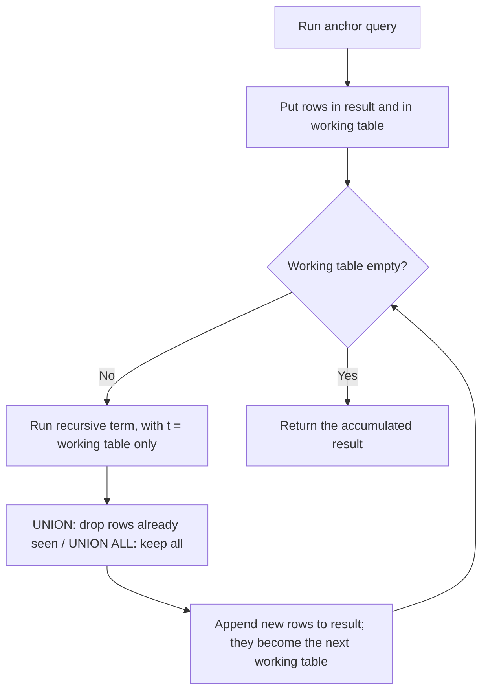

# Common Table Expressions

> **Module 03 · Databases** · Prerequisites: [Window Functions](14-Window-Functions.md) · Next: [Views](16-Views.md)

---

## ⏱ If You Only Have 2 Minutes

- A CTE (`WITH name AS (...)`) is a named subquery that exists only for **one statement**. It exists for readability, recursion, and data-modifying pipelines — not for speed.
- **PostgreSQL 12+** inlines a plain `SELECT` CTE into the main query when it is referenced **once** and has no side effects. Referenced twice or more, it is computed once and stored. Before 12, every CTE was an "optimization fence".
- `WITH x AS MATERIALIZED (...)` forces one computation; `AS NOT MATERIALIZED` forces inlining. Use them only after reading the plan.
- `WITH RECURSIVE` = an anchor query `UNION ALL` a recursive query that joins to the CTE itself. It walks trees and graphs (category trees, org charts, bills of materials).
- Recursion stops when an iteration returns no rows. Bad data with a cycle never stops — protect with a path array (`WHERE NOT id = ANY(path)`), a depth limit, or the **`CYCLE` clause (PostgreSQL 14+)**.
- **Data-modifying CTEs** (`WITH moved AS (DELETE ... RETURNING *) INSERT INTO archive SELECT * FROM moved`) run as one atomic statement: no window where a row is in both tables or in neither.
- All parts of one `WITH` statement see the **same snapshot**. One part cannot see another part's changes except through `RETURNING`.

---

## 1. What It Is and Why It Exists

A **common table expression** gives a name to a query result so the rest of the statement can use it like a table. It is defined with `WITH` and disappears when the statement finishes. Nothing is stored in the catalog — that is the difference from a [view](16-Views.md).

**Analogy:** showing your work in a maths exam. Instead of one enormous expression, you write "let A = ..., let B = ..., answer = A − B". The result is the same, but a reader (or reviewer) can check each step.

**The problems it solves.**

1. **Readability.** A report query with three levels of nested subqueries reads inside-out. With CTEs it reads top to bottom: "paid orders → revenue per customer → top decile".
2. **Hierarchies.** Plain SQL cannot follow a `parent_id` chain of unknown depth. Without `WITH RECURSIVE`, applications run one query per level — five round trips for a five-level breadcrumb, and an N+1 problem for subtrees.
3. **Multi-step writes in one statement.** "Delete old orders and copy them into the archive" is two statements. If the process dies between them, rows are lost or duplicated unless you wrap them in a transaction. A data-modifying CTE does both in one statement that is atomic by definition, and the `DELETE ... RETURNING` output feeds the `INSERT` directly.

---

## 2. How It Works

### Non-recursive CTEs: inline or materialize

When PostgreSQL plans a statement with `WITH`, it decides for each CTE whether to **inline** it (paste it into the main query as a subquery, so the planner can push filters into it and use indexes) or **materialize** it (run it once, keep the rows in memory or a temp file, and scan that result).

| CTE kind | PostgreSQL 12+ default |
|---|---|
| `SELECT`, no volatile functions, referenced once | Inlined |
| `SELECT`, referenced two or more times | Materialized once |
| Recursive | Materialized (it is a loop) |
| Data-modifying (`INSERT` / `UPDATE` / `DELETE`) | Executed exactly once, always to completion |

PostgreSQL 11 and older **always** materialized. That is why older blog posts call CTEs an optimization fence: a filter in the outer query was not pushed into the CTE, so `WITH o AS (SELECT * FROM orders) SELECT * FROM o WHERE id = 5` read the whole table. On 12+ the same query uses the primary key.

You can override the default:

```sql
-- Force inlining even though the CTE is used twice: each use gets its own index-friendly plan.
WITH paid AS NOT MATERIALIZED (
  SELECT id, customer_id, total_cents, created_at FROM orders WHERE status = 'paid'
)
SELECT
  (SELECT count(*) FROM paid WHERE customer_id = $1)              AS orders_for_customer,
  (SELECT max(created_at) FROM paid WHERE customer_id = $1)       AS last_paid_at;

-- Force one evaluation: an expensive aggregate you want computed once, and a plan
-- that must not push outer filters into it.
WITH customer_spend AS MATERIALIZED (
  SELECT customer_id, sum(total_cents) AS spend_cents
  FROM orders WHERE status IN ('paid', 'shipped')
  GROUP BY customer_id
)
SELECT * FROM customer_spend WHERE spend_cents > 100000;
```

Inlining can also be *worse*: if the CTE calls an expensive function per row, inlining it into a query that references it twice runs the function twice. The rule is the same as everywhere in performance work — read `EXPLAIN (ANALYZE, BUFFERS)` and look for `CTE Scan` (materialized) versus the CTE's tables appearing directly in the plan (inlined).

### Recursive CTEs: the working-table loop

```sql
WITH RECURSIVE t AS (
  <anchor>          -- non-recursive term, runs once
  UNION ALL
  <recursive term>  -- references t; runs repeatedly
)
SELECT ... FROM t;
```

PostgreSQL evaluates it like this:



Two details matter in interviews:

- In each iteration, the self-reference sees **only the rows from the previous iteration**, not the whole result so far. That is what makes it a breadth-first walk.
- With `UNION` (not `ALL`), rows identical to ones already produced are discarded. That stops a cycle *only if* the repeated rows are fully identical. As soon as you add a `depth` or `path` column, every row is unique and `UNION` no longer protects you.

### Data-modifying CTEs: one snapshot, one statement

Rules from the PostgreSQL docs, in plain words:

1. Every sub-statement in the `WITH` and the main statement run with **the same snapshot**. A `SELECT` in the main query does not see rows that an `INSERT` in a CTE just added — only the CTE's `RETURNING` output shows them.
2. Data-modifying CTEs run **exactly once, to completion**, even if the main query never reads them.
3. The **order** in which sub-statements run is not defined. Don't make one depend on another's side effects.
4. Don't modify **the same row twice** in one statement (for example, two `UPDATE`s of one row in different CTEs). Only one change wins, and which one is unpredictable.
5. Foreign-key checks and other after-triggers run at the **end of the whole statement**, so deleting children and their parent in sibling CTEs is fine with the default `NO ACTION` foreign keys.

---

## 3. Key Concepts

### CTE, subquery, temp table or view

| | CTE | Subquery | Temporary table | View |
|---|---|---|---|---|
| Lifetime | One statement | One statement | Session (or transaction) | Permanent, in the catalog |
| Reusable within the statement | Yes, by name | No (repeat the text) | Yes | Yes |
| Can be indexed / analyzed | No | No | Yes (`CREATE INDEX`, `ANALYZE`) | No (underlying tables can be) |
| Recursion | `WITH RECURSIVE` | No | Manual loop | Recursive views exist but are rare |
| Data-modifying steps | Yes (`DELETE ... RETURNING`) | No | Separate statements | No |

When an intermediate result is large and reused by several *statements*, or needs its own index, a temp table beats a CTE.

### Hierarchies with an adjacency list

The sample schema stores `products.category` as text. To model a tree, add a `categories` table where each row points to its parent:

```sql
CREATE TABLE categories (
  id         bigint GENERATED ALWAYS AS IDENTITY PRIMARY KEY,
  parent_id  bigint REFERENCES categories(id),   -- NULL = root
  slug       text   NOT NULL UNIQUE,
  name       text   NOT NULL,
  CHECK (parent_id <> id)                       -- blocks the trivial self-cycle only
);
CREATE INDEX categories_parent_idx ON categories (parent_id);   -- needed to walk downwards

ALTER TABLE products ADD COLUMN category_id bigint REFERENCES categories(id);
```

Walking **down** (all subcategories of "electronics", for a product listing):

```sql
WITH RECURSIVE subtree AS (
  SELECT id FROM categories WHERE slug = $1
  UNION                                   -- only `id` is selected, so UNION also stops cycles
  SELECT c.id
  FROM categories c
  JOIN subtree s ON c.parent_id = s.id
)
SELECT p.id, p.name, p.price_cents
FROM products p
WHERE p.category_id IN (SELECT id FROM subtree);
```

Walking **up** gives a breadcrumb (see section 4). An org chart (`employees.manager_id`) or a bill of materials (`parts.parent_part_id` with quantities) uses exactly the same pattern.

Alternatives to the adjacency list: a **materialized path** (`'1/7/42'` with `LIKE '1/7/%'` or the `ltree` extension) or a **closure table** (one row per ancestor–descendant pair). They make subtree reads faster and moves of whole subtrees harder. Adjacency list + recursive CTE is the simplest correct start.

### Cycle protection

A data bug (category 7's parent is 9, and 9's parent is 7) turns a recursive query into an infinite loop that runs until `statement_timeout` or until it fills the disk with temp files. Three defences:

| Defence | How | Notes |
|---|---|---|
| Path array | Carry `ARRAY[id]`, append each step, and stop with `WHERE NOT c.id = ANY(path)` | Works on all versions. The array also gives you the full path for free |
| Depth limit | Carry `depth`, stop with `WHERE depth < 20` | Also guards against absurdly deep but valid data |
| `CYCLE` clause (PG 14+) | `CYCLE id SET is_cycle USING path` after the CTE body | PostgreSQL maintains the path and flag; filter `WHERE NOT is_cycle` |

```sql
-- PostgreSQL 14+: standard-SQL cycle detection
WITH RECURSIVE up AS (
  SELECT id, parent_id, name, 1 AS depth FROM categories WHERE id = $1
  UNION ALL
  SELECT c.id, c.parent_id, c.name, up.depth + 1
  FROM categories c
  JOIN up ON c.id = up.parent_id
) CYCLE id SET is_cycle USING path
SELECT id, name FROM up WHERE NOT is_cycle ORDER BY depth DESC;
```

PostgreSQL 14 also added `SEARCH DEPTH FIRST BY ... SET ordercol` and `SEARCH BREADTH FIRST BY ...` to produce a sort column for tree-shaped output.

Also fix the data: a trigger or an application check that rejects a `parent_id` change which would create a loop. Defending only in the reading query hides corrupted data.

### Data-modifying pipelines

The common shapes:

```sql
-- Move rows: delete from one table, insert into another, atomically.
WITH moved AS (DELETE FROM src WHERE ... RETURNING *)
INSERT INTO dst SELECT * FROM moved;

-- Insert a parent and its children in one round trip.
WITH new_order AS (
  INSERT INTO orders (customer_id, status, total_cents) VALUES ($1, 'pending', $2) RETURNING id
)
INSERT INTO order_items (order_id, product_id, quantity, unit_price_cents)
SELECT new_order.id, i.product_id, i.quantity, i.unit_price_cents
FROM new_order,
     jsonb_to_recordset($3::jsonb) AS i(product_id bigint, quantity int, unit_price_cents int);
```

The second form saves a round trip and needs no explicit transaction, because one statement is always atomic.

> **MySQL (InnoDB) difference:** MySQL 8.0 supports `WITH` and `WITH RECURSIVE`; recursion is capped by `cte_max_recursion_depth` (default 1000). A CTE body must be a `SELECT`, and MySQL has no `RETURNING`, so an archive move is `INSERT ... SELECT` followed by `DELETE` inside one transaction. Before MySQL 8.0 there were no CTEs at all.

---

## 4. Code Examples

Scenario 1: a product page shows a breadcrumb ("Home › Electronics › Audio › Headphones") from the `categories` tree. Scenario 2: a nightly job moves shipped and cancelled orders older than 18 months, with their items and payments, into archive tables — in batches, one atomic statement per batch.

### SQL

```sql
-- Breadcrumb: walk up from a leaf to the root. Path array + depth cap stop bad data from looping.
WITH RECURSIVE crumbs AS (
  SELECT id, parent_id, slug, name, 1 AS depth, ARRAY[id] AS path
  FROM categories
  WHERE id = $1
  UNION ALL
  SELECT c.id, c.parent_id, c.slug, c.name, cr.depth + 1, cr.path || c.id
  FROM categories c
  JOIN crumbs cr ON c.id = cr.parent_id
  WHERE NOT c.id = ANY (cr.path)
    AND cr.depth < 20
)
SELECT id, slug, name FROM crumbs ORDER BY depth DESC;   -- root first
```

Illustrative output for `$1 = 42`:

| id | slug | name |
|---|---|---|
| 1 | electronics | Electronics |
| 7 | audio | Audio |
| 42 | headphones | Headphones |

```sql
-- Archive tables: same columns and NOT NULLs, but no identity, defaults, checks or foreign keys.
CREATE TABLE orders_archive      (LIKE orders);
CREATE TABLE order_items_archive (LIKE order_items);
CREATE TABLE payments_archive    (LIKE payments);

-- One batch. Children and parents are deleted in sibling CTEs; FK checks run at statement end.
WITH batch AS (
  SELECT id FROM orders
  WHERE status IN ('shipped', 'cancelled') AND created_at < $1
  ORDER BY id
  LIMIT $2
  FOR UPDATE SKIP LOCKED              -- skip rows another transaction is changing right now
),
moved_payments AS (DELETE FROM payments p    USING batch b WHERE p.order_id  = b.id RETURNING p.*),
moved_items    AS (DELETE FROM order_items i USING batch b WHERE i.order_id  = b.id RETURNING i.*),
moved_orders   AS (DELETE FROM orders o      USING batch b WHERE o.id        = b.id RETURNING o.*),
ins_payments   AS (INSERT INTO payments_archive    SELECT * FROM moved_payments),
ins_items      AS (INSERT INTO order_items_archive SELECT * FROM moved_items),
ins_orders     AS (INSERT INTO orders_archive      SELECT * FROM moved_orders)
SELECT (SELECT count(*) FROM moved_orders)   AS orders,
       (SELECT count(*) FROM moved_items)    AS items,
       (SELECT count(*) FROM moved_payments) AS payments;
```

The three `INSERT` CTEs are never referenced, but they still run, because data-modifying CTEs always execute to completion. `SELECT *` works because `LIKE` copied the column order. If someone adds a column to `orders` but not to `orders_archive`, the statement fails with "INSERT has more expressions than target columns" — loudly, and with nothing deleted.

### Node.js / TypeScript

```ts
// npm i pg   (types: npm i -D @types/pg) — Node.js 22+, TypeScript 5, ESM
import pg from "pg";
import { setTimeout as sleep } from "node:timers/promises";

const pool = new pg.Pool({ connectionString: process.env.DATABASE_URL });

const BREADCRUMB_SQL = `
  WITH RECURSIVE crumbs AS (
    SELECT id, parent_id, slug, name, 1 AS depth, ARRAY[id] AS path FROM categories WHERE id = $1
    UNION ALL
    SELECT c.id, c.parent_id, c.slug, c.name, cr.depth + 1, cr.path || c.id
    FROM categories c JOIN crumbs cr ON c.id = cr.parent_id
    WHERE NOT c.id = ANY (cr.path) AND cr.depth < 20
  )
  SELECT id, slug, name FROM crumbs ORDER BY depth DESC`;

const ARCHIVE_BATCH_SQL = `
  WITH batch AS (
    SELECT id FROM orders WHERE status IN ('shipped', 'cancelled') AND created_at < $1
    ORDER BY id LIMIT $2 FOR UPDATE SKIP LOCKED
  ),
  moved_payments AS (DELETE FROM payments p    USING batch b WHERE p.order_id = b.id RETURNING p.*),
  moved_items    AS (DELETE FROM order_items i USING batch b WHERE i.order_id = b.id RETURNING i.*),
  moved_orders   AS (DELETE FROM orders o      USING batch b WHERE o.id       = b.id RETURNING o.*),
  ins_payments   AS (INSERT INTO payments_archive    SELECT * FROM moved_payments),
  ins_items      AS (INSERT INTO order_items_archive SELECT * FROM moved_items),
  ins_orders     AS (INSERT INTO orders_archive      SELECT * FROM moved_orders)
  SELECT (SELECT count(*) FROM moved_orders) AS orders, (SELECT count(*) FROM moved_items) AS items,
         (SELECT count(*) FROM moved_payments) AS payments`;

export interface Crumb { id: number; slug: string; name: string }

export async function breadcrumb(categoryId: number): Promise<Crumb[]> {
  // One round trip regardless of depth, instead of one query per ancestor.
  const { rows } = await pool.query<{ id: string; slug: string; name: string }>(BREADCRUMB_SQL, [categoryId]);
  return rows.map((r) => ({ id: Number(r.id), slug: r.slug, name: r.name })); // bigint arrives as string
}

interface BatchCounts { orders: string; items: string; payments: string } // count(*) is bigint

export async function archiveOldOrders(olderThan: Date, batchSize = 500): Promise<number> {
  let total = 0;
  for (;;) {
    // Each pool.query is its own implicit transaction: a batch is fully moved or not at all,
    // and locks are held only for one small batch, not for the whole night.
    const { rows } = await pool.query<BatchCounts>(ARCHIVE_BATCH_SQL, [olderThan, batchSize]);
    const moved = Number(rows[0].orders);
    total += moved;
    console.log(JSON.stringify({
      msg: "archive_batch", orders: moved, items: Number(rows[0].items), payments: Number(rows[0].payments),
    }));
    if (moved < batchSize) break;          // last partial batch: nothing left (or the rest is locked)
    await sleep(200);                      // let replicas and autovacuum keep up
  }
  return total;
}
```

Stopping when `moved < batchSize` matters because of `SKIP LOCKED`: rows locked by a live transaction are skipped, so a batch can come back smaller than the limit. The next night's run picks them up.

### Python

```python
# pip install "psycopg[binary,pool]"   — Python 3.12+
import json
import time
from datetime import UTC, datetime, timedelta
from typing import NamedTuple

from psycopg.rows import namedtuple_row
from psycopg_pool import ConnectionPool

pool = ConnectionPool("postgresql://app@localhost/shop", open=True)

BREADCRUMB_SQL = """
    WITH RECURSIVE crumbs AS (
      SELECT id, parent_id, slug, name, 1 AS depth, ARRAY[id] AS path FROM categories WHERE id = %s
      UNION ALL
      SELECT c.id, c.parent_id, c.slug, c.name, cr.depth + 1, cr.path || c.id
      FROM categories c JOIN crumbs cr ON c.id = cr.parent_id
      WHERE NOT c.id = ANY (cr.path) AND cr.depth < 20
    )
    SELECT id, slug, name FROM crumbs ORDER BY depth DESC
"""

ARCHIVE_BATCH_SQL = """
    WITH batch AS (
      SELECT id FROM orders WHERE status IN ('shipped', 'cancelled') AND created_at < %(cutoff)s
      ORDER BY id LIMIT %(limit)s FOR UPDATE SKIP LOCKED
    ),
    moved_payments AS (DELETE FROM payments p    USING batch b WHERE p.order_id = b.id RETURNING p.*),
    moved_items    AS (DELETE FROM order_items i USING batch b WHERE i.order_id = b.id RETURNING i.*),
    moved_orders   AS (DELETE FROM orders o      USING batch b WHERE o.id       = b.id RETURNING o.*),
    ins_payments   AS (INSERT INTO payments_archive    SELECT * FROM moved_payments),
    ins_items      AS (INSERT INTO order_items_archive SELECT * FROM moved_items),
    ins_orders     AS (INSERT INTO orders_archive      SELECT * FROM moved_orders)
    SELECT (SELECT count(*) FROM moved_orders) AS orders, (SELECT count(*) FROM moved_items) AS items,
           (SELECT count(*) FROM moved_payments) AS payments
"""


class Crumb(NamedTuple):
    id: int
    slug: str
    name: str


def breadcrumb(category_id: int) -> list[Crumb]:
    with pool.connection() as conn:
        rows = conn.execute(BREADCRUMB_SQL, (category_id,)).fetchall()
    return [Crumb(*r) for r in rows]   # psycopg already maps bigint to int


def archive_old_orders(older_than: datetime, batch_size: int = 500) -> int:
    total = 0
    while True:
        # `with pool.connection()` commits when the block exits cleanly and rolls back on error,
        # so each batch is its own short transaction.
        with pool.connection() as conn:
            with conn.cursor(row_factory=namedtuple_row) as cur:
                params = {"cutoff": older_than, "limit": batch_size}
                counts = cur.execute(ARCHIVE_BATCH_SQL, params).fetchone()
        total += counts.orders
        print(json.dumps({"msg": "archive_batch", "orders": counts.orders,
                          "items": counts.items, "payments": counts.payments}))
        if counts.orders < batch_size:
            break
        time.sleep(0.2)   # this is a batch script, so a blocking sleep is fine here
    return total


if __name__ == "__main__":
    print("archived:", archive_old_orders(datetime.now(UTC) - timedelta(days=548)))  # ~18 months
```

**Runtime difference to notice:** in `pg`, a query run on the pool with no `BEGIN` autocommits, so each batch is a transaction automatically. psycopg starts a transaction implicitly on the first statement of a non-autocommit connection and the pool's context manager commits it on exit. Both give "one batch per transaction", but in psycopg it is easy to put the whole loop inside one `with pool.connection()` block by mistake — then all batches become one giant transaction that holds every lock until the end.

---

## 5. Production Concerns

- **Runaway recursion.** A cycle or an unexpectedly deep graph makes a recursive CTE run until `statement_timeout`. Always add a path or depth guard, and set a `statement_timeout` for the role or the request. Watch for temp-file growth (`log_temp_files`), because a materialized recursive result spills to disk.
- **Index the recursive join column.** Walking down joins on `parent_id`; walking up joins on `id`. Without an index on `parent_id`, every iteration scans the whole `categories` table.
- **Archive batch size is a lock and WAL decision.** A data-modifying CTE that moves 5 million rows holds row locks on all of them until it finishes, generates a burst of WAL that replicas must replay (replication lag), and leaves 5 million dead tuples for vacuum. Batches of a few hundred to a few thousand rows, with a short pause, keep each of those small. Measure replica lag while the job runs.
- **`SKIP LOCKED` prevents waiting, not starvation.** Rows that stay locked (a long-running transaction) are skipped every time. Alert if the count of archivable rows does not go down over several runs.
- **Plan surprises after upgrading from PostgreSQL 11 or older.** Queries written around the old fence behaviour can change plans after an upgrade, because CTEs are now inlined. If a query relied on the fence, add `AS MATERIALIZED` explicitly rather than rewriting it under pressure.
- **Archive tables need their own care.** `LIKE` without `INCLUDING` copies no indexes or constraints. Add the indexes that support archive lookups (for example, `orders_archive (customer_id)`), and keep the archive schema in the same migrations as the live tables.
- **What to log:** rows moved per batch, batch duration, replica lag during the job, and the oldest `created_at` still waiting to be archived.

---

## 6. Common Mistakes

- **Assuming a CTE makes a query faster** — on PostgreSQL 12+ a single-use CTE is usually inlined and changes nothing; on 11 and older it can block index use — treat CTEs as readability; use `MATERIALIZED` / `NOT MATERIALIZED` only when the plan shows a reason.
- **Recursive CTE without a cycle guard** — one bad `parent_id` hangs the request until timeout and burns a connection — carry a path array or depth limit, or use `CYCLE` on PostgreSQL 14+.
- **Relying on `UNION` to stop cycles while selecting `depth` or `path`** — rows are never identical, so nothing is removed — use an explicit guard.
- **Expecting a later CTE to see an earlier CTE's changes** — `WITH ins AS (INSERT ...) SELECT ... FROM same_table` does not return the new rows — read them from `RETURNING`.
- **Updating the same row in two sibling CTEs** — one update silently wins — restructure so each row is modified once per statement.
- **Archiving everything in one statement** — long locks, replication lag and a huge rollback if it fails at 95% — batch with `LIMIT` and `FOR UPDATE SKIP LOCKED`, and commit per batch.
- **Forgetting child tables in a move** — `DELETE FROM orders` fails on the `payments` foreign key, or silently cascades `order_items` away without archiving them — move children in sibling CTEs in the same statement.

---

## 7. Comparison Table

How to walk a hierarchy:

| | Recursive CTE (adjacency list) | Loop in application code | Materialized path / `ltree` | Closure table |
|---|---|---|---|---|
| Round trips | 1 | One per level | 1 | 1 |
| Read subtree | Recursive join per level | N+1 queries | Prefix match on an index | Simple join |
| Move a subtree | Update one `parent_id` | Update one `parent_id` | Rewrite paths of all descendants | Rewrite many pair rows |
| Cycle risk | Needs a guard | Needs a guard | Not possible by construction | Not possible by construction |
| Best for | Most trees, moderate depth and size | Avoid | Read-heavy, rarely moved trees | Read-heavy, frequent ancestor queries |

---

## 8. Interview Questions

**[Junior] What is a CTE and why would you use one?**
A CTE is a named subquery defined with `WITH` that exists only for one statement. You use it to break a complex query into readable, named steps, to reuse one intermediate result several times in the statement, to write recursive queries over trees, and to chain data-modifying steps with `RETURNING`.

**[Junior] How does a recursive CTE work?**
It has an anchor query that runs once, `UNION ALL`, and a recursive term that joins to the CTE itself. PostgreSQL runs the anchor, then repeatedly runs the recursive term against only the rows produced by the previous iteration, appending results, until an iteration returns no rows. That is how you walk a `parent_id` chain of unknown depth in one query.

**[Mid] Do CTEs hurt or help performance in PostgreSQL?**
Since PostgreSQL 12, a side-effect-free CTE referenced once is inlined, so it performs like the equivalent subquery. If it is referenced more than once it is materialized once, which helps if it is expensive and hurts if each use could have used an index with a different filter. `AS MATERIALIZED` and `AS NOT MATERIALIZED` override the default. In version 11 and older every CTE was materialized, which is where the "optimization fence" reputation comes from.

**[Mid] How do you stop a recursive query from looping forever?**
Carry an array of visited IDs and refuse to step to an ID already in it, and add a depth limit as a backstop. On PostgreSQL 14+ the `CYCLE id SET is_cycle USING path` clause does the bookkeeping for you. `UNION` instead of `UNION ALL` only helps if the repeated rows are completely identical, which stops being true once you select a depth or path. Also fix the data at write time so cycles cannot be created.

**[Mid] Two CTEs in one statement: one inserts into `orders`, the main query selects from `orders`. Does the select see the new row?**
No. Every part of the statement uses the same snapshot, taken before any of them ran. The new row is visible only through the inserting CTE's `RETURNING` clause. That is why the pattern is `WITH ins AS (INSERT ... RETURNING *) SELECT ... FROM ins`.

**[Senior] Design a job that moves old orders into archive tables safely.**
Use a data-modifying CTE per batch: select a batch of IDs with `LIMIT` and `FOR UPDATE SKIP LOCKED`, delete payments, items and orders in sibling CTEs with `RETURNING *`, and insert those rows into the archive tables, all in one statement so a crash never leaves a row in both tables or neither. Commit per batch to keep locks, WAL bursts and vacuum debt small, pause between batches, and stop when a batch is short. Monitor replica lag, batch duration, and the age of the oldest unarchived row. Before turning it on, check every reader of the live table — reports that expect full history must now union the archive.

**[Senior] When would you not use a recursive CTE for a hierarchy?**
When reads of whole subtrees are very frequent and the tree is large or deep: each request repeats the walk. A materialized path (`ltree`) or a closure table turns subtree reads into one indexed lookup, at the cost of more expensive moves and more write logic. For a graph with many paths between nodes (social networks, routing), recursive SQL explodes combinatorially, and a graph database or precomputed edges may fit better.

---

## 9. Cheat Sheet

```text
WITH x AS (...)            one-statement named subquery; nothing stored
PG 12+ default             referenced once → inlined | twice+ → materialized once
Override                   AS MATERIALIZED (compute once) | AS NOT MATERIALIZED (inline)
PG ≤ 11                    always materialized = "optimization fence"
Recursive                  anchor UNION ALL recursive-term(joins x); stops when an iteration is empty
Each iteration sees        only the previous iteration's rows (working table)
Cycle guard                path array + NOT id = ANY(path) | depth < N | CYCLE id SET is_cycle USING path (14+)
UNION vs UNION ALL         UNION dedups identical rows only — not a guard once depth/path columns exist
Walk down                  JOIN ON c.parent_id = t.id   (index parent_id!)
Walk up                    JOIN ON c.id = t.parent_id
Data-modifying             WITH d AS (DELETE ... RETURNING *) INSERT INTO archive SELECT * FROM d
Snapshot                   all parts see the same snapshot; only RETURNING passes rows along
Guarantees                 runs once, to completion, atomically; order of sub-statements undefined
Never                      modify the same row twice in one statement
Batch moves                LIMIT + FOR UPDATE SKIP LOCKED, commit per batch, watch replica lag
MySQL 8                    WITH RECURSIVE ok (cte_max_recursion_depth 1000); no RETURNING / DML in CTE
```

---

## Related Topics

- [Subqueries](11-Subqueries.md) — what a non-recursive CTE is inlined into
- [Window Functions](14-Window-Functions.md) — CTEs are the usual way to filter on `row_number()`
- [SQL DML](09-SQL-DML.md) — `RETURNING`, upserts and batch writes used inside data-modifying CTEs
- [Query Execution Plans](22-Query-Execution-Plans.md) — spotting `CTE Scan` versus an inlined plan
- [Database Locks](30-Database-Locks.md) — `FOR UPDATE SKIP LOCKED` in batch jobs
- [Cron Jobs](../Module-02-Core-Backend/18-Cron-Jobs.md) — scheduling the nightly archive safely
