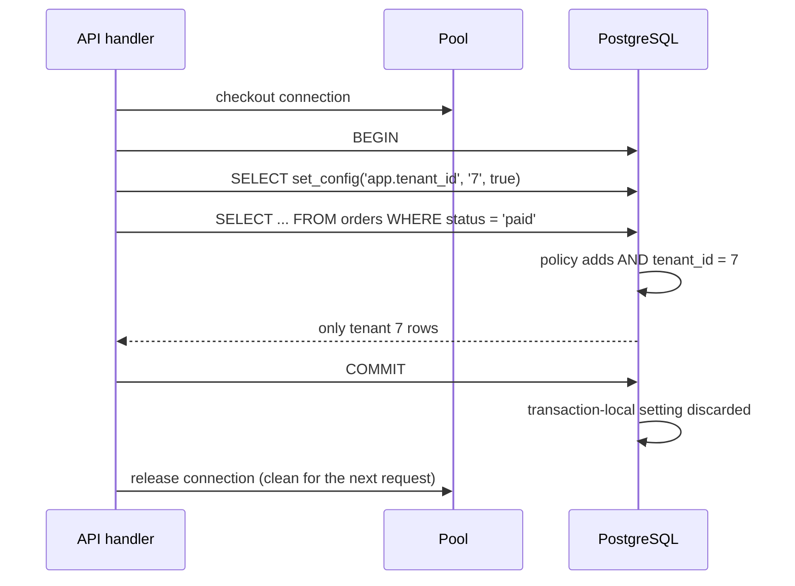

# Views

> **Module 03 · Databases** · Prerequisites: [Common Table Expressions](15-Common-Table-Expressions.md) · Next: [Materialized Views](17-Materialized-Views.md)

---

## ⏱ If You Only Have 2 Minutes

- A view is a **stored query, not stored data**. Every time you select from it, PostgreSQL pastes the definition into your query and plans the whole thing together. It is exactly as fast as the query it hides.
- Views give you a **stable interface**: rename or split a table and keep a view with the old name and shape, so old application versions keep working during a rolling deploy.
- Simple single-table views are **automatically updatable** (PostgreSQL 9.3+). `WITH CHECK OPTION` rejects inserts and updates that would produce a row the view cannot see.
- By default a view reads its tables **with the view owner's privileges**. That is how "GRANT on the view, not on the table" hides columns — and also how a view can accidentally bypass row-level security. `security_invoker = true` (PostgreSQL 15+) checks the caller instead.
- `security_barrier` stops a user's own function in `WHERE` from seeing rows the view filters out.
- **Row-level security** (`ENABLE ROW LEVEL SECURITY` + `CREATE POLICY`) is the multi-tenant tool: the database adds `tenant_id = ...` to every query, so a forgotten `WHERE` cannot leak another tenant's data.
- With a connection pool, set the tenant with `set_config('app.tenant_id', $1, true)` **inside a transaction**. `true` = transaction-local, so the next request that borrows the connection cannot inherit it.

---

## 1. What It Is and Why It Exists

A **view** is a named `SELECT` saved in the database catalog. You query it like a table, but it holds no rows. When you run `SELECT * FROM paid_orders WHERE customer_id = 42`, PostgreSQL's rewriter replaces `paid_orders` with its definition and the planner optimizes the combined query, pushing the `customer_id = 42` filter down to the `orders` index.

**Analogy:** a saved search in your email client. "Unread from my manager" is not a second copy of your inbox. It is a rule that runs against the inbox every time you click it, so it is always up to date and costs whatever the search costs.

**The problems it solves.**

- **Repeated query logic.** "An order counts as revenue if its status is `paid` or `shipped`" is written once, in a view, instead of in twelve services that slowly disagree.
- **Schema changes behind a stable name.** Clients, reports and BI tools depend on table and column names. A view lets you change the real tables and keep the old shape alive until every consumer has moved.
- **Access control.** Give an analyst role `SELECT` on a view that leaves out `customers.email`, and never grant the table itself.
- **Tenant isolation**, together with its stronger relative, row-level security.

What a view does **not** solve: speed. It precomputes nothing. If you need stored results, that is a [materialized view](17-Materialized-Views.md).

---

## 2. How It Works

### Query rewriting

```sql
CREATE VIEW paid_orders AS
SELECT id, customer_id, total_cents, created_at
FROM orders
WHERE status IN ('paid', 'shipped');

SELECT id, total_cents FROM paid_orders WHERE customer_id = 42;
-- is planned as:
SELECT id, total_cents FROM orders
WHERE status IN ('paid', 'shipped') AND customer_id = 42;
```

Because the definition is merged into the outer query, a view over one table costs nothing extra. A view that joins five tables costs the five-table join *every time*, even when the caller only wants one column. PostgreSQL can remove an unused `LEFT JOIN` only when a unique constraint proves the join cannot change the row count; otherwise the join runs.

Two rewriting details that surprise people:

1. **`SELECT *` is expanded when the view is created.** Columns added to the table later do not appear in the view.
2. **Views reference columns by internal position, not by name.** Renaming a column in the table does not break the view — the view keeps its own output column name. Dropping or retyping a column that the view uses is blocked.

### Row-level security with a pooled connection



The policy is attached to the **table**, so it applies whether the query comes from your API, a view, a report script or an ORM — anything running as a role that is subject to RLS.

---

## 3. Key Concepts

### Views as a compatibility layer during migrations

Renaming a table in one step breaks every running instance of the old code. With a view, the rename becomes an expand–contract migration:

```sql
BEGIN;
ALTER TABLE orders RENAME TO sales_orders;
-- Simple single-table view: old code can still SELECT, INSERT, UPDATE and DELETE through it.
CREATE VIEW orders AS SELECT * FROM sales_orders;
GRANT SELECT, INSERT, UPDATE, DELETE ON orders TO app_user;
COMMIT;
-- Deploy code that uses sales_orders everywhere. When no client uses "orders" any more:
DROP VIEW orders;
```

The same idea works for a column rename (`SELECT id, full_name AS name, ...`) or for a table split into two (a join view that presents the old wide shape for reads while writes move to the new tables). Keep these views temporary and tracked; a "temporary" compatibility view tends to live for years.

### Updatable views and `WITH CHECK OPTION`

PostgreSQL makes a view **automatically updatable** when, roughly, it selects from exactly one table or updatable view and has no `DISTINCT`, `GROUP BY`, `HAVING`, `LIMIT`, `OFFSET`, set operations (`UNION` …), aggregates or window functions at the top level. Columns that are plain references to base columns can be written; computed columns cannot. For anything more complex you need an `INSTEAD OF` trigger — usually a sign the logic belongs in application code.

The catch: an updatable view with a `WHERE` lets you write rows that then vanish from the view.

```sql
CREATE VIEW pending_orders AS
SELECT id, customer_id, status, total_cents, created_at
FROM orders
WHERE status = 'pending'
WITH CHECK OPTION;

UPDATE pending_orders SET status = 'paid' WHERE id = 5;
-- ERROR:  new row violates check option for view "pending_orders"
```

Without `WITH CHECK OPTION` the update succeeds and the row disappears from the view. `WITH CASCADED CHECK OPTION` (the default when you write just `CHECK OPTION`) also checks the conditions of views this view is built on; `LOCAL` checks only this view's own `WHERE`.

### Views and privileges: owner rights, `security_barrier`, `security_invoker`

| Option | Behaviour | Use it for |
|---|---|---|
| Default | Base tables are accessed with the **view owner's** privileges; the caller needs only privileges on the view | Hiding columns or rows: grant the view, not the table |
| `security_barrier` | The view's own `WHERE` runs before any caller-supplied condition that is not marked `LEAKPROOF` | Views used as a row filter for untrusted users |
| `security_invoker = true` (PG 15+) | Base tables are checked with the **caller's** privileges and the caller's RLS policies | Views used only for convenience, on tables protected by RLS |

**Why `security_barrier` exists.** Suppose `my_orders` filters to the current customer. A user creates `CREATE FUNCTION peek(text) RETURNS bool ... RAISE NOTICE '%', $1; RETURN true;` with a tiny cost and runs `SELECT * FROM my_orders WHERE peek(status)`. The planner may evaluate the cheap `peek` before the view's filter, so it sees — and prints — other customers' rows. A security-barrier view forces its own conditions first, at some cost: only `LEAKPROOF` functions and operators can be pushed down, which can prevent index use.

**Why `security_invoker` exists.** RLS policies are checked against the role that accesses the table. Through a default view, that role is the **view owner**. If the owner also owns the table — the usual case when migrations create both — RLS is skipped, because table owners bypass RLS unless the table has `FORCE ROW LEVEL SECURITY`. A convenience view then silently shows every tenant's data. On PostgreSQL 15+, `CREATE VIEW ... WITH (security_invoker = true)` closes that hole.

### Row-level security for multi-tenant data

RLS attaches **policies** to a table. Once enabled, every query by a role subject to RLS gets the policy's `USING` expression added as a filter, and every `INSERT`/`UPDATE` must satisfy `WITH CHECK`. If RLS is enabled and no policy matches, no rows are visible — the default is deny.

Who is **not** filtered: superusers, roles with `BYPASSRLS`, and the table owner (unless `FORCE ROW LEVEL SECURITY`). That is why the application must connect as a separate, non-owner role.

| Multi-tenant approach | Isolation enforced by | Main risk |
|---|---|---|
| `WHERE tenant_id = $1` in application code | Every developer, on every query | One forgotten filter leaks data |
| View per tenant / filtered view | View definition | Views multiply; owner-privilege and RLS-bypass traps |
| **RLS policy** | The database, on every query | Misconfigured role (owner/`BYPASSRLS`), leaked session setting |
| Schema or database per tenant | Separate objects | Migrations × N tenants; connection count |

RLS has a cost: the policy expression runs as a filter on every query, and it needs an index that starts with `tenant_id` to be cheap. Tables without a `tenant_id` column (like `order_items`) need either a copied `tenant_id` column or a policy with an `EXISTS` subquery against the parent, which is slower.

### Dependency pain

Views are **hard dependencies** in the catalog:

- `ALTER TABLE orders DROP COLUMN status` fails: "cannot drop column ... because other objects depend on it". Adding `CASCADE` drops the view — and any views built on it — without asking twice.
- `ALTER TABLE orders ALTER COLUMN total_cents TYPE bigint` fails: "cannot alter type of a column used by a view or rule". You must drop the view, alter the column and recreate the view, in one transaction.
- `CREATE OR REPLACE VIEW` can only **add columns at the end**. It cannot rename, reorder or retype existing columns; that needs `DROP VIEW` + `CREATE VIEW`.
- `DROP VIEW` also drops its **grants**. A migration that recreates a view must re-run the `GRANT`s, or the app gets "permission denied" right after deploy.

Before a migration touches a table, list what depends on it:

```sql
SELECT DISTINCT dependent.relname AS view_name
FROM pg_depend d
JOIN pg_rewrite r        ON r.oid = d.objid
JOIN pg_class dependent  ON dependent.oid = r.ev_class
WHERE d.classid = 'pg_rewrite'::regclass
  AND d.refobjid = 'orders'::regclass
  AND dependent.oid <> 'orders'::regclass;
```

Keep view chains shallow (a view built on a view built on a view turns every column change into a multi-object rebuild).

> **MySQL (InnoDB) difference:** MySQL views use `SQL SECURITY DEFINER` (the default) or `SQL SECURITY INVOKER`, the equivalent of PostgreSQL's owner-rights versus `security_invoker`. `WITH CHECK OPTION` is supported. MySQL has no row-level security, so tenant isolation must come from views or application filters.

---

## 4. Code Examples

Scenario: the shop becomes a multi-tenant SaaS — many stores share one database. Each API request is authenticated, the tenant ID comes from the verified token, and PostgreSQL enforces isolation with RLS.

### SQL

```sql
CREATE TABLE tenants (
  id    bigint GENERATED ALWAYS AS IDENTITY PRIMARY KEY,
  name  text NOT NULL
);

-- Shown on an empty table. On a live table, add it nullable, backfill, then SET NOT NULL.
-- The default lets INSERTs omit tenant_id: it comes from the transaction's setting.
ALTER TABLE orders
  ADD COLUMN tenant_id bigint NOT NULL REFERENCES tenants(id)
  DEFAULT nullif(current_setting('app.tenant_id', true), '')::bigint;
CREATE INDEX orders_tenant_created_idx ON orders (tenant_id, created_at DESC);

-- The API connects as app_user: not the table owner, no BYPASSRLS.
CREATE ROLE app_user LOGIN;
GRANT SELECT, INSERT, UPDATE ON orders TO app_user;

ALTER TABLE orders ENABLE ROW LEVEL SECURITY;
ALTER TABLE orders FORCE ROW LEVEL SECURITY;   -- apply policies to the owner too (e.g. scripts)

-- current_setting(..., true) returns NULL when unset, and '' after a local setting has expired,
-- so nullif turns both into NULL: tenant_id = NULL matches nothing (fail closed).
CREATE POLICY tenant_isolation ON orders
  USING      (tenant_id = nullif(current_setting('app.tenant_id', true), '')::bigint)
  WITH CHECK (tenant_id = nullif(current_setting('app.tenant_id', true), '')::bigint);

-- A convenience view that must respect RLS for whoever queries it (PostgreSQL 15+).
CREATE VIEW revenue_orders WITH (security_invoker = true) AS
SELECT id, tenant_id, customer_id, total_cents, created_at
FROM orders
WHERE status IN ('paid', 'shipped');
GRANT SELECT ON revenue_orders TO app_user;
```

Illustrative check, as `app_user`:

```sql
BEGIN;
SELECT set_config('app.tenant_id', '7', true);
SELECT DISTINCT tenant_id FROM orders;                 -- 7
INSERT INTO orders (customer_id, status, total_cents, tenant_id) VALUES (1, 'pending', 500, 8);
-- ERROR:  new row violates row-level security policy for table "orders"
ROLLBACK;
SELECT count(*) FROM orders;                           -- 0: no tenant set, nothing visible
```

### Node.js / TypeScript

```ts
// npm i express pg   (types: npm i -D @types/express @types/pg) — Node.js 22+, TypeScript 5, ESM
import express from "express";
import pg from "pg";

// Connect as app_user. If this were the table owner or a superuser, RLS would not apply.
const pool = new pg.Pool({ connectionString: process.env.APP_DATABASE_URL });

declare global {
  namespace Express {
    interface Request { user?: { sub: string; tenantId: number } } // set by the JWT middleware
  }
}

export async function withTenant<T>(tenantId: number, fn: (c: pg.PoolClient) => Promise<T>): Promise<T> {
  // One checked-out client for the whole unit of work: pool.query() could run each
  // statement on a different connection, and the setting would apply to the wrong one.
  const client = await pool.connect();
  let broken: Error | undefined;
  try {
    await client.query("BEGIN");
    // `true` = transaction-local (like SET LOCAL). SET cannot take $1, set_config can,
    // so the tenant ID is never concatenated into SQL.
    await client.query("SELECT set_config('app.tenant_id', $1, true)", [String(tenantId)]);
    const result = await fn(client);
    await client.query("COMMIT");   // the setting disappears here, before the client is reused
    return result;
  } catch (err) {
    await client.query("ROLLBACK").catch((e: Error) => { broken = e; });
    throw err;
  } finally {
    client.release(broken);         // a truthy argument destroys a connection we could not roll back
  }
}

const app = express();

app.get("/orders", async (req, res) => {
  const status = typeof req.query.status === "string" ? req.query.status : "paid";
  const orders = await withTenant(req.user!.tenantId, async (c) => {
    // No tenant_id filter written here: the policy adds it, and the (tenant_id, created_at)
    // index serves it because current_setting() is STABLE.
    const { rows } = await c.query<{ id: string; status: string; total_cents: number; created_at: Date }>(
      "SELECT id, status, total_cents, created_at FROM orders WHERE status = $1 ORDER BY created_at DESC LIMIT 50",
      [status],
    );
    return rows.map((r) => ({ ...r, id: Number(r.id) }));   // bigint id arrives as a string
  });
  res.json(orders);
});

app.listen(3000);
```

### Python

```python
# pip install fastapi "psycopg[binary,pool]"   — Python 3.12+
from collections.abc import AsyncIterator
from contextlib import asynccontextmanager
from typing import Annotated, Any

from fastapi import Depends, FastAPI, Request
from psycopg import AsyncConnection
from psycopg.rows import dict_row
from psycopg_pool import AsyncConnectionPool

# Connect as app_user, never as the table owner.
pool = AsyncConnectionPool("postgresql://app_user@localhost/shop", open=False)


@asynccontextmanager
async def lifespan(app: FastAPI) -> AsyncIterator[None]:
    await pool.open()
    yield
    await pool.close()


app = FastAPI(lifespan=lifespan)


@asynccontextmanager
async def tenant_tx(tenant_id: int) -> AsyncIterator[AsyncConnection]:
    async with pool.connection() as conn:
        # transaction() commits on success and rolls back on any exception,
        # which also discards the transaction-local tenant setting.
        async with conn.transaction():
            await conn.execute("SELECT set_config('app.tenant_id', %s, true)", (str(tenant_id),))
            yield conn


def current_tenant_id(request: Request) -> int:
    return request.state.tenant_id   # set by the auth middleware from a verified token claim


@app.get("/orders")
async def list_orders(
    tenant_id: Annotated[int, Depends(current_tenant_id)], status: str = "paid"
) -> list[dict[str, Any]]:
    async with tenant_tx(tenant_id) as conn:
        async with conn.cursor(row_factory=dict_row) as cur:
            await cur.execute(
                "SELECT id, status, total_cents, created_at FROM orders"
                " WHERE status = %s ORDER BY created_at DESC LIMIT 50",
                (status,),
            )
            return await cur.fetchall()
```

**Runtime difference to notice:** in `pg`, `pool.query()` is the convenient default, and it is exactly the wrong tool here — two consecutive `pool.query()` calls may run on different connections, so the `set_config` and the `SELECT` would not share a transaction. You must check out a client. In psycopg, `pool.connection()` always hands you one connection, so the trap is less likely; the psycopg trap is instead forgetting `conn.transaction()` on an autocommit connection, which makes the setting expire immediately after the `set_config` statement. With RLS both bugs fail closed (empty results), which is annoying but safe.

**Why transaction-local and not `SET app.tenant_id = ...`?** A session-level setting lives as long as the physical connection. The pool hands that connection to the next request, which may belong to another tenant and may skip setting its own value — for example, a background job that forgot to call `withTenant`. It then reads tenant 7's data. A transaction-local setting is discarded at `COMMIT` or `ROLLBACK`, so it cannot outlive the request. It is also the only kind that works behind PgBouncer in transaction pooling mode, where consecutive transactions from one client can run on different server connections.

---

## 5. Production Concerns

- **Test isolation, don't assume it.** Write an integration test that sets tenant A, inserts a row, sets tenant B, and asserts the row is invisible and that inserting with `tenant_id = A` fails. Run it as `app_user`, not as the migration role — tests that connect as the owner pass while production leaks.
- **Roles.** Migrations run as the owner; the app runs as `app_user` without `BYPASSRLS`. Check with `SELECT rolbypassrls, rolsuper FROM pg_roles WHERE rolname = current_user`. Use `FORCE ROW LEVEL SECURITY` so owner-run scripts are filtered too.
- **Index for the policy.** Every query on an RLS table filters by `tenant_id`, so indexes should lead with it: `(tenant_id, created_at)`, `(tenant_id, customer_id)`. Check `EXPLAIN` as `app_user` — the policy qual appears in the plan.
- **Policies with subqueries are slow.** An `EXISTS (SELECT 1 FROM orders ...)` policy on `order_items` runs per row. Copying `tenant_id` onto child tables is a deliberate, worthwhile denormalization here.
- **Admin and cross-tenant jobs.** A billing job that must read all tenants should use a separate role with `BYPASSRLS` and a separate pool, so the bypass is never available to request handlers.
- **View performance.** A view hides its cost. Log slow queries by statement text and look for views that join tables the caller does not need. `security_barrier` views can prevent index use on caller filters that are not leakproof.
- **Migration safety.** Before altering a table, list dependent views. Recreating a view must happen in the same transaction as the table change and must re-apply grants and `security_invoker`.

---

## 6. Common Mistakes

- **Expecting a view to be faster** — it is re-executed on every query — use a materialized view, summary table or index for speed.
- **Application connects as the table owner** — RLS is silently skipped and every tenant sees everything — use a non-owner role, and `FORCE ROW LEVEL SECURITY` as a second guard.
- **Session-level `SET app.tenant_id` with a pool** — the next request on that connection inherits the previous tenant — use `set_config(..., true)` inside a transaction.
- **`pool.query()` for the `set_config` and the real query** — they run on different connections, so the query sees no tenant (or another request's) — check out one client and wrap both in `BEGIN`/`COMMIT`.
- **Default view over an RLS table** — the view runs as its owner, so RLS is bypassed — `WITH (security_invoker = true)` on PostgreSQL 15+, or ensure the view owner is subject to the policy.
- **`DROP ... CASCADE` to get a migration through** — dependent views vanish, and their grants with them — list dependents first and recreate them explicitly.
- **Updatable filtered view without `WITH CHECK OPTION`** — rows can be written that the view's users can then never see or fix — add the check option.

---

## 7. Comparison Table

| | View | Materialized view | RLS policy | Filter in application code |
|---|---|---|---|---|
| Stores data | No | Yes (snapshot) | No | No |
| Freshness | Always current | Stale until refresh | Always current | Always current |
| Read cost | Same as the underlying query | Read of stored rows | Query + policy filter | Query |
| Enforces access for every client | Only if clients are denied the base table | Same as view | Yes, for every non-bypass role | No — only code paths that remember |
| Typical use | Shared definitions, compatibility layer, column hiding | Expensive aggregates, dashboards | Multi-tenant isolation | Simple single-service apps |

---

## 8. Interview Questions

**[Junior] What is a view, and does it store data?**
A view is a named `SELECT` saved in the database. It stores no rows; each query against it is rewritten to include the view's definition and planned together, so it is always current and costs whatever the underlying query costs. A materialized view is the variant that stores the result.

**[Junior] Can you insert into a view?**
Yes, if it is simple enough to be automatically updatable: one base table or updatable view, no aggregates, `DISTINCT`, `GROUP BY`, `LIMIT`, set operations or window functions. Only plain column references can be written. Add `WITH CHECK OPTION` so writes cannot create rows that fall outside the view's `WHERE`.

**[Mid] How can a view help with a zero-downtime schema change?**
Rename or reshape the table, then create a view with the old name and old columns that maps onto the new structure. Old application instances keep using the view (a simple one is even writable) while new instances use the new table. Once every old instance is gone, drop the view. It turns a breaking change into an expand–contract migration.

**[Mid] What does `security_barrier` protect against?**
Leaky functions. Without it, the planner may evaluate a cheap user-supplied function in the outer `WHERE` before the view's own filter, so the function sees rows the view was meant to hide and can leak them through an error or a notice. A security-barrier view applies its own conditions first and only pushes down `LEAKPROOF` functions.

**[Mid] How does row-level security work in PostgreSQL?**
You enable it per table and create policies. The `USING` expression is added as a filter to reads, updates and deletes, and `WITH CHECK` validates new rows. With RLS enabled and no matching policy, nothing is visible. Superusers, `BYPASSRLS` roles and the table owner (unless `FORCE ROW LEVEL SECURITY`) are not filtered, so the app must use a separate role.

**[Senior] You use RLS with a connection pool. How does the database know the tenant, and what can go wrong?**
Per request, check out one connection, `BEGIN`, call `set_config('app.tenant_id', $1, true)`, run the queries, `COMMIT`. The policy reads `current_setting('app.tenant_id', true)`. The `true` makes the setting transaction-local, so it is discarded before the connection goes back to the pool. Failure modes: a session-level `SET` that leaks to the next borrower; running the `set_config` and the query on different pooled connections; connecting as the owner so RLS never applies; and a policy that errors on the empty-string value a reset setting can have. Fail closed with `nullif(...)`, and test as the app role.

**[Senior] RLS or `WHERE tenant_id = $1` in the repository layer?**
Repository filters work if every query goes through one well-tested layer, and they are easy to see in code. RLS adds a guarantee that also covers ad-hoc scripts, reports, new services and ORM escape hatches, at the cost of a hidden filter, extra setup per transaction, and harder debugging ("why is this query returning nothing?"). For a product where a cross-tenant leak is a serious incident, I would use both: explicit filters for clarity and index use, and RLS as the safety net.

**[Senior] A migration needs to change a column type, but five views depend on it. How do you ship it?**
`ALTER COLUMN TYPE` is blocked while views reference the column. In one transaction: drop the dependent views (deepest first), alter the column, recreate the views, and re-apply grants and options like `security_invoker`. Generate the recreate statements from `pg_get_viewdef` and keep them in the migration. Changing a column type can also rewrite the table under an `ACCESS EXCLUSIVE` lock, so for a large table use expand–contract instead: add a new column, backfill, switch the views and code, then drop the old one.

---

## 9. Cheat Sheet

```text
View              stored SELECT, no data; rewritten into each query; cost = underlying query
SELECT * in view  expanded at CREATE time; new table columns don't appear
Updatable         1 table, no DISTINCT/GROUP BY/HAVING/LIMIT/UNION/aggregates/windows
CHECK OPTION      blocks writes that produce rows outside the view (CASCADED default, LOCAL)
Privileges        default: tables read as view OWNER → GRANT view, not table, to hide columns
security_barrier  view's WHERE runs before non-LEAKPROOF caller functions
security_invoker  PG 15+: check caller's privileges and RLS (use for views over RLS tables)
RLS               ENABLE ROW LEVEL SECURITY; CREATE POLICY p ON t USING (...) WITH CHECK (...)
Bypass RLS        superuser, BYPASSRLS, table owner (unless FORCE ROW LEVEL SECURITY)
Tenant setting    BEGIN; SELECT set_config('app.tenant_id', $1, true); ...; COMMIT
Why local         pooled connections are reused; SET would leak to the next request
Fail closed       nullif(current_setting('app.tenant_id', true), '')::bigint
Dependencies      DROP COLUMN / ALTER TYPE blocked; CREATE OR REPLACE only appends columns
DROP VIEW         loses GRANTs — re-grant in the same migration
```

---

## Related Topics

- [Materialized Views](17-Materialized-Views.md) — the stored-result variant, for speed
- [Database Migrations](34-Database-Migrations.md) — expand–contract, where compatibility views help
- [SQL DDL](08-SQL-DDL.md) — `ALTER TABLE` operations that views block
- [Transactions](27-Transactions.md) — why the tenant setting must live inside one
- [Repository Pattern](../Module-02-Core-Backend/14-Repository-Pattern.md) — the application-side alternative for tenant filters
- [Integration Testing](../Module-09-Testing-and-Code-Quality/05-Integration-Testing.md) — proving tenant isolation against a real database
