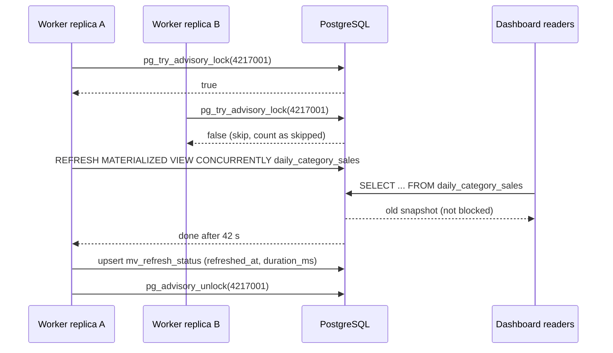

# Materialized Views

> **Module 03 · Databases** · Prerequisites: [Views](16-Views.md) · Next: [Stored Procedures and Functions](18-Stored-Procedures-and-Functions.md)

---

## ⏱ If You Only Have 2 Minutes

- A materialized view **stores the result of a query** on disk, like a table you cannot write to. Reads are fast; the data is a snapshot from the last refresh.
- PostgreSQL never refreshes it for you. `REFRESH MATERIALIZED VIEW` **recomputes the whole query** — there is no built-in incremental refresh.
- Plain `REFRESH` takes an `ACCESS EXCLUSIVE` lock: **every read waits** until it finishes.
- `REFRESH ... CONCURRENTLY` lets reads continue. It needs a **unique index on plain columns covering all rows**, cannot run on a never-populated view, is slower, and leaves dead rows for vacuum.
- Only one refresh of a view runs at a time; a second one **waits**, it does not skip. Guard scheduled refreshes with `pg_try_advisory_lock` so overlapping runs (or every app replica's scheduler) skip instead of piling up.
- **Staleness is a product decision:** decide how old the numbers may be, record when each refresh finished, and show "as of" to users.
- Alternatives: a **summary table updated incrementally** (fresh, but write-path complexity and hot rows) or an **application cache** (per-key, TTL-based, no SQL access to the result).

---

## 1. What It Is and Why It Exists

A **materialized view** is a query whose result PostgreSQL saves as a real relation on disk. You can index it, `ANALYZE` it and query it like a table. You cannot `INSERT` or `UPDATE` it. The only way to change its contents is `REFRESH MATERIALIZED VIEW`, which runs the defining query again and replaces the stored rows.

**Analogy:** the printed departures board at a small train station that someone updates every ten minutes. Reading it takes a glance instead of phoning every train. But a train that left two minutes ago may still be listed, and someone has to own the job of updating the board.

**The problem it solves.** Some reads are expensive and asked often: a sales dashboard that aggregates millions of order lines by day and category, a "top sellers" widget on every product page, a leaderboard. Running the full aggregate per request means seconds of CPU and I/O for every page view, and the cost grows with history. A plain [view](16-Views.md) does not help, because it re-runs the query every time.

A materialized view pays the cost once per refresh and serves every read from a small precomputed result. You give up freshness and gain predictable, cheap reads.

---

## 2. How It Works

### Creating and populating

```sql
CREATE MATERIALIZED VIEW daily_category_sales AS
SELECT ...;                       -- runs the query now and stores the result (WITH DATA is the default)

CREATE MATERIALIZED VIEW ... WITH NO DATA;   -- creates it empty and unreadable until the first REFRESH
```

The stored rows live in their own heap file, so you can create ordinary indexes on them. The definition stays in the catalog, like a view, which is how `REFRESH` knows what to run.

### Plain refresh versus concurrent refresh

| | `REFRESH MATERIALIZED VIEW` | `REFRESH MATERIALIZED VIEW CONCURRENTLY` |
|---|---|---|
| Lock taken | `ACCESS EXCLUSIVE` — blocks reads | `EXCLUSIVE` — reads continue, other refreshes wait |
| How | Runs the query into a new file and swaps it in | Runs the query into a temporary result, diffs it against the current rows, applies only the inserts and deletes |
| Requirements | None | A `UNIQUE` index using only column names (no expression, no `WHERE`) that covers every row; the view must already be populated |
| Speed | Faster, especially when most rows change | Slower; diff cost grows with view size |
| Leftovers | None (old file is dropped) | Dead tuples; needs vacuum |
| Use when | Nobody reads during the refresh, or the view is tiny | Users read it at any time |

The plain refresh's lock has a nasty side effect beyond its own duration. If a long report is reading the view when the refresh starts, the refresh waits for it — and every new reader queues behind the waiting refresh. A 30-second report plus a 20-second refresh can make a dashboard hang for 50 seconds.

### A guarded, scheduled refresh



An **advisory lock** is a lock on an application-chosen number. PostgreSQL attaches no meaning to it; it just guarantees only one session holds it. `pg_try_advisory_lock` returns `false` immediately instead of waiting, which is exactly "skip if a refresh is already running". A session-level advisory lock is released by `pg_advisory_unlock` or automatically when the session ends, so a crashed worker cannot hold it forever.

---

## 3. Key Concepts

### The unique index that `CONCURRENTLY` needs

`CONCURRENTLY` matches old and new rows by a unique key. The index must:

- be `UNIQUE`,
- list plain columns — not `lower(category)`, not `(day::text)`,
- have no `WHERE` clause.

For an aggregate view the natural key is the `GROUP BY` columns: `(day, category)`. If the query has no natural key, you cannot refresh it concurrently until you add one. Do not invent a key with `row_number()` — the numbers shift between refreshes, so every row "changes" and the diff does maximum work.

### Staleness is a product decision

A materialized view is always behind its source by up to one refresh interval plus one refresh duration. Decide that number with the people who use the data:

| Consumer | Acceptable staleness | Refresh plan |
|---|---|---|
| Finance month-end report | Hours; must be complete | Nightly, after the last batch import |
| Internal sales dashboard | 10–15 minutes | Every 10 minutes, concurrently |
| "Top sellers" widget | An hour | Hourly |
| Inventory shown at checkout | Zero | **Not a materialized view** — read the source |

Then make freshness visible. PostgreSQL does not record when a materialized view was last refreshed, so write it yourself (a `mv_refresh_status` table, as in section 4) and show "Data as of 14:20" in the UI. Alert when the age exceeds the agreed limit — a refresh job that silently stopped is the most common failure.

Do not put `now()` in the view's query to get a "refreshed at" column. Every row then changes on every refresh, which makes `CONCURRENTLY` rewrite the entire view.

### Scheduling refreshes

| Scheduler | How | Watch for |
|---|---|---|
| Application worker (`setInterval`, a job queue, a cron library) | Runs `REFRESH` from your code | Runs once **per replica** unless guarded; needs its own DB connection |
| Kubernetes CronJob / system cron | Starts a short-lived process | Overlapping runs if a refresh takes longer than the interval |
| `pg_cron` extension | `SELECT cron.schedule('refresh-sales', '*/10 * * * *', $$REFRESH MATERIALIZED VIEW CONCURRENTLY daily_category_sales$$);` | Runs inside the database; managed services must allow the extension; metrics and alerts are on you |
| After an event (e.g. end of a nightly import) | The import job refreshes at its end | Coupling between jobs; still guard against overlap |

Whatever runs it, add the advisory lock. Two refreshes of one view do not corrupt it — the second simply waits for the first — but waiting refreshes hold connections, then recompute a result that was just computed.

### Materialized view, summary table or cache

A **summary table** is an ordinary table you keep up to date yourself, for example by upserting into a `daily_sales_summary` table whenever an order is paid:

```sql
INSERT INTO daily_sales_summary (day, category, revenue_cents)
VALUES ($1, $2, $3)
ON CONFLICT (day, category)
DO UPDATE SET revenue_cents = daily_sales_summary.revenue_cents + EXCLUDED.revenue_cents;
```

It is fresh within seconds and its maintenance cost is proportional to new data, not total history. But every write path that changes revenue (payment, refund, cancellation, backfill, manual fix) must update it, the "today" rows become hot spots under concurrent writes, and you need a reconciliation job to repair drift.

An **application cache** (for example Redis with a TTL) stores the *answer to a request* rather than a relation. It is per key, easy to invalidate for one customer, and lives outside the database — but you cannot join it, filter it with SQL or build an index on it. See section 7 for the full comparison.

Core PostgreSQL has no incremental materialized view maintenance. If you need fresh aggregates over large data, that is a summary table (or a stream processor), not a faster refresh.

> **MySQL (InnoDB) difference:** MySQL has no materialized views. The usual substitutes are summary tables maintained by the application, triggers or scheduled events (`CREATE EVENT`).

---

## 4. Code Examples

Scenario: an internal dashboard shows revenue per day and category. The source query takes ~40 seconds over three years of orders. The view is refreshed every 10 minutes by a worker that runs on several replicas; only one may refresh at a time, and every run records its duration and outcome.

### SQL

```sql
CREATE MATERIALIZED VIEW daily_category_sales AS
SELECT (o.created_at AT TIME ZONE 'UTC')::date               AS day,      -- fixed zone: deterministic buckets
       p.category,
       count(DISTINCT o.id)                                   AS orders,
       sum(oi.quantity)                                       AS units,
       sum(oi.quantity::bigint * oi.unit_price_cents)         AS revenue_cents
FROM orders o
JOIN order_items oi ON oi.order_id = o.id
JOIN products p     ON p.id = oi.product_id
WHERE o.status IN ('paid', 'shipped')
GROUP BY 1, 2;

-- Required for CONCURRENTLY, and it serves the dashboard's "date range + category" reads.
CREATE UNIQUE INDEX daily_category_sales_key ON daily_category_sales (day, category);

-- PostgreSQL does not track refresh times, so the job records them.
CREATE TABLE mv_refresh_status (
  view_name     text        PRIMARY KEY,
  refreshed_at  timestamptz NOT NULL,
  duration_ms   integer     NOT NULL
);

-- Dashboard read: milliseconds instead of a 40-second aggregate.
SELECT day, category, revenue_cents
FROM daily_category_sales
WHERE day >= $1 AND day < $2
ORDER BY day, category;
```

Illustrative output:

| day | category | orders | units | revenue_cents |
|---|---|---|---|---|
| 2026-11-22 | audio | 214 | 260 | 1893400 |
| 2026-11-22 | books | 512 | 790 | 1104950 |
| 2026-11-23 | audio | 198 | 231 | 1702150 |

### Node.js / TypeScript

```ts
// npm i pg prom-client   (types: npm i -D @types/pg) — Node.js 22+, TypeScript 5, ESM
import pg from "pg";
import { Counter, Gauge, Histogram } from "prom-client";

const LOCK_KEY = 4217001;                 // one fixed number per job; document it with the job
const VIEW = "daily_category_sales";      // a constant, never user input: REFRESH cannot take $1

const duration = new Histogram({
  name: "mv_refresh_duration_seconds", help: "Materialized view refresh time",
  labelNames: ["view", "outcome"], buckets: [1, 5, 15, 30, 60, 120, 300, 600],
});
const lastSuccess = new Gauge({ name: "mv_last_success_timestamp_seconds", help: "Last good refresh", labelNames: ["view"] });
const skipped = new Counter({ name: "mv_refresh_skipped_total", help: "Refresh already running", labelNames: ["view"] });

export async function refreshDailySales(): Promise<void> {
  // A dedicated connection, not a pooled one: the advisory lock and the SET timeouts are
  // session state, and closing the client at the end guarantees both are gone.
  const client = new pg.Client({ connectionString: process.env.DATABASE_URL });
  await client.connect();
  try {
    const { rows } = await client.query<{ locked: boolean }>("SELECT pg_try_advisory_lock($1) AS locked", [LOCK_KEY]);
    if (!rows[0].locked) {                 // another replica (or a slow previous run) is refreshing
      skipped.inc({ view: VIEW });
      return;
    }
    await client.query("SET lock_timeout = '5s'");          // don't queue behind a migration's lock
    await client.query("SET statement_timeout = '15min'");  // a runaway refresh must not run forever

    const started = performance.now();
    try {
      await client.query(`REFRESH MATERIALIZED VIEW CONCURRENTLY ${VIEW}`);
    } catch (err) {
      duration.observe({ view: VIEW, outcome: "error" }, (performance.now() - started) / 1000);
      throw err;
    }
    const ms = Math.round(performance.now() - started);
    duration.observe({ view: VIEW, outcome: "ok" }, ms / 1000);
    lastSuccess.set({ view: VIEW }, Date.now() / 1000);
    await client.query(
      `INSERT INTO mv_refresh_status (view_name, refreshed_at, duration_ms) VALUES ($1, now(), $2)
       ON CONFLICT (view_name) DO UPDATE SET refreshed_at = EXCLUDED.refreshed_at, duration_ms = EXCLUDED.duration_ms`,
      [VIEW, ms],
    );
    console.log(JSON.stringify({ msg: "mv_refreshed", view: VIEW, durationMs: ms }));
  } finally {
    await client.end();                    // ends the session: releases the advisory lock too
  }
}

// In the worker process. setInterval does not wait for the previous run to finish; the advisory
// lock is what makes a slow run (here or on another replica) cause a skip instead of a pile-up.
setInterval(() => { refreshDailySales().catch((err) => console.error("mv_refresh_failed", err)); }, 10 * 60_000);
```

### Python

```python
# pip install "psycopg[binary]" prometheus-client   — Python 3.12+
import json
import logging
import os
import time

import psycopg
from prometheus_client import Counter, Gauge, Histogram, start_http_server
from psycopg import sql

LOCK_KEY = 4217001
VIEW = "daily_category_sales"

DURATION = Histogram("mv_refresh_duration_seconds", "Materialized view refresh time",
                     ["view", "outcome"], buckets=(1, 5, 15, 30, 60, 120, 300, 600))
LAST_SUCCESS = Gauge("mv_last_success_timestamp_seconds", "Last good refresh", ["view"])
SKIPPED = Counter("mv_refresh_skipped_total", "Refresh already running", ["view"])
log = logging.getLogger("mv_refresh")


def refresh_daily_sales() -> None:
    # autocommit=True: each statement commits on its own, so the long REFRESH is not wrapped in
    # an idle-in-transaction block, and the session-level advisory lock is the only thing held.
    with psycopg.connect(os.environ["DATABASE_URL"], autocommit=True) as conn:
        locked = conn.execute("SELECT pg_try_advisory_lock(%s)", (LOCK_KEY,)).fetchone()[0]
        if not locked:
            SKIPPED.labels(VIEW).inc()
            return
        conn.execute("SET lock_timeout = '5s'")
        conn.execute("SET statement_timeout = '15min'")

        started = time.perf_counter()
        try:
            # Identifiers cannot be bind parameters; sql.Identifier quotes the name safely.
            conn.execute(sql.SQL("REFRESH MATERIALIZED VIEW CONCURRENTLY {}").format(sql.Identifier(VIEW)))
        except psycopg.Error:
            DURATION.labels(VIEW, "error").observe(time.perf_counter() - started)
            raise
        elapsed = time.perf_counter() - started
        DURATION.labels(VIEW, "ok").observe(elapsed)
        LAST_SUCCESS.labels(VIEW).set_to_current_time()
        conn.execute(
            """INSERT INTO mv_refresh_status (view_name, refreshed_at, duration_ms) VALUES (%s, now(), %s)
               ON CONFLICT (view_name) DO UPDATE
               SET refreshed_at = EXCLUDED.refreshed_at, duration_ms = EXCLUDED.duration_ms""",
            (VIEW, round(elapsed * 1000)),
        )
        log.info(json.dumps({"msg": "mv_refreshed", "view": VIEW, "duration_ms": round(elapsed * 1000)}))
    # Leaving the `with` block closes the connection, which releases the advisory lock.


if __name__ == "__main__":
    logging.basicConfig(level=logging.INFO)
    start_http_server(9105)                # Prometheus scrapes this worker's metrics
    while True:
        try:
            refresh_daily_sales()
        except psycopg.Error:
            log.exception("mv_refresh_failed")
        time.sleep(600)
```

**Runtime difference to notice:** the Node worker schedules refreshes with `setInterval` on the event loop; the refresh itself is just an awaited network call, so the process stays responsive (for example to metric scrapes) while PostgreSQL does the work. The Python worker uses a blocking loop, which is fine because the process does nothing else — `start_http_server` serves metrics from a background thread. Also note psycopg's default is *not* autocommit: without `autocommit=True` the refresh would run inside an implicit transaction that stays open until you commit, which is easy to forget in a long-lived worker.

---

## 5. Production Concerns

- **Refresh cost is the full query.** A concurrent refresh runs the whole defining query, then a diff join against the existing rows, then writes the changes. It reads as much as the original slow query, every interval. If the refresh duration approaches the interval, you are running the expensive query continuously — switch to a summary table or partition the work.
- **Vacuum and bloat.** Each concurrent refresh deletes and inserts the rows that changed, leaving dead tuples in the view and its indexes. Make sure autovacuum keeps up (check `n_dead_tup` in `pg_stat_user_tables` for the view); otherwise the view and its unique index grow and reads slow down.
- **Lock behaviour.** Use `lock_timeout` on the refresh. A plain refresh waiting behind a long reader blocks every reader behind it; a concurrent refresh waiting behind a migration's `ACCESS EXCLUSIVE` lock just wastes a connection.
- **Replicas.** A refresh generates WAL in proportion to the rows it writes. Big refreshes cause replication lag spikes on read replicas — and a dashboard that reads from a lagging replica is staler than you think.
- **Permissions.** Only the view's owner can refresh it (PostgreSQL 17 adds a grantable `MAINTAIN` privilege). Run the job as the owner role or a role granted that privilege, not as the API's role.
- **Disk space.** A plain refresh builds a complete second copy before dropping the old one; a concurrent refresh needs space for the temporary result. Budget for twice the view's size.
- **What to measure:** refresh duration (histogram), outcome, skipped runs, last success timestamp, and an alert on `now() - refreshed_at` exceeding the agreed staleness. Skipped runs that never stop mean a stuck refresh holding the lock.

---

## 6. Common Mistakes

- **Plain `REFRESH` on a view users read all day** — the dashboard freezes for the full refresh and longer — use `CONCURRENTLY` with a proper unique index.
- **No unique index, or an expression/partial one** — `CONCURRENTLY` fails with an error asking for a unique index — create a plain-column unique index on the natural key.
- **Scheduling the refresh in every API replica** — ten replicas start ten refreshes; nine wait and then recompute the same result — guard with `pg_try_advisory_lock` or run the scheduler in one place.
- **Using a pooled connection for a session-level advisory lock** — the lock stays with the connection after it goes back to the pool, so later runs on other connections can never acquire it — use a dedicated connection, or always unlock on the same connection before releasing it.
- **No freshness tracking** — the refresh job dies quietly and the dashboard shows last week's numbers for days — record `refreshed_at`, show it in the UI, and alert on its age.
- **`now()` or random values in the definition** — every row changes on every refresh, so concurrent refresh rewrites the whole view — keep the query deterministic and track refresh time separately.
- **Materializing data that must be exact** — stock levels, balances, or anything a user acts on immediately — read the source tables, or maintain a summary table transactionally.

---

## 7. Comparison Table

| | Materialized view | Summary table (incremental) | Application cache (e.g. Redis) | Plain view |
|---|---|---|---|---|
| Freshness | Up to one refresh interval + duration | Seconds (same transaction or async worker) | Up to TTL, or until invalidated | Always current |
| Write-path cost | None | Every relevant write updates it | Invalidation on relevant writes | None |
| Refresh cost | Full recompute each time | Proportional to new data | Per key, on miss | Every read |
| Queryable with SQL / indexable | Yes | Yes | No (key lookups) | Yes (no own index) |
| Correctness risk | Staleness only | Drift if any write path forgets to update it | Stale or missed invalidation | None |
| Best for | Heavy aggregates read often, minutes of staleness OK | Large, growing data that must be fresh | Per-user or per-request results | Logic reuse, not speed |

---

## 8. Interview Questions

**[Junior] What is the difference between a view and a materialized view?**
A view stores only the query and runs it on every read, so it is always current but as slow as the query. A materialized view stores the query's result on disk, so reads are fast and can use their own indexes, but the data is only as fresh as the last `REFRESH`.

**[Junior] How do you update a materialized view?**
With `REFRESH MATERIALIZED VIEW name`, which reruns the full query. PostgreSQL does not refresh automatically and has no built-in incremental refresh, so you schedule it — from an application worker, a cron job, or the `pg_cron` extension.

**[Mid] What does `REFRESH ... CONCURRENTLY` do and what does it need?**
It computes the new result, compares it with the current rows by a unique key, and applies only the differences, holding a lock that still allows `SELECT`s. It requires a unique index on plain columns with no `WHERE` clause, and the view must already be populated. It is slower than a plain refresh and leaves dead tuples for vacuum, so it is the right choice when people read during the refresh.

**[Mid] How do you stop two refreshes from overlapping?**
PostgreSQL already serializes refreshes of one view — the second waits on the lock — but waiting runs pile up and redo the work. Take a session-level `pg_try_advisory_lock(key)` on a dedicated connection at the start of the job; if it returns false, skip and count it. The lock is released on unlock or when the connection closes, so a crashed job cannot block future runs.

**[Senior] The dashboard needs numbers no older than 30 seconds over three years of orders. Would you use a materialized view?**
Probably not. A refresh recomputes three years every time, so a 30-second target means running the expensive query almost continuously and creating constant WAL and vacuum work. I would maintain a summary table incrementally: update daily aggregates in the same transaction as the order status change, or from an outbox-driven worker, using `INSERT ... ON CONFLICT DO UPDATE`. I would add a nightly reconciliation that recomputes past days from source and fixes drift, and watch for lock contention on today's rows.

**[Senior] A refresh that used to take 2 minutes now takes 25 and the dashboard is stale. How do you investigate?**
Run the defining query with `EXPLAIN (ANALYZE, BUFFERS)` — data growth or a plan change (bad estimates, a lost index) is the usual cause. Check dead tuples on the view and its unique index; if vacuum is not keeping up, concurrent refreshes slow down as bloat grows. Check whether refreshes are waiting on locks (`pg_stat_activity.wait_event_type = 'Lock'`) behind long queries or migrations. Fixes range from indexing the source, to narrowing the view to recent data, to splitting history into a static table plus a small view over recent days.

**[Senior] Materialized view, summary table or Redis cache for a "top 10 products" widget?**
If the list can be an hour old and is the same for everyone, a materialized view refreshed hourly is simplest: one query, SQL-accessible, no write-path changes. A Redis cache fits better if the widget varies per user or region and only some keys are hot, because it computes only what is requested. A summary table is worth its write-path complexity only if the list must be near real time.

---

## 9. Cheat Sheet

```text
MV               stored query result; indexable; read-only; stale until REFRESH
Create           CREATE MATERIALIZED VIEW v AS ... [WITH NO DATA]
Refresh          full recompute — no incremental refresh in core PostgreSQL
Plain REFRESH    ACCESS EXCLUSIVE → readers blocked (and queue behind a waiting refresh)
CONCURRENTLY     EXCLUSIVE → reads continue; needs UNIQUE index on plain columns, no WHERE
                 must already be populated; slower; dead tuples → vacuum
One at a time    second refresh waits (not skips) → pg_try_advisory_lock to skip
Advisory lock    session-level: dedicated connection; released on unlock or disconnect
Timeouts         SET lock_timeout / statement_timeout on the refresh session
Freshness        not tracked by PG → write refreshed_at yourself; alert on age; show "as of"
Never            now()/random() in the definition; MV for data users act on immediately
Schedule         worker + advisory lock | k8s CronJob | pg_cron cron.schedule(...)
Alternatives     summary table (fresh, write-path work) | cache (per key, TTL) | view (no speedup)
MySQL            no materialized views → summary tables / events
```

---

## Related Topics

- [Views](16-Views.md) — the non-stored version, and when it is enough
- [Denormalization](07-Denormalization.md) — summary tables and keeping copies correct
- [Database Locks](30-Database-Locks.md) — `ACCESS EXCLUSIVE`, `EXCLUSIVE` and advisory locks
- [Cron Jobs](../Module-02-Core-Backend/18-Cron-Jobs.md) — running scheduled work once across replicas
- [Caching Fundamentals](../Module-07-Advanced-Backend-and-System-Design/14-Caching-Fundamentals.md) — the application-cache alternative
- [CQRS](../Module-07-Advanced-Backend-and-System-Design/27-CQRS.md) — read models maintained from events
