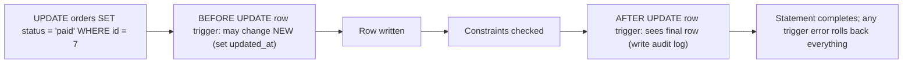

# Stored Procedures and Functions

> **Module 03 · Databases** · Prerequisites: [Materialized Views](17-Materialized-Views.md) · Next: [Indexes](19-Indexes.md)

---

## ⏱ If You Only Have 2 Minutes

- A **function** (`CREATE FUNCTION`, called with `SELECT f(...)`) returns a value, row or set and always runs **inside the caller's transaction**. It cannot `COMMIT`.
- A **procedure** (`CREATE PROCEDURE`, PostgreSQL 11+, called with `CALL p(...)`) returns no value but **can `COMMIT` and `ROLLBACK`** — only if the `CALL` is not inside an explicit transaction block.
- **Volatility** tells the planner what it may assume: `IMMUTABLE` (same inputs → same output forever; required for index expressions), `STABLE` (constant within one statement; usable in index scans), `VOLATILE` (the default; re-evaluated per row). Marking a function too strictly gives **wrong results**.
- **Triggers** run a function automatically on `INSERT`/`UPDATE`/`DELETE`: good for `updated_at` and audit logs, bad for hidden business workflows.
- Logic belongs in the database when it protects **integrity close to the data**, works on **sets** of rows, or removes many **round trips**. It does not belong there when it is business workflow that changes often, needs external calls, or must be unit-tested and traced like app code.
- **Database CPU is the hardest resource to scale.** App servers scale out; the primary database mostly scales up.
- `SECURITY DEFINER` runs with the owner's rights. Always add `SET search_path = ...` and `REVOKE EXECUTE ... FROM PUBLIC`, or a caller can hijack it.

---

## 1. What It Is and Why It Exists

**Stored functions** and **stored procedures** are code saved in the database and executed by the database server. In PostgreSQL you can write them in plain SQL, in **PL/pgSQL** (PostgreSQL's procedural language, with variables, `IF`, loops and exception handling), or in other installed languages.

**Analogy:** a bank's night-safe deposit slot. Instead of the customer walking through the vault (application code issuing five separate queries across the network), the bank offers one well-defined slot. The rules are enforced inside the building, the customer cannot skip a step, and it takes one trip.

**The problems they solve.**

- **Round trips.** Placing an order may lock stock, check availability, insert the order, insert items and write an audit row. From an application server that is five or more network round trips while locks are held. A function does it in one call, and the locks are held for microseconds instead of the network latency of each step.
- **Integrity that must hold for every client.** A trigger that stamps `updated_at` or writes an audit row applies to the API, the admin script and the data fix someone runs at 2 a.m.
- **Set-based work.** "Cancel every pending order older than 30 minutes and release its stock" is a few set-based statements in the database, rather than fetching thousands of rows into the app and writing them back one by one.

The cost is that logic now lives in a second codebase with its own deployment, testing and debugging story. Most of this chapter is about where that line should be.

---

## 2. How It Works

### Function versus procedure

| | Function | Procedure (PostgreSQL 11+) |
|---|---|---|
| Called with | `SELECT f(...)`, or inside any expression | `CALL p(...)` |
| Returns | A scalar, a row, or a set (`RETURNS TABLE`, `SETOF`) | Nothing; `INOUT` (and from PG 14, `OUT`) parameters come back as one row |
| Transactions | Runs inside the caller's transaction; cannot `COMMIT` | May `COMMIT` / `ROLLBACK` between steps if called outside an explicit transaction |
| Usable in queries | Yes: `SELECT`, `WHERE`, index expressions (if `IMMUTABLE`), triggers | No |
| Typical use | Atomic multi-step operations, reusable calculations, trigger bodies | Batch maintenance that commits in chunks |

When a function raises an error, the statement that called it fails, and everything the function did is rolled back with it. That is what makes a function a convenient **atomic unit**: either the whole order is placed, or nothing happened.

A procedure's `COMMIT` ends the current transaction and starts a new one. That only works if the procedure owns the transaction: if the client sent `BEGIN` before `CALL`, the procedure's `COMMIT` fails with `invalid transaction termination`. Drivers that open transactions implicitly (psycopg by default) must use autocommit mode for `CALL`.

### PL/pgSQL in five lines

```sql
CREATE FUNCTION f(p_id bigint) RETURNS bigint LANGUAGE plpgsql AS $$
DECLARE v_total bigint;                         -- variables
BEGIN
  SELECT sum(total_cents) INTO v_total FROM orders WHERE customer_id = p_id;  -- query INTO variable
  IF v_total IS NULL THEN RETURN 0; END IF;     -- control flow
  RETURN v_total;
END;
$$;
```

Other essentials: `RAISE EXCEPTION 'msg %', value USING ERRCODE = '...'` to fail with a specific SQLSTATE, `FOUND` after a statement to see if it touched rows, `BEGIN ... EXCEPTION WHEN ... THEN ... END` blocks to catch errors (each such block creates a subtransaction, which has a cost), and `PERFORM` to run a query and discard the result.

### Triggers

A trigger binds a function to a table event:



- **`BEFORE ... FOR EACH ROW`** can modify `NEW` before it is stored, or return `NULL` to skip the row.
- **`AFTER ... FOR EACH ROW`** sees the final row; its return value is ignored. Use it for side effects such as audit rows.
- **`FOR EACH STATEMENT`** fires once per statement, however many rows changed.
- `UPDATE OF status` fires when `status` appears in the `SET` list — even if the value did not change — so add `WHEN (OLD.status IS DISTINCT FROM NEW.status)`.
- Triggers run in the same transaction as the statement. A failing trigger fails the write.

---

## 3. Key Concepts

### Volatility: `IMMUTABLE`, `STABLE`, `VOLATILE`

| Category | Promise to the planner | Examples | Consequences |
|---|---|---|---|
| `IMMUTABLE` | Same arguments → same result, forever; reads no tables, no settings | `lower(text)`, arithmetic, your `normalize_email(text)` | Can be pre-evaluated at plan time; **required** for index expressions and partial-index predicates |
| `STABLE` | Same arguments → same result within one statement; may read tables, no writes | `now()`, `current_setting()`, a lookup function | Can be used as an index-scan comparison value (evaluated once, not per row) |
| `VOLATILE` (default) | Anything can change, may have side effects | `random()`, `clock_timestamp()`, `nextval()`, anything that writes | Re-evaluated for every row; never used as an index-scan key |

Two failure modes:

- **Too loose.** A function that only reads data is left as the default `VOLATILE`. Then `WHERE customer_id = current_customer_id()` cannot use the index on `customer_id`, because the planner must call the function for every row. Mark it `STABLE`.
- **Too strict (lying).** A function that reads a table, or depends on the `TimeZone` setting, is marked `IMMUTABLE` so it can be used in an index. The index stores values computed at insert time; when the table or setting changes, the index silently returns wrong rows. PostgreSQL does not verify your claim.

```sql
-- Correctly IMMUTABLE: depends only on its argument.
CREATE FUNCTION normalize_email(p_email text) RETURNS text
LANGUAGE sql IMMUTABLE PARALLEL SAFE
RETURN lower(btrim(p_email));

CREATE UNIQUE INDEX customers_email_normalized_key ON customers (normalize_email(email));
-- Queries must use the same expression to use the index:
SELECT id FROM customers WHERE normalize_email(email) = normalize_email($1);
```

(The `RETURN expression` body form for SQL functions exists since PostgreSQL 14.)

Planner visibility also differs by language. A simple `LANGUAGE sql` function can be **inlined** into the calling query, so the planner sees the real expression. A PL/pgSQL function is a black box: PostgreSQL assumes a default cost and, for set-returning functions, 1,000 result rows unless you declare `ROWS`. Wrong row estimates from a black-box function are a classic cause of bad join plans.

### When logic belongs in the database — and when it does not

| Put it in the database | Keep it in the application |
|---|---|
| Rules every writer must obey: constraints first; triggers only for what constraints cannot express | Business workflows: pricing, promotions, eligibility rules that product changes weekly |
| Set-based bulk work over many rows | Anything that calls another service, sends email, or charges a card |
| A multi-step operation that holds locks, where round trips multiply lock time | Logic you need to unit test quickly, trace with OpenTelemetry, and log with request context |
| Housekeeping columns: `updated_at`, audit trails | Logic that must scale with traffic — app servers scale out, the primary database mostly scales up |

The strongest argument against heavy database logic is the last one. The primary database is usually the single most expensive, hardest-to-scale machine in the system. Every CPU-heavy function call runs there, competing with every query. Ten more app servers are a config change; a bigger primary is a migration.

The other recurring costs: logic split across two codebases, deploys that need a migration to change behaviour, debugging without stack traces or request logs, and a smaller pool of engineers comfortable reviewing PL/pgSQL. Triggers add **surprise**: a bulk import is ten times slower than expected because of a trigger nobody remembered.

### Versioning functions with rolling deploys

`CREATE OR REPLACE FUNCTION` changes the code in place, instantly, for every caller — including old application instances still running during a rolling deploy. So:

- Keep the signature and behaviour backward compatible, or add a new function (`place_order_v2`) and drop the old one after every caller has moved (expand–contract).
- `CREATE OR REPLACE` cannot change the return type or parameter names in incompatible ways; that requires `DROP FUNCTION` + `CREATE FUNCTION`, which also drops its grants.
- Functions are identified by name **and argument types**. Adding a parameter creates a second, overloaded function rather than replacing the first.
- Keep every function in migrations, under version control, never edited by hand on production.

### `SECURITY DEFINER` and the `search_path` risk

By default a function runs with the **caller's** privileges (`SECURITY INVOKER`). `SECURITY DEFINER` makes it run with the **owner's** privileges, which lets you expose one narrow, privileged operation (for example "reset this user's failed-login counter") without granting table access.

The danger: unqualified names inside the function are resolved through the **caller's** `search_path`. A caller who can create objects in a schema that is searched earlier — including their own temporary schema — can define a table or function with the same name and have the privileged function use it. The PostgreSQL docs' rules:

```sql
-- Support staff may cancel a pending order, but get no UPDATE privilege on orders.
CREATE FUNCTION support_cancel_order(p_order_id bigint) RETURNS boolean
LANGUAGE sql
SECURITY DEFINER
SET search_path = public, pg_temp          -- fixed path; pg_temp explicitly last
AS $$
  UPDATE public.orders SET status = 'cancelled'   -- schema-qualified as well
  WHERE id = p_order_id AND status = 'pending'
  RETURNING true;
$$;

REVOKE EXECUTE ON FUNCTION support_cancel_order(bigint) FROM PUBLIC;   -- functions are executable by PUBLIC by default
GRANT  EXECUTE ON FUNCTION support_cancel_order(bigint) TO support_role;
```

Also schema-qualify table names inside the body. PostgreSQL 15 removed the default `CREATE` privilege on the `public` schema for all users, which shrinks the attack surface on new clusters, but upgraded clusters keep their old grants.

> **MySQL (InnoDB) difference:** MySQL has stored procedures, functions and triggers, but triggers are **row-level only** (no statement-level triggers). With binary logging enabled, creating a function requires declaring it `DETERMINISTIC`, `NO SQL` or `READS SQL DATA` (or setting `log_bin_trust_function_creators`).

---

## 4. Code Examples

Scenario: checkout calls a `place_order` function that reserves stock and creates the order atomically in one round trip. A maintenance job calls a procedure that cancels stale pending orders in committed batches. Triggers keep `updated_at` and a status audit log correct for every writer.

### SQL

```sql
-- Function: all-or-nothing order placement. Raises a custom SQLSTATE the app can map to 409.
CREATE FUNCTION place_order(p_customer_id bigint, p_items jsonb) RETURNS bigint
LANGUAGE plpgsql AS $$
DECLARE
  v_order_id bigint;
  v_short    bigint;
BEGIN
  -- Lock inventory rows in a fixed order, so two concurrent orders cannot deadlock.
  PERFORM 1 FROM inventory
  WHERE product_id IN (SELECT (x->>'product_id')::bigint FROM jsonb_array_elements(p_items) x)
  ORDER BY product_id FOR UPDATE;

  WITH wanted AS (
    SELECT * FROM jsonb_to_recordset(p_items) AS w(product_id bigint, quantity int)
  ), reserved AS (
    UPDATE inventory i SET available = i.available - w.quantity, version = i.version + 1
    FROM wanted w
    WHERE i.product_id = w.product_id AND i.available >= w.quantity
    RETURNING i.product_id
  )
  SELECT w.product_id INTO v_short
  FROM wanted w LEFT JOIN reserved r USING (product_id)
  WHERE r.product_id IS NULL
  LIMIT 1;

  IF v_short IS NOT NULL THEN
    -- The error aborts the calling statement, undoing the reservations made above.
    RAISE EXCEPTION 'insufficient stock for product %', v_short USING ERRCODE = 'IS001';
  END IF;

  INSERT INTO orders (customer_id, status, total_cents)
  SELECT p_customer_id, 'pending', sum(w.quantity * p.price_cents)
  FROM jsonb_to_recordset(p_items) AS w(product_id bigint, quantity int)
  JOIN products p ON p.id = w.product_id
  RETURNING id INTO v_order_id;

  INSERT INTO order_items (order_id, product_id, quantity, unit_price_cents)
  SELECT v_order_id, w.product_id, w.quantity, p.price_cents
  FROM jsonb_to_recordset(p_items) AS w(product_id bigint, quantity int)
  JOIN products p ON p.id = w.product_id;

  RETURN v_order_id;
END;
$$;

-- Procedure: cancel stale pending orders and release their stock, committing per batch.
CREATE PROCEDURE expire_pending_orders(p_older_than interval, p_batch int DEFAULT 500)
LANGUAGE plpgsql AS $$
DECLARE
  v_count int;
BEGIN
  LOOP
    WITH expired AS (
      UPDATE orders SET status = 'cancelled'
      WHERE id IN (SELECT id FROM orders
                   WHERE status = 'pending' AND created_at < now() - p_older_than
                   ORDER BY id LIMIT p_batch FOR UPDATE SKIP LOCKED)
      RETURNING id
    ), released AS (
      UPDATE inventory i SET available = i.available + x.qty
      FROM (SELECT oi.product_id, sum(oi.quantity) AS qty
            FROM order_items oi JOIN expired e ON e.id = oi.order_id
            GROUP BY oi.product_id) x
      WHERE i.product_id = x.product_id
    )
    SELECT count(*) INTO v_count FROM expired;

    COMMIT;                          -- locks released, progress durable; not allowed in an EXCEPTION block
    EXIT WHEN v_count < p_batch;
  END LOOP;
END;
$$;

-- Triggers: updated_at for every writer, and an audit row on every status change.
ALTER TABLE orders ADD COLUMN updated_at timestamptz NOT NULL DEFAULT now();

CREATE TABLE order_status_history (
  id          bigint GENERATED ALWAYS AS IDENTITY PRIMARY KEY,
  order_id    bigint      NOT NULL,   -- no FK on purpose: history must outlive archived orders
  old_status  text        NOT NULL,
  new_status  text        NOT NULL,
  changed_at  timestamptz NOT NULL DEFAULT clock_timestamp(),
  changed_by  text        NOT NULL DEFAULT coalesce(nullif(current_setting('app.user_id', true), ''), current_user)
);

CREATE FUNCTION set_updated_at() RETURNS trigger LANGUAGE plpgsql AS $$
BEGIN
  NEW.updated_at := now();   -- transaction start time: all rows in one transaction match
  RETURN NEW;
END;
$$;

CREATE FUNCTION log_order_status() RETURNS trigger LANGUAGE plpgsql AS $$
BEGIN
  INSERT INTO order_status_history (order_id, old_status, new_status)
  VALUES (NEW.id, OLD.status, NEW.status);
  RETURN NULL;               -- ignored for AFTER triggers
END;
$$;

CREATE TRIGGER orders_set_updated_at
  BEFORE UPDATE ON orders
  FOR EACH ROW EXECUTE FUNCTION set_updated_at();

CREATE TRIGGER orders_status_audit
  AFTER UPDATE OF status ON orders
  FOR EACH ROW WHEN (OLD.status IS DISTINCT FROM NEW.status)
  EXECUTE FUNCTION log_order_status();
```

Note the interaction: the procedure's `UPDATE orders SET status = 'cancelled'` fires both triggers, so expired orders get a fresh `updated_at` and an audit row without the procedure knowing about either.

### Node.js / TypeScript

```ts
// npm i express pg   (types: npm i -D @types/express @types/pg) — Node.js 22+, TypeScript 5, ESM
import express from "express";
import pg from "pg";

const pool = new pg.Pool({ connectionString: process.env.DATABASE_URL });
const INSUFFICIENT_STOCK = "IS001";       // the custom SQLSTATE raised by place_order

interface OrderLine { productId: number; quantity: number }

export async function placeOrder(customerId: number, lines: OrderLine[]): Promise<number> {
  // One round trip; the function's internal steps share one transaction on the server.
  const payload = JSON.stringify(lines.map((l) => ({ product_id: l.productId, quantity: l.quantity })));
  const { rows } = await pool.query<{ order_id: string }>(
    "SELECT place_order($1, $2::jsonb) AS order_id", [customerId, payload],
  );
  return Number(rows[0].order_id);        // bigint comes back as a string
}

export async function expirePendingOrders(): Promise<void> {
  // pool.query without BEGIN runs in autocommit mode, so the procedure owns its transactions
  // and its COMMITs work. Wrapping this in BEGIN would fail with "invalid transaction termination".
  await pool.query("CALL expire_pending_orders($1::interval, $2)", ["30 minutes", 500]);
}

const app = express();
app.use(express.json());

app.post("/orders", async (req, res) => {
  const { customerId, lines } = req.body as { customerId?: number; lines?: OrderLine[] };
  if (!Number.isInteger(customerId) || !Array.isArray(lines) || lines.length === 0
      || !lines.every((l) => Number.isInteger(l.productId) && Number.isInteger(l.quantity) && l.quantity > 0)) {
    res.status(400).json({ error: "invalid_order" });
    return;
  }
  try {
    const orderId = await placeOrder(customerId!, lines);
    res.status(201).json({ orderId });
  } catch (err) {
    // Map the function's SQLSTATE to an HTTP answer; never parse the message text.
    if (err instanceof pg.DatabaseError && err.code === INSUFFICIENT_STOCK) {
      res.status(409).json({ error: "insufficient_stock", detail: err.message });
      return;
    }
    throw err;                            // Express 5 forwards rejected promises to the error handler
  }
});

// A scheduler (one instance, see the Cron Jobs chapter) calls expirePendingOrders every minute.
app.listen(3000);
```

### Python

```python
# pip install fastapi "psycopg[binary,pool]"   — Python 3.12+
import os
from datetime import timedelta

import psycopg
from fastapi import FastAPI, HTTPException
from psycopg.types.json import Jsonb
from psycopg_pool import ConnectionPool
from pydantic import BaseModel, Field

DSN = os.environ["DATABASE_URL"]
INSUFFICIENT_STOCK = "IS001"
pool = ConnectionPool(DSN, open=True)


class Line(BaseModel):
    product_id: int
    quantity: int = Field(gt=0)


class PlaceOrder(BaseModel):
    customer_id: int
    lines: list[Line] = Field(min_length=1)


app = FastAPI()


@app.post("/orders", status_code=201)
def create_order(body: PlaceOrder) -> dict[str, int]:
    # A plain `def`: FastAPI runs it in a thread pool, so the blocking psycopg call
    # does not stall the event loop.
    try:
        with pool.connection() as conn:   # commits on success, rolls back on error
            row = conn.execute(
                "SELECT place_order(%s, %s)",
                (body.customer_id, Jsonb([line.model_dump() for line in body.lines])),
            ).fetchone()
    except psycopg.Error as err:
        if err.sqlstate == INSUFFICIENT_STOCK:
            raise HTTPException(409, "insufficient_stock") from None
        raise
    return {"order_id": row[0]}           # bigint is already a Python int


def expire_pending_orders() -> None:
    # psycopg opens a transaction before the first statement unless autocommit is on;
    # the procedure's COMMIT would then fail with "invalid transaction termination".
    with psycopg.connect(DSN, autocommit=True) as conn:
        conn.execute("CALL expire_pending_orders(%s, %s)", (timedelta(minutes=30), 500))
```

**Runtime difference to notice:** the two drivers default to opposite transaction modes. `pg` sends each `pool.query()` on its own, in autocommit, so `CALL` just works and you must remember to *add* `BEGIN` when you want a transaction. psycopg starts a transaction implicitly, which is safe for `place_order` but breaks a committing procedure — hence the separate `autocommit=True` connection. Also, psycopg adapts `timedelta` to `interval` and `Jsonb` to `jsonb` directly, while in Node the interval travels as a string with an explicit `::interval` cast.

---

## 5. Production Concerns

- **Database CPU and lock time.** Measure function cost with `pg_stat_user_functions` (enable `track_functions = 'pl'`), which records calls and total/self time per function. A function that is cheap per call but called per row of a large query can dominate CPU on the primary.
- **Plans inside PL/pgSQL.** PL/pgSQL caches query plans per session, and after a few executions may switch to a generic plan that ignores the actual parameter values. If one customer has 90% of the rows, a generic plan can be badly wrong for them. Check with `auto_explain` (with `auto_explain.log_nested_statements = on`) when a function is slow only for some inputs.
- **Lock ordering.** Functions that lock several rows (like `place_order`) must lock in a consistent order, or two concurrent calls deadlock. `ORDER BY ... FOR UPDATE` before the updates fixes the order.
- **Error contract.** Raise specific SQLSTATEs (`USING ERRCODE`) and map them in the app. Matching on message text breaks the first time someone rewords a message.
- **Observability.** Code inside the database has no request ID, no trace span and no structured log. Pass context through a transaction-local setting (`set_config('app.request_id', $1, true)`) if triggers or functions must record it, and log slow calls from the app side with the function name.
- **Testing.** Test functions and triggers against a real PostgreSQL in integration tests (or with pgTAP). Mocking the database in unit tests skips exactly the code that lives in it.
- **Bulk loads and triggers.** Row-level triggers fire once per row, so a 10-million-row backfill runs the trigger 10 million times. Plan backfills with this in mind (batching, or a statement-level trigger with transition tables for audits).

---

## 6. Common Mistakes

- **Leaving read-only functions `VOLATILE`** — `WHERE id = current_customer_id()` becomes a sequential scan — declare `STABLE` (or `IMMUTABLE` if it truly depends only on its arguments).
- **Marking a table-reading or time-zone-dependent function `IMMUTABLE` to get an index** — the index returns wrong results after the data or setting changes — only mark pure functions `IMMUTABLE`.
- **`CALL` inside an explicit transaction for a procedure that commits** — "invalid transaction termination" — call it in autocommit mode.
- **`SECURITY DEFINER` without `SET search_path`** — a caller can shadow a table or function and run code with the owner's rights — set a fixed `search_path` with `pg_temp` last, schema-qualify names, revoke `EXECUTE` from `PUBLIC`.
- **Business workflows in triggers** — an insert silently sends emails or recalculates prices; bulk loads crawl; nobody can find the logic — keep triggers to housekeeping and integrity, put workflows in the service layer.
- **`CREATE OR REPLACE` with a behaviour change during a rolling deploy** — old app instances get new behaviour mid-deploy — add a new versioned function and retire the old one later.
- **Catching every exception inside PL/pgSQL** — `EXCEPTION WHEN OTHERS` hides real errors and creates a subtransaction per call — catch only the specific conditions you can handle.

---

## 7. Comparison Table

| | Constraint (`CHECK`, `UNIQUE`, FK) | Trigger | Function / procedure | Application service |
|---|---|---|---|---|
| Enforced for every writer | Yes | Yes | Only for callers that use it | Only for code paths that call it |
| Visibility to developers | High (in the schema) | Low (fires implicitly) | Medium (explicit call) | High (in the codebase) |
| Can call external systems | No | No (and must not) | No | Yes |
| Testing | Simple | Needs a real database | Needs a real database | Unit + integration tests |
| Scales with | Database | Database | Database | App servers (horizontal) |
| Best for | Invariants on rows and relations | `updated_at`, audit, denormalized counters | Atomic multi-step data operations, set-based batches | Business rules and workflows |

Prefer the leftmost column that can express the rule.

---

## 8. Interview Questions

**[Junior] What is the difference between a function and a procedure in PostgreSQL?**
A function is called from SQL (`SELECT f()`), returns a value or rows, and runs inside the caller's transaction, so it cannot commit. A procedure, added in PostgreSQL 11, is invoked with `CALL`, returns no value apart from `INOUT`/`OUT` parameters, and can `COMMIT` or `ROLLBACK` internally if it was not called inside an explicit transaction block. Use procedures for batch jobs that need to commit in chunks.

**[Junior] What is a trigger, and give a good use for one?**
A trigger runs a function automatically before or after `INSERT`, `UPDATE` or `DELETE`, per row or per statement. Good uses are housekeeping that must apply to every writer: setting `updated_at` in a `BEFORE UPDATE` trigger, or writing an audit row in an `AFTER UPDATE` trigger. A failing trigger fails the write, so the audit cannot be skipped.

**[Mid] What do `IMMUTABLE`, `STABLE` and `VOLATILE` mean, and why do they matter?**
They promise how a function's result can change: never for the same inputs, not within one statement, or at any time. The planner uses that: only `IMMUTABLE` functions can be used in index expressions, `STABLE` and `IMMUTABLE` functions can supply index-scan values, and `VOLATILE` functions are re-run per row. Under-declaring costs performance; over-declaring gives wrong results, because PostgreSQL trusts the label.

**[Mid] Why might you move a multi-step operation into a database function?**
To make it one round trip and one atomic unit. Five application queries hold their locks across five network round trips; a function holds them for the time it takes the server to run five statements. Every client also goes through the same checked path. The trade-off is that the logic is harder to test, trace and change than application code.

**[Senior] Your team wants to move pricing and promotion logic into stored procedures "for performance". What do you say?**
I would first find where the time actually goes — usually it is round trips or N+1 queries, which can be fixed with set-based queries from the app. Pricing rules change often, need unit tests and feature flags, and run per request; moving them to the database couples every change to a migration and spends CPU on the primary, which is the hardest component to scale. I would keep pricing in the service layer and move only data-local, set-based or integrity-critical steps (like the stock reservation) into a function.

**[Senior] What is the risk with `SECURITY DEFINER` functions and how do you mitigate it?**
They run with the owner's privileges but resolve unqualified names through the search path, so a caller who can create objects in a schema searched earlier (including their own temp schema) can shadow a table or function and make the privileged code use it. Mitigate by setting `SET search_path = trusted_schema, pg_temp` on the function, schema-qualifying names, revoking `EXECUTE` from `PUBLIC` and granting it only to the roles that need it, and keeping the function small and audited.

**[Senior] How do you deploy a change to a database function without breaking a rolling deploy?**
`CREATE OR REPLACE` changes behaviour instantly for old and new app instances, so treat it like an API change. Either keep the change backward compatible, or create `place_order_v2`, deploy app code that calls it, and drop the old version after no instance uses it. Keep functions in migrations, test them in CI against a real database, and remember that `DROP FUNCTION` drops grants that must be re-applied.

**[Senior] A trigger-based audit log made a nightly bulk import 8× slower. What are your options?**
Row-level triggers run once per row, so the import pays the function call, and a separate audit `INSERT`, millions of times. The best fix is usually a statement-level `AFTER` trigger with transition tables (`REFERENCING OLD TABLE AS old_rows NEW TABLE AS new_rows`), which writes all audit rows with one set-based `INSERT ... SELECT` per statement and keeps the guarantee for every writer. Batching the import into larger statements makes that even more effective. For very high volumes, change-data-capture from the WAL moves auditing out of the write path entirely. I would not simply disable the trigger for the import, because the audit log then has a hole exactly where bulk changes happened.

---

## 9. Cheat Sheet

```text
FUNCTION       SELECT f(); returns value/row/set; runs in caller's tx; cannot COMMIT
PROCEDURE      CALL p(); PG 11+; may COMMIT/ROLLBACK if CALL is not inside BEGIN...COMMIT
Error          RAISE EXCEPTION '...' USING ERRCODE = 'XX001' → whole calling statement rolls back
IMMUTABLE      pure; required for index expressions; lying = wrong results
STABLE         constant within a statement; can read tables; usable for index scans (now(), current_setting)
VOLATILE       default; per-row evaluation; random(), clock_timestamp(), nextval(), any write
SQL vs PL/pgSQL  simple SQL functions can be inlined; PL/pgSQL is a black box (default ROWS 1000 for sets)
Triggers       BEFORE row: change NEW | AFTER row: audit | WHEN (OLD.x IS DISTINCT FROM NEW.x)
now()          transaction start time; clock_timestamp() = actual time
In the DB      integrity, set-based batches, lock-holding multi-step ops, updated_at/audit
In the app     changing business rules, external calls, things you trace/unit test, CPU-heavy work
Scaling        app servers scale out; the primary DB mostly scales up
SECURITY DEFINER  SET search_path = schema, pg_temp; REVOKE EXECUTE FROM PUBLIC; qualify names
Deploys        CREATE OR REPLACE is instant for all callers → version (f_v2) for breaking changes
Drivers        pg: autocommit by default | psycopg: implicit tx → autocommit=True for CALL
```

---

## Related Topics

- [Materialized Views](17-Materialized-Views.md) — another way to move work into the database, with refresh trade-offs
- [Indexes](19-Indexes.md) — expression indexes that need `IMMUTABLE` functions
- [Deadlocks](31-Deadlocks.md) — why `place_order` locks rows in a fixed order
- [Transactions](27-Transactions.md) — function atomicity and procedure commits
- [Service Layer Pattern](../Module-02-Core-Backend/13-Service-Layer-Pattern.md) — where business workflows belong instead
- [Database Migrations](34-Database-Migrations.md) — shipping function changes with expand–contract
