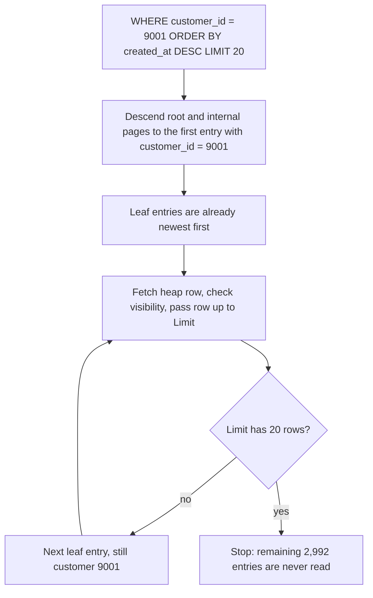

# Composite Indexes

> **Module 03 · Databases** · Prerequisites: [Indexes](19-Indexes.md) · Next: [Covering Indexes](21-Covering-Indexes.md)

---

## ⏱ If You Only Have 2 Minutes

- A composite (multi-column) B-tree sorts entries by the first column, then by the second column among ties, and so on — like a phone book sorted by last name, then first name.
- **Leftmost-prefix rule:** an index on `(a, b, c)` can efficiently serve `a`, `a + b`, and `a + b + c`. It cannot efficiently serve `b` or `c` alone, because those values are scattered across the whole index.
- **Column order: equality columns first, then the sort column, then range columns.** Equality on every column before the sort column is what lets the index return rows already in `ORDER BY` order.
- `(customer_id, created_at DESC)` turns "latest 20 orders for this customer" into "find the first entry, read 20, stop". No Sort node, and the cost no longer grows with the customer's order history.
- A B-tree can be read backwards, so `(a, b)` serves both `ORDER BY a, b` and `ORDER BY a DESC, b DESC`. Only **mixed** directions (`a ASC, b DESC`) need `DESC` in the index definition.
- Two single-column indexes can be combined with a `BitmapAnd`, but bitmaps lose index order, so `ORDER BY ... LIMIT` still sorts every match. One composite index beats them for a hot query.
- An index that is a leftmost prefix of another (`(customer_id)` next to `(customer_id, created_at)`) is usually redundant: drop it unless it enforces uniqueness.

---

## 1. What It Is and Why It Exists

A **composite index** is one index over several columns. Its entries are compared column by column: first by the first column, and only when two entries tie there, by the second, and so on. The result is a single sorted list in which each value of the first column has its own contiguous, internally sorted "section".

**Analogy:** a phone book sorted by `(last name, first name)`. Finding "Smith, John" is quick. Listing every Smith in first-name order is quick, because they are already adjacent and sorted. Finding everyone called "John" regardless of last name means reading the whole book, because the Johns are spread across every section.

**The problem it solves.** After [Indexes](19-Indexes.md), `orders` has an index on `customer_id`. The "My orders" page asks for the 20 newest orders of one customer. For a typical customer with 21 orders that is cheap. For customer 9001, a B2B buyer with 3,012 orders, PostgreSQL must fetch all 3,012 rows from roughly 3,000 different heap pages, sort them by `created_at`, and throw away 2,992. The query gets slower as the customer's history grows, and the biggest customers, the ones you least want to annoy, get the slowest page.

A composite index on `(customer_id, created_at DESC)` stores each customer's orders next to each other, already newest first. The database jumps to the start of customer 9001's section, reads 20 entries and stops. The work is the same for a customer with 20 orders and one with 200,000.

---

## 2. How It Works

### How entries are ordered

A few entries of `orders_customer_created_idx ON orders (customer_id, created_at DESC)`:

| customer_id | created_at | TID |
|---|---|---|
| 9000 | 2026-11-02 08:14 | (84012, 5) |
| 9001 | **2026-11-23 17:40** | (85301, 2) |
| 9001 | 2026-11-23 09:02 | (85277, 9) |
| 9001 | 2026-11-22 16:55 | (85240, 1) |
| … 3,009 more for 9001, each older than the last … | | |
| 9002 | 2026-11-20 11:31 | (84990, 4) |

`customer_id` is sorted ascending; inside each customer, `created_at` is sorted descending. The first entry of customer 9001's section is that customer's newest order.

### What the executor does



The executor is **pull-based**: the `Limit` node asks its child for one row at a time and stops asking after 20. Because the index produces rows in the requested order, there is nothing to sort and nothing else to read.

### Which conditions narrow the scan

PostgreSQL's rule for a B-tree: **equality conditions on the leading columns, plus an inequality on the first column that has no equality condition, define the range of the index that is read.** Conditions on later columns are still checked against index entries (they appear in `Index Cond`), which avoids heap visits, but they do not shrink the range.

Take an index on `(customer_id, status, created_at)`:

| Query predicate | Range actually read |
|---|---|
| `customer_id = 9001` | Customer 9001's section |
| `customer_id = 9001 AND status = 'paid'` | Only the paid sub-section of customer 9001 |
| `customer_id = 9001 AND status = 'paid' AND created_at >= $2` | Only recent paid orders of customer 9001 |
| `customer_id = 9001 AND created_at >= $2` | All of customer 9001's section; `created_at` is checked per entry because `status` (no condition) sits in between |
| `status = 'paid'` | Not usable for a normal descent; the leading column has no condition |

---

## 3. Key Concepts

### The leftmost-prefix rule

An index on `(a, b, c)` behaves like three indexes for free: `(a)`, `(a, b)` and `(a, b, c)`. These are its **leftmost prefixes**. A query that does not constrain `a` can only use the index by reading all of it, which the planner rarely chooses unless the index is much smaller than the table.

MySQL InnoDB follows the same rule. Its `EXPLAIN` shows how much of the index was used in `key_len`.

**Skip scan** is the one partial exception. MySQL 8.0.13 added a skip-scan access method, and PostgreSQL 18 added B-tree skip scan. When the leading column has **few distinct values** (say `status` with four values in an index on `(status, created_at)`), the database can probe the index once per distinct leading value, as if you had written `status IN (all values)`. It helps only when the skipped column has low cardinality. It would not help an index that leads with `customer_id`, which has hundreds of thousands of values. Treat skip scan as a bonus, not a reason to choose a column order.

### Column order: equality, then sort, then range

For one query, choose the order in three steps:

1. **Equality columns first** (`customer_id = $1`, `status = 'paid'`). Among them, order does not matter much for that one query; pick the order that lets other queries share the index via its prefix.
2. **Then the `ORDER BY` column(s)**, in the query's direction. With equality on everything before it, the index yields rows already sorted, so `LIMIT` can stop early.
3. **Then range columns** (`total_cents > 10000`). They are checked inside the index without breaking the order.

This is often called the **ESR rule** (Equality, Sort, Range), a name popularised by MongoDB's documentation for its own B-tree indexes.

Why not put the range column before the sort column? Consider "this customer's large orders, newest first":

```sql
SELECT id, total_cents, created_at FROM orders
WHERE customer_id = $1 AND total_cents > 10000
ORDER BY created_at DESC LIMIT 20;
```

| Index | What happens |
|---|---|
| `(customer_id, created_at DESC, total_cents)` | Reads the customer's section newest first, checks `total_cents` on each index entry, stops after 20 matches. No sort. |
| `(customer_id, total_cents, created_at DESC)` | Reads only orders above 10,000, but they come out ordered by `total_cents`, so all of them must be fetched and sorted before `LIMIT` applies. |

The second index reads fewer entries when large orders are rare and the customer is huge. The first wins in the common case and has a predictable cost. When the range is on the sort column itself (`created_at >= $2 ORDER BY created_at DESC`), there is no conflict: `(customer_id, created_at DESC)` serves both.

### Matching `ORDER BY ... LIMIT`

The index replaces the `Sort` node only if all of these hold:

- Every index column **before** the first `ORDER BY` column has an equality condition.
- The `ORDER BY` columns appear in the index in the **same order**.
- Their directions match the index, or are all exactly reversed (the planner then shows `Index Scan Backward`).
- The `ORDER BY` uses the bare columns, not expressions such as `date(created_at)`.

`ORDER BY created_at DESC` alone is not deterministic if two orders share a timestamp. Pages can then repeat or skip rows. Add the primary key as a tie-breaker, `ORDER BY created_at DESC, id DESC`, and extend the index to `(customer_id, created_at DESC, id DESC)`. This is required for keyset pagination ([Cursor Pagination](25-Cursor-Pagination.md)).

### Mixed sort directions

A B-tree is a doubly linked list at the leaf level, so reading it backwards is as cheap as forwards. That means:

| Index | Serves without a sort | Needs a sort |
|---|---|---|
| `(status, created_at)` | `status, created_at` and `status DESC, created_at DESC` | `status ASC, created_at DESC` |
| `(status, created_at DESC)` | `status ASC, created_at DESC` and `status DESC, created_at ASC` | `status, created_at` |

So `DESC` in an index definition only matters for **mixed** directions. For `(customer_id, created_at DESC)` the `DESC` is not strictly needed for our query (a backward scan of `(customer_id, created_at)` works too). It documents intent and matches the cursor query. If a column is nullable, `NULLS FIRST/LAST` must match as well: `DESC` defaults to `NULLS FIRST`. When only a prefix of the sort order matches, PostgreSQL 13+ can use an **Incremental Sort**, which sorts small groups instead of the whole input. That is cheaper, but still not free.

MySQL note: before 8.0, MySQL parsed `DESC` in index definitions but ignored it. Descending indexes only work from MySQL 8.0.

### One composite index vs several single-column indexes

PostgreSQL can combine single-column indexes on `customer_id` and `status` with a **BitmapAnd**: build a bitmap of matching heap pages from each index, intersect them, then read the surviving pages. That is flexible and works for ad-hoc filter combinations. But it has limits:

- A bitmap is ordered by heap page, not by `created_at`, so `ORDER BY created_at DESC LIMIT 20` still fetches and sorts **every** match.
- Both indexes are scanned in full for their conditions before any row is returned.
- Large bitmaps become "lossy" (whole pages instead of rows) when they exceed `work_mem`, adding rechecks.

Rule of thumb: one composite index per **hot, known query shape**; single-column indexes for ad-hoc filtering on admin screens where flexibility matters more than the last millisecond.

### Redundant indexes

If `(customer_id, created_at DESC)` exists, the plain `(customer_id)` index is redundant: any lookup by `customer_id` can use the composite's prefix. The single-column index is slightly smaller, but it still costs a write on every insert and memory in the cache. Exceptions:

- A **unique** prefix index enforces a constraint (`UNIQUE (email)` next to `(email, name)`). Keep it.
- A different index **type** or a **partial** index is not interchangeable with a B-tree prefix.

---

## 4. Code Examples

### SQL

```sql
-- Equality column first, then the sort column in the query's direction.
CREATE INDEX CONCURRENTLY orders_customer_created_idx
  ON orders (customer_id, created_at DESC);

-- Filtered listing ("my pending orders"): both equality columns, then the sort column.
CREATE INDEX CONCURRENTLY orders_customer_status_created_idx
  ON orders (customer_id, status, created_at DESC);

-- (customer_id) is now a leftmost prefix of both: it only costs writes.
DROP INDEX CONCURRENTLY orders_customer_id_idx;

-- Candidates for removal: non-unique B-tree indexes whose columns lead another index.
SELECT ca.relname AS redundant_index, cb.relname AS covered_by
FROM pg_index a
JOIN pg_index b  ON b.indrelid = a.indrelid AND b.indexrelid <> a.indexrelid
JOIN pg_class ca ON ca.oid = a.indexrelid
JOIN pg_class cb ON cb.oid = b.indexrelid
WHERE ca.relam = cb.relam                      -- same access method
  AND NOT a.indisunique                        -- unique indexes enforce rules: keep them
  AND a.indpred IS NULL AND b.indpred IS NULL  -- skip partial indexes
  AND a.indexprs IS NULL AND b.indexprs IS NULL
  AND (b.indkey::text || ' ') LIKE (a.indkey::text || ' %');  -- "2" is a prefix of "2 5"
```

Before, with only the single-column index from chapter 19, for customer 9001 (3,012 orders). Illustrative output:

```text
Limit  (cost=7843.64..7843.69 rows=20 width=29) (actual time=14.902..14.908 rows=20 loops=1)
  Buffers: shared hit=1204 read=1811
  ->  Sort  (cost=7843.64..7851.16 rows=3010 width=29) (actual time=14.900..14.904 rows=20 loops=1)
        Sort Key: created_at DESC
        Sort Method: top-N heapsort  Memory: 27kB
        ->  Bitmap Heap Scan on orders  (cost=36.19..7763.54 rows=3010 width=29) (actual time=0.623..14.211 rows=3012 loops=1)
              Recheck Cond: (customer_id = 9001)
              Heap Blocks: exact=2999
              Buffers: shared hit=1204 read=1811
              ->  Bitmap Index Scan on orders_customer_id_idx  (cost=0.00..35.44 rows=3010 width=0) (actual time=0.351..0.351 rows=3012 loops=1)
                    Index Cond: (customer_id = 9001)
                    Buffers: shared hit=16
Planning Time: 0.174 ms
Execution Time: 14.951 ms
```

All 3,012 rows are fetched from 2,999 heap pages (1,811 of them not in shared buffers) only to keep 20. After `orders_customer_created_idx` (illustrative output):

```text
Limit  (cost=0.56..21.40 rows=20 width=29) (actual time=0.028..0.061 rows=20 loops=1)
  Buffers: shared hit=24
  ->  Index Scan using orders_customer_created_idx on orders  (cost=0.56..3138.23 rows=3010 width=29) (actual time=0.027..0.057 rows=20 loops=1)
        Index Cond: (customer_id = 9001)
        Buffers: shared hit=24
Planning Time: 0.187 ms
Execution Time: 0.079 ms
```

The Sort node is gone. The Index Scan's *estimated* total covers all 3,010 rows, but the Limit's cost is only 20/3,010 of it, and the actual row count shows it stopped after 20. Execution time drops from about 15 ms to under 0.1 ms, and it now stays flat as the customer places more orders.

### Node.js / TypeScript

The listing endpoint. There are exactly two SQL shapes, each with an index designed for it. The status filter picks between two fixed strings: it is never concatenated into SQL.

```ts
// npm i express pg ; npm i -D @types/express @types/pg typescript   — Node.js 22+, Express 5
import express, { type Request, type Response } from "express";
import pg from "pg";

const pool = new pg.Pool({ connectionString: process.env.DATABASE_URL });
const STATUSES = new Set(["pending", "paid", "shipped", "cancelled"]);

// Served by orders_customer_created_idx (customer_id, created_at DESC): no sort, stops at LIMIT.
const LIST_ALL = `
  SELECT id, status, total_cents, created_at
  FROM orders
  WHERE customer_id = $1
  ORDER BY created_at DESC
  LIMIT $2`;

// Served by orders_customer_status_created_idx (customer_id, status, created_at DESC).
// Using the first index here would walk all of the customer's orders to find rare statuses.
const LIST_BY_STATUS = `
  SELECT id, status, total_cents, created_at
  FROM orders
  WHERE customer_id = $1 AND status = $3
  ORDER BY created_at DESC
  LIMIT $2`;

interface OrderRow { id: string; status: string; total_cents: number; created_at: Date }

const app = express();

app.get("/customers/:customerId/orders", async (req: Request, res: Response) => {
  const customerId = String(req.params.customerId); // Express 5 types params as string | string[]
  if (!/^\d{1,18}$/.test(customerId)) {
    res.status(400).json({ error: "invalid_customer_id" });
    return;
  }
  const limit = Math.min(Math.max(Number(req.query.limit) || 20, 1), 100);
  const status = typeof req.query.status === "string" ? req.query.status : undefined;
  if (status !== undefined && !STATUSES.has(status)) {
    res.status(400).json({ error: "invalid_status" });
    return;
  }

  const { rows } = status
    ? await pool.query<OrderRow>(LIST_BY_STATUS, [customerId, limit, status])
    : await pool.query<OrderRow>(LIST_ALL, [customerId, limit]);

  res.json(
    rows.map((r) => ({
      id: r.id, // bigint arrives as a string in node-postgres: keep it that way for JS safety
      status: r.status,
      totalCents: r.total_cents,
      createdAt: r.created_at.toISOString(),
    })),
  );
});

app.listen(3000);
```

### Python

The same endpoint with FastAPI and an async psycopg pool. FastAPI validates `limit` and `status` before the handler runs, so the handler only chooses between the two fixed statements.

```python
# pip install fastapi uvicorn "psycopg[binary,pool]"   — Python 3.12+
import os
from contextlib import asynccontextmanager
from datetime import datetime
from typing import Annotated, Literal

from fastapi import FastAPI, Query
from psycopg.rows import class_row
from psycopg_pool import AsyncConnectionPool
from pydantic import BaseModel

# Served by orders_customer_created_idx (customer_id, created_at DESC).
LIST_ALL = """
    SELECT id, status, total_cents, created_at
    FROM orders
    WHERE customer_id = %(customer_id)s
    ORDER BY created_at DESC
    LIMIT %(limit)s"""

# Served by orders_customer_status_created_idx (customer_id, status, created_at DESC).
LIST_BY_STATUS = """
    SELECT id, status, total_cents, created_at
    FROM orders
    WHERE customer_id = %(customer_id)s AND status = %(status)s
    ORDER BY created_at DESC
    LIMIT %(limit)s"""


class OrderSummary(BaseModel):
    id: int  # Python ints are unbounded, so bigint maps to int without precision loss
    status: str
    total_cents: int
    created_at: datetime


pool = AsyncConnectionPool(os.environ["DATABASE_URL"], open=False)


@asynccontextmanager
async def lifespan(app: FastAPI):
    await pool.open()
    yield
    await pool.close()


app = FastAPI(lifespan=lifespan)


@app.get("/customers/{customer_id}/orders")
async def list_orders(
    customer_id: int,
    limit: Annotated[int, Query(ge=1, le=100)] = 20,
    status: Literal["pending", "paid", "shipped", "cancelled"] | None = None,
) -> list[OrderSummary]:
    params = {"customer_id": customer_id, "limit": limit, "status": status}
    sql = LIST_ALL if status is None else LIST_BY_STATUS
    async with pool.connection() as conn:
        async with conn.cursor(row_factory=class_row(OrderSummary)) as cur:
            await cur.execute(sql, params)
            return await cur.fetchall()
```

**Why two statements instead of one clever one?** A single query like `WHERE customer_id = $1 AND ($3::text IS NULL OR status = $3)` looks tidier, but once the statement is prepared and planned generically (psycopg prepares after five executions by default), the planner must pick one plan for both cases and usually picks a poor one for at least one of them. Two fixed shapes give two predictable plans, and each has an index built for it.

---

## 5. Production Concerns

- **Design from the query log, not the schema.** List the hot query shapes from `pg_stat_statements` (by calls and total time), group them by equality columns and sort order, and design the fewest indexes whose prefixes serve them all. Three well-ordered composites usually beat eight single-column indexes.
- **Width and write cost.** Each extra column makes every entry bigger, so fewer entries fit per page, the tree is larger, and more of it falls out of cache. Each indexed column is also one more column whose updates cannot be HOT. Putting `status` in an index means every `pending → paid → shipped` transition updates that index (and all others on the table).
- **Skewed customers.** The "before" plan's cost grew with a customer's order count. Test critical queries with your **largest** tenants and customers, not just an average one. A per-customer plan that is fine at p50 can be the p99.9 outage.
- **Generic plans.** Prepared statements can switch to a generic plan after five executions. A plan that is right for an average customer may be wrong for customer 9001. If `EXPLAIN` with literal values looks fine but production is slow, compare with `EXPLAIN (GENERIC_PLAN)` (PostgreSQL 16+). A composite index that removes the sort makes the plan good for every parameter value.
- **Migration order.** Create the new composite index concurrently, confirm with `EXPLAIN` that the query uses it, *then* drop the redundant one concurrently. Doing it the other way round leaves a window with no index at all.
- **What to measure.** For the listing query: `mean_exec_time` and `shared_blks_read` per call in `pg_stat_statements`, before and after. A correct composite index makes both flat regardless of which customer is asking.

---

## 6. Common Mistakes

- **Putting a range or low-selectivity column first** — `(created_at, customer_id)` cannot jump to one customer, so it reads every order in the time range — put equality columns first, range last.
- **Putting a filter column between equality and sort without filtering on it** — `(customer_id, status, created_at)` cannot serve `WHERE customer_id = $1 ORDER BY created_at` without a sort, because entries are grouped by status first — keep the sort column directly after the columns you always filter with `=`.
- **Expecting `(a, b)` to serve `WHERE b = $1`** — the planner falls back to a sequential scan — add an index that leads with `b`, or reorder if `b` is the more common filter; do not count on skip scan unless `a` has few distinct values.
- **Several single-column indexes for a hot `ORDER BY ... LIMIT` query** — BitmapAnd finds the rows but must sort all of them before LIMIT — build one composite index in ESR order.
- **Keeping a redundant prefix index** — `(customer_id)` next to `(customer_id, created_at DESC)` doubles write cost for no read benefit — drop the prefix index (unless it is unique).
- **Mismatched directions in mixed sorts** — `ORDER BY status ASC, created_at DESC` on an index `(status, created_at)` adds a Sort node — define the index as `(status, created_at DESC)`.
- **No tie-breaker in the sort** — rows with equal `created_at` swap between requests, so pages repeat or skip rows — sort and index on `(created_at DESC, id DESC)`.

---

## 7. Comparison Table

| Approach | Example | Serves `WHERE customer_id = $1 ORDER BY created_at DESC LIMIT 20` | Flexibility | Write cost |
|---|---|---|---|---|
| Single-column index | `(customer_id)` | Finds rows, then fetches and sorts all of them | Any query filtering on `customer_id` | Low |
| Two single-column indexes + BitmapAnd | `(customer_id)`, `(status)` | Finds rows; bitmap loses order; full sort | Any combination of the two filters | Two indexes to maintain |
| Composite in ESR order | `(customer_id, created_at DESC)` | Reads exactly 20 entries; no sort | Only queries matching its prefix | One index, slightly wider |
| Composite + `INCLUDE` | `(customer_id, created_at DESC) INCLUDE (...)` | Reads 20 entries, may skip the heap entirely | Same as above | Wider index; included columns block HOT updates |
| Partial composite | `(customer_id, created_at DESC) WHERE status = 'pending'` | Only for the pending variant | Narrow | Small; untouched by non-pending rows |

The covering variant is the subject of [Covering Indexes](21-Covering-Indexes.md).

---

## 8. Interview Questions

**[Junior] What is the leftmost-prefix rule?**
A composite B-tree index on `(a, b, c)` is sorted by `a` first, then `b`, then `c`. It can efficiently find rows by `a`, by `a` and `b`, or by all three, because those form a contiguous range. It cannot efficiently find rows by `b` alone, because rows with a given `b` are spread across every value of `a`.

**[Junior] Does the order of columns in a composite index matter if the query uses all of them with `=`?**
For that one query, mostly not: equality on every column narrows the range the same way. The order matters for every *other* query that might share the index through its prefix, and as soon as there is a range condition or an `ORDER BY`. Choose the order so the index also serves the next most common query.

**[Mid] Design an index for `WHERE customer_id = $1 ORDER BY created_at DESC LIMIT 20`.**
`(customer_id, created_at DESC)`, or `(customer_id, created_at)` read backwards. The equality column comes first, so the scan jumps to the customer's section. The sort column comes next, so the entries are already in output order and the `Limit` node stops after 20 rows. There is no Sort node, and the cost does not depend on how many orders the customer has. Add `id DESC` as a tie-breaker if you paginate with a cursor.

**[Mid] Why "equality, sort, range" and not "equality, range, sort"?**
If a range column comes before the sort column, the index returns matching rows ordered by the range column, so the database must fetch and sort all of them before applying `LIMIT`. With the sort column second, rows come out in the right order and the range condition is checked on each index entry, so the scan stops after `LIMIT` matches. Range-first can read fewer entries when the range is very selective, so it is a trade-off, but sort-first has a predictable cost.

**[Mid] When do you need `DESC` in an index definition?**
Only for mixed directions, such as `ORDER BY status ASC, created_at DESC`. A B-tree can be scanned in both directions, so `(status, created_at)` already serves `status DESC, created_at DESC`. For nullable columns, the `NULLS FIRST/LAST` placement must also match the query.

**[Senior] You have separate indexes on `customer_id` and `status`. Should you replace them with one composite?**
It depends on the workload. A BitmapAnd of the two works for ad-hoc filters but loses index order, so `ORDER BY ... LIMIT` queries sort every match, and both indexes are scanned in full for their conditions. If there is a hot query like "this customer's pending orders, newest first", a composite `(customer_id, status, created_at DESC)` serves it directly and its prefix still covers `customer_id` lookups, so the `customer_id` index becomes redundant. Keep a standalone `status` index only if some query filters by status alone and it is selective, for example a partial index on the rare `pending` value.

**[Senior] An index on `(tenant_id, created_at)` is fast for most tenants but slow for the largest one. Why, and what do you do?**
Check the plan for the large tenant with its real parameter value. Common causes: the query has an extra filter or sort column not in the index, so the scan reads and filters the tenant's whole section, which is huge only for that tenant; or a prepared statement switched to a generic plan chosen for typical tenants. Fix the index to match the full query in ESR order so the work is bounded by `LIMIT`, verify with `EXPLAIN (ANALYZE, BUFFERS)` using the large tenant's ID, and add that tenant to the plan-guard tests.

**[Senior] What is skip scan, and would you rely on it?**
Skip scan lets a database use a composite index when the leading column has no condition, by probing the index once per distinct value of that column. MySQL has it since 8.0.13, and PostgreSQL added it for B-trees in version 18. It only pays off when the skipped leading column has few distinct values. I would treat it as a helpful fallback for occasional queries, and still design the column order for the hot queries, because high-cardinality leading columns make skip scan useless.

---

## 9. Cheat Sheet

```text
Sort order        by col1, then col2 within ties, then col3 ...
Leftmost prefix   (a,b,c) serves a | a,b | a,b,c ; not b or c alone
Scan range        = on leading cols + first inequality bound the range; later cols filtered in-index
Column order      Equality → Sort → Range (ESR)
ORDER BY match    = on every column before the sort col; same order; same or fully reversed direction
Backward scans    (a,b) serves a ASC,b ASC and a DESC,b DESC; mixed needs (a, b DESC)
Nullable sorts    DESC defaults to NULLS FIRST; index and query must agree
Tie-breaker       ORDER BY created_at DESC, id DESC + index (customer_id, created_at DESC, id DESC)
BitmapAnd         combines single-column indexes; loses order → sort before LIMIT
Redundant         (a) is redundant next to (a,b) unless UNIQUE; drop CONCURRENTLY after the new one
Skip scan         MySQL 8.0.13+, PostgreSQL 18+; only for low-cardinality skipped prefix
MySQL             DESC index keys honoured only from 8.0
Plan proof        Limit → Index Scan (no Sort node), actual rows = LIMIT
```

---

## Related Topics

- [Indexes](19-Indexes.md) — B-tree structure, selectivity, and the single-column index this chapter replaces
- [Covering Indexes](21-Covering-Indexes.md) — adding `INCLUDE` columns so the listing never touches the heap
- [Query Execution Plans](22-Query-Execution-Plans.md) — spotting Sort, BitmapAnd and Incremental Sort nodes
- [Cursor Pagination](25-Cursor-Pagination.md) — why the index needs `id` as a tie-breaker for keyset pages
- [Offset Pagination](24-Offset-Pagination.md) — what happens to this index when users ask for page 500
