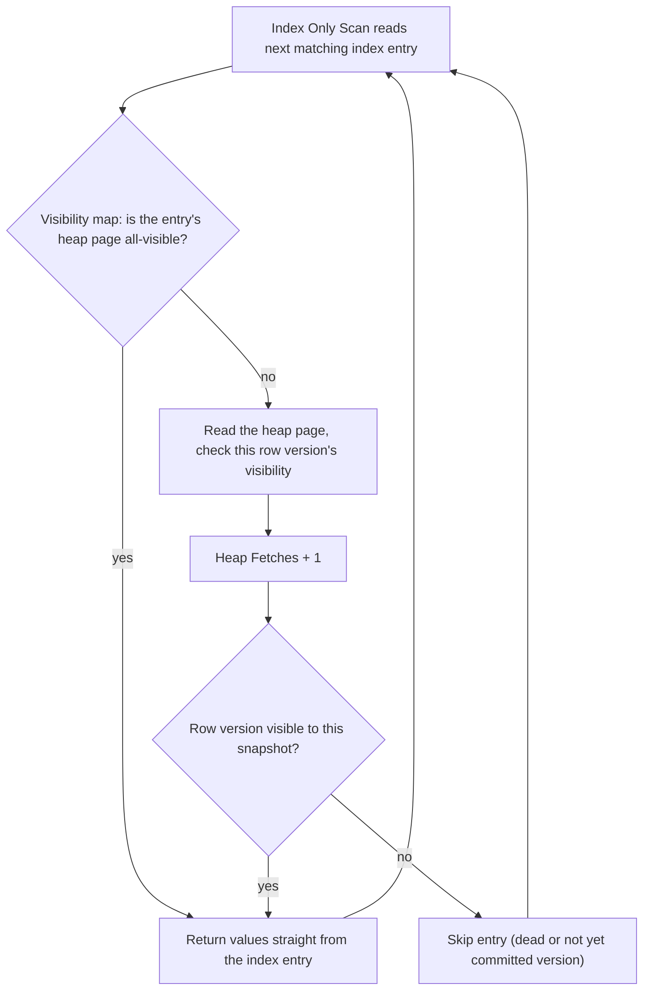

# Covering Indexes

> **Module 03 · Databases** · Prerequisites: [Composite Indexes](20-Composite-Indexes.md) · Next: [Query Execution Plans](22-Query-Execution-Plans.md)

---

## ⏱ If You Only Have 2 Minutes

- A **covering index** contains every column a query touches (in `SELECT`, `WHERE`, `ORDER BY`, `GROUP BY`), so PostgreSQL can answer with an **Index Only Scan** instead of visiting table rows.
- "Index only" is conditional. PostgreSQL still has to prove each row is visible to your snapshot. It checks the **visibility map**: if the heap page is marked all-visible it skips the heap; otherwise it reads the heap page. `EXPLAIN ANALYZE` reports those reads as **`Heap Fetches`**.
- Only **VACUUM** sets the all-visible bit, and any insert, update or delete on a page clears it. Tables with lots of recent updates do many heap fetches until autovacuum catches up.
- `INCLUDE` (PostgreSQL 11+) adds **non-key** columns to the leaf entries only. They do not affect sort order or uniqueness, so `UNIQUE (email) INCLUDE (name)` still means "email is unique".
- PostgreSQL secondary indexes do **not** contain the primary key. If the query returns `id`, put `id` in the index. MySQL InnoDB secondary indexes always carry the primary key, so `id` is covered for free.
- Costs: a bigger index, less of it in cache, more write work, and no HOT updates when an included column changes. B-tree deduplication is also disabled for indexes with `INCLUDE`.
- Cover a few hot, narrow read paths. Never try to cover `SELECT *`.

---

## 1. What It Is and Why It Exists

A normal index scan does two things for every matching row: it reads an index entry, then follows the entry's TID (tuple ID) to the row in the table's heap to get the other columns and check visibility. A **covering index** stores enough columns that the second step can be skipped. PostgreSQL's plan node for this is the **Index Only Scan**.

**Analogy:** a library catalogue card that lists not only the shelf location but also the publication year and page count. If all you want is "how many pages does this book have?", you read the card and never walk to the shelf. But the library also keeps a list of shelves that have changed since the last inventory check. If the book's shelf is on that list, you must walk over and look anyway.

**The problem it solves.** After [Composite Indexes](20-Composite-Indexes.md), the "My orders" listing reads 20 index entries and then 20 heap pages, scattered over three years of data. A customer dashboard also shows lifetime stats per status:

```sql
SELECT status, count(*), sum(total_cents), max(created_at)
FROM orders WHERE customer_id = $1 GROUP BY status;
```

For customer 9001 (3,012 orders) that is about 3,000 random heap page reads per page view, even though every value it needs is small and could sit right next to `customer_id` in the index. With a covering index the same query reads about 20 index pages. Heap reads are the dominant cost of most index scans, so removing them often turns a disk-bound query into a memory-bound one.

---

## 2. How It Works

### Conditions for an Index Only Scan

1. Every column the query references is stored in the index, either as a key column or an `INCLUDE` column.
2. The index type can return stored values. B-tree always can; GiST and SP-GiST can for some operator classes; GIN, BRIN and Hash cannot.
3. The planner estimates it is cheaper. It uses `pg_class.relallvisible / relpages` (the fraction of heap pages marked all-visible) to predict how many heap fetches will still be needed.

### The visibility check

PostgreSQL uses MVCC (multi-version concurrency control): an update writes a new row version, and old versions stay until VACUUM removes them. Index entries carry no information about which transactions can see them, so an index alone cannot say "this row is visible to you".

The **visibility map** solves this cheaply. It stores two bits per heap page: **all-visible** (every row on the page is visible to every current and future transaction) and **all-frozen**. It is tiny: one 8 KB visibility-map page covers about 32,000 heap pages.



Who changes the bits:

- **VACUUM** (including autovacuum) sets all-visible on pages where every row is visible to everyone.
- **Any** `INSERT`, `UPDATE` or `DELETE` that touches a page clears its bit immediately.

So an Index Only Scan is only as good as the table's visibility map. On a freshly vacuumed table it reads no heap pages. On a table where a batch job just updated a million rows, it behaves almost like a normal index scan, plus the extra visibility-map checks.

### A cruel detail for "latest first" queries

The pages holding the **newest** rows are the least likely to be all-visible. A new order is inserted (bit cleared), then marked `paid` minutes later (cleared again), then `shipped` a day later (cleared again). Autovacuum may not have visited those pages yet. A "latest 20 orders" query reads exactly those pages, so it sees more heap fetches than a query over old data. Tuning autovacuum on hot tables is part of making covering indexes work.

---

## 3. Key Concepts

### Key columns vs `INCLUDE` columns

You can cover a query by adding columns to the index key, or by putting them in `INCLUDE`:

```sql
CREATE INDEX ON orders (customer_id, created_at DESC, status, total_cents);              -- all key columns
CREATE INDEX ON orders (customer_id, created_at DESC) INCLUDE (id, status, total_cents);  -- payload columns
```

| | Key column | `INCLUDE` column |
|---|---|---|
| Stored in | Every level of the tree (as separators) and the leaves | Leaf entries only |
| Used for search and ordering | Yes | No; it can be filtered in the index but never narrows the range |
| Affects `UNIQUE` | Yes: uniqueness covers all key columns | No: `UNIQUE (email) INCLUDE (name)` is still unique on `email` |
| Needs a B-tree operator class | Yes | No; types without one (for example `point`) can be included |
| Versions | All | B-tree since PostgreSQL 11, GiST since 12, SP-GiST since 14 |

Use **key columns** when the column also filters or sorts. Use **`INCLUDE`** for pure payload: columns that are only returned. The main practical win of `INCLUDE` is with unique indexes: you can make an existing uniqueness index cover a lookup without weakening the constraint. SQL Server has the same `INCLUDE` syntax. MySQL has no `INCLUDE`; there you add key columns.

### Reading `Heap Fetches`

In `EXPLAIN ANALYZE` output, an Index Only Scan reports `Heap Fetches: N`, the number of index entries for which the heap had to be visited.

- `Heap Fetches: 0` — fully index-only; the visibility map covered every page.
- `Heap Fetches` close to the actual row count — the index-only scan is giving you almost nothing over a normal index scan. Check when the table was last vacuumed (`pg_stat_user_tables.last_autovacuum`) and the all-visible fraction (`relallvisible` vs `relpages` in `pg_class`).

An Index Only Scan with many heap fetches is not "broken". It is still correct and usually no worse than an Index Scan. It is just not delivering the benefit you built the index for.

### Keeping the visibility map fresh

Autovacuum runs on a table when dead rows exceed `autovacuum_vacuum_threshold + autovacuum_vacuum_scale_factor × rows` (defaults: 50 + 20%). On a 10-million-row `orders` table that is about 2 million changed rows between runs: far too rare for a hot covering index. Options:

- Lower the scale factor for that table only: `ALTER TABLE orders SET (autovacuum_vacuum_scale_factor = 0.02)`.
- PostgreSQL 13+ also triggers autovacuum after enough **inserts** (`autovacuum_vacuum_insert_threshold` and `autovacuum_vacuum_insert_scale_factor`), which helps append-mostly tables get their all-visible bits set.
- Run a manual `VACUUM (ANALYZE) orders` after large batch updates.

### Trade-offs

| Cost | Why | How to keep it small |
|---|---|---|
| Bigger index | Every entry carries the extra columns, so fewer entries per page and more pages to cache | Include only small, fixed-width columns the hot query needs |
| Fewer HOT updates | A HOT (heap-only tuple) update is possible only when no **indexed** column changes, and `INCLUDE` columns count as indexed | Avoid including columns that change often, or accept the cost knowingly |
| Write amplification | A non-HOT update adds a new entry to **every** index on the table, plus WAL | Measure `n_tup_hot_upd / n_tup_upd` before and after |
| No deduplication | B-tree deduplication (PostgreSQL 13+) is not used for indexes with `INCLUDE` columns | Expect a larger index than a plain one on low-cardinality keys |
| Entry size limit | A B-tree entry must fit in about one third of a page (about 2.7 KB) | Never include long text or JSON columns |

In our schema, `status` changes two or three times in each order's life (`pending → paid → shipped`). Including it means each of those updates touches every index on `orders`. For the dashboard that is worth it; for a column updated every few seconds it would not be.

### MySQL (InnoDB) difference

InnoDB stores the table as a clustered B-tree on the primary key. Every **secondary index entry contains the primary-key columns** as its row pointer. Consequences:

- An index on `(customer_id, created_at)` already covers `SELECT id, created_at ... WHERE customer_id = ?`. In PostgreSQL you must add `id` yourself.
- A non-covering lookup costs a second B-tree descent into the clustered index for every row, which is why covering indexes matter at least as much in MySQL.
- `EXPLAIN` shows `Using index` in the `Extra` column when the index covers the query.
- A wide primary key (say a 36-character UUID string) is copied into every secondary index, making all of them bigger.

---

## 4. Code Examples

### SQL

Replace chapter 20's listing index with a covering version. `id` is included because PostgreSQL indexes do not carry the primary key.

```sql
CREATE INDEX CONCURRENTLY orders_customer_created_cov_idx
  ON orders (customer_id, created_at DESC) INCLUDE (id, status, total_cents);

-- Same key columns, so it serves everything the old index did.
DROP INDEX CONCURRENTLY orders_customer_created_idx;

-- Fraction of heap pages marked all-visible (updated by VACUUM and ANALYZE).
SELECT relpages, relallvisible,
       round(100.0 * relallvisible / greatest(relpages, 1), 1) AS pct_all_visible
FROM pg_class WHERE relname = 'orders';

-- How often updates stay HOT now that status and total_cents are indexed.
SELECT n_tup_upd, n_tup_hot_upd, last_autovacuum,
       round(100.0 * n_tup_hot_upd / greatest(n_tup_upd, 1), 1) AS hot_pct
FROM pg_stat_user_tables WHERE relname = 'orders';

-- Vacuum this hot table after ~2% changes instead of the default 20%.
ALTER TABLE orders SET (autovacuum_vacuum_scale_factor = 0.02);
```

The dashboard stats query for customer 9001, right after a vacuum. Illustrative output:

```text
HashAggregate  (cost=156.52..156.56 rows=4 width=53) (actual time=0.912..0.914 rows=4 loops=1)
  Group Key: status
  Batches: 1  Memory Usage: 24kB
  Buffers: shared hit=23
  ->  Index Only Scan using orders_customer_created_cov_idx on orders  (cost=0.56..126.42 rows=3010 width=21) (actual time=0.018..0.402 rows=3012 loops=1)
        Index Cond: (customer_id = 9001)
        Heap Fetches: 0
        Buffers: shared hit=23
Planning Time: 0.152 ms
Execution Time: 0.951 ms
```

Twenty-three index pages and no heap pages for 3,012 rows. The same query after a nightly job updated many recent orders and before autovacuum ran (illustrative output):

```text
HashAggregate  (cost=1340.27..1340.31 rows=4 width=53) (actual time=9.734..9.736 rows=4 loops=1)
  Group Key: status
  Batches: 1  Memory Usage: 24kB
  Buffers: shared hit=702 read=728
  ->  Index Only Scan using orders_customer_created_cov_idx on orders  (cost=0.56..1310.17 rows=3010 width=21) (actual time=0.021..9.102 rows=3012 loops=1)
        Index Cond: (customer_id = 9001)
        Heap Fetches: 1412
        Buffers: shared hit=702 read=728
Planning Time: 0.149 ms
Execution Time: 9.781 ms
```

Same plan shape, ten times slower: 1,412 entries pointed at pages that were no longer all-visible, which cost about 1,400 heap page reads. The planner saw this coming: `relallvisible` dropped, so its cost estimate rose. After `VACUUM orders`, the first plan returns.

### Node.js / TypeScript

The dashboard endpoint. The query references only `customer_id`, `status`, `total_cents` and `created_at`, all in the index. The comment on the SQL is the important part: it is what stops the next developer from adding a column and silently losing the index-only scan.

```ts
// npm i express pg ; npm i -D @types/express @types/pg typescript   — Node.js 22+, Express 5
import express, { type Request, type Response } from "express";
import pg from "pg";

const pool = new pg.Pool({ connectionString: process.env.DATABASE_URL });

// COVERED BY orders_customer_created_cov_idx (customer_id, created_at DESC) INCLUDE (id, status, total_cents).
// Every referenced column must stay in that index; one extra column means a heap visit per row.
const ORDER_STATS = `
  SELECT status,
         count(*)::int     AS orders,
         sum(total_cents)  AS total_cents,
         max(created_at)   AS last_order_at
  FROM orders
  WHERE customer_id = $1
  GROUP BY status`;

interface StatsRow { status: string; orders: number; total_cents: string; last_order_at: Date }

const app = express();

app.get("/customers/:customerId/order-stats", async (req: Request, res: Response) => {
  const customerId = String(req.params.customerId); // Express 5 types params as string | string[]
  if (!/^\d{1,18}$/.test(customerId)) {
    res.status(400).json({ error: "invalid_customer_id" });
    return;
  }

  const { rows } = await pool.query<StatsRow>(ORDER_STATS, [customerId]);

  // Fill missing statuses with zeros so clients get a stable shape.
  const byStatus: Record<string, { orders: number; totalCents: string }> = {
    pending: { orders: 0, totalCents: "0" },
    paid: { orders: 0, totalCents: "0" },
    shipped: { orders: 0, totalCents: "0" },
    cancelled: { orders: 0, totalCents: "0" },
  };
  let lastOrderAt: Date | null = null;
  for (const r of rows) {
    // sum() of integer returns bigint, which node-postgres gives back as a string: keep it exact.
    byStatus[r.status] = { orders: r.orders, totalCents: r.total_cents };
    if (!lastOrderAt || r.last_order_at.getTime() > lastOrderAt.getTime()) lastOrderAt = r.last_order_at;
  }

  res.json({ customerId, byStatus, lastOrderAt: lastOrderAt?.toISOString() ?? null });
});

app.listen(3000);
```

### Python

The same endpoint with FastAPI and psycopg 3. The response model makes the "stable shape" explicit; Pydantic fills in zeros for statuses the customer has never had.

```python
# pip install fastapi uvicorn "psycopg[binary,pool]"   — Python 3.12+
import os
from contextlib import asynccontextmanager
from datetime import datetime

from fastapi import FastAPI
from psycopg.rows import dict_row
from psycopg_pool import AsyncConnectionPool
from pydantic import BaseModel, Field

# COVERED BY orders_customer_created_cov_idx (customer_id, created_at DESC) INCLUDE (id, status, total_cents).
# Adding a column that is not in the index turns every row into a heap fetch.
ORDER_STATS = """
    SELECT status,
           count(*)         AS orders,
           sum(total_cents) AS total_cents,
           max(created_at)  AS last_order_at
    FROM orders
    WHERE customer_id = %(customer_id)s
    GROUP BY status"""

STATUSES = ("pending", "paid", "shipped", "cancelled")


class StatusStats(BaseModel):
    orders: int = 0
    total_cents: int = 0  # bigint sum arrives as a Python int: no precision issue


class OrderStats(BaseModel):
    customer_id: int
    by_status: dict[str, StatusStats] = Field(default_factory=lambda: {s: StatusStats() for s in STATUSES})
    last_order_at: datetime | None = None


pool = AsyncConnectionPool(os.environ["DATABASE_URL"], open=False)


@asynccontextmanager
async def lifespan(app: FastAPI):
    await pool.open()
    yield
    await pool.close()


app = FastAPI(lifespan=lifespan)


@app.get("/customers/{customer_id}/order-stats")
async def order_stats(customer_id: int) -> OrderStats:
    async with pool.connection() as conn:
        async with conn.cursor(row_factory=dict_row) as cur:
            await cur.execute(ORDER_STATS, {"customer_id": customer_id})
            rows = await cur.fetchall()

    stats = OrderStats(customer_id=customer_id)
    for r in rows:
        stats.by_status[r["status"]] = StatusStats(orders=r["orders"], total_cents=r["total_cents"])
        if stats.last_order_at is None or r["last_order_at"] > stats.last_order_at:
            stats.last_order_at = r["last_order_at"]
    return stats
```

**Runtime difference to notice:** node-postgres returns `bigint` and `numeric` values as strings, because a JavaScript `number` loses precision above 2^53. The TypeScript code casts `count(*)` to `int` in SQL and keeps the `sum` as a string. psycopg maps `bigint` to Python's unbounded `int`, so the Python code needs neither workaround.

To make sure the index stays covering, add the stats query to the plan-guard test from [Indexes](19-Indexes.md) and also assert that the scan node on `orders` is an `Index Only Scan`.

---

## 5. Production Concerns

- **Autovacuum is part of the design.** A covering index on a table with frequent updates needs a vacuum schedule that keeps the visibility map fresh. Monitor `Heap Fetches` on the target query (through `auto_explain` or periodic `EXPLAIN ANALYZE`), and the all-visible percentage from `pg_class`. Long-running transactions block VACUUM from marking pages all-visible, so an idle-in-transaction session can quietly disable your index-only scans.
- **HOT update ratio.** Including `status` or `total_cents` prevents HOT updates whenever those change. Check `n_tup_hot_upd / n_tup_upd` in `pg_stat_user_tables` before and after adding the index. A sharp drop means more index writes, more WAL and more bloat on every index of the table.
- **Index size and cache.** Compare `pg_relation_size` of the covering index with the plain one. If the covering index no longer fits comfortably in memory, its page reads replace the heap reads you removed, and the gain shrinks.
- **Query drift.** The biggest risk is a later change to the query, an ORM adding a column or `SELECT *`, which silently turns Index Only Scans into Index Scans. Keep the covered SQL explicit, comment which index covers it, and guard it in tests.
- **Replicas.** The visibility map is WAL-logged, so replicas see the same all-visible bits as the primary. With `hot_standby_feedback` on, long queries on a replica hold back VACUUM on the primary, which leaves fewer pages all-visible everywhere. Check plans where the query actually runs.
- **Do not cover everything.** One covering index for the hottest read path is usually enough. A second or third covering index on the same write-heavy table multiplies write cost on every insert and non-HOT update.

---

## 6. Common Mistakes

- **Forgetting the primary key** — `SELECT id, ...` with an index that does not contain `id` triggers a heap fetch for every row in PostgreSQL — include `id` explicitly (InnoDB is the database that includes it for you).
- **Assuming "Index Only Scan" means zero heap reads** — on a recently updated table `Heap Fetches` can be close to the row count — check `Heap Fetches`, vacuum hot tables more aggressively, and avoid long transactions.
- **Including frequently updated columns** — every change to an included column is a non-HOT update that touches all indexes — include stable columns, or measure the HOT ratio before deciding.
- **Making included columns key columns "to be safe"** — extra key columns enlarge the upper tree levels and, on a unique index, change what "unique" means — use `INCLUDE` for payload-only columns.
- **Including wide columns** — long `text` or `jsonb` makes the index huge and can hit the ~2.7 KB entry limit with an error at insert time — cover only small fixed-width columns.
- **Covering `SELECT *` queries** — the index becomes a second copy of the table with all its write cost — narrow the query to the columns the endpoint needs first.
- **Expecting GIN or BRIN to cover** — those index types cannot return column values, so they never produce Index Only Scans — use a B-tree for covered read paths.

---

## 7. Comparison Table

| | Plain index + heap | Covering via key columns | Covering via `INCLUDE` |
|---|---|---|---|
| Heap reads per row | One (Index Scan) | None when pages are all-visible | None when pages are all-visible |
| Extra columns usable in `WHERE`/`ORDER BY` | n/a | Yes, they narrow the range and order rows | Filter only; never narrow the range |
| Unique semantics | Unchanged | Uniqueness spans all key columns | Unchanged |
| Upper-level page size | Smallest | Larger (separators carry the extra columns) | Same as plain |
| Deduplication (PG 13+) | Yes | Yes | No |
| HOT updates blocked by | Indexed key columns | All key columns | Key and included columns |
| Best for | Most queries | Extra column is also filtered or sorted | Pure payload columns, especially on unique indexes |

---

## 8. Interview Questions

**[Junior] What is a covering index?**
An index that contains every column a query needs, so the database can answer from the index without reading table rows. In PostgreSQL the plan shows an Index Only Scan. The columns can be part of the key or added with `INCLUDE`. It saves one random heap read per row, which is usually the main cost of an index scan.

**[Junior] What does `INCLUDE` do?**
It adds non-key columns to the leaf entries of a B-tree index (PostgreSQL 11+). Those columns can be returned by an Index Only Scan but are not used for searching or ordering, and they do not affect uniqueness. That lets you add, say, `name` to a unique index on `email` without changing the constraint.

**[Mid] The plan shows an Index Only Scan but the query is still slow. What do you check?**
The `Heap Fetches` line. If it is close to the number of rows, the visibility map does not mark those heap pages all-visible, so PostgreSQL is reading the heap anyway. Check `last_autovacuum` and `relallvisible`, look for long-running transactions that prevent VACUUM from setting the bits, and consider more aggressive per-table autovacuum settings or a manual `VACUUM` after batch jobs.

**[Mid] Why does PostgreSQL need to visit the heap at all if the index has the data?**
Because of MVCC. The index has entries for row versions that may be dead, or not yet committed, or invisible to your snapshot, and it stores no transaction information. The visibility map lets PostgreSQL skip the check for pages where every row is known to be visible to everyone. For all other pages it must read the heap to decide.

**[Mid] How do covering indexes differ in MySQL InnoDB?**
InnoDB's secondary index entries contain the primary key, because the table is a clustered index on the PK. So any secondary index automatically covers the PK column, and `EXPLAIN` shows `Using index` when it covers the whole query. A non-covering lookup costs a second B-tree descent into the clustered index for each row. MySQL has no `INCLUDE` clause, so you add the extra columns as key columns.

**[Senior] What are the costs of adding `status` and `total_cents` to an index on `orders`?**
The index gets larger, so less of it stays cached. Every change to `status` is now a change to an indexed column, which disqualifies HOT updates: each status transition inserts new entries into every index on `orders`, adds WAL, and creates more bloat to vacuum. B-tree deduplication is also disabled for `INCLUDE` indexes. I would measure the HOT ratio and index size before and after, and only keep it if the read path is hot enough to pay for the write cost.

**[Senior] A covering index worked in staging but production shows thousands of heap fetches. Why?**
Staging tables are often loaded once and vacuumed, so every page is all-visible. Production has continuous updates, so the newest pages, exactly the ones "latest orders" queries read, are rarely all-visible, and the default autovacuum scale factor of 20% means big tables are vacuumed rarely. Long transactions or replication slots holding back the xmin horizon can also stop VACUUM from marking pages. Fix the vacuum settings for that table, find the blockers, and measure `Heap Fetches` on production-like data.

---

## 9. Cheat Sheet

```text
Covering index      all referenced columns in the index → Index Only Scan
Still checks        visibility map bit per heap page; not all-visible → heap read (Heap Fetches)
Bit set by          VACUUM / autovacuum only; cleared by any insert/update/delete on the page
Planner uses        pg_class.relallvisible / relpages to cost index-only scans
INCLUDE             PG 11+ B-tree (GiST 12, SP-GiST 14); leaf-only; no ordering; no uniqueness effect
PK in index?        PostgreSQL: no, include id yourself; InnoDB: always (secondary → PK)
Cannot cover        GIN, BRIN, Hash
Costs               bigger index, no HOT when included cols change, no dedup, ~2.7 KB entry max
Hot table tuning    ALTER TABLE t SET (autovacuum_vacuum_scale_factor = 0.02)
Insert-only tables  PG 13+ insert-triggered autovacuum sets all-visible bits
Blockers            long transactions, idle-in-transaction sessions hold back VACUUM
MySQL signal        EXPLAIN Extra: "Using index"
```

---

## Related Topics

- [Composite Indexes](20-Composite-Indexes.md) — the key columns and order that the covering index builds on
- [Query Execution Plans](22-Query-Execution-Plans.md) — reading Index Only Scan, `Heap Fetches` and `Buffers`
- [ACID](28-ACID.md) — MVCC and row versions, the reason the visibility check exists
- [Indexes](19-Indexes.md) — heap vs index, HOT updates, and the plan-guard test to extend
- [Query Optimization](23-Query-Optimization.md) — when a covering index is the right fix and when it is not
