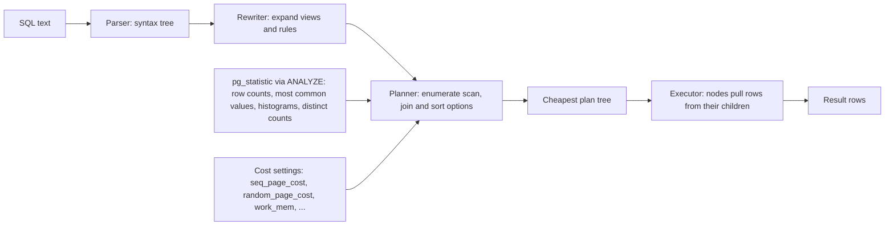

# Query Execution Plans

> **Module 03 · Databases** · Prerequisites: [Covering Indexes](21-Covering-Indexes.md) · Next: [Query Optimization](23-Query-Optimization.md)

---

## ⏱ If You Only Have 2 Minutes

- `EXPLAIN` shows the plan the planner *would* use, with estimates only. `EXPLAIN ANALYZE` **runs the query** and adds actual times, row counts and loops. Run it on `INSERT`/`UPDATE`/`DELETE` only inside `BEGIN; ... ROLLBACK;`.
- Add `BUFFERS` to see pages read from PostgreSQL's cache (`shared hit`), from the OS or disk (`read`), and spilled to temporary files (`temp`). PostgreSQL 18 turns `BUFFERS` on by default with `ANALYZE`.
- A plan is a tree. Rows flow **up** from the most indented nodes, so read it bottom-up. A node's time includes all of its children.
- `cost=startup..total` is in arbitrary units (one sequential page read = 1.0). Use it to compare plans for the *same* query, never to predict milliseconds.
- `rows` and `actual time` are **per loop**. An inner node with `rows=3 loops=21` produced about 63 rows in total. Multiply before you conclude anything.
- The biggest red flag is an estimate that is 10× or more away from the actual row count. Bad estimates cause bad join choices. Fix them with `ANALYZE`, a higher statistics target, or `CREATE STATISTICS` for correlated columns.
- In production, `pg_stat_statements` tells you **which** queries cost the most, and `auto_explain` captures the **plans** of slow ones automatically.
- MySQL has `EXPLAIN ANALYZE` since 8.0.18 (tree format); its classic `EXPLAIN` is a table whose `type`, `key`, `rows` and `Extra` columns you read instead.

---

## 1. What It Is and Why It Exists

SQL says **what** result you want. An **execution plan** says **how** the database will produce it: which tables to scan and with which index, in what order to join them, with which join algorithm, and where to sort, aggregate and stop. PostgreSQL's planner considers many possible plans, estimates the cost of each using statistics about your data, and runs the cheapest one.

**Analogy:** a satellite navigation app. You give it a destination (the query). It picks a route (the plan) using its traffic estimates (the statistics). `EXPLAIN` shows you the route it proposes. `EXPLAIN ANALYZE` actually drives it and records how long each segment took, so you can see where the estimate said "five minutes" and reality said "forty".

**The problem it solves.** Without the plan, performance work is guessing: "add an index on that column, maybe?" With the plan you can see that 99.99% of the time went into one Index Scan that removed ten million rows with a filter, or that a hash join spilled 600 MB to disk because the planner thought one side had 3 million rows when it had 58,000. The same query can be fast in staging and slow in production because data size, distribution and statistics differ. The plan is how you see that difference instead of arguing about it.

---

## 2. How It Works

### From SQL text to rows



The planner works from **statistics**, not from the data itself. `ANALYZE` (run by autovacuum or by hand) samples each table and stores per-column facts: the fraction of nulls, the most common values and their frequencies, a histogram of the rest, the number of distinct values, and the **correlation** between a column's order and the physical row order. From these it estimates how many rows each step will produce, and from row counts it estimates cost.

The executor runs the chosen tree **on demand**. The top node asks its child for a row; that child asks its own children, and so on down to the scans. This is why a `Limit` node can stop a scan early, and why a node's **startup cost** (work before the first row, such as building a hash table or sorting) matters separately from its **total cost**.

### Reading an annotated plan

A customer's 10 most recent orders with the number of units in each. The indexes come from chapters 19–21.

```sql
EXPLAIN (ANALYZE, BUFFERS)
SELECT o.id, o.created_at, sum(oi.quantity) AS units
FROM orders o
JOIN order_items oi ON oi.order_id = o.id
WHERE o.customer_id = 4217
GROUP BY o.id
ORDER BY o.created_at DESC
LIMIT 10;
```

Illustrative output:

```text
Limit  (cost=162.18..162.20 rows=10 width=24) (actual time=0.189..0.192 rows=10 loops=1)
  Buffers: shared hit=109
  ->  Sort  (cost=162.18..162.23 rows=21 width=24) (actual time=0.188..0.190 rows=10 loops=1)
        Sort Key: o.created_at DESC
        Sort Method: top-N heapsort  Memory: 25kB
        Buffers: shared hit=109
        ->  HashAggregate  (cost=161.46..161.67 rows=21 width=24) (actual time=0.165..0.173 rows=21 loops=1)
              Group Key: o.id
              Batches: 1  Memory Usage: 32kB
              Buffers: shared hit=109
              ->  Nested Loop  (cost=1.12..161.20 rows=52 width=20) (actual time=0.021..0.139 rows=55 loops=1)
                    Buffers: shared hit=109
                    ->  Index Only Scan using orders_customer_created_cov_idx on orders o  (cost=0.56..4.93 rows=21 width=16) (actual time=0.012..0.019 rows=21 loops=1)
                          Index Cond: (customer_id = 4217)
                          Heap Fetches: 0
                          Buffers: shared hit=4
                    ->  Index Scan using order_items_pkey on order_items oi  (cost=0.56..7.42 rows=2 width=12) (actual time=0.004..0.005 rows=3 loops=21)
                          Index Cond: (order_id = o.id)
                          Buffers: shared hit=105
Planning Time: 0.318 ms
Execution Time: 0.236 ms
```

Read it from the deepest nodes up:

1. **Index Only Scan on `orders`** finds the customer's 21 orders in 4 index pages, with no heap visits (`Heap Fetches: 0`). Estimate 21, actual 21: the statistics are good.
2. **Index Scan on `order_items_pkey`** runs once per order: `loops=21`. Each loop returns about 3 rows (the display is rounded) and takes about 0.005 ms, so the node's real total is about 21 × 0.005 ≈ 0.105 ms and its buffers add up to 105 page hits.
3. **Nested Loop** joins them: 55 rows (the planner estimated 52). Its own time is roughly 0.139 − 0.019 − 0.105 ≈ 0.015 ms; everything else belongs to its children.
4. **HashAggregate** groups the 55 rows into 21, one per order, all in memory (`Batches: 1`).
5. **Sort** needs only the top 10, so it uses a **top-N heapsort**, keeping 10 rows in a small heap instead of sorting everything.
6. **Limit** returns 10 rows. Total: 0.236 ms, all from cache (`shared hit`, no `read`).

Two habits to build from this example: compare `rows` (estimate) with actual `rows` at every node, and multiply per-loop numbers by `loops` before deciding which node is expensive.

---

## 3. Key Concepts

### `EXPLAIN` options

| Option | What it adds | Notes |
|---|---|---|
| `ANALYZE` | Executes the query; actual time, rows, loops per node | Side effects happen. Wrap DML in `BEGIN ... ROLLBACK`. |
| `BUFFERS` | Shared/local/temp blocks hit, read, dirtied, written | Default with `ANALYZE` from PostgreSQL 18 |
| `VERBOSE` | Output columns per node, schema-qualified names | Useful to see which columns flow through joins |
| `SETTINGS` | Non-default planner settings in effect (PG 12+) | Catches a forgotten `enable_seqscan = off` |
| `WAL` | WAL records and bytes generated (PG 13+) | For write-heavy statements |
| `TIMING OFF` | Keeps row counts, drops per-node timing | Lowers overhead on queries with millions of node calls |
| `GENERIC_PLAN` | Plans a query containing `$1` without values (PG 16+) | Shows what a prepared statement's generic plan looks like; not combinable with `ANALYZE` |
| `FORMAT JSON` | Machine-readable output | For tooling, tests and visualisers |

`EXPLAIN ANALYZE` measures the query on the server. It does not include sending the result to the client, and timing every node adds overhead, so its total can differ from what the application sees. PostgreSQL 17 added a `SERIALIZE` option to include the cost of converting the output rows.

### Cost units

Costs are in abstract units anchored to reading one page sequentially. The defaults:

| Setting | Default | Meaning |
|---|---|---|
| `seq_page_cost` | 1.0 | Read one page as part of a sequential scan |
| `random_page_cost` | 4.0 | Read one page at a random location (many teams lower this on SSDs) |
| `cpu_tuple_cost` | 0.01 | Process one row |
| `cpu_index_tuple_cost` | 0.005 | Process one index entry |
| `cpu_operator_cost` | 0.0025 | Evaluate one operator or function call |

`cost=1.12..161.20` means about 1.12 units before the first row and 161.20 units for all rows. A parent's cost includes its children. Costs are useful for asking "why did the planner prefer plan A over plan B?" They are not milliseconds and cannot be compared across different queries.

### Node types

| Node | What it does | Good when | Warning sign |
|---|---|---|---|
| Seq Scan | Reads every page of the table | Small tables, or most rows needed | Large table, few rows kept (`Rows Removed by Filter` huge) |
| Index Scan | Walks the index, visits the heap per row | Few rows, or index order serves `ORDER BY` | No `Index Cond`, only `Filter`: it is reading the whole index |
| Index Only Scan | Answers from the index; heap only for non-all-visible pages | Covered queries ([chapter 21](21-Covering-Indexes.md)) | `Heap Fetches` close to row count |
| Bitmap Index Scan → Bitmap Heap Scan | Collects matching TIDs, sorts by page, reads each page once | Medium result sets; combining indexes with `BitmapAnd/Or` | `Heap Blocks: lossy=...` means the bitmap overflowed `work_mem` |
| Nested Loop | For each outer row, scan the inner side | Small outer side, indexed inner side; `LIMIT` | Large `loops` on an inner node without an index |
| Hash Join | Builds a hash table of one side, probes it with the other | Large unsorted inputs, equality joins | `Batches` > 1: hash spilled to disk |
| Merge Join | Walks two inputs sorted on the join key in step | Both sides already sorted (indexes) or large equality joins | Explicit Sort nodes feeding it on big inputs |
| Sort | Orders rows | Small inputs, or top-N with `LIMIT` | `Sort Method: external merge  Disk: ...` |
| HashAggregate / GroupAggregate | `GROUP BY` via hash table / via sorted input | Hash for unsorted input; Group when input is already sorted | HashAggregate with `Batches` > 1 or disk usage (spilling possible since PG 13) |
| Limit | Stops pulling rows after N | `ORDER BY ... LIMIT` served by an index | Child that must finish completely (a Sort) before Limit helps |
| Gather / Gather Merge | Combines rows from parallel workers | Big scans and aggregates | `Workers Launched` lower than `Workers Planned` (no free workers) |

Hash joins and hash aggregates may use `work_mem × hash_mem_multiplier` (default multiplier 2.0 since PostgreSQL 15) before spilling. Sorts use `work_mem` (default 4 MB). Each node in each worker gets its own allowance.

### Estimated vs actual rows, and `loops`

Each node shows two row counts: `rows=` in the cost part (the planner's estimate) and `rows=` in the actual part. Both are **per loop**. `actual time=0.004..0.005` is also per loop, in milliseconds: time to the first row, then time to the last row.

When estimate and actual agree within a small factor, the planner had a fair picture. When they differ by 10× or more, look there first: the planner chose join algorithms and join order based on the wrong number. Underestimates are the dangerous ones. Estimate 1 row, and the planner happily chooses a Nested Loop. Get 50,000 rows, and the inner side runs 50,000 times.

A node that shows `(never executed)` was skipped at runtime, for example the inner side of a join whose outer side returned no rows.

### Why estimates go wrong, and the fixes

| Cause | Symptom | Fix |
|---|---|---|
| **Stale statistics** after bulk loads or deletes | Estimates reflect last week's data | `ANALYZE table`. Autovacuum analyzes after `50 + 10%` of rows change (defaults), which on a 10-million-row table is about a million changes. |
| **Skewed column** with more distinct values than the sample captures | Popular values underestimated | `ALTER TABLE ... ALTER COLUMN ... SET STATISTICS 1000` (default target 100), then `ANALYZE` |
| **Correlated columns** | Planner multiplies selectivities as if independent, so it underestimates | `CREATE STATISTICS ... (dependencies, ndistinct, mcv) ON col_a, col_b FROM t` (PG 10+, `mcv` from 12) |
| **Functions or expressions on columns** | No statistics for `lower(email)` or `created_at::date`, so a default guess is used | Rewrite to the bare column, or an expression index (whose expression gets statistics) |
| **Generic plans** for prepared statements | Fine with literals, slow from the app | Compare `EXPLAIN (GENERIC_PLAN)`; `plan_cache_mode` (PG 12+) can force custom plans for a problem statement |
| **`LIMIT` plus a filter correlated with the sort order** | Planner assumes matches are spread evenly and stops early; they are all at the end | A partial or composite index that contains the filter |

### Finding plans in production

- **`pg_stat_statements`** (an extension shipped with PostgreSQL) groups statements by normalized text (constants replaced with `$1`) and records `calls`, `total_exec_time`, `mean_exec_time`, `rows`, shared block hits/reads and temp blocks per statement. It must be in `shared_preload_libraries` (server restart), then `CREATE EXTENSION pg_stat_statements`. It tells you which queries to look at, but not their plans or parameters.
- **`auto_explain`** logs the plan of any statement slower than `auto_explain.log_min_duration`. With `log_analyze = on` the plan includes actual rows, but **every** statement is then instrumented, not just the slow ones, so in production set `log_timing = off` and consider `log_sample_rate`. It can be loaded for all sessions (`shared_preload_libraries` or `session_preload_libraries`) or per session with `LOAD 'auto_explain'` (superuser).
- **`log_min_duration_statement`** logs slow statement text and bind parameters, so you can reproduce them with real values.

### MySQL difference

MySQL's classic `EXPLAIN` prints one row per table: `type` (from best to worst roughly `const`, `eq_ref`, `ref`, `range`, `index`, `ALL` — where `ALL` is a full table scan), `key` (index used), `rows` (estimate), `filtered`, and `Extra` (`Using index` = covering, `Using filesort` = extra sort, `Using temporary` = temp table). `EXPLAIN FORMAT=TREE` (8.0.16) prints a tree similar to PostgreSQL's, and `EXPLAIN ANALYZE` (8.0.18) runs the query and adds `actual time=first..last rows=N loops=N` per node.

---

## 4. Code Examples

### SQL

```sql
-- Writes: ANALYZE really executes them. The rollback undoes the rows,
-- but row locks are held until then and sequence values are still consumed.
BEGIN;
EXPLAIN (ANALYZE, BUFFERS)
UPDATE orders SET status = 'cancelled'
WHERE status = 'pending' AND created_at < now() - interval '7 days';
ROLLBACK;

-- Correlated columns: each product mostly sells at one price, but the planner multiplies
-- the two selectivities as if they were independent.
CREATE STATISTICS order_items_product_price (dependencies) ON product_id, unit_price_cents FROM order_items;
ANALYZE order_items;

-- pg_stat_statements: statements that spill sorts or hashes to disk.
-- Needs shared_preload_libraries = 'pg_stat_statements' and CREATE EXTENSION pg_stat_statements.
SELECT queryid, calls, round(mean_exec_time::numeric, 1) AS mean_ms,
       temp_blks_written, left(query, 80) AS query
FROM pg_stat_statements
WHERE temp_blks_written > 0
ORDER BY temp_blks_written DESC
LIMIT 10;
```

A bad estimate in action: "oldest pending orders", on a database that has a plain index on `orders (created_at)` but not yet the partial index from [Indexes](19-Indexes.md). Illustrative output:

```text
Limit  (cost=0.43..245.31 rows=10 width=24) (actual time=3874.220..3874.262 rows=10 loops=1)
  Buffers: shared hit=40811 read=71530
  ->  Index Scan using orders_created_at_idx on orders  (cost=0.43..490152.12 rows=20015 width=24) (actual time=3874.218..3874.257 rows=10 loops=1)
        Filter: (status = 'pending'::text)
        Rows Removed by Filter: 9981204
        Buffers: shared hit=40811 read=71530
Planning Time: 0.211 ms
Execution Time: 3874.301 ms
```

The total estimate for pending rows (20,015) is right. The mistake is *where* they are. The planner assumes pending orders are spread evenly through time, so walking `created_at` from the oldest end should find 10 of them after about 1/2,000 of the index; the Limit's cost is that fraction of the Index Scan's total. In reality pending orders are all recent, so the scan walked 9,981,204 rows first. Notice there is no `Index Cond`: the index provides only the order. With `orders_pending_created_idx` the same query reads a handful of pages.

The correlated-columns fix, as seen in the scan node (illustrative output, before and after `CREATE STATISTICS`):

```text
-- before
Bitmap Heap Scan on order_items  (cost=24.17..1301.55 rows=12 width=0) (actual time=0.402..3.918 rows=1243 loops=1)
-- after
Bitmap Heap Scan on order_items  (cost=24.17..1301.55 rows=1238 width=0) (actual time=0.398..3.871 rows=1243 loops=1)
```

This scan's cost is unchanged. But in a larger query, an estimate of 12 instead of 1,238 is what makes the planner pick a Nested Loop with 1,243 iterations over something expensive.

### Node.js / TypeScript

A development-only query helper. Any `SELECT` slower than a threshold is re-run under `EXPLAIN (ANALYZE, BUFFERS, FORMAT JSON)` inside a `READ ONLY` transaction that is rolled back, and the plan is logged with the nodes whose estimates are off by 10× or more.

```ts
// npm i pg pino ; npm i -D @types/pg typescript   — Node.js 22+
import pg from "pg";
import pino from "pino";

const log = pino();
export const pool = new pg.Pool({ connectionString: process.env.DATABASE_URL });
const DEV = process.env.NODE_ENV === "development";
const SLOW_MS = Number(process.env.SLOW_QUERY_MS ?? 200);

interface PlanNode {
  "Node Type": string;
  "Relation Name"?: string;
  "Plan Rows": number;
  "Actual Rows": number;
  "Actual Loops": number;
  Plans?: PlanNode[];
}

function* walk(node: PlanNode): Generator<PlanNode> {
  yield node;
  for (const child of node.Plans ?? []) yield* walk(child);
}

// Bad row estimates are the usual root cause of a bad plan, so surface them first.
function misestimates(root: PlanNode) {
  return [...walk(root)]
    .filter((n) => n["Actual Loops"] > 0)
    .map((n) => ({ node: n["Node Type"], relation: n["Relation Name"], est: n["Plan Rows"], actual: n["Actual Rows"] }))
    .filter(({ est, actual }) => Math.max(est, actual, 1) / Math.max(Math.min(est, actual), 1) >= 10);
}

async function explainAnalyze(sql: string, params: unknown[]) {
  const client = await pool.connect();
  try {
    // READ ONLY makes a "SELECT" that calls a writing function fail instead of writing twice.
    await client.query("BEGIN READ ONLY");
    const { rows } = await client.query(`EXPLAIN (ANALYZE, BUFFERS, FORMAT JSON) ${sql}`, params);
    const raw = rows[0]["QUERY PLAN"];
    return (typeof raw === "string" ? JSON.parse(raw) : raw)[0] as { Plan: PlanNode; "Execution Time": number };
  } finally {
    await client.query("ROLLBACK");
    client.release();
  }
}

export async function query<R extends pg.QueryResultRow>(sql: string, params: unknown[] = []) {
  const started = performance.now();
  const result = await pool.query<R>(sql, params);
  const ms = performance.now() - started;

  if (DEV && ms >= SLOW_MS && /^\s*(select|with)\b/i.test(sql)) {
    // Not awaited: the caller gets its rows now; the plan reaches the log a moment later.
    void explainAnalyze(sql, params)
      .then((doc) =>
        log.warn(
          { sql, appMs: Math.round(ms), serverMs: doc["Execution Time"], misestimates: misestimates(doc.Plan), plan: doc.Plan },
          "slow query plan",
        ),
      )
      .catch((err) => log.warn({ err, sql }, "could not explain slow query"));
  }
  return result;
}
```

The second run hits a warmer cache than the first, so its `read` counts and times are usually lower. Logging both `appMs` and `serverMs` makes that visible: a big gap also points at time spent outside the executor, such as transferring a large result or waiting for a pool connection.

### Python

The same goal with PostgreSQL doing the work: every pooled connection loads `auto_explain` in development and sends plans of slow statements back to the client as `NOTICE` messages, which a psycopg notice handler writes to the application log. Unlike the re-run approach, this captures the plan of the **actual** execution, with the parameters and cache state it really had.

```python
# pip install "psycopg[binary,pool]"   — Python 3.12+
import logging
import os

import psycopg
from psycopg import errors
from psycopg_pool import ConnectionPool

log = logging.getLogger("db.plans")
DEV = os.environ.get("APP_ENV") == "development"

AUTO_EXPLAIN = (
    "LOAD 'auto_explain'",                         # superuser only: fine on a local Docker database
    "SET auto_explain.log_min_duration = '200ms'",
    "SET auto_explain.log_analyze = on",           # actual rows and loops, not just estimates
    "SET auto_explain.log_buffers = on",
    "SET auto_explain.log_timing = off",           # keep row counts, skip per-node clock overhead
    "SET auto_explain.log_nested_statements = on", # include statements run inside functions
    "SET auto_explain.log_level = 'notice'",       # NOTICE goes to the client, not only the server log
)


def on_notice(diag: errors.Diagnostic) -> None:
    message = diag.message_primary or ""
    if message.startswith("duration:"):  # auto_explain's message format
        log.warning("slow query plan\n%s", message)
    else:
        log.info("postgres notice: %s", message)


def configure(conn: psycopg.Connection) -> None:
    if not DEV:
        return
    conn.add_notice_handler(on_notice)
    for statement in AUTO_EXPLAIN:
        conn.execute(statement)
    conn.commit()  # the pool requires connections to be returned idle, not inside a transaction


pool = ConnectionPool(os.environ["DATABASE_URL"], configure=configure, open=True)

if __name__ == "__main__":
    logging.basicConfig(level=logging.INFO)
    with pool.connection() as conn:
        conn.execute(
            "SELECT id FROM orders WHERE status = 'pending' ORDER BY created_at LIMIT %s", (10,)
        ).fetchall()
```

**Which approach where?** Both port to either language: node-postgres emits a `notice` event on each client, and psycopg can run the same `EXPLAIN` wrapper. The wrapper works without superuser rights but re-executes the query and only sees `SELECT`s. `auto_explain` sees every statement, including writes and statements inside functions, but needs the extension loaded. In production, configure `auto_explain` server-side (`shared_preload_libraries` plus settings in `postgresql.conf` or `ALTER ROLE ... SET`) and read plans from the server log.

---

## 5. Production Concerns

- **`EXPLAIN ANALYZE` is a real execution.** On a primary it takes locks, consumes I/O and, for DML, holds row locks until you roll back. Run heavy analyses on a replica or a restored copy when possible, and set `statement_timeout` in the session first so a runaway query cannot run for an hour.
- **Instrumentation overhead.** Per-node timing calls the system clock twice per row per node. On queries that process millions of rows, `EXPLAIN ANALYZE` can be noticeably slower than the real query. Use `TIMING OFF` when you only need row counts, and keep `auto_explain.log_timing = off` in production.
- **Plans change without deploys.** Data grows, statistics are refreshed, a parameter value hits a skewed customer, and the planner flips to another plan. Keep `auto_explain` on with a sensible threshold (for example 500 ms) so the plan from the bad moment is in the log, not just a latency graph.
- **Cold vs warm cache.** The first run of a query reads from disk (`read=`), the second from memory (`hit=`). Compare plans with the same cache state, and look at the `Buffers` counts, which are stable, rather than only at times, which are not.
- **Sensitive data.** `auto_explain` and `log_min_duration_statement` write query text and parameter values to logs. Treat database logs as sensitive (they may contain emails or tokens), restrict access, and consider `log_parameter_max_length` to truncate values.
- **pg_stat_statements hygiene.** Statistics accumulate since the last reset. Snapshot them periodically (or export them to your metrics system) so you can compare "this week vs last week". Constants are normalized away, but dynamically generated SQL (a different column list or join per request) creates a new entry per shape and can push out useful ones once `pg_stat_statements.max` (default 5,000) is reached.

---

## 6. Common Mistakes

- **Running `EXPLAIN ANALYZE` on a `DELETE` outside a transaction** — the rows are really deleted — always `BEGIN; EXPLAIN ANALYZE ...; ROLLBACK;`, and remember sequences and external side effects are not rolled back.
- **Reading per-loop numbers as totals** — an inner Index Scan showing `0.005 ms` with `loops=50000` actually took 250 ms — multiply `actual time` and `rows` by `loops`.
- **Comparing costs across different queries** — cost units are relative estimates for one query's alternatives — compare actual times and buffers instead.
- **"Fixing" every Seq Scan** — scanning a 200-row table or reading 40% of a big one sequentially is correct — act on scans where `Rows Removed by Filter` is huge relative to rows returned.
- **Testing plans on a tiny dev database** — with 1,000 rows every plan is a Seq Scan and every query is fast — test on production-sized data, or use a plan guard that penalises seq scans ([Indexes](19-Indexes.md)).
- **Ignoring estimate vs actual** — adding indexes when the real problem is stale statistics or correlated columns — find the first node (from the bottom) where estimates go 10× wrong and fix the statistics.
- **Trusting `EXPLAIN` with literals for a prepared statement** — the app may run a generic plan — use `EXPLAIN (GENERIC_PLAN)` or capture the real plan with `auto_explain`.

---

## 7. Comparison Table

| Tool | Answers | Runs the query? | Overhead | Use it for |
|---|---|---|---|---|
| `EXPLAIN` | Which plan, estimated cost and rows | No | None | Quick check of index use; safe on any statement |
| `EXPLAIN (ANALYZE, BUFFERS)` | What actually happened per node | Yes | One extra execution plus timing overhead | Diagnosing one slow query in depth |
| `auto_explain` | Plans of statements that were slow in real traffic | Logs the real execution | Low without `log_analyze`; higher with it | Catching plan flips and parameter-specific slowness |
| `pg_stat_statements` | Which statements cost the most in total, mean, I/O and temp files | No (aggregates real executions) | Small, always on | Choosing what to optimize; verifying a fix |
| `log_min_duration_statement` | Slow statement text with parameters | No | Log volume | Reproducing a slow query with real values |
| MySQL `EXPLAIN ANALYZE` (8.0.18+) | Actual time, rows, loops per iterator | Yes | Like PostgreSQL's | The same job on MySQL |

---

## 8. Interview Questions

**[Junior] What is the difference between `EXPLAIN` and `EXPLAIN ANALYZE`?**
`EXPLAIN` shows the plan the planner chose with estimated costs and row counts, without running the query. `EXPLAIN ANALYZE` executes the query and adds actual times, actual rows and loop counts for every node. Because it really executes, running it on an `UPDATE` or `DELETE` changes data, so wrap it in `BEGIN` and `ROLLBACK`.

**[Junior] How do you read a plan?**
It is a tree: the most indented nodes run first and pass rows up to their parents. Read from the bottom up, check which scan each table uses, which join algorithm combines them, and where sorting and aggregation happen. The top node's time is the total. Look for the node where time jumps, and compare estimated with actual rows at each step.

**[Mid] What does `loops` mean?**
How many times the node was executed. The inner side of a Nested Loop runs once per outer row, so it might show `loops=21`. The `rows` and `actual time` values are averages per loop, so total rows is `rows × loops` and total time is roughly `actual time × loops`. Forgetting this hides the most expensive node in many plans.

**[Mid] What are the cost numbers?**
Abstract units based on settings like `seq_page_cost = 1.0`, `random_page_cost = 4.0` and per-row CPU costs. The first number is the startup cost before the first row, the second the total. They let the planner compare alternative plans for the same query; they are not milliseconds and cannot be compared across queries.

**[Mid] When does PostgreSQL choose a Nested Loop, a Hash Join, or a Merge Join?**
Nested Loop when the outer side is small and the inner side can be probed by an index, or when a `LIMIT` lets it stop early. Hash Join for larger unsorted inputs on an equality condition: it builds a hash table on the smaller side and needs memory up to `work_mem × hash_mem_multiplier`. Merge Join when both inputs are already sorted on the join key, for example from indexes, or for very large equality joins. All three choices depend on row estimates, which is why bad estimates produce bad joins.

**[Senior] A node shows `rows=1` estimated and `rows=48000` actual. What happens next, and how do you fix it?**
The planner built everything above that node assuming one row, so it probably chose a Nested Loop whose inner side now runs 48,000 times, or a join order that makes intermediate results huge. Find out why the estimate is wrong: stale statistics (run `ANALYZE` and check autovacuum), correlated predicates (create extended statistics with `dependencies` or `mcv`), a function on a column (rewrite, or add an expression index), or a skewed value (raise the statistics target). Confirm the estimate improves, then that the plan changes, rather than forcing a plan with settings.

**[Senior] A query is fast in psql but slow from the application. Why?**
The application probably runs a different execution: a prepared statement on a generic plan, different parameter values (a huge customer), different session settings such as `work_mem` or `search_path`, or it fetches far more rows across the network. Pool waits and transaction contention also add time outside the executor. Capture the real plan with `auto_explain`, compare with `EXPLAIN (GENERIC_PLAN)`, and log the application's measured time next to the server's execution time.

**[Senior] How do you find which queries to optimize in a busy production database?**
Use `pg_stat_statements` ordered by `total_exec_time`, because a 5 ms query called 2 million times a day costs more than a 3-second report run twice. Look also at `shared_blks_read` for I/O-heavy statements and `temp_blks_written` for spills. Then get their plans from `auto_explain` or by reproducing them with real parameters from the slow-query log, and fix the top few. [Query Optimization](23-Query-Optimization.md) turns this into a repeatable method.

---

## 9. Cheat Sheet

```text
EXPLAIN                 estimates only, safe
EXPLAIN (ANALYZE, BUFFERS)   runs it; actual time/rows/loops; hit vs read vs temp
DML                     BEGIN; EXPLAIN ANALYZE ...; ROLLBACK;  (sequences not rolled back)
Read order              deepest node first, rows flow up; parent time includes children
cost=a..b               startup..total, arbitrary units (seq page 1.0, random 4.0)
Per loop                rows and time × loops = totals
Red flags               est vs actual ≥10× | Rows Removed by Filter ≫ rows | Disk: in Sort
                        Batches > 1 in Hash/HashAggregate | Heap Fetches ≈ rows | lossy bitmap
Joins                   Nested Loop small outer + index | Hash big unsorted = | Merge pre-sorted
Fix estimates           ANALYZE | SET STATISTICS 1000 | CREATE STATISTICS (dependencies, mcv)
Prepared statements     EXPLAIN (GENERIC_PLAN) (PG 16+), plan_cache_mode (PG 12+)
Which queries           pg_stat_statements ORDER BY total_exec_time DESC
Which plans             auto_explain.log_min_duration, log_analyze, log_timing = off in prod
MySQL                   EXPLAIN type=ALL is full scan; Extra: Using filesort/temporary/index
                        EXPLAIN ANALYZE 8.0.18+, FORMAT=TREE 8.0.16+
```

---

## Related Topics

- [Query Optimization](23-Query-Optimization.md) — the method that turns a plan reading into a measured fix
- [Indexes](19-Indexes.md) — the scan types and the partial index that fixes the `LIMIT` trap above
- [Covering Indexes](21-Covering-Indexes.md) — Index Only Scan and what `Heap Fetches` means
- [Query Anti-Patterns](26-Query-Anti-Patterns.md) — query shapes that produce the warning signs in the node table
- [Logging](../Module-02-Core-Backend/20-Logging.md) — handling slow-query logs that may contain sensitive parameters
