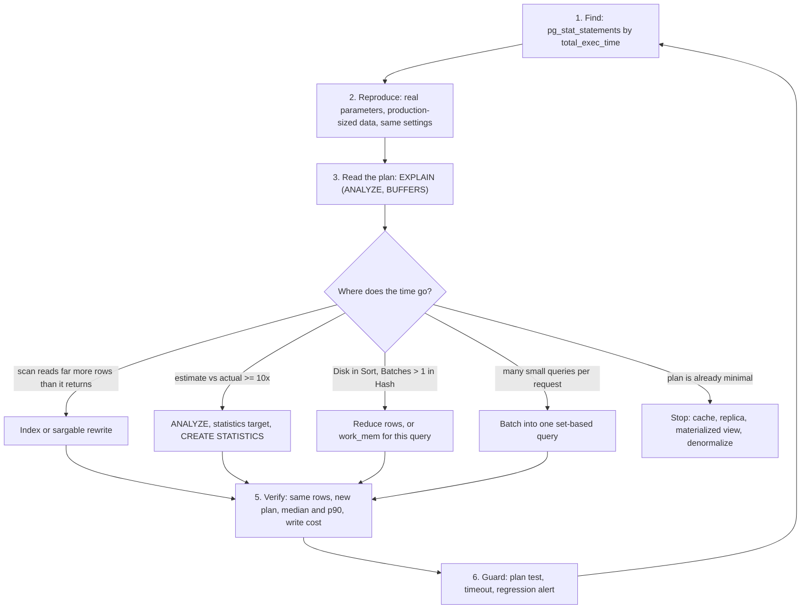

# Query Optimization

> **Module 03 · Databases** · Prerequisites: [Query Execution Plans](22-Query-Execution-Plans.md) · Next: [Offset Pagination](24-Offset-Pagination.md)

---

## ⏱ If You Only Have 2 Minutes

- Optimize what costs the most **in total**: `pg_stat_statements ORDER BY total_exec_time DESC`. A 4 ms query called 3 million times a day costs more than a 6-second report run twice.
- Follow one loop every time: **find → reproduce → read the plan → fix one bottleneck → verify → guard.** Skipping "verify" is how teams ship "optimizations" that change results or make writes slower.
- Reproduce with **real parameter values** and **production-sized data**. A 1,000-row dev database makes every plan look fine.
- Most fixes are boring: an index that matches the query shape, keeping indexed columns bare in `WHERE` (no `col::date`, no `lower(col)` without an expression index), filtering rows before joining or aggregating, and fresh statistics.
- `work_mem` (default 4 MB) is per sort or hash node, per process. Raise it for one report with `SET LOCAL`, not globally: 200 connections × 3 nodes × 256 MB is 150 GB.
- Round trips are part of query cost. Two hundred 1 ms queries per request is 200 ms of waiting; one batched query with `= ANY($1)` is one round trip.
- PostgreSQL runs one process per connection. A small pool (tens, not hundreds, of connections) usually gives more throughput than a large one.
- Stop optimizing the SQL when the plan reads about as many rows as it returns and is still too slow for its frequency. Then change *where* or *when* the work happens: cache, read replica, materialized view, denormalized column.

---

## 1. What It Is and Why It Exists

**Query optimization** is making a specific query return the **same result** using less time, I/O, memory or round trips. It covers changes to the query text, to indexes and statistics, to settings, and to how the application calls the database.

**Analogy:** a doctor, not a mechanic swapping random parts. Look at which patients take most of the ward's time (find), examine the patient (reproduce and read the plan), treat the one cause (fix), check the patient actually improved and has no side effects (verify), and schedule a follow-up (guard).

**The problem it solves.** The database is a shared resource. One query that reads 700 MB per call does not just slow its own endpoint; it evicts cached pages that every other query needs, saturates the disks, and holds connections that the pool cannot hand to anyone else. Without a method, teams guess: they add an index for every slow log line, which slows down every write, or they rewrite a query into something "clever" that is not faster and quietly returns different rows. A repeatable method makes every change measurable and reversible.

---

## 2. How It Works



### Step 1 — Find

`pg_stat_statements` aggregates every execution by normalized statement. Sort by `total_exec_time` first: it is "how much of the database's time this statement consumes". Then look at the per-call numbers that hint at the cause:

| Column (PG 13+) | What a high value suggests |
|---|---|
| `total_exec_time` | Where the database's time goes overall: start here |
| `mean_exec_time`, `calls` | Slow-per-call vs called-too-often (N+1, polling) |
| `rows / calls` | Endpoint returns too much data, or a missing `LIMIT` |
| `shared_blks_read / calls` | Reads from disk: missing index or poor cache fit |
| `temp_blks_written` | Sorts or hashes spilling to disk |

In most systems the top five to ten statements account for most of the load. Optimize those and ignore the long tail.

### Step 2 — Reproduce

`pg_stat_statements` shows `$1`, not values. Get real values from `log_min_duration_statement` (which logs bind parameters) or `auto_explain`, and test both a typical value and the worst one (the biggest customer, the widest date range). Run on a copy with production-sized data and statistics: a restored snapshot or a replica. Run each query twice and note both the cold and warm numbers.

### Step 3 — Read the plan

Run `EXPLAIN (ANALYZE, BUFFERS)` and answer four questions ([Query Execution Plans](22-Query-Execution-Plans.md) explains the output):

1. Which node takes most of the time (remember to multiply by `loops`)?
2. Is there a node that reads or removes far more rows than the query returns?
3. Where do estimated and actual rows first diverge by 10× or more, counting from the bottom?
4. Is anything spilling (`Disk:`, `Batches` > 1, `temp` buffers)?

### Step 4 — Fix one thing

Pick the smallest change that addresses the bottleneck you found (see the catalogue below). Change one thing at a time; otherwise you cannot tell which change helped, and which one just added write cost.

### Step 5 — Verify

- The new query returns **exactly** the same rows for several parameter values. A faster query that returns different results is a bug.
- `EXPLAIN` shows the plan you intended, for typical and worst-case parameters, and for the generic plan if the statement is prepared (`EXPLAIN (GENERIC_PLAN)`, PG 16+).
- Timings: median and p90 over repeated runs, not one lucky run.
- Side costs: for a new index, its size and the change in write latency and HOT updates on that table.
- After deploying, compare the statement's `mean_exec_time` and `shared_blks_read` per call in `pg_stat_statements` with the snapshot from step 1.

### Step 6 — Guard

Add the query to the plan-guard test from [Indexes](19-Indexes.md), set a `statement_timeout` that fits the endpoint, and alert when a top statement's mean time regresses. Plans change as data grows, so the guard is what keeps the fix fixed.

---

## 3. Key Concepts

### Total time beats mean time

| Statement | Calls/day | Mean | Total/day |
|---|---|---|---|
| Customer order listing | 3,000,000 | 4 ms | 3.3 hours |
| Admin revenue report | 40 | 6.1 s | 4 minutes |
| Product lookup by SKU | 9,000,000 | 0.2 ms | 30 minutes |

The report *feels* slow and gets the complaints, but the listing consumes fifty times more database time. Cutting its mean from 4 ms to 1 ms frees more capacity than making the report instant. Fix the report too if a person waits for it, but know which fix helps the database.

### The fix catalogue

| What the plan shows | Fix | What it costs |
|---|---|---|
| Seq Scan or huge `Rows Removed by Filter` for a selective predicate | An index matching the query shape: [single](19-Indexes.md), [composite](20-Composite-Indexes.md), [covering](21-Covering-Indexes.md) or partial | Write cost and disk; build with `CONCURRENTLY` |
| `Filter: ((created_at)::date >= ...)`, `lower(email) = ...` with no matching index, a default-looking estimate | **Sargable** rewrite: keep the column bare and move the computation to the constant side (`created_at >= $1`); or an expression index | You must prove the rewrite is equivalent |
| Rows multiplied by a join and thrown away later (`JOIN` then `DISTINCT`, join then filter) | **Reduce rows early**: filter before joining, aggregate before joining, `EXISTS` instead of `JOIN ... DISTINCT` ([EXISTS vs IN](12-EXISTS-vs-IN.md)) | Sometimes a less obvious query |
| Estimate vs actual off by 10× or more | `ANALYZE`; `ALTER COLUMN ... SET STATISTICS`; `CREATE STATISTICS` for correlated columns | Cheap; slightly longer `ANALYZE` |
| `Sort Method: external merge  Disk:`, Hash `Batches` > 1, `temp_blks_written` | Fewer or narrower rows; an index that delivers the order; or `SET LOCAL work_mem` for this query | Memory, multiplied by concurrent queries |
| Hundreds of identical fast statements per request | **Batch**: one query with `= ANY($1)` or a join ([Query Anti-Patterns](26-Query-Anti-Patterns.md) covers N+1) | One larger result to map |
| Fast in `EXPLAIN ANALYZE`, slow in the app | Time is outside the executor: pool waits, network, a huge result | Pool sizing, `LIMIT`, pagination |
| Query returns 50,000 rows to show 20 | `LIMIT` and [keyset pagination](25-Cursor-Pagination.md) | API change |

### Sargable predicates

A predicate is **sargable** ("search-argument-able") when the database can use an index range for it: the indexed column stands alone on one side of the comparison. `WHERE created_at::date >= $1` hides the column inside a cast, so neither an index on `created_at` nor its statistics apply; the planner falls back to a fixed default guess (one third of the rows for an inequality). `WHERE created_at >= $1::date` compares the bare column with a constant that is converted **once**. Both mean "on or after midnight of that day in the session time zone", so they return the same rows. The full list of shapes that defeat indexes is in [Query Anti-Patterns](26-Query-Anti-Patterns.md).

### Memory: `work_mem`

`work_mem` (default 4 MB) caps the memory **each** sort or hash operation may use before spilling to temporary files. Hash joins and hash aggregates get `work_mem × hash_mem_multiplier` (2.0 by default since PostgreSQL 15). A single query can have several such nodes, each parallel worker gets its own allowance, and every connection can run such a query at the same time. That is why raising it globally is risky. The safe pattern:

```sql
BEGIN;
SET LOCAL work_mem = '64MB';   -- only this transaction, only this report
SELECT ...;
COMMIT;
```

Before raising it, ask whether the node needs those rows at all: filtering earlier, or an index that already delivers the right order, removes the sort instead of feeding it.

### Round trips and connections

Every statement costs a network round trip on top of its execution time. A request that runs 200 lookups at 0.3 ms each plus 0.7 ms of network spends 200 ms mostly **waiting**. One set-based query (`WHERE id = ANY($1)`) does the same work in one trip.

PostgreSQL uses one operating-system process per connection. Hundreds of active connections compete for CPU and locks and each holds memory, so throughput often **drops** as you add connections. A pool of a few times the CPU core count is a common starting point (the PostgreSQL wiki suggests roughly `cores × 2 + effective disks` for active connections), tuned by measurement. With many application instances, a pooler such as PgBouncer in transaction mode multiplexes thousands of client connections onto a small server pool, at the price of session features (session-level `SET`, advisory locks held across transactions) not behaving as they would on a dedicated connection.

### When to stop optimizing the query

The query is "done" when its plan reads roughly as many rows as it returns, through the right index, without spills. If that is still too slow for how often it runs, the answer is no longer in the SQL:

| Situation | Move the work | Trade-off |
|---|---|---|
| Same result requested many times | Cache it ([Caching Fundamentals](../Module-07-Advanced-Backend-and-System-Design/14-Caching-Fundamentals.md)) | Staleness and invalidation |
| Read volume exceeds one server | Read replicas ([Replication](../Module-07-Advanced-Backend-and-System-Design/18-Replication.md)) | Replication lag: reads may be slightly behind |
| Expensive aggregate, freshness of minutes is fine | [Materialized view](17-Materialized-Views.md) | Refresh cost and schedule |
| Expensive derived value read on every request | [Denormalize](07-Denormalization.md) into a column or summary table | Keeping copies correct on every write |

---

## 4. Code Examples

### SQL

Find the statements to work on:

```sql
SELECT queryid,
       calls,
       round(total_exec_time)                                   AS total_ms,
       round(mean_exec_time::numeric, 1)                        AS mean_ms,
       round(rows::numeric / greatest(calls, 1), 1)             AS rows_per_call,
       round(shared_blks_read::numeric / greatest(calls, 1), 1) AS disk_blocks_per_call,
       temp_blks_written,
       left(query, 70)                                          AS query
FROM pg_stat_statements
ORDER BY total_exec_time DESC
LIMIT 10;
```

The case worked through below: an admin "revenue by category, last 7 days" report takes about 6 seconds. The original query:

```sql
SELECT p.category, sum(oi.quantity::bigint * oi.unit_price_cents) AS revenue_cents
FROM orders o
JOIN order_items oi ON oi.order_id = o.id
JOIN products p     ON p.id = oi.product_id
WHERE o.status IN ('paid', 'shipped')
  AND o.created_at::date >= $1::date          -- column hidden inside a cast
GROUP BY p.category
ORDER BY revenue_cents DESC, p.category;
```

Its plan with `$1 = '2026-11-17'`, on 10 million orders and 25 million order items. Parallel workers are disabled (`SET max_parallel_workers_per_gather = 0`) to keep the plan short. Illustrative output:

```text
Sort  (cost=1617370.40..1617370.46 rows=24 width=40) (actual time=6143.902..6143.905 rows=24 loops=1)
  Sort Key: (sum(((oi.quantity)::bigint * oi.unit_price_cents))) DESC, p.category
  Sort Method: quicksort  Memory: 26kB
  Buffers: shared hit=31207 read=213746, temp read=94323 written=94323
  ->  HashAggregate  (cost=1617369.61..1617369.85 rows=24 width=40) (actual time=6143.861..6143.870 rows=24 loops=1)
        Group Key: p.category
        Batches: 1  Memory Usage: 24kB
        ->  Hash Join  (cost=337895.00..1557432.10 rows=7916667 width=20) (actual time=2391.020..6097.433 rows=150800 loops=1)
              Hash Cond: (oi.product_id = p.id)
              ->  Hash Join  (cost=337285.00..1452318.20 rows=7916667 width=20) (actual time=2385.611..6061.127 rows=150800 loops=1)
                    Hash Cond: (oi.order_id = o.id)
                    ->  Seq Scan on order_items oi  (cost=0.00..409459.00 rows=25000000 width=20) (actual time=0.009..1490.552 rows=25000000 loops=1)
                    ->  Hash  (cost=285334.00..285334.00 rows=3166667 width=8) (actual time=2385.102..2385.103 rows=58012 loops=1)
                          Buckets: 262144  Batches: 32  Memory Usage: 2240kB
                          ->  Seq Scan on orders o  (cost=0.00..285334.00 rows=3166667 width=8) (actual time=1298.114..2370.648 rows=58012 loops=1)
                                Filter: ((status = ANY ('{paid,shipped}'::text[])) AND ((created_at)::date >= '2026-11-17'::date))
                                Rows Removed by Filter: 9941988
              ->  Hash  (cost=360.00..360.00 rows=20000 width=20) (actual time=5.312..5.313 rows=20000 loops=1)
                    Buckets: 32768  Batches: 1  Memory Usage: 1301kB
                    ->  Seq Scan on products p  (cost=0.00..360.00 rows=20000 width=20) (actual time=0.006..2.418 rows=20000 loops=1)
Planning Time: 0.611 ms
Execution Time: 6146.218 ms
```

The diagnosis, bottom-up: the `orders` scan estimates **3,166,667** rows and gets **58,012**, a 55× overestimate, because the planner has no statistics for `created_at::date` and uses its default one-third guess. Expecting millions of orders, it chooses to hash them into 32 batches and read all 25 million `order_items` rows, writing them to temporary files batch by batch (`temp written=94323` blocks, about 770 MB). The fix has two parts:

```sql
-- 1. Sargable rewrite (same rows): the cast moves to the constant, which is converted once.
--    AND o.created_at >= $1::date
-- 2. An index for the new range predicate.
CREATE INDEX CONCURRENTLY orders_created_at_idx ON orders (created_at);
```

The rewrite alone fixes the estimate (the planner can now use the `created_at` histogram), and the index removes the full scan of `orders`. After both (illustrative output):

```text
Sort  (cost=54591.70..54591.76 rows=24 width=40) (actual time=171.511..171.514 rows=24 loops=1)
  Sort Key: (sum(((oi.quantity)::bigint * oi.unit_price_cents))) DESC, p.category
  Sort Method: quicksort  Memory: 26kB
  Buffers: shared hit=287904 read=3106
  ->  HashAggregate  (cost=54590.87..54591.11 rows=24 width=40) (actual time=171.470..171.479 rows=24 loops=1)
        Group Key: p.category
        Batches: 1  Memory Usage: 24kB
        ->  Hash Join  (cost=611.00..53459.27 rows=150880 width=20) (actual time=5.102..143.770 rows=150800 loops=1)
              Hash Cond: (oi.product_id = p.id)
              ->  Nested Loop  (cost=1.00..52436.18 rows=150880 width=20) (actual time=0.041..101.553 rows=150800 loops=1)
                    ->  Index Scan using orders_created_at_idx on orders o  (cost=0.43..2398.41 rows=59240 width=8) (actual time=0.024..21.637 rows=58012 loops=1)
                          Index Cond: (created_at >= '2026-11-17'::date)
                          Filter: (status = ANY ('{paid,shipped}'::text[]))
                          Rows Removed by Filter: 6203
                    ->  Index Scan using order_items_pkey on order_items oi  (cost=0.56..0.84 rows=3 width=20) (actual time=0.001..0.001 rows=3 loops=58012)
                          Index Cond: (order_id = o.id)
              ->  Hash  (cost=360.00..360.00 rows=20000 width=20) (actual time=4.987..4.988 rows=20000 loops=1)
                    Buckets: 32768  Batches: 1  Memory Usage: 1301kB
                    ->  Seq Scan on products p  (cost=0.00..360.00 rows=20000 width=20) (actual time=0.006..2.301 rows=20000 loops=1)
Planning Time: 0.702 ms
Execution Time: 171.602 ms
```

The estimate is now 59,240 against 58,012 actual. With an accurate number the planner probes `order_items` through its primary key 58,012 times instead of reading 25 million rows, nothing spills, and the time drops from 6.1 s to 0.17 s. The index also costs a little on every order insert, which is acceptable for a column that is set once and never updated.

### Node.js / TypeScript

A small benchmark script for the "verify" step: it runs both versions on one connection, reports median and p90, and fails if the results differ.

```ts
// npm i pg ; npm i -D @types/pg tsx typescript   — run: npx tsx compare-report.ts
import assert from "node:assert/strict";
import pg from "pg";

const REPORT = (dateFilter: string) => `
  SELECT p.category, sum(oi.quantity::bigint * oi.unit_price_cents) AS revenue_cents
  FROM orders o
  JOIN order_items oi ON oi.order_id = o.id
  JOIN products p     ON p.id = oi.product_id
  WHERE o.status IN ('paid', 'shipped') AND ${dateFilter}
  GROUP BY p.category
  ORDER BY revenue_cents DESC, p.category`;

// The only difference: where the cast happens. Both are fixed strings, never user input.
const BEFORE = REPORT("o.created_at::date >= $1::date");
const AFTER = REPORT("o.created_at >= $1::date");

// One client: both versions see the same session settings and the same warm cache.
const client = new pg.Client({ connectionString: process.env.DATABASE_URL });

async function measure(label: string, sql: string, params: unknown[], runs = 10) {
  const reference = await client.query(sql, params); // warm-up run; its rows are the reference result
  const samples: number[] = [];
  for (let i = 0; i < runs; i++) {
    const t0 = performance.now();
    await client.query(sql, params);
    samples.push(performance.now() - t0);
  }
  samples.sort((a, b) => a - b);
  const pick = (p: number) => samples[Math.min(samples.length - 1, Math.floor(p * samples.length))];
  console.log(`${label.padEnd(6)} median ${pick(0.5).toFixed(1)} ms   p90 ${pick(0.9).toFixed(1)} ms   (${runs} runs)`);
  return reference.rows;
}

async function main(): Promise<void> {
  await client.connect();
  try {
    await client.query("SET statement_timeout = '60s'"); // a pathological "before" must not run forever
    const since = new Date(Date.now() - 7 * 86_400_000).toISOString().slice(0, 10); // 'YYYY-MM-DD'
    const before = await measure("before", BEFORE, [since], 5);
    const after = await measure("after", AFTER, [since]);
    // sum() over bigint returns numeric, which node-postgres gives back as an exact string.
    assert.deepEqual(after, before, "the rewrite changed the result");
    console.log(`identical results: ${after.length} categories`);
  } finally {
    await client.end();
  }
}

main().catch((err) => {
  console.error(err);
  process.exitCode = 1;
});
```

Illustrative output:

```text
before median 6188.4 ms   p90 6302.7 ms   (5 runs)
after  median 176.9 ms   p90 181.3 ms   (10 runs)
identical results: 24 categories
```

The application-side numbers are a few milliseconds above the server's `Execution Time` because they include the round trip and transferring 24 rows.

### Python

The same check with psycopg 3. Automatic server-side preparation is disabled so both versions are measured as plain statements; check the prepared (generic) plan separately with `EXPLAIN (GENERIC_PLAN)`.

```python
# pip install "psycopg[binary]"   — Python 3.12+; run: python compare_report.py
import os
import statistics
import time
from datetime import UTC, datetime, timedelta

import psycopg

REPORT = """
    SELECT p.category, sum(oi.quantity::bigint * oi.unit_price_cents) AS revenue_cents
    FROM orders o
    JOIN order_items oi ON oi.order_id = o.id
    JOIN products p     ON p.id = oi.product_id
    WHERE o.status IN ('paid', 'shipped') AND {date_filter}
    GROUP BY p.category
    ORDER BY revenue_cents DESC, p.category"""

# Fixed SQL fragments chosen by the script, never user input.
BEFORE = REPORT.format(date_filter="o.created_at::date >= %(since)s::date")
AFTER = REPORT.format(date_filter="o.created_at >= %(since)s::date")


def measure(conn: psycopg.Connection, label: str, sql: str, params: dict, runs: int = 10) -> list[tuple]:
    reference = conn.execute(sql, params).fetchall()  # warm-up; also the result to compare
    samples: list[float] = []
    for _ in range(runs):
        t0 = time.perf_counter()
        conn.execute(sql, params).fetchall()
        samples.append((time.perf_counter() - t0) * 1000)
    p90 = statistics.quantiles(samples, n=10)[-1]
    print(f"{label:<6} median {statistics.median(samples):.1f} ms   p90 {p90:.1f} ms   ({runs} runs)")
    return reference


def main() -> None:
    since = datetime.now(UTC).date() - timedelta(days=7)
    # prepare_threshold=None: measure the SQL itself, not psycopg's prepared-statement path.
    with psycopg.connect(os.environ["DATABASE_URL"], autocommit=True, prepare_threshold=None) as conn:
        conn.execute("SET statement_timeout = '60s'")
        before = measure(conn, "before", BEFORE, {"since": since}, runs=5)
        after = measure(conn, "after", AFTER, {"since": since})
    # numeric sums come back as Decimal, so equality is exact.
    assert after == before, "the rewrite changed the result"
    print(f"identical results: {len(after)} categories")


if __name__ == "__main__":
    main()
```

**Runtime difference to notice:** node-postgres never prepares a statement unless you give it a `name`, so each run is planned with the actual date. psycopg 3 prepares a statement after five executions by default, and PostgreSQL may then switch to a generic plan that does not know the date. For a range predicate like this one, the generic estimate falls back to a default selectivity. If you leave preparation on in production, verify the generic plan too.

---

## 5. Production Concerns

- **Measure before and after in production, not just on a copy.** Snapshot `pg_stat_statements` before the deploy, then compare `mean_exec_time`, `shared_blks_read / calls` and `temp_blks_written` after a representative period. `pg_stat_statements_reset()` clears everything for everyone, so prefer snapshots over resets on a shared database.
- **Timeouts as a safety net.** Set `statement_timeout` per role or per transaction (for example 2 s for API traffic, longer for a reporting role), so a plan flip turns into fast errors instead of exhausted pools. Add `idle_in_transaction_session_timeout` so abandoned transactions do not hold locks or block VACUUM.
- **Index cost is paid by writers.** Every index added during optimization slows inserts and non-HOT updates on that table. Record the change in write latency and in `n_tup_hot_upd / n_tup_upd` next to the read improvement, and remove indexes that later become unused ([Indexes](19-Indexes.md)).
- **Plan stability.** A fix that relies on a fragile estimate can flip back as data grows. Prefer fixes that make the good plan obviously cheapest (an index that matches the query shape) over ones that only nudge costs. PostgreSQL has no built-in plan hints; settings such as `enable_nestloop = off` are diagnostic tools, not production fixes.
- **Memory settings and concurrency.** Before raising `work_mem` for a role, estimate the worst case: concurrent connections × memory-hungry nodes per query × the setting. Raise it with `SET LOCAL` inside the report's transaction instead.
- **Load tests confirm the fix under concurrency.** One fast run proves little if 200 concurrent calls contend for the same pages or locks. Re-run the endpoint's load test and compare p95/p99 latency and database CPU.

---

## 6. Common Mistakes

- **Optimizing the query with the worst mean instead of the worst total** — the slow report gets fixed while a 4 ms query called millions of times keeps the database busy — sort `pg_stat_statements` by `total_exec_time` first.
- **Testing on a small or synthetic dataset** — every plan looks fast and the real bottleneck never appears — reproduce on production-sized data with real parameter values, including the worst-case customer.
- **Changing several things at once** — an index, a rewrite and a setting ship together, and nobody knows which helped or which slowed writes — one change per measurement.
- **Not checking the result** — a rewrite that moves a condition from `WHERE` to a `LEFT JOIN ... ON`, or swaps `IN` for a join, silently changes rows — compare full result sets for several parameters.
- **Raising `work_mem` globally** — works in a quiet test, exhausts memory under concurrency — use `SET LOCAL` for the specific query, or remove the sort with an index.
- **Fixing the query with a cache first** — the cache hides a 700 MB scan until a cold start or an invalidation storm brings it back at the worst time — make the query reasonable first, then cache for scale.
- **Keeping hundreds of database connections "for throughput"** — CPU contention and memory pressure lower throughput — a small pool per instance, plus PgBouncer when instances multiply.

---

## 7. Comparison Table

| Lever | Typical gain | Effort | Main cost or risk | Reach for it when |
|---|---|---|---|---|
| Index matching the query | 10–1000× | Low | Write amplification, disk | Scan reads far more rows than it returns |
| Sargable rewrite / reduce rows early | 2–100× | Low–medium | Must prove equivalence | Function on a column, late filtering |
| Statistics (`ANALYZE`, `CREATE STATISTICS`) | Fixes the plan choice | Low | Slightly longer `ANALYZE` | Estimates off by 10× or more |
| `work_mem` for one query | Removes disk spills | Low | Memory × concurrency | Sort or hash spills you cannot avoid |
| Batching round trips | Proportional to the number of calls | Medium | Bigger result mapping | Many small statements per request |
| Connection pooling | Throughput under load | Medium | Session-state limits in transaction pooling | Many app instances or connection storms |
| Cache, replica, materialized view, denormalization | Removes the query from the hot path | High | Staleness, lag, consistency work | The plan is already minimal |

---

## 8. Interview Questions

**[Junior] An endpoint is slow. How do you start?**
First confirm the time is in the database: compare the endpoint's latency with the query's execution time in logs or `pg_stat_statements`. Then take the slow query with its real parameters, run `EXPLAIN (ANALYZE, BUFFERS)` on production-sized data, and find the node that takes the time. Only then change something, one thing at a time, and measure again.

**[Mid] Why sort `pg_stat_statements` by total time instead of mean time?**
Total time is the database capacity a statement consumes. A cheap query called millions of times can cost far more than a slow one called rarely, and it affects every user. Mean time still matters for user-facing latency, so look at both, but total time decides what frees the most capacity.

**[Mid] Why is `WHERE created_at::date >= $1` slow, and how do you fix it?**
The column is wrapped in a cast, so an index on `created_at` cannot be used and the planner has no statistics for the expression, so it guesses a third of the rows. That bad estimate can also push it towards hash joins over whole tables. Rewrite it as `created_at >= $1::date`, which is equivalent because both compare against midnight in the session time zone, and add an index on `created_at` if the range is selective.

**[Mid] What is `work_mem`, and why not set it to 1 GB?**
It limits the memory each sort or hash operation may use before spilling to temporary files. It applies per node, per parallel worker, per connection, so a high global value multiplied by concurrent queries can exhaust server memory. Raise it with `SET LOCAL` inside the transaction of a specific heavy query, and first check whether filtering earlier or an index that provides the sort order avoids the spill altogether.

**[Mid] How does batching improve performance if each query is already fast?**
Each statement pays a network round trip and per-statement overhead on top of execution. Two hundred 0.3 ms lookups with 0.7 ms network latency each take about 200 ms, mostly waiting. One query with `WHERE id = ANY($1)` returns the same rows in a single round trip and lets the database use one plan for all of them.

**[Senior] You deployed an index that made a query 50× faster in staging, but production latency barely moved. What do you check?**
That production uses the new plan: capture it with `auto_explain` or `EXPLAIN` using production parameters, including the generic plan if the statement is prepared. Check that the index is valid (`indisvalid`) and that statistics were refreshed. Then check whether the database was the bottleneck at all: pool wait time, network transfer of large results, lock waits, or other statements dominating `total_exec_time`. Finally compare `pg_stat_statements` per-call numbers before and after rather than endpoint latency alone.

**[Senior] When do you stop optimizing a query and change the architecture instead?**
When the plan reads about as many rows as it returns, through the right index, with no spills or misestimates, and it is still too slow or too frequent for the load. Then the options are caching the result (with invalidation), sending reads to replicas (accepting lag), precomputing with a materialized view or summary table (accepting staleness or write-time work), or denormalizing a derived value. Each moves cost from read time to write time or adds staleness, so pick the one whose trade-off the product can accept.

**[Senior] Your service has 40 instances with 50 connections each, and the database is struggling. What do you do?**
Two thousand connections means two thousand PostgreSQL processes competing for CPU, locks and memory, and throughput usually falls beyond a few times the core count. Shrink each instance's pool so the total active connections stay near what the server can run in parallel, and put PgBouncer in transaction mode in front to multiplex clients. Check the application for session-level state (session `SET`, advisory locks held across transactions) that transaction pooling breaks, and watch pool wait time to size it.

---

## 9. Cheat Sheet

```text
Method        find → reproduce → read plan → fix ONE thing → verify → guard
Find          pg_stat_statements ORDER BY total_exec_time DESC; then mean, rows/call, blks_read, temp
Reproduce     real params (log_min_duration_statement / auto_explain), prod-sized data, warm + cold
Read          EXPLAIN (ANALYZE, BUFFERS): slowest node × loops, rows removed, est vs actual, spills
Fixes         index | sargable rewrite | filter/aggregate before join | ANALYZE / CREATE STATISTICS
              SET LOCAL work_mem | batch with = ANY($1) | pool connections | LIMIT + keyset pages
Sargable      col::date >= $1  →  col >= $1::date ; lower(col) = $1 needs an expression index
work_mem      4 MB default, per node per process; hash × hash_mem_multiplier (2.0, PG 15+)
Connections   one process each; small pool; PgBouncer transaction mode for many instances
Verify        identical rows, intended plan (incl. GENERIC_PLAN), median + p90, write cost
Guard         plan-guard test, statement_timeout, alert on mean_exec_time regression
Stop when     plan reads ≈ rows returned → cache, replica, materialized view, denormalize
```

---

## Related Topics

- [Query Execution Plans](22-Query-Execution-Plans.md) — how to read the plans this method depends on
- [Query Anti-Patterns](26-Query-Anti-Patterns.md) — the catalogue of query shapes to recognise and avoid, including N+1
- [Materialized Views](17-Materialized-Views.md) — precomputing an aggregate when the query is already optimal
- [Denormalization](07-Denormalization.md) — storing derived values on purpose, and keeping them correct
- [Caching Fundamentals](../Module-07-Advanced-Backend-and-System-Design/14-Caching-Fundamentals.md) — taking repeated reads off the database
- [Replication](../Module-07-Advanced-Backend-and-System-Design/18-Replication.md) — scaling reads with replicas and living with lag
