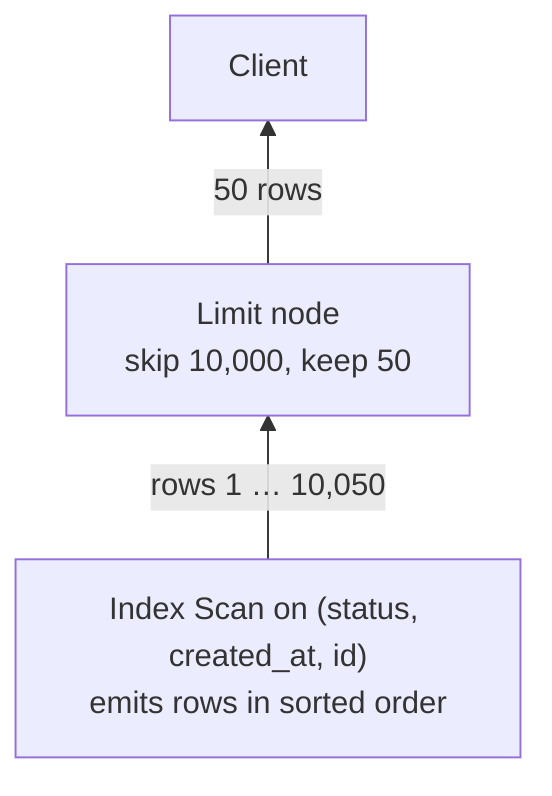

# Offset Pagination

> **Module 03 · Databases** · Prerequisites: [Query Optimization](23-Query-Optimization.md) · Next: [Cursor Pagination](25-Cursor-Pagination.md)

---

## ⏱ If You Only Have 2 Minutes

- `LIMIT 50 OFFSET 10000` does not jump to row 10,001. The database **produces 10,050 rows and throws away the first 10,000**. Cost grows linearly with the offset, even with a perfect index.
- Offset pagination needs a **deterministic `ORDER BY` with a unique tie-breaker** (`ORDER BY created_at DESC, id DESC`). Without it, rows with equal sort keys can appear on two pages or on none.
- When rows are inserted or deleted between two page requests, every later row shifts. An insert at the top gives the user a **duplicate**; a delete gives them a **missed row**.
- `COUNT(*)` for "page 1 of 4,812" is a separate full scan of every matching row. PostgreSQL keeps no stored row count because of MVCC. Use a **capped count** ("10,000+") or a planner estimate.
- Offset is fine for **small, bounded, mostly static** sets: admin tables, search results capped at a few hundred, settings lists.
- Mitigations: cap `pageSize` (e.g. 100) and the reachable depth (e.g. 10,000 rows); use a **deferred join** so the skipped rows are read from an index only, not from the table.
- For deep or constantly changing lists (feeds, timelines, exports), switch to [cursor pagination](25-Cursor-Pagination.md).

---

## 1. What It Is and Why It Exists

**Offset pagination** splits a sorted result into numbered pages. Page *p* with page size *n* is the query with `LIMIT n OFFSET (p − 1) × n`. The client sends `?page=3&pageSize=25` and gets rows 51–75.

**Analogy:** reading page 300 of a book by counting pages from the front cover each time. It works, and you can open any page number. But every jump means counting all the pages before it, and if someone tears out page 12 while you are reading, everything after it is now off by one.

**The problem it solves.** A table with two million orders cannot be sent to a browser in one response. Offset pagination is the simplest way to send it in slices: the SQL is one clause, every ORM supports it, and the UI gets page numbers and a "jump to page 40" box for free. That is why it is the default in admin panels and early APIs.

**What breaks.** Two things get worse as the data grows:

1. **Latency grows with depth.** Page 1 takes a millisecond. Page 4,000 takes hundreds of milliseconds, because the database still has to walk past every earlier row.
2. **Pages are not stable.** A page is defined by a position ("rows 51–75"), not by the data. When rows are added or removed, positions move.

The API contract side (response shape, default and maximum `limit`) is covered in [API Design Principles](../Module-02-Core-Backend/04-API-Design-Principles.md). This chapter is about what the database does with `OFFSET`, and how to keep it affordable.

---

## 2. How It Works

### The executor reads, then discards

PostgreSQL's executor is a tree of nodes that pass rows upward one at a time. `LIMIT` and `OFFSET` are handled by a **Limit** node at the top. It pulls rows from the node below, drops the first *offset* rows, passes the next *limit* rows up, and then stops pulling.



The skipped rows are not free. For each of them the index scan has to:

1. Read the index entry.
2. Visit the table page (the **heap**) to fetch the row and check that it is visible to this transaction (MVCC).
3. Hand the row to the Limit node, which discards it.

The PostgreSQL documentation says this directly: rows skipped by `OFFSET` still have to be computed inside the server, so a large offset can be slow.

If there is **no index** that matches the `ORDER BY`, it is worse. The database must read every matching row and sort them before it can skip anything. PostgreSQL uses a bounded "top-N heapsort" that keeps only `offset + limit` rows in memory, but it still reads the whole table.

### What the plan looks like

Assume 2 million orders, 1.2 million of them `paid`, and this index:

```sql
CREATE INDEX orders_status_created_id_idx ON orders (status, created_at DESC, id DESC);
```

Page 2,001 with 50 rows per page:

```sql
EXPLAIN (ANALYZE, BUFFERS, COSTS OFF)
SELECT id, customer_id, status, total_cents, created_at
FROM orders
WHERE status = 'paid'
ORDER BY created_at DESC, id DESC
LIMIT 50 OFFSET 100000;
```

Illustrative output:

```text
Limit (actual time=96.741..96.812 rows=50 loops=1)
  Buffers: shared hit=99310 read=1162
  ->  Index Scan using orders_status_created_id_idx on orders (actual time=0.029..96.790 rows=100050 loops=1)
        Index Cond: (status = 'paid'::text)
        Buffers: shared hit=99310 read=1162
Planning Time: 0.142 ms
Execution Time: 96.851 ms
```

Read it from the inside out. The index scan produced **100,050 rows** and touched about 100,000 buffers (8 KB pages), roughly one heap page per row because orders are scattered across the table. The Limit node returned 50. The same query with `OFFSET 0` reads about 55 buffers and runs in well under a millisecond. Nothing about the index is wrong; the work is simply proportional to the offset.

### Why pages drift

A page is a position in a sorted list, evaluated fresh on every request. Each request also runs in its own snapshot, so it sees whatever was committed by then.

| Time | Event | Page 1 (`OFFSET 0 LIMIT 3`) | Page 2 (`OFFSET 3 LIMIT 3`) |
|---|---|---|---|
| t1 | User loads page 1 | 109, 108, 107 | — |
| t2 | Order 110 is created | — | — |
| t3 | User loads page 2 | — | **107**, 106, 105 (107 again: duplicate) |

With a delete instead of an insert, the opposite happens. If order 108 is cancelled and removed at t2, page 2 starts at 105, and order 106 is never shown. For an admin table this is a small annoyance. For an export job or a sync client that pages through "all orders", it is silent data loss.

### Why non-unique ordering loses rows

`ORDER BY created_at DESC` alone is not a total order: bulk imports often give hundreds of rows the same timestamp. SQL leaves the order of tied rows undefined. PostgreSQL's planner takes `LIMIT` and `OFFSET` into account, so different offsets can get different plans (index scan for page 1, sort for page 900), and each plan may break ties differently. A row can then appear on page 3 and page 4, or on neither. The fix is always the same: add the primary key as the last sort column, and include it in the index.

---

## 3. Key Concepts

### The cost of `COUNT(*)` for "total pages"

A page-number UI wants "Page 3 of 4,812", which needs the total number of matching rows. In PostgreSQL that is expensive:

- There is no stored row count. Under MVCC, different transactions can see different numbers of rows at the same moment, so the count must be computed by checking visibility of every matching row.
- `count(*)` over 1.2 million matching rows is a full index or table scan. It often costs **more than the page query itself**, on every page view.

Options, from exact to cheap:

| Approach | SQL | Cost | Accuracy |
|---|---|---|---|
| Exact count | `SELECT count(*) FROM orders WHERE status = $1` | Scans all matches | Exact at that snapshot |
| Capped count | `SELECT count(*) FROM (SELECT 1 FROM orders WHERE status = $1 LIMIT 10001) t` | At most 10,001 rows | Exact below the cap, then "10,000+" |
| Table estimate | `SELECT reltuples::bigint FROM pg_class WHERE oid = 'orders'::regclass` | One catalog row | Whole table only; updated by `VACUUM`/`ANALYZE` (−1 if never analyzed) |
| Planner estimate | Run `EXPLAIN` for the filtered query and read the top `rows=` value | Planning only | Can be off by a large factor on skewed data |
| No total | Return `hasMore` only (fetch `limit + 1` rows) | Free | "Next" button only |

The **capped count** pairs naturally with a depth cap: if users can never go past row 10,000, there is no reason to count beyond it. Search engines show "about N results" for the same reason.

### Deferred join

A **deferred join** (also called "late row lookup") does the skipping on a narrow index and touches the table only for the rows you return:

```sql
SELECT o.id, o.customer_id, o.status, o.total_cents, o.created_at
FROM orders o
WHERE o.id IN (
  SELECT id
  FROM orders
  WHERE status = $1
  ORDER BY created_at DESC, id DESC
  OFFSET $2 LIMIT $3
)
ORDER BY o.created_at DESC, o.id DESC;
```

The inner query needs only `status`, `created_at` and `id`, which are all in `orders_status_created_id_idx`. PostgreSQL can answer it with an **index-only scan**: it reads index pages and skips the heap, as long as the visibility map says those pages are all-visible (which `VACUUM` maintains). The outer query then fetches 50 full rows by primary key.

Illustrative output for the same page 2,001:

```text
Sort (actual time=19.330..19.337 rows=50 loops=1)
  Sort Key: o.created_at DESC, o.id DESC
  Sort Method: quicksort  Memory: 31kB
  Buffers: shared hit=732
  ->  Nested Loop (actual time=19.150..19.290 rows=50 loops=1)
        Buffers: shared hit=732
        ->  HashAggregate (actual time=19.130..19.141 rows=50 loops=1)
              Group Key: "ANY_subquery".id
              Buffers: shared hit=532
              ->  Limit (actual time=19.090..19.112 rows=50 loops=1)
                    Buffers: shared hit=532
                    ->  Index Only Scan using orders_status_created_id_idx on orders (actual time=0.021..19.105 rows=100050 loops=1)
                          Index Cond: (status = 'paid'::text)
                          Heap Fetches: 0
                          Buffers: shared hit=532
        ->  Index Scan using orders_pkey on orders o (actual time=0.003..0.003 rows=1 loops=50)
              Index Cond: (id = "ANY_subquery".id)
              Buffers: shared hit=200
```

Buffers drop from about 100,000 to 732, and time from 97 ms to 19 ms. Note what did **not** change: the index-only scan still walks 100,050 entries. A deferred join is a constant-factor improvement, not a fix for depth. Page 20,000 is still ten times slower than page 2,000.

### Deterministic ordering

Rules for an `ORDER BY` that pages correctly:

- End with a unique column (usually the primary key): `ORDER BY created_at DESC, id DESC`.
- Index the same columns in the same direction, after any equality filter columns: `(status, created_at DESC, id DESC)`. See [Composite Indexes](20-Composite-Indexes.md).
- Do not let clients sort by arbitrary columns. Every allowed sort needs its own index, or deep pages turn into full sorts. Keep an allow-list that maps a sort name to an `ORDER BY` clause; never interpolate the raw parameter into SQL.

### Caps and validation

| Limit | Typical value | Why |
|---|---|---|
| Default `pageSize` | 20–50 | Small responses for the common case |
| Maximum `pageSize` | 100–500 | Bounds memory in the database, the driver and the JSON encoder |
| Maximum reachable row | 1,000–10,000 | Bounds the cost of the deepest page; users do not read past it anyway |
| `page` | Integer ≥ 1 | `page=0` or `page=-1` should be a 4xx, not a negative `OFFSET` error from the database |

Real systems publish such caps: GitHub's search API returns at most 1,000 results per query, and Elasticsearch refuses `from + size` above `index.max_result_window` (10,000 by default). Past the cap, the honest answer is "narrow your filters", or a cursor-based endpoint for bulk access.

### When offset pagination is the right choice

- The set is **small and bounded**: a customer's 30 saved addresses, a 2,000-row product catalogue in an admin screen.
- Users need **random access by page number** and rarely go deep.
- The data changes slowly, or a duplicate/missed row between pages does not matter.
- The result is already **capped** by relevance, like search results.

Choose cursors instead when the list is unbounded, constantly changing (feeds, notifications, audit logs), or read by machines that must see every row exactly once (exports, sync APIs).

### `LIMIT`/`OFFSET` syntax across databases

`LIMIT n OFFSET m` works in PostgreSQL, MySQL and SQLite. The SQL standard spelling, also supported by PostgreSQL, is `OFFSET m ROWS FETCH FIRST n ROWS ONLY`. SQL Server uses the standard form after `ORDER BY`.

> **MySQL (InnoDB) difference:** MySQL also accepts `LIMIT m, n` (offset first). It does **not** allow `LIMIT` inside an `IN (...)` subquery, so the deferred join is written as a join to a derived table: `SELECT o.* FROM orders o JOIN (SELECT id FROM orders WHERE status = ? ORDER BY created_at DESC, id DESC LIMIT ?, ?) p ON p.id = o.id`. In InnoDB every secondary index entry already contains the primary key, so the inner query is covered by an index on `(status, created_at, id)`. `SQL_CALC_FOUND_ROWS` is deprecated since MySQL 8.0.17; run a separate `COUNT(*)` instead.

---

## 4. Code Examples

Scenario: an admin endpoint `GET /admin/orders?status=paid&page=3&pageSize=25`. It validates input, caps the page size and the depth, uses the deferred join, and returns a capped total.

### SQL

```sql
-- Supports the filter, the sort and the tie-breaker, and covers the inner query.
CREATE INDEX orders_status_created_id_idx ON orders (status, created_at DESC, id DESC);

-- Page query ($1 = status, $2 = offset, $3 = limit)
SELECT o.id, o.customer_id, o.status, o.total_cents, o.created_at
FROM orders o
WHERE o.id IN (
  SELECT id FROM orders
  WHERE status = $1
  ORDER BY created_at DESC, id DESC
  OFFSET $2 LIMIT $3
)
ORDER BY o.created_at DESC, o.id DESC;

-- Capped total ($2 = cap + 1): counts at most 10,001 rows, never the whole table.
SELECT count(*) AS n
FROM (SELECT 1 FROM orders WHERE status = $1 LIMIT $2) AS capped;
```

### Node.js / TypeScript

```ts
// npm i express pg zod  (dev: @types/express @types/pg)  — Node.js 22+, TypeScript 5, ESM
import express from "express";
import pg from "pg";
import { z } from "zod";

const pool = new pg.Pool({ connectionString: process.env.DATABASE_URL, max: 10 });

const MAX_PAGE_SIZE = 100;
const MAX_REACHABLE_ROWS = 10_000; // deepest row a client can page to; also the count cap

const PAGE_SQL = `
  SELECT o.id, o.customer_id, o.status, o.total_cents, o.created_at
  FROM orders o
  WHERE o.id IN (SELECT id FROM orders WHERE status = $1
                 ORDER BY created_at DESC, id DESC OFFSET $2 LIMIT $3)
  ORDER BY o.created_at DESC, o.id DESC`;
const COUNT_SQL = `SELECT count(*) AS n FROM (SELECT 1 FROM orders WHERE status = $1 LIMIT $2) AS capped`;

const Query = z.object({
  status: z.enum(["pending", "paid", "shipped", "cancelled"]),
  page: z.coerce.number().int().min(1).default(1),
  // Clamp rather than reject: a client asking for 10,000 rows gets 100, not an error or an outage.
  pageSize: z.coerce.number().int().min(1).default(25).transform((n) => Math.min(n, MAX_PAGE_SIZE)),
});

interface OrderRow {
  id: string;          // bigint arrives as a string: JS numbers are exact only up to 2^53
  customer_id: string;
  status: string;
  total_cents: number;
  created_at: Date;
}

const app = express();

app.get("/admin/orders", async (req, res) => {
  const parsed = Query.safeParse(req.query);
  if (!parsed.success) {
    res.status(422).type("application/problem+json")
      .json({ title: "Invalid query parameters", errors: parsed.error.issues });
    return;
  }
  const { status, page, pageSize } = parsed.data;
  const offset = (page - 1) * pageSize;
  if (offset + pageSize > MAX_REACHABLE_ROWS) {
    res.status(422).type("application/problem+json")
      .json({ title: "Page too deep", detail: `Only the first ${MAX_REACHABLE_ROWS} rows are pageable; add filters.` });
    return;
  }

  // pool.query checks out a connection per call, so the page and the count run in parallel.
  // They use separate snapshots: under concurrent writes the total can be off by a few rows.
  const [pageResult, countResult] = await Promise.all([
    pool.query<OrderRow>(PAGE_SQL, [status, offset, pageSize]),
    pool.query<{ n: string }>(COUNT_SQL, [status, MAX_REACHABLE_ROWS + 1]),
  ]);
  const n = Number(countResult.rows[0].n);

  res.json({
    data: pageResult.rows,
    page,
    pageSize,
    total: Math.min(n, MAX_REACHABLE_ROWS),
    totalIsCapped: n > MAX_REACHABLE_ROWS, // UI shows "10,000+"
  });
});

app.listen(3000);
```

Express 5 forwards a rejected promise from an async handler to the error middleware, so a database error becomes a 500 without a `try/catch` here.

### Python

```python
# pip install fastapi "psycopg[binary]" psycopg-pool   — Python 3.12+
import asyncio
import os
from contextlib import asynccontextmanager
from datetime import datetime
from typing import Annotated, Any, Literal

from fastapi import FastAPI, HTTPException, Query
from psycopg.rows import dict_row
from psycopg_pool import AsyncConnectionPool
from pydantic import BaseModel

MAX_PAGE_SIZE = 100
MAX_REACHABLE_ROWS = 10_000

PAGE_SQL = """
    SELECT o.id, o.customer_id, o.status, o.total_cents, o.created_at
    FROM orders o
    WHERE o.id IN (SELECT id FROM orders WHERE status = %(status)s
                   ORDER BY created_at DESC, id DESC OFFSET %(offset)s LIMIT %(limit)s)
    ORDER BY o.created_at DESC, o.id DESC"""
COUNT_SQL = """SELECT count(*) AS n
    FROM (SELECT 1 FROM orders WHERE status = %(status)s LIMIT %(cap)s) AS capped"""

pool = AsyncConnectionPool(os.environ["DATABASE_URL"], open=False, kwargs={"row_factory": dict_row})


@asynccontextmanager
async def lifespan(_: FastAPI):
    await pool.open()
    yield
    await pool.close()


app = FastAPI(lifespan=lifespan)


class OrderOut(BaseModel):
    id: int
    customer_id: int
    status: str
    total_cents: int
    created_at: datetime


class OrderPage(BaseModel):
    data: list[OrderOut]
    page: int
    page_size: int
    total: int
    total_is_capped: bool


async def fetch_all(sql: str, params: dict[str, Any]) -> list[dict[str, Any]]:
    async with pool.connection() as conn:
        cur = await conn.execute(sql, params)
        return await cur.fetchall()


@app.get("/admin/orders")
async def list_orders(
    status: Literal["pending", "paid", "shipped", "cancelled"],
    page: Annotated[int, Query(ge=1)] = 1,
    page_size: Annotated[int, Query(ge=1)] = 25,
) -> OrderPage:
    page_size = min(page_size, MAX_PAGE_SIZE)
    offset = (page - 1) * page_size
    if offset + page_size > MAX_REACHABLE_ROWS:
        raise HTTPException(422, f"Only the first {MAX_REACHABLE_ROWS} rows are pageable; add filters.")

    # One psycopg connection runs one statement at a time, so parallelism needs two
    # pooled connections. TaskGroup cancels the sibling query if either one fails.
    async with asyncio.TaskGroup() as tg:
        rows = tg.create_task(fetch_all(PAGE_SQL, {"status": status, "offset": offset, "limit": page_size}))
        count = tg.create_task(fetch_all(COUNT_SQL, {"status": status, "cap": MAX_REACHABLE_ROWS + 1}))
    n = count.result()[0]["n"]

    return OrderPage(
        data=[OrderOut(**r) for r in rows.result()],
        page=page,
        page_size=page_size,
        total=min(n, MAX_REACHABLE_ROWS),
        total_is_capped=n > MAX_REACHABLE_ROWS,
    )
```

**Runtime differences to notice:** `pg` returns `bigint` columns (`id`, `count(*)`) as strings, because a JavaScript number cannot hold every 64-bit integer exactly; psycopg returns Python `int`, which is arbitrary-precision. And `pg`'s `pool.query` hides connection checkout, so `Promise.all` is enough for parallel queries, while in Python you must ask the pool for two connections explicitly. FastAPI turns a failed `Query(ge=1)` check into a 422 automatically; in Express the validation is your code.

---

## 5. Production Concerns

- **Bots and crawlers find deep pages.** A "Last page" link or a crawler following `?page=` links will request page 40,000. Without a depth cap, one client can keep several database cores busy. Cap depth in the API, not only in the UI, and rate-limit list endpoints.
- **Watch latency by page depth.** Record `offset` as a bucketed attribute (0, 1–1k, 1k–10k, >10k) on the request span or metric. If p99 latency rises with the bucket, you are paying the discard cost. In `pg_stat_statements`, the page query shows high `shared_blks_hit` per call relative to rows returned.
- **The count can cost more than the page.** Measure the two queries separately. If `count(*)` dominates, cap it, cache it per filter for a short time, or drop it from the response.
- **Index-only scans depend on `VACUUM`.** The deferred join is fast only while `Heap Fetches` stays near zero. On a table with heavy updates and lagging autovacuum, the visibility map goes stale and the inner query starts visiting the heap again. Check `Heap Fetches` in the plan when deep pages slow down.
- **Changing data between pages.** For exports and sync jobs, do not page with `OFFSET`. Use a cursor, or run the whole export in one `REPEATABLE READ` transaction with a server-side cursor so every page reads the same snapshot.
- **`statement_timeout` as a guard.** Set a per-role or per-transaction timeout (for example 2–5 s for the API role) so a forgotten deep-page path fails fast instead of piling up connections.
- **Sort allow-list.** A `sort` parameter must map to a fixed set of `ORDER BY` clauses. Interpolating it into SQL is an injection hole, and allowing an unindexed sort turns every page into a full sort.

---

## 6. Common Mistakes

- **`ORDER BY created_at` without a tie-breaker** — rows with equal timestamps appear on two pages or vanish — add `id` as the last sort key and to the index.
- **No `ORDER BY` at all** — SQL returns rows in whatever order the plan produces, which can change between pages — always sort when you use `LIMIT`/`OFFSET`.
- **Uncapped `pageSize`** — `?pageSize=1000000` loads the table into the API process — clamp to a maximum (100–500).
- **Exact `COUNT(*)` on every request** — the count scan costs more than the page and runs on every click — capped count, estimate, or `hasMore` only.
- **Using offset for exports or sync** — inserts and deletes between pages cause duplicates and silently skipped rows — use [cursor pagination](25-Cursor-Pagination.md).
- **Believing an index makes deep offsets cheap** — the index avoids the sort, but the executor still reads every skipped row — cap depth or use a deferred join.
- **Computing `OFFSET` from unvalidated input** — `page=0` gives a negative offset (a database error) and very large numbers overflow — validate `page ≥ 1` and the maximum depth before building the query.

---

## 7. Comparison Table

| | Offset pagination | Offset + deferred join | Cursor (keyset) pagination |
|---|---|---|---|
| Request | `?page=200&pageSize=50` | Same | `?limit=50&cursor=eyJ...` |
| Work for a deep page | Reads all skipped rows from index **and** table | Reads skipped entries from the index only | Seeks to the cursor; reads `limit` rows |
| Jump to page *N* | Yes | Yes | No (only next/previous, or seek to a value) |
| Total pages | Needs `COUNT(*)` | Needs `COUNT(*)` | Usually not offered |
| Stable while data changes | No: duplicates and missed rows | No | Yes for inserts/deletes elsewhere in the list |
| Arbitrary sort columns | Easy (each needs an index to be fast) | Needs a covering index per sort | Each sort needs its own cursor shape and index |
| Best for | Small admin tables, capped search results | Admin tables that occasionally go deep | Feeds, infinite scroll, exports, public APIs |

---

## 8. Interview Questions

**[Junior] Why does `OFFSET 100000` get slow even when there is an index?**
The index lets the database read rows in the right order without sorting, but it cannot jump to the 100,001st entry. A B-tree does not know row positions. The executor still produces the first 100,000 rows, checks each one's visibility in the table, and the Limit node throws them away. Cost is linear in the offset.

**[Junior] Why must offset pagination have an `ORDER BY` with a unique column?**
Without `ORDER BY`, the row order is whatever the plan happens to produce, and it can differ between the query for page 1 and page 2. With a non-unique sort key, tied rows have no defined order, so a row can land on two pages or none. Adding the primary key as the last sort column makes the order total and repeatable.

**[Mid] A user reports seeing the same order on page 1 and page 2. What happened?**
Most likely a new order was inserted at the top between the two requests, which pushed every row down one position. The last row of page 1 became the first row of page 2. The opposite (a delete) makes a row disappear. Offset pages are positions, not data, so this is inherent; the fixes are cursor pagination, or accepting it for low-stakes admin screens.

**[Mid] How would you show "Page 3 of N" cheaply on a 50-million-row table?**
An exact `count(*)` scans every matching row because PostgreSQL has no stored count under MVCC. I would cap it: `SELECT count(*) FROM (SELECT 1 ... LIMIT 10001)` and show "10,000+" past the cap. For an unfiltered table, `pg_class.reltuples` gives an estimate for free. For filtered queries, the planner's row estimate from `EXPLAIN` is another option, with the warning that it can be far off. Often the best answer is to drop the total and show "Next".

**[Mid] What is a deferred join, and what does it not fix?**
The inner query selects only the primary keys for the page with `OFFSET/LIMIT`, using a covering index so it can be an index-only scan. The outer query then fetches the full rows for those 50 keys. This avoids visiting the table for every skipped row, which is usually most of the cost. It does not remove the linear walk over index entries, so very deep pages are still slow; it also needs the visibility map to be fresh.

**[Senior] An export job pages through 5 million orders with `OFFSET` and the finance team finds missing orders. Explain and fix.**
Each page runs in its own snapshot. Orders cancelled and deleted, or newly inserted, between pages shift positions, so some rows are skipped and others repeated. The job also gets slower as it goes, which makes the window for drift longer. Fix it with keyset pagination on `(created_at, id)` or `id`, which is stable against changes elsewhere in the list. If the export must be a consistent point-in-time snapshot, run it in one `REPEATABLE READ` transaction (or from a replica) with a server-side cursor, and keep it off the primary if it is long.

**[Senior] Product wants "jump to any page" on a 20-million-row audit log. How do you respond?**
I would explain that page 300,000 costs a scan of 15 million rows, and that the numbers shift every second because the log is append-only and busy. I would offer filters that shrink the set first (date range, actor, entity), keyset pagination for next/previous, and "jump to a date" instead of "jump to page", which is a seek on the indexed timestamp and costs the same as page 1. If page numbers are still required, cap them (for example the first 10,000 rows) and use a deferred join within that cap.

**[Senior] When is offset pagination the better choice over cursors?**
When the set is small or capped, users need random access by page number, and the occasional duplicate between pages does not matter: admin tables, a catalogue of a few thousand products, relevance-ranked search results already capped at a few hundred hits. Offset also supports arbitrary sort columns and page-number UIs with almost no code. Cursor pagination's advantages only matter when the list is deep or changes while people page through it.

---

## 9. Cheat Sheet

```text
Mechanics       LIMIT n OFFSET m → produce m+n rows, discard m. Cost O(m), even with an index.
Order           ORDER BY sort_col DESC, id DESC  — unique tie-breaker, same order in the index
Index           (filter cols, sort col, id) e.g. (status, created_at DESC, id DESC)
Drift           insert above → duplicate on next page; delete above → missed row
COUNT(*)        no stored count in Postgres (MVCC) → full scan of matches
Cheap totals    capped: count(*) FROM (SELECT 1 ... LIMIT 10001) → "10,000+"
                estimate: pg_class.reltuples (whole table) | EXPLAIN rows (filtered)
Caps            pageSize ≤ 100–500 (clamp) · reachable rows ≤ ~10,000 (reject) · page ≥ 1
Deferred join   WHERE id IN (SELECT id ... ORDER BY ... OFFSET LIMIT) → index-only skip
                constant-factor win; needs fresh visibility map (VACUUM)
MySQL           LIMIT m, n · no LIMIT in IN-subquery → JOIN a derived table
                SQL_CALC_FOUND_ROWS deprecated (8.0.17)
Use offset      small/bounded sets, admin tables, capped search, page-number UIs
Use cursors     feeds, infinite scroll, exports, sync APIs, anything deep or busy
```

---

## Related Topics

- [Cursor Pagination](25-Cursor-Pagination.md) — the keyset alternative that stays fast and stable at any depth
- [Composite Indexes](20-Composite-Indexes.md) — ordering index columns to match filter, sort and tie-breaker
- [Covering Indexes](21-Covering-Indexes.md) — why the deferred join's inner query can skip the table
- [Query Execution Plans](22-Query-Execution-Plans.md) — reading Limit nodes, buffers and heap fetches
- [API Design Principles](../Module-02-Core-Backend/04-API-Design-Principles.md) — the pagination contract the endpoint exposes
