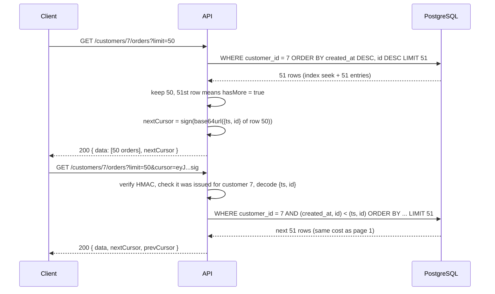

# Cursor Pagination

> **Module 03 · Databases** · Prerequisites: [Offset Pagination](24-Offset-Pagination.md), [Composite Indexes](20-Composite-Indexes.md) · Next: [Query Anti-Patterns](26-Query-Anti-Patterns.md)

---

## ⏱ If You Only Have 2 Minutes

- **Keyset (cursor) pagination** remembers the sort key of the last row and asks for rows *after* it: `WHERE (created_at, id) < ($1, $2) ORDER BY created_at DESC, id DESC LIMIT 51`. Page 10,000 costs the same as page 1.
- It needs a **composite index in the same column order and direction** as the `ORDER BY`, after any equality filters: `(customer_id, created_at DESC, id DESC)`.
- The sort must end with a **unique tie-breaker** (`id`). Paging on `created_at` alone skips or repeats rows that share a timestamp.
- The **row-value comparison** `(a, b) < (x, y)` means `a < x OR (a = x AND b < y)`, and PostgreSQL can use it as a single index range condition. It only works when every column sorts in the same direction.
- Send the cursor as an **opaque token**: base64url JSON of the last key, plus an **HMAC** so clients cannot edit it, and bind it to the filters it was issued for.
- Fetch `limit + 1` rows to know whether a next page exists. There is no cheap total and **no "jump to page N"**; you can still seek to a value ("orders before 1 March").
- Inserts and deletes elsewhere in the list do not shift pages, so there are no duplicates. A row whose **sort key changes** while someone pages can still be skipped or seen twice.

---

## 1. What It Is and Why It Exists

**Cursor pagination** returns a page of rows plus a token (the **cursor**) that marks where the page ended. The next request sends that token back, and the server continues from that point. The most common implementation is **keyset pagination** (also called the "seek method"): the cursor holds the values of the sort columns from the last row, and the next query filters on them.

**Analogy:** a bookmark. Instead of remembering "I was on page 212" and counting pages from the front every time, you leave a bookmark at the last line you read. Opening the book at the bookmark is instant, and if someone adds a chapter at the front, your bookmark still points to the right line.

**The problem it solves.** [Offset pagination](24-Offset-Pagination.md) has two failures that get worse as tables grow: deep pages make the database read and discard every earlier row, and inserts or deletes between requests shift rows onto the wrong page. Keyset pagination fixes both:

- The database **seeks** directly to the bookmark in a B-tree index and reads only `limit + 1` rows.
- A page is defined by data values ("rows older than this order"), not by a position, so changes elsewhere in the list do not move it.

Feeds, notification lists, audit logs, infinite scroll, sync APIs and exports all use it. Stripe's `starting_after` / `ending_before` parameters and the GraphQL Relay connection spec (`first` / `after` / `pageInfo.hasNextPage`) are public examples of the same idea. The HTTP contract (response shape, default and maximum `limit`) is in [API Design Principles](../Module-02-Core-Backend/04-API-Design-Principles.md); this chapter is about the query, the index and the token.

---

## 2. How It Works

### The request cycle



### The query and the index

```sql
-- Equality column first, then the sort columns in the ORDER BY direction.
-- This also fixes the sample schema's deliberate gap: orders.customer_id had no index.
CREATE INDEX orders_customer_created_id_idx
  ON orders (customer_id, created_at DESC, id DESC);

-- First page
SELECT id, status, total_cents, created_at
FROM orders
WHERE customer_id = $1
ORDER BY created_at DESC, id DESC
LIMIT 51;

-- Every later page: $2, $3 = created_at and id of the last row the client saw
SELECT id, status, total_cents, created_at
FROM orders
WHERE customer_id = $1
  AND (created_at, id) < ($2, $3)
ORDER BY created_at DESC, id DESC
LIMIT 51;
```

The index stores entries sorted by `(customer_id, created_at DESC, id DESC)`. To run the second query, PostgreSQL descends the B-tree to the position of `(7, $2, $3)`, then reads entries forward until it has 51 rows. It never touches the entries before the cursor.

Illustrative output for a deep page of a customer with 400,000 orders:

```text
Limit (actual time=0.038..0.091 rows=51 loops=1)
  Buffers: shared hit=55
  ->  Index Scan using orders_customer_created_id_idx on orders (actual time=0.037..0.086 rows=51 loops=1)
        Index Cond: ((customer_id = 7) AND (ROW(created_at, id) < ROW('2026-03-14 09:12:44.531207+00'::timestamp with time zone, '8812734'::bigint)))
        Buffers: shared hit=55
Planning Time: 0.121 ms
Execution Time: 0.112 ms
```

Both conditions are in `Index Cond`, which means they bound the index scan rather than filter rows after reading them. About 4 index pages plus 51 heap pages: the same work as the first page.

### Row-value comparison

`(created_at, id) < ($2, $3)` compares row values left to right, like comparing words letter by letter. It is exactly:

```sql
created_at < $2 OR (created_at = $2 AND id < $3)
```

Both forms return the same rows. The row form is shorter, and PostgreSQL recognises it as one range condition on the index, so it can start the scan at the right place. The expanded `OR` form is harder for the planner: depending on version and indexes it may scan from the start of the customer's range and filter. If your database or ORM cannot express row values, add a redundant leading condition so the index still bounds the scan:

```sql
WHERE customer_id = $1
  AND created_at <= $2                                   -- bounds the index range
  AND (created_at < $2 OR (created_at = $2 AND id < $3)) -- exact tie-breaking
```

### Previous page

To go backwards from the first row of the current page, flip both the comparison and the sort, then reverse the rows in the application:

```sql
SELECT id, status, total_cents, created_at
FROM orders
WHERE customer_id = $1
  AND (created_at, id) > ($2, $3)      -- $2, $3 = first row of the current page
ORDER BY created_at ASC, id ASC        -- same index, scanned backwards
LIMIT 51;
```

A B-tree can be scanned in either direction, so the same index serves both. Without reversing the result, the "previous" page would be displayed upside down.

---

## 3. Key Concepts

### The tie-breaker

Sort keys are rarely unique. A bulk import, a batch job or plain luck gives many orders the same `created_at`. If the cursor holds only `created_at`:

- `created_at < $2` **skips** every remaining row with the same timestamp as the last row of the page.
- `created_at <= $2` **repeats** them.

Adding the primary key as the last sort column and to the cursor makes every position unique. The rule from the [Composite Indexes](20-Composite-Indexes.md) chapter applies: equality columns first, then the sort columns, ending with the tie-breaker, all in the `ORDER BY` direction.

### Sorting by other columns

Each sort option needs its own cursor shape and its own index.

| Sort | `ORDER BY` | Cursor holds | Index |
|---|---|---|---|
| Newest first | `created_at DESC, id DESC` | `(created_at, id)` | `(customer_id, created_at DESC, id DESC)` |
| Largest total | `total_cents DESC, id DESC` | `(total_cents, id)` | `(customer_id, total_cents DESC, id DESC)` |
| Cheapest first, newest among ties | `total_cents ASC, id DESC` | `(total_cents, id)` | `(customer_id, total_cents ASC, id DESC)` |

The last row has **mixed directions**, so a row-value comparison cannot express it (it compares every column in the same direction). Write it out:

```sql
WHERE customer_id = $1
  AND total_cents >= $2                                   -- bounds the index range
  AND (total_cents > $2 OR (total_cents = $2 AND id < $3))
ORDER BY total_cents ASC, id DESC
LIMIT 51;
```

**Nullable sort columns** need extra care. A comparison with `NULL` is unknown, so `(discount, id) < (NULL, 5)` filters out every row, and NULLs sort first in a `DESC` order in PostgreSQL. Either make the sort column `NOT NULL`, or sort by `COALESCE(col, 0)` with a matching expression index, so the cursor never holds a NULL.

### The opaque, signed cursor

Clients should treat the cursor as an opaque string they pass back unchanged. Make it opaque on purpose:

| Layer | Purpose |
|---|---|
| JSON payload `{v, dir, ts, id, scope}` | Holds the key values, the direction, and a version for future format changes |
| base64url encoding | URL-safe (`-` and `_`, no padding), so it fits in a query string without escaping |
| HMAC-SHA256 over the payload | Clients cannot edit the values or build their own cursors |
| `scope` field | Binds the cursor to the filters and owner it was issued for |

**Base64 alone is not protection.** Anyone can decode it, change `id`, and re-encode it. Usually that only lets a client skip ahead in a list it can already read, but it also lets them send odd values (huge numbers, malformed timestamps) straight into your query, and it locks you into the format forever because clients start building cursors themselves. Signing with a server-side key fixes both. If the payload contains something the client must not read, encrypt it instead (for example AES-GCM); signing is not confidentiality.

**Precision trap.** PostgreSQL `timestamptz` has microsecond precision. A JavaScript `Date` has millisecond precision. If the Node API reads `created_at` into a `Date` and builds the cursor from it, the cursor is up to 999 µs earlier than the real value, and the next page silently skips rows inside that gap. Keep the timestamp as a string produced by PostgreSQL (or epoch microseconds) in Node. Python's `datetime` holds microseconds, so it round-trips safely.

### When filters change

A cursor is only meaningful for the exact query that produced it. If the client changes `status=paid` to `status=shipped` but sends the old cursor, the server would start the new list at a point chosen for a different list. Two common designs:

- **Bind the filters into the cursor** (the `scope` field) and reject a mismatch with `400`. The client must restart from the first page when filters change.
- **Store the filters in the cursor** and ignore query parameters when a cursor is present. Simpler for clients, but the URL no longer shows what is being listed.

The same applies to the sort order and the authenticated user: a cursor issued to customer 7 must not work for customer 8's list.

### Consistency while rows change

Each page request runs in its own snapshot, like offset pagination. The difference is what happens to rows around the cursor:

| Change between two requests | Offset pagination | Keyset pagination |
|---|---|---|
| New row inserted before the cursor (a newer order) | Everything shifts: duplicate on next page | Not shown in later pages; appears on refresh |
| Row deleted before the cursor | Everything shifts: a row is missed | No effect |
| The cursor row itself deleted | — | No effect: the cursor is a value, not a pointer to a row |
| Row's **sort key** updated (e.g. sorting by `updated_at`) | Can move | Can move past the cursor: skipped or shown twice |

There is one subtle gap for **sync APIs** that ask "give me everything after cursor X". `created_at DEFAULT now()` is the transaction **start** time, and identity values are taken before commit. A long transaction can insert a row with an older timestamp and commit *after* a reader has already paged past that timestamp. That row is never returned. Fixes: only serve rows older than a small safety window (`created_at < now() - interval '5 seconds'`), or use a commit-ordered feed such as an outbox table or logical replication. See [Transactions](27-Transactions.md).

### What you give up

- **No "jump to page 40".** There is no page number to jump to. Offer "jump to a date" instead: a cursor built from `(date, max id)` is just another seek, as fast as page 1.
- **No cheap total.** Return `hasMore` from the `limit + 1` row. If the UI needs a count, it is the same expensive `COUNT(*)` as with offsets.
- **Fixed sort options.** Each one needs an index and a cursor shape, so you cannot let clients sort by any column.

---

## 4. Code Examples

Scenario: `GET /customers/:customerId/orders?limit=50&cursor=…` returns a customer's orders newest first with `nextCursor` and `prevCursor`. Cursors are signed and bound to the customer.

### SQL

```sql
CREATE INDEX orders_customer_created_id_idx
  ON orders (customer_id, created_at DESC, id DESC);

-- Next page ($2/$3 = last row shown). The ::timestamptz cast parses the cursor's text exactly.
SELECT id, status, total_cents, created_at
FROM orders
WHERE customer_id = $1 AND (created_at, id) < ($2::timestamptz, $3::bigint)
ORDER BY created_at DESC, id DESC
LIMIT $4;   -- limit + 1

-- Previous page ($2/$3 = first row shown); reverse the rows in the application.
SELECT id, status, total_cents, created_at
FROM orders
WHERE customer_id = $1 AND (created_at, id) > ($2::timestamptz, $3::bigint)
ORDER BY created_at ASC, id ASC
LIMIT $4;
```

### Node.js / TypeScript

Cursor codec:

```ts
// npm i express pg zod  (dev: @types/express @types/pg)  — Node.js 22+, TypeScript 5, ESM
import { createHmac, timingSafeEqual } from "node:crypto";
import { z } from "zod";

// 32+ random bytes from a secret manager. Rotating it invalidates outstanding cursors (clients restart).
const KEY = Buffer.from(process.env.CURSOR_HMAC_KEY ?? "", "base64");

const CursorSchema = z.object({
  v: z.literal(1),
  dir: z.enum(["next", "prev"]),
  ts: z.string().max(40),             // microsecond timestamp text from Postgres, never a JS Date
  id: z.string().regex(/^\d{1,19}$/), // bigint kept as a string
  scope: z.string().max(100),         // which list this cursor belongs to
});
export type Cursor = z.infer<typeof CursorSchema>;

const mac = (body: string) => createHmac("sha256", KEY).update(body).digest("base64url");

export function encodeCursor(c: Cursor): string {
  const body = Buffer.from(JSON.stringify(c)).toString("base64url");
  return `${body}.${mac(body)}`;
}

export function decodeCursor(token: string, scope: string): Cursor | null {
  if (token.length > 512) return null;
  const [body, sig] = token.split(".");
  if (!body || !sig) return null;
  const given = Buffer.from(sig);
  const expected = Buffer.from(mac(body));
  // timingSafeEqual throws on different lengths, so check that first.
  if (given.length !== expected.length || !timingSafeEqual(given, expected)) return null;
  try {
    const parsed = CursorSchema.safeParse(JSON.parse(Buffer.from(body, "base64url").toString("utf8")));
    return parsed.success && parsed.data.scope === scope ? parsed.data : null;
  } catch {
    return null; // signed by us but unparseable: treat as invalid, never as "start over"
  }
}
```

Query and endpoint:

```ts
import express from "express";
import pg from "pg";
import { decodeCursor, encodeCursor, type Cursor } from "./cursor.js";

const pool = new pg.Pool({ connectionString: process.env.DATABASE_URL });

// Alias must differ from the column name: ORDER BY created_at would otherwise sort by the text alias.
const COLS = `id, status, total_cents,
  to_char(created_at AT TIME ZONE 'UTC', 'YYYY-MM-DD"T"HH24:MI:SS.US"Z"') AS created_at_utc`;
const FIRST = `SELECT ${COLS} FROM orders WHERE customer_id = $1
  ORDER BY created_at DESC, id DESC LIMIT $2`;
const NEXT = `SELECT ${COLS} FROM orders WHERE customer_id = $1
  AND (created_at, id) < ($2::timestamptz, $3::bigint) ORDER BY created_at DESC, id DESC LIMIT $4`;
const PREV = `SELECT ${COLS} FROM orders WHERE customer_id = $1
  AND (created_at, id) > ($2::timestamptz, $3::bigint) ORDER BY created_at ASC, id ASC LIMIT $4`;

interface Row { id: string; status: string; total_cents: number; created_at_utc: string }

const app = express();

app.get("/customers/:customerId/orders", async (req, res) => {
  const customerId = req.params.customerId;
  const limit = Math.min(Math.max(Math.trunc(Number(req.query.limit)) || 20, 1), 100);
  if (!/^\d{1,19}$/.test(customerId)) { res.status(404).json({ error: "not_found" }); return; }
  const scope = `orders:customer:${customerId}`;

  let cursor: Cursor | null = null;
  if (typeof req.query.cursor === "string") {
    cursor = decodeCursor(req.query.cursor, scope);
    if (!cursor) { res.status(400).json({ error: "invalid_cursor" }); return; }
  }

  const { rows } = cursor === null
    ? await pool.query<Row>(FIRST, [customerId, limit + 1])
    : await pool.query<Row>(cursor.dir === "next" ? NEXT : PREV, [customerId, cursor.ts, cursor.id, limit + 1]);

  const extra = rows.length > limit;             // the (limit+1)th row only signals "there is more"
  const page = rows.slice(0, limit);
  if (cursor?.dir === "prev") page.reverse();    // PREV ran ascending
  const hasNext = cursor?.dir === "prev" ? true : extra;
  const hasPrev = cursor === null ? false : cursor.dir === "prev" ? extra : true;
  const at = (r: Row | undefined, dir: Cursor["dir"]) =>
    r ? encodeCursor({ v: 1, dir, ts: r.created_at_utc, id: r.id, scope }) : null;

  res.json({
    data: page,
    nextCursor: hasNext ? at(page.at(-1), "next") : null,
    prevCursor: hasPrev ? at(page[0], "prev") : null,
  });
});

app.listen(3000);
```

### Python

Cursor codec:

```python
# pip install fastapi "psycopg[binary]" psycopg-pool   — Python 3.12+
import base64
import hashlib
import hmac
import os
from datetime import datetime
from typing import Literal

from pydantic import BaseModel, ValidationError

KEY = base64.b64decode(os.environ["CURSOR_HMAC_KEY"])


class Cursor(BaseModel):
    v: Literal[1] = 1
    dir: Literal["next", "prev"]
    ts: datetime  # Python datetime keeps microseconds, so it round-trips Postgres timestamptz exactly
    id: int
    scope: str


def _b64e(raw: bytes) -> str:
    return base64.urlsafe_b64encode(raw).rstrip(b"=").decode()


def _b64d(text: str) -> bytes:
    return base64.urlsafe_b64decode(text + "=" * (-len(text) % 4))  # restore stripped padding


def _mac(body: str) -> str:
    return _b64e(hmac.new(KEY, body.encode(), hashlib.sha256).digest())


def encode_cursor(c: Cursor) -> str:
    body = _b64e(c.model_dump_json().encode())
    return f"{body}.{_mac(body)}"


def decode_cursor(token: str, scope: str) -> Cursor | None:
    if len(token) > 512:
        return None
    body, _, sig = token.partition(".")
    # Compare bytes: compare_digest raises TypeError on non-ASCII str input.
    if not body or not hmac.compare_digest(sig.encode(), _mac(body).encode()):
        return None
    try:
        c = Cursor.model_validate_json(_b64d(body))
    except (ValueError, ValidationError):
        return None
    return c if c.scope == scope else None
```

Query and endpoint:

```python
import os
from contextlib import asynccontextmanager
from typing import Annotated, Any, Literal

from fastapi import FastAPI, HTTPException, Query
from psycopg.rows import dict_row
from psycopg_pool import AsyncConnectionPool

from cursor import Cursor, decode_cursor, encode_cursor

COLS = "SELECT id, status, total_cents, created_at FROM orders WHERE customer_id = %(cid)s"
FIRST = f"{COLS} ORDER BY created_at DESC, id DESC LIMIT %(n)s"
NEXT = (f"{COLS} AND (created_at, id) < (%(ts)s::timestamptz, %(id)s::bigint) "
        "ORDER BY created_at DESC, id DESC LIMIT %(n)s")
PREV = (f"{COLS} AND (created_at, id) > (%(ts)s::timestamptz, %(id)s::bigint) "
        "ORDER BY created_at ASC, id ASC LIMIT %(n)s")

pool = AsyncConnectionPool(os.environ["DATABASE_URL"], open=False, kwargs={"row_factory": dict_row})


@asynccontextmanager
async def lifespan(_: FastAPI):
    await pool.open()
    yield
    await pool.close()


app = FastAPI(lifespan=lifespan)


@app.get("/customers/{customer_id}/orders")
async def list_orders(
    customer_id: int,
    limit: Annotated[int, Query(ge=1, le=100)] = 20,
    cursor: str | None = None,
) -> dict[str, Any]:
    scope = f"orders:customer:{customer_id}"
    cur: Cursor | None = None
    if cursor is not None and (cur := decode_cursor(cursor, scope)) is None:
        raise HTTPException(400, "invalid_cursor")

    params: dict[str, Any] = {"cid": customer_id, "n": limit + 1}
    sql = FIRST
    if cur is not None:
        sql = NEXT if cur.dir == "next" else PREV
        params |= {"ts": cur.ts, "id": cur.id}
    async with pool.connection() as conn:
        rows = await (await conn.execute(sql, params)).fetchall()

    extra = len(rows) > limit
    page = rows[:limit]
    if cur is not None and cur.dir == "prev":
        page.reverse()
    has_next = True if (cur is not None and cur.dir == "prev") else extra
    has_prev = False if cur is None else (extra if cur.dir == "prev" else True)

    def at(row: dict[str, Any], d: Literal["next", "prev"]) -> str:
        return encode_cursor(Cursor(dir=d, ts=row["created_at"], id=row["id"], scope=scope))

    return {
        "data": page,
        "next_cursor": at(page[-1], "next") if has_next and page else None,
        "prev_cursor": at(page[0], "prev") if has_prev and page else None,
    }
```

**Runtime differences to notice:** in Node, the timestamp is formatted by PostgreSQL with `to_char(... 'US')` and kept as a string, because a JS `Date` would truncate microseconds and break the cursor. In Python, psycopg returns a `datetime` with microseconds, and Pydantic serializes it to ISO 8601 without loss, so no SQL formatting is needed. The explicit `::bigint` and `::timestamptz` casts matter in both: they make the parameter types match the index columns, so the planner uses the row comparison as an index condition. Validation errors also differ: FastAPI rejects `limit=500` with a 422, while the Node handler clamps it.

---

## 5. Production Concerns

- **Verify the plan.** The whole point is an index seek. Check with `EXPLAIN (ANALYZE, BUFFERS)` that the row comparison appears in `Index Cond`, not as a `Filter` with a large `Rows Removed by Filter`. A mismatch in sort direction or a missing equality column in the index silently turns it into a scan of the customer's whole range.
- **Cursor key management.** Keep the HMAC key in a secret manager, at least 32 random bytes. To rotate without breaking clients mid-scroll, accept the old key for verification for a short overlap (a cursor is usually used within minutes), while signing with the new one. Log the count of `invalid_cursor` responses: a spike means a bad rotation, a client bug, or someone tampering.
- **Cursor size and lifetime.** Keep the payload small (a few key values); cursors travel in URLs, and proxies and browsers limit URL length. Cursors do not need server state, so they never "expire" by themselves. If the format changes, bump `v` and either support both versions or return `400` so clients restart.
- **Authorization still applies.** The cursor proves the server issued it for that scope, not that the current caller may read the list. Check ownership of `customerId` on every request.
- **Index cost.** Each supported sort order is another index on a write-heavy table. Offer two or three sorts, not ten.
- **Bulk exports.** Keyset pagination is the right way to walk a large table in batches (`WHERE id > $1 ORDER BY id LIMIT 5000`). Each batch is a short query, so you avoid one long transaction that holds back `VACUUM`. If the export must be one consistent snapshot, run it in a single `REPEATABLE READ` transaction on a replica instead.
- **Late-committing rows.** For "everything since X" sync endpoints, apply a safety window or use an outbox/logical-replication feed, as described above. Monitor for clients that report missing records.

---

## 6. Common Mistakes

- **Cursor on `created_at` alone** — rows that share a timestamp are skipped or repeated at page boundaries — add `id` as tie-breaker to the `ORDER BY`, the cursor and the index.
- **Index direction or order does not match the `ORDER BY`** — the planner sorts or filters instead of seeking, so deep pages are slow again — index `(filter cols, sort col DESC, id DESC)` exactly as queried.
- **Row comparison with mixed directions** — `(total_cents, id) > ($1, $2)` with `ORDER BY total_cents ASC, id DESC` returns the wrong rows — write the expanded `OR` form with a bounding `>=` condition.
- **Building the cursor from a JS `Date`** — microseconds are truncated and rows inside the gap disappear — keep the Postgres timestamp as text or epoch microseconds.
- **Unsigned base64 cursors** — clients edit them, build their own, and you can never change the format — HMAC-sign them and validate the decoded shape.
- **Reusing a cursor after filters change** — the new list starts at a meaningless point — bind filters into the cursor and return `400` on mismatch.
- **Forgetting to reverse the "previous" page** — the page shows in ascending order — reverse in the application after the ascending query.

---

## 7. Comparison Table

| | Offset pagination | Keyset (cursor) pagination | Server-side DB cursor (`DECLARE … CURSOR`) |
|---|---|---|---|
| Cost of a deep page | Grows with the offset | Constant: index seek + `limit` rows | Constant per fetch |
| Stable while data changes | No | Yes for inserts/deletes elsewhere | Yes (one snapshot) |
| Jump to page *N* | Yes | No; seek to a value instead | No |
| Total count | Extra `COUNT(*)` | Extra `COUNT(*)` (usually omitted) | Extra `COUNT(*)` |
| Server state between requests | None | None (state is in the token) | An open transaction or session per client |
| Works over stateless HTTP | Yes | Yes | No: tied to one connection |
| Sort flexibility | Any column (indexed to be fast) | Fixed set, one index each | Any query |
| Best for | Small admin tables, capped search | Feeds, infinite scroll, public APIs, exports | Batch jobs inside one process |

---

## 8. Interview Questions

**[Junior] How does cursor pagination differ from offset pagination?**
Offset pagination asks for "rows 1,001–1,050", so the database reads and discards the first 1,000. Cursor pagination asks for "the 50 rows after this one", using the sort key of the last row seen. With a matching index the database seeks straight to that point, so every page costs the same, and inserts or deletes earlier in the list do not shift the pages.

**[Junior] Why do you need `id` in the cursor when you sort by `created_at`?**
Because `created_at` is not unique. If the last row of a page shares its timestamp with rows on the next page, `created_at < $1` skips those rows and `<=` repeats them. Adding the primary key makes every position unique, so the condition `(created_at, id) < ($1, $2)` lands exactly after the last row shown.

**[Mid] What index does `WHERE customer_id = $1 AND (created_at, id) < ($2, $3) ORDER BY created_at DESC, id DESC` need, and why?**
`(customer_id, created_at DESC, id DESC)`. The equality column comes first, so all of one customer's orders are together. Within that range, entries are already in the output order, so the database can seek to the cursor position and read 51 entries without sorting. An index on `(created_at, id)` alone would need to filter by customer, and an index with a different column order would need a sort.

**[Mid] Why sign the cursor if the data in it is not secret?**
Signing is about integrity, not secrecy. Without it, clients can edit the cursor to send arbitrary values into your query, and they start depending on its internal format, so you can never change it. An HMAC lets the server reject any cursor it did not issue, and including a scope stops a cursor for one list or user being used on another. If the content were sensitive, you would need encryption as well.

**[Mid] How do you implement a "previous page" link?**
Build a cursor from the first row of the current page and flip the query: `(created_at, id) > (...)` with `ORDER BY created_at ASC, id ASC LIMIT n+1`. The same index is scanned backwards. Reverse the rows in the application before returning them. Whether there is a page before that one is decided by the extra row, just like `hasMore` going forward.

**[Senior] A sync API using `created_at > cursor` occasionally loses records. What is happening?**
`created_at` defaults to `now()`, which is the start time of the inserting transaction, not its commit time. A transaction that starts at 10:00:00.100 and commits at 10:00:02 becomes visible after a client has already paged past 10:00:01, so it is never returned. Identity columns have the same problem because values are allocated before commit. Fixes: only serve rows older than a safety window larger than your longest write transaction, or drive sync from a commit-ordered source such as an outbox table processed in order or logical replication.

**[Senior] Product wants users to sort a 50-million-row list by any of 12 columns, with cursor pagination. What do you say?**
Each sort needs its own index with the tie-breaker, and its own cursor shape. Twelve indexes on a write-heavy table cost write throughput, storage and vacuum time, and columns with NULLs or mixed directions need special handling. I would pick the two or three sorts users actually need, give each an index, and route rare sorts or ad-hoc analysis to a search engine or a reporting replica. For the remaining sorts, the cursor includes the sort name so a cursor from one sort cannot be used with another.

**[Senior] Can keyset pagination still show a row twice or skip one? When?**
Yes, when a row's sort key changes while someone is paging. If you sort by `updated_at` and a row is updated after the client passed it, it moves ahead of the cursor and appears again; if it moves the other way, it is skipped. Late-committing transactions cause the same effect for insert-time sorts. Inserts and deletes of other rows are safe. If a consumer needs exactly-once, it needs an immutable sort key, or a snapshot (one `REPEATABLE READ` transaction or a replica), or a change feed.

---

## 9. Cheat Sheet

```text
Query          WHERE filter AND (sort, id) < ($last_sort, $last_id)
               ORDER BY sort DESC, id DESC LIMIT n+1
Index          (equality filters, sort DESC, id DESC) — same order and direction as ORDER BY
Row compare    (a,b) < (x,y)  ≡  a < x OR (a = x AND b < y); index-usable; same direction only
Mixed dirs     expanded OR + bounding  a >= x  condition; index with matching mixed directions
Has more       fetch n+1; extra row = another page exists
Previous       flip > and ASC, same index backwards, reverse rows in app
Cursor         base64url(JSON {v, dir, ts, id, scope}) + "." + HMAC-SHA256 → 400 on mismatch
Precision      timestamptz = µs; JS Date = ms → keep timestamp as text in Node
NULLs          NOT NULL sort column or COALESCE + expression index
Filters        bind them into the cursor; changing filters = start over
Can't          jump to page N (seek to a value instead), cheap totals
Stable         inserts/deletes elsewhere: yes · sort key updates, late commits: no
Sync APIs      now() = txn start → late commits are missed → safety window or outbox
```

---

## Related Topics

- [Offset Pagination](24-Offset-Pagination.md) — the simpler approach and why it degrades at depth
- [Composite Indexes](20-Composite-Indexes.md) — column order and direction that make the seek possible
- [Query Execution Plans](22-Query-Execution-Plans.md) — confirming the row comparison is an `Index Cond`
- [API Design Principles](../Module-02-Core-Backend/04-API-Design-Principles.md) — the pagination contract clients see
- [Transactions](27-Transactions.md) — why `now()` is transaction start time and what that means for sync feeds
